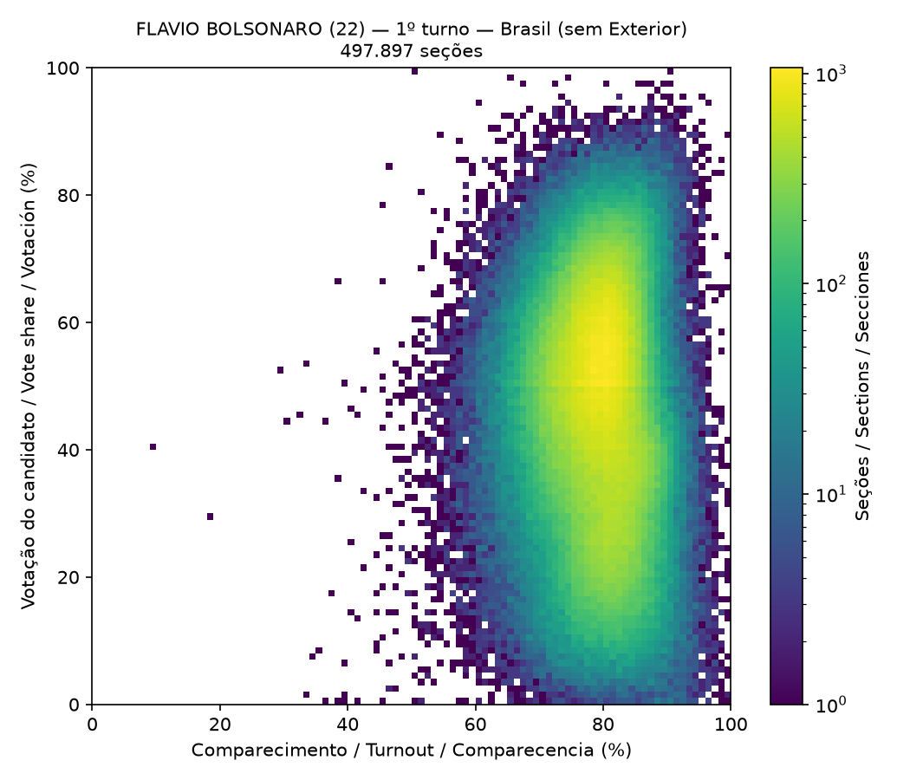
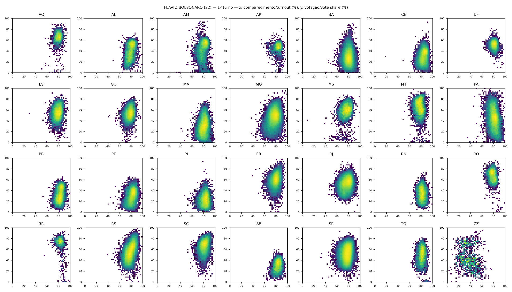
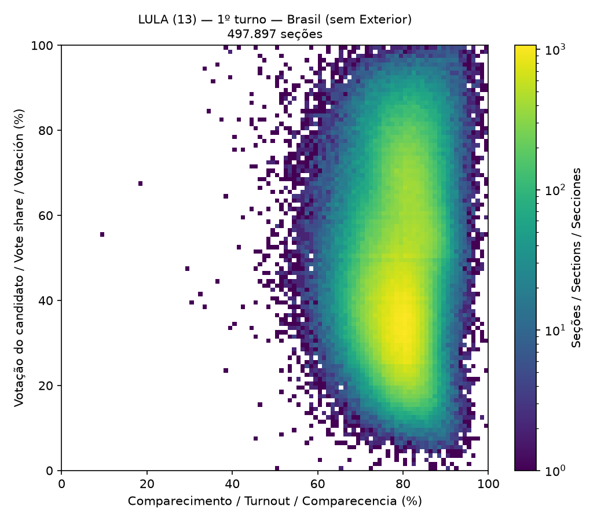
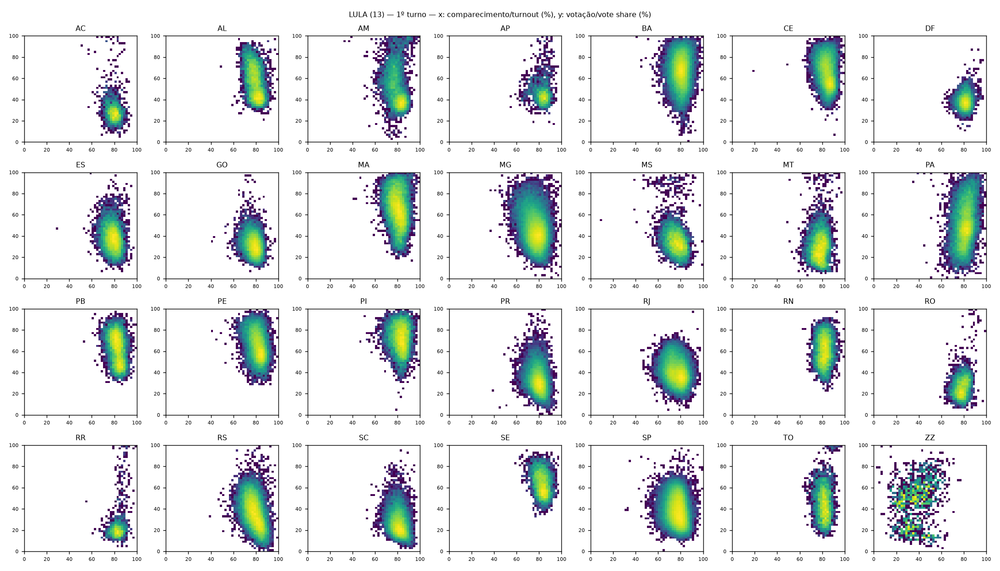

# Technical Report on the Statistical Audit of Ballot Box Reports

**Brazilian General Elections 2026 — round 1**

|  |  |
|---|---|
| Document identifier | `9165933898a60a122ef611afe0d7d955` |
| Issue date | 2026-10-24 |
| Analysis engine version | 2.1.0 |
| SHA-256 of the analytical core | `6585b4ef6297b5217e2a821fe3fc80ed0f7fb0f78348b6997164d21c72ba5412` |

> 🧾 **Integrity Status (Technical Determinism):** First run with these input files. The analytical core (15 methodologies, without date, time or duration) has been recorded as the **homologation report**, with SHA-256 `6585b4ef6297b5217e2a821fe3fc80ed0f7fb0f78348b6997164d21c72ba5412`. Every new run with the same files will be compared with this record.

**Color legend:** 🔴 Statistical anomaly (ballot box listed for verification) · 🟡 Informational event (recorded for checking, below the anomaly criterion) · 🟢 No occurrence · ⚠️ Test execution failure

## 1. Nature of the document and disclaimers

This document is a technical report of exploratory statistical analysis (*election forensics*) applied to the official public Ballot Box Report (Boletim de Urna, BU) data released by Brazil's Superior Electoral Court (Tribunal Superior Eleitoral, TSE) on its Open Data Portal.

This report **is not an official forensic expert report** (Articles 159 et seq. of the Brazilian Code of Criminal Procedure) and **does not attribute any conduct to any person or institution**.

A statistical flag identifies an observation that is improbable under the reference model stated in this document. **A statistical anomaly is not proof of fraud, error or irregularity.** Every flag must undergo documentary and technical verification: the printed BU, the signed digital files of the voting machine (.bu, .imgbu, .rdv, .logjez), polling station minutes and incident records.

In analyses covering hundreds of thousands of units, a non-zero number of flags is expected even in a sound electoral process, owing to natural variability, local particularities and simplifying model assumptions. The false discovery rate is controlled at 0.01 (Section 8.4) for the inferential tests.

## 2. Authorship and technical responsibility

|  |  |
|---|---|
| Author | Eduardo Santana dos Santos Beira de Lima |
| Field of expertise | Specialist in Prompt Engineering and AI-Driven Analytical Architecture |
| Place of execution | Downtown Curitiba, Paraná, Brazil |
| Instagram | @edu.limaoficial |

## 3. Executive summary

A total of 67,858,974 records from 28 official files (28 federative units) were processed, corresponding to 499,206 section reports (499,206 distinct polling sections; round 1) and 2,490,804 section–office reports. 15 statistical and consistency tests were applied.

File integrity: 28 of 56 files with SHA-512 hash matching the official hash published by the TSE; 0 mismatching; 28 without possible official verification.

Sections with at least one anomaly flag: 1,491 (0.30% of the sections analyzed). Sections with convergent flags (two or more distinct tests): 8.

**Consolidated results**

| Test | Units analyzed | Flags (anomaly) | Informational events | Raw occurrences | Rate |
|---|---:|---:|---:|---:|---:|
| 🟢 1. Ballot Report Arithmetic Closure | 2,490,804 | 0 | 0 | — | 0.000% |
| 🟢 2. Vote Total Inconsistency | 2,490,804 | 0 | 0 | — | 0.000% |
| 🔴 3. In-Section Unanimity | 1,992,870 | 20 | 39 | 59 | 0.001% |
| 🔴 4. Zero Abstention | 499,206 | 2 | 0 | 15 | 0.000% |
| 🔴 5. Excess Blank and Null Votes | 2,490,244 | 105 | 0 | — | 0.004% |
| 🔴 6. Extreme Split-Ticket Voting | 994,167 | 1,166 | 0 | 20,879 | 0.117% |
| 🔴 7. Party-List Vote Anomaly | 995,429 | 9 | 0 | — | 0.001% |
| 🔴 8. Neighboring-Section Contrast | 902,557 | 24 | 0 | — | 0.003% |
| 🔴 9. Sections with Identical Results | 1,990,390 | 2 | 0 | 386 | 0.000% |
| 🔴 10. Low Biometric Validation | 499,060 | 212 | 0 | — | 0.042% |
| 🔴 11. Atypical Timestamps | 499,176 | 53 | 214 | — | 0.011% |
| 🔴 12. Voting Machine Replacement and Paper-Ballot Voting | 499,206 | 21 | 3,042 | — | 0.004% |
| 🟢 13. Second-Digit Test (Mebane 2BL) | 120 | 0 | 0 | — | 0.000% |
| 🟢 14. Last-Digit Test (Beber–Scacco) | 248 | 0 | 0 | — | 0.000% |
| 🟡 15. Election Fingerprint (Klimek) | 58 | 0 | 8 | — | 0.000% |

### 🔎 How to check your ballot box

Each test in Section 9 includes the **full list** of the ballot boxes it flagged, with state, municipality (name and TSE code), zone, section, aggregated sections, polling place, ballot box number and load code.

1. Find your state, zone and section on your voter card or in the e-Título app.

2. Search for the zone and section in this report (Ctrl+F) or in the files `dados/busca_urnas.json` (one entry per section, with every test in which it appears) and `dados/secoes_sinalizadas.csv`.

3. If your section was **aggregated** into another, your votes appear under the number of the main section: look for your section number in the *Aggregated sections* column.

4. The ballot box number and the load code allow comparison with the printed report posted at the section and with the TSE's official correspondence files.

## 4. Scope, data sources and coverage

Primary source: TSE Open Data Portal, dataset "Resultados – 2026 – Boletim de Urna" (bweb files). Supplementary source: "Correspondências esperadas e efetivadas" (CESP files), used in test 12. The data are public and were processed without any alteration of content.

**Coverage by state**

| State | Round | File | Records | Sections |
|---|---|---|---:|---:|
| AC | 1 | bweb_1t_AC_051020261403.csv | 258,052 | 2,270 |
| AL | 1 | bweb_1t_AL_051020261403.csv | 685,455 | 7,101 |
| AM | 1 | bweb_1t_AM_051020261403.csv | 1,073,532 | 8,157 |
| AP | 1 | bweb_1t_AP_051020261403.csv | 267,474 | 1,914 |
| BA | 1 | bweb_1t_BA_051020261403.csv | 4,225,183 | 35,476 |
| CE | 1 | bweb_1t_CE_051020261403.csv | 2,751,489 | 23,765 |
| DF | 1 | bweb_1t_DF_051020261403.csv | 1,188,269 | 6,969 |
| ES | 1 | bweb_1t_ES_051020261403.csv | 1,179,742 | 9,844 |
| GO | 1 | bweb_1t_GO_051020261403.csv | 2,133,284 | 15,686 |
| MA | 1 | bweb_1t_MA_051020261403.csv | 1,924,028 | 18,093 |
| MG | 1 | bweb_1t_MG_051020261403.csv | 6,339,455 | 52,062 |
| MS | 1 | bweb_1t_MS_051020261403.csv | 749,206 | 7,106 |
| MT | 1 | bweb_1t_MT_051020261403.csv | 891,997 | 8,287 |
| PA | 1 | bweb_1t_PA_051020261403.csv | 2,385,016 | 20,827 |
| PB | 1 | bweb_1t_PB_051020261403.csv | 1,075,721 | 10,712 |
| PE | 1 | bweb_1t_PE_051020261403.csv | 2,808,375 | 21,418 |
| PI | 1 | bweb_1t_PI_051020261403.csv | 922,913 | 10,225 |
| PR | 1 | bweb_1t_PR_051020261403.csv | 3,640,079 | 27,142 |
| RJ | 1 | bweb_1t_RJ_051020261403.csv | 7,122,339 | 37,675 |
| RN | 1 | bweb_1t_RN_051020261403.csv | 747,317 | 8,115 |
| RO | 1 | bweb_1t_RO_051020261403.csv | 537,631 | 4,698 |
| RR | 1 | bweb_1t_RR_051020261403.csv | 192,871 | 1,519 |
| RS | 1 | bweb_1t_RS_051020261403.csv | 3,649,489 | 27,547 |
| SC | 1 | bweb_1t_SC_051020261403.csv | 2,118,318 | 17,326 |
| SE | 1 | bweb_1t_SE_051020261403.csv | 661,549 | 5,923 |
| SP | 1 | bweb_1t_SP_051020261403.csv | 17,891,697 | 103,656 |
| TO | 1 | bweb_1t_TO_051020261403.csv | 426,458 | 4,384 |
| ZZ | 1 | bweb_1t_ZZ_051020261403.csv | 12,035 | 1,309 |

All 27 federative units and voters abroad (ZZ) are present in the analyzed dataset.

## 5. Data integrity and digital chain of custody

For each input file, the SHA-512 cryptographic digest (FIPS 180-4) was computed — the same algorithm used by the TSE when publishing the files. Whenever available, the computed digest was compared with the official digest (.sha512 file published by the TSE next to each .zip file).

The TSE's official hash refers to the compressed file (.zip). Files supplied already decompressed (.csv) have their digest recorded but cannot be checked against the official hash.

The **manifest hash** is the SHA-512 of the sorted list "name;size;sha512" of all input files and uniquely identifies the analyzed dataset.

| File | Size (bytes) | SHA-512 (computed) | Official check |
|---|---:|---|---|
| bweb_1t_AC_051020261403.csv | 119,176,183 | `95a3c358d88476b651c0de59cb913cf7a8c1590a1cfed446b9446bcd550d94e8596c6fbd754211937d8294e78bd9f47419a090fe224fd5c0db8cb277c07180d9` | not verifiable (.csv) |
| bweb_1t_AL_051020261403.csv | 319,368,579 | `65a5e0a5cb8efbe05471d7f81d9b43e3e473d5742969e0ad4eac053c880d67e53a3d0e620def9f95ede34ba933a46855cfd943d4c63376b65c5679efcbd3f7b7` | not verifiable (.csv) |
| bweb_1t_AM_051020261403.csv | 491,982,201 | `b98f79ac4553a4aee1f18cea1a28a993ccf161f48ed4914426ac381f34fe751e3ecae979cd15af9944d2e3068aa905a3ceb14a03e848a9846d4a08bf60d774c5` | not verifiable (.csv) |
| bweb_1t_AP_051020261403.csv | 122,469,881 | `423c402428223c6d32f4eb2f1a08f9b50f006031a68e602166fc4ac1ebbec56226babbf3ea168e1f674e66bd22b7c2f3472ed56ac2f4f677635cd669180e0e61` | not verifiable (.csv) |
| bweb_1t_BA_051020261403.csv | 1,960,709,937 | `0028e4b7f0b34e931b97fc22070cf1ea5d2045915cfe8021fb422549240f684a2edb228ce60ea592215594a7208d8ce922635b520182e3ab300a5d22596c72a2` | not verifiable (.csv) |
| bweb_1t_CE_051020261403.csv | 1,277,225,233 | `670ae2da28287fbd2afb0e1f0f8e2d50b7c4a2baee4900e497bc075268aff54af10cdcd3ef5b159ab5967e4eebd5ae1b303d4599b103e5a60e9562cb0b825ed0` | not verifiable (.csv) |
| bweb_1t_DF_051020261403.csv | 549,839,174 | `fce4111e82e5159db28a1c486bdd779e59d77eea686b78cdbd8bd7c66cc679565a187a1524c7a9471fe36951eac2441a9017264c6ba320a9bfd0b373f9db5dac` | not verifiable (.csv) |
| bweb_1t_ES_051020261403.csv | 545,366,396 | `d55a40bde37b4f4f2a32a8654845e08c50f09e15f40d6d140348556cd394bfe3cfd03c4b3e838398b1de465e804e71001a9b6d4a350a59ad0df1461687db3d79` | not verifiable (.csv) |
| bweb_1t_GO_051020261403.csv | 991,254,462 | `e9e98565f1724ce4e8704482fd1ff66b8d605173e374d7bf244765d53b7f9cecf1723ee2d95cf2a59ea89a005530e3f038f3738a90a216bd7ab7767e8bfd96e0` | not verifiable (.csv) |
| bweb_1t_MA_051020261403.csv | 892,916,466 | `89844263044c98a5b7518ed066d51c3cb8685571985cd5afdf4b2fedd13586d19fffbd84594ef699008e1516aa7e81954bd7ac3d8468359d74f09f492747ba5e` | not verifiable (.csv) |
| bweb_1t_MG_051020261403.csv | 2,942,696,720 | `64cc1a9675b8f7f7ce5da828c8b7aea154e35b7a2bc45a96e1708400d70a80f3ef7e6ea2228bb2e4288ec61b0ae8eb23dbefe026e5cb5b9eeb0117850f315f90` | not verifiable (.csv) |
| bweb_1t_MS_051020261403.csv | 346,403,603 | `2e8acf6df9e9f8ecf7a8394e82f768e92da6d7a5445203b4be84e07554889379e55c9397bb3e917022823a3585baf4460550246f2baf0f09d288e68432bee8e0` | not verifiable (.csv) |
| bweb_1t_MT_051020261403.csv | 411,757,026 | `ff0b68d43e79ba2369c8195de8e6090e51328b082a95c8f3328e50aa55ba7b032319481b28597f0ba3cfca8b851005791b978ecad6867a875406cf039ccc38a5` | not verifiable (.csv) |
| bweb_1t_PA_051020261403.csv | 1,099,380,670 | `7399e1453107d44ccb10b1a07248a9292daace765d0d17de44380c4d730bd54217f2e6a92bbfbb11a7b2e1abb6933cd878c500361d6f4c4c0b5dd00584094f00` | not verifiable (.csv) |
| bweb_1t_PB_051020261403.csv | 495,715,924 | `d2a48af3fb8937a1bb7aaa4f36cd76c1c8a05674e7382de86d59bae852847737b674c2962d01fef817cccbf5de012f56524620e49c44f828557b08b49330975f` | not verifiable (.csv) |
| bweb_1t_PE_051020261403.csv | 1,300,845,659 | `ba90e92d98cbe7c11c95c3162a8cc7ea943d67ae67897d2727b5aaea2dfe79c63fbbdb5552a950467c63b594fb7f49f9d311a8c495c1612d2bb37dcf0869f0d1` | not verifiable (.csv) |
| bweb_1t_PI_051020261403.csv | 427,291,621 | `60464ab847c8557085860eed90ef6838bbbeab48c610009e1dc5b5d86a5546e123eb1a803d8fc1de9390e4d1cffe652c58d7d45b3d56dac27f491a7e4f0a3b65` | not verifiable (.csv) |
| bweb_1t_PR_051020261403.csv | 1,685,389,425 | `341823fcd7757466fc3ab2fab2db684d78b938f36b4aff8bfd77f24fcb34d4ed380cb55e3a503eedcc8af4c9db0c667929c408495c58fa49a46a4002a362f10f` | not verifiable (.csv) |
| bweb_1t_RJ_051020261403.csv | 3,334,488,820 | `d2a52d5a45905b0e965f5df5ac62dfd2f6e3eb91ed7ac3157dd14a7c6c1868663bd58cde34662b2b65bd52b0d92e1aa1ee361ab06d044451a17afbb44f0c82c9` | not verifiable (.csv) |
| bweb_1t_RN_051020261403.csv | 343,463,370 | `4743848cf64178b670710f96fafc92348d571f2f619b8b3b507d1cd3c85386a1101eb7d585693b79f3bac2e0ded8219b4367140d1c585d4165bf4287263fce6f` | not verifiable (.csv) |
| bweb_1t_RO_051020261403.csv | 247,649,862 | `d3dec90d75747d18edbf11cda4c55ee865af384e769ca8e745d849b68186511f49d4d2446d03a85b00a812b242e0c113f26b0120592a70a5fea9391490bdd427` | not verifiable (.csv) |
| bweb_1t_RR_051020261403.csv | 88,371,550 | `8bdada4a8a3e384ddfeb3c88283eb73f4a811f6236ca8ab79d9b8323243b9f4520cc16583ca14b3e9ae4e6161afe0408c473ef9a3751f3e6a6794489e6a4f2f8` | not verifiable (.csv) |
| bweb_1t_RS_051020261403.csv | 1,695,797,525 | `d79cc067c88c5523251c3666f56c784327e4df0b6217e358b4f353265fa807350425070972709a2a5938c639b4df53e3846277c36a43145baed98ea7bdfbe925` | not verifiable (.csv) |
| bweb_1t_SC_051020261403.csv | 978,668,939 | `8160bee3e5ec56772d95e1d068acdc75a79ef1c23458f5d399933e9a3ff336802e12e4245bc75584ed65e5b03c9342b7e9df9e2b16d4ee7d02ad29933429b245` | not verifiable (.csv) |
| bweb_1t_SE_051020261403.csv | 306,882,478 | `79f63b161b51911322680624e563d4c92ef8ec7f931f0cefd97113a51ca4653165b27466d74c0a21f04e6ec9a455b70b7d407d38d49a913ca4ed7c62eeb04b60` | not verifiable (.csv) |
| bweb_1t_SP_051020261403.csv | 8,316,061,252 | `c63fdcf623e0ee0d4bc398246ca891bdea6a90f229be512f4a7938f29a250897b6993a5fe4ed5251b4713cfeff700e6c1307718ec7bdd99ccf1fb17b28b48ae4` | not verifiable (.csv) |
| bweb_1t_TO_051020261403.csv | 197,178,750 | `552c2412684bbf63a1ef244a96f6889e621e9ca9c77ff7c2559dab32c9606951f68b4c7402cca5c7e5c8249f3b4d4a41906d18be2ad659bca9764d6e2ae8d0fe` | not verifiable (.csv) |
| bweb_1t_ZZ_051020261403.csv | 5,340,144 | `8d9c579e4c8fee5f9e0ba9ba9691a1a009c882929823329c659180c1ef18d357a546cb96d5e2a7ca0b73e0c773143b0eb8e547e5e304feb4c98d03b13984a68f` | not verifiable (.csv) |
| CESP_1t_AC_041020261259.zip | 442,637 | `30f12f23bd856704f71d70412e5425e7b33a44a2fc5a3dde900f8f5ea9a56179b713088dd8d0563e4523893c24411ee3519ba6b6d62c1614b28b9476541ddff9` | MATCH |
| CESP_1t_AL_041020261259.zip | 646,136 | `5253894e260e3b38d2b0506be76ae46d5e387391feabee3070bf5aeace14a46489606ff1fde12ac07a90b93acd6c6d8dfb6208db0b1a81c88e39a55c4161d824` | MATCH |
| CESP_1t_AM_041020261259.zip | 734,596 | `bc4c2cea6e4e8076a22d2a74882bca99075e130270722c3fb2620115ad2691ec455d5b9611f87b9f9924f302b7c3242e6d75bb10e118d9c3707d500e3f6c43ed` | MATCH |
| CESP_1t_AP_041020261259.zip | 421,126 | `dfe56da79146b1247590f5d15550784cdd5e6b4d14e841296f1aa4ef41c39eb6a39e124af87878cb2abc5484d4026cdcfbeea9f6b3bd83783d6e0da1291e2a6f` | MATCH |
| CESP_1t_BA_041020261259.zip | 2,448,341 | `451b169a7f80b3e5be486eca86d4191e168e0dab973ca5061dafd40f6bfebe1e728e3186ec90c8ac397256aa3d21706dc0b94626feb65a2da9bf5d4f84d3ceab` | MATCH |
| CESP_1t_CE_041020261259.zip | 1,629,306 | `a91fba2c74d581cf331a85773a0a7d3fd598053986522cdcfe590d9ae6dfc4a989007304788dcacc9a41d951d3c721d88ada6e280a670e68ab7bba7fd2c7e584` | MATCH |
| CESP_1t_DF_041020261259.zip | 617,365 | `50d9d3b3effa4441e213844b29c23ec3f5e387908d464259727e4a7730d3e9cf96f5e2d0d4a8fcbcd3958fa70f07668ff9593acd699dcda7d2879eb042aab891` | MATCH |
| CESP_1t_ES_041020261259.zip | 783,259 | `86a07a94e30852aa98f8e5c26b1c8c1cf431888808fa42172ea97892a938c77a87addf8897139313ace679051b2fc96fe0566dfb495d3e29ed8eb7d2da60a547` | MATCH |
| CESP_1t_GO_041020261259.zip | 1,131,400 | `e4b608cdb272c857bc78d47196f1497d6c6e3f087f7174224e752e559e36a5d4372002bbd838409b41fa6df191408cedf904a004b3c761849d12602372adf27c` | MATCH |
| CESP_1t_MA_041020261259.zip | 1,316,529 | `d032f973e5c3f03552a13779adda9c27c07016c1cd36dc70372b8e3837a06d8a47a6976e320bf77ab978b48aea4417d1358b9ac52006948062aad89365ca591a` | MATCH |
| CESP_1t_MG_041020261259.zip | 3,407,520 | `909ded33b78a5c2dc3735b9a81bdd8f7158da48cf15d858291e66bee050b6fe7d2665d966a7a124cbbee694247c18f99f2cea26d4cf2b50e62d36383476173be` | MATCH |
| CESP_1t_MS_041020261259.zip | 701,828 | `a719efdfd68ccc7026c7f943709b438dd286996fe7a653f9c3eb82e117658d776a6390064b67d1813e716fabac8593ef56d90c2b31e5eb50a1177e11ed99b1eb` | MATCH |
| CESP_1t_MT_041020261259.zip | 769,686 | `ca4e4fc868b2268fbc1d1e3e952d4e831200b09862c7ffa4fe3e5342cb4e9d39871bd8df0d38f837bdab95a7042fb8a0259b1b0f131cef599c0ad0c3c4c6ec5a` | MATCH |
| CESP_1t_PA_041020261259.zip | 1,443,157 | `edb61c674417ec3555d71f647a60409c4bb1a9b3add08557b41ec2fc38f521ac194c6e3a239dbdcf31c5b39b6aae7de4b3fe709a4321882e93955e9e024b7f99` | MATCH |
| CESP_1t_PB_041020261259.zip | 839,746 | `e91c0699e87eb7037c8dc34764bc124f25b2d6e51ba23babe74d95bf34af50017511221882374eea7a32711a48cc934d036b02b3dbd3930b54b7b469f9cfec58` | MATCH |
| CESP_1t_PE_041020261259.zip | 1,492,971 | `ebe76e9f874233c3e9cf9cab52136c9d4d3a8c667de0121e5c5620d37020a0569843147bc8c6285e9bcfbff0fc963d2eb05d4d7a53c6cd3a9f7439f90eeec08d` | MATCH |
| CESP_1t_PI_041020261259.zip | 881,986 | `1a564d177e5cf9da01bb2887ca90238fc12b2cc4d15896f14883cb6f3ee7ce46d512b203320babeaf36766475b18573bd1df8de91cd93ed85075779087f8882d` | MATCH |
| CESP_1t_PR_041020261259.zip | 1,860,497 | `799a19426b565211737b4cb294f80eb8f3141093715ee7af2cdc86d2bfc96be565b8361760eb50dc50fb6538cc669a24c4ebe85264fd1fc99df860e4e04ea170` | MATCH |
| CESP_1t_RJ_041020261259.zip | 2,324,464 | `df2c765602483a5803da67fef04be3e048bd21865137ae429a568642c61afbcaa2d8db36288ae8392aa29ba7eac0a9597b1f39acf74ed7e98c92ba128293d4d6` | MATCH |
| CESP_1t_RN_041020261259.zip | 715,295 | `1d0c65e716c4e6354bc7eba5f8b806577737a6e7edd979226093b382c2886842dc1700a6813385e784adfe6c8ff8ed546ccc3e48a8d7dc28cbf7d273d81fac5c` | MATCH |
| CESP_1t_RO_041020261259.zip | 550,705 | `d142a05174e1111a27d761b7cda83543f76faeb0a77499118968e3451586f53c0987e75c4886dab37b085a90b40ce7914cae9559d36122bacbc3b6ad67d690a6` | MATCH |
| CESP_1t_RR_041020261259.zip | 403,712 | `d3a5d2f1f30f31e871c27205633f6d7c2f4a9465b284d2ca5b995bda7c2bf773d4db877d00098e3e5329967036378237cbb983c99c4db12745c8c33b7b3ff04d` | MATCH |
| CESP_1t_RS_041020261259.zip | 1,997,091 | `9f5dc5fb836be84dd3723cf20c7302ec791156a2d97a26bbbd20c02f2678769f7da5848732688973e7d69f70477c132f9c1a903b44feea94ae169b6fbf63a469` | MATCH |
| CESP_1t_SC_041020261259.zip | 1,293,971 | `ba4225a8700c89dd782b423fe0da5d95bb19b07c7619a641f8957abc4ff87d992c7c5d1d79d12e9d9e3426d695424c0d1da110b860263240d9e5f96ad5365958` | MATCH |
| CESP_1t_SE_041020261259.zip | 598,815 | `44bb85409b0eff1fe252ebf92a8a7560066efc2b13cd68a027f8d03b02414f4c589938ffc81e59c73e134763b8fbcfded69395e013e22f113331e87c59b70c32` | MATCH |
| CESP_1t_SP_041020261259.zip | 7,089,933 | `8e38593758205250c8b8ea144a1c16b9990044f9d77c38b31e462a8e0957f8f25e23405443753e98a1e4805f089669a99611c2cec4e531df1de919455ef06c9b` | MATCH |
| CESP_1t_TO_041020261259.zip | 544,341 | `fa7f50dde4db5d84a785204b8c82b97b09c9d3b85c759747ea312aab4911102724166766e6202d68ee3aaff3c67b2abb41bfb3053ff23bac405dd82c43b71f62` | MATCH |
| CESP_1t_ZZ_041020261259.zip | 396,973 | `7d51dc17603a3964e58493cc70f805d5c9a92b4e6f1d1ad5297640e5fc04785b7d5845a3312fd8a0ca762b2fbfe76959b50eb734d2ff9c9ef63b5b9d85e1aa3f` | MATCH |

**Manifest hash (SHA-512):** `9165933898a60a122ef611afe0d7d955266220b08990002a4138c63025214f64dbe41aac68d4966f6aea10dd5654d5d3bed69122debe2509ad3993b6aba2ac22`

## 6. Computing environment and execution timeline

|  |  |
|---|---|
| Processing start | 2026-10-24 12:13:41 |
| Processing end | 2026-10-24 12:46:32 |
| Total duration | 0h 32min 50s |
| Reference time zone | America/Sao_Paulo (UTC−03:00) |
| Operating system | Windows 11 (AMD64) |
| Python | 3.14.7 |
| Libraries | DuckDB 2.0.0; pandas 3.0.6; NumPy 2.5.3; SciPy 1.18.1; Matplotlib 3.11.2 |
| Processor cores | 4 |
| Physical memory | 7.9 GB |
| DuckDB memory limit | 3.6 GB |
| Compressed volume read | 0.00 GB |
| Decompressed volume processed | 29.33 GB |

## 7. Pre-processing and quality control

- Full reading of the CSV files (Latin-1 encoding, ";" separator) by a columnar analytical engine (DuckDB), without sampling.
- TSE sentinel values ("#NULO#", "#NE", −1, −3) converted to missing information in numeric and time fields.
- Voting-machine load codes normalized (removal of separators and leading zeros) for comparison with the expected correspondence.
- Section key: round, state, municipality code, electoral zone and section. Report key: section and office.
- Valid votes: candidate and party-list votes (types 1 and 4). Invalid: blank (type 2, option 95) and null (type 3, option 96). Annulled votes tallied separately (option 97) are included in the total but not among valid votes.

**Empirical validation of k (votes per voter)**

| Office | Reports | Modal ratio Σvotes/turnout | k |
|---|---:|---:|---:|
| President | 499,206 | 1.000 | 1 |
| Governor | 497,897 | 1.000 | 1 |
| Senator | 497,897 | 2.000 | 2 |
| Federal Deputy | 497,897 | 1.000 | 1 |
| State Deputy | 490,928 | 1.000 | 1 |
| District Deputy | 6,969 | 1.000 | 1 |
| — | 10 | 1.000 | 1 |

## 8. Methodological foundations

### 8.1 Unit of analysis

The elementary unit is the section–office report. Turnout, biometric, timestamp and machine tests use the section. The digit tests (13 and 14) and the election fingerprint (15) operate on aggregates (candidate × state).

### 8.2 Geographic reference groups

Each section is compared with the sections of its reference group, defined hierarchically: the electoral zone within the municipality (when it comprises at least 20 sections); otherwise, the municipality; then the remaining sections of the same electoral zone; then of the state; and finally of the round. This hierarchy preserves local homogeneity, including in large cities divided into several zones, without sacrificing the stability of the estimates.

### 8.3 Beta-binomial model and overdispersion

Section-level vote counts show greater variability than predicted by the binomial model, owing to heterogeneity of the electorate across sections. Proportion tests use the beta-binomial model (Skellam, 1948), with mean m and intraclass correlation ρ estimated within the reference group by the weighted moment estimator (Ridout, Demétrio and Firth, 1999): m = Σx/Σn; S = Σ nᵢ(yᵢ − m)²/(G − 1); n₀ = (Σn − Σn²/Σn)/(G − 1); ρ = [S/(m(1 − m)) − 1]/(n₀ − 1), restricted to [0.000001; 0.5]. Parameters: α = m(1/ρ − 1); β = (1 − m)(1/ρ − 1). The unit under test is excluded from its group's estimate (leave-one-out), so that an extreme value does not mask itself; groups with fewer than three units receive the maximum ρ (conservative).

### 8.4 Multiple comparisons

In each inferential test, the p-values of all eligible units are adjusted with the Benjamini and Hochberg (1995) procedure, which controls the expected false discovery rate (FDR) at 0.01. Units in which the tested event does not occur (e.g., no unanimity) or whose share does not exceed the group mean receive p = 1; since such units could not be flagged, this does not change the flags and makes the adjustment conservative.

### 8.5 Deterministic tests

Tests 1, 2, 11 and 12 verify arithmetic, chronological or documentary identities. There is no probabilistic model: any violation is flagged.

### 8.6 Parameters used

| Parameter | Value |
|---|---|
| `ALFA_FDR` | 0.01 |
| `MIN_SECOES_GRUPO` | 20 |
| `RHO_MIN / RHO_MAX` | 1e-06 / 0.5 |
| `MIN_VOTOS_UNANIMIDADE` | 10 |
| `MIN_APTOS_ABSTENCAO` | 20 |
| `MIN_VOTOS_PROPORCAO` | 30 |
| `LIMIAR_BLOCO` | 0.7 |
| `LIMIAR_Z_ROBUSTO` | 3.5 |
| `MIN_VOTOS_VOTO_CRUZADO` | 50 |
| `MIN_SECOES_LOCAL` | 3 |
| `LIMIAR_DIF_VIZINHANCA_PP` | 25.0 |
| `MIN_VOTOS_IDENTICOS` | 50 |
| `MIN_CATEGORIAS_IDENTICOS` | 3 |
| `LIMIAR_ESPERADO_IDENTICOS` | 0.01 |
| `HORA_INICIO_OFICIAL / HORA_FIM_OFICIAL` | 8 / 17 |
| `TOLERANCIA_MINUTOS` | 2 |
| `ATRASO_ABERTURA_MIN` | 60 |
| `MIN_CONTAGENS_DIGITOS` | 50 |
| `MIN_MEDIANA_DIGITOS` | 30 |
| `REPLICAS_DIGITOS / SEMENTE_SIMULACAO` | 50 / 20261004 |
| `MIN_SECOES_LOCAL_DIGITOS` | 4 |
| `KLIMEK_CANTO` | 0.9 |
| `KLIMEK_MIN_CANTO / KLIMEK_RAZAO` | 10 / 3.0 |
| `VAGAS_POR_CARGO` | President=1, Governor=1, Senator=2, Federal Deputy=1, State Deputy=1, District Deputy=1 |

## 9. Results by test

### 9.1 🟢 Ballot Report Arithmetic Closure

**Objective.** To verify the internal arithmetic and structural consistency of each Ballot Box Report (Boletim de Urna, BU).

**Method.** For each section–office pair the following identities are checked: (i) eligible voters = turnout + abstentions; (ii) turnout ≤ eligible voters; (iii) constancy of eligible voters, turnout and abstentions across all records of the same report; (iv) absence of duplicated vote options; (v) absence of negative counts. For each section: (vi) equal turnout across all state-level offices; (vii) presidential turnout greater than or equal to state-level turnout (a positive difference is explained by in-transit voters entitled to vote for President only); (viii) presence of every expected office in the report; (ix) constancy of the machine number, software load code, opening time and biometric count across all records of the section.

**Flagging criterion.** Deterministic test. Any violation is flagged as an anomaly.

**Limitations and alternative explanations.** A violation indicates a recording, extraction or processing error and must be checked against the printed BU and the signed digital files of the voting machine (.bu, .rdv, .logjez).

> 📊 **Result:** 🟢 **0 anomaly(ies)** in 2,490,804 units analyzed (0.000%) · 🟡 0 informational event(s).
>
> **What it means:** no ballot box met the anomaly criterion of this test.

🟢 No flags.

### 9.2 🟢 Vote Total Inconsistency

**Objective.** To verify whether the total number of votes recorded for each office is consistent with the number of voters who turned out.

**Method.** For each section–office: Σ votes (candidate, party-list, blank, null and annulled) = k × turnout, where k is the number of votes per voter for the office: k = 2 for Senator in 2026 (renewal of two thirds of the Federal Senate) and k = 1 for all other offices. The empirical validity of k is confirmed by the modal ratio Σ votes / turnout observed for each office.

**Flagging criterion.** Deterministic test. Any difference (Δ ≠ 0) is flagged as an anomaly.

**Limitations and alternative explanations.** Differences may stem from extraction or recording errors; definitive verification requires the printed BU and the signed .bu file.

> 📊 **Result:** 🟢 **0 anomaly(ies)** in 2,490,804 units analyzed (0.000%) · 🟡 0 informational event(s).
>
> **What it means:** no ballot box met the anomaly criterion of this test.

🟢 No flags.

### 9.3 🔴 In-Section Unanimity

**Objective.** To identify sections in which a single candidate received all valid votes and to assess the statistical rarity of the event.

**Method.** Eligible units are section–office pairs (President, Governor and Deputies) with at least 10 valid votes. For each unanimity, the probability of the event is computed under a beta-binomial model whose parameters (mean and intraclass correlation) are estimated by the method of moments from the same candidate's vote in all sections of the geographic reference group (Section 8.2). p = P(X = n). P-values are adjusted with the Benjamini–Hochberg procedure (Section 8.4).

**Flagging criterion.** Anomaly (🔴) when q < 0.01. All other sections with 100% of the valid votes for a single candidate are listed as informational events (🟡), with the count by candidate.

**Limitations and alternative explanations.** Small homogeneous communities (indigenous villages, isolated communities, specific facilities) may produce legitimate unanimity that the reference group does not capture.

> 📊 **Result:** 🔴 **20 anomaly(ies)** in 1,992,870 units analyzed (0.001%) · 🟡 39 informational event(s).
>
> Raw occurrences (before the statistical criterion): 59.
>
> **What it means:** each ballot box in the 🔴 list below showed a result that, under the criterion above, is arithmetically impossible (tests 1 and 2) or statistically improbable in its context. It is a statistical anomaly: it indicates priority for documentary verification (printed report, polling station minutes, ballot box records), but is not, by itself, proof of fraud.
>
> The 🟡 events are recorded for transparency and checking, but did not meet the anomaly criterion.

**Breakdown by category**

| Category | Count |
|---|---:|
| 🟡 100% for a single candidate | 39 |
| 🔴 Improbable unanimity | 20 |

**Sections with 100% of the valid votes for a single candidate, by candidate**

| State | Office | Candidate | 100% sections | 🔴 Improbable |
|---|---|---|---:|---:|
| All states | President | nº 13 — LULA | 36 | 8 |
| All states | President | nº 22 — FLAVIO BOLSONARO | 2 | 0 |
| AC | President | nº 13 — LULA | 1 | 1 |
| AM | President | nº 13 — LULA | 4 | 0 |
| AP | President | nº 13 — LULA | 1 | 0 |
| BA | President | nº 13 — LULA | 1 | 0 |
| CE | President | nº 13 — LULA | 2 | 0 |
| ES | President | nº 13 — LULA | 1 | 0 |
| MA | President | nº 13 — LULA | 5 | 1 |
| MG | President | nº 13 — LULA | 3 | 0 |
| MS | President | nº 13 — LULA | 1 | 0 |
| MT | President | nº 13 — LULA | 1 | 1 |
| PA | President | nº 13 — LULA | 10 | 4 |
| PA | President | nº 22 — FLAVIO BOLSONARO | 1 | 0 |
| RR | President | nº 13 — LULA | 3 | 0 |
| RS | President | nº 13 — LULA | 1 | 1 |
| RS | President | nº 22 — FLAVIO BOLSONARO | 1 | 0 |
| TO | President | nº 13 — LULA | 2 | 0 |
| ES | Governor | nº 13 — HELDER SALOMÃO | 1 | 1 |
| MG | Governor | nº 10 — CLEITINHO AZEVEDO | 1 | 0 |
| MS | Governor | nº 13 — FÁBIO TRAD | 1 | 1 |
| MT | Governor | nº 55 — DOUTORA NATASHA | 1 | 1 |
| PA | Governor | nº 15 — HANA GHASSAN | 8 | 5 |
| PA | Governor | nº 20 — DR. DANIEL | 1 | 0 |
| PI | Governor | nº 13 — RAFAEL FONTELES | 1 | 0 |
| RS | Governor | nº 12 — JULIANA BRIZOLA | 1 | 1 |
| SP | Governor | nº 13 — FERNANDO HADDAD | 4 | 2 |
| SP | Governor | nº 10 — TARCÍSIO | 1 | 0 |
| MT | Federal Deputy | nº 1313 | 1 | 1 |

#### 🔴 Ballot boxes with anomalies — full list (20)

| # | State | Municipality | Zone | Section | Aggregated sections | Place | Ballot box no. | Load code | Office | Observed | Reference | q (BH) | Detail |
|---:|---|---|---:|---:|---|---|---|---|---|---|---|---|---|
| 1 | AC | CRUZEIRO DO SUL (1074) | 4 | 457 | — | 2291 | 2264708 | 93153576434520797581571 | President | 151/151 (100%) | 24.68% | 5.53e-22 | nº 13 — LULA |
| 2 | MS | ARAL MOREIRA (91715) | 19 | 313 | — | 1171 | 2151060 | 819487483665562412876018 | Governor | 51/51 (100%) | 11.61% | 1.37e-18 | nº 13 — FÁBIO TRAD |
| 3 | MT | CONFRESA (90280) | 28 | 200 | — | 1120 | 2456017 | 484950667769399559554249 | Federal Deputy | 297/297 (100%) | 8.12% | 1.15e-15 | nº 1313 |
| 4 | MT | CONFRESA (90280) | 28 | 200 | — | 1120 | 2456017 | 484950667769399559554249 | Governor | 290/290 (100%) | 8.24% | 1.25e-15 | nº 55 — DOUTORA NATASHA |
| 5 | PA | NOVO REPARTIMENTO (4421) | 101 | 163 | — | 1538 | 1797579 | 454065295877676964678872 | President | 260/260 (100%) | 35.67% | 2.97e-15 | nº 13 — LULA |
| 6 | PA | NOVO REPARTIMENTO (4421) | 101 | 163 | — | 1538 | 1797579 | 454065295877676964678872 | Governor | 256/256 (100%) | 30.72% | 2.03e-14 | nº 15 — HANA GHASSAN |
| 7 | RS | VIAMÃO (89630) | 59 | 591 | — | 2208 | 2007723 | 125646319138205055713445 | Governor | 59/59 (100%) | 38.81% | 1.39e-13 | nº 12 — JULIANA BRIZOLA |
| 8 | PA | PARAUAPEBAS (5835) | 106 | 365 | — | 1210 | 2183419 | 664541902690794112041508 | Governor | 142/142 (100%) | 36.88% | 9.46e-13 | nº 15 — HANA GHASSAN |
| 9 | PA | PARAUAPEBAS (5835) | 106 | 365 | — | 1210 | 2183419 | 664541902690794112041508 | President | 141/141 (100%) | 34.73% | 1.40e-12 | nº 13 — LULA |
| 10 | PA | PARAUAPEBAS (5835) | 106 | 244 | — | 1210 | 2199222 | 381713289743450358294702 | Governor | 129/129 (100%) | 36.89% | 4.42e-12 | nº 15 — HANA GHASSAN |
| 11 | RS | VIAMÃO (89630) | 59 | 591 | — | 2208 | 2007723 | 125646319138205055713445 | President | 65/65 (100%) | 44.18% | 1.29e-11 | nº 13 — LULA |
| 12 | MT | PORTO ALEGRE DO NORTE (98850) | 28 | 191 | — | 1090 | 2251676 | 78909907683703746396615 | President | 61/61 (100%) | 29.54% | 1.45e-09 | nº 13 — LULA |
| 13 | PA | SÃO FÉLIX DO XINGU (5452) | 53 | 217 | — | 1341 | 2324287 | 499517511164880586291396 | Governor | 129/129 (100%) | 21.66% | 2.53e-08 | nº 15 — HANA GHASSAN |
| 14 | PA | ALTAMIRA (4111) | 18 | 516 | — | 3018 | 2435673 | 662961843603081870364038 | President | 54/54 (100%) | 31.43% | 8.57e-07 | nº 13 — LULA |
| 15 | MA | MONTES ALTOS (8397) | 103 | 28 | — | 1090 | 2130489 | 288370308322445035404691 | President | 281/281 (100%) | 55.6% | 8.57e-07 | nº 13 — LULA |
| 16 | PA | ALTAMIRA (4111) | 18 | 516 | — | 3018 | 2435673 | 662961843603081870364038 | Governor | 50/50 (100%) | 32.54% | 4.38e-05 | nº 15 — HANA GHASSAN |
| 17 | SP | SÃO PAULO (71072) | 3 | 438 | — | 1589 | 2302166 | 402173852417798722381520 | Governor | 41/41 (100%) | 47.55% | 5.03e-05 | nº 13 — FERNANDO HADDAD |
| 18 | SP | SANTO ANDRÉ (70572) | 306 | 285 | 286 | 1996 | 1672897 | 121905417645338728146082 | Governor | 31/31 (100%) | 36.72% | 0.0002 | nº 13 — FERNANDO HADDAD |
| 19 | PA | ALMEIRIM (4090) | 55 | 128 | — | 1600 | 1782102 | 751065866488733879336592 | President | 156/156 (100%) | 64.11% | 0.0024 | nº 13 — LULA |
| 20 | ES | ARACRUZ (56111) | 20 | 232 | — | 1627 | 2216136 | 559169164666977586808161 | Governor | 31/31 (100%) | 16.26% | 0.0037 | nº 13 — HELDER SALOMÃO |

<b>🟡 Informational events — full list (39)</b>

| # | State | Municipality | Zone | Section | Aggregated sections | Place | Ballot box no. | Load code | Office | Observed | Reference | q (BH) | Detail |
|---:|---|---|---:|---:|---|---|---|---|---|---|---|---|---|
| 1 | AP | MAZAGÃO (6076) | 5 | 75 | — | 1309 | 2241451 | 422797461955976115906174 | President | 81/81 (100%) | 59.29% | 0.0147 | nº 13 — LULA |
| 2 | TO | TOCANTINÓPOLIS (96210) | 9 | 192 | — | 1252 | 2259977 | 28001967379852561832277 | President | 159/159 (100%) | 61.0% | 0.0147 | nº 13 — LULA |
| 3 | ES | ARACRUZ (56111) | 20 | 232 | — | 1627 | 2216136 | 559169164666977586808161 | President | 33/33 (100%) | 37.84% | 0.0262 | nº 13 — LULA |
| 4 | PA | ALTAMIRA (4111) | 18 | 519 | — | 3000 | 2432252 | 188113690255192522644658 | President | 21/21 (100%) | 31.47% | 0.0295 | nº 13 — LULA |
| 5 | MS | ARAL MOREIRA (91715) | 19 | 313 | — | 1171 | 2151060 | 819487483665562412876018 | President | 52/52 (100%) | 39.66% | 0.0358 | nº 13 — LULA |
| 6 | MG | LUISLÂNDIA (41009) | 50 | 224 | — | 1139 | 2030910 | 457980217071642965842121 | President | 74/74 (100%) | 75.74% | 0.0536 | nº 13 — LULA |
| 7 | PA | ORIXIMINÁ (5053) | 38 | 260 | — | 2097 | 2398124 | 123921728706135398328421 | President | 144/144 (100%) | 48.96% | 0.1188 | nº 13 — LULA |
| 8 | PA | ALTAMIRA (4111) | 18 | 519 | — | 3000 | 2432252 | 188113690255192522644658 | Governor | 20/20 (100%) | 32.57% | 0.1529 | nº 15 — HANA GHASSAN |
| 9 | MA | GRAJAÚ (7935) | 15 | 405 | — | 2100 | 2307579 | 838745747844235797663665 | President | 95/95 (100%) | 55.84% | 0.1529 | nº 13 — LULA |
| 10 | MG | SALINAS (51390) | 244 | 256 | 54 | 1562 | 2101483 | 392329581680825942195798 | President | 41/41 (100%) | 54.67% | 0.1615 | nº 13 — LULA |
| 11 | CE | TAMBORIL (15652) | 61 | 102 | — | 1767 | 2246978 | 552608869756796213846188 | President | 92/92 (100%) | 74.63% | 0.1665 | nº 13 — LULA |
| 12 | PA | NOVO REPARTIMENTO (4421) | 101 | 152 | — | 1546 | 1808129 | 757095412207256142914206 | President | 18/18 (100%) | 36.12% | 0.7807 | nº 13 — LULA |
| 13 | PA | NOVO REPARTIMENTO (4421) | 101 | 152 | — | 1546 | 1808129 | 757095412207256142914206 | Governor | 17/17 (100%) | 31.24% | 0.7988 | nº 15 — HANA GHASSAN |
| 14 | TO | PARANÃ (95214) | 18 | 87 | — | 1252 | 2029768 | 545949876269528743698983 | President | 37/37 (100%) | 68.47% | 1.0000 | nº 13 — LULA |
| 15 | PA | AVEIRO (4197) | 34 | 660 | — | 1481 | 2301485 | 737838698238961942554015 | President | 102/102 (100%) | 50.45% | 1.0000 | nº 13 — LULA |
| 16 | SP | DIADEMA (63770) | 222 | 461 | — | 1589 | 2397240 | 1954895971038900135246 | Governor | 12/12 (100%) | 46.03% | 1.0000 | nº 13 — FERNANDO HADDAD |
| 17 | PA | AVEIRO (4197) | 34 | 660 | — | 1481 | 2301485 | 737838698238961942554015 | Governor | 92/92 (100%) | 56.19% | 1.0000 | nº 15 — HANA GHASSAN |
| 18 | AM | PARINTINS (2690) | 4 | 280 | — | 2054 | 2339655 | 288772022399821049100294 | President | 98/98 (100%) | 78.62% | 1.0000 | nº 13 — LULA |
| 19 | MG | PORTEIRINHA (50431) | 226 | 219 | — | 1686 | 2059715 | 416639650049367554622427 | President | 26/26 (100%) | 58.49% | 1.0000 | nº 13 — LULA |
| 20 | RS | CÂNDIDO GODÓI (85839) | 166 | 81 | — | 1228 | 2454088 | 970014649433027243988115 | President | 81/81 (100%) | 71.43% | 1.0000 | nº 22 — FLAVIO BOLSONARO |
| 21 | SP | GUARULHOS (64777) | 185 | 373 | — | 1384 | 1803822 | 645584735286390166757194 | Governor | 11/11 (100%) | 47.32% | 1.0000 | nº 13 — FERNANDO HADDAD |
| 22 | MA | SANTA HELENA (8958) | 83 | 170 | — | 1538 | 2097347 | 6289580832099347235639 | President | 52/52 (100%) | 68.89% | 1.0000 | nº 13 — LULA |
| 23 | MA | SANTA HELENA (8958) | 83 | 179 | — | 1562 | 2130536 | 602249174092366034989837 | President | 51/51 (100%) | 68.9% | 1.0000 | nº 13 — LULA |
| 24 | CE | PORANGA (15210) | 40 | 208 | — | 1368 | 1771927 | 836411897567653560622545 | President | 54/54 (100%) | 79.12% | 1.0000 | nº 13 — LULA |
| 25 | AM | BENJAMIN CONSTANT (2135) | 20 | 89 | — | 1244 | 2373862 | 343748891733702512736919 | President | 242/242 (100%) | 77.4% | 1.0000 | nº 13 — LULA |
| 26 | PA | VISEU (5657) | 14 | 236 | — | 2151 | 2202784 | 283379335151331332099479 | President | 68/68 (100%) | 76.33% | 1.0000 | nº 13 — LULA |
| 27 | PA | SÃO FÉLIX DO XINGU (5452) | 53 | 244 | — | 1252 | 2438081 | 933961834108950071577351 | Governor | 148/148 (100%) | 77.2% | 1.0000 | nº 20 — DR. DANIEL |
| 28 | PA | JURUTI (4774) | 105 | 92 | — | 1481 | 1797147 | 424006277620451543825737 | President | 30/30 (100%) | 57.62% | 1.0000 | nº 13 — LULA |
| 29 | MA | ALCÂNTARA (7030) | 52 | 85 | — | 1554 | 2252617 | 444001446568757657173688 | President | 77/77 (100%) | 76.58% | 1.0000 | nº 13 — LULA |
| 30 | AM | SÃO GABRIEL DA CACHOEIRA (2836) | 19 | 87 | — | 1600 | 2340183 | 844590178974280706745108 | President | 223/223 (100%) | 77.36% | 1.0000 | nº 13 — LULA |
| 31 | PI | BURITI DOS MONTES (10103) | 34 | 142 | — | 1198 | 2217069 | 721737312514416640234328 | Governor | 72/72 (100%) | 89.44% | 1.0000 | nº 13 — RAFAEL FONTELES |
| 32 | AM | SÃO GABRIEL DA CACHOEIRA (2836) | 19 | 59 | — | 1503 | 2341475 | 693075031156308170924735 | President | 150/150 (100%) | 77.43% | 1.0000 | nº 13 — LULA |
| 33 | BA | CAMAÇARI (34134) | 171 | 409 | — | 1589 | 1754593 | 388307734813258540993848 | President | 10/10 (100%) | 62.82% | 1.0000 | nº 13 — LULA |
| 34 | MG | ITURAMA (46876) | 142 | 144 | — | 1295 | 2138653 | 988357795225789766241453 | Governor | 13/13 (100%) | 70.3% | 1.0000 | nº 10 — CLEITINHO AZEVEDO |
| 35 | SP | ITAPETININGA (65471) | 52 | 386 | — | 2151 | 1658947 | 194476686705702716653230 | Governor | 14/14 (100%) | 75.7% | 1.0000 | nº 10 — TARCÍSIO |
| 36 | PA | JACAREACANGA (4200) | 102 | 44 | — | 1244 | 2422991 | 823213543995329732979338 | President | 49/49 (100%) | 49.61% | 1.0000 | nº 22 — FLAVIO BOLSONARO |
| 37 | RR | UIRAMUTÃ (3107) | 7 | 102 | — | 1120 | 2283168 | 918868228332767517964201 | President | 192/192 (100%) | 68.17% | 1.0000 | nº 13 — LULA |
| 38 | RR | UIRAMUTÃ (3107) | 7 | 61 | — | 1120 | 2254486 | 555232084845268560980417 | President | 185/185 (100%) | 68.2% | 1.0000 | nº 13 — LULA |
| 39 | RR | UIRAMUTÃ (3107) | 7 | 124 | — | 1279 | 2276704 | 706747371811879937279798 | President | 51/51 (100%) | 68.75% | 1.0000 | nº 13 — LULA |

### 9.4 🔴 Zero Abstention

**Objective.** To identify sections with 100% turnout of eligible voters and to assess the statistical rarity of the event.

**Method.** Sections with at least 20 eligible voters. Turnout is modeled as beta-binomial (x = turnout; n = eligible voters), with parameters estimated within the reference group; p = P(X = n); Benjamini–Hochberg adjustment.

**Flagging criterion.** Flagged when q < 0.01. The raw count of sections with full turnout is also reported.

**Limitations and alternative explanations.** Small sections, special sections (prisons, juvenile detention units) and recently revised voter rolls may show legitimate full turnout. In-transit voters alter the denominator.

> 📊 **Result:** 🔴 **2 anomaly(ies)** in 499,206 units analyzed (0.000%) · 🟡 0 informational event(s).
>
> Raw occurrences (before the statistical criterion): 15.
>
> **What it means:** each ballot box in the 🔴 list below showed a result that, under the criterion above, is arithmetically impossible (tests 1 and 2) or statistically improbable in its context. It is a statistical anomaly: it indicates priority for documentary verification (printed report, polling station minutes, ballot box records), but is not, by itself, proof of fraud.

#### 🔴 Ballot boxes with anomalies — full list (2)

| # | State | Municipality | Zone | Section | Aggregated sections | Place | Ballot box no. | Load code | Office | Observed | Reference | q (BH) | Detail |
|---:|---|---|---:|---:|---|---|---|---|---|---|---|---|---|
| 1 | BA | SANTO ESTEVÃO (38750) | 143 | 230 | — | 1406 | 1766728 | 101980493186797726454635 | — | 168/168 | 80.96% | 7.87e-05 |  |
| 2 | CE | DEPUTADO IRAPUAN PINHEIRO (15989) | 55 | 160 | — | 1406 | 1819164 | 352325860163274599329991 | — | 127/127 | 83.54% | 0.0055 |  |

### 9.5 🔴 Excess Blank and Null Votes

**Objective.** To identify reports whose share of blank and null votes is significantly higher than that of the reference group.

**Method.** For each section–office with at least 30 votes: x = blank + null; n = total votes for the office. p = P(X ≥ x) under a beta-binomial model fitted to the reference group; Benjamini–Hochberg adjustment. The modified robust z-score of the share (group median and median absolute deviation) is also reported.

**Flagging criterion.** Flagged when q < 0.01.

**Limitations and alternative explanations.** Null-vote campaigns, rejected candidacies and difficulties in operating the voting machine among specific voter profiles legitimately raise the share of invalid votes.

> 📊 **Result:** 🔴 **105 anomaly(ies)** in 2,490,244 units analyzed (0.004%) · 🟡 0 informational event(s).
>
> **What it means:** each ballot box in the 🔴 list below showed a result that, under the criterion above, is arithmetically impossible (tests 1 and 2) or statistically improbable in its context. It is a statistical anomaly: it indicates priority for documentary verification (printed report, polling station minutes, ballot box records), but is not, by itself, proof of fraud.

#### 🔴 Ballot boxes with anomalies — full list (105)

| # | State | Municipality | Zone | Section | Aggregated sections | Place | Ballot box no. | Load code | Office | Observed | Reference | q (BH) | Detail |
|---:|---|---|---:|---:|---|---|---|---|---|---|---|---|---|
| 1 | AL | GIRAU DO PONCIANO (27570) | 44 | 176 | — | 1287 | 2455685 | 595631838064182468129072 | Federal Deputy | 52.5% (21/40) | 6.26% | < 1e-300 | z=23.3 |
| 2 | BA | TABOCAS DO BREJO VELHO (39179) | 190 | 91 | — | 1074 | 1793800 | 826154562234634000966073 | President | 23.12% (46/199) | 3.55% | < 1e-300 | z=19.8 |
| 3 | MG | ANTÔNIO CARLOS (40576) | 24 | 18 | — | 1104 | 2297575 | 51563005610440119644444 | Senator | 50.27% (187/372) | 26.76% | < 1e-300 | z=10.6 |
| 4 | PA | VITÓRIA DO XINGU (4405) | 18 | 549 | — | 1660 | 2301148 | 829177545381379512024166 | Federal Deputy | 34.48% (20/58) | 2.64% | < 1e-300 | z=23.6 |
| 5 | PI | BRASILEIRA (10006) | 11 | 177 | — | 1155 | 2357025 | 632881988769184230567955 | President | 19.47% (37/190) | 4.56% | < 1e-300 | z=10.1 |
| 6 | RR | ALTO ALEGRE (3050) | 3 | 226 | 253 | 1198 | 2288890 | 715304691814844794540734 | Senator | 77.31% (368/476) | 8.24% | < 1e-300 | z=43.9 |
| 7 | SC | LAGES (81833) | 104 | 232 | — | 1376 | 2462889 | 930646544835526282890665 | Federal Deputy | 76.67% (23/30) | 11.12% | < 1e-300 | z=30.8 |
| 8 | SP | ARARAQUARA (61638) | 385 | 307 | — | 1317 | 2394428 | 456783494106167135284188 | Senator | 74.46% (137/184) | 20.17% | < 1e-300 | z=8.9 |
| 9 | DF | BRASÍLIA (97012) | 5 | 303 | — | 1694 | 2457106 | 655620259010097096354256 | District Deputy | 21.51% (57/265) | 5.57% | 9.80e-09 | z=10.0 |
| 10 | MA | PINHEIRO (8699) | 37 | 445 | — | 1910 | 2027937 | 474145660998525832618049 | Federal Deputy | 42.19% (27/64) | 4.54% | 2.08e-08 | z=21.3 |
| 11 | SP | ARARAQUARA (61638) | 385 | 307 | — | 1317 | 2394428 | 456783494106167135284188 | State Deputy | 63.04% (58/92) | 14.47% | 2.08e-08 | z=11.9 |
| 12 | SP | ARARAQUARA (61638) | 385 | 307 | — | 1317 | 2394428 | 456783494106167135284188 | Federal Deputy | 59.78% (55/92) | 11.6% | 5.67e-08 | z=14.6 |
| 13 | PA | VITÓRIA DO XINGU (4405) | 18 | 549 | — | 1660 | 2301148 | 829177545381379512024166 | State Deputy | 44.83% (26/58) | 2.67% | 7.31e-08 | z=38.6 |
| 14 | PA | VITÓRIA DO XINGU (4405) | 18 | 549 | — | 1660 | 2301148 | 829177545381379512024166 | Senator | 43.1% (50/116) | 9.77% | 8.83e-08 | z=15.3 |
| 15 | MA | BALSAS (7277) | 22 | 252 | — | 1627 | 2127546 | 466382218906376277786165 | State Deputy | 46.0% (23/50) | 5.9% | 1.72e-07 | z=22.5 |
| 16 | PA | MARITUBA (4642) | 78 | 409 | — | 1341 | 2182910 | 923229279770615544817449 | Senator | 69.64% (39/56) | 12.5% | 1.72e-07 | z=30.2 |
| 17 | MA | PINHEIRO (8699) | 37 | 445 | — | 1910 | 2027937 | 474145660998525832618049 | State Deputy | 40.62% (26/64) | 4.98% | 1.78e-07 | z=21.4 |
| 18 | AL | GIRAU DO PONCIANO (27570) | 44 | 176 | — | 1287 | 2455685 | 595631838064182468129072 | State Deputy | 55.0% (22/40) | 7.49% | 1.78e-07 | z=24.8 |
| 19 | MA | PINHEIRO (8699) | 37 | 445 | — | 1910 | 2027937 | 474145660998525832618049 | Senator | 46.09% (59/128) | 14.72% | 2.16e-07 | z=12.8 |
| 20 | SC | LAGES (81833) | 104 | 232 | — | 1376 | 2462889 | 930646544835526282890665 | State Deputy | 63.33% (19/30) | 8.3% | 2.25e-07 | z=24.7 |
| 21 | MA | TIMON (9377) | 19 | 570 | — | 1945 | 2307432 | 600266544175856492340204 | Senator | 59.38% (57/96) | 18.9% | 2.88e-07 | z=12.5 |
| 22 | MG | ANTÔNIO CARLOS (40576) | 24 | 18 | — | 1104 | 2297575 | 51563005610440119644444 | State Deputy | 31.72% (59/186) | 12.49% | 3.17e-06 | z=8.7 |
| 23 | CE | JUAZEIRO DO NORTE (14478) | 119 | 267 | — | 1228 | 2243491 | 325647697187811542193874 | Federal Deputy | 46.51% (20/43) | 7.56% | 3.51e-06 | z=23.3 |
| 24 | MG | RIO PARDO DE MINAS (51110) | 237 | 211 | — | 1686 | 2061628 | 493165857868917830302978 | Senator | 46.04% (128/278) | 15.57% | 3.95e-06 | z=7.9 |
| 25 | PA | PARAGOMINAS (5096) | 42 | 290 | — | 1597 | 1809059 | 373587181951690288764797 | Senator | 54.76% (23/42) | 10.51% | 5.22e-06 | z=22.1 |
| 26 | MA | SÃO LUÍS (9210) | 10 | 845 | — | 2291 | 1813392 | 647071190577920315447319 | Federal Deputy | 25.79% (41/159) | 6.22% | 6.89e-06 | z=11.8 |
| 27 | TO | ARAGUAÍNA (92410) | 1 | 458 | — | 1775 | 2264333 | 530964126885168859959998 | Senator | 56.94% (41/72) | 15.01% | 8.80e-06 | z=12.7 |
| 28 | DF | BRASÍLIA (97012) | 5 | 303 | — | 1694 | 2457106 | 655620259010097096354256 | President | 13.86% (37/267) | 3.13% | 1.93e-05 | z=8.6 |
| 29 | MG | ANTÔNIO CARLOS (40576) | 24 | 18 | — | 1104 | 2297575 | 51563005610440119644444 | Federal Deputy | 31.72% (59/186) | 12.94% | 1.93e-05 | z=13.7 |
| 30 | MA | TIMON (9377) | 19 | 570 | — | 1945 | 2307432 | 600266544175856492340204 | State Deputy | 47.92% (23/48) | 8.48% | 2.55e-05 | z=15.2 |
| 31 | RS | CHARQUEADAS (86932) | 50 | 224 | — | 1406 | 2230590 | 662201426543779288669687 | Federal Deputy | 34.09% (45/132) | 9.23% | 2.55e-05 | z=12.8 |
| 32 | MA | SÃO LUÍS (9210) | 10 | 845 | — | 2291 | 1813392 | 647071190577920315447319 | State Deputy | 29.56% (47/159) | 7.89% | 2.76e-05 | z=10.0 |
| 33 | SC | ARMAZÉM (80292) | 99 | 13 | — | 1074 | 2003601 | 32265439972801422302455 | Senator | 20.04% (105/524) | 9.05% | 4.01e-05 | z=7.3 |
| 34 | PR | PORTO VITÓRIA (77852) | 153 | 129 | — | 1090 | 2063820 | 815058037096531907092302 | Federal Deputy | 35.65% (41/115) | 5.8% | 4.24e-05 | z=13.6 |
| 35 | DF | BRASÍLIA (97012) | 5 | 303 | — | 1694 | 2457106 | 655620259010097096354256 | Federal Deputy | 22.64% (60/265) | 7.66% | 4.28e-05 | z=7.6 |
| 36 | SE | PEDRINHAS (32018) | 4 | 146 | — | 1066 | 2291064 | 286272317074118805597049 | President | 14.41% (34/236) | 4.21% | 4.32e-05 | z=8.3 |
| 37 | PR | PORTO VITÓRIA (77852) | 153 | 129 | — | 1090 | 2063820 | 815058037096531907092302 | Senator | 43.91% (101/230) | 14.23% | 5.53e-05 | z=8.5 |
| 38 | RS | URUGUAIANA (89516) | 57 | 321 | — | 1864 | 2404523 | 138225657977797571790761 | Senator | 64.71% (22/34) | 11.61% | 6.30e-05 | z=17.2 |
| 39 | MT | BOM JESUS DO ARAGUAIA (90905) | 53 | 112 | — | 1066 | 2447957 | 919859292574425385152229 | Governor | 22.14% (31/140) | 5.86% | 6.53e-05 | z=10.5 |
| 40 | PR | PORTO VITÓRIA (77852) | 153 | 129 | — | 1090 | 2063820 | 815058037096531907092302 | State Deputy | 36.52% (42/115) | 6.38% | 7.61e-05 | z=12.2 |
| 41 | SC | CHAPECÓ (80810) | 94 | 386 | — | 1627 | 2462676 | 328739813532637306692960 | State Deputy | 59.38% (19/32) | 9.92% | 8.35e-05 | z=17.5 |
| 42 | SP | DIADEMA (63770) | 222 | 461 | — | 1589 | 2397240 | 1954895971038900135246 | Senator | 71.05% (27/38) | 18.81% | 8.35e-05 | z=14.4 |
| 43 | MG | ITAGUARA (46434) | 81 | 113 | — | 1082 | 1754217 | 615628109801354344303170 | Governor | 38.2% (68/178) | 13.87% | 8.46e-05 | z=9.3 |
| 44 | SE | NOSSA SENHORA DAS DORES (31917) | 16 | 37 | — | 1066 | 2275174 | 199892179379579516397056 | President | 18.82% (54/287) | 6.23% | 9.80e-05 | z=6.8 |
| 45 | BA | JUAZEIRO (36692) | 47 | 343 | — | 1678 | 2254677 | 479352355230271683432027 | Senator | 43.21% (248/574) | 16.5% | 0.0001 | z=7.7 |
| 46 | BA | JUAZEIRO (36692) | 47 | 343 | — | 1678 | 2254677 | 479352355230271683432027 | State Deputy | 26.83% (77/287) | 7.78% | 0.0001 | z=8.8 |
| 47 | BA | BOTUPORÃ (33839) | 168 | 97 | — | 1104 | 1794902 | 275766670125083069421482 | President | 24.56% (42/171) | 5.24% | 0.0001 | z=8.0 |
| 48 | MA | TIMON (9377) | 19 | 570 | — | 1945 | 2307432 | 600266544175856492340204 | Federal Deputy | 41.67% (20/48) | 6.57% | 0.0001 | z=15.8 |
| 49 | MG | ANTÔNIO CARLOS (40576) | 24 | 18 | — | 1104 | 2297575 | 51563005610440119644444 | Governor | 31.18% (58/186) | 14.14% | 0.0002 | z=8.3 |
| 50 | MA | BALSAS (7277) | 22 | 252 | — | 1627 | 2127546 | 466382218906376277786165 | Federal Deputy | 30.0% (15/50) | 3.84% | 0.0002 | z=17.8 |
| 51 | AM | BARCELOS (2097) | 18 | 39 | — | 1163 | 2357976 | 200015407150802604942367 | President | 22.43% (24/107) | 2.67% | 0.0002 | z=16.8 |
| 52 | PB | SANTA RITA (21750) | 3 | 230 | — | 1171 | 1796875 | 821715217187524112548236 | State Deputy | 58.06% (18/31) | 11.11% | 0.0003 | z=16.2 |
| 53 | RS | CHARQUEADAS (86932) | 50 | 224 | — | 1406 | 2230590 | 662201426543779288669687 | State Deputy | 34.85% (46/132) | 9.96% | 0.0004 | z=11.6 |
| 54 | DF | BRASÍLIA (97012) | 5 | 303 | — | 1694 | 2457106 | 655620259010097096354256 | Governor | 22.64% (60/265) | 8.17% | 0.0006 | z=7.4 |
| 55 | AM | ITACOATIARA (2410) | 3 | 134 | — | 1759 | 2340724 | 793612536945786721574563 | Senator | 25.32% (119/470) | 9.93% | 0.0007 | z=7.9 |
| 56 | MG | ITAGUARA (46434) | 81 | 113 | — | 1082 | 1754217 | 615628109801354344303170 | Federal Deputy | 35.96% (64/178) | 13.46% | 0.0007 | z=8.4 |
| 57 | AM | JURUÁ (2470) | 50 | 19 | 26 / 27 / 36 / 40 / 44 | 1180 | 2316234 | 931628998051954512448123 | Governor | 22.84% (37/162) | 5.89% | 0.0008 | z=8.2 |
| 58 | CE | GRAÇA (13064) | 79 | 159 | — | 1147 | 1818135 | 610109049461366125199247 | President | 23.4% (33/141) | 5.16% | 0.0008 | z=11.7 |
| 59 | SC | LAGES (81833) | 104 | 232 | — | 1376 | 2462889 | 930646544835526282890665 | Senator | 55.0% (33/60) | 17.29% | 0.0008 | z=11.3 |
| 60 | RS | PORTO ALEGRE (88013) | 1 | 266 | — | 1449 | 2467354 | 787689046518539582128504 | Federal Deputy | 23.04% (44/191) | 5.04% | 0.0010 | z=10.7 |
| 61 | AM | ITACOATIARA (2410) | 3 | 134 | — | 1759 | 2340724 | 793612536945786721574563 | Governor | 21.7% (51/235) | 6.47% | 0.0011 | z=7.4 |
| 62 | SP | SÃO PAULO (71072) | 257 | 508 | — | 2224 | 1669324 | 725302054921550837539148 | Senator | 58.7% (27/46) | 15.21% | 0.0012 | z=12.1 |
| 63 | MG | ITAGUARA (46434) | 81 | 113 | — | 1082 | 1754217 | 615628109801354344303170 | State Deputy | 37.08% (66/178) | 14.9% | 0.0013 | z=8.3 |
| 64 | MG | PASSA TEMPO (49530) | 208 | 53 | — | 1139 | 1836646 | 665972345855378959211302 | President | 30.95% (39/126) | 8.72% | 0.0014 | z=7.5 |
| 65 | MA | BALSAS (7277) | 22 | 252 | — | 1627 | 2127546 | 466382218906376277786165 | Senator | 40.0% (40/100) | 12.84% | 0.0015 | z=10.9 |
| 66 | MA | CAXIAS (7579) | 4 | 378 | — | 2127 | 2098733 | 763220407473432297789469 | President | 19.79% (37/187) | 4.23% | 0.0015 | z=9.4 |
| 67 | PE | ITAPETIM (24538) | 99 | 33 | — | 1058 | 2388355 | 292791834906560058102632 | President | 19.65% (34/173) | 5.33% | 0.0016 | z=9.3 |
| 68 | SP | OSASCO (67890) | 315 | 337 | — | 2119 | 2307130 | 392328648174860270509886 | Senator | 67.65% (23/34) | 20.75% | 0.0016 | z=14.2 |
| 69 | SP | ARARAQUARA (61638) | 385 | 307 | — | 1317 | 2394428 | 456783494106167135284188 | Governor | 46.74% (43/92) | 13.58% | 0.0016 | z=7.4 |
| 70 | PA | VITÓRIA DO XINGU (4405) | 18 | 549 | — | 1660 | 2301148 | 829177545381379512024166 | Governor | 37.93% (22/58) | 10.64% | 0.0017 | z=12.6 |
| 71 | RS | TRIUNFO (89435) | 133 | 71 | — | 1180 | 2417658 | 866149467507926832449067 | State Deputy | 25.34% (56/221) | 8.73% | 0.0017 | z=8.1 |
| 72 | RJ | RIO DE JANEIRO (60011) | 4 | 215 | — | 1244 | 2230036 | 443088249645460831471994 | Governor | 14.47% (46/318) | 4.61% | 0.0017 | z=7.7 |
| 73 | CE | ARACATI (13218) | 8 | 244 | — | 2119 | 2295398 | 791467694790396766212926 | State Deputy | 31.5% (40/127) | 7.35% | 0.0017 | z=9.7 |
| 74 | CE | PARAMOTI (15091) | 111 | 152 | — | 1104 | 2299867 | 168043821307226722877254 | Senator | 36.3% (98/270) | 15.28% | 0.0019 | z=6.2 |
| 75 | BA | SANTA BÁRBARA (38512) | 160 | 82 | — | 1163 | 1791328 | 6951788148368502233544 | Senator | 36.32% (146/402) | 18.55% | 0.0020 | z=7.2 |
| 76 | CE | PARAMOTI (15091) | 111 | 152 | — | 1104 | 2299867 | 168043821307226722877254 | Federal Deputy | 15.56% (21/135) | 3.87% | 0.0022 | z=10.9 |
| 77 | PR | PORTO VITÓRIA (77852) | 153 | 129 | — | 1090 | 2063820 | 815058037096531907092302 | Governor | 33.04% (38/115) | 8.39% | 0.0026 | z=9.3 |
| 78 | SC | CHAPECÓ (80810) | 94 | 386 | — | 1627 | 2462676 | 328739813532637306692960 | Federal Deputy | 53.12% (17/32) | 10.06% | 0.0030 | z=16.1 |
| 79 | AL | GIRAU DO PONCIANO (27570) | 44 | 176 | — | 1287 | 2455685 | 595631838064182468129072 | Senator | 45.0% (36/80) | 15.57% | 0.0031 | z=11.1 |
| 80 | MG | DIVINO DAS LARANJEIRAS (44415) | 117 | 40 | — | 1040 | 2134416 | 198312470623355111137136 | Senator | 26.05% (99/380) | 13.24% | 0.0038 | z=6.2 |
| 81 | BA | TABOCAS DO BREJO VELHO (39179) | 190 | 91 | — | 1074 | 1793800 | 826154562234634000966073 | Governor | 22.11% (44/199) | 6.49% | 0.0039 | z=8.0 |
| 82 | SP | LAVRINHAS (66338) | 42 | 132 | — | 1082 | 2087031 | 358185874615654430128965 | State Deputy | 18.1% (42/232) | 7.57% | 0.0041 | z=5.8 |
| 83 | RS | PORTO ALEGRE (88013) | 1 | 266 | — | 1449 | 2467354 | 787689046518539582128504 | State Deputy | 22.51% (43/191) | 5.15% | 0.0046 | z=10.7 |
| 84 | AM | BARCELOS (2097) | 18 | 38 | — | 1171 | 2356996 | 391934480369767913495569 | Governor | 25.2% (32/127) | 6.8% | 0.0047 | z=7.5 |
| 85 | PI | JAICÓS (11037) | 19 | 99 | — | 1317 | 2194724 | 405646020726332613785421 | President | 20.45% (36/176) | 6.14% | 0.0047 | z=10.8 |
| 86 | BA | AMÉRICA DOURADA (30716) | 199 | 39 | — | 1236 | 2272473 | 762347963596266269060940 | Federal Deputy | 20.8% (26/125) | 5.05% | 0.0048 | z=9.7 |
| 87 | MG | BOCAIÚVA (41459) | 44 | 133 | — | 1309 | 2089979 | 597631226705699814063350 | President | 15.18% (34/224) | 4.54% | 0.0060 | z=6.6 |
| 88 | MG | SÃO GONÇALO DO SAPUCAÍ (52396) | 253 | 106 | — | 1040 | 2076217 | 590645349646662405215533 | State Deputy | 30.29% (73/241) | 13.96% | 0.0061 | z=5.7 |
| 89 | RS | PORTO ALEGRE (88013) | 1 | 266 | — | 1449 | 2467354 | 787689046518539582128504 | Senator | 30.1% (115/382) | 7.19% | 0.0061 | z=13.2 |
| 90 | PB | SANTA RITA (21750) | 3 | 230 | — | 1171 | 1796875 | 821715217187524112548236 | Senator | 62.9% (39/62) | 24.37% | 0.0063 | z=9.5 |
| 91 | AM | JURUÁ (2470) | 50 | 19 | 26 / 27 / 36 / 40 / 44 | 1180 | 2316234 | 931628998051954512448123 | Senator | 27.78% (90/324) | 8.93% | 0.0064 | z=9.5 |
| 92 | SP | SANTO ANTÔNIO DA ALEGRIA (70599) | 202 | 67 | — | 1015 | 2262208 | 736513927599184260558586 | Federal Deputy | 20.0% (37/185) | 8.08% | 0.0071 | z=5.8 |
| 93 | PA | MOJU (4936) | 37 | 283 | — | 1945 | 2183496 | 584456657991674447670711 | President | 13.42% (40/298) | 3.69% | 0.0071 | z=6.3 |
| 94 | SC | GUARACIABA (81256) | 82 | 115 | — | 1180 | 2021574 | 22280739994811487438722 | Governor | 18.55% (41/221) | 6.89% | 0.0072 | z=5.4 |
| 95 | PI | JÚLIO BORGES (12203) | 88 | 65 | — | 1066 | 2030923 | 623206592592606103442627 | Governor | 13.25% (31/234) | 4.72% | 0.0072 | z=7.4 |
| 96 | MG | ITAGUARA (46434) | 81 | 113 | — | 1082 | 1754217 | 615628109801354344303170 | Senator | 47.75% (170/356) | 21.39% | 0.0074 | z=7.5 |
| 97 | SC | SALETE (83011) | 46 | 106 | — | 1023 | 1826454 | 498443240915774360585552 | Governor | 18.44% (33/179) | 6.99% | 0.0078 | z=8.3 |
| 98 | RN | ESPÍRITO SANTO (16691) | 9 | 24 | — | 1023 | 2373202 | 435842011881634445395897 | State Deputy | 26.25% (42/160) | 11.66% | 0.0081 | z=9.0 |
| 99 | MG | MONTE AZUL (48577) | 180 | 182 | — | 1546 | 2062852 | 342599216583548525005722 | President | 23.36% (25/107) | 4.83% | 0.0081 | z=11.7 |
| 100 | PA | CURUÇÁ (4570) | 9 | 114 | — | 1490 | 2286477 | 439142038511052442829421 | Governor | 28.64% (63/220) | 10.55% | 0.0081 | z=7.9 |
| 101 | RS | ESMERALDA (86452) | 58 | 207 | — | 1023 | 2316105 | 44727996035225294022915 | State Deputy | 24.55% (41/167) | 7.24% | 0.0081 | z=7.5 |
| 102 | BA | VITÓRIA DA CONQUISTA (39659) | 40 | 800 | — | 3590 | 2049118 | 504278228313297988368748 | State Deputy | 30.92% (47/152) | 7.23% | 0.0081 | z=8.1 |
| 103 | MA | PEDREIRAS (8613) | 9 | 194 | — | 1678 | 2291206 | 712370877959272144580277 | Senator | 38.46% (30/78) | 13.26% | 0.0084 | z=10.5 |
| 104 | PE | CONDADO (23914) | 125 | 93 | — | 1066 | 2172654 | 612039571429694324517670 | President | 14.73% (38/258) | 5.77% | 0.0086 | z=6.5 |
| 105 | MA | BARREIRINHAS (7331) | 56 | 60 | — | 1309 | 2297158 | 447045867214572918467749 | President | 13.71% (34/248) | 3.26% | 0.0093 | z=7.1 |

### 9.6 🔴 Extreme Split-Ticket Voting

**Objective.** To identify sections showing extreme ideological divergence between the executive and the legislative vote.

**Method.** Valid votes (candidate and party-list) are assigned to the party's spectrum (Section 12): Left (−2), Center-left (−1), Center (0), Center-right (+1) and Right (+2); federated parties take the classification of the party heading the federation; Center votes remain in the denominator. The pairs President × Federal Deputy and Governor × State/District Deputy are compared in sections with at least 50 valid votes in both offices. Criterion A (blocs): share ≥ 70% for the Left bloc (Left + Center-left) in one office and ≥ 70% for the Right bloc (Right + Center-right) in the other. Criterion B (local context): modified robust z-score (Iglewicz–Hoaglin) of the difference between the two offices' mean ideological scores, computed within the reference group, with |z| ≥ 3.5.

**Flagging criterion.** Flagged when criteria A and B are met simultaneously. Counts for criterion A alone are reported.

**Limitations and alternative explanations.** Split-ticket voting is legitimate and frequent electoral behavior in Brazil. The ideological classification is an analytical assumption of the author, not an official category.

> 📊 **Result:** 🔴 **1,166 anomaly(ies)** in 994,167 units analyzed (0.117%) · 🟡 0 informational event(s).
>
> Sections meeting criterion A only (blocs): 20,879. Meeting A and B: 1,166.
>
> **What it means:** each ballot box in the 🔴 list below showed a result that, under the criterion above, is arithmetically impossible (tests 1 and 2) or statistically improbable in its context. It is a statistical anomaly: it indicates priority for documentary verification (printed report, polling station minutes, ballot box records), but is not, by itself, proof of fraud.

**Breakdown by category**

| Category | Count |
|---|---:|
| 🔴 President × Federal Deputy | 883 |
| 🔴 Governor × State/District Deputy | 283 |

#### 🔴 Ballot boxes with anomalies — full list (1,166)

| # | State | Municipality | Zone | Section | Aggregated sections | Place | Ballot box no. | Load code | Office | Occurrence | Observed | Reference | Detail |
|---:|---|---|---:|---:|---|---|---|---|---|---|---|---|---|
| 1 | AC | MARECHAL THAUMATURGO (1040) | 4 | 326 | — | 1163 | 2273921 | 742718810473686309121336 | President | President × Federal Deputy | E 99% / D 1% × E 5% / D 80% | Δ=-2.67 | z=-6.5 |
| 2 | AC | MARECHAL THAUMATURGO (1040) | 4 | 326 | — | 1163 | 2273921 | 742718810473686309121336 | Governor | Governor × State/District Deputy | E 2% / D 98% × E 80% / D 18% | Δ=2.4 | z=8.8 |
| 3 | AC | CRUZEIRO DO SUL (1074) | 4 | 301 | — | 2291 | 2251101 | 648608027692032195086832 | Governor | Governor × State/District Deputy | E 28% / D 72% × E 76% / D 16% | Δ=2.14 | z=15.2 |
| 4 | AC | CRUZEIRO DO SUL (1074) | 4 | 457 | — | 2291 | 2264708 | 93153576434520797581571 | Governor | Governor × State/District Deputy | E 19% / D 81% × E 83% / D 5% | Δ=2.66 | z=19.6 |
| 5 | AC | JORDÃO (1104) | 5 | 65 | — | 1074 | 2285723 | 641619612797794095077374 | Governor | Governor × State/District Deputy | E 23% / D 77% × E 84% / D 16% | Δ=2.07 | z=4.7 |
| 6 | AC | JORDÃO (1104) | 5 | 66 | — | 1074 | 2273044 | 86063162441442089701437 | Governor | Governor × State/District Deputy | E 23% / D 77% × E 87% / D 13% | Δ=2.19 | z=5.5 |
| 7 | AC | JORDÃO (1104) | 5 | 125 | — | 1074 | 2256855 | 409295183773983336884034 | Governor | Governor × State/District Deputy | E 22% / D 78% × E 76% / D 24% | Δ=1.92 | z=3.7 |
| 8 | AC | FEIJÓ (1139) | 7 | 69 | 92 | 1341 | 2276053 | 861663273133295800554056 | President | President × Federal Deputy | E 87% / D 13% × E 9% / D 76% | Δ=-2.36 | z=-7.7 |
| 9 | AC | TARAUACÁ (1473) | 5 | 74 | 147 | 1376 | 2254583 | 751630684817382895541813 | President | President × Federal Deputy | E 96% / D 4% × E 3% / D 95% | Δ=-2.93 | z=-11.4 |
| 10 | AC | TARAUACÁ (1473) | 5 | 74 | 147 | 1376 | 2254583 | 751630684817382895541813 | Governor | Governor × State/District Deputy | E 11% / D 89% × E 78% / D 21% | Δ=2.04 | z=18.6 |
| 11 | AL | ARAPIRACA (27057) | 22 | 154 | — | 1368 | 2071186 | 828518703584434111532968 | President | President × Federal Deputy | E 72% / D 28% × E 1% / D 95% | Δ=-1.86 | z=-3.7 |
| 12 | AL | ARAPIRACA (27057) | 22 | 480 | — | 1660 | 2438389 | 394275318087210418167556 | President | President × Federal Deputy | E 74% / D 26% × E 1% / D 94% | Δ=-1.91 | z=-3.8 |
| 13 | AL | ARAPIRACA (27057) | 22 | 492 | — | 1660 | 2071252 | 404376613188822122976722 | President | President × Federal Deputy | E 72% / D 28% × E 1% / D 92% | Δ=-1.81 | z=-3.5 |
| 14 | AL | CAMPO ALEGRE (27278) | 47 | 71 | — | 1171 | 2472383 | 14906617897960548825499 | President | President × Federal Deputy | E 79% / D 21% × E 3% / D 92% | Δ=-2.04 | z=-4.2 |
| 15 | AL | CORURIPE (27456) | 7 | 76 | — | 1244 | 2435994 | 749651899674847315444845 | President | President × Federal Deputy | E 78% / D 22% × E 5% / D 86% | Δ=-1.9 | z=-4.0 |
| 16 | AL | JOAQUIM GOMES (27758) | 53 | 166 | — | 1210 | 2473980 | 187986351908089947743104 | President | President × Federal Deputy | E 87% / D 13% × E 4% / D 78% | Δ=-2.19 | z=-4.1 |
| 17 | AL | MARIBONDO (27952) | 48 | 195 | — | 1040 | 2030810 | 931409201152979970135817 | President | President × Federal Deputy | E 77% / D 23% × E 1% / D 97% | Δ=-2.06 | z=-5.0 |
| 18 | AL | MARIBONDO (27952) | 48 | 196 | — | 1040 | 2072200 | 2116382759390595099631 | President | President × Federal Deputy | E 74% / D 26% × E 0% / D 96% | Δ=-1.92 | z=-4.1 |
| 19 | AL | OLHO D'ÁGUA GRANDE (28177) | 37 | 84 | — | 1058 | 2432760 | 448542445649168871979927 | President | President × Federal Deputy | E 86% / D 14% × E 0% / D 97% | Δ=-2.43 | z=-4.6 |
| 20 | AL | OLHO D'ÁGUA GRANDE (28177) | 37 | 104 | — | 1104 | 2440040 | 569754099061624297501750 | President | President × Federal Deputy | E 82% / D 18% × E 0% / D 94% | Δ=-2.24 | z=-3.7 |
| 21 | AL | PALESTINA (28231) | 11 | 36 | — | 1074 | 1773657 | 702088579257931042478408 | President | President × Federal Deputy | E 81% / D 19% × E 1% / D 94% | Δ=-2.21 | z=-3.5 |
| 22 | AL | PENEDO (28339) | 13 | 173 | — | 1422 | 2438082 | 53445966282057956405340 | President | President × Federal Deputy | E 78% / D 22% × E 4% / D 88% | Δ=-1.97 | z=-4.9 |
| 23 | AL | PENEDO (28339) | 13 | 174 | — | 1406 | 2458478 | 114051136188395175982734 | President | President × Federal Deputy | E 80% / D 20% × E 2% / D 96% | Δ=-2.19 | z=-6.2 |
| 24 | AL | PENEDO (28339) | 13 | 175 | — | 1392 | 2447575 | 710011848148273104340973 | President | President × Federal Deputy | E 72% / D 28% × E 2% / D 97% | Δ=-1.89 | z=-4.4 |
| 25 | AL | PENEDO (28339) | 13 | 178 | — | 1422 | 2443003 | 356475817912092608389656 | President | President × Federal Deputy | E 76% / D 24% × E 4% / D 88% | Δ=-1.89 | z=-4.4 |
| 26 | AL | PENEDO (28339) | 13 | 182 | — | 1406 | 2443727 | 2940875177211984244206 | President | President × Federal Deputy | E 82% / D 18% × E 0% / D 98% | Δ=-2.32 | z=-6.9 |
| 27 | AL | PENEDO (28339) | 13 | 183 | — | 1392 | 2456018 | 83748064685571330661068 | President | President × Federal Deputy | E 73% / D 27% × E 1% / D 97% | Δ=-1.88 | z=-4.4 |
| 28 | AL | PIAÇABUÇU (28355) | 13 | 152 | — | 1040 | 2471864 | 557095214509709811584036 | President | President × Federal Deputy | E 83% / D 17% × E 1% / D 88% | Δ=-2.22 | z=-4.8 |
| 29 | AL | SÃO JOSÉ DA TAPERA (28673) | 51 | 22 | — | 1090 | 1773234 | 711117071604753781003632 | President | President × Federal Deputy | E 87% / D 13% × E 2% / D 82% | Δ=-2.32 | z=-3.5 |
| 30 | AL | SÃO JOSÉ DA TAPERA (28673) | 51 | 24 | — | 1090 | 1768747 | 226268807455167380697628 | President | President × Federal Deputy | E 89% / D 11% × E 2% / D 81% | Δ=-2.34 | z=-3.6 |
| 31 | AL | SÃO JOSÉ DA TAPERA (28673) | 51 | 50 | — | 1090 | 1655353 | 781824133255604065807911 | President | President × Federal Deputy | E 91% / D 9% × E 1% / D 86% | Δ=-2.51 | z=-4.5 |
| 32 | AL | TEOTÔNIO VILELA (28932) | 34 | 169 | — | 1201 | 2443385 | 152380658636708704145886 | President | President × Federal Deputy | E 72% / D 28% × E 3% / D 94% | Δ=-1.81 | z=-3.8 |
| 33 | AL | TEOTÔNIO VILELA (28932) | 34 | 173 | — | 1198 | 2468894 | 738138644894241922608673 | President | President × Federal Deputy | E 74% / D 26% × E 5% / D 86% | Δ=-1.76 | z=-3.6 |
| 34 | AM | NOVO AIRÃO (2011) | 34 | 18 | 24 | 1074 | 2345163 | 498714447798807378171230 | President | President × Federal Deputy | E 78% / D 22% × E 2% / D 91% | Δ=-2.13 | z=-6.2 |
| 35 | AM | AUTAZES (2070) | 35 | 4 | — | 1031 | 2356237 | 767152203454481871974526 | President | President × Federal Deputy | E 82% / D 18% × E 3% / D 76% | Δ=-2.26 | z=-4.1 |
| 36 | AM | AUTAZES (2070) | 35 | 81 | 163 | 1392 | 2460200 | 383314056430330086609098 | President | President × Federal Deputy | E 83% / D 17% × E 1% / D 81% | Δ=-2.4 | z=-4.7 |
| 37 | AM | AUTAZES (2070) | 35 | 92 | — | 1406 | 2469860 | 211697063684538607165664 | President | President × Federal Deputy | E 81% / D 19% × E 1% / D 86% | Δ=-2.27 | z=-4.1 |
| 38 | AM | AUTAZES (2070) | 35 | 147 | — | 1406 | 2470688 | 544930687917116975652489 | President | President × Federal Deputy | E 78% / D 22% × E 0% / D 88% | Δ=-2.23 | z=-4.0 |
| 39 | AM | CARAUARI (2216) | 21 | 70 | — | 1236 | 2351741 | 555280046094595189868315 | President | President × Federal Deputy | E 98% / D 2% × E 4% / D 83% | Δ=-2.69 | z=-4.8 |
| 40 | AM | CARAUARI (2216) | 21 | 77 | — | 1350 | 2350645 | 60331323103094725057206 | President | President × Federal Deputy | E 92% / D 8% × E 2% / D 94% | Δ=-2.72 | z=-4.9 |
| 41 | AM | CARAUARI (2216) | 21 | 96 | — | 1414 | 2460256 | 494674788474281224489454 | President | President × Federal Deputy | E 99% / D 1% × E 11% / D 89% | Δ=-2.63 | z=-4.5 |
| 42 | AM | CODAJÁS (2275) | 7 | 35 | — | 1597 | 2018373 | 288205045415032361973092 | President | President × Federal Deputy | E 82% / D 18% × E 3% / D 84% | Δ=-2.14 | z=-3.6 |
| 43 | AM | CODAJÁS (2275) | 7 | 38 | — | 1627 | 2016234 | 601437692647555324448629 | President | President × Federal Deputy | E 83% / D 17% × E 0% / D 82% | Δ=-2.37 | z=-4.5 |
| 44 | AM | CODAJÁS (2275) | 7 | 53 | — | 1732 | 2039161 | 237700913791440684656864 | President | President × Federal Deputy | E 79% / D 21% × E 0% / D 98% | Δ=-2.24 | z=-4.0 |
| 45 | AM | CODAJÁS (2275) | 7 | 54 | — | 1740 | 2088106 | 480225278716502227817616 | President | President × Federal Deputy | E 91% / D 9% × E 0% / D 92% | Δ=-2.66 | z=-5.5 |
| 46 | AM | FONTE BOA (2330) | 10 | 35 | 52 | 1120 | 2085281 | 401247160255635873578076 | President | President × Federal Deputy | E 90% / D 10% × E 0% / D 90% | Δ=-2.61 | z=-4.0 |
| 47 | AM | FONTE BOA (2330) | 10 | 48 | — | 1139 | 2018742 | 542661706679151092184072 | President | President × Federal Deputy | E 93% / D 7% × E 4% / D 93% | Δ=-2.65 | z=-4.2 |
| 48 | AM | HUMAITÁ (2356) | 17 | 68 | — | 1325 | 2350666 | 418925719721368446552871 | President | President × Federal Deputy | E 72% / D 28% × E 0% / D 93% | Δ=-2.07 | z=-5.3 |
| 49 | AM | SANTA ISABEL DO RIO NEGRO (2372) | 30 | 31 | 33 | 1236 | 2340819 | 447865767512248116764215 | Governor | Governor × State/District Deputy | E 0% / D 100% × E 98% / D 1% | Δ=2.96 | z=14.0 |
| 50 | AM | IPIXUNA (2399) | 45 | 52 | — | 1139 | 2040399 | 648347212761742348705298 | President | President × Federal Deputy | E 86% / D 14% × E 2% / D 94% | Δ=-2.89 | z=-5.7 |
| 51 | AM | ITACOATIARA (2410) | 3 | 88 | — | 1554 | 2355872 | 692602135935632812015738 | President | President × Federal Deputy | E 86% / D 14% × E 0% / D 70% | Δ=-2.49 | z=-3.7 |
| 52 | AM | ITAPIRANGA (2437) | 24 | 8 | — | 1082 | 2339287 | 226480104032135465080462 | President | President × Federal Deputy | E 88% / D 12% × E 1% / D 86% | Δ=-2.52 | z=-7.9 |
| 53 | AM | ITAPIRANGA (2437) | 24 | 64 | — | 1155 | 2336522 | 44662900504838611804885 | President | President × Federal Deputy | E 88% / D 12% × E 0% / D 88% | Δ=-2.4 | z=-7.3 |
| 54 | AM | JAPURÁ (2453) | 48 | 12 | — | 1074 | 2357890 | 204836493261232786697780 | President | President × Federal Deputy | E 99% / D 1% × E 1% / D 98% | Δ=-2.94 | z=-5.6 |
| 55 | AM | JAPURÁ (2453) | 48 | 13 | — | 1082 | 2358597 | 720088123581521977311101 | President | President × Federal Deputy | E 91% / D 9% × E 1% / D 87% | Δ=-2.57 | z=-4.8 |
| 56 | AM | JURUÁ (2470) | 50 | 19 | 26 / 27 / 36 / 40 / 44 | 1180 | 2316234 | 931628998051954512448123 | President | President × Federal Deputy | E 92% / D 8% × E 6% / D 90% | Δ=-2.57 | z=-7.5 |
| 57 | AM | JUTAÍ (2496) | 41 | 6 | — | 1147 | 2040697 | 100949767616020098351829 | President | President × Federal Deputy | E 72% / D 28% × E 5% / D 78% | Δ=-1.7 | z=-5.0 |
| 58 | AM | JUTAÍ (2496) | 41 | 12 | — | 1155 | 2040540 | 939232223430197244062353 | President | President × Federal Deputy | E 73% / D 27% × E 8% / D 73% | Δ=-1.63 | z=-4.4 |
| 59 | AM | LÁBREA (2518) | 12 | 23 | — | 1600 | 2082745 | 518780981316236623384439 | President | President × Federal Deputy | E 91% / D 9% × E 2% / D 72% | Δ=-2.53 | z=-4.6 |
| 60 | AM | LÁBREA (2518) | 12 | 46 | 104 | 3026 | 2082917 | 205649148144694262770644 | President | President × Federal Deputy | E 77% / D 23% × E 1% / D 89% | Δ=-2.28 | z=-3.6 |
| 61 | AM | LÁBREA (2518) | 12 | 73 | — | 2860 | 2017028 | 336962331942907842194209 | President | President × Federal Deputy | E 85% / D 15% × E 6% / D 81% | Δ=-2.32 | z=-3.8 |
| 62 | AM | LÁBREA (2518) | 12 | 88 | — | 3093 | 2038055 | 710700159442208466235500 | President | President × Federal Deputy | E 89% / D 11% × E 1% / D 78% | Δ=-2.43 | z=-4.2 |
| 63 | AM | LÁBREA (2518) | 12 | 102 | — | 3000 | 2016596 | 266255579765356912707688 | President | President × Federal Deputy | E 94% / D 6% × E 7% / D 70% | Δ=-2.51 | z=-4.5 |
| 64 | AM | MANACAPURU (2534) | 6 | 62 | — | 1295 | 2352020 | 658731299977171705756806 | President | President × Federal Deputy | E 72% / D 28% × E 3% / D 73% | Δ=-1.86 | z=-3.8 |
| 65 | AM | MANACAPURU (2534) | 6 | 194 | — | 1740 | 2460338 | 790145951741487297552067 | President | President × Federal Deputy | E 81% / D 19% × E 6% / D 81% | Δ=-1.97 | z=-4.2 |
| 66 | AM | MANACAPURU (2534) | 6 | 216 | — | 1775 | 2470040 | 769842674346333953977566 | President | President × Federal Deputy | E 77% / D 23% × E 1% / D 76% | Δ=-1.95 | z=-4.1 |
| 67 | AM | MANACAPURU (2534) | 6 | 217 | — | 1783 | 2460892 | 264892281196110903379983 | President | President × Federal Deputy | E 84% / D 16% × E 1% / D 85% | Δ=-2.46 | z=-6.1 |
| 68 | AM | MANAUS (2550) | 68 | 502 | 774 | 1864 | 2017415 | 384668051459864969149407 | President | President × Federal Deputy | E 71% / D 29% × E 6% / D 84% | Δ=-1.7 | z=-7.6 |
| 69 | AM | MANAUS (2550) | 68 | 511 | 771 | 1902 | 2018613 | 344264971541730442641347 | President | President × Federal Deputy | E 71% / D 29% × E 6% / D 79% | Δ=-1.78 | z=-8.3 |
| 70 | AM | MANAUS (2550) | 68 | 513 | 775 | 1856 | 2085744 | 637193484370835139809592 | President | President × Federal Deputy | E 77% / D 23% × E 7% / D 87% | Δ=-1.95 | z=-9.6 |
| 71 | AM | MANAUS (2550) | 68 | 776 | 509 | 1937 | 2086938 | 394769176782802242009422 | President | President × Federal Deputy | E 83% / D 17% × E 1% / D 96% | Δ=-2.44 | z=-13.4 |
| 72 | AM | MARAÃ (2593) | 49 | 33 | — | 1139 | 2347000 | 795806332538805932991500 | President | President × Federal Deputy | E 91% / D 9% × E 4% / D 86% | Δ=-2.53 | z=-5.1 |
| 73 | AM | NHAMUNDÁ (2631) | 43 | 41 | — | 1422 | 2342641 | 464807854257421221564618 | President | President × Federal Deputy | E 90% / D 10% × E 0% / D 77% | Δ=-3.13 | z=-4.0 |
| 74 | AM | NHAMUNDÁ (2631) | 43 | 47 | — | 1430 | 2341275 | 171978224528142552892404 | President | President × Federal Deputy | E 99% / D 1% × E 0% / D 92% | Δ=-3.82 | z=-6.5 |
| 75 | AM | NOVA OLINDA DO NORTE (2658) | 35 | 160 | — | 1163 | 2351797 | 160392673091991499650209 | President | President × Federal Deputy | E 93% / D 7% × E 1% / D 93% | Δ=-2.65 | z=-4.1 |
| 76 | AM | NOVA OLINDA DO NORTE (2658) | 35 | 175 | — | 1198 | 2335394 | 210897349496247635077915 | President | President × Federal Deputy | E 97% / D 3% × E 1% / D 78% | Δ=-2.67 | z=-4.2 |
| 77 | AM | PAUINI (2712) | 44 | 21 | — | 1112 | 2084840 | 151187405791530903523105 | President | President × Federal Deputy | E 94% / D 6% × E 16% / D 79% | Δ=-2.27 | z=-7.6 |
| 78 | AM | SANTO ANTÔNIO DO IÇÁ (2739) | 47 | 9 | — | 1040 | 2340906 | 523357515265534932881504 | President | President × Federal Deputy | E 98% / D 2% × E 0% / D 96% | Δ=-2.9 | z=-4.5 |
| 79 | AM | SANTO ANTÔNIO DO IÇÁ (2739) | 47 | 10 | — | 1040 | 2359902 | 533458600966965451038857 | President | President × Federal Deputy | E 100% / D 0% × E 1% / D 94% | Δ=-2.93 | z=-4.6 |
| 80 | AM | SANTO ANTÔNIO DO IÇÁ (2739) | 47 | 26 | — | 1040 | 2355722 | 190024994732844243636346 | President | President × Federal Deputy | E 99% / D 1% × E 1% / D 93% | Δ=-2.91 | z=-4.6 |
| 81 | AM | SANTO ANTÔNIO DO IÇÁ (2739) | 47 | 46 | — | 1040 | 2337899 | 987903926999690105124270 | President | President × Federal Deputy | E 98% / D 2% × E 0% / D 92% | Δ=-2.84 | z=-4.4 |
| 82 | AM | SANTO ANTÔNIO DO IÇÁ (2739) | 47 | 57 | — | 1180 | 2358646 | 109115221611599083613885 | President | President × Federal Deputy | E 99% / D 1% × E 1% / D 91% | Δ=-2.86 | z=-4.4 |
| 83 | AM | SANTO ANTÔNIO DO IÇÁ (2739) | 47 | 63 | — | 1139 | 2350314 | 866791614887724789265103 | President | President × Federal Deputy | E 98% / D 2% × E 1% / D 90% | Δ=-2.93 | z=-4.6 |
| 84 | AM | SANTO ANTÔNIO DO IÇÁ (2739) | 47 | 71 | — | 1180 | 2251565 | 58610654706109684273510 | President | President × Federal Deputy | E 97% / D 3% × E 0% / D 91% | Δ=-2.82 | z=-4.3 |
| 85 | AM | SANTO ANTÔNIO DO IÇÁ (2739) | 47 | 74 | — | 1139 | 2354948 | 169721092517360092774632 | President | President × Federal Deputy | E 98% / D 2% × E 1% / D 90% | Δ=-3.01 | z=-4.9 |
| 86 | AM | SANTO ANTÔNIO DO IÇÁ (2739) | 47 | 87 | — | 1180 | 2356185 | 109115439811593660372388 | President | President × Federal Deputy | E 99% / D 1% × E 0% / D 94% | Δ=-2.89 | z=-4.5 |
| 87 | AM | TEFÉ (2810) | 9 | 40 | — | 1198 | 2360068 | 362135647979476492906932 | President | President × Federal Deputy | E 87% / D 13% × E 6% / D 78% | Δ=-2.28 | z=-3.9 |
| 88 | AM | URUCARÁ (2852) | 27 | 26 | — | 1090 | 2356256 | 297620090073051638417053 | President | President × Federal Deputy | E 91% / D 9% × E 1% / D 77% | Δ=-2.6 | z=-3.6 |
| 89 | AM | URUCARÁ (2852) | 27 | 27 | — | 1104 | 2343227 | 439034345270014708315525 | President | President × Federal Deputy | E 88% / D 12% × E 7% / D 80% | Δ=-2.72 | z=-4.1 |
| 90 | AM | ALVARÃES (2895) | 60 | 7 | — | 1031 | 2355741 | 708812471101998248022779 | President | President × Federal Deputy | E 77% / D 23% × E 1% / D 91% | Δ=-2.07 | z=-3.7 |
| 91 | AM | AMATURÁ (2917) | 22 | 64 | — | 1058 | 2340752 | 136849131844816691193027 | President | President × Federal Deputy | E 96% / D 4% × E 1% / D 82% | Δ=-2.76 | z=-5.4 |
| 92 | AM | AMATURÁ (2917) | 22 | 65 | 67 | 1082 | 2358592 | 702506678851635700687181 | President | President × Federal Deputy | E 87% / D 13% × E 0% / D 70% | Δ=-2.67 | z=-5.0 |
| 93 | AM | AMATURÁ (2917) | 22 | 66 | — | 1074 | 2460847 | 641900723945317777605651 | President | President × Federal Deputy | E 96% / D 4% × E 0% / D 73% | Δ=-2.71 | z=-5.2 |
| 94 | AM | AMATURÁ (2917) | 22 | 72 | 124 | 1058 | 2352437 | 803516511661487126452038 | President | President × Federal Deputy | E 97% / D 3% × E 0% / D 84% | Δ=-2.79 | z=-5.6 |
| 95 | AM | AMATURÁ (2917) | 22 | 85 | — | 1058 | 2349127 | 480384590479213542759969 | President | President × Federal Deputy | E 98% / D 2% × E 0% / D 87% | Δ=-2.85 | z=-5.9 |
| 96 | AM | AMATURÁ (2917) | 22 | 107 | — | 1058 | 2355917 | 803516665611502857027385 | President | President × Federal Deputy | E 95% / D 5% × E 0% / D 79% | Δ=-2.65 | z=-4.9 |
| 97 | AM | BERURI (2950) | 54 | 33 | — | 1155 | 2349015 | 387417925816826185769338 | President | President × Federal Deputy | E 78% / D 22% × E 2% / D 98% | Δ=-2.28 | z=-4.3 |
| 98 | AM | BERURI (2950) | 54 | 34 | — | 1155 | 2350874 | 599538242237241305065360 | President | President × Federal Deputy | E 78% / D 22% × E 4% / D 95% | Δ=-2.14 | z=-3.7 |
| 99 | AM | BERURI (2950) | 54 | 43 | 46 | 1210 | 2345029 | 912770522273308540916376 | President | President × Federal Deputy | E 79% / D 21% × E 0% / D 98% | Δ=-2.23 | z=-4.1 |
| 100 | AM | BOA VISTA DO RAMOS (2976) | 5 | 173 | — | 1082 | 2350771 | 71962983622628221848917 | President | President × Federal Deputy | E 96% / D 4% × E 1% / D 71% | Δ=-2.95 | z=-3.6 |
| 101 | AM | IRANDUBA (98353) | 56 | 16 | — | 1023 | 2016942 | 765077498434717357946472 | President | President × Federal Deputy | E 81% / D 19% × E 5% / D 77% | Δ=-2.5 | z=-5.8 |
| 102 | AM | IRANDUBA (98353) | 56 | 22 | — | 1066 | 2085863 | 754976117533934876068023 | President | President × Federal Deputy | E 82% / D 18% × E 11% / D 79% | Δ=-2.01 | z=-4.0 |
| 103 | AM | IRANDUBA (98353) | 56 | 27 | — | 1104 | 2086731 | 47805955505905555788853 | President | President × Federal Deputy | E 71% / D 29% × E 3% / D 87% | Δ=-1.95 | z=-3.9 |
| 104 | AM | IRANDUBA (98353) | 56 | 45 | 110 | 1120 | 2038001 | 653966489725937961077044 | President | President × Federal Deputy | E 72% / D 28% × E 5% / D 78% | Δ=-2.08 | z=-4.3 |
| 105 | AM | IRANDUBA (98353) | 56 | 46 | 213 | 1252 | 2037723 | 653966597725397143267901 | President | President × Federal Deputy | E 85% / D 15% × E 3% / D 73% | Δ=-2.7 | z=-6.5 |
| 106 | AM | ITAMARATI (98370) | 69 | 19 | 20 | 1147 | 2357552 | 87749147392187038178372 | President | President × Federal Deputy | E 74% / D 26% × E 1% / D 76% | Δ=-2.27 | z=-4.1 |
| 107 | AM | TABATINGA (98477) | 36 | 19 | — | 1309 | 2351967 | 731260796854962864601883 | President | President × Federal Deputy | E 96% / D 4% × E 0% / D 80% | Δ=-2.73 | z=-6.4 |
| 108 | AM | TABATINGA (98477) | 36 | 20 | — | 1309 | 2350991 | 680755823349516839431066 | President | President × Federal Deputy | E 96% / D 4% × E 0% / D 83% | Δ=-2.74 | z=-6.4 |
| 109 | AM | TABATINGA (98477) | 36 | 21 | — | 1309 | 2350337 | 175604422898357343637001 | President | President × Federal Deputy | E 96% / D 4% × E 1% / D 84% | Δ=-2.71 | z=-6.3 |
| 110 | AM | TABATINGA (98477) | 36 | 22 | — | 1309 | 2356094 | 145301509795535094776284 | President | President × Federal Deputy | E 93% / D 7% × E 2% / D 81% | Δ=-2.58 | z=-5.8 |
| 111 | AM | TABATINGA (98477) | 36 | 30 | 115 | 1309 | 2351929 | 579644782638522752818332 | President | President × Federal Deputy | E 94% / D 6% × E 2% / D 79% | Δ=-2.58 | z=-5.8 |
| 112 | AM | TABATINGA (98477) | 36 | 56 | — | 1287 | 2345537 | 842371854361992737763097 | President | President × Federal Deputy | E 93% / D 7% × E 2% / D 80% | Δ=-2.56 | z=-5.7 |
| 113 | AM | TABATINGA (98477) | 36 | 57 | — | 1287 | 2334044 | 34290159180464781961928 | President | President × Federal Deputy | E 95% / D 5% × E 0% / D 80% | Δ=-2.68 | z=-6.2 |
| 114 | AM | TABATINGA (98477) | 36 | 59 | — | 1198 | 2356287 | 24189361579261279164139 | President | President × Federal Deputy | E 94% / D 6% × E 0% / D 84% | Δ=-2.88 | z=-6.9 |
| 115 | AM | TABATINGA (98477) | 36 | 77 | — | 1287 | 2351962 | 711058972175317231148784 | President | President × Federal Deputy | E 95% / D 5% × E 1% / D 80% | Δ=-2.64 | z=-6.1 |
| 116 | AM | TABATINGA (98477) | 36 | 91 | — | 1198 | 2460182 | 539240277866207088421457 | President | President × Federal Deputy | E 93% / D 7% × E 0% / D 78% | Δ=-2.72 | z=-6.4 |
| 117 | AM | TABATINGA (98477) | 36 | 95 | — | 1287 | 2357176 | 943381128907911678497118 | President | President × Federal Deputy | E 95% / D 5% × E 0% / D 79% | Δ=-2.64 | z=-6.0 |
| 118 | AM | TABATINGA (98477) | 36 | 100 | — | 1287 | 2340903 | 3987097313874963406759 | President | President × Federal Deputy | E 97% / D 3% × E 0% / D 83% | Δ=-2.74 | z=-6.4 |
| 119 | AM | TABATINGA (98477) | 36 | 122 | — | 1295 | 2356825 | 993886447012873663679057 | President | President × Federal Deputy | E 79% / D 21% × E 1% / D 91% | Δ=-2.13 | z=-4.2 |
| 120 | AM | TONANTINS (98515) | 47 | 22 | — | 1040 | 2336748 | 430548793452359887638377 | President | President × Federal Deputy | E 97% / D 3% × E 0% / D 98% | Δ=-3.31 | z=-5.0 |
| 121 | AM | TONANTINS (98515) | 47 | 59 | — | 1040 | 2351286 | 460851800503086700560972 | President | President × Federal Deputy | E 97% / D 3% × E 1% / D 97% | Δ=-3.18 | z=-4.4 |
| 122 | AP | MACAPÁ (6050) | 10 | 225 | — | 1490 | 2357282 | 455452322291052300909952 | President | President × Federal Deputy | E 83% / D 17% × E 22% / D 74% | Δ=-2.17 | z=-8.7 |
| 123 | AP | MACAPÁ (6050) | 14 | 393 | — | 1570 | 2465170 | 910042143216166463093202 | President | President × Federal Deputy | E 90% / D 10% × E 9% / D 90% | Δ=-2.82 | z=-11.3 |
| 124 | AP | MACAPÁ (6050) | 14 | 395 | — | 1589 | 2357280 | 142365597339881807598172 | President | President × Federal Deputy | E 72% / D 28% × E 22% / D 71% | Δ=-1.7 | z=-6.3 |
| 125 | AP | MACAPÁ (6050) | 14 | 398 | — | 1597 | 2354756 | 334284112158633115722973 | President | President × Federal Deputy | E 71% / D 29% × E 24% / D 74% | Δ=-1.65 | z=-6.1 |
| 126 | AP | MAZAGÃO (6076) | 5 | 78 | — | 1333 | 2219912 | 624717997875015278170570 | Governor | Governor × State/District Deputy | E 0% / D 100% × E 80% / D 20% | Δ=1.98 | z=5.6 |
| 127 | AP | OIAPOQUE (6092) | 4 | 72 | — | 1090 | 2017840 | 158659860778803515782312 | President | President × Federal Deputy | E 95% / D 5% × E 25% / D 73% | Δ=-2.49 | z=-6.1 |
| 128 | AP | LARANJAL DO JARI (6130) | 7 | 34 | — | 1082 | 2019238 | 676144329669369436923696 | President | President × Federal Deputy | E 94% / D 6% × E 17% / D 81% | Δ=-2.38 | z=-5.2 |
| 129 | BA | EUNÁPOLIS (30058) | 188 | 388 | — | 1813 | 2219889 | 501003219942890990539325 | Governor | Governor × State/District Deputy | E 80% / D 20% × E 9% / D 91% | Δ=-2.38 | z=-4.4 |
| 130 | BA | ARATACA (30732) | 166 | 108 | — | 1104 | 2175274 | 791296765391692515982747 | President | President × Federal Deputy | E 82% / D 18% × E 27% / D 73% | Δ=-1.52 | z=-5.0 |
| 131 | BA | BURITIRAMA (30791) | 77 | 107 | 108 | 1082 | 2313218 | 453571311981018800244924 | Governor | Governor × State/District Deputy | E 73% / D 27% × E 22% / D 77% | Δ=-1.59 | z=-3.9 |
| 132 | BA | BURITIRAMA (30791) | 77 | 111 | — | 1112 | 2304768 | 392965660175720470140698 | Governor | Governor × State/District Deputy | E 86% / D 14% × E 29% / D 71% | Δ=-1.86 | z=-4.9 |
| 133 | BA | BURITIRAMA (30791) | 77 | 127 | — | 1228 | 2286895 | 948420946821024004095914 | Governor | Governor × State/District Deputy | E 83% / D 17% × E 13% / D 85% | Δ=-2.13 | z=-5.9 |
| 134 | BA | BURITIRAMA (30791) | 77 | 172 | — | 1112 | 2312176 | 584884386485142810039142 | Governor | Governor × State/District Deputy | E 77% / D 23% × E 26% / D 74% | Δ=-1.72 | z=-4.4 |
| 135 | BA | BURITIRAMA (30791) | 77 | 178 | 245 | 1287 | 2290716 | 221248686749323771320219 | Governor | Governor × State/District Deputy | E 72% / D 28% × E 20% / D 79% | Δ=-1.59 | z=-3.9 |
| 136 | BA | BURITIRAMA (30791) | 77 | 190 | — | 1325 | 2311800 | 231349953850631078282812 | Governor | Governor × State/District Deputy | E 79% / D 21% × E 20% / D 79% | Δ=-1.84 | z=-4.8 |
| 137 | BA | BURITIRAMA (30791) | 77 | 202 | — | 1341 | 2312158 | 978723379924044442118092 | Governor | Governor × State/District Deputy | E 82% / D 18% × E 27% / D 73% | Δ=-1.74 | z=-4.4 |
| 138 | BA | BURITIRAMA (30791) | 77 | 240 | — | 1341 | 2309837 | 695995154196224302924148 | Governor | Governor × State/District Deputy | E 85% / D 15% × E 21% / D 79% | Δ=-1.96 | z=-5.3 |
| 139 | BA | CAPIM GROSSO (30830) | 191 | 40 | — | 1120 | 2236373 | 234506516790514667726094 | President | President × Federal Deputy | E 73% / D 27% × E 18% / D 79% | Δ=-1.52 | z=-4.9 |
| 140 | BA | CAPIM GROSSO (30830) | 191 | 44 | — | 1155 | 2224062 | 406223121407196800446808 | President | President × Federal Deputy | E 71% / D 29% × E 9% / D 87% | Δ=-1.62 | z=-5.6 |
| 141 | BA | CAPIM GROSSO (30830) | 191 | 167 | — | 1163 | 2246216 | 72990351674397378512481 | President | President × Federal Deputy | E 80% / D 20% × E 22% / D 72% | Δ=-1.55 | z=-5.1 |
| 142 | BA | DIAS D'ÁVILA (30872) | 186 | 112 | — | 1252 | 1667347 | 160047542445142405016131 | President | President × Federal Deputy | E 73% / D 27% × E 17% / D 83% | Δ=-1.57 | z=-3.6 |
| 143 | BA | DIAS D'ÁVILA (30872) | 186 | 114 | — | 1244 | 1674361 | 725603323201286951099695 | President | President × Federal Deputy | E 79% / D 21% × E 17% / D 81% | Δ=-1.72 | z=-4.3 |
| 144 | BA | FÁTIMA (30899) | 82 | 15 | — | 1066 | 2353177 | 158493778376195598722188 | Governor | Governor × State/District Deputy | E 78% / D 22% × E 27% / D 72% | Δ=-1.58 | z=-3.8 |
| 145 | BA | FÁTIMA (30899) | 82 | 141 | — | 1066 | 2302722 | 613039090722726795107881 | President | President × Federal Deputy | E 89% / D 11% × E 4% / D 76% | Δ=-2.28 | z=-3.5 |
| 146 | BA | FÁTIMA (30899) | 82 | 173 | — | 1066 | 2352433 | 683746596829183605956156 | Governor | Governor × State/District Deputy | E 75% / D 25% × E 21% / D 77% | Δ=-1.65 | z=-4.1 |
| 147 | BA | FILADÉLFIA (30910) | 149 | 125 | — | 1090 | 2425391 | 142150925666854424815065 | Governor | Governor × State/District Deputy | E 81% / D 19% × E 6% / D 94% | Δ=-3.12 | z=-9.1 |
| 148 | BA | FILADÉLFIA (30910) | 149 | 128 | — | 1112 | 2400842 | 273463389179996768206732 | Governor | Governor × State/District Deputy | E 81% / D 19% × E 16% / D 84% | Δ=-2.23 | z=-4.0 |
| 149 | BA | FILADÉLFIA (30910) | 149 | 132 | — | 1163 | 2427075 | 182554707170015329867220 | Governor | Governor × State/District Deputy | E 87% / D 13% × E 12% / D 87% | Δ=-2.74 | z=-6.9 |
| 150 | BA | FILADÉLFIA (30910) | 149 | 138 | — | 1112 | 2415727 | 677403850319871178733839 | Governor | Governor × State/District Deputy | E 85% / D 15% × E 19% / D 79% | Δ=-2.22 | z=-3.9 |
| 151 | BA | FILADÉLFIA (30910) | 149 | 186 | — | 1163 | 2414800 | 61342375558280602930880 | Governor | Governor × State/District Deputy | E 84% / D 16% × E 13% / D 86% | Δ=-2.59 | z=-6.1 |
| 152 | BA | FILADÉLFIA (30910) | 149 | 204 | — | 1180 | 2414750 | 283564902580990107347682 | President | President × Federal Deputy | E 94% / D 6% × E 8% / D 92% | Δ=-2.67 | z=-4.6 |
| 153 | BA | FILADÉLFIA (30910) | 149 | 204 | — | 1180 | 2414750 | 283564902580990107347682 | Governor | Governor × State/District Deputy | E 93% / D 7% × E 22% / D 78% | Δ=-2.26 | z=-4.2 |
| 154 | BA | JOÃO DOURADO (30996) | 199 | 79 | — | 1147 | 2311971 | 348305824255735055853075 | President | President × Federal Deputy | E 87% / D 13% × E 13% / D 87% | Δ=-2.23 | z=-6.6 |
| 155 | BA | JOÃO DOURADO (30996) | 199 | 79 | — | 1147 | 2311971 | 348305824255735055853075 | Governor | Governor × State/District Deputy | E 88% / D 12% × E 27% / D 73% | Δ=-1.9 | z=-4.4 |
| 156 | BA | JOÃO DOURADO (30996) | 199 | 83 | — | 1180 | 2291123 | 509921394671008583944637 | President | President × Federal Deputy | E 84% / D 16% × E 6% / D 94% | Δ=-2.26 | z=-6.7 |
| 157 | BA | JOÃO DOURADO (30996) | 199 | 83 | — | 1180 | 2291123 | 509921394671008583944637 | Governor | Governor × State/District Deputy | E 84% / D 16% × E 10% / D 90% | Δ=-2.24 | z=-6.7 |
| 158 | BA | JOÃO DOURADO (30996) | 199 | 84 | — | 1180 | 2274764 | 540325545075327742680604 | President | President × Federal Deputy | E 80% / D 20% × E 7% / D 93% | Δ=-2.1 | z=-5.8 |
| 159 | BA | JOÃO DOURADO (30996) | 199 | 84 | — | 1180 | 2274764 | 540325545075327742680604 | Governor | Governor × State/District Deputy | E 81% / D 19% × E 12% / D 88% | Δ=-2.13 | z=-6.0 |
| 160 | BA | JOÃO DOURADO (30996) | 199 | 86 | 103 | 1198 | 2264685 | 914062130012000023655849 | President | President × Federal Deputy | E 88% / D 12% × E 11% / D 89% | Δ=-2.22 | z=-6.5 |
| 161 | BA | JOÃO DOURADO (30996) | 199 | 86 | 103 | 1198 | 2264685 | 914062130012000023655849 | Governor | Governor × State/District Deputy | E 90% / D 10% × E 17% / D 83% | Δ=-2.23 | z=-6.6 |
| 162 | BA | JOÃO DOURADO (30996) | 199 | 88 | — | 1210 | 2290746 | 358406791356582102180692 | President | President × Federal Deputy | E 85% / D 15% × E 6% / D 94% | Δ=-2.26 | z=-6.7 |
| 163 | BA | JOÃO DOURADO (30996) | 199 | 88 | — | 1210 | 2290746 | 358406791356582102180692 | Governor | Governor × State/District Deputy | E 87% / D 13% × E 17% / D 83% | Δ=-2.14 | z=-6.0 |
| 164 | BA | JOÃO DOURADO (30996) | 199 | 90 | — | 1210 | 2301818 | 782749416599377637060017 | President | President × Federal Deputy | E 82% / D 18% × E 16% / D 84% | Δ=-1.9 | z=-4.7 |
| 165 | BA | JOÃO DOURADO (30996) | 199 | 90 | — | 1210 | 2301818 | 782749416599377637060017 | Governor | Governor × State/District Deputy | E 88% / D 12% × E 17% / D 83% | Δ=-2.19 | z=-6.3 |
| 166 | BA | JOÃO DOURADO (30996) | 199 | 91 | 109 | 1198 | 2305814 | 176688910438049013726899 | President | President × Federal Deputy | E 74% / D 26% × E 13% / D 87% | Δ=-1.7 | z=-3.6 |
| 167 | BA | JOÃO DOURADO (30996) | 199 | 91 | 109 | 1198 | 2305814 | 176688910438049013726899 | Governor | Governor × State/District Deputy | E 80% / D 20% × E 19% / D 81% | Δ=-1.86 | z=-4.2 |
| 168 | BA | JOÃO DOURADO (30996) | 199 | 93 | — | 1244 | 2303770 | 358406312756107801459760 | President | President × Federal Deputy | E 84% / D 16% × E 11% / D 88% | Δ=-2.12 | z=-5.9 |
| 169 | BA | JOÃO DOURADO (30996) | 199 | 93 | — | 1244 | 2303770 | 358406312756107801459760 | Governor | Governor × State/District Deputy | E 89% / D 11% × E 16% / D 84% | Δ=-2.23 | z=-6.6 |
| 170 | BA | JOÃO DOURADO (30996) | 199 | 102 | — | 1074 | 2305805 | 378608682258002494514370 | President | President × Federal Deputy | E 75% / D 25% × E 12% / D 88% | Δ=-1.71 | z=-3.6 |
| 171 | BA | JOÃO DOURADO (30996) | 199 | 102 | — | 1074 | 2305805 | 378608682258002494514370 | Governor | Governor × State/District Deputy | E 81% / D 19% × E 17% / D 83% | Δ=-1.98 | z=-5.0 |
| 172 | BA | JOÃO DOURADO (30996) | 199 | 105 | — | 1210 | 2297538 | 116082754532233843156059 | President | President × Federal Deputy | E 84% / D 16% × E 14% / D 86% | Δ=-2.0 | z=-5.3 |
| 173 | BA | JOÃO DOURADO (30996) | 199 | 105 | — | 1210 | 2297538 | 116082754532233843156059 | Governor | Governor × State/District Deputy | E 87% / D 13% × E 16% / D 84% | Δ=-2.18 | z=-6.3 |
| 174 | BA | JOÃO DOURADO (30996) | 199 | 108 | — | 1244 | 2315087 | 489719459469799348019002 | President | President × Federal Deputy | E 84% / D 16% × E 12% / D 88% | Δ=-2.08 | z=-5.7 |
| 175 | BA | JOÃO DOURADO (30996) | 199 | 108 | — | 1244 | 2315087 | 489719459469799348019002 | Governor | Governor × State/District Deputy | E 89% / D 11% × E 16% / D 84% | Δ=-2.19 | z=-6.3 |
| 176 | BA | JOÃO DOURADO (30996) | 199 | 111 | — | 1147 | 2328124 | 792850067700264684922447 | President | President × Federal Deputy | E 80% / D 20% × E 14% / D 86% | Δ=-1.93 | z=-4.9 |
| 177 | BA | JOÃO DOURADO (30996) | 199 | 111 | — | 1147 | 2328124 | 792850067700264684922447 | Governor | Governor × State/District Deputy | E 80% / D 20% × E 21% / D 79% | Δ=-1.84 | z=-4.1 |
| 178 | BA | ÁGUA FRIA (33073) | 74 | 329 | — | 1490 | 1838264 | 582251984450657754352349 | President | President × Federal Deputy | E 91% / D 9% × E 18% / D 80% | Δ=-2.17 | z=-3.7 |
| 179 | BA | ÁGUA FRIA (33073) | 74 | 329 | — | 1490 | 1838264 | 582251984450657754352349 | Governor | Governor × State/District Deputy | E 82% / D 18% × E 22% / D 77% | Δ=-2.5 | z=-4.7 |
| 180 | BA | ALAGOINHAS (33138) | 163 | 9 | — | 1023 | 2231446 | 724456717210668656292792 | Governor | Governor × State/District Deputy | E 72% / D 28% × E 25% / D 75% | Δ=-1.57 | z=-5.1 |
| 181 | BA | ALAGOINHAS (33138) | 163 | 25 | — | 1090 | 2245138 | 7284693338928773834139 | Governor | Governor × State/District Deputy | E 74% / D 26% × E 24% / D 76% | Δ=-1.6 | z=-5.2 |
| 182 | BA | ALAGOINHAS (33138) | 163 | 26 | — | 1139 | 2225700 | 451729259383116129578634 | Governor | Governor × State/District Deputy | E 74% / D 26% × E 28% / D 72% | Δ=-1.46 | z=-4.4 |
| 183 | BA | ALAGOINHAS (33138) | 163 | 47 | — | 1023 | 2027174 | 926476971530908943289655 | Governor | Governor × State/District Deputy | E 70% / D 30% × E 16% / D 84% | Δ=-1.72 | z=-6.0 |
| 184 | BA | ALAGOINHAS (33138) | 163 | 69 | — | 1015 | 2169279 | 431527848781905885692538 | Governor | Governor × State/District Deputy | E 71% / D 29% × E 22% / D 78% | Δ=-1.54 | z=-4.9 |
| 185 | BA | ALAGOINHAS (33138) | 163 | 145 | — | 1015 | 2225805 | 785062707804235526415846 | Governor | Governor × State/District Deputy | E 73% / D 27% × E 23% / D 77% | Δ=-1.63 | z=-5.5 |
| 186 | BA | ALAGOINHAS (33138) | 163 | 146 | — | 1090 | 2232052 | 88092116434741532064964 | Governor | Governor × State/District Deputy | E 81% / D 19% × E 23% / D 77% | Δ=-1.8 | z=-6.6 |
| 187 | BA | ALAGOINHAS (33138) | 163 | 148 | — | 1015 | 2031083 | 461830712172212034783850 | Governor | Governor × State/District Deputy | E 71% / D 29% × E 21% / D 78% | Δ=-1.59 | z=-5.2 |
| 188 | BA | ALAGOINHAS (33138) | 163 | 192 | — | 1368 | 2244666 | 219305159503404501113193 | Governor | Governor × State/District Deputy | E 77% / D 23% × E 27% / D 73% | Δ=-1.56 | z=-5.0 |
| 189 | BA | ALAGOINHAS (33138) | 163 | 197 | — | 1988 | 2225544 | 37587521785167188716986 | Governor | Governor × State/District Deputy | E 81% / D 19% × E 17% / D 83% | Δ=-2.0 | z=-7.9 |
| 190 | BA | ALAGOINHAS (33138) | 163 | 241 | — | 1988 | 2231374 | 77991641557701983574914 | Governor | Governor × State/District Deputy | E 71% / D 29% × E 28% / D 72% | Δ=-1.37 | z=-3.8 |
| 191 | BA | ALAGOINHAS (33138) | 163 | 271 | — | 1589 | 2226153 | 613345395811906322450618 | President | President × Federal Deputy | E 84% / D 16% × E 28% / D 70% | Δ=-1.8 | z=-5.1 |
| 192 | BA | ALAGOINHAS (33138) | 163 | 443 | — | 1856 | 2231559 | 916375883662991989445215 | Governor | Governor × State/District Deputy | E 75% / D 25% × E 16% / D 84% | Δ=-1.87 | z=-7.0 |
| 193 | BA | ALAGOINHAS (33138) | 163 | 446 | — | 1023 | 2243837 | 583042881329456652002526 | Governor | Governor × State/District Deputy | E 70% / D 30% × E 26% / D 73% | Δ=-1.42 | z=-4.1 |
| 194 | BA | ALCOBAÇA (33154) | 112 | 250 | 382 | 1163 | 2424561 | 409878935430324776377186 | Governor | Governor × State/District Deputy | E 85% / D 15% × E 12% / D 88% | Δ=-2.23 | z=-10.1 |
| 195 | BA | AMÉLIA RODRIGUES (33219) | 192 | 175 | — | 1066 | 1765584 | 764270890434068090768222 | President | President × Federal Deputy | E 82% / D 18% × E 13% / D 86% | Δ=-2.1 | z=-6.3 |
| 196 | BA | AMÉLIA RODRIGUES (33219) | 192 | 176 | — | 1066 | 1789911 | 723866968230974539422742 | President | President × Federal Deputy | E 81% / D 19% × E 10% / D 88% | Δ=-2.07 | z=-6.1 |
| 197 | BA | AMÉLIA RODRIGUES (33219) | 192 | 177 | — | 1066 | 1758168 | 653159009523922003572576 | President | President × Federal Deputy | E 80% / D 20% × E 15% / D 84% | Δ=-1.91 | z=-5.3 |
| 198 | BA | AMÉLIA RODRIGUES (33219) | 192 | 200 | — | 1163 | 1764885 | 501644689908059024827131 | President | President × Federal Deputy | E 74% / D 26% × E 17% / D 83% | Δ=-1.61 | z=-3.6 |
| 199 | BA | ANDORINHA (33260) | 45 | 253 | — | 1163 | 2424783 | 903073765812063177109866 | Governor | Governor × State/District Deputy | E 85% / D 15% × E 13% / D 86% | Δ=-2.46 | z=-4.2 |
| 200 | BA | ANGICAL (33278) | 126 | 27 | — | 1244 | 2222970 | 769965678885873747699528 | President | President × Federal Deputy | E 87% / D 13% × E 16% / D 84% | Δ=-2.1 | z=-3.7 |
| 201 | BA | ANGICAL (33278) | 126 | 55 | 16 | 1155 | 2216253 | 547743444763784100577137 | President | President × Federal Deputy | E 85% / D 15% × E 13% / D 82% | Δ=-2.06 | z=-3.6 |
| 202 | BA | APORÁ (33375) | 44 | 151 | — | 1171 | 2225697 | 717443267426461692673471 | Governor | Governor × State/District Deputy | E 75% / D 25% × E 12% / D 88% | Δ=-2.16 | z=-3.8 |
| 203 | BA | ARAMARI (33430) | 163 | 172 | — | 1210 | 2235284 | 32487835195668543552010 | Governor | Governor × State/District Deputy | E 83% / D 17% × E 16% / D 82% | Δ=-2.01 | z=-3.8 |
| 204 | BA | BAIXA GRANDE (33510) | 86 | 145 | — | 1244 | 2223459 | 818703732601533573283865 | President | President × Federal Deputy | E 83% / D 17% × E 21% / D 78% | Δ=-1.72 | z=-6.8 |
| 205 | BA | BAIXA GRANDE (33510) | 86 | 145 | — | 1244 | 2223459 | 818703732601533573283865 | Governor | Governor × State/District Deputy | E 82% / D 18% × E 27% / D 70% | Δ=-1.69 | z=-5.1 |
| 206 | BA | BARRA (33537) | 77 | 153 | — | 1317 | 2352473 | 514277289561240095303549 | Governor | Governor × State/District Deputy | E 84% / D 16% × E 29% / D 71% | Δ=-1.66 | z=-4.1 |
| 207 | BA | BARRA DO MENDES (33596) | 176 | 29 | — | 1074 | 2309307 | 166440292081575253929298 | President | President × Federal Deputy | E 97% / D 3% × E 8% / D 85% | Δ=-2.89 | z=-3.8 |
| 208 | BA | BARREIRAS (33634) | 70 | 33 | 34 | 1040 | 2223683 | 754624291359097654366976 | President | President × Federal Deputy | E 75% / D 25% × E 3% / D 71% | Δ=-1.69 | z=-4.3 |
| 209 | BA | BARREIRAS (33634) | 70 | 33 | 34 | 1040 | 2223683 | 754624291359097654366976 | Governor | Governor × State/District Deputy | E 74% / D 26% × E 28% / D 71% | Δ=-1.63 | z=-8.8 |
| 210 | BA | BARREIRAS (33634) | 70 | 315 | 376 | 1635 | 2222654 | 98058981441991276676660 | President | President × Federal Deputy | E 79% / D 21% × E 4% / D 77% | Δ=-1.91 | z=-4.9 |
| 211 | BA | BOA VISTA DO TUPIM (33758) | 42 | 289 | — | 1287 | 2198013 | 256175985988649340491611 | President | President × Federal Deputy | E 77% / D 23% × E 7% / D 91% | Δ=-1.97 | z=-4.0 |
| 212 | BA | BOM JESUS DA LAPA (33774) | 71 | 73 | 74 / 75 | 1260 | 1838508 | 305290120756014921355709 | President | President × Federal Deputy | E 84% / D 16% × E 11% / D 89% | Δ=-2.16 | z=-3.9 |
| 213 | BA | BOM JESUS DA LAPA (33774) | 71 | 73 | 74 / 75 | 1260 | 1838508 | 305290120756014921355709 | Governor | Governor × State/District Deputy | E 81% / D 19% × E 16% / D 83% | Δ=-2.08 | z=-4.0 |
| 214 | BA | BOM JESUS DA LAPA (33774) | 71 | 76 | 77 / 78 | 1260 | 1796363 | 305290455556031665361912 | President | President × Federal Deputy | E 85% / D 15% × E 11% / D 89% | Δ=-2.19 | z=-4.0 |
| 215 | BA | BOM JESUS DA LAPA (33774) | 71 | 76 | 77 / 78 | 1260 | 1796363 | 305290455556031665361912 | Governor | Governor × State/District Deputy | E 86% / D 14% × E 17% / D 82% | Δ=-2.2 | z=-4.6 |
| 216 | BA | BOM JESUS DA LAPA (33774) | 71 | 79 | 80 / 240 | 1260 | 1835646 | 921452407518679402000899 | President | President × Federal Deputy | E 83% / D 17% × E 12% / D 88% | Δ=-2.1 | z=-3.7 |
| 217 | BA | BOM JESUS DA LAPA (33774) | 71 | 79 | 80 / 240 | 1260 | 1835646 | 921452407518679402000899 | Governor | Governor × State/District Deputy | E 80% / D 20% × E 18% / D 82% | Δ=-2.01 | z=-3.6 |
| 218 | BA | BOM JESUS DA LAPA (33774) | 71 | 149 | — | 1570 | 1775645 | 881048249914032424779617 | President | President × Federal Deputy | E 84% / D 16% × E 7% / D 93% | Δ=-2.28 | z=-4.4 |
| 219 | BA | BOM JESUS DA LAPA (33774) | 71 | 149 | — | 1570 | 1775645 | 881048249914032424779617 | Governor | Governor × State/District Deputy | E 79% / D 21% × E 20% / D 78% | Δ=-2.01 | z=-3.6 |
| 220 | BA | BOM JESUS DA LAPA (33774) | 71 | 150 | — | 1589 | 1780000 | 618321050787448869442289 | President | President × Federal Deputy | E 94% / D 6% × E 14% / D 86% | Δ=-2.46 | z=-5.1 |
| 221 | BA | BOM JESUS DA LAPA (33774) | 71 | 151 | 205 | 1597 | 1798114 | 901250457316755768054092 | President | President × Federal Deputy | E 91% / D 9% × E 10% / D 90% | Δ=-2.42 | z=-4.9 |
| 222 | BA | BOM JESUS DA LAPA (33774) | 71 | 151 | 205 | 1597 | 1798114 | 901250457316755768054092 | Governor | Governor × State/District Deputy | E 85% / D 15% × E 18% / D 82% | Δ=-2.13 | z=-4.2 |
| 223 | BA | BOM JESUS DA LAPA (33774) | 71 | 213 | — | 1333 | 1807964 | 386098963163181713701425 | President | President × Federal Deputy | E 88% / D 12% × E 14% / D 86% | Δ=-2.19 | z=-4.0 |
| 224 | BA | BOM JESUS DA LAPA (33774) | 71 | 218 | 319 | 1724 | 1842253 | 547614677779635702772551 | Governor | Governor × State/District Deputy | E 86% / D 14% × E 24% / D 76% | Δ=-2.02 | z=-3.7 |
| 225 | BA | BOM JESUS DA LAPA (33774) | 71 | 223 | — | 1589 | 1824088 | 860846516911698363822911 | President | President × Federal Deputy | E 88% / D 12% × E 15% / D 84% | Δ=-2.18 | z=-4.0 |
| 226 | BA | BOM JESUS DA LAPA (33774) | 71 | 225 | 227 | 1597 | 1771220 | 961856837621833773736624 | President | President × Federal Deputy | E 94% / D 6% × E 12% / D 87% | Δ=-2.45 | z=-5.0 |
| 227 | BA | BOM JESUS DA LAPA (33774) | 71 | 241 | — | 1562 | 1757555 | 911351480297512571017554 | President | President × Federal Deputy | E 85% / D 15% × E 12% / D 88% | Δ=-2.13 | z=-3.8 |
| 228 | BA | BOM JESUS DA LAPA (33774) | 71 | 241 | — | 1562 | 1757555 | 911351480297512571017554 | Governor | Governor × State/District Deputy | E 84% / D 16% × E 14% / D 85% | Δ=-2.18 | z=-4.5 |
| 229 | BA | BOM JESUS DA LAPA (33774) | 71 | 266 | — | 1694 | 1824785 | 83068341314285424731446 | President | President × Federal Deputy | E 86% / D 14% × E 10% / D 89% | Δ=-2.19 | z=-4.0 |
| 230 | BA | BOM JESUS DA LAPA (33774) | 71 | 266 | — | 1694 | 1824785 | 83068341314285424731446 | Governor | Governor × State/District Deputy | E 90% / D 10% × E 22% / D 77% | Δ=-2.16 | z=-4.3 |
| 231 | BA | BOM JESUS DA LAPA (33774) | 71 | 329 | — | 1813 | 1758290 | 72967470583784179829037 | Governor | Governor × State/District Deputy | E 94% / D 6% × E 20% / D 80% | Δ=-2.48 | z=-6.0 |
| 232 | BA | BONITO (33804) | 69 | 104 | — | 1023 | 2192598 | 682009211653334147287521 | Governor | Governor × State/District Deputy | E 76% / D 24% × E 23% / D 77% | Δ=-1.63 | z=-5.5 |
| 233 | BA | BREJÕES (33855) | 36 | 212 | — | 1139 | 2210812 | 11788482910092584360183 | Governor | Governor × State/District Deputy | E 72% / D 28% × E 24% / D 71% | Δ=-1.55 | z=-3.7 |
| 234 | BA | BREJOLÂNDIA (33871) | 190 | 12 | — | 1090 | 1772876 | 60878354610986581657352 | Governor | Governor × State/District Deputy | E 90% / D 10% × E 13% / D 87% | Δ=-2.45 | z=-4.0 |
| 235 | BA | BRUMADO (33910) | 90 | 160 | — | 1503 | 2293608 | 670130183969921276666617 | President | President × Federal Deputy | E 85% / D 15% × E 20% / D 80% | Δ=-2.05 | z=-3.8 |
| 236 | BA | CAATIBA (33952) | 201 | 99 | — | 1090 | 2424035 | 908619527251229131877513 | Governor | Governor × State/District Deputy | E 74% / D 26% × E 19% / D 81% | Δ=-2.0 | z=-5.5 |
| 237 | BA | CAETANOS (34029) | 58 | 218 | — | 1031 | 2280655 | 300253439267118617381689 | President | President × Federal Deputy | E 86% / D 14% × E 29% / D 71% | Δ=-1.61 | z=-4.7 |
| 238 | BA | CAETANOS (34029) | 58 | 221 | — | 1066 | 2309587 | 7223430637346076888676 | President | President × Federal Deputy | E 85% / D 15% × E 24% / D 75% | Δ=-1.72 | z=-5.4 |
| 239 | BA | CAETITÉ (34037) | 63 | 148 | — | 1414 | 2209160 | 208595450672221094903916 | Governor | Governor × State/District Deputy | E 80% / D 20% × E 22% / D 76% | Δ=-1.79 | z=-4.2 |
| 240 | BA | CAMAMU (34150) | 78 | 36 | 204 | 1490 | 1832855 | 376874240946617337873290 | President | President × Federal Deputy | E 71% / D 29% × E 19% / D 81% | Δ=-1.91 | z=-4.3 |
| 241 | BA | CAMAMU (34150) | 78 | 37 | — | 1201 | 1773744 | 871824857896557117146024 | President | President × Federal Deputy | E 83% / D 17% × E 24% / D 76% | Δ=-1.82 | z=-4.0 |
| 242 | BA | CAMAMU (34150) | 78 | 38 | — | 1503 | 1771972 | 215258302330899469205194 | President | President × Federal Deputy | E 81% / D 19% × E 22% / D 78% | Δ=-1.81 | z=-3.9 |
| 243 | BA | CAMAMU (34150) | 78 | 80 | 203 | 1503 | 1791672 | 33440590688050764408976 | President | President × Federal Deputy | E 83% / D 17% × E 23% / D 77% | Δ=-1.84 | z=-4.0 |
| 244 | BA | CANÁPOLIS (34215) | 99 | 40 | — | 1120 | 1779862 | 125174406861272855257754 | President | President × Federal Deputy | E 87% / D 13% × E 27% / D 73% | Δ=-1.75 | z=-4.6 |
| 245 | BA | CANÁPOLIS (34215) | 99 | 164 | 189 | 1147 | 1781461 | 185780137681237797359729 | President | President × Federal Deputy | E 89% / D 11% × E 28% / D 72% | Δ=-1.8 | z=-5.0 |
| 246 | BA | CANÁPOLIS (34215) | 99 | 188 | — | 1147 | 1754285 | 791841327542149920925052 | President | President × Federal Deputy | E 84% / D 16% × E 27% / D 73% | Δ=-1.63 | z=-3.7 |
| 247 | BA | CANARANA (34231) | 174 | 94 | — | 1120 | 2309950 | 143916215238641013151595 | President | President × Federal Deputy | E 83% / D 17% × E 8% / D 92% | Δ=-2.96 | z=-3.7 |
| 248 | BA | CANARANA (34231) | 174 | 95 | — | 1120 | 2274424 | 73209253831104436818543 | President | President × Federal Deputy | E 85% / D 15% × E 9% / D 91% | Δ=-3.01 | z=-3.8 |
| 249 | BA | CANARANA (34231) | 174 | 103 | — | 1180 | 2293806 | 901592325838651036490831 | Governor | Governor × State/District Deputy | E 81% / D 19% × E 19% / D 81% | Δ=-1.92 | z=-7.2 |
| 250 | BA | CANARANA (34231) | 174 | 114 | — | 1244 | 2313319 | 234825831371373773773001 | Governor | Governor × State/District Deputy | E 78% / D 22% × E 23% / D 77% | Δ=-1.66 | z=-5.6 |
| 251 | BA | CANARANA (34231) | 174 | 160 | — | 1350 | 2305856 | 2502514948065446580022 | Governor | Governor × State/District Deputy | E 81% / D 19% × E 30% / D 70% | Δ=-1.66 | z=-5.5 |
| 252 | BA | CANARANA (34231) | 174 | 166 | — | 1120 | 2309474 | 699471863017055099711453 | President | President × Federal Deputy | E 86% / D 14% × E 10% / D 90% | Δ=-2.97 | z=-3.7 |
| 253 | BA | CANARANA (34231) | 174 | 167 | — | 1120 | 2290742 | 871289152935909773588608 | President | President × Federal Deputy | E 89% / D 11% × E 7% / D 93% | Δ=-3.16 | z=-4.1 |
| 254 | BA | CANAVIEIRAS (34258) | 116 | 144 | — | 1171 | 2136670 | 203002015179190390967973 | President | President × Federal Deputy | E 73% / D 27% × E 23% / D 77% | Δ=-1.68 | z=-4.3 |
| 255 | BA | CANDEAL (34274) | 114 | 179 | — | 1104 | 2235236 | 272387843874112734181585 | President | President × Federal Deputy | E 90% / D 10% × E 14% / D 84% | Δ=-2.26 | z=-5.4 |
| 256 | BA | CANDEAL (34274) | 114 | 183 | — | 1090 | 2232391 | 605620587207111761276845 | President | President × Federal Deputy | E 84% / D 16% × E 10% / D 78% | Δ=-2.08 | z=-4.2 |
| 257 | BA | CANDEAL (34274) | 114 | 183 | — | 1090 | 2232391 | 605620587207111761276845 | Governor | Governor × State/District Deputy | E 80% / D 20% × E 7% / D 93% | Δ=-2.21 | z=-3.8 |
| 258 | BA | CANDEAL (34274) | 114 | 262 | — | 1090 | 2025967 | 444004262191147897698421 | President | President × Federal Deputy | E 86% / D 14% × E 9% / D 82% | Δ=-2.18 | z=-4.8 |
| 259 | BA | CANDEAL (34274) | 114 | 262 | — | 1090 | 2025967 | 444004262191147897698421 | Governor | Governor × State/District Deputy | E 85% / D 15% × E 6% / D 94% | Δ=-2.41 | z=-4.5 |
| 260 | BA | CANDEIAS (34290) | 127 | 97 | — | 1457 | 1666821 | 402240809802338838587836 | Governor | Governor × State/District Deputy | E 70% / D 30% × E 26% / D 72% | Δ=-1.47 | z=-4.0 |
| 261 | BA | CANDEIAS (34290) | 127 | 313 | — | 1465 | 1655319 | 674967343187831436087009 | Governor | Governor × State/District Deputy | E 71% / D 29% × E 26% / D 72% | Δ=-1.44 | z=-3.8 |
| 262 | BA | CANDIBA (34312) | 64 | 18 | — | 1058 | 2195896 | 517037462997359073902276 | President | President × Federal Deputy | E 80% / D 20% × E 7% / D 92% | Δ=-2.04 | z=-5.3 |
| 263 | BA | CANDIBA (34312) | 64 | 19 | — | 1058 | 2073487 | 850471918631907063266019 | President | President × Federal Deputy | E 82% / D 18% × E 12% / D 87% | Δ=-2.01 | z=-5.1 |
| 264 | BA | CANDIBA (34312) | 64 | 22 | — | 1120 | 2027477 | 214007579267289947636923 | President | President × Federal Deputy | E 87% / D 13% × E 13% / D 79% | Δ=-2.06 | z=-5.5 |
| 265 | BA | CANDIBA (34312) | 64 | 165 | — | 1120 | 2035775 | 62592127352211524551582 | President | President × Federal Deputy | E 89% / D 11% × E 7% / D 86% | Δ=-2.36 | z=-8.2 |
| 266 | BA | CANDIBA (34312) | 64 | 165 | — | 1120 | 2035775 | 62592127352211524551582 | Governor | Governor × State/District Deputy | E 89% / D 11% × E 13% / D 84% | Δ=-2.28 | z=-4.1 |
| 267 | BA | CANSANÇÃO (34355) | 50 | 199 | — | 1104 | 2305802 | 796914503715492161033324 | President | President × Federal Deputy | E 90% / D 10% × E 15% / D 79% | Δ=-2.28 | z=-3.5 |
| 268 | BA | CANSANÇÃO (34355) | 50 | 221 | — | 1210 | 2343935 | 413176849229746670621838 | President | President × Federal Deputy | E 90% / D 10% × E 21% / D 74% | Δ=-2.39 | z=-4.0 |
| 269 | BA | CANSANÇÃO (34355) | 50 | 292 | — | 1210 | 2312598 | 665601694030608237325533 | President | President × Federal Deputy | E 88% / D 12% × E 18% / D 78% | Δ=-2.39 | z=-3.9 |
| 270 | BA | CARAÍBAS (34363) | 161 | 311 | — | 1112 | 2039857 | 584120036461318120278489 | Governor | Governor × State/District Deputy | E 79% / D 21% × E 27% / D 73% | Δ=-1.63 | z=-3.8 |
| 271 | BA | CASA NOVA (34436) | 66 | 241 | — | 2054 | 2252281 | 220630793842962072368194 | Governor | Governor × State/District Deputy | E 78% / D 22% × E 18% / D 82% | Δ=-2.37 | z=-8.3 |
| 272 | BA | CASTRO ALVES (34452) | 43 | 34 | — | 1198 | 2212826 | 956556608875940441826624 | Governor | Governor × State/District Deputy | E 83% / D 17% × E 16% / D 77% | Δ=-2.05 | z=-3.8 |
| 273 | BA | CASTRO ALVES (34452) | 43 | 146 | — | 1449 | 2052918 | 754536781247480543125742 | Governor | Governor × State/District Deputy | E 81% / D 19% × E 7% / D 80% | Δ=-2.13 | z=-4.2 |
| 274 | BA | CATU (34495) | 129 | 238 | — | 1350 | 2400713 | 640586919737154780826076 | President | President × Federal Deputy | E 83% / D 17% × E 23% / D 75% | Δ=-1.82 | z=-4.2 |
| 275 | BA | CATURAMA (34509) | 111 | 209 | — | 1112 | 2304876 | 220749398463228431118357 | Governor | Governor × State/District Deputy | E 94% / D 6% × E 9% / D 90% | Δ=-2.56 | z=-4.0 |
| 276 | BA | CATURAMA (34509) | 111 | 230 | — | 1201 | 2309339 | 149941536955589288780310 | Governor | Governor × State/District Deputy | E 93% / D 7% × E 11% / D 89% | Δ=-2.49 | z=-3.5 |
| 277 | BA | CENTRAL (34517) | 159 | 15 | — | 1090 | 2306009 | 533196152701997245066273 | President | President × Federal Deputy | E 84% / D 16% × E 18% / D 81% | Δ=-2.24 | z=-3.7 |
| 278 | BA | CENTRAL (34517) | 159 | 22 | — | 1147 | 2302867 | 48247404652273834712069 | President | President × Federal Deputy | E 94% / D 6% × E 6% / D 94% | Δ=-3.16 | z=-6.6 |
| 279 | BA | CENTRAL (34517) | 159 | 33 | — | 1244 | 2309147 | 209863745489091763572348 | President | President × Federal Deputy | E 90% / D 10% × E 29% / D 71% | Δ=-2.26 | z=-3.8 |
| 280 | BA | CENTRAL (34517) | 159 | 33 | — | 1244 | 2309147 | 209863745489091763572348 | Governor | Governor × State/District Deputy | E 86% / D 14% × E 28% / D 72% | Δ=-1.87 | z=-3.8 |
| 281 | BA | CENTRAL (34517) | 159 | 119 | — | 1279 | 2288516 | 714914866340542355351528 | Governor | Governor × State/District Deputy | E 72% / D 28% × E 23% / D 77% | Δ=-1.93 | z=-4.0 |
| 282 | BA | CENTRAL (34517) | 159 | 197 | — | 1368 | 2302855 | 543297036723708189486157 | President | President × Federal Deputy | E 77% / D 23% × E 13% / D 85% | Δ=-2.36 | z=-4.1 |
| 283 | BA | CENTRAL (34517) | 159 | 197 | — | 1368 | 2302855 | 543297036723708189486157 | Governor | Governor × State/District Deputy | E 72% / D 28% × E 19% / D 80% | Δ=-1.95 | z=-4.1 |
| 284 | BA | CENTRAL (34517) | 159 | 199 | — | 1333 | 2291022 | 209863910089595624871871 | Governor | Governor × State/District Deputy | E 80% / D 20% × E 23% / D 77% | Δ=-1.97 | z=-4.2 |
| 285 | BA | CHORROCHÓ (34533) | 158 | 35 | — | 1147 | 1775666 | 713503471349785144226987 | President | President × Federal Deputy | E 93% / D 7% × E 11% / D 87% | Δ=-2.44 | z=-6.4 |
| 286 | BA | CHORROCHÓ (34533) | 158 | 68 | — | 1147 | 1762705 | 632795939987573471294102 | President | President × Federal Deputy | E 86% / D 14% × E 15% / D 81% | Δ=-2.05 | z=-4.9 |
| 287 | BA | CHORROCHÓ (34533) | 158 | 76 | — | 1031 | 1765111 | 360068513260566532416544 | President | President × Federal Deputy | E 86% / D 14% × E 22% / D 75% | Δ=-1.91 | z=-4.3 |
| 288 | BA | CHORROCHÓ (34533) | 158 | 85 | — | 1031 | 1771073 | 450977569369013224905001 | President | President × Federal Deputy | E 89% / D 11% × E 19% / D 79% | Δ=-2.12 | z=-5.1 |
| 289 | BA | CÍCERO DANTAS (34550) | 82 | 112 | — | 1120 | 2341945 | 925170303633198262834472 | President | President × Federal Deputy | E 76% / D 24% × E 9% / D 76% | Δ=-2.35 | z=-8.5 |
| 290 | BA | CIPÓ (34576) | 79 | 194 | — | 1090 | 2286565 | 811629970104966676343175 | Governor | Governor × State/District Deputy | E 79% / D 21% × E 22% / D 76% | Δ=-1.84 | z=-3.6 |
| 291 | BA | CONCEIÇÃO DO COITÉ (34673) | 132 | 161 | — | 1767 | 2221200 | 506502122714152232313846 | President | President × Federal Deputy | E 71% / D 29% × E 12% / D 87% | Δ=-1.64 | z=-4.7 |
| 292 | BA | CONDEÚBA (34738) | 60 | 145 | — | 1295 | 2047501 | 547796462301889870487186 | President | President × Federal Deputy | E 75% / D 25% × E 6% / D 89% | Δ=-1.86 | z=-3.6 |
| 293 | BA | CONDEÚBA (34738) | 60 | 172 | — | 1392 | 2037855 | 436685231300816119240112 | President | President × Federal Deputy | E 83% / D 17% × E 12% / D 83% | Δ=-2.02 | z=-4.1 |
| 294 | BA | CONDEÚBA (34738) | 60 | 174 | — | 1406 | 2048905 | 618403630318202572303093 | President | President × Federal Deputy | E 89% / D 11% × E 24% / D 72% | Δ=-1.86 | z=-3.6 |
| 295 | BA | CORAÇÃO DE MARIA (34770) | 130 | 55 | — | 1066 | 1766856 | 585388480162631187206874 | Governor | Governor × State/District Deputy | E 78% / D 22% × E 24% / D 71% | Δ=-1.75 | z=-4.9 |
| 296 | BA | CORIBE (34819) | 61 | 114 | — | 1155 | 1753508 | 547107140119998254144916 | President | President × Federal Deputy | E 91% / D 9% × E 6% / D 94% | Δ=-2.53 | z=-5.9 |
| 297 | BA | CURAÇÁ (34975) | 85 | 87 | — | 1570 | 2252378 | 944805276914705582004808 | President | President × Federal Deputy | E 93% / D 7% × E 6% / D 91% | Δ=-3.21 | z=-4.3 |
| 298 | BA | DÁRIO MEIRA (34991) | 147 | 30 | — | 1082 | 2240189 | 54519265760014375313704 | President | President × Federal Deputy | E 73% / D 27% × E 9% / D 91% | Δ=-1.78 | z=-13.0 |
| 299 | BA | DÁRIO MEIRA (34991) | 147 | 32 | — | 1082 | 2234712 | 852599286440166435038758 | President | President × Federal Deputy | E 70% / D 30% × E 9% / D 91% | Δ=-1.69 | z=-12.1 |
| 300 | BA | EUCLIDES DA CUNHA (35130) | 102 | 166 | 283 | 1422 | 2288787 | 446275613611781542431718 | President | President × Federal Deputy | E 90% / D 10% × E 14% / D 85% | Δ=-2.59 | z=-4.1 |
| 301 | BA | FEIRA DE SANTANA (35157) | 156 | 444 | — | 1848 | 1795807 | 858895930681580011858807 | Governor | Governor × State/District Deputy | E 70% / D 30% × E 27% / D 70% | Δ=-1.44 | z=-4.1 |
| 302 | BA | FEIRA DE SANTANA (35157) | 157 | 294 | — | 1350 | 1769007 | 464967711449421766002069 | President | President × Federal Deputy | E 77% / D 23% × E 29% / D 71% | Δ=-1.41 | z=-3.6 |
| 303 | BA | GANDU (35238) | 151 | 44 | 45 | 1112 | 1781235 | 312886037890467540313023 | President | President × Federal Deputy | E 76% / D 24% × E 5% / D 95% | Δ=-2.1 | z=-5.6 |
| 304 | BA | GANDU (35238) | 151 | 44 | 45 | 1112 | 1781235 | 312886037890467540313023 | Governor | Governor × State/District Deputy | E 74% / D 26% × E 8% / D 92% | Δ=-2.02 | z=-5.5 |
| 305 | BA | GUARATINGA (35351) | 189 | 24 | 25 | 1112 | 2232785 | 198283778448067775447310 | President | President × Federal Deputy | E 75% / D 25% × E 20% / D 80% | Δ=-1.5 | z=-8.0 |
| 306 | BA | GUARATINGA (35351) | 189 | 28 | 113 | 1112 | 2155308 | 733637759102293091983664 | President | President × Federal Deputy | E 73% / D 27% × E 17% / D 83% | Δ=-1.54 | z=-8.3 |
| 307 | BA | IAÇU (35378) | 193 | 119 | — | 1201 | 2195995 | 550360703138592756332497 | Governor | Governor × State/District Deputy | E 76% / D 24% × E 16% / D 84% | Δ=-1.88 | z=-3.8 |
| 308 | BA | IBICUÍ (35459) | 146 | 197 | 234 | 1260 | 2049213 | 64809550134790755304643 | President | President × Federal Deputy | E 75% / D 25% × E 5% / D 94% | Δ=-1.96 | z=-4.2 |
| 309 | BA | SANTA RITA DE CÁSSIA (35491) | 97 | 76 | 121 | 1228 | 2244326 | 365076514518837412150420 | Governor | Governor × State/District Deputy | E 93% / D 7% × E 17% / D 83% | Δ=-2.33 | z=-4.9 |
| 310 | BA | SANTA RITA DE CÁSSIA (35491) | 97 | 135 | — | 1279 | 2246006 | 698309545351179230275947 | Governor | Governor × State/District Deputy | E 98% / D 2% × E 25% / D 75% | Δ=-2.32 | z=-4.9 |
| 311 | BA | IBIRAPITANGA (35556) | 134 | 127 | — | 1147 | 2225509 | 870961870299346686768510 | President | President × Federal Deputy | E 78% / D 22% × E 6% / D 94% | Δ=-2.4 | z=-4.2 |
| 312 | BA | IBIRAPITANGA (35556) | 134 | 128 | — | 1147 | 2228314 | 860860978098071928697757 | President | President × Federal Deputy | E 76% / D 24% × E 7% / D 93% | Δ=-2.29 | z=-3.7 |
| 313 | BA | IBIRAPITANGA (35556) | 134 | 129 | — | 1147 | 2238087 | 224496441034714795734362 | President | President × Federal Deputy | E 77% / D 23% × E 7% / D 93% | Δ=-2.33 | z=-3.8 |
| 314 | BA | IGAPORÃ (35696) | 168 | 136 | — | 1090 | 1765993 | 57844016332014640862415 | Governor | Governor × State/District Deputy | E 80% / D 20% × E 8% / D 92% | Δ=-2.19 | z=-3.7 |
| 315 | BA | IGRAPIÚNA (35700) | 32 | 178 | 204 | 1040 | 1825737 | 942137407190323522535526 | President | President × Federal Deputy | E 82% / D 18% × E 6% / D 93% | Δ=-2.13 | z=-4.1 |
| 316 | BA | IGRAPIÚNA (35700) | 32 | 207 | — | 1163 | 1761952 | 134056088289727934300091 | President | President × Federal Deputy | E 83% / D 17% × E 10% / D 90% | Δ=-2.14 | z=-4.1 |
| 317 | BA | IGUAÍ (35718) | 146 | 58 | — | 1139 | 2052175 | 445447676422762582427805 | President | President × Federal Deputy | E 73% / D 27% × E 7% / D 92% | Δ=-1.83 | z=-4.1 |
| 318 | BA | IGUAÍ (35718) | 146 | 74 | — | 1120 | 2031026 | 546457479098210635208202 | President | President × Federal Deputy | E 78% / D 22% × E 10% / D 90% | Δ=-1.94 | z=-4.7 |
| 319 | BA | IGUAÍ (35718) | 146 | 124 | — | 1023 | 2052622 | 203023879364916968621449 | President | President × Federal Deputy | E 78% / D 22% × E 14% / D 86% | Δ=-1.84 | z=-4.2 |
| 320 | BA | ILHÉUS (35734) | 25 | 307 | 308 / 309 | 1538 | 2177579 | 696538732703145764744970 | President | President × Federal Deputy | E 78% / D 22% × E 27% / D 73% | Δ=-1.65 | z=-5.1 |
| 321 | BA | ILHÉUS (35734) | 26 | 215 | — | 1449 | 2169306 | 716751511802576692906788 | President | President × Federal Deputy | E 78% / D 22% × E 19% / D 78% | Δ=-1.66 | z=-5.4 |
| 322 | BA | ILHÉUS (35734) | 26 | 215 | — | 1449 | 2169306 | 716751511802576692906788 | Governor | Governor × State/District Deputy | E 75% / D 25% × E 23% / D 77% | Δ=-2.1 | z=-7.9 |
| 323 | BA | ILHÉUS (35734) | 26 | 235 | — | 1449 | 2177852 | 625842565693143806006212 | President | President × Federal Deputy | E 71% / D 29% × E 12% / D 82% | Δ=-1.61 | z=-5.2 |
| 324 | BA | INHAMBUPE (35750) | 44 | 71 | — | 1309 | 2225822 | 755747357077680822267130 | Governor | Governor × State/District Deputy | E 78% / D 22% × E 30% / D 70% | Δ=-1.67 | z=-3.8 |
| 325 | BA | INHAMBUPE (35750) | 44 | 186 | — | 1201 | 2246051 | 139585440715920820011102 | Governor | Governor × State/District Deputy | E 74% / D 26% × E 21% / D 79% | Δ=-1.72 | z=-4.0 |
| 326 | BA | IPIAÚ (35793) | 24 | 99 | — | 1228 | 2222050 | 469904087384070193210112 | President | President × Federal Deputy | E 77% / D 23% × E 14% / D 86% | Δ=-1.95 | z=-4.3 |
| 327 | BA | IPIAÚ (35793) | 24 | 100 | — | 1228 | 2031507 | 469904550484492327401522 | President | President × Federal Deputy | E 77% / D 23% × E 14% / D 85% | Δ=-1.98 | z=-4.4 |
| 328 | BA | IPIAÚ (35793) | 24 | 100 | — | 1228 | 2031507 | 469904550484492327401522 | Governor | Governor × State/District Deputy | E 73% / D 27% × E 13% / D 87% | Δ=-1.86 | z=-4.3 |
| 329 | BA | IPIAÚ (35793) | 24 | 102 | 103 | 1244 | 2225645 | 722530030210916717238224 | President | President × Federal Deputy | E 78% / D 22% × E 14% / D 84% | Δ=-1.89 | z=-4.0 |
| 330 | BA | IPIAÚ (35793) | 24 | 102 | 103 | 1244 | 2225645 | 722530030210916717238224 | Governor | Governor × State/District Deputy | E 78% / D 22% × E 20% / D 80% | Δ=-1.77 | z=-3.9 |
| 331 | BA | IPIAÚ (35793) | 24 | 104 | 105 | 1244 | 2235631 | 35661569739637720867176 | President | President × Federal Deputy | E 75% / D 25% × E 5% / D 94% | Δ=-2.0 | z=-4.5 |
| 332 | BA | IPIAÚ (35793) | 24 | 104 | 105 | 1244 | 2235631 | 35661569739637720867176 | Governor | Governor × State/District Deputy | E 72% / D 28% × E 11% / D 89% | Δ=-1.86 | z=-4.3 |
| 333 | BA | IPIAÚ (35793) | 24 | 121 | — | 1244 | 2234884 | 894247237025122831544249 | President | President × Federal Deputy | E 81% / D 19% × E 10% / D 90% | Δ=-2.06 | z=-4.7 |
| 334 | BA | IPIAÚ (35793) | 24 | 121 | — | 1244 | 2234884 | 894247237025122831544249 | Governor | Governor × State/District Deputy | E 73% / D 27% × E 12% / D 88% | Δ=-1.84 | z=-4.2 |
| 335 | BA | IPUPIARA (35831) | 94 | 49 | 52 | 1139 | 2293650 | 138920406850599425672730 | President | President × Federal Deputy | E 84% / D 16% × E 4% / D 95% | Δ=-2.93 | z=-4.7 |
| 336 | BA | ITABERABA (35955) | 42 | 95 | — | 1074 | 2198228 | 337483513795272149339041 | Governor | Governor × State/District Deputy | E 71% / D 29% × E 17% / D 83% | Δ=-1.9 | z=-4.0 |
| 337 | BA | ITABERABA (35955) | 42 | 153 | — | 1309 | 2198950 | 155665922966375434173621 | Governor | Governor × State/District Deputy | E 77% / D 23% × E 21% / D 78% | Δ=-1.91 | z=-4.1 |
| 338 | BA | ITABERABA (35955) | 42 | 154 | — | 1309 | 2196031 | 983948861849484905868957 | Governor | Governor × State/District Deputy | E 74% / D 26% × E 22% / D 78% | Δ=-1.82 | z=-3.6 |
| 339 | BA | ITABERABA (35955) | 42 | 159 | — | 1333 | 2222925 | 600110036258628620089077 | Governor | Governor × State/District Deputy | E 77% / D 23% × E 16% / D 82% | Δ=-1.99 | z=-4.5 |
| 340 | BA | ITABERABA (35955) | 42 | 188 | — | 1376 | 2195512 | 458695987843358875436171 | President | President × Federal Deputy | E 89% / D 11% × E 13% / D 86% | Δ=-2.25 | z=-3.7 |
| 341 | BA | ITABERABA (35955) | 42 | 188 | — | 1376 | 2195512 | 458695987843358875436171 | Governor | Governor × State/District Deputy | E 88% / D 12% × E 18% / D 81% | Δ=-2.2 | z=-5.6 |
| 342 | BA | ITABERABA (35955) | 42 | 193 | — | 1392 | 2225906 | 105160152608397447955870 | President | President × Federal Deputy | E 95% / D 5% × E 15% / D 85% | Δ=-2.4 | z=-4.2 |
| 343 | BA | ITABERABA (35955) | 42 | 193 | — | 1392 | 2225906 | 105160152608397447955870 | Governor | Governor × State/District Deputy | E 94% / D 6% × E 22% / D 76% | Δ=-2.22 | z=-5.6 |
| 344 | BA | ITABERABA (35955) | 42 | 199 | — | 1333 | 2195841 | 549504253252557452657208 | Governor | Governor × State/District Deputy | E 76% / D 24% × E 18% / D 80% | Δ=-1.92 | z=-4.1 |
| 345 | BA | ITABERABA (35955) | 42 | 286 | — | 1554 | 2195839 | 761726161513276074886121 | Governor | Governor × State/District Deputy | E 86% / D 14% × E 28% / D 72% | Δ=-1.85 | z=-3.8 |
| 346 | BA | ITABERABA (35955) | 42 | 288 | — | 1570 | 2198351 | 64756688743060803278244 | Governor | Governor × State/District Deputy | E 79% / D 21% × E 18% / D 82% | Δ=-2.15 | z=-5.3 |
| 347 | BA | ITABERABA (35955) | 42 | 290 | — | 1422 | 2232526 | 428392233679096468488975 | Governor | Governor × State/District Deputy | E 74% / D 26% × E 17% / D 78% | Δ=-1.82 | z=-3.6 |
| 348 | BA | ITABUNA (35971) | 27 | 115 | 199 | 1198 | 2168466 | 810872529231637666910600 | President | President × Federal Deputy | E 79% / D 21% × E 25% / D 73% | Δ=-1.77 | z=-5.9 |
| 349 | BA | ITACARÉ (35998) | 198 | 142 | — | 1309 | 2130457 | 82068671251215953103358 | President | President × Federal Deputy | E 78% / D 22% × E 17% / D 82% | Δ=-2.0 | z=-3.6 |
| 350 | BA | ITACARÉ (35998) | 198 | 143 | — | 1309 | 2176483 | 677927376610822772444679 | President | President × Federal Deputy | E 81% / D 19% × E 17% / D 82% | Δ=-2.15 | z=-4.1 |
| 351 | BA | ITAGIBÁ (36056) | 147 | 62 | — | 1104 | 2247588 | 979311613136465691383756 | President | President × Federal Deputy | E 71% / D 29% × E 13% / D 87% | Δ=-1.51 | z=-4.1 |
| 352 | BA | ITAJUÍPE (36110) | 136 | 170 | — | 1376 | 2168630 | 970293553527822485451242 | Governor | Governor × State/District Deputy | E 75% / D 25% × E 11% / D 88% | Δ=-2.0 | z=-3.8 |
| 353 | BA | ITAMBÉ (36170) | 201 | 70 | 115 / 124 | 1333 | 2179321 | 290058786426129190960058 | Governor | Governor × State/District Deputy | E 79% / D 21% × E 22% / D 78% | Δ=-2.44 | z=-5.7 |
| 354 | BA | ITAMBÉ (36170) | 201 | 122 | — | 1406 | 2154586 | 481977934145029100893196 | Governor | Governor × State/District Deputy | E 94% / D 6% × E 17% / D 83% | Δ=-2.3 | z=-5.2 |
| 355 | BA | ITAPÉ (36250) | 27 | 253 | — | 1090 | 2176814 | 96500956896593910098143 | President | President × Federal Deputy | E 71% / D 29% × E 8% / D 89% | Δ=-1.71 | z=-4.4 |
| 356 | BA | ITAPICURU (36315) | 81 | 233 | — | 1376 | 2352748 | 804447525783171220487621 | President | President × Federal Deputy | E 93% / D 7% × E 4% / D 88% | Δ=-2.76 | z=-4.4 |
| 357 | BA | ITATIM (36382) | 107 | 69 | — | 1015 | 2210754 | 365022771963285452672096 | President | President × Federal Deputy | E 85% / D 15% × E 4% / D 96% | Δ=-2.34 | z=-7.5 |
| 358 | BA | ITATIM (36382) | 107 | 99 | — | 1015 | 2154908 | 567042180783736339809800 | President | President × Federal Deputy | E 83% / D 17% × E 6% / D 94% | Δ=-2.22 | z=-6.6 |
| 359 | BA | ITATIM (36382) | 107 | 101 | — | 1139 | 2210542 | 193305395946646819137626 | President | President × Federal Deputy | E 83% / D 17% × E 22% / D 78% | Δ=-1.8 | z=-3.6 |
| 360 | BA | ITUBERÁ (36471) | 32 | 33 | — | 1163 | 1781848 | 545597088196166929557988 | President | President × Federal Deputy | E 88% / D 12% × E 11% / D 88% | Δ=-2.23 | z=-6.6 |
| 361 | BA | ITUBERÁ (36471) | 32 | 34 | 219 | 1171 | 1760380 | 818224461423099352401160 | President | President × Federal Deputy | E 79% / D 21% × E 20% / D 77% | Δ=-1.61 | z=-3.6 |
| 362 | BA | ITUBERÁ (36471) | 32 | 65 | — | 1244 | 1770555 | 606103573021249412710797 | President | President × Federal Deputy | E 75% / D 25% × E 24% / D 71% | Δ=-1.58 | z=-3.5 |
| 363 | BA | JACOBINA (36510) | 46 | 208 | — | 1295 | 2413347 | 740768808652980456651146 | Governor | Governor × State/District Deputy | E 84% / D 16% × E 14% / D 85% | Δ=-2.2 | z=-3.5 |
| 364 | BA | JACOBINA (36510) | 46 | 377 | — | 1481 | 2408468 | 225516750678179718270750 | Governor | Governor × State/District Deputy | E 72% / D 28% × E 11% / D 89% | Δ=-2.2 | z=-3.5 |
| 365 | BA | JAGUAQUARA (36536) | 76 | 147 | — | 1325 | 2240000 | 839298975925206875311665 | President | President × Federal Deputy | E 77% / D 23% × E 9% / D 90% | Δ=-1.87 | z=-4.1 |
| 366 | BA | JAGUARARI (36552) | 179 | 50 | 51 / 72 | 1295 | 2254196 | 969153317949426033890322 | President | President × Federal Deputy | E 74% / D 26% × E 19% / D 73% | Δ=-1.49 | z=-3.7 |
| 367 | BA | JEQUIÉ (36617) | 22 | 59 | 180 | 1139 | 2234563 | 363972706525223789846780 | Governor | Governor × State/District Deputy | E 71% / D 29% × E 16% / D 84% | Δ=-1.72 | z=-10.1 |
| 368 | BA | JITAÚNA (36676) | 24 | 293 | — | 1171 | 2223917 | 147472283264609928871005 | President | President × Federal Deputy | E 87% / D 13% × E 4% / D 96% | Δ=-2.45 | z=-3.6 |
| 369 | BA | JUAZEIRO (36692) | 47 | 303 | — | 1848 | 2251048 | 55110651748986887208885 | President | President × Federal Deputy | E 71% / D 29% × E 19% / D 74% | Δ=-1.74 | z=-3.8 |
| 370 | BA | JUAZEIRO (36692) | 47 | 305 | — | 1848 | 2253160 | 206625020763949664133208 | President | President × Federal Deputy | E 74% / D 26% × E 14% / D 75% | Δ=-1.91 | z=-4.3 |
| 371 | BA | JUAZEIRO (36692) | 47 | 306 | — | 1848 | 2254171 | 792584729522748841229072 | President | President × Federal Deputy | E 71% / D 29% × E 19% / D 72% | Δ=-1.68 | z=-3.6 |
| 372 | BA | JUAZEIRO (36692) | 47 | 307 | — | 1848 | 2271847 | 944099987537103832561334 | President | President × Federal Deputy | E 71% / D 29% × E 15% / D 78% | Δ=-1.84 | z=-4.1 |
| 373 | BA | JUAZEIRO (36692) | 47 | 308 | — | 1848 | 2252730 | 822887976925583697994277 | President | President × Federal Deputy | E 72% / D 28% × E 20% / D 72% | Δ=-1.77 | z=-3.9 |
| 374 | BA | JUAZEIRO (36692) | 48 | 316 | — | 1856 | 2252278 | 307646309821436289129365 | President | President × Federal Deputy | E 75% / D 25% × E 13% / D 77% | Δ=-1.91 | z=-3.8 |
| 375 | BA | JUCURUÇU (36706) | 172 | 94 | — | 1058 | 2429268 | 221202292347121627231958 | Governor | Governor × State/District Deputy | E 77% / D 23% × E 15% / D 83% | Δ=-1.95 | z=-4.5 |
| 376 | BA | JUCURUÇU (36706) | 172 | 128 | — | 1074 | 2394591 | 493929606668189161973210 | Governor | Governor × State/District Deputy | E 78% / D 22% × E 15% / D 78% | Δ=-1.93 | z=-4.3 |
| 377 | BA | LENÇÓIS (36870) | 89 | 61 | — | 1066 | 2284311 | 739328267036070975024134 | President | President × Federal Deputy | E 87% / D 13% × E 12% / D 88% | Δ=-2.25 | z=-4.2 |
| 378 | BA | LENÇÓIS (36870) | 89 | 62 | — | 1066 | 2309951 | 648419281127262371079010 | President | President × Federal Deputy | E 83% / D 17% × E 9% / D 91% | Δ=-2.2 | z=-3.8 |
| 379 | BA | LENÇÓIS (36870) | 89 | 69 | — | 1120 | 2391243 | 143469554677754834593481 | President | President × Federal Deputy | E 90% / D 10% × E 14% / D 85% | Δ=-2.28 | z=-4.3 |
| 380 | BA | MACAJUBA (36935) | 87 | 194 | — | 1147 | 2223475 | 851318011690917368920085 | President | President × Federal Deputy | E 95% / D 5% × E 8% / D 88% | Δ=-2.74 | z=-6.5 |
| 381 | BA | MACAÚBAS (36978) | 65 | 163 | — | 1600 | 2307481 | 676664519430135298046076 | Governor | Governor × State/District Deputy | E 23% / D 77% × E 76% / D 19% | Δ=1.37 | z=4.1 |
| 382 | BA | MAIRI (37036) | 86 | 30 | — | 1090 | 2195593 | 675089889787060944346835 | President | President × Federal Deputy | E 83% / D 17% × E 14% / D 85% | Δ=-1.98 | z=-3.8 |
| 383 | BA | MALHADA DE PEDRAS (37079) | 90 | 174 | — | 1120 | 2269393 | 722635749873412596128180 | President | President × Federal Deputy | E 83% / D 17% × E 29% / D 71% | Δ=-2.14 | z=-4.1 |
| 384 | BA | MANOEL VITORINO (37095) | 22 | 161 | — | 1139 | 2225792 | 236359858807339945603549 | President | President × Federal Deputy | E 96% / D 4% × E 18% / D 82% | Δ=-2.33 | z=-4.1 |
| 385 | BA | MARACÁS (37117) | 37 | 32 | — | 1112 | 2245945 | 634061063645589002481230 | President | President × Federal Deputy | E 74% / D 26% × E 11% / D 88% | Δ=-1.75 | z=-7.0 |
| 386 | BA | MARACÁS (37117) | 37 | 84 | — | 1228 | 2013415 | 58203054587461534263744 | President | President × Federal Deputy | E 80% / D 20% × E 22% / D 77% | Δ=-1.57 | z=-6.1 |
| 387 | BA | MARACÁS (37117) | 37 | 194 | — | 1686 | 2227313 | 977495137379424806188354 | President | President × Federal Deputy | E 76% / D 24% × E 17% / D 82% | Δ=-1.78 | z=-7.2 |
| 388 | BA | MARCIONÍLIO SOUZA (37176) | 193 | 13 | — | 1058 | 2195424 | 730778132869857068353454 | President | President × Federal Deputy | E 91% / D 9% × E 9% / D 91% | Δ=-2.52 | z=-6.1 |
| 389 | BA | MARCIONÍLIO SOUZA (37176) | 193 | 20 | — | 1112 | 2198785 | 639768774159798367970495 | Governor | Governor × State/District Deputy | E 82% / D 18% × E 27% / D 72% | Δ=-1.72 | z=-3.9 |
| 390 | BA | MIGUEL CALMON (37257) | 103 | 25 | 26 | 1112 | 2349316 | 376579068747323654262654 | President | President × Federal Deputy | E 85% / D 15% × E 18% / D 82% | Δ=-1.98 | z=-4.2 |
| 391 | BA | MIGUEL CALMON (37257) | 103 | 27 | — | 1139 | 2401153 | 699711601379852482261355 | President | President × Federal Deputy | E 72% / D 28% × E 16% / D 84% | Δ=-1.82 | z=-3.7 |
| 392 | BA | MIGUEL CALMON (37257) | 103 | 143 | — | 1350 | 2425593 | 770519475166754282456001 | President | President × Federal Deputy | E 86% / D 14% × E 26% / D 74% | Δ=-1.81 | z=-3.7 |
| 393 | BA | MIGUEL CALMON (37257) | 103 | 156 | — | 1430 | 2424554 | 285670385817241603737362 | President | President × Federal Deputy | E 85% / D 15% × E 24% / D 73% | Δ=-1.79 | z=-3.6 |
| 394 | BA | MIGUEL CALMON (37257) | 103 | 190 | — | 1503 | 2413864 | 12943734390974659085177 | President | President × Federal Deputy | E 84% / D 16% × E 8% / D 92% | Δ=-2.67 | z=-6.6 |
| 395 | BA | MILAGRES (37273) | 193 | 101 | — | 1074 | 2228531 | 617566816410655588684093 | President | President × Federal Deputy | E 86% / D 14% × E 28% / D 72% | Δ=-1.83 | z=-4.8 |
| 396 | BA | MILAGRES (37273) | 193 | 108 | — | 1112 | 2222749 | 223627196871298409138903 | President | President × Federal Deputy | E 84% / D 16% × E 24% / D 76% | Δ=-1.76 | z=-4.5 |
| 397 | BA | MILAGRES (37273) | 193 | 109 | — | 1112 | 2195661 | 385243462487738929477574 | President | President × Federal Deputy | E 83% / D 17% × E 21% / D 77% | Δ=-1.83 | z=-4.8 |
| 398 | BA | MILAGRES (37273) | 193 | 111 | — | 1112 | 2228147 | 597364869908895748741129 | President | President × Federal Deputy | E 84% / D 16% × E 22% / D 78% | Δ=-1.9 | z=-5.2 |
| 399 | BA | MUCURI (37419) | 35 | 225 | — | 1120 | 2429405 | 31979902568109887588685 | President | President × Federal Deputy | E 75% / D 25% × E 23% / D 77% | Δ=-1.68 | z=-5.8 |
| 400 | BA | MUCURI (37419) | 35 | 226 | — | 1120 | 2424043 | 900666886555048537473325 | President | President × Federal Deputy | E 76% / D 24% × E 21% / D 79% | Δ=-1.92 | z=-6.9 |
| 401 | BA | MUCURI (37419) | 35 | 227 | — | 1120 | 2473134 | 385414476403943717555965 | President | President × Federal Deputy | E 71% / D 29% × E 23% / D 77% | Δ=-1.66 | z=-5.7 |
| 402 | BA | MUCURI (37419) | 35 | 278 | — | 1120 | 2426664 | 829858374803808769205697 | President | President × Federal Deputy | E 71% / D 29% × E 15% / D 85% | Δ=-1.89 | z=-6.8 |
| 403 | BA | NOVA FÁTIMA (37567) | 196 | 213 | — | 1082 | 2221020 | 389876962372804567107994 | President | President × Federal Deputy | E 81% / D 19% × E 13% / D 86% | Δ=-1.94 | z=-3.9 |
| 404 | BA | NOVA FÁTIMA (37567) | 196 | 223 | — | 1139 | 2242533 | 955533608429745948497271 | President | President × Federal Deputy | E 89% / D 11% × E 21% / D 79% | Δ=-1.96 | z=-4.0 |
| 405 | BA | NOVA ITARANA (37575) | 36 | 200 | — | 1082 | 2227567 | 904377087131643643481235 | President | President × Federal Deputy | E 92% / D 8% × E 23% / D 76% | Δ=-2.02 | z=-12.7 |
| 406 | BA | NOVA SOURE (37591) | 79 | 160 | — | 1112 | 2354083 | 438291948812635512882444 | Governor | Governor × State/District Deputy | E 89% / D 11% × E 26% / D 73% | Δ=-1.95 | z=-4.4 |
| 407 | BA | NOVA SOURE (37591) | 79 | 183 | — | 1112 | 2251912 | 923140908061837049588498 | Governor | Governor × State/District Deputy | E 92% / D 8% × E 22% / D 78% | Δ=-2.13 | z=-5.2 |
| 408 | BA | OURIÇANGAS (37672) | 74 | 178 | — | 1163 | 1762925 | 53898517756110356517337 | Governor | Governor × State/District Deputy | E 84% / D 16% × E 18% / D 81% | Δ=-2.02 | z=-4.6 |
| 409 | BA | PARATINGA (37753) | 173 | 109 | — | 1040 | 1790194 | 649155726360645068466050 | Governor | Governor × State/District Deputy | E 80% / D 20% × E 18% / D 82% | Δ=-1.98 | z=-3.9 |
| 410 | BA | PARATINGA (37753) | 173 | 150 | 239 | 1260 | 1825716 | 83599525404536669638736 | President | President × Federal Deputy | E 94% / D 6% × E 16% / D 84% | Δ=-2.37 | z=-4.0 |
| 411 | BA | PARATINGA (37753) | 173 | 159 | — | 1317 | 1758378 | 719862142650830058227235 | Governor | Governor × State/District Deputy | E 83% / D 17% × E 14% / D 85% | Δ=-2.17 | z=-4.9 |
| 412 | BA | PARIPIRANGA (37770) | 52 | 133 | — | 1341 | 2302718 | 42661679376932883327671 | Governor | Governor × State/District Deputy | E 75% / D 25% × E 20% / D 74% | Δ=-1.68 | z=-3.8 |
| 413 | BA | PILÃO ARCADO (37893) | 195 | 14 | — | 1120 | 2254173 | 775504281116884384694500 | President | President × Federal Deputy | E 88% / D 12% × E 15% / D 84% | Δ=-2.64 | z=-4.5 |
| 414 | BA | PLANALTINO (37990) | 37 | 189 | — | 1155 | 2225880 | 359333997852217828142212 | President | President × Federal Deputy | E 81% / D 19% × E 18% / D 82% | Δ=-1.92 | z=-4.3 |
| 415 | BA | PONTO NOVO (38067) | 149 | 193 | — | 1210 | 2424203 | 64042115178841355136643 | Governor | Governor × State/District Deputy | E 88% / D 12% × E 13% / D 87% | Δ=-3.11 | z=-4.7 |
| 416 | BA | PONTO NOVO (38067) | 149 | 202 | — | 1210 | 2427078 | 437779832315379460006848 | Governor | Governor × State/District Deputy | E 78% / D 22% × E 4% / D 96% | Δ=-3.17 | z=-5.1 |
| 417 | BA | PONTO NOVO (38067) | 149 | 203 | — | 1244 | 2424596 | 447880953616734313887883 | Governor | Governor × State/District Deputy | E 91% / D 9% × E 5% / D 95% | Δ=-3.5 | z=-7.2 |
| 418 | BA | PRESIDENTE JÂNIO QUADROS (38156) | 60 | 180 | — | 1180 | 2039770 | 658607302303794208312524 | President | President × Federal Deputy | E 77% / D 23% × E 14% / D 86% | Δ=-1.87 | z=-4.3 |
| 419 | BA | QUIJINGUE (38199) | 102 | 123 | 138 | 1171 | 2341978 | 534584095748239652906660 | Governor | Governor × State/District Deputy | E 84% / D 16% × E 21% / D 77% | Δ=-2.05 | z=-3.5 |
| 420 | BA | RETIROLÂNDIA (38237) | 196 | 192 | — | 1155 | 2247116 | 769114708769348685121652 | Governor | Governor × State/District Deputy | E 76% / D 24% × E 22% / D 78% | Δ=-1.73 | z=-4.2 |
| 421 | BA | RETIROLÂNDIA (38237) | 196 | 193 | — | 1155 | 2233623 | 728710775565585464702685 | Governor | Governor × State/District Deputy | E 72% / D 28% × E 21% / D 79% | Δ=-1.69 | z=-3.9 |
| 422 | BA | RIACHÃO DAS NEVES (38253) | 182 | 39 | — | 1180 | 2239699 | 959682156309549506961165 | President | President × Federal Deputy | E 94% / D 6% × E 12% / D 72% | Δ=-2.75 | z=-3.5 |
| 423 | BA | RIACHÃO DO JACUÍPE (38270) | 114 | 188 | — | 1163 | 2215968 | 949054478364260743917769 | Governor | Governor × State/District Deputy | E 71% / D 29% × E 23% / D 77% | Δ=-1.5 | z=-3.6 |
| 424 | BA | RIACHÃO DO JACUÍPE (38270) | 114 | 189 | — | 1180 | 2231269 | 635923279833554298562329 | Governor | Governor × State/District Deputy | E 77% / D 23% × E 28% / D 72% | Δ=-1.55 | z=-3.8 |
| 425 | BA | RIACHO DE SANTANA (38296) | 113 | 126 | — | 1333 | 1819511 | 795128689193722502222403 | President | President × Federal Deputy | E 88% / D 12% × E 14% / D 86% | Δ=-2.36 | z=-4.8 |
| 426 | BA | RIO REAL (38415) | 49 | 169 | — | 1538 | 2232207 | 544381041438583618844043 | Governor | Governor × State/District Deputy | E 92% / D 8% × E 11% / D 84% | Δ=-2.39 | z=-3.6 |
| 427 | BA | RUY BARBOSA (38458) | 87 | 121 | — | 1163 | 2219818 | 399972730231845539136961 | Governor | Governor × State/District Deputy | E 75% / D 25% × E 25% / D 75% | Δ=-1.72 | z=-4.2 |
| 428 | BA | SALVADOR (38490) | 4 | 234 | — | 1465 | 2428190 | 245668077074055272157525 | President | President × Federal Deputy | E 79% / D 21% × E 19% / D 80% | Δ=-1.96 | z=-4.6 |
| 429 | BA | SALVADOR (38490) | 10 | 818 | — | 2259 | 2429654 | 215328880361134739607708 | President | President × Federal Deputy | E 76% / D 24% × E 25% / D 72% | Δ=-1.66 | z=-5.9 |
| 430 | BA | SANTANÓPOLIS (38679) | 74 | 95 | — | 1082 | 1756377 | 737866910160924504546582 | President | President × Federal Deputy | E 83% / D 17% × E 6% / D 92% | Δ=-2.91 | z=-4.1 |
| 431 | BA | SANTANÓPOLIS (38679) | 74 | 123 | — | 1082 | 1795990 | 838876394770657077643189 | President | President × Federal Deputy | E 85% / D 15% × E 6% / D 90% | Δ=-2.98 | z=-4.3 |
| 432 | BA | SANTO ANTÔNIO DE JESUS (38733) | 202 | 129 | — | 1066 | 2194608 | 62046288019468928973196 | President | President × Federal Deputy | E 78% / D 22% × E 13% / D 79% | Δ=-1.81 | z=-3.5 |
| 433 | BA | SANTO ANTÔNIO DE JESUS (38733) | 202 | 200 | — | 1260 | 2006332 | 991339174326916043983939 | President | President × Federal Deputy | E 79% / D 21% × E 10% / D 84% | Δ=-1.89 | z=-3.9 |
| 434 | BA | SANTO ESTEVÃO (38750) | 143 | 94 | 189 | 1333 | 1765257 | 51475120691978287495771 | President | President × Federal Deputy | E 93% / D 7% × E 7% / D 93% | Δ=-2.55 | z=-5.9 |
| 435 | BA | SANTO ESTEVÃO (38750) | 143 | 94 | 189 | 1333 | 1765257 | 51475120691978287495771 | Governor | Governor × State/District Deputy | E 83% / D 17% × E 15% / D 85% | Δ=-2.13 | z=-5.9 |
| 436 | BA | SANTO ESTEVÃO (38750) | 143 | 95 | — | 1120 | 1769971 | 415011599527429537009846 | President | President × Federal Deputy | E 91% / D 9% × E 13% / D 87% | Δ=-2.4 | z=-5.4 |
| 437 | BA | SANTO ESTEVÃO (38750) | 143 | 134 | — | 1120 | 1761935 | 293899030308092741854600 | President | President × Federal Deputy | E 88% / D 12% × E 15% / D 85% | Δ=-2.23 | z=-4.7 |
| 438 | BA | SANTO ESTEVÃO (38750) | 143 | 134 | — | 1120 | 1761935 | 293899030308092741854600 | Governor | Governor × State/District Deputy | E 76% / D 24% × E 28% / D 72% | Δ=-1.7 | z=-4.1 |
| 439 | BA | SANTO ESTEVÃO (38750) | 143 | 139 | — | 1309 | 1775399 | 960566257775082746516493 | Governor | Governor × State/District Deputy | E 71% / D 29% × E 24% / D 76% | Δ=-1.56 | z=-3.5 |
| 440 | BA | SANTO ESTEVÃO (38750) | 143 | 144 | — | 1309 | 1754131 | 606930415839458626143623 | Governor | Governor × State/District Deputy | E 80% / D 20% × E 28% / D 72% | Δ=-1.7 | z=-4.1 |
| 441 | BA | SANTO ESTEVÃO (38750) | 143 | 165 | — | 1317 | 1765039 | 112081179490654054786679 | President | President × Federal Deputy | E 88% / D 12% × E 20% / D 80% | Δ=-2.15 | z=-4.4 |
| 442 | BA | SANTO ESTEVÃO (38750) | 143 | 176 | — | 1333 | 1813818 | 526122769431194924606076 | President | President × Federal Deputy | E 94% / D 6% × E 27% / D 73% | Δ=-2.29 | z=-4.9 |
| 443 | BA | SANTO ESTEVÃO (38750) | 143 | 186 | — | 1309 | 1762045 | 303900616109147315921175 | Governor | Governor × State/District Deputy | E 73% / D 27% × E 18% / D 82% | Δ=-1.82 | z=-4.6 |
| 444 | BA | SANTO ESTEVÃO (38750) | 143 | 196 | — | 1333 | 1765880 | 283798664104435723576678 | President | President × Federal Deputy | E 94% / D 6% × E 19% / D 81% | Δ=-2.56 | z=-6.0 |
| 445 | BA | SANTO ESTEVÃO (38750) | 143 | 204 | — | 1317 | 1657113 | 334203334726208163588195 | President | President × Federal Deputy | E 83% / D 17% × E 18% / D 78% | Δ=-2.0 | z=-3.9 |
| 446 | BA | SANTO ESTEVÃO (38750) | 143 | 230 | — | 1406 | 1766728 | 101980493186797726454635 | President | President × Federal Deputy | E 89% / D 11% × E 27% / D 71% | Δ=-1.92 | z=-3.5 |
| 447 | BA | SÃO FRANCISCO DO CONDE (38830) | 162 | 22 | 23 | 1147 | 1655997 | 292302650572108950511357 | Governor | Governor × State/District Deputy | E 78% / D 22% × E 29% / D 70% | Δ=-1.62 | z=-4.0 |
| 448 | BA | SÃO FRANCISCO DO CONDE (38830) | 162 | 103 | — | 1279 | 1657736 | 110584531673604985226723 | President | President × Federal Deputy | E 90% / D 10% × E 24% / D 76% | Δ=-1.95 | z=-3.7 |
| 449 | BA | SÃO FRANCISCO DO CONDE (38830) | 162 | 144 | — | 1341 | 1666956 | 161089975921366222499759 | President | President × Federal Deputy | E 86% / D 14% × E 18% / D 81% | Δ=-1.98 | z=-3.8 |
| 450 | BA | SÃO FRANCISCO DO CONDE (38830) | 162 | 153 | — | 1406 | 1655929 | 979170741402791464064468 | President | President × Federal Deputy | E 92% / D 8% × E 26% / D 74% | Δ=-1.99 | z=-3.9 |
| 451 | BA | SÃO GONÇALO DOS CAMPOS (38857) | 108 | 53 | — | 1309 | 1838048 | 856482537195571542427518 | Governor | Governor × State/District Deputy | E 75% / D 25% × E 24% / D 76% | Δ=-1.65 | z=-4.1 |
| 452 | BA | SÁTIRO DIAS (38938) | 44 | 182 | — | 1325 | 2244495 | 7372878491279595654765 | Governor | Governor × State/District Deputy | E 90% / D 10% × E 16% / D 84% | Δ=-2.3 | z=-14.5 |
| 453 | BA | SEABRA (38970) | 88 | 214 | — | 1686 | 2377278 | 539897229596381452532610 | Governor | Governor × State/District Deputy | E 84% / D 16% × E 27% / D 73% | Δ=-1.75 | z=-4.9 |
| 454 | BA | SERRINHA (39098) | 150 | 117 | — | 1414 | 1768402 | 432887368565351426020930 | Governor | Governor × State/District Deputy | E 83% / D 17% × E 29% / D 71% | Δ=-1.9 | z=-4.4 |
| 455 | BA | SERRINHA (39098) | 150 | 128 | 129 | 1481 | 1752780 | 372281480507665193276157 | Governor | Governor × State/District Deputy | E 77% / D 23% × E 28% / D 72% | Δ=-1.84 | z=-4.2 |
| 456 | BA | SERRINHA (39098) | 150 | 275 | — | 1414 | 1761138 | 8544224500195075064346 | Governor | Governor × State/District Deputy | E 78% / D 22% × E 30% / D 70% | Δ=-1.66 | z=-3.6 |
| 457 | BA | SIMÕES FILHO (39136) | 33 | 148 | — | 1279 | 1680846 | 404894653381482445397220 | President | President × Federal Deputy | E 88% / D 12% × E 8% / D 92% | Δ=-2.39 | z=-4.2 |
| 458 | BA | SIMÕES FILHO (39136) | 33 | 148 | — | 1279 | 1680846 | 404894653381482445397220 | Governor | Governor × State/District Deputy | E 70% / D 30% × E 14% / D 85% | Δ=-1.74 | z=-4.3 |
| 459 | BA | SOUTO SOARES (39152) | 174 | 32 | — | 1139 | 2305912 | 403442831673334256479832 | President | President × Federal Deputy | E 94% / D 6% × E 22% / D 78% | Δ=-2.35 | z=-3.8 |
| 460 | BA | TANHAÇU (39195) | 58 | 338 | — | 1198 | 2306051 | 976220335424688503570149 | President | President × Federal Deputy | E 74% / D 26% × E 7% / D 93% | Δ=-1.79 | z=-3.7 |
| 461 | BA | TANHAÇU (39195) | 58 | 339 | — | 1198 | 2306173 | 87331551235141466541369 | President | President × Federal Deputy | E 72% / D 28% × E 4% / D 94% | Δ=-1.79 | z=-3.7 |
| 462 | BA | TAPIRAMUTÁ (39250) | 54 | 99 | — | 1112 | 2127012 | 361915987517392775839340 | President | President × Federal Deputy | E 80% / D 20% × E 22% / D 76% | Δ=-1.73 | z=-5.0 |
| 463 | BA | TEOLÂNDIA (39314) | 197 | 209 | — | 1147 | 1774716 | 836532006817214907682077 | President | President × Federal Deputy | E 89% / D 11% × E 5% / D 95% | Δ=-2.52 | z=-4.7 |
| 464 | BA | TEOLÂNDIA (39314) | 197 | 209 | — | 1147 | 1774716 | 836532006817214907682077 | Governor | Governor × State/District Deputy | E 77% / D 23% × E 11% / D 89% | Δ=-2.09 | z=-6.7 |
| 465 | BA | UBAITABA (39438) | 73 | 73 | — | 1139 | 2179319 | 146196961080352228191653 | Governor | Governor × State/District Deputy | E 74% / D 26% × E 20% / D 71% | Δ=-1.59 | z=-6.3 |
| 466 | BA | UBAITABA (39438) | 73 | 74 | — | 1139 | 2171401 | 348116278200900895378551 | Governor | Governor × State/District Deputy | E 73% / D 27% × E 15% / D 81% | Δ=-1.77 | z=-7.7 |
| 467 | BA | VÁRZEA DO POÇO (39616) | 103 | 177 | — | 1082 | 2390392 | 587900933463787719288426 | President | President × Federal Deputy | E 78% / D 22% × E 21% / D 78% | Δ=-1.81 | z=-4.1 |
| 468 | BA | VÁRZEA DO POÇO (39616) | 103 | 178 | — | 1090 | 2414032 | 587900040263454631777232 | President | President × Federal Deputy | E 87% / D 13% × E 23% / D 76% | Δ=-1.95 | z=-4.8 |
| 469 | BA | VÁRZEA DO POÇO (39616) | 103 | 179 | — | 1090 | 2413768 | 668708233771813442235254 | President | President × Federal Deputy | E 89% / D 11% × E 21% / D 79% | Δ=-2.08 | z=-5.6 |
| 470 | BA | LAPÃO (39730) | 104 | 164 | — | 1406 | 2310010 | 928845875364782047194078 | President | President × Federal Deputy | E 90% / D 10% × E 12% / D 88% | Δ=-2.81 | z=-3.6 |
| 471 | BA | PÉ DE SERRA (39810) | 114 | 246 | — | 1171 | 2226453 | 462706586453524376815797 | President | President × Federal Deputy | E 83% / D 17% × E 11% / D 87% | Δ=-2.03 | z=-6.7 |
| 472 | BA | PÉ DE SERRA (39810) | 114 | 258 | — | 1171 | 2246282 | 402100819047835101120063 | President | President × Federal Deputy | E 78% / D 22% × E 11% / D 88% | Δ=-1.91 | z=-6.1 |
| 473 | BA | SÃO GABRIEL (39896) | 95 | 445 | — | 1368 | 2304612 | 32621224912510814441765 | President | President × Federal Deputy | E 84% / D 16% × E 21% / D 79% | Δ=-2.02 | z=-4.9 |
| 474 | BA | SÃO GABRIEL (39896) | 95 | 445 | — | 1368 | 2304612 | 32621224912510814441765 | Governor | Governor × State/District Deputy | E 83% / D 17% × E 27% / D 73% | Δ=-1.73 | z=-3.6 |
| 475 | BA | TANQUE NOVO (39918) | 168 | 171 | — | 1066 | 1769834 | 440483137483822597400584 | President | President × Federal Deputy | E 94% / D 6% × E 16% / D 77% | Δ=-2.28 | z=-4.8 |
| 476 | BA | TANQUE NOVO (39918) | 168 | 178 | 194 | 1198 | 1675729 | 844423300923011987627865 | Governor | Governor × State/District Deputy | E 89% / D 11% × E 24% / D 72% | Δ=-2.42 | z=-3.6 |
| 477 | BA | TANQUE NOVO (39918) | 168 | 188 | — | 1058 | 1835434 | 945433473433322612673258 | Governor | Governor × State/District Deputy | E 82% / D 18% × E 20% / D 75% | Δ=-2.4 | z=-3.5 |
| 478 | BA | TEIXEIRA DE FREITAS (39934) | 183 | 126 | 127 | 1260 | 2309472 | 418739308448724203116442 | President | President × Federal Deputy | E 73% / D 27% × E 22% / D 78% | Δ=-1.41 | z=-6.0 |
| 479 | BA | VÁRZEA DA ROÇA (39977) | 86 | 86 | — | 1163 | 2197447 | 395661616190788758503567 | Governor | Governor × State/District Deputy | E 76% / D 24% × E 25% / D 73% | Δ=-1.85 | z=-7.2 |
| 480 | BA | VÁRZEA DA ROÇA (39977) | 86 | 89 | — | 1163 | 2194659 | 324954877083015784440427 | Governor | Governor × State/District Deputy | E 75% / D 25% × E 29% / D 70% | Δ=-1.69 | z=-6.2 |
| 481 | BA | WANDERLEY (39993) | 98 | 155 | — | 1180 | 2245127 | 262977253929827807935418 | President | President × Federal Deputy | E 85% / D 15% × E 9% / D 81% | Δ=-2.14 | z=-4.5 |
| 482 | BA | WANDERLEY (39993) | 98 | 157 | — | 1139 | 2239987 | 343785559437029572339805 | President | President × Federal Deputy | E 80% / D 20% × E 4% / D 83% | Δ=-2.03 | z=-4.0 |
| 483 | CE | ACARAPE (13145) | 52 | 91 | — | 1570 | 1819522 | 23659763423544147645855 | President | President × Federal Deputy | E 80% / D 20% × E 26% / D 72% | Δ=-1.78 | z=-4.8 |
| 484 | CE | ACARAPE (13145) | 52 | 149 | — | 1570 | 1751967 | 912548270512529010240231 | President | President × Federal Deputy | E 74% / D 26% × E 23% / D 77% | Δ=-1.7 | z=-4.3 |
| 485 | CE | ERERÉ (13200) | 10 | 121 | — | 1066 | 1773326 | 550762891407994401836764 | President | President × Federal Deputy | E 86% / D 14% × E 29% / D 70% | Δ=-2.23 | z=-4.9 |
| 486 | CE | ARACOIABA (13234) | 67 | 276 | — | 1708 | 2293176 | 2119339661990546696460 | Governor | Governor × State/District Deputy | E 79% / D 21% × E 25% / D 75% | Δ=-1.82 | z=-5.7 |
| 487 | CE | ARARENDÁ (13420) | 48 | 120 | 209 | 1317 | 1784680 | 160432392823636143569576 | President | President × Federal Deputy | E 91% / D 9% × E 3% / D 85% | Δ=-2.48 | z=-3.7 |
| 488 | CE | ARARENDÁ (13420) | 48 | 138 | 147 | 1120 | 1768327 | 29018200460152724547100 | President | President × Federal Deputy | E 90% / D 10% × E 1% / D 81% | Δ=-2.5 | z=-3.9 |
| 489 | CE | CAMPOS SALES (13536) | 38 | 39 | 118 / 123 | 1236 | 2038576 | 460655663536300622186215 | Governor | Governor × State/District Deputy | E 78% / D 22% × E 12% / D 88% | Δ=-2.77 | z=-4.2 |
| 490 | CE | CAMPOS SALES (13536) | 38 | 40 | — | 1201 | 2042743 | 450554734535032440341831 | Governor | Governor × State/District Deputy | E 80% / D 20% × E 16% / D 84% | Δ=-2.67 | z=-3.9 |
| 491 | CE | CAMPOS SALES (13536) | 38 | 43 | 78 | 1236 | 2235293 | 127221736202218435720894 | Governor | Governor × State/District Deputy | E 77% / D 23% × E 19% / D 81% | Δ=-2.6 | z=-3.6 |
| 492 | CE | CAMPOS SALES (13536) | 38 | 50 | 115 | 1201 | 2236572 | 672776021622297946230370 | Governor | Governor × State/District Deputy | E 83% / D 17% × E 17% / D 83% | Δ=-2.81 | z=-4.3 |
| 493 | CE | CAMPOS SALES (13536) | 38 | 153 | — | 1449 | 2041576 | 854594622296373094748532 | Governor | Governor × State/District Deputy | E 85% / D 15% × E 23% / D 76% | Δ=-2.57 | z=-3.6 |
| 494 | CE | CAUCAIA (13730) | 37 | 132 | — | 1406 | 2304250 | 759573271910617010873141 | President | President × Federal Deputy | E 80% / D 20% × E 14% / D 71% | Δ=-2.18 | z=-4.8 |
| 495 | CE | CAUCAIA (13730) | 37 | 433 | — | 2321 | 2278288 | 890987794498922685502059 | President | President × Federal Deputy | E 76% / D 24% × E 18% / D 73% | Δ=-2.08 | z=-4.4 |
| 496 | CE | CAUCAIA (13730) | 120 | 228 | 229 | 1430 | 2333885 | 668689865415292894658916 | President | President × Federal Deputy | E 78% / D 22% × E 10% / D 88% | Δ=-2.66 | z=-4.3 |
| 497 | CE | CRATEÚS (13838) | 20 | 225 | — | 2151 | 2184482 | 242338110750897753327753 | President | President × Federal Deputy | E 87% / D 13% × E 17% / D 80% | Δ=-2.13 | z=-4.0 |
| 498 | CE | GENERAL SAMPAIO (13935) | 50 | 203 | — | 1104 | 1756954 | 644399158546009531597673 | Governor | Governor × State/District Deputy | E 70% / D 30% × E 18% / D 80% | Δ=-1.7 | z=-6.7 |
| 499 | CE | GUARACIABA DO NORTE (14010) | 74 | 101 | — | 1848 | 2247726 | 803873004434892201543129 | President | President × Federal Deputy | E 84% / D 16% × E 19% / D 79% | Δ=-1.89 | z=-3.8 |
| 500 | CE | GUARACIABA DO NORTE (14010) | 74 | 122 | — | 1848 | 2239410 | 96702549463394763991809 | Governor | Governor × State/District Deputy | E 71% / D 29% × E 27% / D 73% | Δ=-1.48 | z=-3.6 |
| 501 | CE | IBARETAMA (14060) | 6 | 83 | — | 1520 | 2203795 | 11467905365253230303366 | President | President × Federal Deputy | E 96% / D 4% × E 15% / D 85% | Δ=-2.48 | z=-6.6 |
| 502 | CE | IPU (14176) | 21 | 126 | — | 1090 | 2231539 | 796404680271790464726868 | President | President × Federal Deputy | E 91% / D 9% × E 12% / D 88% | Δ=-2.42 | z=-3.8 |
| 503 | CE | JAGUARIBARA (14370) | 72 | 63 | — | 1112 | 1771037 | 832854582337829674796506 | President | President × Federal Deputy | E 85% / D 15% × E 11% / D 89% | Δ=-2.2 | z=-7.4 |
| 504 | CE | JAGUARIBARA (14370) | 72 | 64 | — | 1112 | 1818315 | 206591064574288591978920 | President | President × Federal Deputy | E 84% / D 16% × E 9% / D 91% | Δ=-2.25 | z=-7.8 |
| 505 | CE | JAGUARIBARA (14370) | 72 | 68 | — | 1112 | 1768104 | 388309687792694376348947 | President | President × Federal Deputy | E 83% / D 17% × E 13% / D 87% | Δ=-2.12 | z=-6.7 |
| 506 | CE | JUAZEIRO DO NORTE (14478) | 28 | 337 | — | 2062 | 2240164 | 345836591925844311920426 | President | President × Federal Deputy | E 84% / D 16% × E 7% / D 70% | Δ=-1.99 | z=-3.6 |
| 507 | CE | LAVRAS DA MANGABEIRA (14516) | 14 | 42 | — | 1775 | 2185831 | 863337364208814505067964 | President | President × Federal Deputy | E 90% / D 10% × E 15% / D 83% | Δ=-2.35 | z=-3.6 |
| 508 | CE | MARANGUAPE (14559) | 4 | 88 | — | 1538 | 2412213 | 143258584102257630138991 | President | President × Federal Deputy | E 78% / D 22% × E 14% / D 81% | Δ=-2.35 | z=-3.6 |
| 509 | CE | MARTINÓPOLE (14591) | 25 | 158 | — | 1090 | 1753303 | 453514773317810814135983 | Governor | Governor × State/District Deputy | E 81% / D 19% × E 26% / D 74% | Δ=-1.87 | z=-5.1 |
| 510 | CE | MARTINÓPOLE (14591) | 25 | 233 | — | 1120 | 1752971 | 928261647295195055301946 | Governor | Governor × State/District Deputy | E 77% / D 23% × E 26% / D 74% | Δ=-1.79 | z=-4.6 |
| 511 | CE | MASSAPÊ (14613) | 45 | 116 | — | 1350 | 1818598 | 659248471999335524681824 | Governor | Governor × State/District Deputy | E 23% / D 77% × E 74% / D 26% | Δ=0.91 | z=3.9 |
| 512 | CE | MAURITI (14630) | 76 | 153 | — | 2186 | 2042391 | 345649114310249213071698 | President | President × Federal Deputy | E 80% / D 20% × E 8% / D 81% | Δ=-1.95 | z=-3.5 |
| 513 | CE | MORADA NOVA (14753) | 47 | 213 | — | 1813 | 1750739 | 230128819966654155673154 | President | President × Federal Deputy | E 88% / D 12% × E 15% / D 84% | Δ=-2.49 | z=-7.3 |
| 514 | CE | MORADA NOVA (14753) | 47 | 216 | — | 1562 | 1767213 | 68411974549111835883824 | President | President × Federal Deputy | E 70% / D 30% × E 21% / D 77% | Δ=-1.55 | z=-3.6 |
| 515 | CE | MORADA NOVA (14753) | 47 | 233 | — | 1724 | 1752830 | 129017843255797298850520 | Governor | Governor × State/District Deputy | E 28% / D 72% × E 77% / D 22% | Δ=0.79 | z=3.8 |
| 516 | CE | MORADA NOVA (14753) | 47 | 250 | — | 1961 | 1767308 | 401845932083731440092553 | Governor | Governor × State/District Deputy | E 28% / D 72% × E 72% / D 28% | Δ=0.73 | z=3.5 |
| 517 | CE | MORADA NOVA (14753) | 47 | 270 | — | 1813 | 1817606 | 967401633139497536723724 | President | President × Federal Deputy | E 70% / D 30% × E 20% / D 78% | Δ=-1.68 | z=-4.1 |
| 518 | CE | MORADA NOVA (14753) | 47 | 283 | — | 1597 | 1755357 | 159320221215779805075475 | President | President × Federal Deputy | E 75% / D 25% × E 25% / D 74% | Δ=-1.83 | z=-4.7 |
| 519 | CE | ORÓS (14915) | 15 | 297 | — | 1325 | 2203701 | 6662581738227341835944 | President | President × Federal Deputy | E 81% / D 19% × E 19% / D 80% | Δ=-1.84 | z=-3.8 |
| 520 | CE | ORÓS (14915) | 15 | 303 | 281 | 1244 | 2221840 | 754137353813531885887373 | President | President × Federal Deputy | E 86% / D 14% × E 26% / D 73% | Δ=-1.91 | z=-4.1 |
| 521 | CE | PARAMBU (15075) | 19 | 340 | 341 | 1260 | 2138878 | 139119684851382687344769 | Governor | Governor × State/District Deputy | E 24% / D 76% × E 74% / D 26% | Δ=0.65 | z=6.4 |
| 522 | CE | PEDRA BRANCA (15113) | 59 | 106 | — | 1740 | 2210132 | 10235760257062118720750 | President | President × Federal Deputy | E 92% / D 8% × E 4% / D 78% | Δ=-2.96 | z=-3.5 |
| 523 | CE | PENTECOSTE (15156) | 50 | 132 | — | 1295 | 1820011 | 552790076200390646464471 | President | President × Federal Deputy | E 80% / D 20% × E 17% / D 81% | Δ=-1.92 | z=-4.4 |
| 524 | CE | QUIXERAMOBIM (15296) | 11 | 186 | — | 2496 | 1772411 | 648782956596795578512259 | President | President × Federal Deputy | E 95% / D 5% × E 10% / D 86% | Δ=-2.84 | z=-4.0 |
| 525 | CE | REDENÇÃO (15334) | 52 | 17 | — | 1090 | 1773707 | 115768958592414572070930 | Governor | Governor × State/District Deputy | E 72% / D 28% × E 23% / D 76% | Δ=-1.55 | z=-4.1 |
| 526 | CE | REDENÇÃO (15334) | 52 | 84 | — | 1511 | 1847709 | 226879222403566179470025 | President | President × Federal Deputy | E 84% / D 16% × E 27% / D 72% | Δ=-2.15 | z=-3.5 |
| 527 | CE | RUSSAS (15377) | 9 | 176 | — | 1708 | 1817844 | 153214399002908647180673 | President | President × Federal Deputy | E 74% / D 26% × E 20% / D 77% | Δ=-1.59 | z=-4.1 |
| 528 | CE | SÃO GONÇALO DO AMARANTE (15490) | 36 | 283 | — | 1651 | 2289103 | 220509295739804764328842 | President | President × Federal Deputy | E 77% / D 23% × E 14% / D 78% | Δ=-1.93 | z=-4.5 |
| 529 | CE | SÃO GONÇALO DO AMARANTE (15490) | 36 | 296 | — | 1392 | 2281394 | 190206660475839246150446 | President | President × Federal Deputy | E 73% / D 27% × E 17% / D 83% | Δ=-1.86 | z=-4.1 |
| 530 | CE | SOBRAL (15598) | 24 | 351 | 235 | 2488 | 1750495 | 6258738552720803519993 | Governor | Governor × State/District Deputy | E 27% / D 73% × E 74% / D 26% | Δ=0.63 | z=4.1 |
| 531 | CE | SOBRAL (15598) | 24 | 402 | — | 2801 | 1767976 | 248682820576912068852417 | Governor | Governor × State/District Deputy | E 26% / D 74% × E 85% / D 15% | Δ=0.91 | z=5.8 |
| 532 | CE | SOBRAL (15598) | 24 | 430 | — | 2801 | 1816810 | 844642418136066936889127 | Governor | Governor × State/District Deputy | E 26% / D 74% × E 82% / D 18% | Δ=0.81 | z=5.2 |
| 533 | CE | SOBRAL (15598) | 24 | 505 | — | 2860 | 1790458 | 854743859789952395685252 | President | President × Federal Deputy | E 83% / D 17% × E 18% / D 82% | Δ=-1.94 | z=-4.3 |
| 534 | CE | SOBRAL (15598) | 24 | 553 | — | 2879 | 1812951 | 470905606899982914730947 | Governor | Governor × State/District Deputy | E 27% / D 73% × E 76% / D 24% | Δ=0.71 | z=4.6 |
| 535 | CE | SOBRAL (15598) | 24 | 616 | — | 3000 | 1818533 | 703228971322319268578324 | President | President × Federal Deputy | E 71% / D 29% × E 6% / D 94% | Δ=-1.76 | z=-3.6 |
| 536 | CE | SOBRAL (15598) | 24 | 616 | — | 3000 | 1818533 | 703228971322319268578324 | Governor | Governor × State/District Deputy | E 21% / D 79% × E 91% / D 9% | Δ=1.21 | z=7.7 |
| 537 | CE | TAMBORIL (15652) | 61 | 78 | 16 | 1120 | 2237221 | 966749336997966271839268 | President | President × Federal Deputy | E 79% / D 21% × E 10% / D 84% | Δ=-1.91 | z=-4.0 |
| 538 | CE | TIANGUÁ (15695) | 81 | 111 | — | 1406 | 2227579 | 862853139686117230702474 | President | President × Federal Deputy | E 84% / D 16% × E 9% / D 80% | Δ=-2.05 | z=-4.2 |
| 539 | CE | VIÇOSA DO CEARÁ (15830) | 35 | 98 | — | 1465 | 2043245 | 640940155661132893945689 | President | President × Federal Deputy | E 85% / D 15% × E 28% / D 72% | Δ=-2.4 | z=-4.2 |
| 540 | CE | FORQUILHA (15911) | 121 | 223 | — | 1201 | 1784512 | 64540715247108700866632 | President | President × Federal Deputy | E 79% / D 21% × E 20% / D 72% | Δ=-1.7 | z=-3.7 |
| 541 | CE | FORQUILHA (15911) | 121 | 226 | — | 1236 | 1765543 | 367570341119545594996780 | President | President × Federal Deputy | E 72% / D 28% × E 10% / D 87% | Δ=-1.67 | z=-3.5 |
| 542 | CE | FORQUILHA (15911) | 121 | 229 | — | 1252 | 1753383 | 741308055057566891281724 | President | President × Federal Deputy | E 80% / D 20% × E 22% / D 76% | Δ=-1.73 | z=-3.8 |
| 543 | CE | FORQUILHA (15911) | 121 | 232 | 218 | 1287 | 1818438 | 104944719193785499342557 | President | President × Federal Deputy | E 80% / D 20% × E 20% / D 75% | Δ=-1.68 | z=-3.6 |
| 544 | CE | ICAPUÍ (15938) | 8 | 154 | — | 1201 | 2333062 | 790367676262279531220458 | Governor | Governor × State/District Deputy | E 18% / D 82% × E 86% / D 12% | Δ=1.39 | z=4.7 |
| 545 | ES | LINHARES (56634) | 25 | 425 | — | 2291 | 2394165 | 921261978400924448826159 | President | President × Federal Deputy | E 75% / D 25% × E 28% / D 72% | Δ=-1.32 | z=-5.3 |
| 546 | ES | PEDRO CANÁRIO (57150) | 27 | 153 | — | 1104 | 2383203 | 321223092723529329258519 | President | President × Federal Deputy | E 72% / D 28% × E 26% / D 74% | Δ=-1.5 | z=-5.7 |
| 547 | GO | MONTE ALEGRE DE GOIÁS (94676) | 105 | 67 | — | 1147 | 1823848 | 334197521954438312209190 | President | President × Federal Deputy | E 93% / D 7% × E 17% / D 75% | Δ=-2.22 | z=-4.5 |
| 548 | GO | POSSE (95613) | 29 | 44 | — | 1139 | 1806680 | 2413724961475611706157 | President | President × Federal Deputy | E 74% / D 26% × E 10% / D 78% | Δ=-1.9 | z=-4.6 |
| 549 | GO | SÃO DOMINGOS (95915) | 47 | 44 | — | 1163 | 1819904 | 774082493373088145897473 | President | President × Federal Deputy | E 72% / D 28% × E 10% / D 87% | Δ=-1.84 | z=-4.7 |
| 550 | MA | ALDEIAS ALTAS (7056) | 5 | 99 | 114 | 1295 | 2311774 | 896144511076671592195879 | President | President × Federal Deputy | E 92% / D 8% × E 5% / D 80% | Δ=-3.14 | z=-4.7 |
| 551 | MA | ARAIOSES (7170) | 12 | 128 | — | 1651 | 2270755 | 843113954252967069825214 | President | President × Federal Deputy | E 95% / D 5% × E 18% / D 75% | Δ=-2.42 | z=-3.6 |
| 552 | MA | ARARI (7196) | 27 | 57 | 95 | 1309 | 2250905 | 315422432614170688876248 | President | President × Federal Deputy | E 90% / D 10% × E 6% / D 85% | Δ=-3.04 | z=-3.6 |
| 553 | MA | ARARI (7196) | 27 | 82 | — | 1309 | 2311933 | 163907949882635967853870 | President | President × Federal Deputy | E 93% / D 7% × E 8% / D 86% | Δ=-3.07 | z=-3.7 |
| 554 | MA | BALSAS (7277) | 22 | 57 | — | 1201 | 2093418 | 779413893230708206089426 | President | President × Federal Deputy | E 74% / D 26% × E 7% / D 86% | Δ=-1.87 | z=-3.9 |
| 555 | MA | BALSAS (7277) | 22 | 59 | — | 1198 | 2121544 | 395675731092487808246394 | President | President × Federal Deputy | E 75% / D 25% × E 9% / D 91% | Δ=-1.92 | z=-4.1 |
| 556 | MA | BALSAS (7277) | 22 | 66 | — | 1228 | 2102222 | 516887594804495002353817 | President | President × Federal Deputy | E 79% / D 21% × E 13% / D 86% | Δ=-1.93 | z=-4.1 |
| 557 | MA | BALSAS (7277) | 22 | 68 | — | 1244 | 2121002 | 971433277155732147464231 | President | President × Federal Deputy | E 73% / D 27% × E 10% / D 88% | Δ=-1.74 | z=-3.6 |
| 558 | MA | BALSAS (7277) | 22 | 70 | — | 1252 | 2126999 | 405776898498519055170836 | President | President × Federal Deputy | E 76% / D 24% × E 6% / D 91% | Δ=-2.01 | z=-4.3 |
| 559 | MA | BALSAS (7277) | 22 | 105 | — | 1392 | 2130937 | 991635631657153697631822 | President | President × Federal Deputy | E 73% / D 27% × E 4% / D 92% | Δ=-1.96 | z=-4.2 |
| 560 | MA | BALSAS (7277) | 22 | 197 | — | 1546 | 2072368 | 830019325536890913480715 | President | President × Federal Deputy | E 73% / D 27% × E 3% / D 90% | Δ=-1.87 | z=-3.9 |
| 561 | MA | CENTRO DO GUILHERME (7447) | 101 | 118 | — | 1090 | 2124225 | 716991753556769766274394 | President | President × Federal Deputy | E 99% / D 1% × E 0% / D 100% | Δ=-3.95 | z=-7.2 |
| 562 | MA | CARUTAPERA (7552) | 55 | 17 | — | 1139 | 2286602 | 734463570706790474766540 | President | President × Federal Deputy | E 82% / D 18% × E 14% / D 70% | Δ=-2.38 | z=-3.6 |
| 563 | MA | CARUTAPERA (7552) | 55 | 18 | — | 1147 | 2281306 | 845574798817928492751530 | President | President × Federal Deputy | E 89% / D 11% × E 10% / D 87% | Δ=-2.99 | z=-5.8 |
| 564 | MA | GOVERNADOR EDISON LOBÃO (7609) | 103 | 83 | — | 1104 | 2023876 | 473389360131329046061580 | President | President × Federal Deputy | E 78% / D 22% × E 15% / D 73% | Δ=-1.73 | z=-4.4 |
| 565 | MA | CODÓ (7633) | 7 | 239 | — | 1520 | 2310296 | 925769300918564169040712 | President | President × Federal Deputy | E 90% / D 10% × E 8% / D 80% | Δ=-2.78 | z=-3.7 |
| 566 | MA | GOVERNADOR NUNES FREIRE (7668) | 101 | 88 | — | 1180 | 2124784 | 852805294113848790938906 | President | President × Federal Deputy | E 83% / D 17% × E 9% / D 90% | Δ=-2.97 | z=-3.8 |
| 567 | MA | IGARAPÉ DO MEIO (7684) | 77 | 416 | — | 1104 | 2125503 | 326158418657044932175160 | President | President × Federal Deputy | E 93% / D 7% × E 9% / D 88% | Δ=-3.23 | z=-4.1 |
| 568 | MA | IGARAPÉ DO MEIO (7684) | 77 | 424 | 441 | 1139 | 2075066 | 164542107613226312688665 | President | President × Federal Deputy | E 97% / D 3% × E 7% / D 86% | Δ=-3.33 | z=-4.4 |
| 569 | MA | IGARAPÉ DO MEIO (7684) | 77 | 425 | — | 1147 | 2092437 | 326158379129054695546724 | President | President × Federal Deputy | E 91% / D 9% × E 8% / D 92% | Δ=-3.18 | z=-3.9 |
| 570 | MA | IGARAPÉ DO MEIO (7684) | 77 | 439 | — | 1252 | 2092001 | 598885150356473275312334 | President | President × Federal Deputy | E 96% / D 4% × E 13% / D 84% | Δ=-3.1 | z=-3.6 |
| 571 | MA | FORTALEZA DOS NOGUEIRAS (7790) | 105 | 25 | 154 | 1147 | 2098245 | 657629345714957473870071 | President | President × Federal Deputy | E 87% / D 13% × E 20% / D 76% | Δ=-2.64 | z=-3.9 |
| 572 | MA | MARACAÇUMÉ (7889) | 100 | 88 | — | 1058 | 2125428 | 99718532372939541206066 | President | President × Federal Deputy | E 81% / D 19% × E 7% / D 90% | Δ=-2.75 | z=-5.6 |
| 573 | MA | MARACAÇUMÉ (7889) | 100 | 181 | — | 1155 | 2210777 | 301839066268678014704731 | President | President × Federal Deputy | E 82% / D 18% × E 13% / D 85% | Δ=-2.59 | z=-4.9 |
| 574 | MA | MARANHÃOZINHO (7927) | 101 | 78 | — | 1104 | 2125278 | 647584011909773495464340 | President | President × Federal Deputy | E 99% / D 1% × E 1% / D 99% | Δ=-3.95 | z=-4.5 |
| 575 | MA | MARANHÃOZINHO (7927) | 101 | 138 | — | 1104 | 2126381 | 51625232450316727404765 | President | President × Federal Deputy | E 97% / D 3% × E 0% / D 98% | Δ=-3.82 | z=-4.1 |
| 576 | MA | IMPERATRIZ (8036) | 33 | 740 | — | 2496 | 2083944 | 713025624792379806205615 | President | President × Federal Deputy | E 73% / D 27% × E 15% / D 75% | Δ=-1.79 | z=-6.2 |
| 577 | MA | ITAPECURU MIRIM (8079) | 16 | 193 | 282 | 1350 | 1813266 | 33376084064776745684982 | President | President × Federal Deputy | E 95% / D 5% × E 7% / D 85% | Δ=-2.6 | z=-3.6 |
| 578 | MA | ITAPECURU MIRIM (8079) | 16 | 202 | 281 / 302 | 1635 | 1813605 | 972770378736755689236040 | President | President × Federal Deputy | E 97% / D 3% × E 1% / D 74% | Δ=-2.75 | z=-4.1 |
| 579 | MA | ITAPECURU MIRIM (8079) | 16 | 337 | — | 1759 | 1813089 | 477720721974365157121146 | President | President × Federal Deputy | E 93% / D 7% × E 3% / D 92% | Δ=-2.67 | z=-3.8 |
| 580 | MA | PRESIDENTE SARNEY (8141) | 106 | 84 | — | 1082 | 2093635 | 781053784297160394848085 | President | President × Federal Deputy | E 91% / D 9% × E 13% / D 83% | Δ=-2.33 | z=-4.0 |
| 581 | MA | PRESIDENTE SARNEY (8141) | 106 | 90 | — | 1139 | 2128056 | 397114026702821754050168 | President | President × Federal Deputy | E 88% / D 12% × E 8% / D 85% | Δ=-2.62 | z=-5.4 |
| 582 | MA | PRESIDENTE SARNEY (8141) | 106 | 92 | — | 1155 | 2093500 | 306205150993615904100326 | President | President × Federal Deputy | E 91% / D 9% × E 13% / D 72% | Δ=-2.27 | z=-3.7 |
| 583 | MA | PRESIDENTE SARNEY (8141) | 106 | 174 | — | 1139 | 2093373 | 154790178478424425329794 | President | President × Federal Deputy | E 84% / D 16% × E 12% / D 83% | Δ=-2.41 | z=-4.4 |
| 584 | MA | LAGO VERDE (8176) | 66 | 240 | — | 1260 | 2100597 | 889896341007769818759210 | President | President × Federal Deputy | E 96% / D 4% × E 13% / D 81% | Δ=-2.6 | z=-3.8 |
| 585 | MA | LORETO (8214) | 62 | 20 | — | 1066 | 2129990 | 104374240024810608693207 | President | President × Federal Deputy | E 92% / D 8% × E 6% / D 89% | Δ=-2.83 | z=-3.8 |
| 586 | MA | MATINHA (8290) | 86 | 110 | — | 1325 | 2097092 | 947916109188582570331787 | President | President × Federal Deputy | E 96% / D 4% × E 11% / D 83% | Δ=-2.69 | z=-3.7 |
| 587 | MA | SÃO JOÃO DO PARAÍSO (8320) | 46 | 126 | — | 1104 | 2294465 | 375231264397787957767475 | President | President × Federal Deputy | E 81% / D 19% × E 6% / D 90% | Δ=-2.23 | z=-5.2 |
| 588 | MA | VILA NOVA DOS MARTÍRIOS (8621) | 92 | 64 | — | 1023 | 2075112 | 358020211132136744423163 | President | President × Federal Deputy | E 71% / D 29% × E 14% / D 79% | Δ=-1.84 | z=-5.6 |
| 589 | MA | PINHEIRO (8699) | 37 | 298 | — | 1597 | 2127889 | 898387582436188348446046 | President | President × Federal Deputy | E 97% / D 3% × E 7% / D 90% | Δ=-3.45 | z=-3.9 |
| 590 | MA | SANTA HELENA (8958) | 83 | 144 | — | 1414 | 2124508 | 844673657494017311446228 | President | President × Federal Deputy | E 95% / D 5% × E 15% / D 85% | Δ=-2.72 | z=-3.6 |
| 591 | MA | SANTA LUZIA (8974) | 70 | 79 | — | 1333 | 2120647 | 641213126023818453791056 | President | President × Federal Deputy | E 82% / D 18% × E 7% / D 86% | Δ=-2.44 | z=-3.5 |
| 592 | MA | SANTA LUZIA (8974) | 70 | 80 | — | 1350 | 2075182 | 95758656268868493063866 | President | President × Federal Deputy | E 88% / D 12% × E 4% / D 79% | Δ=-2.69 | z=-4.3 |
| 593 | MA | SANTA LUZIA (8974) | 70 | 159 | — | 1350 | 2131364 | 509899934009554257330045 | President | President × Federal Deputy | E 85% / D 15% × E 7% / D 78% | Δ=-2.53 | z=-3.8 |
| 594 | MA | SANTA LUZIA (8974) | 70 | 186 | — | 1716 | 2026364 | 338182645051370938538659 | President | President × Federal Deputy | E 92% / D 8% × E 5% / D 71% | Δ=-2.46 | z=-3.6 |
| 595 | MA | SÃO FRANCISCO DO MARANHÃO (9156) | 21 | 97 | — | 1104 | 2313507 | 80533488302257795740525 | President | President × Federal Deputy | E 90% / D 10% × E 6% / D 92% | Δ=-3.15 | z=-3.9 |
| 596 | MA | SÃO FRANCISCO DO MARANHÃO (9156) | 21 | 103 | — | 1155 | 2255575 | 535078954247288198640964 | President | President × Federal Deputy | E 92% / D 8% × E 7% / D 91% | Δ=-3.36 | z=-5.1 |
| 597 | MA | TUNTUM (9393) | 79 | 69 | — | 1260 | 2082633 | 891737301532113706085112 | President | President × Federal Deputy | E 79% / D 21% × E 2% / D 78% | Δ=-2.69 | z=-4.7 |
| 598 | MA | TUNTUM (9393) | 79 | 70 | — | 1260 | 2126992 | 255373740668718193719091 | President | President × Federal Deputy | E 73% / D 27% × E 2% / D 78% | Δ=-2.49 | z=-4.2 |
| 599 | MA | TUNTUM (9393) | 79 | 78 | — | 1260 | 2130170 | 427090798485093287881780 | President | President × Federal Deputy | E 74% / D 26% × E 3% / D 75% | Δ=-2.4 | z=-4.0 |
| 600 | MA | TUNTUM (9393) | 79 | 110 | — | 1260 | 2130970 | 447292604287784116309486 | President | President × Federal Deputy | E 71% / D 29% × E 4% / D 73% | Δ=-2.26 | z=-3.7 |
| 601 | MA | SANTA INÊS (9571) | 57 | 265 | 266 | 1783 | 2138750 | 980010133235575495101366 | President | President × Federal Deputy | E 84% / D 16% × E 1% / D 95% | Δ=-2.54 | z=-3.5 |
| 602 | MA | SANTA INÊS (9571) | 57 | 330 | 331 | 1988 | 2125783 | 676979152362084838790954 | President | President × Federal Deputy | E 86% / D 14% × E 3% / D 94% | Δ=-2.62 | z=-3.8 |
| 603 | MA | SANTA LUZIA DO PARUÁ (9652) | 80 | 114 | 145 | 1414 | 2093280 | 706626301603024894543324 | President | President × Federal Deputy | E 81% / D 19% × E 5% / D 75% | Δ=-2.57 | z=-3.6 |
| 604 | MA | ARAME (9679) | 104 | 28 | — | 1090 | 2393893 | 715224731824860969478379 | President | President × Federal Deputy | E 86% / D 14% × E 8% / D 75% | Δ=-2.6 | z=-4.1 |
| 605 | MA | ARAME (9679) | 104 | 57 | — | 1210 | 2395814 | 846537967079659908758977 | President | President × Federal Deputy | E 92% / D 8% × E 12% / D 81% | Δ=-2.56 | z=-4.0 |
| 606 | MA | ARAME (9679) | 104 | 58 | — | 1210 | 2400227 | 472800709242378477854247 | President | President × Federal Deputy | E 88% / D 12% × E 11% / D 80% | Δ=-2.47 | z=-3.7 |
| 607 | MA | ARAME (9679) | 104 | 70 | — | 1279 | 2383035 | 533406028538222705969741 | President | President × Federal Deputy | E 99% / D 1% × E 1% / D 93% | Δ=-3.23 | z=-5.9 |
| 608 | MA | ARAME (9679) | 104 | 75 | — | 1279 | 2395377 | 695022731354820601824284 | President | President × Federal Deputy | E 96% / D 4% × E 2% / D 88% | Δ=-3.2 | z=-5.8 |
| 609 | MA | ZÉ DOCA (9717) | 96 | 120 | — | 1422 | 2092985 | 909419132101623796498461 | President | President × Federal Deputy | E 92% / D 8% × E 1% / D 85% | Δ=-3.3 | z=-3.6 |
| 610 | MG | ALMENARA (40339) | 9 | 43 | — | 1090 | 2093998 | 674666284545147052339822 | President | President × Federal Deputy | E 76% / D 24% × E 20% / D 76% | Δ=-1.79 | z=-3.6 |
| 611 | MG | ALMENARA (40339) | 9 | 133 | 250 | 1147 | 2097985 | 361535991214651282645487 | President | President × Federal Deputy | E 82% / D 18% × E 11% / D 86% | Δ=-2.51 | z=-6.7 |
| 612 | MG | ALMENARA (40339) | 9 | 152 | — | 1147 | 2069430 | 937292591971683858386115 | President | President × Federal Deputy | E 76% / D 24% × E 13% / D 84% | Δ=-2.15 | z=-5.2 |
| 613 | MG | LONTRA (40380) | 255 | 39 | — | 1015 | 2095106 | 530661737670044081316064 | President | President × Federal Deputy | E 80% / D 20% × E 9% / D 91% | Δ=-2.24 | z=-5.1 |
| 614 | MG | LONTRA (40380) | 255 | 99 | — | 1015 | 2077914 | 207328828837564587493535 | President | President × Federal Deputy | E 73% / D 27% × E 9% / D 91% | Δ=-2.01 | z=-3.8 |
| 615 | MG | LONTRA (40380) | 255 | 113 | — | 1015 | 2091186 | 914499406608024362340581 | President | President × Federal Deputy | E 76% / D 24% × E 7% / D 93% | Δ=-2.23 | z=-5.1 |
| 616 | MG | CACHOEIRA DE PAJEÚ (40533) | 213 | 177 | — | 1040 | 2130794 | 407998758296656997104846 | President | President × Federal Deputy | E 82% / D 18% × E 10% / D 90% | Δ=-2.1 | z=-3.6 |
| 617 | MG | ARAÇUAÍ (40673) | 15 | 45 | — | 1120 | 2128426 | 978759802006190280559159 | President | President × Federal Deputy | E 79% / D 21% × E 29% / D 71% | Δ=-1.64 | z=-4.8 |
| 618 | MG | ARAÇUAÍ (40673) | 15 | 239 | — | 1295 | 2134165 | 312193694311197794327538 | President | President × Federal Deputy | E 84% / D 16% × E 30% / D 70% | Δ=-2.0 | z=-6.4 |
| 619 | MG | URUCUIA (40886) | 320 | 151 | — | 1066 | 2054401 | 186059736450268797274111 | President | President × Federal Deputy | E 90% / D 10% × E 24% / D 76% | Δ=-2.08 | z=-5.7 |
| 620 | MG | AUGUSTO DE LIMA (40959) | 54 | 69 | — | 1082 | 1846134 | 186197595789920754502944 | President | President × Federal Deputy | E 77% / D 23% × E 23% / D 77% | Δ=-2.1 | z=-3.6 |
| 621 | MG | LUISLÂNDIA (41009) | 50 | 176 | — | 1090 | 2130938 | 660001909292993867849411 | President | President × Federal Deputy | E 81% / D 19% × E 14% / D 86% | Δ=-2.1 | z=-3.6 |
| 622 | MG | LUISLÂNDIA (41009) | 50 | 185 | — | 1112 | 2123737 | 639798838289221445345965 | President | President × Federal Deputy | E 88% / D 12% × E 13% / D 87% | Δ=-2.3 | z=-4.2 |
| 623 | MG | LUISLÂNDIA (41009) | 50 | 224 | — | 1139 | 2030910 | 457980217071642965842121 | President | President × Federal Deputy | E 100% / D 0% × E 7% / D 93% | Δ=-2.84 | z=-5.7 |
| 624 | MG | BANDEIRA (41033) | 9 | 171 | — | 1074 | 2076992 | 375036066601178040853904 | President | President × Federal Deputy | E 83% / D 17% × E 20% / D 80% | Δ=-2.56 | z=-3.6 |
| 625 | MG | BARRA LONGA (41130) | 225 | 23 | — | 1082 | 2401779 | 827569294483804951639983 | President | President × Federal Deputy | E 72% / D 28% × E 29% / D 71% | Δ=-1.41 | z=-6.4 |
| 626 | MG | BARRA LONGA (41130) | 225 | 25 | — | 1104 | 2298367 | 948781634795411992743839 | President | President × Federal Deputy | E 71% / D 29% × E 25% / D 74% | Δ=-1.47 | z=-6.9 |
| 627 | MG | BARROSO (41173) | 228 | 108 | — | 1139 | 1782659 | 723692691454205423451518 | President | President × Federal Deputy | E 79% / D 21% × E 22% / D 77% | Δ=-2.11 | z=-5.0 |
| 628 | MG | OLHOS D'ÁGUA (41203) | 44 | 69 | — | 1031 | 2083576 | 100482510956034492364226 | Governor | Governor × State/District Deputy | E 77% / D 23% × E 21% / D 79% | Δ=-1.56 | z=-6.7 |
| 629 | MG | OLHOS D'ÁGUA (41203) | 44 | 189 | — | 1074 | 2090267 | 797351433925391395011760 | Governor | Governor × State/District Deputy | E 76% / D 24% × E 14% / D 85% | Δ=-1.64 | z=-7.1 |
| 630 | MG | OLHOS D'ÁGUA (41203) | 44 | 222 | — | 1104 | 2078713 | 29674565648613427030034 | President | President × Federal Deputy | E 78% / D 22% × E 14% / D 86% | Δ=-2.35 | z=-6.9 |
| 631 | MG | BELO VALE (41270) | 338 | 25 | — | 1163 | 1768188 | 145850837755033132332521 | President | President × Federal Deputy | E 92% / D 8% × E 4% / D 96% | Δ=-3.5 | z=-19.1 |
| 632 | MG | BELO VALE (41270) | 338 | 25 | — | 1163 | 1768188 | 145850837755033132332521 | Governor | Governor × State/District Deputy | E 92% / D 8% × E 2% / D 98% | Δ=-2.65 | z=-15.9 |
| 633 | MG | BERILO (41297) | 177 | 162 | — | 1139 | 2134527 | 437278165772294223188298 | President | President × Federal Deputy | E 89% / D 11% × E 24% / D 76% | Δ=-2.34 | z=-5.2 |
| 634 | MG | BERILO (41297) | 177 | 202 | — | 1155 | 2064732 | 932228331322027277272384 | President | President × Federal Deputy | E 86% / D 14% × E 19% / D 80% | Δ=-2.0 | z=-3.8 |
| 635 | MG | PATIS (41300) | 185 | 225 | 504 | 1066 | 2031323 | 320652196268476101582127 | President | President × Federal Deputy | E 77% / D 23% × E 22% / D 78% | Δ=-1.67 | z=-4.7 |
| 636 | MG | PATIS (41300) | 185 | 340 | — | 1074 | 2132192 | 169036711652370457142109 | President | President × Federal Deputy | E 80% / D 20% × E 26% / D 74% | Δ=-1.56 | z=-4.1 |
| 637 | MG | PATIS (41300) | 185 | 356 | — | 1082 | 2067385 | 189238461954295925797687 | President | President × Federal Deputy | E 85% / D 15% × E 26% / D 74% | Δ=-1.77 | z=-5.4 |
| 638 | MG | PATIS (41300) | 185 | 397 | — | 1074 | 2132822 | 977117646933319135192783 | President | President × Federal Deputy | E 72% / D 28% × E 18% / D 82% | Δ=-1.55 | z=-4.0 |
| 639 | MG | PATIS (41300) | 185 | 449 | — | 1120 | 2077740 | 219541847257578915198138 | President | President × Federal Deputy | E 71% / D 29% × E 14% / D 86% | Δ=-1.6 | z=-4.3 |
| 640 | MG | BIAS FORTES (41351) | 24 | 139 | — | 1082 | 2407083 | 357393645996658523596906 | President | President × Federal Deputy | E 85% / D 15% × E 19% / D 80% | Δ=-2.55 | z=-3.6 |
| 641 | MG | PINTÓPOLIS (41386) | 285 | 78 | — | 1112 | 2121862 | 829811197880480766757407 | President | President × Federal Deputy | E 83% / D 17% × E 8% / D 92% | Δ=-2.62 | z=-5.7 |
| 642 | MG | PINTÓPOLIS (41386) | 285 | 81 | — | 1155 | 2129841 | 223851895920215031947071 | President | President × Federal Deputy | E 79% / D 21% × E 10% / D 89% | Δ=-2.17 | z=-4.0 |
| 643 | MG | PINTÓPOLIS (41386) | 285 | 88 | — | 1198 | 2061627 | 668295108664929935574806 | President | President × Federal Deputy | E 81% / D 19% × E 7% / D 93% | Δ=-2.85 | z=-6.6 |
| 644 | MG | BOCAIÚVA (41459) | 44 | 149 | — | 1147 | 2081682 | 294601659275108547699639 | Governor | Governor × State/District Deputy | E 80% / D 20% × E 24% / D 70% | Δ=-1.6 | z=-7.6 |
| 645 | MG | BRASÍLIA DE MINAS (41718) | 50 | 156 | — | 1643 | 2123439 | 69141162240115026078318 | President | President × Federal Deputy | E 87% / D 13% × E 13% / D 87% | Δ=-2.45 | z=-4.2 |
| 646 | MG | BONITO DE MINAS (41742) | 148 | 107 | 282 | 1180 | 2049249 | 955920817753293297795125 | President | President × Federal Deputy | E 95% / D 5% × E 11% / D 89% | Δ=-2.87 | z=-4.4 |
| 647 | MG | CÔNEGO MARINHO (41904) | 148 | 162 | — | 1139 | 2062149 | 439568167735367851687611 | President | President × Federal Deputy | E 89% / D 11% × E 17% / D 83% | Δ=-2.26 | z=-4.6 |
| 648 | MG | CÔNEGO MARINHO (41904) | 148 | 316 | — | 1244 | 2123493 | 55730053337704114111288 | President | President × Federal Deputy | E 91% / D 9% × E 17% / D 82% | Δ=-2.31 | z=-4.9 |
| 649 | MG | CAPELINHA (42455) | 67 | 95 | 134 | 1368 | 2037133 | 423261602387631994426309 | President | President × Federal Deputy | E 75% / D 25% × E 26% / D 74% | Δ=-1.81 | z=-4.5 |
| 650 | MG | CARMO DA CACHOEIRA (42773) | 281 | 16 | — | 1058 | 2350155 | 435828164496412222825797 | President | President × Federal Deputy | E 70% / D 30% × E 12% / D 88% | Δ=-1.78 | z=-5.6 |
| 651 | MG | CARMO DA MATA (42790) | 197 | 200 | — | 1082 | 1840890 | 324281509693266807393571 | Governor | Governor × State/District Deputy | E 24% / D 76% × E 84% / D 16% | Δ=2.5 | z=4.9 |
| 652 | MG | CLARO DOS POÇÕES (43290) | 184 | 335 | — | 1082 | 2091200 | 543863579431337218838381 | Governor | Governor × State/District Deputy | E 22% / D 78% × E 76% / D 24% | Δ=1.53 | z=4.5 |
| 653 | MG | CLÁUDIO (43311) | 81 | 61 | — | 1201 | 1754745 | 829449356930364478037276 | Governor | Governor × State/District Deputy | E 25% / D 74% × E 84% / D 16% | Δ=2.49 | z=7.4 |
| 654 | MG | COIMBRA (43338) | 282 | 35 | — | 1066 | 1755208 | 80504845240721783514076 | President | President × Federal Deputy | E 71% / D 29% × E 22% / D 78% | Δ=-1.39 | z=-4.8 |
| 655 | MG | DIAMANTINA (44318) | 101 | 199 | 208 | 1406 | 2011819 | 594379304500384077870625 | Governor | Governor × State/District Deputy | E 21% / D 78% × E 78% / D 22% | Δ=2.38 | z=15.6 |
| 656 | MG | DIVINÉSIA (44377) | 261 | 77 | — | 1082 | 1783946 | 670838930141800439897499 | President | President × Federal Deputy | E 81% / D 19% × E 18% / D 79% | Δ=-2.01 | z=-4.6 |
| 657 | MG | ENTRE RIOS DE MINAS (44776) | 106 | 129 | 94 | 1198 | 1770578 | 86883302755128256931914 | President | President × Federal Deputy | E 71% / D 29% × E 17% / D 83% | Δ=-1.87 | z=-5.4 |
| 658 | MG | ESPINOSA (44857) | 109 | 87 | — | 1473 | 2064546 | 116519446415592812800958 | President | President × Federal Deputy | E 86% / D 14% × E 9% / D 89% | Δ=-2.19 | z=-4.5 |
| 659 | MG | ESPINOSA (44857) | 109 | 164 | — | 1643 | 2130053 | 25610974206893203844283 | President | President × Federal Deputy | E 76% / D 24% × E 2% / D 94% | Δ=-2.03 | z=-4.0 |
| 660 | MG | FRANCISCO SÁ (45330) | 115 | 54 | — | 1147 | 2098006 | 903361693380920967505399 | President | President × Federal Deputy | E 70% / D 30% × E 11% / D 88% | Δ=-1.69 | z=-4.3 |
| 661 | MG | FRANCISCO SÁ (45330) | 115 | 114 | — | 1449 | 2091068 | 428513020671556025200655 | President | President × Federal Deputy | E 83% / D 17% × E 28% / D 70% | Δ=-1.73 | z=-4.5 |
| 662 | MG | FRANCISCO SÁ (45330) | 115 | 121 | — | 1473 | 2085468 | 196290533648201233641419 | President | President × Federal Deputy | E 83% / D 17% × E 24% / D 76% | Δ=-1.67 | z=-4.3 |
| 663 | MG | GOUVEIA (45519) | 101 | 128 | — | 1120 | 2090256 | 506670619057691719957724 | President | President × Federal Deputy | E 77% / D 23% × E 1% / D 99% | Δ=-3.04 | z=-4.6 |
| 664 | MG | GOUVEIA (45519) | 101 | 129 | — | 1112 | 2097519 | 900610129797765468457039 | President | President × Federal Deputy | E 75% / D 25% × E 5% / D 95% | Δ=-2.83 | z=-3.9 |
| 665 | MG | GOUVEIA (45519) | 101 | 130 | — | 1120 | 2062754 | 153135455722369972431662 | President | President × Federal Deputy | E 72% / D 28% × E 4% / D 96% | Δ=-2.75 | z=-3.6 |
| 666 | MG | GOUVEIA (45519) | 101 | 131 | 125 | 1074 | 2102451 | 749094740981127088436135 | President | President × Federal Deputy | E 84% / D 16% × E 5% / D 95% | Δ=-3.13 | z=-4.9 |
| 667 | MG | GRÃO MOGOL (45551) | 120 | 87 | — | 1171 | 2132133 | 917914243478236294535814 | President | President × Federal Deputy | E 82% / D 18% × E 22% / D 77% | Δ=-1.67 | z=-3.6 |
| 668 | MG | GUANHÃES (45594) | 121 | 89 | — | 1520 | 1834860 | 814015363796737483497679 | President | President × Federal Deputy | E 70% / D 30% × E 29% / D 70% | Δ=-1.3 | z=-4.6 |
| 669 | MG | GUARACIABA (45632) | 225 | 209 | — | 1112 | 2421134 | 321419498539575608827196 | President | President × Federal Deputy | E 84% / D 16% × E 18% / D 81% | Δ=-1.96 | z=-3.7 |
| 670 | MG | ITABIRA (46337) | 132 | 224 | — | 1210 | 1754589 | 961148724983267181693836 | President | President × Federal Deputy | E 73% / D 27% × E 19% / D 81% | Δ=-1.8 | z=-5.9 |
| 671 | MG | ITABIRITO (46370) | 133 | 85 | — | 1376 | 1754029 | 383401499025751207627563 | President | President × Federal Deputy | E 71% / D 29% × E 27% / D 71% | Δ=-1.25 | z=-5.5 |
| 672 | MG | ITACARAMBI (46418) | 148 | 20 | — | 1066 | 2081548 | 182743328468278121856120 | Governor | Governor × State/District Deputy | E 28% / D 71% × E 70% / D 23% | Δ=1.81 | z=7.2 |
| 673 | MG | ITACARAMBI (46418) | 148 | 341 | — | 1279 | 2064822 | 61531722297153950184339 | President | President × Federal Deputy | E 92% / D 8% × E 14% / D 84% | Δ=-2.27 | z=-10.3 |
| 674 | MG | ITAIPÉ (46450) | 196 | 150 | — | 1040 | 2124340 | 705108141890315815087333 | President | President × Federal Deputy | E 79% / D 21% × E 19% / D 81% | Δ=-2.06 | z=-4.4 |
| 675 | MG | JABOTICATUBAS (46914) | 143 | 38 | 39 | 1112 | 2421075 | 627032716182801609266199 | President | President × Federal Deputy | E 75% / D 25% × E 16% / D 84% | Δ=-1.65 | z=-4.3 |
| 676 | MG | JACINTO (46930) | 144 | 79 | 21 | 1074 | 2060057 | 241805722624649105615504 | President | President × Federal Deputy | E 73% / D 27% × E 11% / D 89% | Δ=-2.43 | z=-4.6 |
| 677 | MG | JANAÚBA (47015) | 147 | 67 | — | 1171 | 2068660 | 965910156059407340385790 | President | President × Federal Deputy | E 74% / D 26% × E 30% / D 70% | Δ=-1.57 | z=-4.3 |
| 678 | MG | JANAÚBA (47015) | 147 | 175 | — | 1392 | 2077338 | 723586855677540177903966 | President | President × Federal Deputy | E 84% / D 16% × E 24% / D 76% | Δ=-2.22 | z=-6.9 |
| 679 | MG | JANUÁRIA (47031) | 148 | 224 | — | 2305 | 2095847 | 671692439268662463181175 | President | President × Federal Deputy | E 83% / D 17% × E 11% / D 89% | Δ=-2.3 | z=-3.6 |
| 680 | MG | JEQUITINHONHA (47155) | 149 | 43 | — | 1147 | 2096690 | 728608338487062960859877 | President | President × Federal Deputy | E 80% / D 20% × E 12% / D 88% | Δ=-1.98 | z=-3.9 |
| 681 | MG | JEQUITINHONHA (47155) | 149 | 100 | — | 1180 | 2062263 | 496385585824918373632349 | President | President × Federal Deputy | E 83% / D 17% × E 17% / D 82% | Δ=-2.08 | z=-4.3 |
| 682 | MG | MONJOLOS (48496) | 101 | 267 | — | 1031 | 2069536 | 302750671789372619575498 | President | President × Federal Deputy | E 72% / D 28% × E 12% / D 87% | Δ=-1.68 | z=-5.6 |
| 683 | MG | MONTE AZUL (48577) | 180 | 158 | — | 1430 | 2062200 | 211286533770031774990683 | President | President × Federal Deputy | E 90% / D 10% × E 26% / D 74% | Δ=-2.13 | z=-4.5 |
| 684 | MG | MONTE AZUL (48577) | 180 | 160 | — | 1457 | 2128555 | 463711970095869082250113 | President | President × Federal Deputy | E 70% / D 30% × E 8% / D 92% | Δ=-1.87 | z=-3.5 |
| 685 | MG | MONTES CLAROS (48658) | 184 | 310 | — | 1619 | 2084701 | 715680057151209316204685 | President | President × Federal Deputy | E 84% / D 16% × E 11% / D 89% | Δ=-2.13 | z=-13.8 |
| 686 | MG | MONTES CLAROS (48658) | 184 | 364 | — | 1686 | 2080198 | 210630340501501042351568 | Governor | Governor × State/District Deputy | E 23% / D 73% × E 71% / D 29% | Δ=1.33 | z=6.3 |
| 687 | MG | MONTES CLAROS (48658) | 184 | 429 | — | 1104 | 2089386 | 766185252656560345189936 | President | President × Federal Deputy | E 71% / D 29% × E 23% / D 76% | Δ=-1.37 | z=-8.9 |
| 688 | MG | MONTES CLAROS (48658) | 185 | 232 | — | 1520 | 2098076 | 69126672649427302337348 | Governor | Governor × State/District Deputy | E 25% / D 74% × E 72% / D 25% | Δ=1.23 | z=5.9 |
| 689 | MG | MONTES CLAROS (48658) | 317 | 254 | — | 1503 | 2129700 | 69117038390186880877869 | President | President × Federal Deputy | E 77% / D 23% × E 11% / D 89% | Δ=-1.86 | z=-9.3 |
| 690 | MG | MONTES CLAROS (48658) | 317 | 294 | — | 1651 | 2133827 | 99420343593238421554409 | President | President × Federal Deputy | E 81% / D 19% × E 12% / D 88% | Δ=-2.02 | z=-10.1 |
| 691 | MG | MONTES CLAROS (48658) | 317 | 294 | — | 1651 | 2133827 | 99420343593238421554409 | Governor | Governor × State/District Deputy | E 16% / D 83% × E 76% / D 24% | Δ=1.88 | z=12.2 |
| 692 | MG | MONTES CLAROS (48658) | 317 | 368 | — | 1775 | 2123346 | 8511579381554081267513 | President | President × Federal Deputy | E 82% / D 18% × E 29% / D 71% | Δ=-1.53 | z=-7.6 |
| 693 | MG | MONTES CLAROS (48658) | 317 | 369 | — | 1783 | 2009755 | 554066230336708308172194 | Governor | Governor × State/District Deputy | E 26% / D 71% × E 79% / D 20% | Δ=1.34 | z=8.0 |
| 694 | MG | MONTES CLAROS (48658) | 317 | 370 | — | 1783 | 2100477 | 129723880593712776470300 | Governor | Governor × State/District Deputy | E 24% / D 76% × E 82% / D 18% | Δ=1.62 | z=10.1 |
| 695 | MG | NANUQUE (48852) | 190 | 68 | 71 | 1252 | 2070097 | 933865235013684062734431 | President | President × Federal Deputy | E 71% / D 29% × E 17% / D 83% | Δ=-1.98 | z=-3.6 |
| 696 | MG | NANUQUE (48852) | 190 | 70 | 69 | 1252 | 2036129 | 873259360207575325228111 | President | President × Federal Deputy | E 72% / D 28% × E 17% / D 83% | Δ=-2.01 | z=-3.7 |
| 697 | MG | NANUQUE (48852) | 190 | 115 | 92 | 1252 | 2069726 | 913663628116588669565538 | President | President × Federal Deputy | E 73% / D 27% × E 18% / D 82% | Δ=-2.0 | z=-3.6 |
| 698 | MG | PEÇANHA (49719) | 212 | 63 | 119 | 1147 | 2266151 | 491596247270213003134108 | President | President × Federal Deputy | E 77% / D 23% × E 14% / D 86% | Δ=-2.32 | z=-3.8 |
| 699 | MG | PEDRA AZUL (49735) | 213 | 51 | — | 1198 | 2134746 | 742632201588126698272028 | President | President × Federal Deputy | E 75% / D 25% × E 11% / D 89% | Δ=-2.59 | z=-5.2 |
| 700 | MG | PEDRA AZUL (49735) | 213 | 52 | — | 1198 | 2134046 | 106268670224691740172883 | President | President × Federal Deputy | E 70% / D 30% × E 10% / D 90% | Δ=-2.41 | z=-4.6 |
| 701 | MG | PEDRA AZUL (49735) | 213 | 69 | — | 1201 | 2076714 | 389096798343161356996656 | President | President × Federal Deputy | E 71% / D 29% × E 2% / D 98% | Δ=-2.46 | z=-4.8 |
| 702 | MG | PEDRA AZUL (49735) | 213 | 114 | — | 1198 | 2184672 | 591117194564810184799217 | President | President × Federal Deputy | E 76% / D 24% × E 8% / D 91% | Δ=-2.68 | z=-5.5 |
| 703 | MG | PORTEIRINHA (50431) | 226 | 64 | 150 | 1295 | 2052851 | 749972608582817344783244 | President | President × Federal Deputy | E 76% / D 24% × E 26% / D 74% | Δ=-1.5 | z=-5.1 |
| 704 | MG | RAUL SOARES (50792) | 231 | 71 | — | 1503 | 2421866 | 981948585139706672993974 | President | President × Federal Deputy | E 72% / D 28% × E 24% / D 76% | Δ=-1.51 | z=-4.2 |
| 705 | MG | RIO PARDO DE MINAS (51110) | 237 | 206 | — | 1694 | 2083522 | 169832002435567623002112 | Governor | Governor × State/District Deputy | E 14% / D 86% × E 75% / D 23% | Δ=2.51 | z=8.2 |
| 706 | MG | RUBELITA (51292) | 244 | 21 | 101 | 1074 | 2132902 | 706560952786624885979026 | President | President × Federal Deputy | E 70% / D 30% × E 8% / D 92% | Δ=-1.68 | z=-3.6 |
| 707 | MG | RUBELITA (51292) | 244 | 167 | — | 1082 | 2034081 | 565146844072807340708540 | President | President × Federal Deputy | E 84% / D 16% × E 23% / D 77% | Δ=-1.87 | z=-4.5 |
| 708 | MG | RUBELITA (51292) | 244 | 196 | 156 / 197 | 1210 | 2060945 | 413631797757813241066413 | President | President × Federal Deputy | E 82% / D 18% × E 23% / D 76% | Δ=-1.74 | z=-3.9 |
| 709 | MG | SALINAS (51390) | 244 | 142 | 141 | 1406 | 2132342 | 372127969678678746358063 | President | President × Federal Deputy | E 83% / D 17% × E 19% / D 72% | Δ=-1.81 | z=-6.1 |
| 710 | MG | SANTO ANTÔNIO DO AMPARO (51977) | 46 | 81 | — | 1074 | 1751876 | 622956297120908724273258 | President | President × Federal Deputy | E 77% / D 23% × E 19% / D 81% | Δ=-2.04 | z=-4.6 |
| 711 | MG | SANTO ANTÔNIO DO AMPARO (51977) | 46 | 125 | — | 1074 | 1772571 | 127906908670752776575709 | President | President × Federal Deputy | E 79% / D 21% × E 19% / D 81% | Δ=-2.07 | z=-4.7 |
| 712 | MG | SANTO HIPÓLITO (52116) | 95 | 102 | — | 1317 | 1759680 | 842902150888583931733035 | Governor | Governor × State/District Deputy | E 12% / D 88% × E 88% / D 12% | Δ=3.0 | z=9.4 |
| 713 | MG | SANTOS DUMONT (52132) | 250 | 89 | — | 1252 | 2458746 | 902143451033898724522002 | President | President × Federal Deputy | E 75% / D 25% × E 20% / D 80% | Δ=-1.6 | z=-4.2 |
| 714 | MG | SANTOS DUMONT (52132) | 250 | 159 | 116 | 1252 | 2278698 | 619214045509876787190303 | President | President × Federal Deputy | E 72% / D 28% × E 20% / D 80% | Δ=-1.51 | z=-3.8 |
| 715 | MG | SÃO FRANCISCO (52213) | 252 | 205 | — | 1546 | 2082903 | 749949478893933145197844 | President | President × Federal Deputy | E 76% / D 24% × E 18% / D 82% | Δ=-1.84 | z=-3.9 |
| 716 | MG | SÃO FRANCISCO (52213) | 252 | 218 | — | 1597 | 2059548 | 426717554761746006300384 | President | President × Federal Deputy | E 81% / D 19% × E 10% / D 89% | Δ=-2.14 | z=-4.8 |
| 717 | MG | SÃO FRANCISCO (52213) | 252 | 228 | — | 1724 | 2089577 | 386313580057142475268044 | President | President × Federal Deputy | E 89% / D 11% × E 28% / D 72% | Δ=-1.88 | z=-4.0 |
| 718 | MG | SENHORA DOS REMÉDIOS (53236) | 25 | 127 | — | 1112 | 2442857 | 523521523420800732726675 | President | President × Federal Deputy | E 81% / D 19% × E 15% / D 84% | Δ=-2.23 | z=-4.3 |
| 719 | MG | SERRO (53414) | 262 | 87 | — | 1112 | 1826604 | 147196473317446204601033 | President | President × Federal Deputy | E 79% / D 21% × E 24% / D 75% | Δ=-1.71 | z=-4.0 |
| 720 | MG | SERRO (53414) | 262 | 147 | — | 1171 | 1775679 | 15883158104089950372911 | President | President × Federal Deputy | E 88% / D 12% × E 8% / D 92% | Δ=-3.09 | z=-10.2 |
| 721 | MG | SERRO (53414) | 262 | 150 | — | 1180 | 1756460 | 197601638022964004424988 | President | President × Federal Deputy | E 83% / D 17% × E 25% / D 75% | Δ=-1.83 | z=-4.6 |
| 722 | MG | TRÊS PONTAS (53872) | 273 | 79 | — | 1104 | 2458597 | 63906547624078348582513 | Governor | Governor × State/District Deputy | E 13% / D 85% × E 74% / D 26% | Δ=2.38 | z=5.7 |
| 723 | MG | TRÊS PONTAS (53872) | 273 | 80 | — | 1112 | 2295963 | 861986421804431282491369 | Governor | Governor × State/District Deputy | E 12% / D 88% × E 76% / D 24% | Δ=2.6 | z=6.7 |
| 724 | MG | TRÊS PONTAS (53872) | 273 | 81 | — | 1112 | 2422523 | 457845121563904925092539 | Governor | Governor × State/District Deputy | E 16% / D 82% × E 78% / D 22% | Δ=2.51 | z=6.3 |
| 725 | MG | TRÊS PONTAS (53872) | 273 | 150 | — | 1112 | 2255769 | 902390341876299028982971 | Governor | Governor × State/District Deputy | E 24% / D 75% × E 76% / D 24% | Δ=2.02 | z=4.1 |
| 726 | MG | TURMALINA (53937) | 336 | 98 | — | 1180 | 2079001 | 741588255975128866218839 | President | President × Federal Deputy | E 81% / D 19% × E 17% / D 83% | Δ=-2.18 | z=-7.8 |
| 727 | MG | UBAÍ (53996) | 50 | 101 | — | 1112 | 2128186 | 121047328089210700155422 | Governor | Governor × State/District Deputy | E 27% / D 73% × E 81% / D 19% | Δ=1.55 | z=4.2 |
| 728 | MG | UBAÍ (53996) | 50 | 112 | — | 1260 | 2054023 | 686603062645790944834464 | President | President × Federal Deputy | E 87% / D 13% × E 21% / D 79% | Δ=-1.96 | z=-4.3 |
| 729 | MG | UBAÍ (53996) | 50 | 201 | — | 1341 | 2131152 | 393774688616041987637355 | President | President × Federal Deputy | E 93% / D 7% × E 30% / D 70% | Δ=-1.96 | z=-4.3 |
| 730 | MG | UBAÍ (53996) | 50 | 232 | — | 1376 | 2070629 | 393774007916798610191855 | President | President × Federal Deputy | E 87% / D 13% × E 12% / D 88% | Δ=-2.14 | z=-5.1 |
| 731 | MG | VAZANTE (54194) | 295 | 52 | — | 1120 | 2426634 | 851821421822437552337900 | President | President × Federal Deputy | E 81% / D 19% × E 23% / D 77% | Δ=-2.34 | z=-6.5 |
| 732 | MG | VOLTA GRANDE (54437) | 7 | 100 | — | 1023 | 2462077 | 557032642507840925878668 | President | President × Federal Deputy | E 70% / D 30% × E 18% / D 82% | Δ=-1.62 | z=-3.8 |
| 733 | MS | JAPORÃ (55034) | 33 | 31 | — | 1040 | 2023532 | 835237153667205996161081 | President | President × Federal Deputy | E 97% / D 3% × E 7% / D 93% | Δ=-2.8 | z=-6.4 |
| 734 | MS | JAPORÃ (55034) | 33 | 66 | — | 1040 | 2008171 | 602914684381099952828075 | President | President × Federal Deputy | E 95% / D 5% × E 5% / D 94% | Δ=-2.81 | z=-6.5 |
| 735 | MS | JAPORÃ (55034) | 33 | 67 | — | 1040 | 2002374 | 107964298031802278844654 | President | President × Federal Deputy | E 95% / D 5% × E 8% / D 92% | Δ=-2.73 | z=-6.2 |
| 736 | MS | JAPORÃ (55034) | 33 | 68 | — | 1040 | 2002419 | 693823992590500570610865 | President | President × Federal Deputy | E 95% / D 5% × E 6% / D 94% | Δ=-2.81 | z=-6.5 |
| 737 | MS | JAPORÃ (55034) | 33 | 71 | — | 1040 | 2151699 | 572611176860527940653072 | President | President × Federal Deputy | E 93% / D 7% × E 7% / D 92% | Δ=-2.69 | z=-6.1 |
| 738 | MS | JAPORÃ (55034) | 33 | 118 | — | 1040 | 2023835 | 552409595658199484719161 | President | President × Federal Deputy | E 95% / D 5% × E 11% / D 89% | Δ=-2.62 | z=-5.8 |
| 739 | MS | JAPORÃ (55034) | 33 | 131 | — | 1040 | 2009480 | 249378653927368303258053 | President | President × Federal Deputy | E 93% / D 7% × E 6% / D 94% | Δ=-2.7 | z=-6.1 |
| 740 | MS | JAPORÃ (55034) | 33 | 191 | — | 1040 | 2007885 | 542308372457270132859661 | President | President × Federal Deputy | E 96% / D 4% × E 4% / D 96% | Δ=-2.84 | z=-6.6 |
| 741 | MS | JAPORÃ (55034) | 33 | 192 | 195 | 1040 | 2006480 | 37257979106064528289233 | President | President × Federal Deputy | E 93% / D 7% × E 5% / D 95% | Δ=-2.75 | z=-6.3 |
| 742 | MS | ANTÔNIO JOÃO (90174) | 52 | 208 | — | 1082 | 2024076 | 607917666741617012906852 | President | President × Federal Deputy | E 93% / D 7% × E 30% / D 70% | Δ=-1.96 | z=-9.5 |
| 743 | MS | AQUIDAUANA (90212) | 10 | 203 | — | 1244 | 1827530 | 85015592659165766547224 | President | President × Federal Deputy | E 94% / D 6% × E 17% / D 82% | Δ=-2.65 | z=-7.2 |
| 744 | MS | AQUIDAUANA (90212) | 10 | 203 | — | 1244 | 1827530 | 85015592659165766547224 | Governor | Governor × State/District Deputy | E 78% / D 22% × E 11% / D 88% | Δ=-2.7 | z=-10.4 |
| 745 | MS | AQUIDAUANA (90212) | 10 | 204 | — | 1244 | 1843367 | 175924790368279251471178 | President | President × Federal Deputy | E 94% / D 6% × E 20% / D 78% | Δ=-2.41 | z=-6.5 |
| 746 | MS | AQUIDAUANA (90212) | 10 | 204 | — | 1244 | 1843367 | 175924790368279251471178 | Governor | Governor × State/District Deputy | E 79% / D 21% × E 10% / D 90% | Δ=-2.81 | z=-11.1 |
| 747 | MS | AQUIDAUANA (90212) | 10 | 207 | — | 1244 | 1844869 | 85015035659452079129957 | President | President × Federal Deputy | E 89% / D 11% × E 21% / D 77% | Δ=-2.26 | z=-6.0 |
| 748 | MS | AQUIDAUANA (90212) | 10 | 207 | — | 1244 | 1844869 | 85015035659452079129957 | Governor | Governor × State/District Deputy | E 74% / D 26% × E 9% / D 91% | Δ=-2.67 | z=-10.2 |
| 749 | MS | AQUIDAUANA (90212) | 10 | 210 | — | 1260 | 1827662 | 145621399065875225216293 | President | President × Federal Deputy | E 91% / D 9% × E 22% / D 74% | Δ=-2.07 | z=-5.4 |
| 750 | MS | AQUIDAUANA (90212) | 10 | 213 | — | 1260 | 1759902 | 327439900752691916797444 | President | President × Federal Deputy | E 86% / D 14% × E 25% / D 72% | Δ=-1.88 | z=-4.8 |
| 751 | MS | AQUIDAUANA (90212) | 10 | 226 | — | 1260 | 1763384 | 559762535184750318775538 | President | President × Federal Deputy | E 90% / D 10% × E 24% / D 73% | Δ=-1.99 | z=-5.2 |
| 752 | MS | AQUIDAUANA (90212) | 10 | 246 | — | 1317 | 1763744 | 650772774598077213227872 | President | President × Federal Deputy | E 77% / D 23% × E 17% / D 71% | Δ=-1.99 | z=-5.2 |
| 753 | MS | AQUIDAUANA (90212) | 10 | 248 | — | 1244 | 1829708 | 792186136812158220500025 | President | President × Federal Deputy | E 84% / D 16% × E 16% / D 83% | Δ=-2.25 | z=-6.0 |
| 754 | MS | AQUIDAUANA (90212) | 10 | 248 | — | 1244 | 1829708 | 792186136812158220500025 | Governor | Governor × State/District Deputy | E 70% / D 30% × E 4% / D 96% | Δ=-2.72 | z=-10.5 |
| 755 | MS | MIRANDA (91111) | 15 | 34 | — | 1120 | 1762401 | 639825284268125001741927 | Governor | Governor × State/District Deputy | E 82% / D 18% × E 22% / D 78% | Δ=-2.0 | z=-7.8 |
| 756 | MS | MIRANDA (91111) | 15 | 106 | — | 1120 | 1829226 | 134875887171032119742700 | Governor | Governor × State/District Deputy | E 78% / D 22% × E 20% / D 79% | Δ=-1.98 | z=-7.6 |
| 757 | MS | PORTO MURTINHO (91375) | 20 | 20 | — | 1058 | 2447470 | 914205054906933187641122 | President | President × Federal Deputy | E 84% / D 16% × E 12% / D 88% | Δ=-2.39 | z=-14.0 |
| 758 | MS | SIDROLÂNDIA (91570) | 31 | 37 | — | 1155 | 2152360 | 739305715871811077494833 | President | President × Federal Deputy | E 79% / D 21% × E 21% / D 76% | Δ=-1.76 | z=-5.3 |
| 759 | MS | SIDROLÂNDIA (91570) | 31 | 70 | — | 1155 | 2006301 | 234355722598594527845916 | President | President × Federal Deputy | E 79% / D 21% × E 28% / D 71% | Δ=-1.58 | z=-4.6 |
| 760 | MS | SIDROLÂNDIA (91570) | 31 | 128 | — | 1376 | 2001069 | 375769481185102241298658 | President | President × Federal Deputy | E 95% / D 5% × E 26% / D 74% | Δ=-2.31 | z=-7.3 |
| 761 | MS | SIDROLÂNDIA (91570) | 31 | 128 | — | 1376 | 2001069 | 375769481185102241298658 | Governor | Governor × State/District Deputy | E 74% / D 26% × E 16% / D 84% | Δ=-1.86 | z=-11.8 |
| 762 | MS | SIDROLÂNDIA (91570) | 31 | 131 | — | 1406 | 2023976 | 709002113118332448578026 | Governor | Governor × State/District Deputy | E 75% / D 25% × E 6% / D 89% | Δ=-2.61 | z=-18.8 |
| 763 | MS | ELDORADO (91731) | 25 | 191 | 192 | 1082 | 2009416 | 504919334201913824249066 | President | President × Federal Deputy | E 90% / D 10% × E 18% / D 82% | Δ=-2.44 | z=-8.2 |
| 764 | MS | CORONEL SAPUCAIA (98590) | 19 | 292 | — | 1112 | 2150742 | 727778756382725549766280 | President | President × Federal Deputy | E 91% / D 9% × E 28% / D 72% | Δ=-2.04 | z=-3.6 |
| 765 | MS | CORONEL SAPUCAIA (98590) | 19 | 304 | — | 1112 | 2152589 | 40910750614789943754037 | President | President × Federal Deputy | E 93% / D 7% × E 24% / D 76% | Δ=-2.27 | z=-4.4 |
| 766 | MT | ALTO BOA VISTA (90042) | 15 | 249 | — | 1090 | 2448525 | 309192759470408469818753 | President | President × Federal Deputy | E 91% / D 9% × E 20% / D 80% | Δ=-2.5 | z=-5.7 |
| 767 | MT | QUERÊNCIA (90069) | 53 | 163 | — | 1180 | 2270916 | 489416328594095550626819 | Governor | Governor × State/District Deputy | E 0% / D 100% × E 78% / D 22% | Δ=2.16 | z=20.8 |
| 768 | MT | QUERÊNCIA (90069) | 53 | 170 | — | 1198 | 2444731 | 933961511039822967077506 | President | President × Federal Deputy | E 80% / D 20% × E 4% / D 96% | Δ=-3.04 | z=-22.1 |
| 769 | MT | PORTO ESTRELA (90182) | 13 | 144 | — | 1058 | 2261963 | 778917584078515226755451 | President | President × Federal Deputy | E 73% / D 27% × E 15% / D 85% | Δ=-2.02 | z=-4.5 |
| 770 | MT | CONFRESA (90280) | 28 | 158 | — | 1120 | 2440411 | 394041717760022264492481 | Governor | Governor × State/District Deputy | E 0% / D 100% × E 98% / D 2% | Δ=2.94 | z=28.6 |
| 771 | MT | CONFRESA (90280) | 28 | 200 | — | 1120 | 2456017 | 484950667769399559554249 | Governor | Governor × State/District Deputy | E 0% / D 100% × E 95% / D 5% | Δ=2.79 | z=26.6 |
| 772 | MT | BARÃO DE MELGAÇO (90310) | 38 | 94 | — | 1082 | 2462214 | 669775735705888463468582 | President | President × Federal Deputy | E 75% / D 25% × E 10% / D 90% | Δ=-1.98 | z=-5.8 |
| 773 | MT | BARÃO DE MELGAÇO (90310) | 38 | 237 | — | 1090 | 2269170 | 962705125935408041546135 | President | President × Federal Deputy | E 80% / D 20% × E 13% / D 87% | Δ=-2.07 | z=-6.3 |
| 774 | MT | BARRA DO GARÇAS (90352) | 9 | 531 | — | 1511 | 2011356 | 746773514274475795822139 | President | President × Federal Deputy | E 94% / D 6% × E 30% / D 70% | Δ=-2.26 | z=-10.3 |
| 775 | MT | BRASNORTE (90468) | 56 | 129 | — | 1155 | 2025170 | 339834550280723779495055 | President | President × Federal Deputy | E 81% / D 19% × E 19% / D 81% | Δ=-1.76 | z=-14.3 |
| 776 | MT | CÁCERES (90476) | 6 | 339 | — | 2062 | 2015072 | 551321022417930017177406 | President | President × Federal Deputy | E 70% / D 30% × E 6% / D 94% | Δ=-2.16 | z=-3.6 |
| 777 | MT | GENERAL CARNEIRO (90778) | 9 | 481 | — | 1058 | 2005852 | 444143473661153323145508 | President | President × Federal Deputy | E 92% / D 8% × E 16% / D 84% | Δ=-2.64 | z=-5.7 |
| 778 | MT | FELIZ NATAL (90786) | 36 | 65 | — | 1058 | 2005606 | 564643531502336892322719 | President | President × Federal Deputy | E 89% / D 11% × E 23% / D 77% | Δ=-2.41 | z=-16.7 |
| 779 | MT | FELIZ NATAL (90786) | 36 | 151 | — | 1058 | 2133663 | 69693612652185001678073 | President | President × Federal Deputy | E 90% / D 10% × E 24% / D 76% | Δ=-2.3 | z=-15.9 |
| 780 | MT | GAÚCHA DO NORTE (90824) | 57 | 43 | — | 1058 | 2134283 | 910403521430001115087375 | President | President × Federal Deputy | E 80% / D 20% × E 13% / D 87% | Δ=-2.28 | z=-9.1 |
| 781 | MT | GAÚCHA DO NORTE (90824) | 57 | 60 | — | 1058 | 2025987 | 516463935090811582816193 | President | President × Federal Deputy | E 78% / D 22% × E 14% / D 86% | Δ=-2.15 | z=-8.5 |
| 782 | MT | GAÚCHA DO NORTE (90824) | 57 | 78 | — | 1112 | 2135755 | 112423486350713461462651 | President | President × Federal Deputy | E 97% / D 3% × E 14% / D 86% | Δ=-2.67 | z=-11.0 |
| 783 | MT | GAÚCHA DO NORTE (90824) | 57 | 85 | — | 1120 | 2135223 | 233635348962119063170741 | President | President × Federal Deputy | E 96% / D 4% × E 8% / D 92% | Δ=-2.75 | z=-11.3 |
| 784 | MT | ROSÁRIO OESTE (91537) | 3 | 105 | 132 | 1317 | 2313786 | 721105364044964415584475 | President | President × Federal Deputy | E 79% / D 21% × E 13% / D 87% | Δ=-2.23 | z=-4.3 |
| 785 | MT | ROSÁRIO OESTE (91537) | 3 | 127 | — | 1520 | 2447224 | 296862295433025570225838 | President | President × Federal Deputy | E 79% / D 21% × E 14% / D 86% | Δ=-2.17 | z=-4.1 |
| 786 | MT | TANGARÁ DA SERRA (91855) | 19 | 224 | — | 1430 | 2024898 | 299335053298466065574889 | President | President × Federal Deputy | E 81% / D 19% × E 13% / D 87% | Δ=-1.91 | z=-11.5 |
| 787 | MT | JUARA (98191) | 27 | 124 | — | 1279 | 2271308 | 210712883287973540682385 | President | President × Federal Deputy | E 94% / D 6% × E 7% / D 93% | Δ=-3.45 | z=-21.2 |
| 788 | MT | JUÍNA (98310) | 35 | 321 | — | 1350 | 2448514 | 495225019343750570725129 | President | President × Federal Deputy | E 94% / D 6% × E 21% / D 79% | Δ=-2.15 | z=-16.1 |
| 789 | MT | CAMPINÁPOLIS (98655) | 26 | 157 | — | 1104 | 2024682 | 587138798224729651607045 | President | President × Federal Deputy | E 92% / D 8% × E 25% / D 75% | Δ=-2.17 | z=-5.9 |
| 790 | MT | CAMPINÁPOLIS (98655) | 26 | 197 | 213 | 1120 | 2040988 | 536633023819293861500421 | President | President × Federal Deputy | E 99% / D 1% × E 29% / D 71% | Δ=-2.15 | z=-5.8 |
| 791 | MT | CAMPINÁPOLIS (98655) | 26 | 203 | — | 1104 | 2001098 | 728552237038942764960465 | President | President × Federal Deputy | E 96% / D 4% × E 16% / D 84% | Δ=-2.53 | z=-7.3 |
| 792 | MT | CAMPINÁPOLIS (98655) | 26 | 209 | — | 1139 | 2024966 | 274007448693329504640430 | Governor | Governor × State/District Deputy | E 0% / D 100% × E 71% / D 19% | Δ=1.86 | z=5.2 |
| 793 | MT | MARCELÂNDIA (98710) | 32 | 279 | 277 | 1074 | 2014882 | 679810339452203384061605 | Governor | Governor × State/District Deputy | E 0% / D 100% × E 83% / D 17% | Δ=2.52 | z=18.4 |
| 794 | MT | PEIXOTO DE AZEVEDO (98817) | 33 | 209 | — | 1112 | 2024866 | 303184478285464935829996 | Governor | Governor × State/District Deputy | E 0% / D 100% × E 95% / D 5% | Δ=2.88 | z=21.6 |
| 795 | MT | PEIXOTO DE AZEVEDO (98817) | 33 | 255 | — | 1139 | 2006504 | 949548023749521608651328 | Governor | Governor × State/District Deputy | E 0% / D 100% × E 70% / D 17% | Δ=2.27 | z=14.9 |
| 796 | MT | PORTO ALEGRE DO NORTE (98850) | 28 | 191 | — | 1090 | 2251676 | 78909907683703746396615 | Governor | Governor × State/District Deputy | E 0% / D 100% × E 77% / D 13% | Δ=2.45 | z=16.1 |
| 797 | MT | COMODORO (99015) | 61 | 56 | — | 1139 | 2006973 | 690522700897925347049344 | President | President × Federal Deputy | E 74% / D 26% × E 21% / D 79% | Δ=-1.99 | z=-11.8 |
| 798 | MT | COMODORO (99015) | 61 | 102 | — | 1163 | 2134137 | 498502804677701863048630 | President | President × Federal Deputy | E 92% / D 8% × E 11% / D 89% | Δ=-2.4 | z=-14.5 |
| 799 | MT | GUARANTÃ DO NORTE (99058) | 44 | 284 | — | 1171 | 2011320 | 566328743756215356321036 | President | President × Federal Deputy | E 96% / D 4% × E 24% / D 76% | Δ=-2.15 | z=-22.8 |
| 800 | PA | ALENQUER (4073) | 21 | 60 | — | 1376 | 1796421 | 579782992706044764474893 | President | President × Federal Deputy | E 90% / D 10% × E 0% / D 83% | Δ=-2.43 | z=-4.1 |
| 801 | PA | ALENQUER (4073) | 21 | 86 | 63 | 1406 | 1798446 | 135338356871999199027518 | President | President × Federal Deputy | E 83% / D 17% × E 2% / D 83% | Δ=-2.14 | z=-3.6 |
| 802 | PA | ALENQUER (4073) | 21 | 90 | — | 1562 | 1792540 | 357560988993021812727363 | President | President × Federal Deputy | E 93% / D 7% × E 0% / D 80% | Δ=-2.56 | z=-4.4 |
| 803 | PA | ALENQUER (4073) | 21 | 196 | — | 1970 | 1783714 | 276752659668696253462635 | President | President × Federal Deputy | E 97% / D 3% × E 10% / D 71% | Δ=-2.47 | z=-4.2 |
| 804 | PA | ALENQUER (4073) | 21 | 234 | — | 2216 | 1805374 | 731398561731226672292811 | President | President × Federal Deputy | E 96% / D 4% × E 13% / D 73% | Δ=-2.29 | z=-3.9 |
| 805 | PA | ALENQUER (4073) | 21 | 245 | — | 2232 | 1797935 | 781803793936457881174269 | President | President × Federal Deputy | E 88% / D 12% × E 0% / D 91% | Δ=-2.43 | z=-4.2 |
| 806 | PA | JACAREACANGA (4200) | 102 | 26 | — | 1171 | 2405634 | 25233820402750935185211 | President | President × Federal Deputy | E 18% / D 82% × E 77% / D 16% | Δ=1.78 | z=4.6 |
| 807 | PA | BAGRE (4219) | 15 | 13 | — | 1066 | 2383221 | 14363410059359520429573 | President | President × Federal Deputy | E 86% / D 14% × E 7% / D 78% | Δ=-2.27 | z=-3.9 |
| 808 | PA | BAGRE (4219) | 15 | 281 | — | 1040 | 2327392 | 276989128985968527172968 | President | President × Federal Deputy | E 74% / D 26% × E 6% / D 85% | Δ=-2.27 | z=-3.8 |
| 809 | PA | BAGRE (4219) | 15 | 345 | — | 1198 | 2406581 | 458707557703040411774059 | President | President × Federal Deputy | E 98% / D 2% × E 16% / D 80% | Δ=-2.51 | z=-5.0 |
| 810 | PA | BAGRE (4219) | 15 | 346 | — | 1066 | 2383524 | 125474335970994325953122 | President | President × Federal Deputy | E 86% / D 14% × E 7% / D 80% | Δ=-2.31 | z=-4.1 |
| 811 | PA | BREVES (4359) | 15 | 324 | — | 1805 | 2329152 | 605322458266298066797618 | President | President × Federal Deputy | E 93% / D 7% × E 18% / D 71% | Δ=-2.34 | z=-5.2 |
| 812 | PA | BREVES (4359) | 15 | 328 | — | 1805 | 2416492 | 120574416818622373738101 | President | President × Federal Deputy | E 90% / D 10% × E 14% / D 73% | Δ=-2.34 | z=-5.2 |
| 813 | PA | BREVES (4359) | 15 | 349 | — | 1910 | 2392267 | 433605974249023504578235 | President | President × Federal Deputy | E 72% / D 28% × E 9% / D 73% | Δ=-1.86 | z=-3.6 |
| 814 | PA | CURRALINHO (4553) | 86 | 83 | — | 1252 | 2276179 | 65928953490603268761103 | President | President × Federal Deputy | E 89% / D 11% × E 0% / D 80% | Δ=-2.85 | z=-8.0 |
| 815 | PA | BELTERRA (4804) | 104 | 47 | — | 1333 | 2406271 | 174570221782834709511337 | President | President × Federal Deputy | E 75% / D 25% × E 9% / D 81% | Δ=-1.69 | z=-4.4 |
| 816 | PA | SANTARÉM (5355) | 20 | 332 | — | 2798 | 2375136 | 794593493484714792989166 | President | President × Federal Deputy | E 88% / D 12% × E 9% / D 84% | Δ=-2.82 | z=-12.4 |
| 817 | PA | SANTARÉM (5355) | 20 | 335 | — | 2810 | 2276135 | 218735246926890136962552 | President | President × Federal Deputy | E 77% / D 23% × E 16% / D 72% | Δ=-1.68 | z=-7.3 |
| 818 | PA | SANTARÉM (5355) | 20 | 340 | — | 2844 | 2394414 | 400654958945335562882793 | President | President × Federal Deputy | E 79% / D 21% × E 2% / D 87% | Δ=-2.17 | z=-9.5 |
| 819 | PA | SANTARÉM (5355) | 20 | 344 | — | 2879 | 2417999 | 744088733792747450412619 | President | President × Federal Deputy | E 76% / D 24% × E 4% / D 72% | Δ=-1.8 | z=-7.8 |
| 820 | PA | SANTARÉM (5355) | 20 | 492 | — | 3417 | 2422329 | 632977847381314310221069 | President | President × Federal Deputy | E 85% / D 15% × E 14% / D 71% | Δ=-1.95 | z=-8.5 |
| 821 | PA | SANTARÉM (5355) | 20 | 508 | — | 3522 | 2306992 | 441058771762756918418454 | President | President × Federal Deputy | E 79% / D 21% × E 15% / D 71% | Δ=-1.78 | z=-7.7 |
| 822 | PA | SANTARÉM (5355) | 20 | 518 | — | 3506 | 2279145 | 57119459194229806564988 | President | President × Federal Deputy | E 77% / D 23% × E 11% / D 75% | Δ=-1.66 | z=-7.2 |
| 823 | PA | SANTARÉM (5355) | 20 | 681 | — | 4103 | 2402735 | 643078855548282137441269 | President | President × Federal Deputy | E 78% / D 22% × E 12% / D 76% | Δ=-1.76 | z=-7.7 |
| 824 | PA | SANTARÉM (5355) | 20 | 685 | — | 4081 | 2301143 | 36917682987721490967836 | President | President × Federal Deputy | E 73% / D 27% × E 6% / D 79% | Δ=-1.71 | z=-7.4 |
| 825 | PA | SANTARÉM (5355) | 20 | 691 | — | 4090 | 2259454 | 228836500906196649308261 | President | President × Federal Deputy | E 75% / D 25% × E 4% / D 88% | Δ=-1.96 | z=-8.5 |
| 826 | PA | SANTARÉM (5355) | 20 | 697 | — | 4138 | 2284427 | 168230108500756900755119 | President | President × Federal Deputy | E 83% / D 17% × E 3% / D 78% | Δ=-2.16 | z=-9.5 |
| 827 | PA | SANTARÉM (5355) | 20 | 767 | — | 4448 | 2409320 | 380452200822277149158832 | President | President × Federal Deputy | E 86% / D 14% × E 9% / D 73% | Δ=-2.15 | z=-9.4 |
| 828 | PA | SANTARÉM (5355) | 20 | 858 | — | 4502 | 2398579 | 269240212910801591935239 | President | President × Federal Deputy | E 90% / D 10% × E 2% / D 70% | Δ=-2.3 | z=-10.1 |
| 829 | PA | SANTARÉM (5355) | 20 | 912 | — | 4561 | 2432045 | 329846421816257470282288 | President | President × Federal Deputy | E 75% / D 25% × E 0% / D 78% | Δ=-1.79 | z=-7.8 |
| 830 | PA | SANTARÉM (5355) | 83 | 188 | — | 1600 | 2416174 | 370326906865203315683190 | President | President × Federal Deputy | E 77% / D 23% × E 14% / D 73% | Δ=-1.62 | z=-7.1 |
| 831 | PA | SANTARÉM (5355) | 83 | 202 | — | 1732 | 2398469 | 178306570245518279070862 | President | President × Federal Deputy | E 76% / D 24% × E 3% / D 87% | Δ=-1.86 | z=-8.1 |
| 832 | PA | SANTARÉM (5355) | 83 | 208 | — | 2160 | 2282318 | 915780973319383234137626 | President | President × Federal Deputy | E 76% / D 24% × E 4% / D 76% | Δ=-1.83 | z=-8.0 |
| 833 | PA | SANTARÉM (5355) | 83 | 228 | — | 1988 | 2285767 | 269215466954470038356650 | President | President × Federal Deputy | E 73% / D 27% × E 5% / D 83% | Δ=-1.7 | z=-7.4 |
| 834 | PA | SANTARÉM (5355) | 83 | 294 | — | 2283 | 2290077 | 491538742088661955363181 | President | President × Federal Deputy | E 95% / D 5% × E 4% / D 74% | Δ=-2.49 | z=-11.0 |
| 835 | PA | SANTARÉM (5355) | 83 | 358 | 444 | 2615 | 2282719 | 683457184707355262482697 | President | President × Federal Deputy | E 82% / D 18% × E 5% / D 72% | Δ=-2.03 | z=-8.9 |
| 836 | PA | SANTARÉM (5355) | 83 | 390 | — | 1988 | 2332570 | 350124253702756696333760 | President | President × Federal Deputy | E 74% / D 26% × E 7% / D 77% | Δ=-1.63 | z=-7.1 |
| 837 | PA | SANTARÉM (5355) | 104 | 179 | — | 1449 | 2415171 | 6653579548101980514080 | President | President × Federal Deputy | E 76% / D 24% × E 14% / D 73% | Δ=-1.53 | z=-5.4 |
| 838 | PA | SANTARÉM (5355) | 104 | 189 | — | 1503 | 2438337 | 774330414525539110314735 | President | President × Federal Deputy | E 79% / D 21% × E 12% / D 79% | Δ=-1.8 | z=-6.4 |
| 839 | PA | SANTARÉM (5355) | 104 | 201 | — | 1597 | 2332546 | 794532080227860510101010 | President | President × Federal Deputy | E 71% / D 29% × E 11% / D 73% | Δ=-1.36 | z=-4.8 |
| 840 | PA | SANTARÉM (5355) | 104 | 227 | — | 1805 | 2423121 | 542007638714929840772038 | President | President × Federal Deputy | E 96% / D 4% × E 8% / D 88% | Δ=-2.58 | z=-9.3 |
| 841 | PA | SANTARÉM (5355) | 104 | 237 | — | 1902 | 2419102 | 804633964389880774276746 | President | President × Federal Deputy | E 76% / D 24% × E 24% / D 72% | Δ=-1.49 | z=-5.3 |
| 842 | PA | OURILÂNDIA DO NORTE (5959) | 74 | 168 | — | 1171 | 2192665 | 509443894577315019697920 | President | President × Federal Deputy | E 82% / D 18% × E 27% / D 71% | Δ=-2.21 | z=-13.5 |
| 843 | PB | ÁGUA BRANCA (19011) | 74 | 100 | 134 | 1023 | 2381429 | 617354702823125779014992 | President | President × Federal Deputy | E 84% / D 16% × E 11% / D 89% | Δ=-3.0 | z=-3.5 |
| 844 | PB | ÁGUA BRANCA (19011) | 74 | 127 | — | 1082 | 2450441 | 102203109249817394752818 | President | President × Federal Deputy | E 91% / D 9% × E 10% / D 90% | Δ=-3.28 | z=-5.2 |
| 845 | PB | ÁGUA BRANCA (19011) | 74 | 128 | — | 1082 | 2456570 | 556748662294479006284190 | President | President × Federal Deputy | E 91% / D 9% × E 13% / D 87% | Δ=-3.15 | z=-4.4 |
| 846 | PB | ÁGUA BRANCA (19011) | 74 | 129 | — | 1082 | 2453749 | 374930593976573345298218 | President | President × Federal Deputy | E 90% / D 10% × E 14% / D 86% | Δ=-3.09 | z=-4.1 |
| 847 | PB | ÁGUA BRANCA (19011) | 74 | 130 | — | 1082 | 2458084 | 465839764385834409928731 | President | President × Federal Deputy | E 89% / D 11% × E 11% / D 89% | Δ=-3.18 | z=-4.7 |
| 848 | PB | ÁGUA BRANCA (19011) | 74 | 131 | — | 1082 | 2463220 | 354728761074934370910304 | President | President × Federal Deputy | E 84% / D 16% × E 10% / D 90% | Δ=-3.01 | z=-3.6 |
| 849 | PB | SÃO JOÃO DO RIO DO PEIXE (19135) | 37 | 20 | — | 1732 | 2450109 | 381536522767537417357939 | President | President × Federal Deputy | E 88% / D 12% × E 17% / D 83% | Δ=-2.77 | z=-3.5 |
| 850 | PB | AREIA (19216) | 11 | 79 | — | 1198 | 2211223 | 168734643181111195876745 | Governor | Governor × State/District Deputy | E 1% / D 95% × E 78% / D 22% | Δ=2.18 | z=4.0 |
| 851 | PB | AROEIRAS (19259) | 49 | 60 | — | 1295 | 2034229 | 4227420469207115461095 | President | President × Federal Deputy | E 79% / D 21% × E 6% / D 94% | Δ=-2.5 | z=-3.7 |
| 852 | PB | AROEIRAS (19259) | 49 | 71 | — | 1295 | 2209965 | 388065982507300887292134 | President | President × Federal Deputy | E 79% / D 21% × E 5% / D 95% | Δ=-2.49 | z=-3.6 |
| 853 | PB | BOA VENTURA (19437) | 42 | 145 | — | 1171 | 2385222 | 72357993309558508834074 | President | President × Federal Deputy | E 86% / D 14% × E 13% / D 87% | Δ=-2.89 | z=-4.5 |
| 854 | PB | BOA VENTURA (19437) | 42 | 160 | — | 1066 | 2381804 | 456195967369306676919960 | President | President × Federal Deputy | E 88% / D 12% × E 12% / D 88% | Δ=-3.03 | z=-5.9 |
| 855 | PB | MARIZÓPOLIS (19461) | 35 | 186 | — | 1074 | 2364691 | 959071268692682283213599 | President | President × Federal Deputy | E 71% / D 29% × E 22% / D 78% | Δ=-1.51 | z=-7.7 |
| 856 | PB | CACHOEIRA DOS ÍNDIOS (19674) | 68 | 23 | — | 1147 | 2364979 | 237053708598127455076762 | President | President × Federal Deputy | E 90% / D 10% × E 10% / D 90% | Δ=-2.46 | z=-4.4 |
| 857 | PB | CAMALAÚ (19798) | 29 | 203 | — | 1040 | 2446708 | 809293314542443573444778 | President | President × Federal Deputy | E 72% / D 28% × E 21% / D 79% | Δ=-2.11 | z=4.7 |
| 858 | PB | CAMPINA GRANDE (19810) | 17 | 191 | — | 1082 | 2168001 | 258409089717306767873961 | President | President × Federal Deputy | E 80% / D 20% × E 22% / D 78% | Δ=-2.29 | z=-4.1 |
| 859 | PB | COREMAS (19976) | 52 | 115 | — | 1180 | 2211375 | 746031456994763858353160 | President | President × Federal Deputy | E 81% / D 19% × E 29% / D 71% | Δ=-1.91 | z=-3.7 |
| 860 | PB | CURRAL VELHO (20079) | 42 | 199 | — | 1015 | 2354656 | 593909304089987109140145 | President | President × Federal Deputy | E 76% / D 24% × E 18% / D 82% | Δ=-2.46 | z=-4.2 |
| 861 | PB | CURRAL VELHO (20079) | 42 | 200 | — | 1015 | 2456431 | 78757253237677379093523 | President | President × Federal Deputy | E 72% / D 28% × E 15% / D 85% | Δ=-2.42 | z=-3.9 |
| 862 | PB | CURRAL VELHO (20079) | 42 | 204 | — | 1066 | 2341560 | 169666780959850776696340 | President | President × Federal Deputy | E 77% / D 23% × E 16% / D 84% | Δ=-2.51 | z=-4.5 |
| 863 | PB | DESTERRO (20095) | 30 | 4 | — | 1309 | 2453775 | 451166894458889683481842 | President | President × Federal Deputy | E 84% / D 16% × E 6% / D 94% | Δ=-3.08 | z=-3.6 |
| 864 | PB | DONA INÊS (20150) | 14 | 91 | — | 1171 | 2211442 | 170168915959564762326232 | President | President × Federal Deputy | E 90% / D 10% × E 9% / D 91% | Δ=-2.54 | z=-3.8 |
| 865 | PB | DONA INÊS (20150) | 14 | 100 | — | 1171 | 2034810 | 887239974230222760121301 | President | President × Federal Deputy | E 91% / D 9% × E 9% / D 91% | Δ=-2.56 | z=-4.0 |
| 866 | PB | ITABAIANA (20397) | 6 | 81 | — | 1287 | 2282968 | 434809108210504040835963 | President | President × Federal Deputy | E 77% / D 23% × E 10% / D 90% | Δ=-2.13 | z=-3.6 |
| 867 | PB | LASTRO (20699) | 63 | 145 | — | 1015 | 2354547 | 186293109007114263702662 | Governor | Governor × State/District Deputy | E 0% / D 97% × E 80% / D 7% | Δ=2.55 | z=3.5 |
| 868 | PB | MARI (20834) | 4 | 232 | — | 1295 | 2381392 | 176461789136226079199220 | President | President × Federal Deputy | E 85% / D 15% × E 4% / D 96% | Δ=-3.02 | z=-4.6 |
| 869 | PB | MONTEIRO (20958) | 29 | 212 | — | 1554 | 2452757 | 536566003945248171905263 | President | President × Federal Deputy | E 91% / D 9% × E 6% / D 94% | Δ=-2.67 | z=-3.8 |
| 870 | PB | PASSAGEM (21156) | 65 | 141 | — | 1015 | 2372253 | 489545967851410173614515 | Governor | Governor × State/District Deputy | E 0% / D 92% × E 71% / D 28% | Δ=1.82 | z=3.7 |
| 871 | PB | PICUÍ (21296) | 25 | 123 | — | 1406 | 2230792 | 70576633872485025743520 | President | President × Federal Deputy | E 81% / D 19% × E 12% / D 88% | Δ=-2.18 | z=-3.7 |
| 872 | PB | PICUÍ (21296) | 25 | 136 | — | 1406 | 2034801 | 514920470316222838236419 | President | President × Federal Deputy | E 84% / D 16% × E 14% / D 86% | Δ=-2.17 | z=-3.6 |
| 873 | PB | PICUÍ (21296) | 25 | 141 | — | 1406 | 2032453 | 585627063723985117325866 | President | President × Federal Deputy | E 87% / D 13% × E 18% / D 82% | Δ=-2.24 | z=-3.8 |
| 874 | PB | PICUÍ (21296) | 25 | 147 | — | 1406 | 2033759 | 302899449395951507287245 | Governor | Governor × State/District Deputy | E 0% / D 95% × E 81% / D 18% | Δ=2.36 | z=4.2 |
| 875 | PB | PICUÍ (21296) | 25 | 150 | — | 1406 | 2198644 | 908859340855975546062222 | Governor | Governor × State/District Deputy | E 0% / D 95% × E 79% / D 21% | Δ=2.24 | z=3.6 |
| 876 | PB | PILAR (21318) | 44 | 111 | — | 1074 | 2211603 | 165188433773437579604332 | President | President × Federal Deputy | E 76% / D 24% × E 5% / D 95% | Δ=-2.03 | z=-3.8 |
| 877 | PB | POCINHOS (21415) | 50 | 84 | — | 1180 | 2227363 | 678202679810702097925347 | President | President × Federal Deputy | E 82% / D 18% × E 5% / D 95% | Δ=-3.06 | z=-8.0 |
| 878 | PB | POCINHOS (21415) | 50 | 87 | — | 1198 | 2211553 | 476282801603100269692071 | President | President × Federal Deputy | E 74% / D 26% × E 7% / D 93% | Δ=-2.71 | z=-5.3 |
| 879 | PB | POCINHOS (21415) | 50 | 88 | — | 1163 | 2209691 | 577292012013413870489777 | President | President × Federal Deputy | E 75% / D 25% × E 8% / D 92% | Δ=-2.72 | z=-5.4 |
| 880 | PB | POCINHOS (21415) | 50 | 91 | — | 1201 | 2211527 | 213656959377937301190312 | President | President × Federal Deputy | E 75% / D 25% × E 8% / D 92% | Δ=-2.69 | z=-5.2 |
| 881 | PB | POCINHOS (21415) | 50 | 95 | — | 1180 | 2208054 | 476282654203216174606523 | President | President × Federal Deputy | E 78% / D 22% × E 7% / D 93% | Δ=-2.89 | z=-6.6 |
| 882 | PB | POCINHOS (21415) | 50 | 121 | — | 1180 | 2034494 | 759010092531584566643099 | President | President × Federal Deputy | E 74% / D 26% × E 2% / D 98% | Δ=-2.82 | z=-6.1 |
| 883 | PB | SAPÉ (22071) | 4 | 242 | — | 1503 | 2450924 | 164260843838260420495775 | President | President × Federal Deputy | E 87% / D 13% × E 20% / D 80% | Δ=-2.37 | z=-3.6 |
| 884 | PB | SOLEDADE (22233) | 23 | 89 | — | 1180 | 2166112 | 476194022867133971374253 | President | President × Federal Deputy | E 76% / D 24% × E 5% / D 95% | Δ=-2.47 | z=-4.3 |
| 885 | PB | SOLEDADE (22233) | 23 | 90 | — | 1180 | 2209718 | 718518341691584029496074 | President | President × Federal Deputy | E 75% / D 25% × E 5% / D 95% | Δ=-2.47 | z=-4.3 |
| 886 | PB | SUMÉ (22276) | 43 | 57 | — | 1139 | 2169665 | 473208597270203749795419 | President | President × Federal Deputy | E 88% / D 12% × E 29% / D 71% | Δ=-2.21 | z=-4.2 |
| 887 | PB | TAVARES (22330) | 34 | 106 | — | 1104 | 2451540 | 948859698345266241538695 | President | President × Federal Deputy | E 93% / D 7% × E 10% / D 90% | Δ=-2.86 | z=-5.7 |
| 888 | PB | TAVARES (22330) | 34 | 107 | — | 1104 | 2370999 | 211586078072139019528365 | President | President × Federal Deputy | E 90% / D 10% × E 7% / D 93% | Δ=-2.76 | z=-4.9 |
| 889 | PB | TAVARES (22330) | 34 | 108 | — | 1120 | 2372264 | 807445773031933282306171 | President | President × Federal Deputy | E 96% / D 4% × E 9% / D 91% | Δ=-2.88 | z=-5.9 |
| 890 | PB | TAVARES (22330) | 34 | 109 | — | 1120 | 2353548 | 100475188261510284769912 | President | President × Federal Deputy | E 97% / D 3% × E 9% / D 91% | Δ=-2.91 | z=-6.2 |
| 891 | PB | TAVARES (22330) | 34 | 237 | — | 1120 | 2451197 | 292394450857620908666759 | President | President × Federal Deputy | E 94% / D 6% × E 7% / D 93% | Δ=-2.86 | z=-5.8 |
| 892 | PB | TAVARES (22330) | 34 | 242 | — | 1074 | 2371150 | 746839426102351591483782 | President | President × Federal Deputy | E 72% / D 28% × E 15% / D 85% | Δ=-1.79 | z=3.6 |
| 893 | PE | ALAGOINHA (23116) | 120 | 66 | — | 1090 | 2340000 | 931416017610373343086428 | Governor | Governor × State/District Deputy | E 12% / D 88% × E 73% / D 27% | Δ=1.69 | z=3.8 |
| 894 | PE | AMARAJI (23175) | 31 | 73 | — | 1082 | 2193377 | 48236861638636111685246 | President | President × Federal Deputy | E 76% / D 24% × E 16% / D 83% | Δ=-1.84 | z=-4.1 |
| 895 | PE | TAMANDARÉ (23280) | 26 | 37 | — | 1031 | 1772528 | 469726442805124799448219 | President | President × Federal Deputy | E 80% / D 20% × E 12% / D 87% | Δ=-2.38 | z=-4.1 |
| 896 | PE | TAMANDARÉ (23280) | 26 | 38 | — | 1031 | 1772906 | 65786157665479339943203 | President | President × Federal Deputy | E 82% / D 18% × E 14% / D 86% | Δ=-2.39 | z=-4.2 |
| 897 | PE | TAMANDARÉ (23280) | 26 | 40 | — | 1031 | 1773709 | 772857056936527608115565 | President | President × Federal Deputy | E 78% / D 22% × E 13% / D 86% | Δ=-2.28 | z=-3.7 |
| 898 | PE | TAMANDARÉ (23280) | 26 | 56 | — | 1031 | 1761865 | 257605262546920427658036 | President | President × Federal Deputy | E 78% / D 22% × E 13% / D 86% | Δ=-2.32 | z=-3.9 |
| 899 | PE | TAMANDARÉ (23280) | 26 | 66 | — | 1031 | 1814237 | 954675031716960975455739 | President | President × Federal Deputy | E 77% / D 23% × E 11% / D 89% | Δ=-2.33 | z=-3.9 |
| 900 | PE | TAMANDARÉ (23280) | 26 | 78 | — | 1031 | 1815488 | 904170279916660185902270 | President | President × Federal Deputy | E 81% / D 19% × E 15% / D 84% | Δ=-2.34 | z=-4.0 |
| 901 | PE | BUÍQUE (23558) | 60 | 161 | — | 1422 | 2346537 | 233465859159063224679774 | President | President × Federal Deputy | E 96% / D 4% × E 14% / D 83% | Δ=-3.01 | z=-3.8 |
| 902 | PE | BUÍQUE (23558) | 60 | 161 | — | 1422 | 2346537 | 233465859159063224679774 | Governor | Governor × State/District Deputy | E 72% / D 28% × E 18% / D 82% | Δ=-1.16 | z=-3.5 |
| 903 | PE | CABO DE SANTO AGOSTINHO (23574) | 121 | 145 | — | 1295 | 2044023 | 999633914629988416765063 | President | President × Federal Deputy | E 83% / D 17% × E 14% / D 85% | Δ=-2.17 | z=-3.8 |
| 904 | PE | CABO DE SANTO AGOSTINHO (23574) | 121 | 201 | — | 1295 | 2044136 | 363370652809164682882688 | President | President × Federal Deputy | E 84% / D 16% × E 13% / D 84% | Δ=-2.2 | z=-4.0 |
| 905 | PE | CABROBÓ (23590) | 77 | 98 | — | 1236 | 2355715 | 776003282100020984033062 | President | President × Federal Deputy | E 94% / D 6% × E 12% / D 80% | Δ=-2.43 | z=-4.0 |
| 906 | PE | CABROBÓ (23590) | 77 | 100 | — | 1244 | 2319699 | 220548317545127461790979 | President | President × Federal Deputy | E 92% / D 8% × E 8% / D 88% | Δ=-2.51 | z=-4.3 |
| 907 | PE | CABROBÓ (23590) | 77 | 108 | — | 1309 | 2368138 | 200346170986353409292077 | President | President × Federal Deputy | E 93% / D 7% × E 18% / D 82% | Δ=-2.5 | z=-4.3 |
| 908 | PE | CABROBÓ (23590) | 77 | 111 | — | 1333 | 2357437 | 159841429681642274733188 | President | President × Federal Deputy | E 92% / D 8% × E 12% / D 82% | Δ=-2.53 | z=-4.4 |
| 909 | PE | CABROBÓ (23590) | 77 | 113 | — | 1384 | 2368351 | 200346698286276012577604 | Governor | Governor × State/District Deputy | E 74% / D 26% × E 19% / D 72% | Δ=-1.25 | z=-10.1 |
| 910 | PE | CABROBÓ (23590) | 77 | 115 | — | 1341 | 2319583 | 200346910186313658048579 | Governor | Governor × State/District Deputy | E 73% / D 27% × E 18% / D 74% | Δ=-1.16 | z=-9.4 |
| 911 | PE | CABROBÓ (23590) | 77 | 117 | — | 1236 | 2360720 | 978023907363302144142897 | President | President × Federal Deputy | E 90% / D 10% × E 13% / D 83% | Δ=-2.34 | z=-3.5 |
| 912 | PE | CABROBÓ (23590) | 77 | 124 | — | 1333 | 2296087 | 452871128111555372195184 | President | President × Federal Deputy | E 90% / D 10% × E 16% / D 80% | Δ=-2.41 | z=-3.9 |
| 913 | PE | CALÇADO (23655) | 94 | 9 | — | 1040 | 1774164 | 292036280921415497063965 | President | President × Federal Deputy | E 91% / D 9% × E 10% / D 90% | Δ=-2.67 | z=-4.8 |
| 914 | PE | CALÇADO (23655) | 94 | 17 | — | 1040 | 1819431 | 251632095250442012186419 | President | President × Federal Deputy | E 86% / D 14% × E 5% / D 95% | Δ=-2.76 | z=-5.6 |
| 915 | PE | CAPOEIRAS (23752) | 130 | 65 | — | 1074 | 1822173 | 653695628110602854187420 | President | President × Federal Deputy | E 91% / D 9% × E 14% / D 85% | Δ=-3.12 | z=-3.5 |
| 916 | PE | CAPOEIRAS (23752) | 130 | 73 | — | 1074 | 1666283 | 562786385690489125238512 | President | President × Federal Deputy | E 89% / D 11% × E 9% / D 91% | Δ=-3.2 | z=-4.0 |
| 917 | PE | CARPINA (23795) | 20 | 85 | 86 / 101 | 1139 | 2172589 | 206234314487117592088360 | President | President × Federal Deputy | E 73% / D 27% × E 6% / D 79% | Δ=-2.38 | z=-4.4 |
| 918 | PE | CARPINA (23795) | 20 | 126 | — | 1350 | 2221920 | 317345207987542168359100 | President | President × Federal Deputy | E 73% / D 27% × E 13% / D 83% | Δ=-2.32 | z=-4.1 |
| 919 | PE | CARPINA (23795) | 20 | 127 | — | 1392 | 2194243 | 681082681324195968293915 | President | President × Federal Deputy | E 75% / D 25% × E 16% / D 76% | Δ=-2.16 | z=-3.5 |
| 920 | PE | CARUARU (23817) | 106 | 290 | 291 | 1511 | 1809595 | 381713196387257806178723 | President | President × Federal Deputy | E 75% / D 25% × E 21% / D 76% | Δ=-1.93 | z=-6.0 |
| 921 | PE | ESCADA (24031) | 19 | 136 | — | 1392 | 2161170 | 90915059390515956137183 | President | President × Federal Deputy | E 75% / D 25% × E 14% / D 83% | Δ=-2.49 | z=-3.8 |
| 922 | PE | ESCADA (24031) | 19 | 140 | — | 1392 | 2170808 | 464652837627626400901513 | President | President × Federal Deputy | E 77% / D 23% × E 14% / D 83% | Δ=-2.49 | z=-3.8 |
| 923 | PE | FEIRA NOVA (24074) | 135 | 53 | — | 1090 | 2221829 | 279812954902165002722160 | President | President × Federal Deputy | E 77% / D 23% × E 14% / D 81% | Δ=-2.22 | z=-3.6 |
| 924 | PE | FLORESTA (24139) | 72 | 37 | 38 | 1066 | 2343307 | 947365928891597989996453 | President | President × Federal Deputy | E 90% / D 10% × E 24% / D 76% | Δ=-2.46 | z=-3.9 |
| 925 | PE | FLORESTA (24139) | 72 | 39 | — | 1104 | 2358657 | 795850990576181652820456 | President | President × Federal Deputy | E 93% / D 7% × E 27% / D 73% | Δ=-2.47 | z=-3.9 |
| 926 | PE | IGARASSU (24350) | 85 | 89 | — | 1333 | 2222026 | 53916605377096860916450 | President | President × Federal Deputy | E 80% / D 20% × E 15% / D 84% | Δ=-2.0 | z=-3.7 |
| 927 | PE | IGARASSU (24350) | 85 | 90 | — | 1333 | 2172736 | 195330827591514222409822 | President | President × Federal Deputy | E 78% / D 22% × E 14% / D 83% | Δ=-1.97 | z=-3.6 |
| 928 | PE | IGARASSU (24350) | 85 | 273 | — | 1562 | 2222418 | 639774634650044805725268 | President | President × Federal Deputy | E 78% / D 22% × E 21% / D 77% | Δ=-1.95 | z=-3.5 |
| 929 | PE | JATAÚBA (24597) | 54 | 161 | — | 1171 | 1775027 | 348913969961767667513499 | Governor | Governor × State/District Deputy | E 29% / D 71% × E 76% / D 24% | Δ=0.91 | z=5.4 |
| 930 | PE | LAGOA DOS GATOS (24732) | 86 | 96 | 97 | 1066 | 1663950 | 440266730651893562248622 | Governor | Governor × State/District Deputy | E 25% / D 75% × E 79% / D 20% | Δ=1.07 | z=4.5 |
| 931 | PE | LIMOEIRO (24775) | 24 | 168 | — | 1392 | 2167131 | 851443248894848564100433 | Governor | Governor × State/District Deputy | E 81% / D 19% × E 25% / D 75% | Δ=-1.08 | z=-4.7 |
| 932 | PE | PALMARES (24996) | 37 | 132 | — | 1104 | 1814566 | 169014688339765565331267 | President | President × Federal Deputy | E 75% / D 25% × E 26% / D 74% | Δ=-1.49 | z=-3.7 |
| 933 | PE | PAUDALHO (25119) | 17 | 42 | — | 1287 | 2184537 | 764260265698029589678821 | President | President × Federal Deputy | E 72% / D 28% × E 21% / D 79% | Δ=-2.14 | z=-4.2 |
| 934 | PE | PAUDALHO (25119) | 17 | 184 | — | 1317 | 2042653 | 935977029740229717733131 | President | President × Federal Deputy | E 78% / D 22% × E 27% / D 71% | Δ=-2.13 | z=-4.2 |
| 935 | PE | PESQUEIRA (25178) | 55 | 111 | — | 1317 | 2336073 | 830673101334657024975705 | President | President × Federal Deputy | E 87% / D 13% × E 14% / D 86% | Δ=-2.98 | z=-4.0 |
| 936 | PE | PESQUEIRA (25178) | 55 | 111 | — | 1317 | 2336073 | 830673101334657024975705 | Governor | Governor × State/District Deputy | E 20% / D 80% × E 78% / D 20% | Δ=1.15 | z=4.9 |
| 937 | PE | PESQUEIRA (25178) | 55 | 112 | — | 1317 | 2335583 | 921582305943165618524478 | Governor | Governor × State/District Deputy | E 23% / D 77% × E 77% / D 20% | Δ=1.09 | z=4.7 |
| 938 | PE | PESQUEIRA (25178) | 55 | 113 | — | 1317 | 2337814 | 113401604962440114595912 | President | President × Federal Deputy | E 87% / D 13% × E 18% / D 82% | Δ=-2.86 | z=-3.7 |
| 939 | PE | PESQUEIRA (25178) | 55 | 113 | — | 1317 | 2337814 | 113401604962440114595912 | Governor | Governor × State/District Deputy | E 19% / D 81% × E 85% / D 14% | Δ=1.36 | z=5.8 |
| 940 | PE | PESQUEIRA (25178) | 55 | 196 | — | 1473 | 2353755 | 93299477953613773345031 | President | President × Federal Deputy | E 93% / D 7% × E 18% / D 81% | Δ=-3.04 | z=-4.2 |
| 941 | PE | PESQUEIRA (25178) | 55 | 196 | — | 1473 | 2353755 | 93299477953613773345031 | Governor | Governor × State/District Deputy | E 15% / D 85% × E 83% / D 17% | Δ=1.37 | z=5.8 |
| 942 | PE | PESQUEIRA (25178) | 55 | 197 | — | 1490 | 2354041 | 871077367031271967499469 | President | President × Federal Deputy | E 97% / D 3% × E 19% / D 80% | Δ=-3.13 | z=-4.5 |
| 943 | PE | PESQUEIRA (25178) | 55 | 198 | — | 1481 | 2320750 | 588148182302262746083397 | President | President × Federal Deputy | E 97% / D 3% × E 7% / D 93% | Δ=-3.61 | z=-6.1 |
| 944 | PE | PESQUEIRA (25178) | 55 | 198 | — | 1481 | 2320750 | 588148182302262746083397 | Governor | Governor × State/District Deputy | E 9% / D 91% × E 83% / D 16% | Δ=1.41 | z=6.0 |
| 945 | PE | PESQUEIRA (25178) | 55 | 200 | — | 1473 | 2270047 | 204310383664485225635330 | President | President × Federal Deputy | E 94% / D 6% × E 19% / D 79% | Δ=-3.02 | z=-4.2 |
| 946 | PE | PESQUEIRA (25178) | 55 | 200 | — | 1473 | 2270047 | 204310383664485225635330 | Governor | Governor × State/District Deputy | E 21% / D 79% × E 85% / D 15% | Δ=1.28 | z=5.5 |
| 947 | PE | PESQUEIRA (25178) | 55 | 202 | — | 1481 | 2358070 | 42794444748696334665924 | President | President × Federal Deputy | E 98% / D 2% × E 10% / D 89% | Δ=-3.49 | z=-5.7 |
| 948 | PE | PESQUEIRA (25178) | 55 | 202 | — | 1481 | 2358070 | 42794444748696334665924 | Governor | Governor × State/District Deputy | E 16% / D 84% × E 80% / D 20% | Δ=1.15 | z=4.9 |
| 949 | PE | PESQUEIRA (25178) | 55 | 204 | — | 1490 | 2335959 | 73097692361941359537482 | President | President × Federal Deputy | E 96% / D 4% × E 16% / D 83% | Δ=-3.17 | z=-4.7 |
| 950 | PE | PESQUEIRA (25178) | 55 | 245 | — | 1570 | 2336956 | 790269807733213369248152 | President | President × Federal Deputy | E 86% / D 14% × E 12% / D 87% | Δ=-2.96 | z=-4.0 |
| 951 | PE | PESQUEIRA (25178) | 55 | 245 | — | 1570 | 2336956 | 790269807733213369248152 | Governor | Governor × State/District Deputy | E 15% / D 85% × E 85% / D 15% | Δ=1.39 | z=5.9 |
| 952 | PE | PESQUEIRA (25178) | 55 | 246 | — | 1490 | 2288209 | 477037593401701177173689 | President | President × Federal Deputy | E 91% / D 9% × E 15% / D 85% | Δ=-2.99 | z=-4.1 |
| 953 | PE | PETROLÂNDIA (25194) | 70 | 56 | — | 1112 | 2357809 | 960545979042393814188565 | President | President × Federal Deputy | E 85% / D 15% × E 18% / D 81% | Δ=-2.28 | z=-3.5 |
| 954 | PE | PETROLÂNDIA (25194) | 70 | 85 | — | 1112 | 2356856 | 849333959734710906716588 | President | President × Federal Deputy | E 82% / D 18% × E 16% / D 83% | Δ=-2.31 | z=-3.7 |
| 955 | PE | PETROLÂNDIA (25194) | 70 | 117 | — | 1295 | 2340985 | 940343877314933327131938 | President | President × Federal Deputy | E 83% / D 17% × E 19% / D 81% | Δ=-2.32 | z=-3.7 |
| 956 | PE | PETROLÂNDIA (25194) | 70 | 118 | — | 1295 | 2346932 | 374686418857197991256825 | President | President × Federal Deputy | E 90% / D 10% × E 26% / D 72% | Δ=-2.38 | z=-4.0 |
| 957 | PE | PETROLINA (25216) | 83 | 521 | — | 1694 | 2365761 | 156104858917042951516336 | President | President × Federal Deputy | E 87% / D 13% × E 12% / D 88% | Δ=-2.33 | z=-4.7 |
| 958 | PE | RIBEIRÃO (25356) | 28 | 91 | — | 1279 | 1809579 | 636065370275040830366057 | President | President × Federal Deputy | E 77% / D 23% × E 17% / D 78% | Δ=-2.16 | z=-3.7 |
| 959 | PE | SÃO LOURENÇO DA MATA (25739) | 13 | 71 | — | 1139 | 2221969 | 245464849736934614713803 | President | President × Federal Deputy | E 74% / D 26% × E 10% / D 88% | Δ=-2.46 | z=-4.4 |
| 960 | PE | SÃO LOURENÇO DA MATA (25739) | 13 | 72 | — | 1139 | 2215426 | 740414456686598016911869 | President | President × Federal Deputy | E 70% / D 30% × E 9% / D 89% | Δ=-2.37 | z=-4.1 |
| 961 | PE | SÃO LOURENÇO DA MATA (25739) | 13 | 164 | — | 1139 | 2185164 | 306070259797261399261526 | President | President × Federal Deputy | E 77% / D 23% × E 7% / D 92% | Δ=-2.74 | z=-5.4 |
| 962 | PE | SÃO LOURENÇO DA MATA (25739) | 13 | 172 | — | 1139 | 2172009 | 659505456632773199341926 | President | President × Federal Deputy | E 76% / D 24% × E 14% / D 84% | Δ=-2.39 | z=-4.2 |
| 963 | PE | TRACUNHAÉM (26093) | 23 | 136 | — | 1155 | 2161137 | 798126758245730796559592 | President | President × Federal Deputy | E 84% / D 16% × E 16% / D 83% | Δ=-2.53 | z=-5.6 |
| 964 | PE | TRACUNHAÉM (26093) | 23 | 138 | — | 1155 | 2042168 | 192166374485344762914957 | President | President × Federal Deputy | E 78% / D 22% × E 12% / D 87% | Δ=-2.44 | z=-4.9 |
| 965 | PE | TRACUNHAÉM (26093) | 23 | 141 | 150 | 1155 | 2186345 | 848631326150299755841034 | President | President × Federal Deputy | E 78% / D 22% × E 11% / D 88% | Δ=-2.5 | z=-5.4 |
| 966 | PE | TRIUNFO (26131) | 67 | 117 | — | 1058 | 2358134 | 840903772656975371465943 | Governor | Governor × State/District Deputy | E 71% / D 29% × E 5% / D 94% | Δ=-1.4 | z=-5.0 |
| 967 | PE | VENTUROSA (26190) | 120 | 24 | — | 1112 | 2337025 | 664889246899926195722287 | President | President × Federal Deputy | E 90% / D 10% × E 16% / D 84% | Δ=-2.51 | z=-4.3 |
| 968 | PI | ÁGUA BRANCA (10030) | 52 | 108 | — | 1228 | 1800778 | 822639794531675606615740 | President | President × Federal Deputy | E 85% / D 15% × E 18% / D 74% | Δ=-2.06 | z=-4.8 |
| 969 | PI | BAIXA GRANDE DO RIBEIRO (10049) | 44 | 41 | — | 1104 | 2399554 | 316703707660924648981360 | President | President × Federal Deputy | E 80% / D 20% × E 22% / D 72% | Δ=-1.61 | z=-4.3 |
| 970 | PI | ALTOS (10073) | 32 | 81 | — | 1210 | 1800557 | 163159833427967743586337 | President | President × Federal Deputy | E 87% / D 13% × E 20% / D 74% | Δ=-2.5 | z=-6.0 |
| 971 | PI | ALTOS (10073) | 32 | 92 | — | 1210 | 1800484 | 466189316357384282884316 | President | President × Federal Deputy | E 81% / D 19% × E 17% / D 79% | Δ=-2.42 | z=-5.8 |
| 972 | PI | CALDEIRÃO GRANDE DO PIAUÍ (10146) | 40 | 65 | 99 | 1066 | 2203028 | 223850197533924975989430 | President | President × Federal Deputy | E 88% / D 12% × E 8% / D 89% | Δ=-2.27 | z=-4.9 |
| 973 | PI | CASTELO DO PIAUÍ (10510) | 34 | 101 | — | 1147 | 2035959 | 894654098421531537133807 | President | President × Federal Deputy | E 94% / D 6% × E 5% / D 94% | Δ=-3.36 | z=-4.1 |
| 974 | PI | CASTELO DO PIAUÍ (10510) | 34 | 159 | — | 1597 | 2034707 | 86573510727354025940827 | President | President × Federal Deputy | E 91% / D 9% × E 10% / D 87% | Δ=-3.13 | z=-3.6 |
| 975 | PI | SÃO JOSÉ DO DIVINO (10529) | 21 | 52 | — | 1015 | 2202894 | 762501331778998331652200 | President | President × Federal Deputy | E 91% / D 9% × E 4% / D 78% | Δ=-3.05 | z=-5.3 |
| 976 | PI | CAMPO GRANDE DO PIAUÍ (10723) | 19 | 85 | — | 1031 | 2205923 | 718077826038059584825824 | President | President × Federal Deputy | E 86% / D 14% × E 7% / D 93% | Δ=-2.63 | z=-3.5 |
| 977 | PI | CAMPO GRANDE DO PIAUÍ (10723) | 19 | 123 | — | 1090 | 2036607 | 879693439754399447449730 | President | President × Federal Deputy | E 91% / D 9% × E 5% / D 89% | Δ=-2.65 | z=-3.6 |
| 978 | PI | CAMPO GRANDE DO PIAUÍ (10723) | 19 | 152 | — | 1031 | 2195931 | 657471313932010636383594 | President | President × Federal Deputy | E 89% / D 11% × E 11% / D 88% | Δ=-2.64 | z=-3.5 |
| 979 | PI | FRANCISCO AYRES (10812) | 61 | 313 | 314 | 1074 | 2343019 | 736926407593656977838782 | President | President × Federal Deputy | E 84% / D 16% × E 29% / D 71% | Δ=-1.57 | z=-4.4 |
| 980 | PI | FRONTEIRAS (10855) | 40 | 78 | — | 1260 | 2219144 | 87536451904639582649761 | President | President × Federal Deputy | E 85% / D 15% × E 7% / D 91% | Δ=-2.27 | z=-4.5 |
| 981 | PI | FRONTEIRAS (10855) | 40 | 78 | — | 1260 | 2219144 | 87536451904639582649761 | Governor | Governor × State/District Deputy | E 82% / D 18% × E 18% / D 70% | Δ=-1.79 | z=-3.6 |
| 982 | PI | GILBUÉS (10871) | 35 | 70 | — | 1198 | 2459582 | 247700734710166545427678 | President | President × Federal Deputy | E 92% / D 8% × E 1% / D 97% | Δ=-3.43 | z=-5.1 |
| 983 | PI | GILBUÉS (10871) | 35 | 70 | — | 1198 | 2459582 | 247700734710166545427678 | Governor | Governor × State/District Deputy | E 87% / D 13% × E 12% / D 78% | Δ=-2.14 | z=-3.6 |
| 984 | PI | MATIAS OLÍMPIO (11215) | 80 | 41 | — | 1171 | 2196271 | 695925084706514452595366 | President | President × Federal Deputy | E 89% / D 11% × E 15% / D 74% | Δ=-2.11 | z=-4.3 |
| 985 | PI | PADRE MARCOS (11436) | 68 | 59 | 100 | 1074 | 2395352 | 74237418439500665355231 | Governor | Governor × State/District Deputy | E 86% / D 14% × E 2% / D 74% | Δ=-2.27 | z=-5.9 |
| 986 | PI | PADRE MARCOS (11436) | 68 | 65 | 81 | 1090 | 2399886 | 13631981833254704191273 | Governor | Governor × State/District Deputy | E 94% / D 6% × E 1% / D 74% | Δ=-2.53 | z=-8.4 |
| 987 | PI | PAES LANDIM (11452) | 37 | 169 | — | 1058 | 2087187 | 699067199636728266789980 | President | President × Federal Deputy | E 80% / D 20% × E 12% / D 87% | Δ=-2.38 | z=-3.6 |
| 988 | PI | PEDRO II (11576) | 12 | 53 | 54 | 1287 | 2396156 | 453174135305041244018076 | President | President × Federal Deputy | E 87% / D 13% × E 15% / D 72% | Δ=-2.3 | z=-3.6 |
| 989 | PI | PIRIPIRI (11673) | 11 | 194 | — | 1716 | 2396028 | 521870683827542223609778 | President | President × Federal Deputy | E 89% / D 11% × E 29% / D 71% | Δ=-2.2 | z=-3.7 |
| 990 | PI | REDENÇÃO DO GURGUÉIA (11738) | 15 | 122 | — | 1058 | 2216967 | 310593762017506293866453 | President | President × Federal Deputy | E 74% / D 26% × E 9% / D 78% | Δ=-1.62 | z=-7.7 |
| 991 | PI | UNIÃO (12211) | 16 | 131 | 191 | 1600 | 1800988 | 450818863391127201605134 | President | President × Federal Deputy | E 92% / D 8% × E 23% / D 72% | Δ=-2.33 | z=-3.6 |
| 992 | PI | PAVUSSU (12289) | 72 | 39 | — | 1015 | 2035411 | 223493426628804254140996 | Governor | Governor × State/District Deputy | E 88% / D 12% × E 23% / D 73% | Δ=-1.9 | z=-3.5 |
| 993 | PI | PAVUSSU (12289) | 72 | 40 | — | 1015 | 2193741 | 51776335811916114186332 | Governor | Governor × State/District Deputy | E 91% / D 9% × E 23% / D 73% | Δ=-2.0 | z=-3.7 |
| 994 | PI | PAVUSSU (12289) | 72 | 71 | — | 1040 | 2036875 | 92180699291027397322935 | Governor | Governor × State/District Deputy | E 89% / D 11% × E 23% / D 76% | Δ=-1.96 | z=-3.6 |
| 995 | PI | DIRCEU ARCOVERDE (12297) | 95 | 86 | — | 1082 | 2206115 | 960114184522117775728568 | President | President × Federal Deputy | E 80% / D 20% × E 20% / D 78% | Δ=-1.62 | z=-4.7 |
| 996 | PI | DIRCEU ARCOVERDE (12297) | 95 | 87 | — | 1082 | 2207568 | 950013286321243694763095 | President | President × Federal Deputy | E 75% / D 25% × E 17% / D 81% | Δ=-1.51 | z=-4.1 |
| 997 | PR | ESPIGÃO ALTO DO IGUAÇU (75329) | 163 | 152 | — | 1180 | 2399099 | 398523053894009044889325 | President | President × Federal Deputy | E 92% / D 8% × E 1% / D 99% | Δ=-2.81 | z=-8.0 |
| 998 | PR | SÃO JERÔNIMO DA SERRA (78697) | 63 | 67 | — | 1090 | 2313931 | 783153976062815586074093 | President | President × Federal Deputy | E 94% / D 6% × E 25% / D 74% | Δ=-2.12 | z=-6.3 |
| 999 | PR | SENGÉS (79014) | 54 | 22 | — | 1082 | 2019949 | 566135925416962370858701 | President | President × Federal Deputy | E 28% / D 72% × E 72% / D 28% | Δ=1.35 | z=4.4 |
| 1000 | PR | SENGÉS (79014) | 54 | 27 | — | 1112 | 2019945 | 818660724341018328545405 | President | President × Federal Deputy | E 22% / D 78% × E 81% / D 19% | Δ=2.19 | z=7.6 |
| 1001 | PR | SENGÉS (79014) | 54 | 51 | — | 1082 | 2022621 | 71286533867670208282761 | President | President × Federal Deputy | E 24% / D 76% × E 71% / D 29% | Δ=1.43 | z=4.7 |
| 1002 | RJ | ITAPERUNA (58432) | 107 | 98 | 222 | 1392 | 2397040 | 243010756993655624613097 | President | President × Federal Deputy | E 71% / D 29% × E 29% / D 71% | Δ=-1.44 | z=-6.3 |
| 1003 | RJ | MACAÉ (58475) | 109 | 62 | — | 1210 | 2394876 | 674475312803758263446084 | Governor | Governor × State/District Deputy | E 3% / D 97% × E 71% / D 29% | Δ=1.96 | z=5.6 |
| 1004 | RJ | MACAÉ (58475) | 109 | 63 | — | 1210 | 2466085 | 664374416502625702477444 | Governor | Governor × State/District Deputy | E 3% / D 97% × E 71% / D 29% | Δ=1.99 | z=5.8 |
| 1005 | RJ | MACAÉ (58475) | 109 | 178 | — | 1520 | 2397217 | 724980186113488570382472 | Governor | Governor × State/District Deputy | E 2% / D 98% × E 70% / D 29% | Δ=1.92 | z=5.4 |
| 1006 | RJ | MACAÉ (58475) | 109 | 199 | — | 1210 | 2350777 | 967304677916630236782429 | Governor | Governor × State/District Deputy | E 4% / D 96% × E 70% / D 29% | Δ=1.95 | z=5.6 |
| 1007 | RJ | MACAÉ (58475) | 109 | 250 | 244 / 278 | 1678 | 2395687 | 765384295273497706877197 | Governor | Governor × State/District Deputy | E 4% / D 96% × E 71% / D 28% | Δ=1.97 | z=5.7 |
| 1008 | RJ | MACAÉ (58475) | 109 | 340 | — | 1368 | 2345674 | 219829760486241370129779 | Governor | Governor × State/District Deputy | E 2% / D 98% × E 71% / D 29% | Δ=1.9 | z=5.2 |
| 1009 | RJ | MACAÉ (58475) | 109 | 378 | — | 1210 | 2437352 | 492657138552157506841428 | Governor | Governor × State/District Deputy | E 9% / D 91% × E 72% / D 28% | Δ=1.82 | z=4.7 |
| 1010 | RJ | MACAÉ (58475) | 109 | 396 | — | 1368 | 2382970 | 593667154483261511293451 | Governor | Governor × State/District Deputy | E 5% / D 95% × E 70% / D 29% | Δ=1.71 | z=3.9 |
| 1011 | RJ | NITERÓI (58653) | 71 | 458 | — | 1554 | 2238673 | 732433325622325007093503 | Governor | Governor × State/District Deputy | E 13% / D 87% × E 78% / D 22% | Δ=1.89 | z=5.2 |
| 1012 | RJ | RIO DAS FLORES (58890) | 111 | 215 | 216 | 1031 | 2398664 | 836510633775333588118437 | President | President × Federal Deputy | E 77% / D 23% × E 22% / D 74% | Δ=-1.49 | z=-3.7 |
| 1013 | RN | AFONSO BEZERRA (16055) | 18 | 57 | — | 1058 | 2059543 | 653060772555467201638669 | President | President × Federal Deputy | E 79% / D 21% × E 25% / D 75% | Δ=-1.93 | z=-6.3 |
| 1014 | RN | AFONSO BEZERRA (16055) | 18 | 58 | — | 1058 | 2057844 | 107505338200192705858635 | President | President × Federal Deputy | E 79% / D 21% × E 26% / D 74% | Δ=-1.93 | z=-6.3 |
| 1015 | RN | ALTO DO RODRIGUES (16136) | 47 | 55 | — | 1090 | 2371955 | 167521060404791204412466 | President | President × Federal Deputy | E 91% / D 9% × E 16% / D 84% | Δ=-2.34 | z=-5.0 |
| 1016 | RN | ALTO DO RODRIGUES (16136) | 47 | 69 | — | 1090 | 2368034 | 743379152062003669135614 | President | President × Federal Deputy | E 84% / D 16% × E 16% / D 84% | Δ=-2.08 | z=-3.5 |
| 1017 | RN | ANGICOS (16152) | 18 | 38 | — | 1058 | 2059570 | 782373874448090945154793 | President | President × Federal Deputy | E 72% / D 28% × E 28% / D 72% | Δ=-1.4 | z=-4.0 |
| 1018 | RN | CAMPO GRANDE (16250) | 31 | 35 | — | 1180 | 2356171 | 629694380361384967064223 | President | President × Federal Deputy | E 76% / D 24% × E 9% / D 91% | Δ=-2.47 | z=-4.9 |
| 1019 | RN | CAMPO GRANDE (16250) | 31 | 36 | 86 | 1180 | 2345287 | 13533889400980639486360 | President | President × Federal Deputy | E 81% / D 19% × E 6% / D 94% | Δ=-2.77 | z=-6.0 |
| 1020 | RN | CAMPO GRANDE (16250) | 31 | 37 | — | 1198 | 2345329 | 862018843885045227848316 | President | President × Federal Deputy | E 76% / D 24% × E 18% / D 82% | Δ=-2.15 | z=-3.7 |
| 1021 | RN | CAMPO GRANDE (16250) | 31 | 38 | — | 1198 | 2345606 | 902422991489296663894958 | President | President × Federal Deputy | E 78% / D 22% × E 14% / D 86% | Δ=-2.32 | z=-4.4 |
| 1022 | RN | RIO DO FOGO (16268) | 64 | 63 | — | 1040 | 2344249 | 375423129512119821767525 | President | President × Federal Deputy | E 71% / D 29% × E 15% / D 85% | Δ=-1.98 | z=-3.5 |
| 1023 | RN | CAMPO REDONDO (16411) | 68 | 87 | — | 1074 | 2058552 | 132643466626265284954557 | President | President × Federal Deputy | E 84% / D 16% × E 15% / D 85% | Δ=-2.24 | z=-4.5 |
| 1024 | RN | CEARÁ-MIRIM (16519) | 6 | 85 | — | 1759 | 2058704 | 150781264531512590752187 | President | President × Federal Deputy | E 83% / D 17% × E 12% / D 88% | Δ=-2.52 | z=-3.9 |
| 1025 | RN | DOUTOR SEVERIANO (16632) | 43 | 105 | — | 1082 | 2390535 | 652326291676564101259072 | President | President × Federal Deputy | E 70% / D 30% × E 28% / D 72% | Δ=-1.21 | z=3.8 |
| 1026 | RN | FLORÂNIA (16756) | 21 | 41 | — | 1104 | 2057318 | 982123373838147620494680 | President | President × Federal Deputy | E 70% / D 30% × E 15% / D 85% | Δ=-1.84 | z=-6.4 |
| 1027 | RN | FLORÂNIA (16756) | 21 | 52 | — | 1104 | 2057271 | 426567997882507706328854 | President | President × Federal Deputy | E 73% / D 27% × E 18% / D 82% | Δ=-1.83 | z=-6.4 |
| 1028 | RN | FLORÂNIA (16756) | 21 | 59 | — | 1112 | 2064031 | 709395043210274278350942 | President | President × Federal Deputy | E 80% / D 20% × E 14% / D 86% | Δ=-2.31 | z=-11.1 |
| 1029 | RN | FLORÂNIA (16756) | 21 | 62 | — | 1112 | 2063756 | 658890293405899206546411 | President | President × Federal Deputy | E 73% / D 27% × E 16% / D 84% | Δ=-1.92 | z=-7.3 |
| 1030 | RN | GOIANINHA (16810) | 9 | 104 | — | 1244 | 2051221 | 124411653932291706659733 | Governor | Governor × State/District Deputy | E 79% / D 21% × E 19% / D 80% | Δ=-1.98 | z=-6.1 |
| 1031 | RN | GOIANINHA (16810) | 9 | 177 | — | 1244 | 2052051 | 972996325267620277116456 | Governor | Governor × State/District Deputy | E 84% / D 16% × E 22% / D 78% | Δ=-2.02 | z=-6.3 |
| 1032 | RN | JOÃO DIAS (17159) | 41 | 29 | — | 1015 | 2344912 | 284567413924774770325372 | President | President × Federal Deputy | E 79% / D 21% × E 18% / D 82% | Δ=-2.44 | z=-4.7 |
| 1033 | RN | JOÃO DIAS (17159) | 41 | 30 | — | 1015 | 2351945 | 82547296304923227108369 | President | President × Federal Deputy | E 71% / D 29% × E 17% / D 83% | Δ=-2.17 | z=-4.1 |
| 1034 | RN | JOÃO DIAS (17159) | 41 | 31 | — | 1015 | 2339888 | 304769629926090846674693 | President | President × Federal Deputy | E 73% / D 27% × E 14% / D 86% | Δ=-2.35 | z=-4.5 |
| 1035 | RN | JOÃO DIAS (17159) | 41 | 32 | — | 1040 | 2339154 | 112850546207787261558921 | President | President × Federal Deputy | E 73% / D 27% × E 12% / D 88% | Δ=-2.4 | z=-4.6 |
| 1036 | RN | JOÃO DIAS (17159) | 41 | 33 | — | 1040 | 2352086 | 890628434385582955689563 | President | President × Federal Deputy | E 80% / D 20% × E 14% / D 86% | Δ=-2.63 | z=-5.1 |
| 1037 | RN | JOÃO DIAS (17159) | 41 | 34 | — | 1015 | 2349411 | 961335610892001808144156 | President | President × Federal Deputy | E 74% / D 26% × E 15% / D 85% | Δ=-2.32 | z=-4.4 |
| 1038 | RN | JOÃO DIAS (17159) | 41 | 57 | — | 1015 | 2056393 | 840123965880626938010875 | President | President × Federal Deputy | E 74% / D 26% × E 14% / D 86% | Δ=-2.39 | z=-4.6 |
| 1039 | RN | JOÃO DIAS (17159) | 41 | 69 | — | 1015 | 2057319 | 143153556310206273869057 | President | President × Federal Deputy | E 71% / D 29% × E 16% / D 84% | Δ=-2.23 | z=-4.2 |
| 1040 | RN | JOÃO DIAS (17159) | 41 | 72 | — | 1015 | 2340123 | 648103350360981897526955 | President | President × Federal Deputy | E 73% / D 27% × E 12% / D 88% | Δ=-2.41 | z=-4.6 |
| 1041 | RN | JOÃO DIAS (17159) | 41 | 80 | — | 1015 | 2347238 | 153254718011237666881147 | President | President × Federal Deputy | E 79% / D 21% × E 14% / D 86% | Δ=-2.62 | z=-5.1 |
| 1042 | RN | MONTE DAS GAMELEIRAS (17574) | 15 | 4 | — | 1023 | 2055109 | 143676582062497892314936 | Governor | Governor × State/District Deputy | E 16% / D 84% × E 74% / D 16% | Δ=2.26 | z=3.6 |
| 1043 | RN | MONTE DAS GAMELEIRAS (17574) | 15 | 5 | — | 1031 | 2055072 | 153777702863178700661438 | Governor | Governor × State/District Deputy | E 16% / D 84% × E 76% / D 13% | Δ=2.26 | z=3.6 |
| 1044 | RN | MONTE DAS GAMELEIRAS (17574) | 15 | 51 | — | 1023 | 2054490 | 355797817183811436218916 | Governor | Governor × State/District Deputy | E 16% / D 84% × E 80% / D 13% | Δ=2.29 | z=3.6 |
| 1045 | RN | MOSSORÓ (17590) | 34 | 231 | — | 1384 | 2360747 | 293794799081325081638153 | President | President × Federal Deputy | E 76% / D 24% × E 19% / D 81% | Δ=-1.87 | z=-3.8 |
| 1046 | RN | MOSSORÓ (17590) | 34 | 237 | — | 1414 | 2340286 | 879552032639588952622451 | President | President × Federal Deputy | E 71% / D 29% × E 16% / D 84% | Δ=-1.9 | z=-3.9 |
| 1047 | RN | PAU DOS FERROS (17876) | 40 | 120 | — | 1252 | 2344224 | 955623188695349380064308 | President | President × Federal Deputy | E 72% / D 28% × E 26% / D 74% | Δ=-1.56 | z=-3.7 |
| 1048 | RN | PEDRO AVELINO (17930) | 17 | 79 | — | 1066 | 2015142 | 653549130865556190763651 | President | President × Federal Deputy | E 82% / D 18% × E 19% / D 81% | Δ=-2.05 | z=-3.7 |
| 1049 | RN | PEDRO VELHO (17957) | 11 | 146 | — | 1082 | 2060901 | 641982672065851587689533 | President | President × Federal Deputy | E 82% / D 18% × E 20% / D 80% | Δ=-1.92 | z=-3.9 |
| 1050 | RN | SANTA CRUZ (18236) | 16 | 135 | — | 1252 | 2059164 | 210594068491903402930042 | President | President × Federal Deputy | E 82% / D 18% × E 19% / D 81% | Δ=-2.36 | z=-7.8 |
| 1051 | RN | SANTA CRUZ (18236) | 16 | 137 | — | 1252 | 2059658 | 8473072370253578408613 | President | President × Federal Deputy | E 77% / D 23% × E 15% / D 85% | Δ=-2.28 | z=-7.4 |
| 1052 | RN | SANTA CRUZ (18236) | 16 | 142 | — | 1147 | 2059656 | 432716024813799721423549 | President | President × Federal Deputy | E 82% / D 18% × E 20% / D 80% | Δ=-2.0 | z=-6.0 |
| 1053 | RN | SANTA CRUZ (18236) | 16 | 162 | — | 1252 | 2059222 | 99382821779668032532399 | President | President × Federal Deputy | E 81% / D 19% × E 18% / D 82% | Δ=-2.32 | z=-7.6 |
| 1054 | RN | SANTANA DO MATOS (18279) | 18 | 105 | 106 | 1074 | 2059823 | 76202716681304608620250 | President | President × Federal Deputy | E 83% / D 17% × E 22% / D 78% | Δ=-2.12 | z=-3.7 |
| 1055 | RN | SANTO ANTÔNIO (18295) | 13 | 127 | — | 1139 | 2230479 | 367776368703342782101250 | President | President × Federal Deputy | E 77% / D 23% × E 28% / D 72% | Δ=-1.72 | z=-4.2 |
| 1056 | RN | SÃO GONÇALO DO AMARANTE (18376) | 51 | 52 | — | 1260 | 2052119 | 447990013491903834018810 | President | President × Federal Deputy | E 72% / D 28% × E 24% / D 76% | Δ=-1.64 | z=-3.6 |
| 1057 | RN | SÃO JOSÉ DE MIPIBU (18414) | 7 | 64 | — | 1139 | 2238104 | 329009181226212166249339 | President | President × Federal Deputy | E 74% / D 26% × E 9% / D 91% | Δ=-2.31 | z=-4.4 |
| 1058 | RN | SÃO JOSÉ DE MIPIBU (18414) | 7 | 68 | — | 1139 | 2238164 | 137190135993331966450063 | President | President × Federal Deputy | E 73% / D 27% × E 9% / D 91% | Δ=-2.37 | z=-4.6 |
| 1059 | RN | SÃO JOSÉ DE MIPIBU (18414) | 7 | 75 | 111 | 1180 | 2238171 | 632140679357300078989392 | President | President × Federal Deputy | E 71% / D 29% × E 6% / D 94% | Δ=-2.48 | z=-5.0 |
| 1060 | RN | SÃO JOSÉ DE MIPIBU (18414) | 7 | 90 | — | 1139 | 2226500 | 389615018181986986219501 | President | President × Federal Deputy | E 71% / D 29% × E 6% / D 94% | Δ=-2.26 | z=-4.3 |
| 1061 | RN | SÃO JOSÉ DE MIPIBU (18414) | 7 | 101 | — | 1139 | 2238226 | 844261041127233481457003 | President | President × Federal Deputy | E 72% / D 28% × E 16% / D 84% | Δ=-2.02 | z=-3.5 |
| 1062 | RN | SEVERIANO MELO (18694) | 45 | 64 | — | 1040 | 2356064 | 208003067042711767507763 | President | President × Federal Deputy | E 88% / D 12% × E 19% / D 81% | Δ=-2.36 | z=-4.6 |
| 1063 | RN | RAFAEL GODEIRO (18937) | 37 | 71 | — | 1015 | 2340519 | 186016782882898699871642 | Governor | Governor × State/District Deputy | E 24% / D 76% × E 78% / D 16% | Δ=2.16 | z=13.6 |
| 1064 | RN | RAFAEL GODEIRO (18937) | 37 | 72 | — | 1015 | 2344270 | 226420933286604292584138 | Governor | Governor × State/District Deputy | E 26% / D 74% × E 82% / D 13% | Δ=2.25 | z=14.0 |
| 1065 | RN | RAFAEL GODEIRO (18937) | 37 | 73 | — | 1015 | 2337716 | 327430148196790438232797 | Governor | Governor × State/District Deputy | E 25% / D 75% × E 82% / D 12% | Δ=2.32 | z=14.4 |
| 1066 | RN | RAFAEL GODEIRO (18937) | 37 | 74 | — | 1015 | 2345394 | 428440352606179769230841 | Governor | Governor × State/District Deputy | E 26% / D 74% × E 79% / D 13% | Δ=2.11 | z=13.3 |
| 1067 | RN | RAFAEL GODEIRO (18937) | 37 | 75 | — | 1015 | 2340569 | 186016228382603292252852 | Governor | Governor × State/District Deputy | E 22% / D 78% × E 79% / D 15% | Δ=2.29 | z=14.3 |
| 1068 | RN | RAFAEL GODEIRO (18937) | 37 | 76 | — | 1023 | 2378608 | 600258756224300762254402 | Governor | Governor × State/District Deputy | E 24% / D 76% × E 86% / D 12% | Δ=2.42 | z=14.9 |
| 1069 | RN | RAFAEL GODEIRO (18937) | 37 | 77 | — | 1023 | 2344326 | 226420483886204608276679 | Governor | Governor × State/District Deputy | E 24% / D 76% × E 81% / D 13% | Δ=2.27 | z=14.1 |
| 1070 | RN | RAFAEL GODEIRO (18937) | 37 | 78 | — | 1023 | 2344256 | 499147869113144878609412 | Governor | Governor × State/District Deputy | E 23% / D 77% × E 78% / D 14% | Δ=2.25 | z=14.0 |
| 1071 | RN | RAFAEL GODEIRO (18937) | 37 | 79 | — | 1023 | 2359751 | 489046963612481113605817 | Governor | Governor × State/District Deputy | E 23% / D 77% × E 81% / D 15% | Δ=2.31 | z=14.3 |
| 1072 | RN | RAFAEL GODEIRO (18937) | 37 | 80 | — | 1023 | 2340515 | 489046042212158160636628 | Governor | Governor × State/District Deputy | E 23% / D 77% × E 79% / D 16% | Δ=2.26 | z=14.1 |
| 1073 | RN | RAFAEL GODEIRO (18937) | 37 | 104 | 107 | 1015 | 2338199 | 670965209831620549770383 | Governor | Governor × State/District Deputy | E 29% / D 71% × E 82% / D 11% | Δ=2.14 | z=13.4 |
| 1074 | RO | PORTO VELHO (35) | 6 | 567 | — | 1848 | 2033936 | 927058562034772849783788 | President | President × Federal Deputy | E 79% / D 21% × E 6% / D 86% | Δ=-2.65 | z=-8.6 |
| 1075 | RO | JI-PARANÁ (51) | 30 | 125 | — | 1210 | 2250570 | 178138951698114619134237 | President | President × Federal Deputy | E 97% / D 3% × E 12% / D 78% | Δ=-3.23 | z=-23.3 |
| 1076 | RO | JI-PARANÁ (51) | 30 | 138 | — | 1210 | 2252170 | 905411087971384731106372 | President | President × Federal Deputy | E 95% / D 5% × E 11% / D 78% | Δ=-3.14 | z=-22.6 |
| 1077 | RO | CACOAL (94) | 11 | 217 | — | 1457 | 2017256 | 538871556827109147033823 | President | President × Federal Deputy | E 82% / D 18% × E 1% / D 72% | Δ=-2.09 | z=-16.4 |
| 1078 | RO | CACOAL (94) | 11 | 231 | — | 1473 | 2018576 | 841902345158868055022715 | President | President × Federal Deputy | E 85% / D 15% × E 1% / D 86% | Δ=-2.33 | z=-18.3 |
| 1079 | RO | COSTA MARQUES (213) | 5 | 56 | — | 1112 | 2270581 | 197174206087006230798002 | President | President × Federal Deputy | E 73% / D 27% × E 6% / D 93% | Δ=-2.17 | z=-3.7 |
| 1080 | RR | CAROEBE (3000) | 4 | 63 | — | 1040 | 2257687 | 800724552317583121682295 | President | President × Federal Deputy | E 86% / D 14% × E 2% / D 98% | Δ=-2.44 | z=-15.5 |
| 1081 | RR | CAROEBE (3000) | 4 | 141 | — | 1163 | 2283087 | 285572762668174112277933 | President | President × Federal Deputy | E 97% / D 3% × E 3% / D 97% | Δ=-2.81 | z=-18.2 |
| 1082 | RR | ALTO ALEGRE (3050) | 3 | 226 | 253 | 1198 | 2288890 | 715304691814844794540734 | President | President × Federal Deputy | E 99% / D 1% × E 0% / D 100% | Δ=-3.34 | z=-14.0 |
| 1083 | RR | CANTÁ (3069) | 5 | 498 | — | 1074 | 2015450 | 340889219121020906369787 | President | President × Federal Deputy | E 71% / D 29% × E 22% / D 78% | Δ=-1.71 | z=-6.6 |
| 1084 | RR | CANTÁ (3069) | 5 | 503 | — | 1090 | 2260320 | 674122450839153222724528 | President | President × Federal Deputy | E 73% / D 27% × E 26% / D 74% | Δ=-1.57 | z=-5.9 |
| 1085 | RR | BONFIM (3077) | 9 | 14 | — | 1040 | 2280449 | 380537891104309018316995 | President | President × Federal Deputy | E 71% / D 29% × E 14% / D 86% | Δ=-2.14 | z=-6.2 |
| 1086 | RR | BONFIM (3077) | 9 | 46 | — | 1163 | 2257972 | 239022173185641431764923 | President | President × Federal Deputy | E 71% / D 29% × E 25% / D 73% | Δ=-1.7 | z=-4.6 |
| 1087 | RR | BONFIM (3077) | 9 | 47 | — | 1171 | 2290178 | 37002089065000418476039 | President | President × Federal Deputy | E 73% / D 27% × E 13% / D 86% | Δ=-2.24 | z=-6.6 |
| 1088 | RR | NORMANDIA (3115) | 9 | 88 | — | 1147 | 2260107 | 584857022685430326924770 | President | President × Federal Deputy | E 92% / D 8% × E 6% / D 94% | Δ=-2.57 | z=-4.1 |
| 1089 | RR | NORMANDIA (3115) | 9 | 90 | — | 1163 | 2300606 | 695968320496427653314481 | President | President × Federal Deputy | E 81% / D 19% × E 9% / D 90% | Δ=-2.39 | z=-3.7 |
| 1090 | RR | PACARAIMA (3123) | 7 | 20 | — | 1104 | 2254521 | 533630674223451157300577 | President | President × Federal Deputy | E 88% / D 12% × E 25% / D 75% | Δ=-2.18 | z=-5.8 |
| 1091 | RR | PACARAIMA (3123) | 7 | 80 | — | 1120 | 2260408 | 533630095177361810424363 | President | President × Federal Deputy | E 92% / D 8% × E 29% / D 71% | Δ=-2.05 | z=-5.4 |
| 1092 | RR | PACARAIMA (3123) | 7 | 85 | — | 1139 | 2260685 | 48781157728965070379219 | President | President × Federal Deputy | E 70% / D 30% × E 21% / D 77% | Δ=-1.48 | z=-3.5 |
| 1093 | RR | PACARAIMA (3123) | 7 | 89 | — | 1155 | 2260087 | 634640181287920984248339 | President | President × Federal Deputy | E 75% / D 25% × E 7% / D 93% | Δ=-2.24 | z=-6.0 |
| 1094 | RR | SÃO LUIZ (3158) | 4 | 67 | — | 1155 | 2285959 | 682912873222448941825785 | President | President × Federal Deputy | E 96% / D 4% × E 24% / D 76% | Δ=-2.76 | z=-19.2 |
| 1095 | RS | CHARRUA (86568) | 100 | 128 | — | 1180 | 2324738 | 284337397938292130317184 | Governor | Governor × State/District Deputy | E 82% / D 11% × E 24% / D 72% | Δ=-1.3 | z=-9.5 |
| 1096 | RS | CHARRUA (86568) | 100 | 140 | — | 1180 | 2260316 | 516660883561801058834552 | Governor | Governor × State/District Deputy | E 79% / D 7% × E 18% / D 78% | Δ=-1.6 | z=-11.0 |
| 1097 | RS | GRAMADO DOS LOUREIROS (86762) | 99 | 22 | — | 1023 | 1767543 | 916653278409209195670351 | President | President × Federal Deputy | E 73% / D 27% × E 20% / D 80% | Δ=-1.48 | z=-4.9 |
| 1098 | RS | GRAMADO DOS LOUREIROS (86762) | 99 | 29 | — | 1066 | 1802998 | 169178293334428231076704 | President | President × Federal Deputy | E 76% / D 24% × E 18% / D 80% | Δ=-1.52 | z=-5.0 |
| 1099 | RS | REDENTORA (88110) | 140 | 51 | — | 1139 | 2451886 | 906827369816732125955789 | Governor | Governor × State/District Deputy | E 74% / D 9% × E 18% / D 71% | Δ=-1.23 | z=-4.3 |
| 1100 | RS | TAQUARA (89273) | 55 | 30 | — | 1180 | 1788793 | 847174057770801087430382 | Governor | Governor × State/District Deputy | E 15% / D 82% × E 71% / D 26% | Δ=1.81 | z=6.8 |
| 1101 | RS | PAROBÉ (98256) | 55 | 280 | — | 1090 | 1826073 | 565046300189362100061809 | Governor | Governor × State/District Deputy | E 11% / D 85% × E 71% / D 24% | Δ=1.99 | z=3.9 |
| 1102 | SC | CAMPO BELO DO SUL (80659) | 52 | 65 | — | 1171 | 1777805 | 107667070979163905279635 | President | President × Federal Deputy | E 71% / D 29% × E 17% / D 72% | Δ=-1.5 | z=-4.6 |
| 1103 | SC | CORREIA PINTO (83950) | 93 | 108 | — | 1201 | 2440620 | 114407086599418684143496 | President | President × Federal Deputy | E 73% / D 27% × E 20% / D 74% | Δ=-1.68 | z=-6.4 |
| 1104 | SE | SANTANA DO SÃO FRANCISCO (31003) | 15 | 164 | — | 1058 | 2173250 | 481710434619595252323993 | President | President × Federal Deputy | E 84% / D 16% × E 24% / D 76% | Δ=-1.89 | z=-3.8 |
| 1105 | SE | AQUIDABÃ (31038) | 3 | 99 | — | 1180 | 2174354 | 913824534163852685610416 | President | President × Federal Deputy | E 87% / D 13% × E 9% / D 91% | Δ=-2.44 | z=-4.1 |
| 1106 | SE | AQUIDABÃ (31038) | 3 | 105 | — | 1198 | 2313232 | 45137684634120074413053 | President | President × Federal Deputy | E 86% / D 14% × E 12% / D 88% | Δ=-2.24 | z=-3.5 |
| 1107 | SE | AQUIDABÃ (31038) | 3 | 148 | — | 1180 | 2276499 | 671400923852077064434671 | President | President × Federal Deputy | E 87% / D 13% × E 13% / D 86% | Δ=-2.27 | z=-3.6 |
| 1108 | SE | CAMPO DO BRITO (31194) | 24 | 129 | — | 1090 | 2266136 | 937751153902461442368234 | President | President × Federal Deputy | E 82% / D 18% × E 16% / D 84% | Δ=-2.33 | z=-4.4 |
| 1109 | SE | CARIRA (31275) | 29 | 53 | — | 1198 | 2047895 | 482661167310493811970924 | President | President × Federal Deputy | E 75% / D 25% × E 0% / D 100% | Δ=-2.31 | z=-3.7 |
| 1110 | SE | CARIRA (31275) | 29 | 56 | — | 1198 | 2274345 | 432156449859428330944604 | President | President × Federal Deputy | E 78% / D 22% × E 1% / D 98% | Δ=-2.41 | z=-4.3 |
| 1111 | SE | DIVINA PASTORA (31399) | 14 | 195 | 194 | 1066 | 2204336 | 509301772618184819799674 | President | President × Federal Deputy | E 87% / D 13% × E 20% / D 80% | Δ=-2.1 | z=-3.8 |
| 1112 | SE | DIVINA PASTORA (31399) | 14 | 196 | — | 1066 | 2047681 | 479098851115993843932436 | President | President × Federal Deputy | E 88% / D 12% × E 17% / D 81% | Δ=-2.22 | z=-4.7 |
| 1113 | SE | GENERAL MAYNARD (31470) | 14 | 133 | — | 1058 | 2313090 | 327983950841106128656849 | President | President × Federal Deputy | E 82% / D 18% × E 13% / D 86% | Δ=-2.09 | z=-3.7 |
| 1114 | SE | ITABAIANA (31577) | 9 | 285 | — | 1740 | 2048296 | 476446764829912202619212 | President | President × Federal Deputy | E 85% / D 15% × E 3% / D 97% | Δ=-2.91 | z=-4.8 |
| 1115 | SE | ITABAIANA (31577) | 9 | 293 | — | 1805 | 2046921 | 496648635973077862994336 | President | President × Federal Deputy | E 89% / D 11% × E 15% / D 85% | Δ=-2.81 | z=-4.5 |
| 1116 | SE | ITAPORANGA D'AJUDA (31631) | 31 | 129 | — | 1287 | 2306138 | 527884745737188995894821 | President | President × Federal Deputy | E 79% / D 21% × E 9% / D 91% | Δ=-2.63 | z=-3.5 |
| 1117 | SE | JAPARATUBA (31658) | 11 | 102 | 182 | 1147 | 2174630 | 617279927408892289500876 | President | President × Federal Deputy | E 81% / D 19% × E 15% / D 85% | Δ=-1.97 | z=-4.0 |
| 1118 | SE | JAPARATUBA (31658) | 11 | 104 | — | 1120 | 2313491 | 193037723266914196032578 | President | President × Federal Deputy | E 87% / D 13% × E 11% / D 89% | Δ=-2.27 | z=-5.8 |
| 1119 | SE | JAPARATUBA (31658) | 11 | 123 | — | 1155 | 2309720 | 889906447999277450697243 | President | President × Federal Deputy | E 80% / D 20% × E 19% / D 80% | Δ=-1.91 | z=-3.6 |
| 1120 | SE | JAPARATUBA (31658) | 11 | 132 | 187 | 1155 | 2354045 | 768794289514166294360951 | President | President × Federal Deputy | E 79% / D 21% × E 12% / D 88% | Δ=-2.08 | z=-4.6 |
| 1121 | SE | MOITA BONITA (31810) | 26 | 149 | — | 1155 | 2272964 | 162596520867183071506773 | President | President × Federal Deputy | E 72% / D 28% × E 10% / D 90% | Δ=-2.05 | z=-4.1 |
| 1122 | SE | PIRAMBU (32050) | 11 | 101 | — | 1082 | 2174844 | 445062641894388695290671 | President | President × Federal Deputy | E 86% / D 14% × E 16% / D 84% | Δ=-2.17 | z=-4.3 |
| 1123 | SE | PIRAMBU (32050) | 11 | 107 | — | 1082 | 2170217 | 313749172170643474671340 | President | President × Federal Deputy | E 84% / D 16% × E 12% / D 88% | Δ=-2.37 | z=-5.4 |
| 1124 | SE | PIRAMBU (32050) | 11 | 185 | — | 1082 | 2312263 | 344052540909937894062862 | President | President × Federal Deputy | E 86% / D 14% × E 18% / D 82% | Δ=-2.12 | z=-4.1 |
| 1125 | SE | POÇO REDONDO (32077) | 28 | 28 | — | 1180 | 2172686 | 877889899166984963071309 | President | President × Federal Deputy | E 77% / D 23% × E 11% / D 88% | Δ=-2.13 | z=-4.8 |
| 1126 | SE | POÇO REDONDO (32077) | 28 | 43 | — | 1180 | 2285952 | 625364236385621556306773 | President | President × Federal Deputy | E 79% / D 21% × E 12% / D 88% | Δ=-2.2 | z=-5.2 |
| 1127 | SE | POÇO REDONDO (32077) | 28 | 50 | — | 1171 | 2293748 | 271829625051618040970299 | President | President × Federal Deputy | E 84% / D 16% × E 16% / D 84% | Δ=-2.25 | z=-5.6 |
| 1128 | SE | POÇO REDONDO (32077) | 28 | 72 | — | 1180 | 2277328 | 736475446031914989206949 | President | President × Federal Deputy | E 76% / D 24% × E 7% / D 93% | Δ=-2.18 | z=-5.1 |
| 1129 | SE | POÇO VERDE (32093) | 22 | 245 | — | 1147 | 2274342 | 896625901732173929467857 | President | President × Federal Deputy | E 83% / D 17% × E 21% / D 78% | Δ=-2.14 | z=-4.4 |
| 1130 | SE | POÇO VERDE (32093) | 22 | 260 | — | 1147 | 2175518 | 623998222788830836682450 | President | President × Federal Deputy | E 78% / D 22% × E 19% / D 81% | Δ=-1.99 | z=-3.7 |
| 1131 | SE | PROPRIÁ (32131) | 19 | 34 | — | 1155 | 2200459 | 202026851686661444859920 | President | President × Federal Deputy | E 84% / D 16% × E 22% / D 78% | Δ=-2.03 | z=-4.3 |
| 1132 | SE | RIBEIRÓPOLIS (32190) | 26 | 123 | — | 1171 | 2171375 | 561336121053092663214400 | President | President × Federal Deputy | E 79% / D 21% × E 10% / D 89% | Δ=-2.52 | z=-3.8 |
| 1133 | SE | ROSÁRIO DO CATETE (32212) | 14 | 116 | — | 1120 | 2200667 | 857936678826229141993614 | President | President × Federal Deputy | E 87% / D 13% × E 12% / D 88% | Δ=-2.51 | z=-4.9 |
| 1134 | SE | ROSÁRIO DO CATETE (32212) | 14 | 127 | — | 1120 | 2047742 | 100461104651751996583348 | President | President × Federal Deputy | E 86% / D 14% × E 15% / D 85% | Δ=-2.33 | z=-4.0 |
| 1135 | SE | SÃO CRISTÓVÃO (32336) | 21 | 282 | — | 1015 | 2047527 | 834208792885899867417545 | Governor | Governor × State/District Deputy | E 6% / D 94% × E 74% / D 23% | Δ=2.34 | z=3.8 |
| 1136 | SE | SIMÃO DIAS (32417) | 22 | 146 | — | 1350 | 2102105 | 560992595198499457216205 | President | President × Federal Deputy | E 85% / D 15% × E 19% / D 81% | Δ=-2.09 | z=-3.8 |
| 1137 | SE | TOBIAS BARRETO (32476) | 23 | 97 | — | 1490 | 2173929 | 869633268187777828303637 | President | President × Federal Deputy | E 86% / D 14% × E 3% / D 97% | Δ=-3.05 | z=-3.7 |
| 1138 | SE | TOBIAS BARRETO (32476) | 23 | 143 | 144 | 1490 | 2047994 | 546401247790178817381958 | President | President × Federal Deputy | E 87% / D 13% × E 2% / D 98% | Δ=-3.23 | z=-4.1 |
| 1139 | SP | ITAPECERICA DA SERRA (65455) | 201 | 515 | — | 2119 | 2336145 | 599888668156461500906085 | President | President × Federal Deputy | E 72% / D 28% × E 27% / D 71% | Δ=-1.69 | z=-6.2 |
| 1140 | SP | ITAPECERICA DA SERRA (65455) | 201 | 523 | — | 1171 | 2288898 | 933222851215214950183891 | President | President × Federal Deputy | E 74% / D 26% × E 28% / D 71% | Δ=-1.73 | z=-6.4 |
| 1141 | TO | DARCINÓPOLIS (73032) | 27 | 57 | — | 1031 | 2153080 | 561147685137203383653471 | President | President × Federal Deputy | E 80% / D 20% × E 9% / D 91% | Δ=-2.7 | z=-4.4 |
| 1142 | TO | RECURSOLÂNDIA (73229) | 33 | 27 | — | 1015 | 2454844 | 396093301291109968663006 | Governor | Governor × State/District Deputy | E 0% / D 100% × E 71% / D 22% | Δ=2.1 | z=6.0 |
| 1143 | TO | RECURSOLÂNDIA (73229) | 33 | 29 | — | 1015 | 2466897 | 981952118250927261054455 | Governor | Governor × State/District Deputy | E 0% / D 100% × E 73% / D 21% | Δ=2.14 | z=6.1 |
| 1144 | TO | SANTA FÉ DO ARAGUAIA (73350) | 34 | 28 | — | 1023 | 2465655 | 472712494663265595965161 | President | President × Federal Deputy | E 81% / D 19% × E 9% / D 91% | Δ=-2.83 | z=-5.4 |
| 1145 | TO | SANTA FÉ DO ARAGUAIA (73350) | 34 | 29 | — | 1031 | 2462861 | 886853014904768966536810 | President | President × Federal Deputy | E 93% / D 7% × E 26% / D 74% | Δ=-2.55 | z=-4.4 |
| 1146 | TO | LAGOA DA CONFUSÃO (73385) | 13 | 103 | — | 1090 | 2255756 | 197759610934578792251787 | President | President × Federal Deputy | E 83% / D 17% × E 12% / D 88% | Δ=-2.59 | z=-5.0 |
| 1147 | TO | ANANÁS (92193) | 12 | 51 | — | 1066 | 2153036 | 974726439163846333243452 | President | President × Federal Deputy | E 71% / D 29% × E 2% / D 98% | Δ=-2.27 | z=-5.2 |
| 1148 | TO | GOIANORTE (92240) | 16 | 87 | — | 1066 | 2279441 | 542927872583537910588009 | President | President × Federal Deputy | E 80% / D 20% × E 4% / D 96% | Δ=-2.88 | z=-4.7 |
| 1149 | TO | ARAGUATINS (92436) | 10 | 102 | — | 1163 | 2258278 | 710378029360920002923870 | President | President × Federal Deputy | E 92% / D 8% × E 18% / D 82% | Δ=-2.55 | z=-3.9 |
| 1150 | TO | FORMOSO DO ARAGUAIA (93653) | 15 | 64 | — | 1198 | 2030133 | 419103275968721810343092 | President | President × Federal Deputy | E 72% / D 28% × E 8% / D 92% | Δ=-2.13 | z=-4.3 |
| 1151 | TO | FORMOSO DO ARAGUAIA (93653) | 15 | 65 | — | 1180 | 2029596 | 843446819311752858241685 | President | President × Federal Deputy | E 87% / D 13% × E 12% / D 88% | Δ=-2.61 | z=-5.6 |
| 1152 | TO | FORMOSO DO ARAGUAIA (93653) | 15 | 72 | — | 1236 | 2028549 | 601022313287472308290060 | President | President × Federal Deputy | E 99% / D 1% × E 6% / D 94% | Δ=-2.83 | z=-6.3 |
| 1153 | TO | FORMOSO DO ARAGUAIA (93653) | 15 | 72 | — | 1236 | 2028549 | 601022313287472308290060 | Governor | Governor × State/District Deputy | E 0% / D 100% × E 85% / D 15% | Δ=2.51 | z=19.1 |
| 1154 | TO | ITACAJÁ (94056) | 33 | 37 | — | 1066 | 2455033 | 671121657347039714329028 | President | President × Federal Deputy | E 98% / D 2% × E 2% / D 98% | Δ=-3.81 | z=-6.4 |
| 1155 | TO | ITACAJÁ (94056) | 33 | 38 | — | 1074 | 2464864 | 893343989569207594543608 | President | President × Federal Deputy | E 96% / D 4% × E 7% / D 93% | Δ=-3.51 | z=-5.5 |
| 1156 | TO | ITACAJÁ (94056) | 33 | 45 | — | 1074 | 2455095 | 448898273424908845724556 | President | President × Federal Deputy | E 97% / D 3% × E 5% / D 95% | Δ=-3.57 | z=-5.7 |
| 1157 | TO | ITACAJÁ (94056) | 33 | 65 | 68 | 1090 | 2462695 | 852939820165191238802251 | President | President × Federal Deputy | E 97% / D 3% × E 16% / D 84% | Δ=-3.2 | z=-4.5 |
| 1158 | TO | MIRACEMA DO TOCANTINS (94617) | 5 | 44 | — | 1058 | 2252705 | 267781982545891520712442 | President | President × Federal Deputy | E 73% / D 27% × E 10% / D 90% | Δ=-2.25 | z=-3.6 |
| 1159 | TO | MIRACEMA DO TOCANTINS (94617) | 5 | 72 | — | 1112 | 2293106 | 136468843272952848991339 | President | President × Federal Deputy | E 72% / D 28% × E 9% / D 91% | Δ=-2.25 | z=-3.6 |
| 1160 | TO | PEDRO AFONSO (95257) | 23 | 56 | — | 1104 | 2263725 | 997546004045259987558201 | President | President × Federal Deputy | E 74% / D 26% × E 4% / D 96% | Δ=-2.61 | z=-4.7 |
| 1161 | TO | GOIATINS (95338) | 32 | 60 | — | 1171 | 2459540 | 47447466557445433816028 | President | President × Federal Deputy | E 99% / D 1% × E 5% / D 95% | Δ=-3.53 | z=-3.5 |
| 1162 | TO | GOIATINS (95338) | 32 | 61 | — | 1180 | 2151794 | 794922325232548838270411 | President | President × Federal Deputy | E 99% / D 1% × E 6% / D 94% | Δ=-3.54 | z=-3.5 |
| 1163 | TO | GOIATINS (95338) | 32 | 84 | — | 1180 | 2153221 | 542497540607832869511086 | President | President × Federal Deputy | E 99% / D 1% × E 3% / D 97% | Δ=-3.63 | z=-3.8 |
| 1164 | TO | PIUM (95478) | 13 | 64 | — | 1058 | 2468023 | 476887338083532348711582 | President | President × Federal Deputy | E 98% / D 2% × E 5% / D 95% | Δ=-3.37 | z=-13.4 |
| 1165 | TO | PIUM (95478) | 13 | 109 | — | 1058 | 2254668 | 739413817609117925151748 | President | President × Federal Deputy | E 97% / D 3% × E 7% / D 93% | Δ=-3.27 | z=-12.9 |
| 1166 | TO | TOCANTINÓPOLIS (96210) | 9 | 128 | — | 1279 | 2253446 | 300829417007554459252321 | President | President × Federal Deputy | E 95% / D 5% × E 21% / D 79% | Δ=-2.8 | z=-3.7 |

### 9.7 🔴 Party-List Vote Anomaly

**Objective.** To identify proportional-office reports whose share of party-list votes is significantly higher than that of the reference group.

**Method.** For Federal, State and District Deputy, with at least 30 valid votes: x = party-list votes; n = valid votes. p = P(X ≥ x) under a beta-binomial model fitted to the reference group; Benjamini–Hochberg adjustment.

**Flagging criterion.** Flagged when q < 0.01.

**Limitations and alternative explanations.** Party-list vote campaigns and the strength of specific parties in certain localities legitimately raise the share of party-list votes.

> 📊 **Result:** 🔴 **9 anomaly(ies)** in 995,429 units analyzed (0.001%) · 🟡 0 informational event(s).
>
> **What it means:** each ballot box in the 🔴 list below showed a result that, under the criterion above, is arithmetically impossible (tests 1 and 2) or statistically improbable in its context. It is a statistical anomaly: it indicates priority for documentary verification (printed report, polling station minutes, ballot box records), but is not, by itself, proof of fraud.

#### 🔴 Ballot boxes with anomalies — full list (9)

| # | State | Municipality | Zone | Section | Aggregated sections | Place | Ballot box no. | Load code | Office | Observed | Reference | q (BH) | Detail |
|---:|---|---|---:|---:|---|---|---|---|---|---|---|---|---|
| 1 | SP | VOTORANTIM (72435) | 220 | 270 | — | 1430 | 2210908 | 121344799098482578022805 | Federal Deputy | 20.0% (15/75) | 2.42% | < 1e-300 |  |
| 2 | RS | PORTO ALEGRE (88013) | 159 | 533 | — | 2402 | 2466634 | 434186422009680805000950 | Federal Deputy | 25.64% (20/78) | 4.04% | 0.0005 |  |
| 3 | PI | PAULISTANA (11550) | 38 | 108 | — | 1465 | 2194482 | 374746343145819038215072 | Federal Deputy | 24.3% (52/214) | 4.76% | 0.0005 |  |
| 4 | MA | BELA VISTA DO MARANHÃO (7188) | 77 | 330 | — | 1023 | 2099555 | 780804261107980318160763 | State Deputy | 18.83% (42/223) | 5.76% | 0.0009 |  |
| 5 | SC | ITAPOÁ (81663) | 105 | 210 | — | 1058 | 2375914 | 770941024810623604904870 | State Deputy | 16.67% (46/276) | 6.32% | 0.0011 |  |
| 6 | AM | MANICORÉ (2577) | 16 | 52 | — | 1287 | 2086845 | 100383671540281350693567 | Federal Deputy | 11.11% (20/180) | 2.01% | 0.0017 |  |
| 7 | RO | JI-PARANÁ (51) | 30 | 156 | — | 1252 | 2271992 | 663087766422054336238291 | State Deputy | 20.33% (37/182) | 4.38% | 0.0017 |  |
| 8 | PR | SANTANA DO ITARARÉ (78557) | 20 | 90 | — | 1147 | 1842791 | 656779284981929928759822 | State Deputy | 22.18% (55/248) | 8.15% | 0.0025 |  |
| 9 | AM | BARCELOS (2097) | 18 | 38 | — | 1171 | 2356996 | 391934480369767913495569 | Federal Deputy | 22.22% (28/126) | 3.01% | 0.0062 |  |

### 9.8 🔴 Neighboring-Section Contrast

**Objective.** To identify sections whose vote diverges drastically from the other sections at the same polling place.

**Method.** For President (top candidate in the dataset) and Governor (top candidate in the state), at polling places with at least 3 sections and sections with at least 30 valid votes: the candidate's share in the section is compared with the share in the remaining sections of the same polling place using a two-proportion z statistic, corrected by an overdispersion factor φ robustly estimated within each reference group (φ = median(z²)/0.4549, with φ ≥ 1). Two-sided p; Benjamini–Hochberg adjustment.

**Flagging criterion.** Flagged when q < 0.01 and the absolute difference is ≥ 25 percentage points.

**Limitations and alternative explanations.** Voters are assigned to sections partly by registration order and address, which may produce distinct profiles (age, neighborhood of origin) within the same polling place.

> 📊 **Result:** 🔴 **24 anomaly(ies)** in 902,557 units analyzed (0.003%) · 🟡 0 informational event(s).
>
> **What it means:** each ballot box in the 🔴 list below showed a result that, under the criterion above, is arithmetically impossible (tests 1 and 2) or statistically improbable in its context. It is a statistical anomaly: it indicates priority for documentary verification (printed report, polling station minutes, ballot box records), but is not, by itself, proof of fraud.

#### 🔴 Ballot boxes with anomalies — full list (24)

| # | State | Municipality | Zone | Section | Aggregated sections | Place | Ballot box no. | Load code | Office | Observed | Reference | q (BH) | Detail |
|---:|---|---|---:|---:|---|---|---|---|---|---|---|---|---|
| 1 | SP | BOTUCATU (62499) | 26 | 402 | — | 1236 | 2322564 | 807260389641265150529124 | President | 19.2% (nº 22) | 53.6% | 5.85e-17 | Δ=-34.3 p.p.; φ=1.3 |
| 2 | MG | BELO HORIZONTE (41238) | 32 | 336 | — | 1040 | 2265899 | 684011824715523437063796 | President | 13.6% (nº 22) | 43.4% | 5.85e-17 | Δ=-29.7 p.p.; φ=1.29 |
| 3 | SP | BOTUCATU (62499) | 26 | 402 | — | 1236 | 2322564 | 807260389641265150529124 | Governor | 24.2% (nº 10) | 63.8% | 2.57e-13 | Δ=-39.5 p.p.; φ=1.73 |
| 4 | MA | AÇAILÂNDIA (9610) | 71 | 468 | 466 / 467 | 1767 | 2210691 | 730733396627472836104233 | President | 63.7% (nº 22) | 23.6% | 1.79e-10 | Δ=40.0 p.p.; φ=1.69 |
| 5 | SP | BAURU (62197) | 23 | 463 | — | 1228 | 2001439 | 581105692753899389435183 | Governor | 27.2% (nº 10) | 65.8% | 1.38e-09 | Δ=-38.6 p.p.; φ=1.81 |
| 6 | MA | AÇAILÂNDIA (9610) | 71 | 468 | 466 / 467 | 1767 | 2210691 | 730733396627472836104233 | Governor | 43.2% (nº 55) | 14.7% | 1.71e-06 | Δ=28.4 p.p.; φ=1.46 |
| 7 | SP | SÃO CARLOS (70793) | 121 | 451 | — | 1988 | 1788042 | 126446949237629744088318 | Governor | 20.0% (nº 10) | 49.6% | 4.01e-06 | Δ=-29.6 p.p.; φ=1.3 |
| 8 | SP | ARAÇATUBA (61557) | 299 | 290 | — | 2160 | 2214161 | 487628290995280119042384 | Governor | 37.6% (nº 10) | 72.4% | 1.18e-05 | Δ=-34.8 p.p.; φ=1.17 |
| 9 | SP | SÃO CARLOS (70793) | 121 | 451 | — | 1988 | 1788042 | 126446949237629744088318 | President | 13.2% (nº 22) | 39.7% | 1.27e-05 | Δ=-26.5 p.p.; φ=1.7 |
| 10 | SP | ITAPECERICA DA SERRA (65455) | 201 | 523 | — | 1171 | 2288898 | 933222851215214950183891 | Governor | 26.8% (nº 10) | 53.7% | 1.27e-05 | Δ=-26.8 p.p.; φ=1.23 |
| 11 | CE | MORRINHOS (14796) | 44 | 148 | — | 1244 | 1818503 | 964568210657845888180268 | President | 33.2% (nº 22) | 63.1% | 2.39e-05 | Δ=-29.9 p.p.; φ=1.33 |
| 12 | SP | SÃO PAULO (71072) | 381 | 704 | — | 1422 | 2056019 | 876881940638723542122867 | Governor | 13.6% (nº 10) | 39.6% | 2.90e-05 | Δ=-26.0 p.p.; φ=1.73 |
| 13 | SP | BAURU (62197) | 23 | 463 | — | 1228 | 2001439 | 581105692753899389435183 | President | 26.6% (nº 22) | 56.7% | 2.90e-05 | Δ=-30.0 p.p.; φ=1.88 |
| 14 | PR | TOLEDO (79278) | 75 | 462 | — | 1406 | 1660271 | 749578749136967041083365 | President | 42.0% (nº 22) | 67.1% | 3.67e-05 | Δ=-25.1 p.p.; φ=1.41 |
| 15 | RO | ALTA FLORESTA D'OESTE (310) | 17 | 97 | — | 1023 | 2283836 | 760860166616080342408631 | Governor | 30.9% (nº 22) | 65.9% | 5.63e-05 | Δ=-35.1 p.p.; φ=1.0 |
| 16 | BA | EUNÁPOLIS (30058) | 203 | 289 | — | 1430 | 2052982 | 470798200759863586585745 | Governor | 62.3% (nº 13) | 36.6% | 8.64e-05 | Δ=25.7 p.p.; φ=1.39 |
| 17 | SE | SIMÃO DIAS (32417) | 22 | 183 | — | 1503 | 2302848 | 348770326362621082189901 | Governor | 72.4% (nº 55) | 45.8% | 0.0001 | Δ=26.6 p.p.; φ=1.13 |
| 18 | RO | ALTA FLORESTA D'OESTE (310) | 17 | 97 | — | 1023 | 2283836 | 760860166616080342408631 | President | 33.3% (nº 22) | 69.4% | 0.0002 | Δ=-36.1 p.p.; φ=1.25 |
| 19 | SP | SÃO PAULO (71072) | 251 | 330 | — | 1074 | 2032426 | 573821053091584909561891 | Governor | 33.6% (nº 10) | 62.8% | 0.0006 | Δ=-29.2 p.p.; φ=1.45 |
| 20 | MT | NOVA NAZARÉ (90964) | 30 | 108 | — | 1031 | 2447173 | 137734107703640814841819 | President | 41.5% (nº 22) | 68.3% | 0.0015 | Δ=-26.7 p.p.; φ=1.53 |
| 21 | MA | AÇAILÂNDIA (9610) | 71 | 438 | — | 1767 | 2094202 | 488208933302278938472094 | President | 19.1% (nº 22) | 45.2% | 0.0016 | Δ=-26.2 p.p.; φ=1.69 |
| 22 | CE | SÃO BENEDITO (15474) | 22 | 231 | — | 1830 | 2211715 | 514887010811380981329705 | Governor | 90.4% (nº 13) | 61.5% | 0.0024 | Δ=28.9 p.p.; φ=2.33 |
| 23 | PR | CURITIBA (75353) | 1 | 778 | — | 2429 | 2140648 | 820793820929829075277055 | President | 26.2% (nº 22) | 52.4% | 0.0024 | Δ=-26.3 p.p.; φ=1.66 |
| 24 | BA | CAMAÇARI (34134) | 170 | 262 | — | 1180 | 1767510 | 145972964716780920286813 | President | 58.7% (nº 22) | 32.4% | 0.0065 | Δ=26.3 p.p.; φ=1.29 |

### 9.9 🔴 Sections with Identical Results

**Objective.** To identify distinct sections with exactly identical result vectors.

**Method.** For each section–office (President, Governor and Deputies) a signature (MD5) of the full result vector (vote options, blank and null) is computed. Reports with at least 50 votes and at least 3 categories with votes are considered. Matching signatures in distinct sections (same office; same state for state-level offices; whole dataset for President) are assessed through the approximate probability of a chance match between two multinomial vectors (normal approximation: P ≈ (4πn)^−(K−1)/2 · Π pᵢ^−1/2), multiplied by the number of section pairs with the same vote total within the scope, yielding the expected number of chance matches E.

**Flagging criterion.** Flagged when E < 0.01.

**Limitations and alternative explanations.** The approximation provides an order of magnitude. Matches may stem from duplicated records in the data extraction.

> 📊 **Result:** 🔴 **2 anomaly(ies)** in 1,990,390 units analyzed (0.000%) · 🟡 0 informational event(s).
>
> Raw occurrences (before the statistical criterion): 386.
>
> **What it means:** each ballot box in the 🔴 list below showed a result that, under the criterion above, is arithmetically impossible (tests 1 and 2) or statistically improbable in its context. It is a statistical anomaly: it indicates priority for documentary verification (printed report, polling station minutes, ballot box records), but is not, by itself, proof of fraud.

#### 🔴 Ballot boxes with anomalies — full list (2)

| # | State | Municipality | Zone | Section | Aggregated sections | Place | Ballot box no. | Load code | Office | Observed | Reference | Detail |
|---:|---|---|---:|---:|---|---|---|---|---|---|---|---|
| 1 | AP | MACAPÁ (6050) | 2 | 538 | — | 2313 | 2343351 | 415063953692367289263754 | Governor | n=135; K=4 | E=2.06e-03 | = AP/6130/7/76 |
| 2 | AP | LARANJAL DO JARI (6130) | 7 | 76 | — | 1155 | 2014208 | 565033710710470241813565 | Governor | n=135; K=4 | E=2.06e-03 | = AP/6050/2/538 |

### 9.10 🔴 Low Biometric Validation

**Objective.** To identify sections with an atypical share of biometrically registered voters who were enabled without biometric identification.

**Method.** x = QT_ELEI_BIOM_SEM_HABILITACAO (biometrically registered voters enabled by other means); n = turnout. Sections with at least 30 voters. p = P(X ≥ x) under a beta-binomial model fitted to the reference group; Benjamini–Hochberg adjustment.

**Flagging criterion.** Flagged when q < 0.01.

**Limitations and alternative explanations.** Fingerprint reading failures (elderly voters, manual workers), biometric reader defects and regional differences in registry quality explain legitimate increases. The BU does not report how many voters in the section have biometric records; the denominator used is total turnout.

> 📊 **Result:** 🔴 **212 anomaly(ies)** in 499,060 units analyzed (0.042%) · 🟡 0 informational event(s).
>
> **What it means:** each ballot box in the 🔴 list below showed a result that, under the criterion above, is arithmetically impossible (tests 1 and 2) or statistically improbable in its context. It is a statistical anomaly: it indicates priority for documentary verification (printed report, polling station minutes, ballot box records), but is not, by itself, proof of fraud.

#### 🔴 Ballot boxes with anomalies — full list (212)

| # | State | Municipality | Zone | Section | Aggregated sections | Place | Ballot box no. | Load code | Office | Observed | Reference | q (BH) | Detail |
|---:|---|---|---:|---:|---|---|---|---|---|---|---|---|---|
| 1 | AL | DELMIRO GOUVEIA (27472) | 40 | 12 | — | 1040 | 1677076 | 970525971910366951670580 | — | 93.66% (133/142) | 9.85% | < 1e-300 |  |
| 2 | AL | OLHO D'ÁGUA DAS FLORES (28134) | 11 | 119 | — | 1058 | 1675105 | 431361586879789458766861 | — | 63.44% (144/227) | 12.31% | < 1e-300 |  |
| 3 | BA | CANDEIAS (34290) | 127 | 326 | — | 1040 | 1680929 | 755775828016481019853204 | — | 88.82% (270/304) | 8.73% | < 1e-300 |  |
| 4 | BA | GLÓRIA (35270) | 84 | 340 | — | 1430 | 1762842 | 27102576241464620940902 | — | 64.08% (91/142) | 9.73% | < 1e-300 |  |
| 5 | CE | CAMOCIM (13510) | 32 | 175 | — | 2208 | 1657058 | 644807776028746678764179 | — | 95.11% (175/184) | 11.06% | < 1e-300 |  |
| 6 | CE | NOVA RUSSAS (14877) | 48 | 41 | — | 1856 | 1659495 | 196235197884062290658234 | — | 66.38% (154/232) | 11.66% | < 1e-300 |  |
| 7 | ES | SERRA (56995) | 26 | 584 | — | 1090 | 1671986 | 435923888516505926992615 | — | 95.13% (215/226) | 8.32% | < 1e-300 |  |
| 8 | MA | PAÇO DO LUMIAR (8494) | 93 | 326 | — | 1481 | 1674116 | 751071821131331211127884 | — | 95.69% (200/209) | 10.57% | < 1e-300 |  |
| 9 | MA | SÃO LUÍS (9210) | 2 | 97 | — | 1228 | 1655151 | 475369876939932010608378 | — | 90.26% (139/154) | 7.91% | < 1e-300 |  |
| 10 | MG | BELO HORIZONTE (41238) | 334 | 253 | — | 1244 | 2401507 | 199111057207366688045802 | — | 91.72% (266/290) | 4.65% | < 1e-300 |  |
| 11 | MG | PORTO FIRME (50458) | 217 | 46 | — | 1031 | 1672891 | 223024223241609430072922 | — | 85.65% (197/230) | 11.16% | < 1e-300 |  |
| 12 | PA | COLARES (4510) | 8 | 350 | — | 1287 | 1657373 | 907278528406111592074084 | — | 75.47% (80/106) | 8.87% | < 1e-300 |  |
| 13 | PA | PARAGOMINAS (5096) | 42 | 321 | — | 1104 | 1809696 | 222072746303673996699702 | — | 40.61% (106/261) | 6.16% | < 1e-300 |  |
| 14 | PA | DOM ELISEU (5975) | 84 | 35 | — | 1040 | 1805362 | 972797731285225343711544 | — | 80.9% (144/178) | 7.81% | < 1e-300 |  |
| 15 | PE | BARREIROS (23272) | 42 | 46 | — | 1201 | 1660999 | 712921653176854216532339 | — | 92.27% (167/181) | 9.56% | < 1e-300 |  |
| 16 | PE | CARUARU (23817) | 105 | 324 | — | 1520 | 1676468 | 58469055324277595191648 | — | 92.99% (292/314) | 8.53% | < 1e-300 |  |
| 17 | PE | CARUARU (23817) | 106 | 278 | — | 1473 | 1659468 | 210096767484960103221408 | — | 54.89% (129/235) | 8.79% | < 1e-300 |  |
| 18 | PE | JATAÚBA (24597) | 54 | 185 | — | 1023 | 1659332 | 803559803976776620923207 | — | 89.24% (257/288) | 10.64% | < 1e-300 |  |
| 19 | PI | BATALHA (10294) | 45 | 32 | 33 | 1147 | 1659268 | 339316767283487788534232 | — | 90.18% (202/224) | 13.48% | < 1e-300 |  |
| 20 | PR | GUARACI (75795) | 64 | 4 | — | 1023 | 1669029 | 344920783590738820208600 | — | 82.38% (173/210) | 9.15% | < 1e-300 |  |
| 21 | PR | JAPURÁ (76414) | 149 | 73 | — | 1023 | 1804136 | 152151151091313694432065 | — | 49.39% (122/247) | 9.94% | < 1e-300 |  |
| 22 | PR | JUSSARA (76538) | 149 | 74 | — | 1040 | 1653015 | 653601655472035669511517 | — | 64.61% (157/243) | 9.13% | < 1e-300 |  |
| 23 | PR | MANDAGUAÇU (76759) | 102 | 58 | — | 1023 | 1659366 | 11732242977816122370022 | — | 77.31% (167/216) | 8.57% | < 1e-300 |  |
| 24 | PR | NOVA LONDRINA (77259) | 96 | 86 | — | 1040 | 1661566 | 231352450475932574162396 | — | 97.36% (221/227) | 13.06% | < 1e-300 |  |
| 25 | PR | PEABIRU (77577) | 74 | 34 | — | 1015 | 1669431 | 927385926023971805023853 | — | 41.47% (107/258) | 11.12% | < 1e-300 |  |
| 26 | PR | PORTO RICO (77836) | 85 | 40 | — | 1015 | 1663510 | 675078955777593898446294 | — | 87.11% (196/225) | 12.35% | < 1e-300 |  |
| 27 | PR | UBIRATÃ (79332) | 98 | 100 | — | 1074 | 1660787 | 760627859386212765777765 | — | 57.14% (112/196) | 11.89% | < 1e-300 |  |
| 28 | RS | BAGÉ (85316) | 7 | 50 | — | 2054 | 1653322 | 214098561570780721035439 | — | 71.76% (155/216) | 13.15% | < 1e-300 |  |
| 29 | RS | CAMAQUÃ (85693) | 12 | 212 | — | 2437 | 1658955 | 907519903159976639583112 | — | 76.74% (221/288) | 13.17% | < 1e-300 |  |
| 30 | RS | SANTA MARIA DO HERVAL (86207) | 153 | 13 | — | 1260 | 1677821 | 607937003890017070277396 | — | 91.28% (199/218) | 12.75% | < 1e-300 |  |
| 31 | RS | OSÓRIO (87734) | 77 | 93 | — | 1082 | 1674984 | 360562328799749841985316 | — | 78.57% (176/224) | 11.67% | < 1e-300 |  |
| 32 | RS | SÃO PEDRO DA SERRA (87807) | 152 | 142 | — | 1031 | 1681029 | 27268615333296309256749 | — | 94.12% (176/187) | 11.92% | < 1e-300 |  |
| 33 | RS | TRAMANDAÍ (89354) | 110 | 123 | — | 1090 | 1665843 | 624378185172199453418044 | — | 67.86% (171/252) | 11.36% | < 1e-300 |  |
| 34 | SC | INDAIAL (81477) | 15 | 119 | — | 1171 | 1681388 | 683330839792999265073193 | — | 55.68% (147/264) | 10.59% | < 1e-300 |  |
| 35 | SC | NAVEGANTES (82210) | 106 | 19 | — | 1015 | 1678471 | 740549808847593884260943 | — | 94.78% (218/230) | 10.53% | < 1e-300 |  |
| 36 | SP | BARRETOS (62090) | 21 | 207 | — | 1147 | 1676938 | 705395652024232818698371 | — | 40.74% (121/297) | 5.56% | < 1e-300 |  |
| 37 | SP | EMBU DAS ARTES (64017) | 391 | 164 | — | 1104 | 1668429 | 623863578241596675287563 | — | 56.49% (135/239) | 5.86% | < 1e-300 |  |
| 38 | SP | PEDREGULHO (68411) | 155 | 67 | — | 1970 | 1677143 | 180417378722799279849605 | — | 87.14% (210/241) | 6.56% | < 1e-300 |  |
| 39 | SP | SANTOS (70718) | 118 | 325 | — | 1392 | 1823075 | 879691832384239778859648 | — | 89.95% (170/189) | 5.58% | < 1e-300 |  |
| 40 | SP | SÃO PAULO (71072) | 1 | 72 | — | 1058 | 1843381 | 190030907350821648632325 | — | 65.93% (178/270) | 6.23% | < 1e-300 |  |
| 41 | SP | SÃO PAULO (71072) | 325 | 642 | — | 1872 | 1680392 | 765772805375976335197171 | — | 88.36% (167/189) | 6.31% | < 1e-300 |  |
| 42 | SP | SÃO PAULO (71072) | 392 | 34 | — | 1058 | 1666870 | 523364175662507511355925 | — | 83.08% (162/195) | 5.99% | < 1e-300 |  |
| 43 | SP | SÃO PAULO (71072) | 404 | 269 | — | 1309 | 1652165 | 341514937627655248143635 | — | 84.52% (202/239) | 5.47% | < 1e-300 |  |
| 44 | SP | SÃO PAULO (71072) | 420 | 365 | — | 1244 | 1653119 | 533403778528964574483247 | — | 84.31% (86/102) | 5.85% | < 1e-300 |  |
| 45 | SP | TABOÃO DA SERRA (71579) | 324 | 235 | — | 1252 | 1666346 | 260511201660924602804391 | — | 91.55% (260/284) | 5.25% | < 1e-300 |  |
| 46 | SP | TABOÃO DA SERRA (71579) | 416 | 224 | — | 1015 | 1832589 | 906999901007512653125627 | — | 48.35% (117/242) | 4.91% | < 1e-300 |  |
| 47 | MA | SÃO LUÍS (9210) | 10 | 887 | — | 2356 | 1674613 | 707677751412244832730309 | — | 90.62% (29/32) | 7.68% | 3.54e-12 |  |
| 48 | MA | ANAJATUBA (7137) | 109 | 67 | 93 | 1260 | 1750560 | 592567787391139595157377 | — | 72.06% (98/136) | 11.75% | 8.82e-11 |  |
| 49 | BA | TANQUE NOVO (39918) | 168 | 178 | 194 | 1198 | 1675729 | 844423300923011987627865 | — | 91.46% (257/281) | 11.72% | 8.82e-11 |  |
| 50 | PE | CARUARU (23817) | 105 | 390 | — | 1414 | 1673562 | 785742685282572216511937 | — | 94.62% (123/130) | 8.67% | 2.46e-10 |  |
| 51 | PR | TAPEJARA (79111) | 86 | 218 | — | 1015 | 1680927 | 614683744846594572515578 | — | 96.59% (170/176) | 10.63% | 2.61e-10 |  |
| 52 | CE | MASSAPÊ (14613) | 45 | 89 | — | 1104 | 1650268 | 134096687113315298444293 | — | 87.15% (217/249) | 9.35% | 3.59e-10 |  |
| 53 | RJ | RIO DE JANEIRO (60011) | 214 | 325 | — | 1457 | 1664203 | 291598292307706090758862 | — | 58.21% (163/280) | 10.41% | 3.72e-10 |  |
| 54 | PR | CAMBÉ (74713) | 78 | 261 | — | 1481 | 1673448 | 828219828150329917696059 | — | 60.58% (166/274) | 10.48% | 3.73e-10 |  |
| 55 | MA | SÃO JOSÉ DE RIBAMAR (8893) | 47 | 572 | — | 2550 | 1657726 | 55910219978718040099304 | — | 88.14% (104/118) | 9.32% | 3.80e-10 |  |
| 56 | SP | ALUMÍNIO (61220) | 131 | 31 | — | 1058 | 1679883 | 930434257376522034584618 | — | 91.84% (225/245) | 5.56% | 4.14e-10 |  |
| 57 | CE | MORADA NOVA (14753) | 47 | 36 | — | 1104 | 1659484 | 270532146687994098427761 | — | 74.06% (157/212) | 11.96% | 5.59e-10 |  |
| 58 | SP | GUARUJÁ (64750) | 310 | 15 | — | 1040 | 1679585 | 162250789329250101150514 | — | 83.1% (118/142) | 5.71% | 5.59e-10 |  |
| 59 | PI | MIGUEL ALVES (11231) | 17 | 158 | — | 1600 | 1652668 | 553139875969629747943243 | — | 88.54% (85/96) | 9.41% | 5.83e-10 |  |
| 60 | MS | ANGÉLICA (91693) | 27 | 108 | — | 1015 | 1672948 | 209611174565162877585151 | — | 89.66% (156/174) | 12.41% | 6.59e-10 |  |
| 61 | RS | FELIZ (86592) | 165 | 105 | — | 1252 | 1650767 | 817587456581869334367151 | — | 58.37% (136/233) | 12.44% | 6.59e-10 |  |
| 62 | SP | AMERICANA (61310) | 384 | 230 | — | 1155 | 1665555 | 313858702856616972487993 | — | 90.94% (271/298) | 6.46% | 7.44e-10 |  |
| 63 | PA | SANTO ANTÔNIO DO TAUÁ (5398) | 36 | 424 | — | 1228 | 1656490 | 387525322594446169367374 | — | 60.34% (70/116) | 7.5% | 7.79e-10 |  |
| 64 | MT | CUIABÁ (90670) | 1 | 879 | — | 2488 | 1651808 | 153326355863169990950087 | — | 84.56% (252/298) | 8.87% | 7.79e-10 |  |
| 65 | ES | SERRA (56995) | 26 | 651 | — | 2020 | 1672015 | 31983030529805115638863 | — | 98.21% (274/279) | 8.25% | 8.62e-10 |  |
| 66 | PR | CIDADE GAÚCHA (75078) | 127 | 10 | — | 1023 | 1654033 | 623362626402948513339060 | — | 60.33% (146/242) | 10.01% | 8.89e-10 |  |
| 67 | CE | GRANJA (13951) | 25 | 117 | — | 1368 | 1659994 | 774246706271347532844623 | — | 89.68% (226/252) | 9.03% | 9.20e-10 |  |
| 68 | AL | LIMOEIRO DE ANADIA (27839) | 47 | 145 | — | 1392 | 2438947 | 86313002994560881735134 | — | 32.66% (97/297) | 6.38% | 1.01e-09 |  |
| 69 | RJ | NOVA IGUAÇU (58696) | 156 | 4 | — | 1015 | 2155796 | 769886200358261183021068 | — | 63.46% (165/260) | 6.08% | 1.04e-09 |  |
| 70 | PR | IGUARAÇU (75957) | 67 | 139 | — | 1023 | 1662736 | 909309196150355474088358 | — | 94.96% (226/238) | 10.17% | 1.22e-09 |  |
| 71 | PR | IBIPORÃ (75914) | 80 | 160 | — | 1198 | 1670409 | 134569135090249093302365 | — | 58.63% (146/249) | 9.84% | 1.28e-09 |  |
| 72 | PR | BELA VISTA DO PARAÍSO (74535) | 77 | 51 | — | 1066 | 1664296 | 556281557511319858428121 | — | 46.49% (106/228) | 11.48% | 1.28e-09 |  |
| 73 | PE | IATI (24295) | 136 | 90 | — | 1082 | 1671176 | 361332361184101878074123 | — | 79.08% (155/196) | 11.37% | 1.28e-09 |  |
| 74 | CE | CHAVAL (13773) | 108 | 1 | — | 1023 | 1657035 | 49501155152692513271788 | — | 93.33% (168/180) | 10.17% | 1.33e-09 |  |
| 75 | SC | ITAPEMA (81639) | 91 | 296 | — | 1040 | 1678378 | 267900739648006429913393 | — | 90.48% (228/252) | 10.89% | 1.35e-09 |  |
| 76 | PE | SÃO CAITANO (25615) | 44 | 130 | — | 1406 | 1660237 | 218693514898934109104951 | — | 62.96% (136/216) | 9.63% | 1.35e-09 |  |
| 77 | SP | INDAIATUBA (65110) | 211 | 256 | — | 2127 | 1837814 | 13037016538527648077045 | — | 69.96% (177/253) | 5.01% | 2.28e-09 |  |
| 78 | RJ | RIO DE JANEIRO (60011) | 10 | 302 | — | 1660 | 1671779 | 746081741845007947558413 | — | 78.87% (224/284) | 10.1% | 2.28e-09 |  |
| 79 | PR | SANTA ISABEL DO IVAÍ (78492) | 94 | 44 | — | 1023 | 1775977 | 421449422578389491446679 | — | 79.82% (182/228) | 13.82% | 2.28e-09 |  |
| 80 | DF | BRASÍLIA (97012) | 10 | 115 | — | 1210 | 1808612 | 696076407743155195092931 | — | 37.83% (115/304) | 6.54% | 3.10e-09 |  |
| 81 | RS | FARROUPILHA (86550) | 61 | 39 | — | 1406 | 1676512 | 407293608600820215184164 | — | 82.01% (196/239) | 9.95% | 3.73e-09 |  |
| 82 | SP | ITAPECERICA DA SERRA (65455) | 201 | 406 | — | 1937 | 1833342 | 508979505830737095474790 | — | 34.59% (101/292) | 5.57% | 1.53e-08 |  |
| 83 | SP | SÃO PAULO (71072) | 408 | 361 | — | 1287 | 1677676 | 826306624645427697895037 | — | 37.78% (102/270) | 4.96% | 2.51e-08 |  |
| 84 | PE | BOM CONSELHO (23418) | 61 | 39 | 40 / 41 | 1090 | 1762406 | 602013808405927148353705 | — | 48.82% (83/170) | 10.94% | 2.56e-08 |  |
| 85 | PR | PALOTINA (77399) | 124 | 1 | — | 1015 | 1660303 | 549521651982627057368599 | — | 91.67% (231/252) | 13.35% | 4.24e-08 |  |
| 86 | SP | SANTANA DE PARNAÍBA (70475) | 428 | 69 | — | 1040 | 1762095 | 406778812617255483219405 | — | 29.64% (83/280) | 4.68% | 5.30e-08 |  |
| 87 | CE | JAGUARIBE (14397) | 10 | 7 | 60 | 1040 | 1674619 | 265633032485888345997856 | — | 76.19% (176/231) | 13.21% | 6.00e-08 |  |
| 88 | CE | URUOCA (15792) | 25 | 80 | — | 1171 | 1773435 | 577926132518803096435389 | — | 47.03% (111/236) | 11.03% | 6.33e-08 |  |
| 89 | RJ | VOLTA REDONDA (59250) | 131 | 321 | — | 1341 | 2402048 | 172258699747183816578439 | — | 40.43% (95/235) | 6.69% | 8.71e-08 |  |
| 90 | SP | SÃO PAULO (71072) | 253 | 297 | — | 1309 | 1669322 | 58691636460552167819725 | — | 42.7% (76/178) | 8.17% | 1.29e-07 |  |
| 91 | CE | SOBRAL (15598) | 24 | 330 | — | 1236 | 1652409 | 854743331877326159503756 | — | 54.9% (157/286) | 9.42% | 2.55e-07 |  |
| 92 | SP | ITATIBA (65692) | 58 | 25 | — | 1031 | 1835921 | 57528054224824483441612 | — | 36.4% (95/261) | 5.73% | 3.34e-07 |  |
| 93 | GO | TRINDADE (96253) | 49 | 123 | — | 1317 | 1665386 | 419068976601230971973987 | — | 94.34% (250/265) | 13.63% | 4.49e-07 |  |
| 94 | PR | CONSELHEIRO MAIRINCK (75191) | 79 | 1 | — | 1015 | 1659193 | 397687505920294450526491 | — | 57.25% (146/255) | 11.73% | 5.30e-07 |  |
| 95 | BA | SAUBARA (38946) | 178 | 179 | — | 1104 | 1656755 | 562202136507836395099389 | — | 94.16% (258/274) | 11.03% | 5.46e-07 |  |
| 96 | RJ | RIO DE JANEIRO (60011) | 9 | 236 | — | 1155 | 1671776 | 99508092677685105045853 | — | 41.64% (127/305) | 9.0% | 5.70e-07 |  |
| 97 | MG | BELO HORIZONTE (41238) | 36 | 321 | — | 1210 | 2270192 | 785065301194551756954414 | — | 22.13% (79/357) | 5.02% | 2.54e-06 |  |
| 98 | RN | NATAL (17612) | 3 | 473 | — | 2046 | 1784265 | 671200857488202064355067 | — | 35.0% (98/280) | 10.13% | 2.54e-06 |  |
| 99 | GO | TRINDADE (96253) | 49 | 216 | — | 1465 | 1665155 | 45331957391682949025766 | — | 93.72% (209/223) | 13.68% | 2.54e-06 |  |
| 100 | MG | PEÇANHA (49719) | 212 | 61 | — | 1120 | 2262356 | 774324302398001114271046 | — | 28.57% (64/224) | 6.99% | 2.58e-06 |  |
| 101 | CE | APUIARÉS (13170) | 50 | 220 | — | 1074 | 1816055 | 103245424084497942443763 | — | 45.31% (116/256) | 10.27% | 4.02e-06 |  |
| 102 | GO | TRINDADE (96253) | 49 | 175 | — | 1325 | 1658697 | 671694804908895283640964 | — | 92.08% (244/265) | 13.64% | 6.05e-06 |  |
| 103 | SP | SÃO PAULO (71072) | 258 | 522 | — | 1031 | 1668567 | 291070108282377732460621 | — | 40.41% (99/245) | 8.51% | 7.07e-06 |  |
| 104 | SP | SÃO PAULO (71072) | 418 | 95 | — | 1090 | 1822970 | 240555426940063584417792 | — | 30.94% (82/265) | 5.34% | 9.27e-06 |  |
| 105 | SP | SOROCABA (71455) | 137 | 75 | — | 1104 | 1674610 | 657972698232748861417224 | — | 37.38% (77/206) | 6.38% | 2.61e-05 |  |
| 106 | PR | SANTA MARIANA (78530) | 109 | 2 | — | 1015 | 1674359 | 153223373623610428102248 | — | 41.77% (99/237) | 12.32% | 2.79e-05 |  |
| 107 | SP | SÃO PAULO (71072) | 373 | 335 | — | 1023 | 1826239 | 392048420896665070997020 | — | 26.83% (77/287) | 5.37% | 3.52e-05 |  |
| 108 | CE | PENTECOSTE (15156) | 50 | 72 | — | 1104 | 1680188 | 785013498481867605860462 | — | 40.15% (110/274) | 9.86% | 3.81e-05 |  |
| 109 | BA | LAURO DE FREITAS (36854) | 180 | 386 | — | 1660 | 1655626 | 74172567616091508023958 | — | 94.12% (288/306) | 10.69% | 3.84e-05 |  |
| 110 | AL | DOIS RIACHOS (27499) | 46 | 142 | — | 1015 | 1670703 | 908384499489028269248942 | — | 47.67% (123/258) | 10.8% | 4.02e-05 |  |
| 111 | AL | TAQUARANA (28819) | 45 | 174 | 172 | 1066 | 1675293 | 556538556820368598646968 | — | 52.47% (117/223) | 11.7% | 5.25e-05 |  |
| 112 | RS | SÃO BORJA (88633) | 47 | 16 | — | 1988 | 1661917 | 188023918117784592046429 | — | 44.05% (100/227) | 11.74% | 5.90e-05 |  |
| 113 | CE | CAMOCIM (13510) | 32 | 202 | — | 1082 | 1659433 | 250968650011577525790596 | — | 75.13% (148/197) | 11.13% | 5.95e-05 |  |
| 114 | RJ | RIO DE JANEIRO (60011) | 188 | 329 | — | 1570 | 1665369 | 685421689835849918137829 | — | 37.41% (107/286) | 9.48% | 6.34e-05 |  |
| 115 | MA | SÃO JOSÉ DE RIBAMAR (8893) | 47 | 477 | — | 1899 | 1663346 | 96314097238612472350207 | — | 48.54% (116/239) | 9.32% | 6.69e-05 |  |
| 116 | SP | SÃO PAULO (71072) | 327 | 534 | — | 1546 | 1669808 | 200138304614728251011422 | — | 34.49% (109/316) | 6.21% | 7.07e-05 |  |
| 117 | PB | JOÃO PESSOA (20516) | 70 | 545 | — | 1953 | 1800008 | 678916950484206294575306 | — | 29.9% (87/291) | 7.59% | 7.96e-05 |  |
| 118 | SP | SÃO PAULO (71072) | 351 | 80 | — | 1074 | 1832608 | 695042259907571870999570 | — | 29.89% (81/271) | 5.69% | 7.97e-05 |  |
| 119 | PR | TOLEDO (79278) | 75 | 55 | — | 1082 | 1663424 | 517255518104125240154357 | — | 39.11% (106/271) | 9.89% | 9.81e-05 |  |
| 120 | MT | VÁRZEA GRANDE (91677) | 49 | 301 | — | 1635 | 1650752 | 19128392901774213918127 | — | 32.66% (65/199) | 7.67% | 9.81e-05 |  |
| 121 | BA | SÃO FRANCISCO DO CONDE (38830) | 162 | 14 | — | 1023 | 1669567 | 443817950687844441716652 | — | 98.64% (217/220) | 11.16% | 0.0001 |  |
| 122 | BA | BOM JESUS DA SERRA (33782) | 59 | 352 | — | 1120 | 2015636 | 991433830274279982142643 | — | 49.3% (105/213) | 11.44% | 0.0001 |  |
| 123 | SP | SERRA AZUL (71293) | 109 | 108 | — | 1015 | 1794360 | 467254432625589475137005 | — | 29.75% (72/242) | 9.66% | 0.0001 |  |
| 124 | PA | ÓBIDOS (5010) | 22 | 241 | — | 2089 | 1847127 | 530989101769041899616902 | — | 48.1% (38/79) | 6.78% | 0.0001 |  |
| 125 | BA | SIMÕES FILHO (39136) | 33 | 222 | — | 1155 | 1675915 | 778531316959890096729192 | — | 91.44% (267/292) | 10.9% | 0.0002 |  |
| 126 | MA | PAÇO DO LUMIAR (8494) | 93 | 328 | — | 1481 | 1654402 | 54001349361790135390974 | — | 70.98% (137/193) | 10.65% | 0.0002 |  |
| 127 | MG | SÃO GONÇALO DO RIO ABAIXO (52370) | 22 | 97 | — | 1031 | 1783431 | 582994980109421780712402 | — | 46.09% (106/230) | 10.05% | 0.0002 |  |
| 128 | SP | SÃO PAULO (71072) | 421 | 541 | — | 1430 | 1677516 | 826343667343501479637051 | — | 32.52% (53/163) | 6.18% | 0.0002 |  |
| 129 | MG | ITUMIRIM (46850) | 343 | 15 | — | 1031 | 1778396 | 627150244308345608514363 | — | 34.72% (67/193) | 10.95% | 0.0002 |  |
| 130 | RS | CAMPINAS DO SUL (85758) | 148 | 380 | — | 1082 | 1650272 | 71632072241627176904908 | — | 46.34% (133/287) | 12.1% | 0.0003 |  |
| 131 | RS | ERECHIM (86371) | 20 | 119 | — | 1295 | 1675541 | 590873592065573412494202 | — | 39.6% (80/202) | 9.66% | 0.0003 |  |
| 132 | MG | SANTA VITÓRIA (51950) | 308 | 10 | — | 1066 | 2075321 | 371952442948918787078111 | — | 30.77% (72/234) | 7.67% | 0.0003 |  |
| 133 | BA | LAURO DE FREITAS (36854) | 180 | 331 | — | 1597 | 1679832 | 811546409782994999556331 | — | 91.92% (239/260) | 10.72% | 0.0003 |  |
| 134 | BA | SENHOR DO BONFIM (39012) | 45 | 288 | — | 1724 | 2343862 | 408323029089909449261018 | — | 27.73% (71/256) | 5.71% | 0.0004 |  |
| 135 | BA | IPIRÁ (35815) | 62 | 51 | 52 | 1090 | 2198280 | 928256389086616216296916 | — | 25.79% (65/252) | 6.14% | 0.0004 |  |
| 136 | SP | SÃO PAULO (71072) | 371 | 57 | — | 1155 | 1818225 | 513238638050358692887780 | — | 28.62% (77/269) | 5.59% | 0.0004 |  |
| 137 | MG | SANTO ANTÔNIO DO RETIRO (41521) | 237 | 395 | — | 1023 | 2062288 | 405956851642115271704000 | — | 28.71% (29/101) | 7.5% | 0.0004 |  |
| 138 | SP | SÃO PAULO (71072) | 372 | 741 | — | 1775 | 1807443 | 897087911671036749856268 | — | 27.55% (73/265) | 5.45% | 0.0004 |  |
| 139 | MS | MIRANDA (91111) | 15 | 31 | — | 1104 | 1817742 | 862148183691470548866508 | — | 46.34% (95/205) | 10.94% | 0.0005 |  |
| 140 | MA | CAXIAS (7579) | 4 | 283 | — | 1899 | 2082095 | 975341046599095950093139 | — | 25.23% (54/214) | 5.05% | 0.0005 |  |
| 141 | BA | SÃO FRANCISCO DO CONDE (38830) | 162 | 96 | — | 1406 | 1657792 | 969069253158731955263873 | — | 96.73% (237/245) | 11.09% | 0.0008 |  |
| 142 | CE | SENADOR POMPEU (15555) | 12 | 78 | — | 1325 | 2243365 | 231452605833695693654470 | — | 33.9% (40/118) | 7.29% | 0.0008 |  |
| 143 | BA | SIMÕES FILHO (39136) | 33 | 139 | — | 1252 | 1657138 | 940248237535708701367828 | — | 91.0% (182/200) | 11.01% | 0.0008 |  |
| 144 | BA | LAURO DE FREITAS (36854) | 180 | 232 | — | 1449 | 1667744 | 660031277563815998118634 | — | 89.83% (265/295) | 10.71% | 0.0010 |  |
| 145 | PR | PALOTINA (77399) | 124 | 80 | — | 1465 | 1658906 | 670834236203708054780908 | — | 82.77% (197/238) | 13.51% | 0.0011 |  |
| 146 | BA | SIMÕES FILHO (39136) | 33 | 68 | — | 1090 | 1673838 | 344288645001045117339234 | — | 88.73% (252/284) | 10.92% | 0.0012 |  |
| 147 | ES | CONCEIÇÃO DO CASTELO (56332) | 40 | 97 | — | 1015 | 2337710 | 775805177297079022528924 | — | 22.22% (62/279) | 5.35% | 0.0012 |  |
| 148 | PR | SANTO ANTÔNIO DA PLATINA (78590) | 22 | 70 | 115 | 1260 | 1833501 | 533689532234403426089078 | — | 42.47% (124/292) | 14.55% | 0.0013 |  |
| 149 | SP | COTIA (63614) | 227 | 367 | — | 1368 | 1676639 | 614370079986536224677230 | — | 26.32% (65/247) | 5.45% | 0.0014 |  |
| 150 | BA | SÃO SEBASTIÃO DO PASSÉ (38890) | 128 | 54 | — | 1147 | 1651356 | 288839077311155999661122 | — | 94.12% (224/238) | 10.4% | 0.0014 |  |
| 151 | PI | JOAQUIM PIRES (11070) | 41 | 199 | — | 1040 | 1782935 | 312870023670760297701494 | — | 35.26% (67/190) | 11.17% | 0.0014 |  |
| 152 | PR | GUARAPUAVA (75833) | 43 | 379 | — | 1643 | 2438724 | 721033473022543747638599 | — | 28.93% (35/121) | 8.04% | 0.0014 |  |
| 153 | SC | BALNEÁRIO PIÇARRAS (82511) | 68 | 143 | — | 1180 | 1677842 | 298159293879251148270791 | — | 32.0% (80/250) | 11.71% | 0.0014 |  |
| 154 | SP | SÃO PAULO (71072) | 353 | 931 | — | 1058 | 1819201 | 866781996616226796449188 | — | 30.1% (62/206) | 5.79% | 0.0014 |  |
| 155 | SP | RIBEIRÃO PRETO (69698) | 305 | 366 | — | 2160 | 1677591 | 692951040340894711042576 | — | 26.75% (42/157) | 5.61% | 0.0014 |  |
| 156 | MG | MARIA DA FÉ (47970) | 99 | 21 | — | 1082 | 2130920 | 681530931159345412027431 | — | 26.72% (62/232) | 6.18% | 0.0016 |  |
| 157 | PB | JOÃO PESSOA (20516) | 1 | 17 | — | 1082 | 1682287 | 52716892775170149003407 | — | 32.21% (86/267) | 9.01% | 0.0018 |  |
| 158 | PR | BANDEIRANTES (74454) | 58 | 24 | — | 1031 | 1661083 | 950918953691421728372037 | — | 34.31% (94/274) | 9.42% | 0.0018 |  |
| 159 | RS | CARLOS BARBOSA (85936) | 152 | 36 | — | 1066 | 1787780 | 895955893520543160654192 | — | 33.86% (64/189) | 8.78% | 0.0019 |  |
| 160 | SC | NAVEGANTES (82210) | 106 | 13 | — | 1015 | 1677897 | 932468930296626262906759 | — | 61.67% (148/240) | 10.67% | 0.0019 |  |
| 161 | PE | RIBEIRÃO (25356) | 28 | 51 | — | 1074 | 1821392 | 797681251334954469870984 | — | 25.25% (51/202) | 8.59% | 0.0021 |  |
| 162 | SP | RIO CLARO (69795) | 288 | 200 | — | 1171 | 1677153 | 44466228443145376847138 | — | 26.67% (72/270) | 5.9% | 0.0022 |  |
| 163 | RS | CORONEL PILAR (89184) | 98 | 15 | — | 1015 | 1846902 | 10152634573608527431946 | — | 51.25% (144/281) | 11.19% | 0.0022 |  |
| 164 | MT | CUIABÁ (90670) | 55 | 286 | — | 1287 | 1832961 | 415931819524935876991995 | — | 28.99% (89/307) | 7.57% | 0.0023 |  |
| 165 | SC | JOINVILLE (81795) | 105 | 156 | — | 1155 | 2442196 | 69670167494995311824376 | — | 18.31% (52/284) | 5.36% | 0.0023 |  |
| 166 | PE | SERRITA (25798) | 76 | 37 | — | 1082 | 2359057 | 665381645916810690730181 | — | 28.22% (57/202) | 6.82% | 0.0024 |  |
| 167 | CE | MISSÃO VELHA (14699) | 16 | 90 | — | 1147 | 2186846 | 582731217936662705419379 | — | 20.9% (51/244) | 5.89% | 0.0024 |  |
| 168 | SP | CAPIVARI (63096) | 38 | 110 | — | 1031 | 1793809 | 742083909564233966912060 | — | 32.65% (48/147) | 5.42% | 0.0024 |  |
| 169 | PR | TOMAZINA (79294) | 19 | 55 | — | 1180 | 1660647 | 293635199516134304726454 | — | 98.24% (223/227) | 17.53% | 0.0025 |  |
| 170 | SP | BAURU (62197) | 387 | 254 | — | 1368 | 1835882 | 5360970506770934641619 | — | 41.67% (15/36) | 6.21% | 0.0025 |  |
| 171 | BA | SIMÕES FILHO (39136) | 33 | 241 | — | 1066 | 1669681 | 980652553580684784847865 | — | 87.02% (248/285) | 10.93% | 0.0027 |  |
| 172 | SC | CANOINHAS (80730) | 8 | 42 | — | 1171 | 2007510 | 845472341143652279017774 | — | 24.42% (42/172) | 6.9% | 0.0034 |  |
| 173 | BA | PAULO AFONSO (37818) | 181 | 215 | — | 1147 | 1763458 | 245900043034235282912095 | — | 38.67% (29/75) | 9.31% | 0.0035 |  |
| 174 | SC | SÃO DOMINGOS (83178) | 49 | 153 | — | 1023 | 2191158 | 421369190972245574303659 | — | 23.98% (47/196) | 6.54% | 0.0037 |  |
| 175 | MG | BONFIM (41610) | 47 | 15 | — | 1015 | 2399261 | 879392499544972572634138 | — | 14.57% (36/247) | 5.96% | 0.0037 |  |
| 176 | RS | CAIÇARA (85677) | 94 | 182 | — | 1120 | 2265874 | 557062426756201277301353 | — | 25.0% (49/196) | 7.54% | 0.0038 |  |
| 177 | BA | JAGUAQUARA (36536) | 76 | 26 | — | 1066 | 2213095 | 657480457974070671524335 | — | 24.11% (27/112) | 5.11% | 0.0038 |  |
| 178 | RS | IVOTI (87173) | 118 | 198 | — | 1244 | 1678778 | 339537933180896869907669 | — | 35.63% (62/174) | 9.73% | 0.0040 |  |
| 179 | ES | MARILÂNDIA (57070) | 46 | 90 | — | 1015 | 2394068 | 151009782727513341409298 | — | 22.18% (55/248) | 5.69% | 0.0040 |  |
| 180 | CE | CEDRO (13757) | 13 | 523 | — | 1872 | 2246966 | 808520729385854333919621 | — | 32.56% (70/215) | 8.6% | 0.0040 |  |
| 181 | PB | CURRAL VELHO (20079) | 42 | 203 | — | 1015 | 2354556 | 816131325524838729882278 | — | 21.21% (49/231) | 8.41% | 0.0040 |  |
| 182 | MG | TAPARUBA (42420) | 129 | 40 | — | 1040 | 2067101 | 647686922799839072288228 | — | 35.1% (53/151) | 11.02% | 0.0041 |  |
| 183 | SE | BREJO GRANDE (31135) | 15 | 196 | — | 1074 | 2048561 | 356297737977269333523700 | — | 21.94% (52/237) | 7.31% | 0.0045 |  |
| 184 | BA | LAURO DE FREITAS (36854) | 180 | 202 | — | 1430 | 1671252 | 872152271184117131062764 | — | 86.25% (276/320) | 10.7% | 0.0047 |  |
| 185 | RJ | RIO DE JANEIRO (60011) | 14 | 446 | — | 1775 | 1760806 | 513702818589332480056409 | — | 30.6% (86/281) | 10.52% | 0.0047 |  |
| 186 | MG | GUIRICEMA (45799) | 284 | 5 | — | 1465 | 1755725 | 809898355427251054603678 | — | 33.19% (76/229) | 11.15% | 0.0048 |  |
| 187 | SP | GUARULHOS (64777) | 394 | 84 | — | 1139 | 1782441 | 89942085362021965113715 | — | 18.41% (44/239) | 4.07% | 0.0051 |  |
| 188 | SP | SÃO PAULO (71072) | 256 | 298 | — | 1295 | 1823588 | 886907579757751821231971 | — | 22.79% (67/294) | 6.1% | 0.0052 |  |
| 189 | MG | GUANHÃES (45594) | 121 | 88 | — | 1473 | 1775906 | 329166762947157384495287 | — | 28.19% (42/149) | 7.56% | 0.0053 |  |
| 190 | MA | PAÇO DO LUMIAR (8494) | 93 | 104 | — | 1163 | 1668027 | 882384886267778916656740 | — | 61.98% (163/263) | 10.63% | 0.0054 |  |
| 191 | SP | PIRACICABA (68756) | 270 | 29 | — | 2461 | 1667062 | 928859055683734680890677 | — | 26.67% (64/240) | 5.54% | 0.0056 |  |
| 192 | MG | CAXAMBU (43095) | 80 | 61 | — | 1163 | 2065234 | 223778753449710657710827 | — | 19.4% (26/134) | 4.92% | 0.0056 |  |
| 193 | MG | MATO VERDE (48194) | 180 | 150 | — | 1090 | 2087680 | 561421005595470335598439 | — | 31.76% (47/148) | 9.03% | 0.0061 |  |
| 194 | CE | FORTALEZA (13897) | 93 | 285 | — | 1430 | 2276548 | 904686190496588604839770 | — | 14.55% (47/323) | 4.02% | 0.0061 |  |
| 195 | MG | CENTRAL DE MINAS (43133) | 169 | 9 | — | 1031 | 2279734 | 640214637235390248638270 | — | 21.7% (46/212) | 8.31% | 0.0062 |  |
| 196 | RS | ANTA GORDA (85138) | 145 | 87 | — | 1082 | 2434896 | 115603443514938881035597 | — | 30.82% (49/159) | 8.82% | 0.0063 |  |
| 197 | BA | SALVADOR (38490) | 16 | 462 | — | 1589 | 2341138 | 114384111589682195442372 | — | 17.7% (37/209) | 4.63% | 0.0064 |  |
| 198 | SC | OTACÍLIO COSTA (83976) | 93 | 136 | — | 1104 | 2376415 | 586754541202124422043900 | — | 29.21% (26/89) | 7.19% | 0.0064 |  |
| 199 | RJ | CAMPOS DOS GOYTACAZES (58190) | 75 | 53 | — | 1260 | 2465289 | 841788522415803914688871 | — | 32.47% (75/231) | 7.71% | 0.0064 |  |
| 200 | MT | LUCAS DO RIO VERDE (90603) | 21 | 141 | — | 1031 | 2137432 | 522077005278115595451511 | — | 16.67% (47/282) | 4.1% | 0.0064 |  |
| 201 | MG | GOVERNADOR VALADARES (45535) | 318 | 1 | — | 1015 | 2448826 | 485070594292881756243570 | — | 27.5% (66/240) | 6.47% | 0.0065 |  |
| 202 | MG | PIEDADE DE CARATINGA (41343) | 71 | 93 | — | 1015 | 2461030 | 24762985621659002327092 | — | 19.28% (43/223) | 5.95% | 0.0069 |  |
| 203 | CE | FARIAS BRITO (13870) | 62 | 226 | — | 1180 | 2241717 | 643528627237110197972700 | — | 20.15% (55/273) | 6.79% | 0.0070 |  |
| 204 | SP | CONCHAL (63452) | 75 | 217 | — | 1058 | 1676401 | 726676729126597233387093 | — | 48.25% (138/286) | 10.27% | 0.0070 |  |
| 205 | RJ | SÃO JOÃO DA BARRA (58998) | 37 | 83 | — | 1422 | 2439645 | 107108990133334126764886 | — | 24.8% (31/125) | 5.3% | 0.0074 |  |
| 206 | PA | ALTAMIRA (4111) | 18 | 234 | — | 1325 | 2438242 | 602355438758509482209137 | — | 19.25% (41/213) | 4.33% | 0.0075 |  |
| 207 | PR | SÃO PEDRO DO IGUAÇU (74861) | 148 | 41 | — | 1066 | 1660195 | 430868431158173281194949 | — | 35.78% (73/204) | 10.35% | 0.0075 |  |
| 208 | BA | AURELINO LEAL (33472) | 73 | 168 | — | 1201 | 2178638 | 816463200210836894227304 | — | 21.95% (36/164) | 5.43% | 0.0076 |  |
| 209 | BA | SIMÕES FILHO (39136) | 33 | 228 | — | 1368 | 1658327 | 586612784240231924395090 | — | 84.59% (236/279) | 10.95% | 0.0079 |  |
| 210 | PA | IGARAPÉ-AÇU (4634) | 5 | 193 | — | 1341 | 2026982 | 934048985678629977299016 | — | 20.31% (52/256) | 6.01% | 0.0080 |  |
| 211 | PI | BETÂNIA DO PIAUÍ (12122) | 38 | 102 | — | 1074 | 2015866 | 431952749313197471584214 | — | 28.42% (52/183) | 8.55% | 0.0081 |  |
| 212 | MG | BRASÍLIA DE MINAS (41718) | 50 | 55 | — | 1279 | 2091203 | 331868230067926664348732 | — | 32.91% (52/158) | 8.96% | 0.0089 |  |

### 9.11 🔴 Atypical Timestamps

**Objective.** To verify the chronological consistency of the events recorded in the BU.

**Method.** For tallied electronic voting machines, the local time zone of each municipality is inferred, among the time zones possible for the state, from the 10th percentile of opening times (a regular opening never precedes the official time, and delays do not shift the reference) (opening, closing and report issuance are recorded in local time; receipt in Brasília time). Official voting hours: 8:00–17:00 (Brasília time), converted to local time; abroad, 8:00–17:00 local time. Tolerance: 2 min. Checks: opening before official time; closing before official time; closing earlier than opening; report issued before closing; report received before issuance (except abroad); opening or closing date different from election day; missing timestamps in a tallied electronic machine. Opening delays ≥ 60 min are reported as informational events.

**Flagging criterion.** Deterministic test. Any violation is flagged as an anomaly; delays are informational.

**Limitations and alternative explanations.** Machine clock drift, replacement of a machine during voting and municipalities whose time zone differs from the majority may produce explainable flags.

> 📊 **Result:** 🔴 **53 anomaly(ies)** in 499,176 units analyzed (0.011%) · 🟡 214 informational event(s).
>
> **What it means:** each ballot box in the 🔴 list below showed a result that, under the criterion above, is arithmetically impossible (tests 1 and 2) or statistically improbable in its context. It is a statistical anomaly: it indicates priority for documentary verification (printed report, polling station minutes, ballot box records), but is not, by itself, proof of fraud.
>
> The 🟡 events are recorded for transparency and checking, but did not meet the anomaly criterion.

**Breakdown by category**

| Category | Count |
|---|---:|
| 🟡 Delayed opening (informational) | 214 |
| 🔴 Report received before issuance | 53 |

#### 🔴 Ballot boxes with anomalies — full list (53)

| # | State | Municipality | Zone | Section | Aggregated sections | Place | Ballot box no. | Load code | Office | Observed | Reference | Detail |
|---:|---|---|---:|---:|---|---|---|---|---|---|---|---|
| 1 | AM | MAUÉS (2615) | 5 | 119 | — | 1210 | 2351220 | 637918780238180950574947 | — | 18:40:59 | 19:16:09 | UTC-4 |
| 2 | AM | MAUÉS (2615) | 5 | 120 | — | 1325 | 2346993 | 759130980150656691840901 | — | 22:02:20 | 22:09:21 | UTC-4 |
| 3 | MT | QUERÊNCIA (90069) | 53 | 113 | — | 1015 | 2268310 | 792547288118163825096375 | — | 19:03:50 | 19:09:37 | UTC-4 |
| 4 | MT | QUERÊNCIA (90069) | 53 | 114 | — | 1015 | 2462329 | 641032241803291174225441 | — | 19:03:00 | 19:16:50 | UTC-4 |
| 5 | MT | QUERÊNCIA (90069) | 53 | 115 | — | 1015 | 2461832 | 782446490617037183666324 | — | 19:02:59 | 19:07:32 | UTC-4 |
| 6 | MT | QUERÊNCIA (90069) | 53 | 116 | — | 1015 | 2266916 | 459113272584981774745224 | — | 19:03:22 | 19:09:59 | UTC-4 |
| 7 | MT | QUERÊNCIA (90069) | 53 | 118 | — | 1015 | 2449574 | 428810466181832343119692 | — | 19:03:51 | 19:08:07 | UTC-4 |
| 8 | MT | QUERÊNCIA (90069) | 53 | 119 | — | 1015 | 2271372 | 257193405964010320127734 | — | 19:03:04 | 19:14:03 | UTC-4 |
| 9 | MT | QUERÊNCIA (90069) | 53 | 120 | — | 1015 | 2445625 | 691537921308628620921017 | — | 19:03:52 | 19:09:08 | UTC-4 |
| 10 | MT | QUERÊNCIA (90069) | 53 | 122 | — | 1015 | 2472619 | 226890679761185558678594 | — | 19:03:06 | 19:07:45 | UTC-4 |
| 11 | MT | QUERÊNCIA (90069) | 53 | 124 | — | 1040 | 2271029 | 651133328664218068485003 | — | 18:09:20 | 18:13:37 | UTC-4 |
| 12 | MT | QUERÊNCIA (90069) | 53 | 129 | — | 1040 | 2472914 | 590527811058137283781504 | — | 18:09:22 | 18:12:50 | UTC-4 |
| 13 | MT | QUERÊNCIA (90069) | 53 | 138 | — | 1066 | 2271512 | 721840905410126401102047 | — | 18:35:44 | 18:42:58 | UTC-4 |
| 14 | MT | QUERÊNCIA (90069) | 53 | 139 | — | 1074 | 2276524 | 34971325916089570419629 | — | 18:46:56 | 18:53:33 | UTC-4 |
| 15 | MT | QUERÊNCIA (90069) | 53 | 140 | — | 1074 | 2468553 | 257193622638114804439107 | — | 18:47:45 | 18:56:05 | UTC-4 |
| 16 | MT | QUERÊNCIA (90069) | 53 | 141 | — | 1074 | 2449558 | 24870503515764938126817 | — | 18:47:00 | 18:51:34 | UTC-4 |
| 17 | MT | QUERÊNCIA (90069) | 53 | 144 | — | 1082 | 2454861 | 832951645196749593504609 | — | 18:09:29 | 18:11:45 | UTC-4 |
| 18 | MT | QUERÊNCIA (90069) | 53 | 145 | — | 1112 | 2277544 | 247092161162751298894181 | — | 17:15:31 | 18:06:32 | UTC-4 |
| 19 | MT | QUERÊNCIA (90069) | 53 | 146 | — | 1112 | 2441433 | 550123584293559881036138 | — | 17:14:35 | 18:06:32 | UTC-4 |
| 20 | MT | QUERÊNCIA (90069) | 53 | 150 | — | 1074 | 2440680 | 257193694538483699007490 | — | 18:47:50 | 18:52:52 | UTC-4 |
| 21 | MT | QUERÊNCIA (90069) | 53 | 151 | — | 1066 | 2266273 | 529820072290299877962689 | — | 18:35:55 | 18:56:29 | UTC-4 |
| 22 | MT | QUERÊNCIA (90069) | 53 | 155 | 123 | 1031 | 2444189 | 540022535692132467896371 | — | 18:20:39 | 18:40:48 | UTC-4 |
| 23 | MT | QUERÊNCIA (90069) | 53 | 159 | — | 1147 | 2448380 | 257193689623582705832715 | — | 18:40:45 | 18:50:52 | UTC-4 |
| 24 | MT | QUERÊNCIA (90069) | 53 | 160 | — | 1155 | 2442713 | 24870539700676517621888 | — | 18:09:38 | 18:23:46 | UTC-4 |
| 25 | MT | QUERÊNCIA (90069) | 53 | 163 | — | 1180 | 2270916 | 489416328594095550626819 | — | 17:16:31 | 18:07:08 | UTC-4 |
| 26 | MT | QUERÊNCIA (90069) | 53 | 164 | — | 1171 | 2295362 | 580426533904985788732393 | — | 17:12:57 | 18:06:36 | UTC-4 |
| 27 | MT | QUERÊNCIA (90069) | 53 | 165 | — | 1120 | 2271731 | 428810485188084576475756 | — | 17:08:48 | 18:02:59 | UTC-4 |
| 28 | MT | QUERÊNCIA (90069) | 53 | 166 | — | 1147 | 2251903 | 317799481729999046949131 | — | 18:41:00 | 18:46:58 | UTC-4 |
| 29 | MT | QUERÊNCIA (90069) | 53 | 167 | — | 1074 | 2474672 | 418709693754958625586703 | — | 18:46:53 | 18:54:09 | UTC-4 |
| 30 | MT | QUERÊNCIA (90069) | 53 | 168 | — | 1147 | 2432080 | 853153247083481476732695 | — | 18:40:46 | 18:47:49 | UTC-4 |
| 31 | MT | QUERÊNCIA (90069) | 53 | 169 | — | 1155 | 2462950 | 135981636111204647791549 | — | 18:09:53 | 18:22:55 | UTC-4 |
| 32 | MT | QUERÊNCIA (90069) | 53 | 170 | — | 1198 | 2444731 | 933961511039822967077506 | — | 17:09:40 | 18:04:11 | UTC-4 |
| 33 | MT | QUERÊNCIA (90069) | 53 | 171 | — | 1147 | 2450363 | 742042438972659503948846 | — | 18:40:47 | 18:50:38 | UTC-4 |
| 34 | MT | BOM JESUS DO ARAGUAIA (90905) | 53 | 89 | — | 1040 | 2270785 | 303798852198642339280564 | — | 17:39:44 | 18:06:49 | UTC-4 |
| 35 | MT | BOM JESUS DO ARAGUAIA (90905) | 53 | 90 | — | 1040 | 2274954 | 828950458150379366284975 | — | 18:29:10 | 19:02:23 | UTC-4 |
| 36 | MT | BOM JESUS DO ARAGUAIA (90905) | 53 | 91 | — | 1040 | 2251522 | 930061676461761530930863 | — | 17:43:47 | 18:23:16 | UTC-4 |
| 37 | MT | BOM JESUS DO ARAGUAIA (90905) | 53 | 92 | — | 1040 | 2271707 | 424910277210637797732084 | — | 18:16:50 | 18:43:31 | UTC-4 |
| 38 | MT | BOM JESUS DO ARAGUAIA (90905) | 53 | 93 | — | 1040 | 2289327 | 455213415213395765310666 | — | 17:40:34 | 18:11:14 | UTC-4 |
| 39 | MT | BOM JESUS DO ARAGUAIA (90905) | 53 | 94 | — | 1040 | 2269025 | 465314539214006435049323 | — | 17:40:39 | 18:10:15 | UTC-4 |
| 40 | MT | BOM JESUS DO ARAGUAIA (90905) | 53 | 95 | — | 1040 | 2472875 | 394607575807210563392016 | — | 17:41:33 | 18:13:44 | UTC-4 |
| 41 | MT | BOM JESUS DO ARAGUAIA (90905) | 53 | 96 | — | 1040 | 2472920 | 970465262365603030108241 | — | 17:40:47 | 18:11:58 | UTC-4 |
| 42 | MT | BOM JESUS DO ARAGUAIA (90905) | 53 | 103 | — | 1040 | 2472581 | 869354285954705640570345 | — | 17:41:38 | 18:06:14 | UTC-4 |
| 43 | MT | BOM JESUS DO ARAGUAIA (90905) | 53 | 105 | — | 1040 | 2458417 | 152283799083278105431920 | — | 17:41:41 | 18:08:21 | UTC-4 |
| 44 | MT | BOM JESUS DO ARAGUAIA (90905) | 53 | 108 | — | 1058 | 2445605 | 111879083350853058175065 | — | 19:03:20 | 19:14:06 | UTC-4 |
| 45 | MT | BOM JESUS DO ARAGUAIA (90905) | 53 | 112 | — | 1066 | 2447957 | 919859292574425385152229 | — | 17:41:44 | 18:07:21 | UTC-4 |
| 46 | MT | BOM JESUS DO ARAGUAIA (90905) | 53 | 158 | — | 1058 | 2251650 | 687536006107895673647207 | — | 19:03:59 | 19:29:36 | UTC-4 |
| 47 | MT | SERRA NOVA DOURADA (90921) | 53 | 99 | — | 1015 | 2269237 | 686136305785171972865405 | — | 19:17:49 | 19:26:16 | UTC-4 |
| 48 | MT | SERRA NOVA DOURADA (90921) | 53 | 100 | — | 1015 | 2266918 | 968964059413194724571791 | — | 19:17:52 | 19:20:08 | UTC-4 |
| 49 | MT | SERRA NOVA DOURADA (90921) | 53 | 101 | — | 1015 | 2268485 | 736641930490374327991085 | — | 19:17:54 | 19:23:33 | UTC-4 |
| 50 | MT | SERRA NOVA DOURADA (90921) | 53 | 104 | — | 1015 | 2474533 | 160984697033623363212314 | — | 19:17:56 | 19:24:40 | UTC-4 |
| 51 | MT | SERRA NOVA DOURADA (90921) | 53 | 154 | — | 1015 | 2446943 | 918459796908583947741719 | — | 19:17:57 | 19:22:44 | UTC-4 |
| 52 | PB | CAMPINA GRANDE (19810) | 16 | 195 | — | 1449 | 2033885 | 692842963611988548417001 | — | 17:13:12 | 17:15:42 | UTC-3 |
| 53 | RS | SAPIRANGA (88994) | 131 | 8 | — | 1139 | 2224933 | 702811588380908164271941 | — | 17:39:37 | 18:05:05 | UTC-3 |

<b>🟡 Informational events — full list (214)</b>

| # | State | Municipality | Zone | Section | Aggregated sections | Place | Ballot box no. | Load code | Office | Observed | Reference | Detail |
|---:|---|---|---:|---:|---|---|---|---|---|---|---|---|
| 1 | AL | MATA GRANDE (27995) | 27 | 61 | — | 1015 | 1664683 | 332524334372406380364451 | — | 09:08:10 | 08:00 | UTC-3 |
| 2 | AM | ITACOATIARA (2410) | 3 | 312 | — | 2054 | 2352371 | 86541642735613406788532 | — | 08:21:46 | 07:00 | UTC-4 |
| 3 | AM | MANACAPURU (2534) | 6 | 213 | — | 1813 | 2360072 | 921458509262808357734149 | — | 08:05:49 | 07:00 | UTC-4 |
| 4 | AM | SÃO GABRIEL DA CACHOEIRA (2836) | 19 | 28 | — | 1228 | 2355667 | 541560566467106711202277 | — | 08:01:23 | 07:00 | UTC-4 |
| 5 | AM | SÃO GABRIEL DA CACHOEIRA (2836) | 19 | 120 | — | 1708 | 2470611 | 662772895132021129025440 | — | 08:14:44 | 07:00 | UTC-4 |
| 6 | BA | EUNÁPOLIS (30058) | 203 | 316 | — | 1473 | 2232289 | 894940895559840290704586 | — | 09:03:15 | 08:00 | UTC-3 |
| 7 | BA | DIAS D'ÁVILA (30872) | 186 | 90 | — | 1368 | 1654213 | 644895645824609014648994 | — | 09:09:18 | 08:00 | UTC-3 |
| 8 | BA | BOTUPORÃ (33839) | 168 | 96 | — | 1090 | 1790129 | 694208693696675415935528 | — | 09:51:07 | 08:00 | UTC-3 |
| 9 | BA | CAETITÉ (34037) | 63 | 78 | — | 1546 | 2141662 | 844959848874694996870948 | — | 09:27:29 | 08:00 | UTC-3 |
| 10 | BA | CAMAÇARI (34134) | 171 | 460 | — | 1600 | 1668458 | 741943741860656303055174 | — | 09:46:59 | 08:00 | UTC-3 |
| 11 | BA | CAMPO ALEGRE DE LOURDES (34177) | 67 | 35 | — | 1678 | 2262128 | 233942994055132069083452 | — | 09:28:18 | 08:00 | UTC-3 |
| 12 | BA | CANDEIAS (34290) | 127 | 26 | — | 1112 | 1657725 | 957795958058404690573851 | — | 09:19:34 | 08:00 | UTC-3 |
| 13 | BA | CANDEIAS (34290) | 127 | 57 | — | 1228 | 1676513 | 129412126753989734865119 | — | 09:24:48 | 08:00 | UTC-3 |
| 14 | BA | FEIRA DE SANTANA (35157) | 156 | 131 | — | 1627 | 1675457 | 434653436203229345552223 | — | 09:05:29 | 08:00 | UTC-3 |
| 15 | BA | IGRAPIÚNA (35700) | 32 | 181 | 189 | 1074 | 1833192 | 719814472067303485133888 | — | 09:19:39 | 08:00 | UTC-3 |
| 16 | BA | ILHÉUS (35734) | 26 | 289 | — | 1570 | 2176368 | 494529496448490432809494 | — | 09:04:23 | 08:00 | UTC-3 |
| 17 | BA | ITABUNA (35971) | 28 | 394 | — | 1384 | 2170360 | 962398968583420432337484 | — | 09:07:02 | 08:00 | UTC-3 |
| 18 | BA | ITAMBÉ (36170) | 201 | 46 | 47 | 1198 | 2212436 | 938922936954952147693016 | — | 10:03:52 | 08:00 | UTC-3 |
| 19 | BA | MACAÚBAS (36978) | 65 | 312 | — | 2046 | 2251955 | 403937969964989358023154 | — | 09:22:20 | 08:00 | UTC-3 |
| 20 | BA | MACURURÉ (36994) | 158 | 49 | 50 / 167 | 1066 | 1666458 | 675299679382326181432243 | — | 10:08:19 | 08:00 | UTC-3 |
| 21 | BA | MARAÚ (37150) | 78 | 158 | 159 | 1333 | 1766785 | 914928235186084024637987 | — | 09:34:11 | 08:00 | UTC-3 |
| 22 | BA | NAZARÉ (37516) | 30 | 52 | — | 1252 | 1763660 | 221843798167964259681767 | — | 09:03:27 | 08:00 | UTC-3 |
| 23 | BA | SANTA MARIA DA VITÓRIA (38636) | 72 | 237 | — | 1546 | 1655606 | 387209388526020136051661 | — | 09:01:51 | 08:00 | UTC-3 |
| 24 | BA | SIMÕES FILHO (39136) | 33 | 100 | — | 1147 | 1655209 | 404894408622857605656496 | — | 09:46:06 | 08:00 | UTC-3 |
| 25 | BA | UMBURANAS (39489) | 167 | 284 | — | 1147 | 2313794 | 243552428558808574356717 | — | 09:26:35 | 08:00 | UTC-3 |
| 26 | BA | VALENÇA (39578) | 31 | 88 | — | 1279 | 1788714 | 878519870103933185985066 | — | 09:28:50 | 08:00 | UTC-3 |
| 27 | BA | VALENÇA (39578) | 31 | 800 | — | 1813 | 1776795 | 636195354579799512697668 | — | 09:01:38 | 08:00 | UTC-3 |
| 28 | CE | CAMOCIM (13510) | 32 | 86 | — | 1589 | 1819912 | 675110671605829638339179 | — | 10:22:24 | 08:00 | UTC-3 |
| 29 | CE | CAMOCIM (13510) | 32 | 180 | — | 2186 | 1756374 | 766019417740571769773111 | — | 09:19:34 | 08:00 | UTC-3 |
| 30 | CE | IPUEIRAS (14192) | 40 | 141 | — | 1384 | 1680625 | 310259317912252916134900 | — | 09:04:25 | 08:00 | UTC-3 |
| 31 | CE | MILAGRES (14672) | 26 | 39 | 86 | 1120 | 2248169 | 210501412315405816638177 | — | 09:12:39 | 08:00 | UTC-3 |
| 32 | CE | MILAGRES (14672) | 26 | 106 | — | 1619 | 2243075 | 139793883807991249805136 | — | 09:01:02 | 08:00 | UTC-3 |
| 33 | CE | MIRAÍMA (14680) | 89 | 228 | — | 1023 | 2210223 | 48159241056500493393075 | — | 09:23:55 | 08:00 | UTC-3 |
| 34 | CE | SENADOR SÁ (15571) | 45 | 65 | — | 1104 | 1670946 | 841167847338927668483750 | — | 09:05:21 | 08:00 | UTC-3 |
| 35 | CE | SOBRAL (15598) | 24 | 420 | — | 2771 | 1844022 | 582016084386794038189321 | — | 09:06:44 | 08:00 | UTC-3 |
| 36 | ES | GUARAPARI (56472) | 24 | 72 | — | 1821 | 1765382 | 750733467148788849039629 | — | 09:32:50 | 08:00 | UTC-3 |
| 37 | ES | GUARAPARI (56472) | 24 | 86 | 130 | 1333 | 1780057 | 13359236527845328872283 | — | 09:24:38 | 08:00 | UTC-3 |
| 38 | GO | CÓRREGO DO OURO (93157) | 34 | 124 | 140 | 1058 | 2185933 | 349299341585909902868130 | — | 09:08:17 | 08:00 | UTC-3 |
| 39 | MA | ALCÂNTARA (7030) | 52 | 47 | — | 1066 | 2308209 | 80465131432183023476725 | — | 09:32:33 | 08:00 | UTC-3 |
| 40 | MA | ALTAMIRA DO MARANHÃO (7072) | 49 | 152 | — | 1090 | 2269842 | 672594336429737968023226 | — | 09:05:57 | 08:00 | UTC-3 |
| 41 | MA | BACABAL (7234) | 13 | 325 | — | 1945 | 2404664 | 398579356568152183372877 | — | 09:00:07 | 08:00 | UTC-3 |
| 42 | MA | CAJARI (7471) | 20 | 142 | 143 | 1120 | 2279165 | 937007520125649052038883 | — | 09:32:07 | 08:00 | UTC-3 |
| 43 | MA | CAXIAS (7579) | 4 | 493 | — | 2402 | 2090648 | 227866549719917758640728 | — | 09:40:47 | 08:00 | UTC-3 |
| 44 | MA | ITAIPAVA DO GRAJAÚ (7706) | 15 | 307 | — | 1295 | 2429915 | 117773157949078620106552 | — | 09:00:23 | 08:00 | UTC-3 |
| 45 | MA | ITAIPAVA DO GRAJAÚ (7706) | 15 | 314 | — | 1279 | 2425300 | 319793096569958360704270 | — | 10:16:28 | 08:00 | UTC-3 |
| 46 | MA | ITAPECURU MIRIM (8079) | 16 | 205 | — | 1473 | 1663727 | 922265927019368097658567 | — | 09:04:10 | 08:00 | UTC-3 |
| 47 | MA | SÃO FRANCISCO DO BREJÃO (8281) | 98 | 157 | — | 1040 | 2130432 | 432694648032904425104320 | — | 09:07:34 | 08:00 | UTC-3 |
| 48 | MA | SÃO DOMINGOS DO MARANHÃO (9113) | 60 | 44 | 53 | 1171 | 2098720 | 2642006004934881158476 | — | 09:03:08 | 08:00 | UTC-3 |
| 49 | MA | SÃO JOÃO BATISTA (9172) | 63 | 128 | — | 1236 | 2130588 | 664941771912059642686560 | — | 09:47:53 | 08:00 | UTC-3 |
| 50 | MA | SÃO LUÍS (9210) | 1 | 677 | — | 2437 | 1672184 | 222833229975973246545077 | — | 09:00:53 | 08:00 | UTC-3 |
| 51 | MA | SÃO LUÍS (9210) | 3 | 477 | — | 1660 | 1651844 | 142047146507439083526581 | — | 09:06:25 | 08:00 | UTC-3 |
| 52 | MA | AÇAILÂNDIA (9610) | 71 | 398 | — | 1880 | 2074763 | 367096360904305676452782 | — | 09:01:53 | 08:00 | UTC-3 |
| 53 | MG | ARAÇUAÍ (40673) | 15 | 34 | 35 / 155 | 1066 | 2086914 | 877849875756638190667608 | — | 09:15:23 | 08:00 | UTC-3 |
| 54 | MG | ARAGUARI (40690) | 16 | 224 | — | 1694 | 2130873 | 59078812364048088228256 | — | 09:02:14 | 08:00 | UTC-3 |
| 55 | MG | ARAGUARI (40690) | 16 | 342 | — | 1791 | 2123938 | 240997246696768214766663 | — | 09:10:13 | 08:00 | UTC-3 |
| 56 | MG | MIRAVÂNIA (41068) | 166 | 55 | — | 1058 | 2049493 | 494066394619534108722943 | — | 09:15:32 | 08:00 | UTC-3 |
| 57 | MG | SÃO JOÃO DAS MISSÕES (41602) | 166 | 232 | 202 | 1082 | 2094516 | 607377211379253334528919 | — | 09:32:48 | 08:00 | UTC-3 |
| 58 | MG | SÃO JOÃO DAS MISSÕES (41602) | 166 | 267 | 288 | 1260 | 2059832 | 486165850967892741886135 | — | 09:58:54 | 08:00 | UTC-3 |
| 59 | MG | BRUMADINHO (41793) | 52 | 85 | — | 1279 | 2297800 | 942251944483589328265167 | — | 09:44:27 | 08:00 | UTC-3 |
| 60 | MG | CHAPADA DO NORTE (43214) | 177 | 261 | — | 1163 | 2066909 | 397174102150535540652009 | — | 09:31:28 | 08:00 | UTC-3 |
| 61 | MG | CORONEL FABRICIANO (43877) | 97 | 168 | — | 1201 | 1673821 | 67346064844896886361533 | — | 09:07:14 | 08:00 | UTC-3 |
| 62 | MG | FELIXLÂNDIA (45136) | 100 | 120 | — | 1040 | 1787983 | 368645362367320316059936 | — | 09:37:38 | 08:00 | UTC-3 |
| 63 | MG | FRANCISCO BADARÓ (45292) | 177 | 153 | — | 1104 | 2015421 | 618196389472711161753434 | — | 09:47:34 | 08:00 | UTC-3 |
| 64 | MG | ITABIRA (46337) | 132 | 33 | — | 1120 | 1836817 | 122764669461742352270239 | — | 09:34:54 | 08:00 | UTC-3 |
| 65 | MG | ITAJUBÁ (46477) | 134 | 295 | — | 1457 | 2076047 | 824856183827134972290763 | — | 12:55:30 | 08:00 | UTC-3 |
| 66 | MG | MARIANA (47996) | 171 | 119 | — | 1635 | 1831727 | 295298447000736675763277 | — | 09:04:18 | 08:00 | UTC-3 |
| 67 | MG | MARIANA (47996) | 171 | 128 | — | 1147 | 1654095 | 578026574382998175343625 | — | 09:14:14 | 08:00 | UTC-3 |
| 68 | MG | PATOS DE MINAS (49590) | 330 | 123 | — | 1201 | 2069191 | 228170780247988026529669 | — | 09:37:00 | 08:00 | UTC-3 |
| 69 | MG | RIO PARDO DE MINAS (51110) | 237 | 238 | 380 | 1775 | 2077935 | 321448593151130084454699 | — | 10:16:34 | 08:00 | UTC-3 |
| 70 | MG | SÃO GOTARDO (52418) | 254 | 47 | — | 1090 | 2314089 | 230720287885226368244684 | — | 09:27:40 | 08:00 | UTC-3 |
| 71 | MG | SIMONÉSIA (53511) | 167 | 292 | — | 1180 | 2280189 | 236051261969502989963109 | — | 09:35:31 | 08:00 | UTC-3 |
| 72 | MG | UBAÍ (53996) | 50 | 133 | — | 1244 | 2129995 | 191754825496536915736266 | — | 09:38:14 | 08:00 | UTC-3 |
| 73 | MG | VARZELÂNDIA (54178) | 255 | 166 | — | 1180 | 2098154 | 499657663651637832777629 | — | 10:04:59 | 08:00 | UTC-3 |
| 74 | MS | DOURADOS (90735) | 43 | 207 | — | 1252 | 2335250 | 649025595019139767697651 | — | 08:43:39 | 07:00 | UTC-4 |
| 75 | MS | JARDIM (90999) | 22 | 43 | — | 1040 | 1846778 | 731509343462067222387644 | — | 08:29:58 | 07:00 | UTC-4 |
| 76 | MS | NOVA ANDRADINA (91235) | 5 | 168 | — | 1260 | 2022119 | 343489349108922549361263 | — | 10:14:17 | 07:00 | UTC-4 |
| 77 | MS | PONTA PORÃ (91316) | 52 | 125 | — | 1350 | 2152521 | 130770917755430710994347 | — | 08:06:07 | 07:00 | UTC-4 |
| 78 | MT | QUERÊNCIA (90069) | 53 | 113 | — | 1015 | 2268310 | 792547288118163825096375 | — | 08:02:50 | 07:00 | UTC-4 |
| 79 | MT | QUERÊNCIA (90069) | 53 | 118 | — | 1015 | 2449574 | 428810466181832343119692 | — | 08:01:23 | 07:00 | UTC-4 |
| 80 | MT | QUERÊNCIA (90069) | 53 | 122 | — | 1015 | 2472619 | 226890679761185558678594 | — | 08:00:40 | 07:00 | UTC-4 |
| 81 | MT | QUERÊNCIA (90069) | 53 | 131 | — | 1058 | 2454523 | 802648210144102857412101 | — | 08:03:27 | 07:00 | UTC-4 |
| 82 | MT | QUERÊNCIA (90069) | 53 | 140 | — | 1074 | 2468553 | 257193622638114804439107 | — | 08:09:03 | 07:00 | UTC-4 |
| 83 | MT | QUERÊNCIA (90069) | 53 | 141 | — | 1074 | 2449558 | 24870503515764938126817 | — | 08:04:41 | 07:00 | UTC-4 |
| 84 | MT | QUERÊNCIA (90069) | 53 | 150 | — | 1074 | 2440680 | 257193694538483699007490 | — | 08:06:10 | 07:00 | UTC-4 |
| 85 | MT | QUERÊNCIA (90069) | 53 | 156 | — | 1058 | 2444190 | 105678204274618806930642 | — | 08:01:29 | 07:00 | UTC-4 |
| 86 | MT | QUERÊNCIA (90069) | 53 | 157 | — | 1082 | 2474456 | 539921744966602166840023 | — | 08:03:19 | 07:00 | UTC-4 |
| 87 | MT | QUERÊNCIA (90069) | 53 | 163 | — | 1180 | 2270916 | 489416328594095550626819 | — | 08:15:36 | 07:00 | UTC-4 |
| 88 | MT | QUERÊNCIA (90069) | 53 | 164 | — | 1171 | 2295362 | 580426533904985788732393 | — | 08:05:26 | 07:00 | UTC-4 |
| 89 | MT | QUERÊNCIA (90069) | 53 | 167 | — | 1074 | 2474672 | 418709693754958625586703 | — | 08:04:05 | 07:00 | UTC-4 |
| 90 | MT | QUERÊNCIA (90069) | 53 | 170 | — | 1198 | 2444731 | 933961511039822967077506 | — | 08:03:42 | 07:00 | UTC-4 |
| 91 | MT | CUIABÁ (90670) | 1 | 508 | — | 2593 | 1666239 | 628073626144715791272294 | — | 08:15:49 | 07:00 | UTC-4 |
| 92 | MT | CUIABÁ (90670) | 51 | 165 | — | 1252 | 1663020 | 193765198575967420156647 | — | 08:04:31 | 07:00 | UTC-4 |
| 93 | MT | BOM JESUS DO ARAGUAIA (90905) | 53 | 89 | — | 1040 | 2270785 | 303798852198642339280564 | — | 08:05:03 | 07:00 | UTC-4 |
| 94 | MT | BOM JESUS DO ARAGUAIA (90905) | 53 | 90 | — | 1040 | 2274954 | 828950458150379366284975 | — | 08:10:35 | 07:00 | UTC-4 |
| 95 | MT | BOM JESUS DO ARAGUAIA (90905) | 53 | 92 | — | 1040 | 2271707 | 424910277210637797732084 | — | 08:03:21 | 07:00 | UTC-4 |
| 96 | MT | BOM JESUS DO ARAGUAIA (90905) | 53 | 98 | — | 1031 | 2457073 | 929960926075860512771925 | — | 08:28:36 | 07:00 | UTC-4 |
| 97 | MT | BOM JESUS DO ARAGUAIA (90905) | 53 | 112 | — | 1066 | 2447957 | 919859292574425385152229 | — | 08:08:59 | 07:00 | UTC-4 |
| 98 | MT | BOM JESUS DO ARAGUAIA (90905) | 53 | 158 | — | 1058 | 2251650 | 687536006107895673647207 | — | 08:19:44 | 07:00 | UTC-4 |
| 99 | PA | BELÉM (4278) | 95 | 309 | — | 1414 | 2190541 | 40322041694162489366080 | — | 09:09:38 | 08:00 | UTC-3 |
| 100 | PA | ULIANÓPOLIS (4324) | 84 | 8 | — | 1023 | 1809140 | 142914141182366345736911 | — | 09:19:04 | 08:00 | UTC-3 |
| 101 | PA | GURUPÁ (4618) | 26 | 18 | — | 1171 | 2417557 | 167796118942841821895206 | — | 09:04:42 | 08:00 | UTC-3 |
| 102 | PA | ÓBIDOS (5010) | 22 | 259 | — | 2143 | 1845460 | 924828924070845018294695 | — | 10:45:07 | 08:00 | UTC-3 |
| 103 | PA | SANTA IZABEL DO PARÁ (5290) | 36 | 59 | 458 | 1090 | 1791751 | 3787007956185191662998 | — | 09:02:36 | 08:00 | UTC-3 |
| 104 | PA | SANTARÉM (5355) | 104 | 227 | — | 1805 | 2423121 | 542007638714929840772038 | — | 09:23:40 | 08:00 | UTC-3 |
| 105 | PA | SÃO FÉLIX DO XINGU (5452) | 53 | 154 | — | 1171 | 2278816 | 994567870111797849715750 | — | 10:07:58 | 08:00 | UTC-3 |
| 106 | PA | SÃO MIGUEL DO GUAMÁ (5517) | 11 | 351 | — | 1570 | 1805236 | 358953084635684067532735 | — | 10:51:28 | 08:00 | UTC-3 |
| 107 | PA | VIGIA (5630) | 8 | 121 | — | 1384 | 1844581 | 789866125588009198536568 | — | 10:12:24 | 08:00 | UTC-3 |
| 108 | PB | SANTA RITA (21750) | 2 | 361 | — | 1686 | 1666808 | 427764424146253140272388 | — | 09:14:32 | 08:00 | UTC-3 |
| 109 | PB | SANTA RITA (21750) | 2 | 402 | — | 1830 | 1667292 | 43926041565879832129621 | — | 09:30:51 | 08:00 | UTC-3 |
| 110 | PE | AGRESTINA (23051) | 86 | 19 | 20 | 1058 | 1679243 | 243546241882638738617793 | — | 10:14:47 | 08:00 | UTC-3 |
| 111 | PE | BARREIROS (23272) | 42 | 95 | — | 1198 | 1814102 | 995749173656663736845611 | — | 09:17:41 | 08:00 | UTC-3 |
| 112 | PE | BREJO DA MADRE DE DEUS (23515) | 54 | 97 | — | 1104 | 1773903 | 822261223406040073316002 | — | 09:06:26 | 08:00 | UTC-3 |
| 113 | PE | CATENDE (23833) | 43 | 47 | — | 1066 | 1668369 | 119972116883431063354788 | — | 09:02:21 | 08:00 | UTC-3 |
| 114 | PE | SÃO BENTO DO UNA (25593) | 52 | 121 | — | 1180 | 1650150 | 780635784640912477470105 | — | 09:03:56 | 08:00 | UTC-3 |
| 115 | PI | COIVARAS (10189) | 32 | 132 | — | 1295 | 1659420 | 254068256236630419068250 | — | 09:12:49 | 08:00 | UTC-3 |
| 116 | PI | FARTURA DO PIAUÍ (10260) | 95 | 97 | — | 1023 | 2194759 | 312249717606795301939985 | — | 10:30:53 | 08:00 | UTC-3 |
| 117 | PI | FARTURA DO PIAUÍ (10260) | 95 | 156 | — | 1040 | 2037029 | 29320121977663110331570 | — | 10:55:09 | 08:00 | UTC-3 |
| 118 | PI | CAMPO MAIOR (10430) | 7 | 148 | — | 1171 | 1650888 | 209297204283171261380342 | — | 09:00:54 | 08:00 | UTC-3 |
| 119 | PI | VÁRZEA BRANCA (10588) | 95 | 60 | — | 1040 | 2140070 | 727890141854950598530682 | — | 09:20:13 | 08:00 | UTC-3 |
| 120 | PI | DOM INOCÊNCIO (10685) | 13 | 245 | — | 1120 | 2205349 | 968236971900027257352763 | — | 09:44:45 | 08:00 | UTC-3 |
| 121 | PI | OEIRAS (11398) | 5 | 226 | — | 1570 | 2219056 | 657720639874388230532426 | — | 09:04:24 | 08:00 | UTC-3 |
| 122 | PI | PARNAGUÁ (11517) | 26 | 14 | — | 1058 | 2355871 | 305910811133382579304993 | — | 09:03:59 | 08:00 | UTC-3 |
| 123 | PI | TERESINA (12190) | 98 | 227 | — | 1015 | 2400567 | 447995445483772842323797 | — | 09:31:45 | 08:00 | UTC-3 |
| 124 | PI | RIACHO FRIO (12300) | 26 | 18 | — | 1023 | 2396166 | 601040557957057244439147 | — | 09:10:28 | 08:00 | UTC-3 |
| 125 | PR | IVATÉ (74462) | 172 | 46 | — | 1015 | 1656625 | 800560744965926926711806 | — | 09:21:29 | 08:00 | UTC-3 |
| 126 | PR | CIANORTE (75051) | 88 | 189 | — | 1171 | 1781146 | 776321773746845067890626 | — | 09:00:39 | 08:00 | UTC-3 |
| 127 | PR | CIANORTE (75051) | 88 | 200 | — | 1171 | 1661516 | 432987436912332307688787 | — | 09:08:17 | 08:00 | UTC-3 |
| 128 | PR | DIAMANTE D'OESTE (75400) | 129 | 108 | — | 1120 | 1776948 | 479769441565040672917432 | — | 09:01:22 | 08:00 | UTC-3 |
| 129 | PR | GUAPOREMA (75779) | 127 | 19 | — | 1023 | 1824163 | 396839456246822368143392 | — | 09:19:37 | 08:00 | UTC-3 |
| 130 | PR | GUARAPUAVA (75833) | 43 | 406 | — | 1813 | 2438883 | 822043840486009045844080 | — | 09:09:44 | 08:00 | UTC-3 |
| 131 | PR | GUARAPUAVA (75833) | 44 | 463 | — | 2038 | 2325019 | 620034736051964039813827 | — | 09:14:48 | 08:00 | UTC-3 |
| 132 | PR | INÁCIO MARTINS (75990) | 34 | 133 | — | 1295 | 2060731 | 220687859799900016787257 | — | 09:25:27 | 08:00 | UTC-3 |
| 133 | PR | INÁCIO MARTINS (75990) | 34 | 189 | — | 1295 | 2060381 | 947859589671296112811846 | — | 09:29:21 | 08:00 | UTC-3 |
| 134 | PR | LARANJEIRAS DO SUL (76597) | 45 | 48 | — | 1171 | 2407175 | 83691244692916895297579 | — | 09:02:30 | 08:00 | UTC-3 |
| 135 | PR | MIRADOR (77038) | 100 | 1 | — | 1015 | 1844771 | 954004067579110916238861 | — | 09:18:45 | 08:00 | UTC-3 |
| 136 | PR | PARAÍSO DO NORTE (77410) | 100 | 18 | — | 1023 | 1842425 | 149323093627621934594765 | — | 10:30:42 | 08:00 | UTC-3 |
| 137 | PR | PRUDENTÓPOLIS (77917) | 30 | 48 | — | 1120 | 2438869 | 906711904496012469983030 | — | 09:31:39 | 08:00 | UTC-3 |
| 138 | PR | SANTO INÁCIO (78654) | 159 | 62 | — | 1058 | 1846834 | 826425467095400476109123 | — | 09:43:02 | 08:00 | UTC-3 |
| 139 | PR | SANTO INÁCIO (78654) | 159 | 63 | — | 1058 | 1779837 | 493192241762169695294252 | — | 09:53:50 | 08:00 | UTC-3 |
| 140 | PR | SÃO CARLOS DO IVAÍ (78670) | 100 | 34 | — | 1058 | 1839828 | 87617733713166264529551 | — | 09:27:22 | 08:00 | UTC-3 |
| 141 | PR | NOVA OLÍMPIA (79677) | 127 | 57 | — | 1031 | 1779656 | 943494066117217566719928 | — | 09:09:55 | 08:00 | UTC-3 |
| 142 | PR | SANTA HELENA (79715) | 129 | 38 | — | 1228 | 1845945 | 652887747166369014623028 | — | 09:10:01 | 08:00 | UTC-3 |
| 143 | PR | TAPIRA (79731) | 127 | 58 | — | 1015 | 1807122 | 792879025466893143954118 | — | 09:26:55 | 08:00 | UTC-3 |
| 144 | PR | TAPIRA (79731) | 127 | 59 | — | 1015 | 1777189 | 146314488801194064209278 | — | 09:33:57 | 08:00 | UTC-3 |
| 145 | PR | TAPIRA (79731) | 127 | 60 | — | 1015 | 1777176 | 813081231768883876830629 | — | 09:25:44 | 08:00 | UTC-3 |
| 146 | PR | TAPIRA (79731) | 127 | 61 | — | 1015 | 1777458 | 267526797913896666725538 | — | 09:24:57 | 08:00 | UTC-3 |
| 147 | PR | TAPIRA (79731) | 127 | 72 | — | 1074 | 1834935 | 55405768092449285941437 | — | 10:54:27 | 08:00 | UTC-3 |
| 148 | RJ | QUEIMADOS (58122) | 138 | 327 | — | 1120 | 2448144 | 57923055430457346212262 | — | 09:27:23 | 08:00 | UTC-3 |
| 149 | RJ | CABO FRIO (58130) | 256 | 272 | — | 1155 | 2177520 | 228941114433891269483300 | — | 09:24:43 | 08:00 | UTC-3 |
| 150 | RJ | CASIMIRO DE ABREU (58254) | 50 | 19 | — | 1430 | 2345971 | 43639048193249200971242 | — | 09:28:59 | 08:00 | UTC-3 |
| 151 | RJ | NOVA IGUAÇU (58696) | 84 | 328 | — | 1031 | 2041857 | 850785143064882413472554 | — | 09:01:38 | 08:00 | UTC-3 |
| 152 | RJ | SÃO JOÃO DE MERITI (59013) | 89 | 260 | — | 1481 | 2239166 | 492304492259730679907650 | — | 09:26:52 | 08:00 | UTC-3 |
| 153 | RJ | SÃO JOÃO DE MERITI (59013) | 186 | 52 | — | 1082 | 2218960 | 219576216519251817874653 | — | 09:06:28 | 08:00 | UTC-3 |
| 154 | RJ | SÃO JOÃO DE MERITI (59013) | 186 | 345 | 346 | 1643 | 2236893 | 987242989921403784354661 | — | 09:04:41 | 08:00 | UTC-3 |
| 155 | RJ | RIO DE JANEIRO (60011) | 10 | 302 | — | 1660 | 1671779 | 746081741845007947558413 | — | 09:01:12 | 08:00 | UTC-3 |
| 156 | RJ | RIO DE JANEIRO (60011) | 161 | 93 | — | 1139 | 1780047 | 776339733045009856688018 | — | 09:02:23 | 08:00 | UTC-3 |
| 157 | RJ | RIO DE JANEIRO (60011) | 162 | 157 | — | 1538 | 1666936 | 321805325387938856547031 | — | 09:30:29 | 08:00 | UTC-3 |
| 158 | RJ | RIO DE JANEIRO (60011) | 162 | 160 | — | 1538 | 1759089 | 503623011358126632199954 | — | 09:09:42 | 08:00 | UTC-3 |
| 159 | RJ | RIO DE JANEIRO (60011) | 162 | 318 | — | 1503 | 1650861 | 624835629991100986504718 | — | 09:07:18 | 08:00 | UTC-3 |
| 160 | RJ | RIO DE JANEIRO (60011) | 169 | 134 | — | 1279 | 1756862 | 483498225597918960235416 | — | 09:13:46 | 08:00 | UTC-3 |
| 161 | RJ | RIO DE JANEIRO (60011) | 169 | 216 | — | 1210 | 1770686 | 453195366406457803711643 | — | 09:07:13 | 08:00 | UTC-3 |
| 162 | RJ | RIO DE JANEIRO (60011) | 170 | 193 | — | 1198 | 1779820 | 533911584730368460129185 | — | 09:03:32 | 08:00 | UTC-3 |
| 163 | RJ | RIO DE JANEIRO (60011) | 176 | 23 | — | 1031 | 1670692 | 473371473427143777642874 | — | 10:16:06 | 08:00 | UTC-3 |
| 164 | RJ | RIO DE JANEIRO (60011) | 188 | 255 | — | 1473 | 1773894 | 160269246929949546765204 | — | 09:23:23 | 08:00 | UTC-3 |
| 165 | RJ | RIO DE JANEIRO (60011) | 188 | 321 | — | 1554 | 1757964 | 685421200966519850359580 | — | 10:03:56 | 08:00 | UTC-3 |
| 166 | RJ | RIO DE JANEIRO (60011) | 192 | 43 | — | 1066 | 1677937 | 624856621267835685710191 | — | 09:25:56 | 08:00 | UTC-3 |
| 167 | RJ | RIO DE JANEIRO (60011) | 214 | 173 | — | 1287 | 1668527 | 352104354479296604383348 | — | 09:01:25 | 08:00 | UTC-3 |
| 168 | RJ | RIO DE JANEIRO (60011) | 214 | 262 | — | 1392 | 1670732 | 897558891790379740528516 | — | 09:24:53 | 08:00 | UTC-3 |
| 169 | RJ | RIO DE JANEIRO (60011) | 245 | 165 | — | 1198 | 2207528 | 69207123048976587513723 | — | 09:53:58 | 08:00 | UTC-3 |
| 170 | RN | TOUROS (18856) | 14 | 56 | — | 1325 | 2051817 | 863437879824105415521707 | — | 09:02:45 | 08:00 | UTC-3 |
| 171 | RO | SÃO MIGUEL DO GUAPORÉ (418) | 35 | 96 | — | 1082 | 2292701 | 748550038185869735951945 | — | 08:01:44 | 07:00 | UTC-4 |
| 172 | RS | DEZESSEIS DE NOVEMBRO (85049) | 52 | 114 | — | 1554 | 2283007 | 440201045448039253542447 | — | 09:15:52 | 08:00 | UTC-3 |
| 173 | RS | INDEPENDÊNCIA (87092) | 89 | 176 | — | 1058 | 2433961 | 602815840495641474485541 | — | 09:00:46 | 08:00 | UTC-3 |
| 174 | RS | PORTO ALEGRE (88013) | 159 | 511 | — | 2097 | 2412764 | 252368885134623761416272 | — | 09:11:50 | 08:00 | UTC-3 |
| 175 | SC | CAMBORIÚ (80616) | 103 | 198 | — | 1228 | 2047458 | 50047658568795060129820 | — | 09:32:09 | 08:00 | UTC-3 |
| 176 | SC | CAMBORIÚ (80616) | 103 | 199 | — | 1279 | 2001765 | 151057860278759973912414 | — | 09:01:11 | 08:00 | UTC-3 |
| 177 | SC | FREI ROGÉRIO (81329) | 11 | 109 | — | 1074 | 1778712 | 567774644182361540767391 | — | 09:06:41 | 08:00 | UTC-3 |
| 178 | SC | LAGES (81833) | 93 | 203 | — | 1201 | 2440515 | 435639942417799641559193 | — | 09:05:33 | 08:00 | UTC-3 |
| 179 | SC | SÃO FRANCISCO DO SUL (83194) | 27 | 56 | — | 1171 | 1654161 | 440135456841996344395314 | — | 09:23:18 | 08:00 | UTC-3 |
| 180 | SC | SÃO FRANCISCO DO SUL (83194) | 27 | 57 | — | 1180 | 1653250 | 389529504035706771346888 | — | 09:18:43 | 08:00 | UTC-3 |
| 181 | SC | BALNEÁRIO RINCÃO (83909) | 79 | 312 | — | 1040 | 1841029 | 106958663169005958992474 | — | 09:02:00 | 08:00 | UTC-3 |
| 182 | SP | HORTOLÂNDIA (61727) | 361 | 352 | — | 2046 | 2100569 | 596839596677791114984858 | — | 09:01:59 | 08:00 | UTC-3 |
| 183 | SP | CAIUÁ (62839) | 102 | 2 | — | 1015 | 1794422 | 247855468503846329303176 | — | 10:35:48 | 08:00 | UTC-3 |
| 184 | SP | CAIUÁ (62839) | 102 | 5 | — | 1015 | 1811549 | 45835594983306545374399 | — | 10:27:11 | 08:00 | UTC-3 |
| 185 | SP | CAIUÁ (62839) | 102 | 85 | — | 1023 | 1796230 | 601491711839121753362306 | — | 10:07:53 | 08:00 | UTC-3 |
| 186 | SP | CAMPINAS (62910) | 275 | 50 | — | 1090 | 1817896 | 268448267462812976871372 | — | 09:26:24 | 08:00 | UTC-3 |
| 187 | SP | DIADEMA (63770) | 329 | 375 | — | 1040 | 1827542 | 607900910714183821293950 | — | 09:37:45 | 08:00 | UTC-3 |
| 188 | SP | FRANCO DA ROCHA (64297) | 192 | 307 | — | 1074 | 1838739 | 624056629539509530294195 | — | 09:55:49 | 08:00 | UTC-3 |
| 189 | SP | FRANCO DA ROCHA (64297) | 192 | 549 | — | 1678 | 1833852 | 512945510528956343927215 | — | 09:12:57 | 08:00 | UTC-3 |
| 190 | SP | GUARULHOS (64777) | 279 | 470 | — | 1023 | 1783795 | 605126602646328382812532 | — | 09:12:23 | 08:00 | UTC-3 |
| 191 | SP | GUARULHOS (64777) | 394 | 504 | — | 1449 | 2126178 | 120346016923331200485408 | — | 09:02:42 | 08:00 | UTC-3 |
| 192 | SP | ITAPECERICA DA SERRA (65455) | 201 | 493 | — | 1279 | 1762512 | 812010138703648995132069 | — | 09:20:55 | 08:00 | UTC-3 |
| 193 | SP | ITAPEVA (65498) | 53 | 343 | — | 1392 | 2395877 | 900058906930483711051136 | — | 09:06:35 | 08:00 | UTC-3 |
| 194 | SP | ITAPEVI (65510) | 359 | 72 | — | 1104 | 2371242 | 551216265682899688160017 | — | 09:27:37 | 08:00 | UTC-3 |
| 195 | SP | ITAPEVI (65510) | 359 | 103 | — | 1180 | 2143036 | 46165048762006744200474 | — | 09:03:49 | 08:00 | UTC-3 |
| 196 | SP | JACAREÍ (65897) | 396 | 242 | — | 1511 | 1841844 | 275683958187325750546052 | — | 09:02:10 | 08:00 | UTC-3 |
| 197 | SP | MAIRINQUE (66699) | 131 | 152 | — | 1040 | 2142324 | 478988131389331400190883 | — | 09:33:22 | 08:00 | UTC-3 |
| 198 | SP | MIRANTE DO PARANAPANEMA (67059) | 165 | 64 | — | 1058 | 2066147 | 228728087432082811591740 | — | 09:22:23 | 08:00 | UTC-3 |
| 199 | SP | OLÍMPIA (67792) | 80 | 176 | — | 1104 | 1836476 | 878243879896493611932173 | — | 09:11:45 | 08:00 | UTC-3 |
| 200 | SP | OSASCO (67890) | 277 | 93 | — | 1090 | 1664011 | 412585411461648189982972 | — | 09:04:02 | 08:00 | UTC-3 |
| 201 | SP | PANORAMA (68098) | 175 | 14 | — | 1015 | 2285400 | 758488266838806181377550 | — | 09:49:27 | 08:00 | UTC-3 |
| 202 | SP | PAULICÉIA (68292) | 175 | 63 | — | 1023 | 1795422 | 223135229220130788212626 | — | 09:15:54 | 08:00 | UTC-3 |
| 203 | SP | PEDRANÓPOLIS (68390) | 302 | 47 | — | 1023 | 2182131 | 760125765681527687541888 | — | 09:10:41 | 08:00 | UTC-3 |
| 204 | SP | PIRAPORA DO BOM JESUS (68837) | 428 | 27 | — | 1074 | 1820143 | 79745987296508878014526 | — | 09:00:25 | 08:00 | UTC-3 |
| 205 | SP | SANTO ANDRÉ (70572) | 156 | 61 | — | 1074 | 1676014 | 505760507939843904743620 | — | 09:00:54 | 08:00 | UTC-3 |
| 206 | SP | SANTO ANDRÉ (70572) | 307 | 391 | — | 1368 | 1809977 | 828986833194995204293165 | — | 09:14:39 | 08:00 | UTC-3 |
| 207 | SP | SÃO BERNARDO DO CAMPO (70750) | 409 | 92 | — | 1090 | 1820755 | 179852025397264602528426 | — | 09:02:57 | 08:00 | UTC-3 |
| 208 | SP | SÃO PAULO (71072) | 1 | 257 | — | 1147 | 2308196 | 48515047573604109325087 | — | 09:03:56 | 08:00 | UTC-3 |
| 209 | SP | SÃO PAULO (71072) | 2 | 35 | — | 1023 | 2253783 | 210243219910136804398610 | — | 09:34:17 | 08:00 | UTC-3 |
| 210 | SP | SÃO PAULO (71072) | 255 | 367 | — | 1317 | 2010762 | 553663551782713004285070 | — | 09:17:42 | 08:00 | UTC-3 |
| 211 | SP | SÃO PAULO (71072) | 258 | 226 | — | 1155 | 1652656 | 179858179264097935340046 | — | 09:10:55 | 08:00 | UTC-3 |
| 212 | SP | SÃO PAULO (71072) | 258 | 290 | — | 1198 | 1664744 | 836424836549970540881456 | — | 09:40:02 | 08:00 | UTC-3 |
| 213 | SP | SÃO PAULO (71072) | 408 | 133 | — | 1104 | 1822574 | 179841177099611427514384 | — | 09:10:32 | 08:00 | UTC-3 |
| 214 | ZZ | LONDRES (29971) | 1 | 1630 | 3294 | 1015 | 1665057 | 772988635778941133115227 | — | 09:17:14 | 08:00 | local time |

### 9.12 🔴 Voting Machine Replacement and Paper-Ballot Voting

**Objective.** To verify the correspondence between the voting machine actually used in each section and the machine assigned in the official correspondence, and to identify sections tallied by counting boards or with machines not tallied, annulled or not installed.

**Method.** When the official expected-correspondence files (CESP/TSE) are available, the effective machine (number and software load code) is compared with the section's expected machine and with the state's official list of contingency machines. Categories: original machine (regular); replacement by an official contingency machine with matching load (informational); load differing from expected; missing load code; contingency machine with mismatched load; machine assigned to another section; machine absent from correspondences; section without published correspondence. Regardless of CESP: machine type other than "Tallied" and reports originating from counting boards (paper-ballot voting or data recovery, informational).

**Flagging criterion.** Non-regular, non-informational categories are flagged as anomalies.

**Limitations and alternative explanations.** Replacement by a contingency machine is a standard operational procedure. Paper-ballot voting has operational causes recorded in the polling station minutes.

> 📊 **Result:** 🔴 **21 anomaly(ies)** in 499,206 units analyzed (0.004%) · 🟡 3,042 informational event(s).
>
> Expected × effective machine correspondence verified in 499,206 sections (496,143 with regular machine and load). Round/state pairs without a CESP file (not verified): none.
>
> **What it means:** each ballot box in the 🔴 list below showed a result that, under the criterion above, is arithmetically impossible (tests 1 and 2) or statistically improbable in its context. It is a statistical anomaly: it indicates priority for documentary verification (printed report, polling station minutes, ballot box records), but is not, by itself, proof of fraud.
>
> The 🟡 events are recorded for transparency and checking, but did not meet the anomaly criterion.

**Breakdown by category**

| Category | Count |
|---|---:|
| 🟡 Official contingency machine (informational) | 3,012 |
| 🟡 Tallied by counting board (paper/recovery) (informational) | 30 |
| 🔴 Machine absent from official correspondences | 12 |
| 🔴 Contingency machine with mismatched load | 7 |
| 🔴 Section without published correspondence | 2 |

#### 🔴 Ballot boxes with anomalies — full list (21)

| # | State | Municipality | Zone | Section | Aggregated sections | Place | Ballot box no. | Load code | Office | Occurrence | Observed | Reference | Detail |
|---:|---|---|---:|---:|---|---|---|---|---|---|---|---|---|
| 1 | AM | MANAUS (2550) | 1 | 778 | — | 2216 | 1789291 | 344245348327650595038351 | — | Machine absent from official correspondences | 1789291 | 1787879 |  |
| 2 | AM | MANAUS (2550) | 1 | 869 | — | 2216 | 1788764 | 909801035945952056785832 | — | Machine absent from official correspondences | 1788764 | 1789821 |  |
| 3 | CE | MILAGRES (14672) | 26 | 30 | — | 1074 | 2242669 | 190399400242270622969853 | — | Machine absent from official correspondences | 2242669 | 2101446 |  |
| 4 | MA | ALCÂNTARA (7030) | 52 | 85 | — | 1554 | 2252617 | 444001446568757657173688 | — | Section without published correspondence | 2252617 |  |  |
| 5 | MA | SÃO LUÍS (9210) | 1 | 124 | — | 1821 | 1813889 | 778388440553633326167944 | — | Machine absent from official correspondences | 1813889 | 1656375 |  |
| 6 | MA | SÃO LUÍS (9210) | 1 | 125 | — | 1821 | 1813386 | 434954210919380372716104 | — | Machine absent from official correspondences | 1813386 | 1651908 |  |
| 7 | MG | BOM DESPACHO (41475) | 45 | 43 | — | 1031 | 1653378 | 81191691179507691153790 | — | Machine absent from official correspondences | 1653378 | 1654079 |  |
| 8 | MG | MONTES CLAROS (48658) | 184 | 358 | — | 1651 | 2101505 | 937802930773402311594287 | — | Machine absent from official correspondences | 2101505 | 2134441 |  |
| 9 | MG | NANUQUE (48852) | 190 | 107 | 96 | 1023 | 2080458 | 145986007534804395284859 | — | Contingency machine with mismatched load | urna 2080458; carga 145986007534804395284859 | urna 2134009; carga 287300140348553631439252 |  |
| 10 | MG | NEPOMUCENO (48917) | 192 | 42 | — | 1040 | 1833553 | 425836428465023306997920 | — | Machine absent from official correspondences | 1833553 | 1757784 |  |
| 11 | MT | PEIXOTO DE AZEVEDO (98817) | 33 | 40 | — | 1058 | 2134987 | 585912586613536162713110 | — | Section without published correspondence | 2134987 |  |  |
| 12 | PA | ACARÁ (4030) | 94 | 117 | — | 1350 | 2156579 | 582765518580616957515488 | — | Contingency machine with mismatched load | urna 2156579; carga 582765518580616957515488 | urna 2181288; carga 815088747703792205171693 |  |
| 13 | PA | BELÉM (4278) | 29 | 578 | — | 1090 | 2157558 | 100923921538831647395921 | — | Contingency machine with mismatched load | urna 2157558; carga 100923921538831647395921 | urna 2192856; carga 959408770223720790168972 |  |
| 14 | PA | BELÉM (4278) | 30 | 260 | — | 1295 | 2157736 | 151436759442997272700826 | — | Machine absent from official correspondences | 2157736 | 2186504 |  |
| 15 | PA | BELÉM (4278) | 98 | 20 | — | 1031 | 2156487 | 30254171689320505179244 | — | Machine absent from official correspondences | 2156487 | 2145283 |  |
| 16 | PA | CURUÇÁ (4570) | 9 | 74 | — | 1015 | 2398484 | 328031259468210668453992 | — | Contingency machine with mismatched load | urna 2398484; carga 328031259468210668453992 | urna 2282996; carga 146213076850802423576075 |  |
| 17 | PA | PLACAS (4626) | 68 | 161 | — | 1210 | 1785058 | 702400708867005711475570 | — | Machine absent from official correspondences | 1785058 | 1797788 |  |
| 18 | PA | SANTA MARIA DO PARÁ (5312) | 4 | 450 | — | 1074 | 1655233 | 423786136722048591210682 | — | Contingency machine with mismatched load | urna 1655233; carga 423786136722048591210682 | urna 1797277; carga 423786131622377729536434 |  |
| 19 | PR | TUNEIRAS DO OESTE (79316) | 86 | 191 | — | 1074 | 1663318 | 42026045298426118852767 | — | Contingency machine with mismatched load | urna 1663318; carga 42026045298426118852767 | urna 1659041; carga 75129904715634810317543 |  |
| 20 | SP | ITATIBA (65692) | 58 | 166 | — | 1945 | 2281187 | 572780744445557037383533 | — | Machine absent from official correspondences | 2281187 | 2124744 |  |
| 21 | SP | SÃO PAULO (71072) | 373 | 44 | — | 1104 | 1827828 | 38412750341014371267050 | — | Contingency machine with mismatched load | urna 1827828; carga 38412750341014371267050 | urna 1827435; carga 109119826648571519978974 |  |

<b>🟡 Informational events — full list (3,042)</b>

| # | State | Municipality | Zone | Section | Aggregated sections | Place | Ballot box no. | Load code | Office | Occurrence | Observed | Reference | Detail |
|---:|---|---|---:|---:|---|---|---|---|---|---|---|---|---|
| 1 | AC | BUJARI (1007) | 9 | 437 | — | 1120 | 2046630 | 418852413282473555234394 | — | Official contingency machine (informational) | 2046630 | 2250983 |  |
| 2 | AC | BUJARI (1007) | 9 | 476 | — | 1120 | 2265332 | 620961627778086480023438 | — | Official contingency machine (informational) | 2265332 | 2262733 |  |
| 3 | AC | PORTO ACRE (1023) | 1 | 797 | — | 1082 | 2047027 | 913802910118455869967967 | — | Official contingency machine (informational) | 2047027 | 2272699 |  |
| 4 | AC | CRUZEIRO DO SUL (1074) | 4 | 198 | — | 2135 | 2275208 | 335577337345173306400454 | — | Official contingency machine (informational) | 2275208 | 2256951 |  |
| 5 | AC | CRUZEIRO DO SUL (1074) | 4 | 308 | — | 2313 | 2264651 | 354379357524668345293968 | — | Official contingency machine (informational) | 2264651 | 2283796 |  |
| 6 | AC | RODRIGUES ALVES (1082) | 4 | 349 | — | 1074 | 2277475 | 52749052777487185146769 | — | Official contingency machine (informational) | 2277475 | 2261917 |  |
| 7 | AC | ACRELÂNDIA (1120) | 8 | 205 | — | 1040 | 2047973 | 671655675974114948376730 | — | Official contingency machine (informational) | 2047973 | 2019031 |  |
| 8 | AC | RIO BRANCO (1392) | 1 | 441 | — | 2550 | 2046963 | 85519088049662996026666 | — | Official contingency machine (informational) | 2046963 | 2044935 |  |
| 9 | AC | RIO BRANCO (1392) | 1 | 551 | — | 2763 | 2048098 | 671478677287536595743869 | — | Official contingency machine (informational) | 2048098 | 2047998 |  |
| 10 | AC | RIO BRANCO (1392) | 9 | 104 | — | 1627 | 2269815 | 580557584955218400447834 | — | Official contingency machine (informational) | 2269815 | 2044904 |  |
| 11 | AL | ÁGUA BRANCA (27014) | 39 | 127 | — | 1279 | 1673934 | 43624049162054757069157 | — | Official contingency machine (informational) | 1673934 | 1671992 |  |
| 12 | AL | ANADIA (27030) | 48 | 102 | — | 1058 | 2445386 | 314947312937611049545186 | — | Official contingency machine (informational) | 2445386 | 2073271 |  |
| 13 | AL | ARAPIRACA (27057) | 22 | 582 | — | 1864 | 2032662 | 192255191468750533153413 | — | Official contingency machine (informational) | 2032662 | 2071813 |  |
| 14 | AL | ARAPIRACA (27057) | 55 | 58 | 59 | 1228 | 2031218 | 586148581568960353144645 | — | Official contingency machine (informational) | 2031218 | 2038694 |  |
| 15 | AL | ARAPIRACA (27057) | 55 | 116 | — | 1074 | 2069734 | 151805159805713427338788 | — | Official contingency machine (informational) | 2069734 | 2070351 |  |
| 16 | AL | ARAPIRACA (27057) | 55 | 122 | 123 | 1082 | 2036691 | 303320308533585779603720 | — | Official contingency machine (informational) | 2036691 | 2038494 |  |
| 17 | AL | ARAPIRACA (27057) | 55 | 318 | — | 1279 | 2072725 | 202310204930464014655909 | — | Official contingency machine (informational) | 2072725 | 2071561 |  |
| 18 | AL | ATALAIA (27073) | 6 | 10 | — | 1082 | 2448755 | 514017516227270244818576 | — | Official contingency machine (informational) | 2448755 | 2072722 |  |
| 19 | AL | BELÉM (27154) | 28 | 89 | — | 1023 | 2457355 | 563958564147452559838283 | — | Official contingency machine (informational) | 2457355 | 2031543 |  |
| 20 | AL | CACIMBINHAS (27235) | 46 | 9 | — | 1015 | 1674607 | 967390966585631209254459 | — | Official contingency machine (informational) | 1674607 | 1816447 |  |
| 21 | AL | CAJUEIRO (27251) | 5 | 118 | — | 1015 | 2448806 | 551810552759625606127557 | — | Official contingency machine (informational) | 2448806 | 2444370 |  |
| 22 | AL | CAMPO ALEGRE (27278) | 47 | 68 | — | 1104 | 2067306 | 378542375933324253994786 | — | Official contingency machine (informational) | 2067306 | 2030839 |  |
| 23 | AL | CANAPI (27316) | 27 | 7 | — | 1040 | 1699937 | 7191009072430425785878 | — | Official contingency machine (informational) | 1699937 | 1761453 |  |
| 24 | AL | CANAPI (27316) | 27 | 112 | — | 1147 | 1673335 | 694060692341006334311533 | — | Official contingency machine (informational) | 1673335 | 1673247 |  |
| 25 | AL | CANAPI (27316) | 27 | 165 | — | 1163 | 1674026 | 380929387812966506706221 | — | Official contingency machine (informational) | 1674026 | 1676791 |  |
| 26 | AL | CORURIPE (27456) | 7 | 80 | — | 1350 | 2073858 | 52782051024905063213694 | — | Official contingency machine (informational) | 2073858 | 2072535 |  |
| 27 | AL | CORURIPE (27456) | 7 | 148 | — | 1180 | 2449366 | 22479021402882267596362 | — | Official contingency machine (informational) | 2449366 | 2073419 |  |
| 28 | AL | DELMIRO GOUVEIA (27472) | 40 | 12 | — | 1040 | 1677076 | 970525971910366951670580 | — | Official contingency machine (informational) | 1677076 | 1816122 |  |
| 29 | AL | DELMIRO GOUVEIA (27472) | 40 | 19 | — | 1040 | 1670216 | 354363354282544022225625 | — | Official contingency machine (informational) | 1670216 | 1661985 |  |
| 30 | AL | FEIRA GRANDE (27510) | 49 | 122 | — | 1082 | 2072189 | 498076493857604130252000 | — | Official contingency machine (informational) | 2072189 | 2071409 |  |
| 31 | AL | IGACI (27618) | 45 | 14 | — | 1104 | 1667745 | 516534516974722403914047 | — | Official contingency machine (informational) | 1667745 | 1769008 |  |
| 32 | AL | IGACI (27618) | 45 | 15 | — | 1325 | 1650792 | 556538552720879792149808 | — | Official contingency machine (informational) | 1650792 | 1673910 |  |
| 33 | AL | IGACI (27618) | 45 | 29 | — | 1325 | 1671871 | 206203209987853284856667 | — | Official contingency machine (informational) | 1671871 | 1842119 |  |
| 34 | AL | IGACI (27618) | 45 | 166 | — | 1201 | 1667990 | 963879963838352230923851 | — | Official contingency machine (informational) | 1667990 | 1670554 |  |
| 35 | AL | IGREJA NOVA (27634) | 37 | 157 | — | 1236 | 2438364 | 716769714564443225990852 | — | Official contingency machine (informational) | 2438364 | 2067430 |  |
| 36 | AL | MACEIÓ (27855) | 1 | 389 | — | 1724 | 2073316 | 196030192782370059002095 | — | Official contingency machine (informational) | 2073316 | 2070272 |  |
| 37 | AL | MACEIÓ (27855) | 1 | 445 | — | 1970 | 2069479 | 539464530416346558815479 | — | Official contingency machine (informational) | 2069479 | 2034141 |  |
| 38 | AL | MACEIÓ (27855) | 2 | 328 | — | 1546 | 2470826 | 741596742961702282534240 | — | Official contingency machine (informational) | 2470826 | 2143668 |  |
| 39 | AL | MACEIÓ (27855) | 3 | 27 | — | 1554 | 2438969 | 387971389936143447960326 | — | Official contingency machine (informational) | 2438969 | 2436979 |  |
| 40 | AL | MACEIÓ (27855) | 3 | 60 | — | 1880 | 2473656 | 529385525326134322084505 | — | Official contingency machine (informational) | 2473656 | 2053186 |  |
| 41 | AL | MACEIÓ (27855) | 3 | 89 | — | 1198 | 2073312 | 792012795186408805243478 | — | Official contingency machine (informational) | 2073312 | 2038326 |  |
| 42 | AL | MACEIÓ (27855) | 3 | 180 | — | 1430 | 2067258 | 590092594766877940535511 | — | Official contingency machine (informational) | 2067258 | 2036810 |  |
| 43 | AL | MACEIÓ (27855) | 3 | 367 | — | 1457 | 2470882 | 670800675292690106742816 | — | Official contingency machine (informational) | 2470882 | 2442599 |  |
| 44 | AL | MACEIÓ (27855) | 3 | 376 | — | 1511 | 2442208 | 377870373144607569577678 | — | Official contingency machine (informational) | 2442208 | 2070485 |  |
| 45 | AL | MACEIÓ (27855) | 33 | 211 | — | 1201 | 2036931 | 963750960614334327857423 | — | Official contingency machine (informational) | 2036931 | 2074265 |  |
| 46 | AL | MACEIÓ (27855) | 54 | 12 | — | 1015 | 2447519 | 236402230337428461120125 | — | Official contingency machine (informational) | 2447519 | 2072392 |  |
| 47 | AL | MACEIÓ (27855) | 54 | 337 | — | 1376 | 2072682 | 741553743563060848237711 | — | Official contingency machine (informational) | 2072682 | 2038503 |  |
| 48 | AL | MARAGOGI (27898) | 14 | 124 | — | 1015 | 2070247 | 445695446043194249370812 | — | Official contingency machine (informational) | 2070247 | 2037457 |  |
| 49 | AL | MARAVILHA (27910) | 50 | 14 | — | 1023 | 1670000 | 702905709899583405930990 | — | Official contingency machine (informational) | 1670000 | 1671869 |  |
| 50 | AL | MARAVILHA (27910) | 50 | 89 | — | 1074 | 1668115 | 16036015330477295933259 | — | Official contingency machine (informational) | 1668115 | 1768591 |  |
| 51 | AL | MARIBONDO (27952) | 48 | 154 | — | 1015 | 2074094 | 2116006659017092286754 | — | Official contingency machine (informational) | 2074094 | 2443248 |  |
| 52 | AL | MAR VERMELHO (27979) | 5 | 18 | — | 1031 | 2437604 | 504905507030081283762763 | — | Official contingency machine (informational) | 2437604 | 2443845 |  |
| 53 | AL | MATA GRANDE (27995) | 27 | 61 | — | 1015 | 1664683 | 332524334372406380364451 | — | Official contingency machine (informational) | 1664683 | 1774156 |  |
| 54 | AL | MATA GRANDE (27995) | 27 | 87 | — | 1180 | 1671092 | 423433429681377961077766 | — | Official contingency machine (informational) | 1671092 | 1774967 |  |
| 55 | AL | OLHO D'ÁGUA DAS FLORES (28134) | 11 | 97 | — | 1104 | 1671233 | 390957395092411911567188 | — | Official contingency machine (informational) | 1671233 | 1813842 |  |
| 56 | AL | OLIVENÇA (28193) | 19 | 148 | — | 1236 | 1676562 | 426948424388214525416634 | — | Official contingency machine (informational) | 1676562 | 1768645 |  |
| 57 | AL | PALESTINA (28231) | 11 | 86 | — | 1112 | 1673042 | 744492749127134731491216 | — | Official contingency machine (informational) | 1673042 | 1659028 |  |
| 58 | AL | PALMEIRA DOS ÍNDIOS (28258) | 10 | 72 | — | 1139 | 1665459 | 286335285401171901638357 | — | Official contingency machine (informational) | 1665459 | 1672946 |  |
| 59 | AL | PALMEIRA DOS ÍNDIOS (28258) | 10 | 178 | — | 1082 | 1671562 | 902597904694959707768178 | — | Official contingency machine (informational) | 1671562 | 1820031 |  |
| 60 | AL | PALMEIRA DOS ÍNDIOS (28258) | 10 | 217 | — | 1074 | 1669629 | 74214075011235039098905 | — | Official contingency machine (informational) | 1669629 | 1664857 |  |
| 61 | AL | PALMEIRA DOS ÍNDIOS (28258) | 10 | 237 | — | 1309 | 1664818 | 43911049665952872627575 | — | Official contingency machine (informational) | 1664818 | 1671159 |  |
| 62 | AL | PALMEIRA DOS ÍNDIOS (28258) | 10 | 321 | — | 1287 | 1673278 | 579264577518430463268757 | — | Official contingency machine (informational) | 1673278 | 1768064 |  |
| 63 | AL | PALMEIRA DOS ÍNDIOS (28258) | 10 | 326 | — | 1333 | 1666755 | 639870638312476364111437 | — | Official contingency machine (informational) | 1666755 | 1669742 |  |
| 64 | AL | PAULO JACINTO (28312) | 28 | 115 | — | 1040 | 2473564 | 590361594675379280003251 | — | Official contingency machine (informational) | 2473564 | 2471874 |  |
| 65 | AL | PENEDO (28339) | 13 | 26 | — | 1015 | 2472102 | 194859198563581997435632 | — | Official contingency machine (informational) | 2472102 | 2448961 |  |
| 66 | AL | PENEDO (28339) | 13 | 181 | — | 1449 | 2438080 | 962536963539592114494457 | — | Official contingency machine (informational) | 2438080 | 2455691 |  |
| 67 | AL | PORTO DE PEDRAS (28479) | 12 | 151 | — | 1023 | 2072469 | 634392635138373947811608 | — | Official contingency machine (informational) | 2072469 | 2038254 |  |
| 68 | AL | PORTO REAL DO COLÉGIO (28495) | 37 | 183 | — | 1228 | 2438543 | 764274763337161048179485 | — | Official contingency machine (informational) | 2438543 | 2033003 |  |
| 69 | AL | RIO LARGO (28533) | 15 | 190 | — | 1376 | 2030817 | 705932705103987605408264 | — | Official contingency machine (informational) | 2030817 | 2072399 |  |
| 70 | AL | SANTANA DO IPANEMA (28592) | 19 | 110 | — | 1163 | 1673379 | 820988821624523968842114 | — | Official contingency machine (informational) | 1673379 | 1764560 |  |
| 71 | AL | SANTANA DO IPANEMA (28592) | 19 | 218 | — | 1260 | 1675103 | 358141354235841514123804 | — | Official contingency machine (informational) | 1675103 | 1679553 |  |
| 72 | AL | SANTANA DO IPANEMA (28592) | 19 | 222 | — | 1260 | 1673098 | 247030245078947127143721 | — | Official contingency machine (informational) | 1673098 | 1670581 |  |
| 73 | AL | SÃO JOSÉ DA LAJE (28657) | 16 | 31 | — | 1104 | 2436253 | 813554811006048028532672 | — | Official contingency machine (informational) | 2436253 | 2038347 |  |
| 74 | AL | SÃO MIGUEL DOS CAMPOS (28711) | 18 | 223 | — | 1260 | 2037984 | 572052575868261841911409 | — | Official contingency machine (informational) | 2037984 | 2442157 |  |
| 75 | AL | SATUBA (28770) | 8 | 120 | — | 1040 | 2474154 | 123200126976931303579335 | — | Official contingency machine (informational) | 2474154 | 2071645 |  |
| 76 | AL | TAQUARANA (28819) | 45 | 174 | 172 | 1066 | 1675293 | 556538556820368598646968 | — | Official contingency machine (informational) | 1675293 | 1670138 |  |
| 77 | AL | TRAIPU (28835) | 20 | 83 | — | 1376 | 2473502 | 407454404347896229570078 | — | Official contingency machine (informational) | 2473502 | 2036715 |  |
| 78 | AM | GUAJARÁ (2020) | 45 | 16 | — | 1031 | 2037939 | 620245625343747811402982 | — | Official contingency machine (informational) | 2037939 | 2082500 |  |
| 79 | AM | ANORI (2038) | 33 | 19 | — | 1023 | 2088172 | 497203492965589875498566 | — | Official contingency machine (informational) | 2088172 | 2018042 |  |
| 80 | AM | ATALAIA DO NORTE (2054) | 42 | 6 | 23 | 1040 | 2360229 | 435293436510353093671002 | — | Official contingency machine (informational) | 2360229 | 2339820 |  |
| 81 | AM | AUTAZES (2070) | 35 | 5 | — | 1040 | 2358726 | 423718423309016538066863 | — | Official contingency machine (informational) | 2358726 | 2346206 |  |
| 82 | AM | COARI (2259) | 8 | 174 | — | 1562 | 2036568 | 936181937104030106002667 | — | Official contingency machine (informational) | 2036568 | 2037727 |  |
| 83 | AM | FONTE BOA (2330) | 10 | 47 | — | 1031 | 2040392 | 128419121273796707784412 | — | Official contingency machine (informational) | 2040392 | 2090856 |  |
| 84 | AM | IPIXUNA (2399) | 45 | 63 | — | 1139 | 2018717 | 900973901415646241309326 | — | Official contingency machine (informational) | 2018717 | 2018634 |  |
| 85 | AM | JUTAÍ (2496) | 41 | 11 | — | 1066 | 2085065 | 100949107257064807379064 | — | Official contingency machine (informational) | 2085065 | 2018400 |  |
| 86 | AM | LÁBREA (2518) | 12 | 73 | — | 2860 | 2017028 | 336962331942907842194209 | — | Official contingency machine (informational) | 2017028 | 2017285 |  |
| 87 | AM | MANACAPURU (2534) | 6 | 307 | — | 1880 | 2356008 | 103276103095936688861037 | — | Official contingency machine (informational) | 2356008 | 2470225 |  |
| 88 | AM | MANAUS (2550) | 1 | 729 | — | 2194 | 1839553 | 627073625868018300087865 | — | Official contingency machine (informational) | 1839553 | 1844054 |  |
| 89 | AM | MANAUS (2550) | 1 | 744 | — | 2062 | 1788722 | 980609980528184544524313 | — | Official contingency machine (informational) | 1788722 | 1789020 |  |
| 90 | AM | MANAUS (2550) | 1 | 945 | — | 2283 | 1788728 | 960407965717357225458543 | — | Official contingency machine (informational) | 1788728 | 1789415 |  |
| 91 | AM | MANAUS (2550) | 31 | 668 | — | 2046 | 2039031 | 829014825646754643605026 | — | Official contingency machine (informational) | 2039031 | 2084706 |  |
| 92 | AM | MANAUS (2550) | 31 | 739 | — | 1988 | 1806286 | 596791593416395979629596 | — | Official contingency machine (informational) | 1806286 | 1810303 |  |
| 93 | AM | MANAUS (2550) | 32 | 739 | — | 2216 | 2039160 | 596770596449481895903157 | — | Official contingency machine (informational) | 2039160 | 2039234 |  |
| 94 | AM | MANAUS (2550) | 32 | 797 | — | 2178 | 2040250 | 647207649577884707524728 | — | Official contingency machine (informational) | 2040250 | 2018177 |  |
| 95 | AM | MANAUS (2550) | 32 | 815 | — | 2089 | 2037867 | 930136939277175892891050 | — | Official contingency machine (informational) | 2037867 | 2085210 |  |
| 96 | AM | MANAUS (2550) | 37 | 500 | — | 1821 | 1788839 | 879585877566659555314631 | — | Official contingency machine (informational) | 1788839 | 1787499 |  |
| 97 | AM | MANAUS (2550) | 37 | 654 | — | 1783 | 1787126 | 10999019354231225164591 | — | Official contingency machine (informational) | 1787126 | 1808971 |  |
| 98 | AM | MANAUS (2550) | 37 | 657 | — | 1945 | 1789394 | 394750392245062239949459 | — | Official contingency machine (informational) | 1789394 | 1798764 |  |
| 99 | AM | MANAUS (2550) | 40 | 582 | — | 1805 | 2018494 | 495760491383327858789524 | — | Official contingency machine (informational) | 2018494 | 2040418 |  |
| 100 | AM | MANAUS (2550) | 58 | 974 | — | 1899 | 1828208 | 324043327796086559967569 | — | Official contingency machine (informational) | 1828208 | 1845570 |  |
| 101 | AM | MANAUS (2550) | 59 | 544 | — | 2305 | 1788041 | 71541077811513942772101 | — | Official contingency machine (informational) | 1788041 | 1788355 |  |
| 102 | AM | MANAUS (2550) | 59 | 565 | — | 2178 | 2037930 | 111945112175174762624040 | — | Official contingency machine (informational) | 2037930 | 2016030 |  |
| 103 | AM | MANAUS (2550) | 59 | 653 | — | 2186 | 1770253 | 526086528307894561158460 | — | Official contingency machine (informational) | 1770253 | 1787837 |  |
| 104 | AM | MANAUS (2550) | 59 | 694 | — | 2348 | 1762965 | 41238042085201052468714 | — | Official contingency machine (informational) | 1762965 | 1789651 |  |
| 105 | AM | MANAUS (2550) | 62 | 633 | — | 1970 | 2028081 | 384649384728211390061738 | — | Official contingency machine (informational) | 2028081 | 2079640 |  |
| 106 | AM | MANAUS (2550) | 63 | 590 | — | 1945 | 1788916 | 202895206663493910349502 | — | Official contingency machine (informational) | 1788916 | 1787517 |  |
| 107 | AM | MANAUS (2550) | 63 | 597 | — | 2062 | 1789728 | 455320451512676019796908 | — | Official contingency machine (informational) | 1789728 | 1789826 |  |
| 108 | AM | MANAUS (2550) | 63 | 649 | — | 1953 | 1787017 | 990774998252283207768462 | — | Official contingency machine (informational) | 1787017 | 1785395 |  |
| 109 | AM | MANAUS (2550) | 63 | 743 | — | 1856 | 1839140 | 960471962681253220125250 | — | Official contingency machine (informational) | 1839140 | 1798160 |  |
| 110 | AM | MANAUS (2550) | 65 | 424 | — | 1597 | 1810108 | 647261641916607371169427 | — | Official contingency machine (informational) | 1810108 | 1797527 |  |
| 111 | AM | MANAUS (2550) | 65 | 456 | — | 1694 | 2088426 | 233120230513849505183790 | — | Official contingency machine (informational) | 2088426 | 2040127 |  |
| 112 | AM | MANAUS (2550) | 65 | 560 | — | 1686 | 2036647 | 475544470137663997407558 | — | Official contingency machine (informational) | 2036647 | 2018775 |  |
| 113 | AM | MANAUS (2550) | 65 | 677 | — | 1830 | 1786498 | 394736393821195065877650 | — | Official contingency machine (informational) | 1786498 | 1766619 |  |
| 114 | AM | MANAUS (2550) | 68 | 656 | — | 1775 | 1787349 | 576587571218887445441825 | — | Official contingency machine (informational) | 1787349 | 1798229 |  |
| 115 | AM | MANAUS (2550) | 68 | 657 | — | 1651 | 1788362 | 404870406322839230778937 | — | Official contingency machine (informational) | 1788362 | 1839523 |  |
| 116 | AM | MANAUS (2550) | 68 | 789 | — | 1651 | 1789040 | 293759290059324937602976 | — | Official contingency machine (informational) | 1789040 | 1789019 |  |
| 117 | AM | MANAUS (2550) | 70 | 680 | — | 1830 | 1798400 | 71556076475310766380256 | — | Official contingency machine (informational) | 1798400 | 1806989 |  |
| 118 | AM | MANAUS (2550) | 70 | 705 | — | 1988 | 1787390 | 313980316017999435185848 | — | Official contingency machine (informational) | 1787390 | 1789861 |  |
| 119 | AM | MANICORÉ (2577) | 16 | 86 | — | 1449 | 2343037 | 585131586469803439145722 | — | Official contingency machine (informational) | 2343037 | 2345069 |  |
| 120 | AM | MANICORÉ (2577) | 16 | 116 | — | 1449 | 2313525 | 59878058416720160601659 | — | Official contingency machine (informational) | 2313525 | 2362346 |  |
| 121 | AM | MAUÉS (2615) | 5 | 21 | — | 1074 | 2344463 | 860241862681471540596880 | — | Official contingency machine (informational) | 2344463 | 2340710 |  |
| 122 | AM | TEFÉ (2810) | 9 | 128 | — | 1171 | 2357611 | 129711123179329875401395 | — | Official contingency machine (informational) | 2357611 | 2454584 |  |
| 123 | AM | SÃO GABRIEL DA CACHOEIRA (2836) | 19 | 69 | — | 1554 | 2358801 | 521358528318286372728965 | — | Official contingency machine (informational) | 2358801 | 2470163 |  |
| 124 | AM | AMATURÁ (2917) | 22 | 64 | — | 1058 | 2340752 | 136849131844816691193027 | — | Official contingency machine (informational) | 2340752 | 2345688 |  |
| 125 | AM | BERURI (2950) | 54 | 16 | — | 1031 | 2390486 | 660245667448124999254644 | — | Official contingency machine (informational) | 2390486 | 2454992 |  |
| 126 | AM | PRESIDENTE FIGUEIREDO (98418) | 51 | 68 | — | 1139 | 2357891 | 513397517206450980354596 | — | Official contingency machine (informational) | 2357891 | 2356472 |  |
| 127 | AP | AMAPÁ (6017) | 1 | 2 | — | 1015 | 2016143 | 144225147552853122109048 | — | Official contingency machine (informational) | 2016143 | 2016120 |  |
| 128 | AP | AMAPÁ (6017) | 1 | 35 | — | 1104 | 2015995 | 53316058643242636870873 | — | Official contingency machine (informational) | 2015995 | 2015761 |  |
| 129 | AP | MAZAGÃO (6076) | 5 | 66 | — | 1015 | 2244699 | 766131761010421398065397 | — | Official contingency machine (informational) | 2244699 | 2031153 |  |
| 130 | AP | OIAPOQUE (6092) | 4 | 66 | — | 1040 | 2016405 | 300174308693511499317686 | — | Official contingency machine (informational) | 2016405 | 2019093 |  |
| 131 | AP | SANTANA (6157) | 6 | 20 | — | 1058 | 2018219 | 906956909781725019290336 | — | Official contingency machine (informational) | 2018219 | 2017783 |  |
| 132 | BA | LUÍS EDUARDO MAGALHÃES (30007) | 205 | 31 | — | 1074 | 2246005 | 110784118651097399778500 | — | Official contingency machine (informational) | 2246005 | 2226269 |  |
| 133 | BA | JUSSARI (30694) | 28 | 413 | — | 1066 | 2179308 | 61608068295892919388793 | — | Official contingency machine (informational) | 2179308 | 2165493 |  |
| 134 | BA | CAPELA DO ALTO ALEGRE (30813) | 196 | 148 | — | 1104 | 2103032 | 672705677001368555815684 | — | Official contingency machine (informational) | 2103032 | 2230729 |  |
| 135 | BA | CAPIM GROSSO (30830) | 191 | 170 | — | 1066 | 2090533 | 325415324499089085709265 | — | Official contingency machine (informational) | 2090533 | 2238459 |  |
| 136 | BA | DIAS D'ÁVILA (30872) | 186 | 31 | — | 1066 | 1661358 | 18532017586239036291124 | — | Official contingency machine (informational) | 1661358 | 1666572 |  |
| 137 | BA | DIAS D'ÁVILA (30872) | 186 | 55 | — | 1309 | 1674221 | 665097667526118191719792 | — | Official contingency machine (informational) | 1674221 | 1658330 |  |
| 138 | BA | DIAS D'ÁVILA (30872) | 186 | 90 | — | 1368 | 1654213 | 644895645824609014648994 | — | Official contingency machine (informational) | 1654213 | 1668998 |  |
| 139 | BA | DIAS D'ÁVILA (30872) | 186 | 122 | — | 1198 | 1656410 | 271158272687670926389734 | — | Official contingency machine (informational) | 1656410 | 1666200 |  |
| 140 | BA | DIAS D'ÁVILA (30872) | 186 | 126 | — | 1210 | 1674774 | 553986558184172830770888 | — | Official contingency machine (informational) | 1674774 | 1671903 |  |
| 141 | BA | DIAS D'ÁVILA (30872) | 186 | 163 | — | 1325 | 1667137 | 331764331668061758702168 | — | Official contingency machine (informational) | 1667137 | 1656282 |  |
| 142 | BA | DIAS D'ÁVILA (30872) | 186 | 181 | 182 | 1180 | 1676688 | 644895644893261231853709 | — | Official contingency machine (informational) | 1676688 | 1655021 |  |
| 143 | BA | FÁTIMA (30899) | 82 | 232 | — | 1058 | 2293060 | 137291133754872424294198 | — | Official contingency machine (informational) | 2293060 | 2354772 |  |
| 144 | BA | ABAÍRA (33014) | 105 | 18 | — | 1155 | 2274519 | 41168047647816487218082 | — | Official contingency machine (informational) | 2274519 | 2388329 |  |
| 145 | BA | ACAJUTIBA (33057) | 21 | 104 | — | 1074 | 2177582 | 680093687418051264478557 | — | Official contingency machine (informational) | 2177582 | 2239725 |  |
| 146 | BA | ADUSTINA (33065) | 52 | 44 | — | 1015 | 2354912 | 188975184020727893789343 | — | Official contingency machine (informational) | 2354912 | 2310103 |  |
| 147 | BA | ALAGOINHAS (33138) | 163 | 152 | — | 1422 | 2231700 | 875971871023924218021760 | — | Official contingency machine (informational) | 2231700 | 2241590 |  |
| 148 | BA | ALAGOINHAS (33138) | 163 | 159 | — | 1350 | 2244134 | 239507231105473204790932 | — | Official contingency machine (informational) | 2244134 | 2064725 |  |
| 149 | BA | ALAGOINHAS (33138) | 163 | 203 | — | 1376 | 2246415 | 148698142896408510969517 | — | Official contingency machine (informational) | 2246415 | 2177826 |  |
| 150 | BA | ALAGOINHAS (33138) | 163 | 234 | — | 1490 | 2169757 | 310315317013361498152270 | — | Official contingency machine (informational) | 2169757 | 2015131 |  |
| 151 | BA | AMARGOSA (33197) | 36 | 3 | — | 1015 | 2212056 | 235210239348604937384540 | — | Official contingency machine (informational) | 2212056 | 2154663 |  |
| 152 | BA | AMARGOSA (33197) | 36 | 17 | — | 1040 | 2046384 | 471234470840932322689252 | — | Official contingency machine (informational) | 2046384 | 2002567 |  |
| 153 | BA | ARACI (33413) | 123 | 133 | — | 1368 | 1680151 | 630819637379032257013459 | — | Official contingency machine (informational) | 1680151 | 1815408 |  |
| 154 | BA | ARACI (33413) | 123 | 199 | — | 1562 | 1653238 | 984354985035958208625904 | — | Official contingency machine (informational) | 1653238 | 1766300 |  |
| 155 | BA | ARAMARI (33430) | 163 | 51 | — | 1236 | 2049340 | 47688041240979856359452 | — | Official contingency machine (informational) | 2049340 | 2240056 |  |
| 156 | BA | BAIXA GRANDE (33510) | 86 | 100 | — | 1023 | 2195701 | 51127053225478487233373 | — | Official contingency machine (informational) | 2195701 | 2222947 |  |
| 157 | BA | BANZAÊ (33529) | 110 | 28 | — | 1015 | 2310009 | 161432164777928615806285 | — | Official contingency machine (informational) | 2310009 | 2276323 |  |
| 158 | BA | BARRA DA ESTIVA (33553) | 169 | 132 | — | 1317 | 2277331 | 290679296426567615845900 | — | Official contingency machine (informational) | 2277331 | 2305138 |  |
| 159 | BA | BARREIRAS (33634) | 70 | 296 | — | 1481 | 2223172 | 582907584190720256361526 | — | Official contingency machine (informational) | 2223172 | 2234312 |  |
| 160 | BA | BARREIRAS (33634) | 75 | 206 | — | 1295 | 2219353 | 320336325979839354447825 | — | Official contingency machine (informational) | 2219353 | 2234948 |  |
| 161 | BA | BOM JESUS DA LAPA (33774) | 71 | 21 | — | 1600 | 1656873 | 12361012102285395849938 | — | Official contingency machine (informational) | 1656873 | 1770523 |  |
| 162 | BA | BOTUPORÃ (33839) | 168 | 96 | — | 1090 | 1790129 | 694208693696675415935528 | — | Official contingency machine (informational) | 1790129 | 1840466 |  |
| 163 | BA | BREJOLÂNDIA (33871) | 190 | 23 | — | 1198 | 1656768 | 189790186557521540115098 | — | Official contingency machine (informational) | 1656768 | 1819198 |  |
| 164 | BA | BREJOLÂNDIA (33871) | 190 | 128 | — | 1252 | 1654554 | 545626542287791832483679 | — | Official contingency machine (informational) | 1654554 | 1835237 |  |
| 165 | BA | BROTAS DE MACAÚBAS (33898) | 94 | 142 | — | 1368 | 2392653 | 964303967603510823593409 | — | Official contingency machine (informational) | 2392653 | 2474221 |  |
| 166 | BA | CACHOEIRA (33979) | 118 | 8 | — | 1481 | 2143881 | 230427237204578822642121 | — | Official contingency machine (informational) | 2143881 | 2155224 |  |
| 167 | BA | CACHOEIRA (33979) | 118 | 121 | — | 1465 | 2155600 | 402144400721462551022740 | — | Official contingency machine (informational) | 2155600 | 2099836 |  |
| 168 | BA | CAETITÉ (34037) | 63 | 78 | — | 1546 | 2141662 | 844959848874694996870948 | — | Official contingency machine (informational) | 2141662 | 2198463 |  |
| 169 | BA | CAIRU (34070) | 31 | 123 | — | 1066 | 1785201 | 9832001433352601432313 | — | Official contingency machine (informational) | 1785201 | 1782988 |  |
| 170 | BA | CAMAÇARI (34134) | 170 | 226 | — | 1260 | 1654448 | 4558008692442175030996 | — | Official contingency machine (informational) | 1654448 | 1793844 |  |
| 171 | BA | CAMAÇARI (34134) | 171 | 460 | — | 1600 | 1668458 | 741943741860656303055174 | — | Official contingency machine (informational) | 1668458 | 1769357 |  |
| 172 | BA | CAMAMU (34150) | 78 | 7 | — | 1023 | 1771552 | 720309722481606762088052 | — | Official contingency machine (informational) | 1771552 | 1837471 |  |
| 173 | BA | CAMAMU (34150) | 78 | 39 | — | 1228 | 1656361 | 285965288483758829847463 | — | Official contingency machine (informational) | 1656361 | 1758933 |  |
| 174 | BA | CAMAMU (34150) | 78 | 95 | — | 1023 | 1789552 | 750612751084123662626395 | — | Official contingency machine (informational) | 1789552 | 1760324 |  |
| 175 | BA | CAMPO FORMOSO (34193) | 53 | 273 | — | 1880 | 2425561 | 717339719469404434725578 | — | Official contingency machine (informational) | 2425561 | 2427217 |  |
| 176 | BA | CANAVIEIRAS (34258) | 116 | 146 | — | 1180 | 2171409 | 738355739365112769491144 | — | Official contingency machine (informational) | 2171409 | 2169787 |  |
| 177 | BA | CANDEIAS (34290) | 127 | 26 | — | 1112 | 1657725 | 957795958058404690573851 | — | Official contingency machine (informational) | 1657725 | 1655006 |  |
| 178 | BA | CANDEIAS (34290) | 127 | 50 | — | 1201 | 1657134 | 129412125780680063022586 | — | Official contingency machine (informational) | 1657134 | 1654273 |  |
| 179 | BA | CANDEIAS (34290) | 127 | 54 | — | 1201 | 1656072 | 513351510692192833485084 | — | Official contingency machine (informational) | 1656072 | 1670237 |  |
| 180 | BA | CANDEIAS (34290) | 127 | 55 | — | 1201 | 1676701 | 977997973738749078212860 | — | Official contingency machine (informational) | 1676701 | 1670535 |  |
| 181 | BA | CANDEIAS (34290) | 127 | 57 | — | 1228 | 1676513 | 129412126753989734865119 | — | Official contingency machine (informational) | 1676513 | 1667897 |  |
| 182 | BA | CANDEIAS (34290) | 127 | 59 | — | 1236 | 1673237 | 260826269167782704904193 | — | Official contingency machine (informational) | 1673237 | 1661825 |  |
| 183 | BA | CANDEIAS (34290) | 127 | 63 | — | 1236 | 1657605 | 180018187459573525645315 | — | Official contingency machine (informational) | 1657605 | 1657592 |  |
| 184 | BA | CANDEIAS (34290) | 127 | 72 | — | 1325 | 1654985 | 341634347275959478913321 | — | Official contingency machine (informational) | 1654985 | 1657842 |  |
| 185 | BA | CANDEIAS (34290) | 127 | 207 | — | 1112 | 1675346 | 887088888056213297317822 | — | Official contingency machine (informational) | 1675346 | 1656189 |  |
| 186 | BA | CANDEIAS (34290) | 127 | 213 | — | 1201 | 1657514 | 89008085976506586222030 | — | Official contingency machine (informational) | 1657514 | 1656313 |  |
| 187 | BA | CANDEIAS (34290) | 127 | 217 | — | 1325 | 1667054 | 967896966764357420686833 | — | Official contingency machine (informational) | 1667054 | 1670296 |  |
| 188 | BA | CANDEIAS (34290) | 127 | 355 | — | 1481 | 1655538 | 775977776845070267688061 | — | Official contingency machine (informational) | 1655538 | 1676766 |  |
| 189 | BA | CANDIBA (34312) | 64 | 23 | — | 1015 | 2195760 | 789764786224000749166454 | — | Official contingency machine (informational) | 2195760 | 2052964 |  |
| 190 | BA | CARAÍBAS (34363) | 161 | 308 | — | 1112 | 2050685 | 692131691706695759204343 | — | Official contingency machine (informational) | 2050685 | 2151750 |  |
| 191 | BA | CARINHANHA (34410) | 125 | 4 | — | 1023 | 2008166 | 71585072442091128609220 | — | Official contingency machine (informational) | 2008166 | 2008527 |  |
| 192 | BA | CASA NOVA (34436) | 66 | 135 | 125 | 1660 | 2258546 | 594367595154516926248755 | — | Official contingency machine (informational) | 2258546 | 2254063 |  |
| 193 | BA | CÍCERO DANTAS (34550) | 82 | 121 | — | 1244 | 2259497 | 723150723013599359484378 | — | Official contingency machine (informational) | 2259497 | 2277150 |  |
| 194 | BA | COARACI (34592) | 135 | 25 | — | 1040 | 2177859 | 408425409797087273352812 | — | Official contingency machine (informational) | 2177859 | 2177657 |  |
| 195 | BA | CONCEIÇÃO DO COITÉ (34673) | 132 | 131 | — | 1996 | 2101754 | 292681290301403451504210 | — | Official contingency machine (informational) | 2101754 | 2166389 |  |
| 196 | BA | CORDEIROS (34797) | 60 | 140 | — | 1040 | 2050837 | 705012709544848636480076 | — | Official contingency machine (informational) | 2050837 | 2052738 |  |
| 197 | BA | CRUZ DAS ALMAS (34959) | 142 | 34 | — | 1163 | 2053284 | 128071125002378273571785 | — | Official contingency machine (informational) | 2053284 | 2192530 |  |
| 198 | BA | CRUZ DAS ALMAS (34959) | 142 | 99 | — | 1066 | 2209249 | 380697389028038714971921 | — | Official contingency machine (informational) | 2209249 | 2156217 |  |
| 199 | BA | CRUZ DAS ALMAS (34959) | 142 | 104 | — | 1090 | 2154945 | 784637784697555565984848 | — | Official contingency machine (informational) | 2154945 | 2170299 |  |
| 200 | BA | CURAÇÁ (34975) | 85 | 11 | 15 | 1619 | 2258819 | 732784738062903286572730 | — | Official contingency machine (informational) | 2258819 | 2264669 |  |
| 201 | BA | DOM BASÍLIO (35017) | 101 | 95 | — | 1015 | 2305587 | 469866461670773785430640 | — | Official contingency machine (informational) | 2305587 | 2290791 |  |
| 202 | BA | ENTRE RIOS (35092) | 144 | 91 | — | 1090 | 2225853 | 443925448167868295793617 | — | Official contingency machine (informational) | 2225853 | 2247546 |  |
| 203 | BA | EUCLIDES DA CUNHA (35130) | 102 | 77 | — | 1287 | 2304815 | 415972412842459680489329 | — | Official contingency machine (informational) | 2304815 | 2308825 |  |
| 204 | BA | FEIRA DE SANTANA (35157) | 154 | 49 | — | 1040 | 1673945 | 242712243192745128229305 | — | Official contingency machine (informational) | 1673945 | 1762508 |  |
| 205 | BA | FEIRA DE SANTANA (35157) | 155 | 129 | — | 1406 | 1656744 | 192218190842615376721310 | — | Official contingency machine (informational) | 1656744 | 1768815 |  |
| 206 | BA | FEIRA DE SANTANA (35157) | 155 | 173 | — | 1074 | 1674415 | 909389903813217050040425 | — | Official contingency machine (informational) | 1674415 | 1839302 |  |
| 207 | BA | FEIRA DE SANTANA (35157) | 155 | 210 | — | 1171 | 1656389 | 81107085831392304460983 | — | Official contingency machine (informational) | 1656389 | 1766830 |  |
| 208 | BA | FEIRA DE SANTANA (35157) | 155 | 213 | — | 1414 | 1656169 | 343733344857909302065654 | — | Official contingency machine (informational) | 1656169 | 1764427 |  |
| 209 | BA | FEIRA DE SANTANA (35157) | 155 | 217 | — | 1252 | 1655185 | 464945463769748660274167 | — | Official contingency machine (informational) | 1655185 | 1840311 |  |
| 210 | BA | FEIRA DE SANTANA (35157) | 155 | 265 | — | 1333 | 1657632 | 868985864867490761276141 | — | Official contingency machine (informational) | 1657632 | 1791392 |  |
| 211 | BA | FEIRA DE SANTANA (35157) | 155 | 890 | — | 1350 | 1674250 | 747773740797045063336137 | — | Official contingency machine (informational) | 1674250 | 1766403 |  |
| 212 | BA | FEIRA DE SANTANA (35157) | 156 | 131 | — | 1627 | 1675457 | 434653436203229345552223 | — | Official contingency machine (informational) | 1675457 | 1766423 |  |
| 213 | BA | FEIRA DE SANTANA (35157) | 156 | 456 | — | 1996 | 1682060 | 596269598219623501794003 | — | Official contingency machine (informational) | 1682060 | 1772746 |  |
| 214 | BA | FEIRA DE SANTANA (35157) | 157 | 220 | — | 1120 | 1670101 | 91830095300186358415928 | — | Official contingency machine (informational) | 1670101 | 1769162 |  |
| 215 | BA | FEIRA DE SANTANA (35157) | 157 | 401 | — | 1473 | 1673557 | 980119980686056378622464 | — | Official contingency machine (informational) | 1673557 | 1760327 |  |
| 216 | BA | FIRMINO ALVES (35173) | 137 | 12 | — | 1031 | 2426847 | 109917109599870214588518 | — | Official contingency machine (informational) | 2426847 | 2246026 |  |
| 217 | BA | FORMOSA DO RIO PRETO (35211) | 187 | 40 | — | 1201 | 2195602 | 718313710091311739047801 | — | Official contingency machine (informational) | 2195602 | 2240147 |  |
| 218 | BA | GANDU (35238) | 151 | 16 | — | 1058 | 1658319 | 19856019260404662041009 | — | Official contingency machine (informational) | 1658319 | 1769708 |  |
| 219 | BA | GLÓRIA (35270) | 84 | 4 | 5 / 6 | 1058 | 1655075 | 825182825521763501549030 | — | Official contingency machine (informational) | 1655075 | 1767541 |  |
| 220 | BA | GLÓRIA (35270) | 84 | 7 | 8 | 1040 | 1658372 | 67506060045028999801481 | — | Official contingency machine (informational) | 1658372 | 1824458 |  |
| 221 | BA | GLÓRIA (35270) | 84 | 223 | 319 / 325 | 1325 | 1661883 | 703970706709630122021009 | — | Official contingency machine (informational) | 1661883 | 1763253 |  |
| 222 | BA | GLÓRIA (35270) | 84 | 387 | — | 1295 | 1657837 | 724172729322514262195784 | — | Official contingency machine (informational) | 1657837 | 1767913 |  |
| 223 | BA | GOVERNADOR MANGABEIRA (35319) | 131 | 144 | — | 1015 | 2148961 | 534494533266829944512305 | — | Official contingency machine (informational) | 2148961 | 2156112 |  |
| 224 | BA | GUARATINGA (35351) | 189 | 55 | — | 1279 | 2225409 | 408804404841121282324334 | — | Official contingency machine (informational) | 2225409 | 2246808 |  |
| 225 | BA | IBIPITANGA (35513) | 65 | 54 | — | 1066 | 2259741 | 924389926246642473629479 | — | Official contingency machine (informational) | 2259741 | 2305728 |  |
| 226 | BA | IBIQUERA (35530) | 42 | 66 | — | 1023 | 2148325 | 893539891871784723427590 | — | Official contingency machine (informational) | 2148325 | 2228370 |  |
| 227 | BA | IBIRAPITANGA (35556) | 134 | 112 | — | 1082 | 2225875 | 153789159227011204194797 | — | Official contingency machine (informational) | 2225875 | 2198302 |  |
| 228 | BA | IBITIARA (35610) | 88 | 247 | — | 1171 | 2380993 | 24746021858510531430625 | — | Official contingency machine (informational) | 2380993 | 2309913 |  |
| 229 | BA | IBOTIRAMA (35653) | 173 | 18 | — | 1198 | 1654775 | 527943526531410825875894 | — | Official contingency machine (informational) | 1654775 | 1824337 |  |
| 230 | BA | IBOTIRAMA (35653) | 173 | 39 | — | 1244 | 1667471 | 123903120691889980064392 | — | Official contingency machine (informational) | 1667471 | 1759591 |  |
| 231 | BA | ILHÉUS (35734) | 25 | 280 | 281 | 1473 | 2168626 | 524821523312214259853110 | — | Official contingency machine (informational) | 2168626 | 2176177 |  |
| 232 | BA | ILHÉUS (35734) | 26 | 289 | — | 1570 | 2176368 | 494529496448490432809494 | — | Official contingency machine (informational) | 2176368 | 2177605 |  |
| 233 | BA | IPIRÁ (35815) | 62 | 96 | — | 1449 | 2056213 | 403004401900695731150243 | — | Official contingency machine (informational) | 2056213 | 2198028 |  |
| 234 | BA | ITABELA (35947) | 189 | 90 | — | 1066 | 2231131 | 338197335685076124701793 | — | Official contingency machine (informational) | 2231131 | 2176876 |  |
| 235 | BA | ITABUNA (35971) | 27 | 95 | — | 1147 | 2168627 | 992690998960725292887406 | — | Official contingency machine (informational) | 2168627 | 2171983 |  |
| 236 | BA | ITABUNA (35971) | 27 | 111 | — | 1295 | 2166027 | 154206154592071349737653 | — | Official contingency machine (informational) | 2166027 | 2177424 |  |
| 237 | BA | ITABUNA (35971) | 28 | 25 | — | 1180 | 2177740 | 649166642251667652171855 | — | Official contingency machine (informational) | 2177740 | 2177662 |  |
| 238 | BA | ITABUNA (35971) | 28 | 394 | — | 1384 | 2170360 | 962398968583420432337484 | — | Official contingency machine (informational) | 2170360 | 2171759 |  |
| 239 | BA | ITAGI (36030) | 147 | 103 | — | 1171 | 2223028 | 180532189305015041997673 | — | Official contingency machine (informational) | 2223028 | 2243350 |  |
| 240 | BA | ITAGUAÇU DA BAHIA (36080) | 68 | 74 | — | 1139 | 2311868 | 856015853889636842207936 | — | Official contingency machine (informational) | 2311868 | 2293606 |  |
| 241 | BA | ITAMARAJU (36137) | 172 | 59 | — | 1120 | 2427613 | 463626465702759669308989 | — | Official contingency machine (informational) | 2427613 | 2424562 |  |
| 242 | BA | ITAMBÉ (36170) | 201 | 46 | 47 | 1198 | 2212436 | 938922936954952147693016 | — | Official contingency machine (informational) | 2212436 | 2154594 |  |
| 243 | BA | ITANAGRA (36196) | 185 | 6 | — | 1058 | 2231506 | 389558380105460599558702 | — | Official contingency machine (informational) | 2231506 | 2231740 |  |
| 244 | BA | ITAPARICA (36234) | 141 | 133 | — | 1120 | 1657812 | 320280328619501447893772 | — | Official contingency machine (informational) | 1657812 | 1843915 |  |
| 245 | BA | ITAPARICA (36234) | 141 | 164 | — | 1198 | 1761803 | 855533850172424395078524 | — | Official contingency machine (informational) | 1761803 | 1761971 |  |
| 246 | BA | ITAPETINGA (36293) | 140 | 163 | — | 1414 | 2049084 | 285565289545350333035452 | — | Official contingency machine (informational) | 2049084 | 2232470 |  |
| 247 | BA | ITAPETINGA (36293) | 140 | 189 | — | 1570 | 2094151 | 820919820699265685347134 | — | Official contingency machine (informational) | 2094151 | 2053259 |  |
| 248 | BA | ITAPICURU (36315) | 81 | 205 | — | 1015 | 2341668 | 471114471950762265274495 | — | Official contingency machine (informational) | 2341668 | 2354392 |  |
| 249 | BA | ITARANTIM (36374) | 138 | 61 | — | 1015 | 2243720 | 688986684262519431262787 | — | Official contingency machine (informational) | 2243720 | 2195529 |  |
| 250 | BA | ITIRUÇU (36390) | 37 | 138 | — | 1082 | 2233568 | 391637390421766885254833 | — | Official contingency machine (informational) | 2233568 | 2233847 |  |
| 251 | BA | ITORORÓ (36439) | 137 | 51 | — | 1082 | 2238507 | 790886791479448679681620 | — | Official contingency machine (informational) | 2238507 | 2102683 |  |
| 252 | BA | ITUBERÁ (36471) | 32 | 1 | — | 1023 | 1793878 | 780521786754075663783061 | — | Official contingency machine (informational) | 1793878 | 1776085 |  |
| 253 | BA | JACARACI (36498) | 92 | 26 | — | 1201 | 2035842 | 59190051993667549883920 | — | Official contingency machine (informational) | 2035842 | 2049600 |  |
| 254 | BA | JEQUIÉ (36617) | 22 | 92 | — | 1350 | 2315214 | 252861258195366636800242 | — | Official contingency machine (informational) | 2315214 | 2240250 |  |
| 255 | BA | JEREMOABO (36633) | 51 | 105 | — | 1465 | 1654589 | 635209630986110195022844 | — | Official contingency machine (informational) | 1654589 | 1776844 |  |
| 256 | BA | JEREMOABO (36633) | 51 | 176 | — | 1635 | 1672984 | 39249033626995774072039 | — | Official contingency machine (informational) | 1672984 | 1767150 |  |
| 257 | BA | JUAZEIRO (36692) | 47 | 273 | — | 1392 | 2258169 | 479352476078078906455825 | — | Official contingency machine (informational) | 2258169 | 2251905 |  |
| 258 | BA | JUSSARA (36714) | 159 | 206 | — | 1198 | 2312105 | 78550072776225693905535 | — | Official contingency machine (informational) | 2312105 | 2270233 |  |
| 259 | BA | LAJE (36773) | 109 | 53 | — | 1040 | 2011537 | 842492845363414880092302 | — | Official contingency machine (informational) | 2011537 | 2170550 |  |
| 260 | BA | LAJE (36773) | 109 | 83 | — | 1139 | 2212310 | 84816080187544849857903 | — | Official contingency machine (informational) | 2212310 | 2153850 |  |
| 261 | BA | LAURO DE FREITAS (36854) | 180 | 46 | — | 1120 | 1674341 | 397304397771085614004052 | — | Official contingency machine (informational) | 1674341 | 1669861 |  |
| 262 | BA | LAURO DE FREITAS (36854) | 180 | 149 | — | 1422 | 1657143 | 346899348143407747584150 | — | Official contingency machine (informational) | 1657143 | 1654610 |  |
| 263 | BA | LAURO DE FREITAS (36854) | 180 | 157 | — | 1023 | 1655662 | 841849846168078778087092 | — | Official contingency machine (informational) | 1655662 | 1678256 |  |
| 264 | BA | LAURO DE FREITAS (36854) | 180 | 177 | — | 1414 | 1675088 | 952960952827863992767021 | — | Official contingency machine (informational) | 1675088 | 1682164 |  |
| 265 | BA | LAURO DE FREITAS (36854) | 180 | 221 | — | 1090 | 1654504 | 528617526584913526189138 | — | Official contingency machine (informational) | 1654504 | 1654393 |  |
| 266 | BA | LAURO DE FREITAS (36854) | 180 | 268 | — | 1554 | 1657731 | 740839743428229546327200 | — | Official contingency machine (informational) | 1657731 | 1652363 |  |
| 267 | BA | LAURO DE FREITAS (36854) | 180 | 274 | — | 1520 | 1673051 | 124677123144397403932062 | — | Official contingency machine (informational) | 1673051 | 1651624 |  |
| 268 | BA | LAURO DE FREITAS (36854) | 180 | 344 | — | 1619 | 1656092 | 589223583559618098803027 | — | Official contingency machine (informational) | 1656092 | 1650221 |  |
| 269 | BA | LAURO DE FREITAS (36854) | 180 | 403 | — | 1678 | 1655682 | 468011464555182830265112 | — | Official contingency machine (informational) | 1655682 | 1656540 |  |
| 270 | BA | LAURO DE FREITAS (36854) | 180 | 417 | — | 1686 | 1679956 | 74172078816028324431534 | — | Official contingency machine (informational) | 1679956 | 1677381 |  |
| 271 | BA | LAURO DE FREITAS (36854) | 180 | 426 | — | 1694 | 1654154 | 33768034300378024010422 | — | Official contingency machine (informational) | 1654154 | 1670579 |  |
| 272 | BA | LAURO DE FREITAS (36854) | 180 | 462 | — | 1740 | 1656340 | 154980154024728043002996 | — | Official contingency machine (informational) | 1656340 | 1652221 |  |
| 273 | BA | LAURO DE FREITAS (36854) | 180 | 470 | — | 1740 | 1666834 | 266091262223555590301214 | — | Official contingency machine (informational) | 1666834 | 1654826 |  |
| 274 | BA | LAURO DE FREITAS (36854) | 180 | 488 | — | 1694 | 1679535 | 457910456797938639830397 | — | Official contingency machine (informational) | 1679535 | 1670337 |  |
| 275 | BA | LAURO DE FREITAS (36854) | 180 | 529 | — | 1813 | 1650304 | 902455905391844519247198 | — | Official contingency machine (informational) | 1650304 | 1650710 |  |
| 276 | BA | LAURO DE FREITAS (36854) | 180 | 535 | — | 1783 | 1664216 | 811546811378807503536575 | — | Official contingency machine (informational) | 1664216 | 1672044 |  |
| 277 | BA | LAURO DE FREITAS (36854) | 180 | 543 | — | 1813 | 1653527 | 215586217453314195541532 | — | Official contingency machine (informational) | 1653527 | 1673229 |  |
| 278 | BA | LICÍNIO DE ALMEIDA (36897) | 117 | 93 | — | 1023 | 2212343 | 61199065992571986418611 | — | Official contingency machine (informational) | 2212343 | 2198512 |  |
| 279 | BA | MACAÚBAS (36978) | 65 | 333 | — | 1155 | 2286033 | 242321245824198710146094 | — | Official contingency machine (informational) | 2286033 | 2315300 |  |
| 280 | BA | MACURURÉ (36994) | 158 | 49 | 50 / 167 | 1066 | 1666458 | 675299679382326181432243 | — | Official contingency machine (informational) | 1666458 | 1825733 |  |
| 281 | BA | MACURURÉ (36994) | 158 | 58 | — | 1023 | 1657091 | 665198664381158083178411 | — | Official contingency machine (informational) | 1657091 | 1761619 |  |
| 282 | BA | MAIRI (37036) | 86 | 12 | — | 1031 | 2219903 | 392261395359346590429958 | — | Official contingency machine (informational) | 2219903 | 2221052 |  |
| 283 | BA | MARACÁS (37117) | 37 | 11 | — | 1856 | 2216538 | 906788902772641146360859 | — | Official contingency machine (informational) | 2216538 | 2237877 |  |
| 284 | BA | MARAGOGIPE (37133) | 118 | 167 | — | 1147 | 2212840 | 815285814240638784257845 | — | Official contingency machine (informational) | 2212840 | 2154631 |  |
| 285 | BA | MARCIONÍLIO SOUZA (37176) | 193 | 6 | — | 1023 | 2232910 | 912596914887645857100413 | — | Official contingency machine (informational) | 2232910 | 2123189 |  |
| 286 | BA | MASCOTE (37192) | 133 | 91 | — | 1104 | 2169018 | 951558955025470242307966 | — | Official contingency machine (informational) | 2169018 | 2176438 |  |
| 287 | BA | MATA DE SÃO JOÃO (37214) | 185 | 37 | — | 1228 | 2232441 | 712891713538128749575157 | — | Official contingency machine (informational) | 2232441 | 2233292 |  |
| 288 | BA | MATA DE SÃO JOÃO (37214) | 185 | 70 | — | 1120 | 2244144 | 904710908957939324691467 | — | Official contingency machine (informational) | 2244144 | 2235905 |  |
| 289 | BA | MATINA (37222) | 113 | 78 | — | 1040 | 1822159 | 863635863488682916846994 | — | Official contingency machine (informational) | 1822159 | 1773267 |  |
| 290 | BA | MONTE SANTO (37311) | 50 | 266 | 349 | 1740 | 2309915 | 13836014087414463261635 | — | Official contingency machine (informational) | 2309915 | 2304057 |  |
| 291 | BA | MONTE SANTO (37311) | 50 | 326 | — | 1953 | 2302226 | 266361267387499942716266 | — | Official contingency machine (informational) | 2302226 | 2279887 |  |
| 292 | BA | MONTE SANTO (37311) | 50 | 331 | — | 1970 | 2267009 | 877722872951301341086914 | — | Official contingency machine (informational) | 2267009 | 2352449 |  |
| 293 | BA | MUCURI (37419) | 35 | 247 | — | 1210 | 2352370 | 910767910156393335563893 | — | Official contingency machine (informational) | 2352370 | 2344152 |  |
| 294 | BA | MULUNGU DO MORRO (37427) | 55 | 235 | — | 1015 | 2273163 | 273617276349487609656068 | — | Official contingency machine (informational) | 2273163 | 2250493 |  |
| 295 | BA | MUTUÍPE (37494) | 109 | 2 | — | 1015 | 2153992 | 238231231058679919673585 | — | Official contingency machine (informational) | 2153992 | 2154771 |  |
| 296 | BA | NAZARÉ (37516) | 30 | 35 | — | 1163 | 1656341 | 302651306461697802983652 | — | Official contingency machine (informational) | 1656341 | 1811633 |  |
| 297 | BA | NOVA FÁTIMA (37567) | 196 | 114 | — | 1058 | 2243551 | 531391535587852023276168 | — | Official contingency machine (informational) | 2243551 | 2231558 |  |
| 298 | BA | NOVA VIÇOSA (37613) | 35 | 161 | — | 1279 | 2250727 | 603636608132365924729392 | — | Official contingency machine (informational) | 2250727 | 2424391 |  |
| 299 | BA | OLIVEIRA DOS BREJINHOS (37656) | 94 | 105 | — | 1244 | 2303972 | 136020133707876302532688 | — | Official contingency machine (informational) | 2303972 | 2297854 |  |
| 300 | BA | PAULO AFONSO (37818) | 84 | 276 | — | 1597 | 1651511 | 219021219160067660602191 | — | Official contingency machine (informational) | 1651511 | 1767057 |  |
| 301 | BA | PAULO AFONSO (37818) | 84 | 310 | — | 1767 | 1656251 | 916091912941760594756630 | — | Official contingency machine (informational) | 1656251 | 1753327 |  |
| 302 | BA | PAULO AFONSO (37818) | 181 | 291 | — | 1260 | 1654807 | 215697218231122619225511 | — | Official contingency machine (informational) | 1654807 | 1767597 |  |
| 303 | BA | PINDOBAÇU (37931) | 115 | 205 | — | 1279 | 2413930 | 975668977750594642587455 | — | Official contingency machine (informational) | 2413930 | 2425260 |  |
| 304 | BA | PIRAÍ DO NORTE (37940) | 151 | 220 | 221 | 1074 | 1753914 | 30658035314532258607941 | — | Official contingency machine (informational) | 1753914 | 1788198 |  |
| 305 | BA | POJUCA (38059) | 200 | 11 | — | 1023 | 2246079 | 862704867425030214911206 | — | Official contingency machine (informational) | 2246079 | 2245898 |  |
| 306 | BA | PORTO SEGURO (38075) | 122 | 411 | — | 1473 | 2232299 | 548199543102397651800761 | — | Official contingency machine (informational) | 2232299 | 2171669 |  |
| 307 | BA | PORTO SEGURO (38075) | 122 | 509 | — | 1490 | 2198359 | 134058136675337390448579 | — | Official contingency machine (informational) | 2198359 | 2233276 |  |
| 308 | BA | PORTO SEGURO (38075) | 122 | 602 | — | 1538 | 2247603 | 315876313983469390692675 | — | Official contingency machine (informational) | 2247603 | 2171186 |  |
| 309 | BA | PORTO SEGURO (38075) | 122 | 654 | — | 1511 | 2243942 | 628907629014032071169138 | — | Official contingency machine (informational) | 2243942 | 2154038 |  |
| 310 | BA | PRADO (38113) | 112 | 37 | 38 | 1074 | 2428482 | 75745078155074994581700 | — | Official contingency machine (informational) | 2428482 | 2342130 |  |
| 311 | BA | QUEIMADAS (38172) | 106 | 77 | — | 1180 | 2237431 | 758250757358059648711219 | — | Official contingency machine (informational) | 2237431 | 2243069 |  |
| 312 | BA | REMANSO (38210) | 67 | 129 | 174 | 1147 | 2251608 | 487867485869786448934737 | — | Official contingency machine (informational) | 2251608 | 2254191 |  |
| 313 | BA | SALVADOR (38490) | 4 | 309 | — | 1376 | 2414625 | 972941979965846444860103 | — | Official contingency machine (informational) | 2414625 | 2250562 |  |
| 314 | BA | SALVADOR (38490) | 6 | 80 | — | 1341 | 2381105 | 589024584605120732235174 | — | Official contingency machine (informational) | 2381105 | 2424675 |  |
| 315 | BA | SALVADOR (38490) | 6 | 283 | — | 1031 | 2429795 | 73973074954567616741586 | — | Official contingency machine (informational) | 2429795 | 2341369 |  |
| 316 | BA | SALVADOR (38490) | 6 | 310 | — | 1023 | 2413653 | 922458920039690099070295 | — | Official contingency machine (informational) | 2413653 | 2424894 |  |
| 317 | BA | SALVADOR (38490) | 7 | 140 | — | 1309 | 2275219 | 538530531378967660748589 | — | Official contingency machine (informational) | 2275219 | 2250453 |  |
| 318 | BA | SALVADOR (38490) | 7 | 186 | — | 1376 | 2406446 | 548631548064838387291863 | — | Official contingency machine (informational) | 2406446 | 2429657 |  |
| 319 | BA | SALVADOR (38490) | 8 | 332 | — | 1350 | 2343608 | 821470820675878793704887 | — | Official contingency machine (informational) | 2343608 | 2413836 |  |
| 320 | BA | SALVADOR (38490) | 9 | 26 | — | 1023 | 2424846 | 770976773520432811990038 | — | Official contingency machine (informational) | 2424846 | 2250469 |  |
| 321 | BA | SALVADOR (38490) | 11 | 536 | — | 1929 | 2341120 | 104228103105053768206002 | — | Official contingency machine (informational) | 2341120 | 2341894 |  |
| 322 | BA | SALVADOR (38490) | 11 | 594 | — | 2011 | 2424883 | 316349310626455327454412 | — | Official contingency machine (informational) | 2424883 | 2391275 |  |
| 323 | BA | SALVADOR (38490) | 14 | 284 | — | 1430 | 2427221 | 336584330908456980703318 | — | Official contingency machine (informational) | 2427221 | 2425233 |  |
| 324 | BA | SALVADOR (38490) | 14 | 286 | — | 1430 | 2289643 | 528403526627224079297937 | — | Official contingency machine (informational) | 2289643 | 2424780 |  |
| 325 | BA | SANTA BÁRBARA (38512) | 160 | 20 | — | 1082 | 1658231 | 509801508446739407632323 | — | Official contingency machine (informational) | 1658231 | 1676270 |  |
| 326 | BA | SANTA BÁRBARA (38512) | 160 | 35 | — | 1040 | 1656398 | 464897469872586476609376 | — | Official contingency machine (informational) | 1656398 | 1765577 |  |
| 327 | BA | SANTA INÊS (38598) | 38 | 154 | — | 1074 | 2208780 | 66815064730472206773340 | — | Official contingency machine (informational) | 2208780 | 2011426 |  |
| 328 | BA | SANTALUZ (38610) | 145 | 10 | — | 1023 | 2227618 | 147206145604397386434566 | — | Official contingency machine (informational) | 2227618 | 2245680 |  |
| 329 | BA | SANTA MARIA DA VITÓRIA (38636) | 72 | 99 | — | 1368 | 1652004 | 185289187829126370550667 | — | Official contingency machine (informational) | 1652004 | 1843984 |  |
| 330 | BA | SANTA MARIA DA VITÓRIA (38636) | 72 | 237 | — | 1546 | 1655606 | 387209388526020136051661 | — | Official contingency machine (informational) | 1655606 | 1812902 |  |
| 331 | BA | SANTANA (38652) | 99 | 162 | — | 1210 | 1657334 | 496911490883058764955325 | — | Official contingency machine (informational) | 1657334 | 1824311 |  |
| 332 | BA | SANTO AMARO (38717) | 178 | 1 | 2 | 1023 | 1656982 | 578503578690355024529824 | — | Official contingency machine (informational) | 1656982 | 1675798 |  |
| 333 | BA | SANTO AMARO (38717) | 178 | 24 | — | 1040 | 1650724 | 265472263901329692916311 | — | Official contingency machine (informational) | 1650724 | 1676533 |  |
| 334 | BA | SANTO AMARO (38717) | 178 | 58 | — | 1074 | 1676699 | 831129838758091540191951 | — | Official contingency machine (informational) | 1676699 | 1655031 |  |
| 335 | BA | SANTO AMARO (38717) | 178 | 64 | — | 1082 | 1667109 | 174563178569821923199019 | — | Official contingency machine (informational) | 1667109 | 1658317 |  |
| 336 | BA | SANTO AMARO (38717) | 178 | 117 | — | 1279 | 1668950 | 723818727923529450642755 | — | Official contingency machine (informational) | 1668950 | 1656052 |  |
| 337 | BA | SANTO AMARO (38717) | 178 | 156 | — | 1163 | 1669317 | 669412665999474604314244 | — | Official contingency machine (informational) | 1669317 | 1655333 |  |
| 338 | BA | SANTO AMARO (38717) | 178 | 182 | 200 | 1406 | 1654472 | 164462168168081680908796 | — | Official contingency machine (informational) | 1654472 | 1650251 |  |
| 339 | BA | SANTO AMARO (38717) | 178 | 205 | — | 1430 | 1652593 | 416987412694820526768961 | — | Official contingency machine (informational) | 1652593 | 1656710 |  |
| 340 | BA | SANTO ANTÔNIO DE JESUS (38733) | 56 | 62 | 64 | 1082 | 2038442 | 890390890260567026343990 | — | Official contingency machine (informational) | 2038442 | 2246119 |  |
| 341 | BA | SANTO ESTEVÃO (38750) | 143 | 204 | — | 1317 | 1657113 | 334203334726208163588195 | — | Official contingency machine (informational) | 1657113 | 1809197 |  |
| 342 | BA | SÃO DESIDÉRIO (38776) | 100 | 58 | — | 1317 | 2244234 | 473256474259676396447731 | — | Official contingency machine (informational) | 2244234 | 2234411 |  |
| 343 | BA | SÃO GONÇALO DOS CAMPOS (38857) | 108 | 13 | — | 1058 | 1679304 | 115508117738664869356797 | — | Official contingency machine (informational) | 1679304 | 1794397 |  |
| 344 | BA | SÃO GONÇALO DOS CAMPOS (38857) | 108 | 37 | — | 1198 | 1675727 | 186215182560108016961969 | — | Official contingency machine (informational) | 1675727 | 1838420 |  |
| 345 | BA | SÃO GONÇALO DOS CAMPOS (38857) | 108 | 135 | — | 1015 | 1651915 | 772174771104300518251545 | — | Official contingency machine (informational) | 1651915 | 1841225 |  |
| 346 | BA | SÃO MIGUEL DAS MATAS (38873) | 36 | 126 | — | 1171 | 2155341 | 915678919084285826532669 | — | Official contingency machine (informational) | 2155341 | 2195709 |  |
| 347 | BA | SÃO SEBASTIÃO DO PASSÉ (38890) | 128 | 1 | — | 1015 | 1674508 | 87619087926680012419985 | — | Official contingency machine (informational) | 1674508 | 1650738 |  |
| 348 | BA | SÃO SEBASTIÃO DO PASSÉ (38890) | 128 | 35 | — | 1023 | 1657713 | 875598874305379948102263 | — | Official contingency machine (informational) | 1657713 | 1660024 |  |
| 349 | BA | SÃO SEBASTIÃO DO PASSÉ (38890) | 128 | 47 | — | 1112 | 1650992 | 168427160234712840915161 | — | Official contingency machine (informational) | 1650992 | 1658793 |  |
| 350 | BA | SÃO SEBASTIÃO DO PASSÉ (38890) | 128 | 144 | — | 1228 | 1661819 | 662677664062335208445821 | — | Official contingency machine (informational) | 1661819 | 1655573 |  |
| 351 | BA | SAPEAÇU (38911) | 142 | 242 | — | 1180 | 2152471 | 180677183048182238244816 | — | Official contingency machine (informational) | 2152471 | 2153398 |  |
| 352 | BA | SÁTIRO DIAS (38938) | 44 | 158 | 165 | 1295 | 2231478 | 310403318222773894514961 | — | Official contingency machine (informational) | 2231478 | 2246331 |  |
| 353 | BA | SAUBARA (38946) | 178 | 192 | — | 1090 | 1656392 | 851331858337741553054649 | — | Official contingency machine (informational) | 1656392 | 1676315 |  |
| 354 | BA | SEABRA (38970) | 88 | 125 | — | 1058 | 2389529 | 145958146057599542997492 | — | Official contingency machine (informational) | 2389529 | 2426627 |  |
| 355 | BA | SENHOR DO BONFIM (39012) | 45 | 107 | — | 1171 | 2413140 | 842767841996236961828681 | — | Official contingency machine (informational) | 2413140 | 2425426 |  |
| 356 | BA | SENHOR DO BONFIM (39012) | 45 | 240 | — | 1597 | 2276546 | 620545625874780855962345 | — | Official contingency machine (informational) | 2276546 | 2391193 |  |
| 357 | BA | SERRINHA (39098) | 150 | 2 | — | 1040 | 1666130 | 806524809140919117601122 | — | Official contingency machine (informational) | 1666130 | 1765838 |  |
| 358 | BA | SERRINHA (39098) | 150 | 38 | — | 1090 | 1674402 | 655009657535416479440161 | — | Official contingency machine (informational) | 1674402 | 1752805 |  |
| 359 | BA | SERRINHA (39098) | 150 | 231 | — | 1082 | 1756670 | 725716725839482771274953 | — | Official contingency machine (informational) | 1756670 | 1825926 |  |
| 360 | BA | SIMÕES FILHO (39136) | 33 | 3 | — | 1015 | 1656279 | 556309558765768978739531 | — | Official contingency machine (informational) | 1656279 | 1673739 |  |
| 361 | BA | SIMÕES FILHO (39136) | 33 | 18 | — | 1023 | 1658353 | 808834806190512535137135 | — | Official contingency machine (informational) | 1658353 | 1675283 |  |
| 362 | BA | SIMÕES FILHO (39136) | 33 | 83 | — | 1112 | 1658243 | 647218642746791618808991 | — | Official contingency machine (informational) | 1658243 | 1674239 |  |
| 363 | BA | SIMÕES FILHO (39136) | 33 | 84 | — | 1112 | 1656143 | 596713599769833048498968 | — | Official contingency machine (informational) | 1656143 | 1666714 |  |
| 364 | BA | SIMÕES FILHO (39136) | 33 | 100 | — | 1147 | 1655209 | 404894408622857605656496 | — | Official contingency machine (informational) | 1655209 | 1675083 |  |
| 365 | BA | SIMÕES FILHO (39136) | 33 | 178 | — | 1350 | 1656619 | 879541878169155696256976 | — | Official contingency machine (informational) | 1656619 | 1656945 |  |
| 366 | BA | SIMÕES FILHO (39136) | 33 | 188 | — | 1384 | 1658294 | 919945911801764612879152 | — | Official contingency machine (informational) | 1658294 | 1651144 |  |
| 367 | BA | SIMÕES FILHO (39136) | 33 | 204 | — | 1368 | 1656135 | 889642883398660189199252 | — | Official contingency machine (informational) | 1656135 | 1673431 |  |
| 368 | BA | SIMÕES FILHO (39136) | 33 | 220 | — | 1430 | 1675191 | 324086322042878565174000 | — | Official contingency machine (informational) | 1675191 | 1676208 |  |
| 369 | BA | SIMÕES FILHO (39136) | 33 | 251 | — | 1430 | 1663614 | 778531771087783123497776 | — | Official contingency machine (informational) | 1663614 | 1654657 |  |
| 370 | BA | SIMÕES FILHO (39136) | 33 | 257 | — | 1490 | 1656695 | 717925711738152475009687 | — | Official contingency machine (informational) | 1656695 | 1682181 |  |
| 371 | BA | TEOFILÂNDIA (39292) | 123 | 30 | — | 1082 | 1674381 | 287384281065716396380120 | — | Official contingency machine (informational) | 1674381 | 1765610 |  |
| 372 | BA | TEOLÂNDIA (39314) | 197 | 58 | — | 1040 | 1674882 | 870136871390410030962876 | — | Official contingency machine (informational) | 1674882 | 1765839 |  |
| 373 | BA | TERRA NOVA (39330) | 128 | 160 | — | 1015 | 1657279 | 753586751671882124045677 | — | Official contingency machine (informational) | 1657279 | 1656763 |  |
| 374 | BA | TERRA NOVA (39330) | 128 | 166 | — | 1023 | 1656004 | 521263524848877360583193 | — | Official contingency machine (informational) | 1656004 | 1675282 |  |
| 375 | BA | TERRA NOVA (39330) | 128 | 176 | — | 1120 | 1656085 | 107021100306495042461950 | — | Official contingency machine (informational) | 1656085 | 1672283 |  |
| 376 | BA | TERRA NOVA (39330) | 128 | 182 | — | 1155 | 1673405 | 985809982694530652443397 | — | Official contingency machine (informational) | 1673405 | 1654915 |  |
| 377 | BA | TREMEDAL (39357) | 177 | 68 | 95 | 1538 | 2051945 | 368971367003940408615660 | — | Official contingency machine (informational) | 2051945 | 2036681 |  |
| 378 | BA | UBAÍRA (39411) | 38 | 29 | — | 1058 | 2211980 | 672976677091162553361517 | — | Official contingency machine (informational) | 2211980 | 2198183 |  |
| 379 | BA | UBAÍRA (39411) | 38 | 31 | — | 1058 | 2154602 | 531562532977205594226330 | — | Official contingency machine (informational) | 2154602 | 2152443 |  |
| 380 | BA | URUÇUCA (39535) | 198 | 179 | — | 1244 | 2176460 | 871447873763442352305490 | — | Official contingency machine (informational) | 2176460 | 2177158 |  |
| 381 | BA | VALENÇA (39578) | 31 | 88 | — | 1279 | 1788714 | 878519870103933185985066 | — | Official contingency machine (informational) | 1788714 | 1808261 |  |
| 382 | BA | VALENÇA (39578) | 31 | 130 | — | 1139 | 1826131 | 100842100026713463750628 | — | Official contingency machine (informational) | 1826131 | 1765745 |  |
| 383 | BA | VITÓRIA DA CONQUISTA (39659) | 39 | 23 | — | 1040 | 2169320 | 271966274256302834212878 | — | Official contingency machine (informational) | 2169320 | 2038163 |  |
| 384 | BA | VITÓRIA DA CONQUISTA (39659) | 39 | 167 | — | 1422 | 2177689 | 716310714751902551071754 | — | Official contingency machine (informational) | 2177689 | 2050011 |  |
| 385 | BA | VITÓRIA DA CONQUISTA (39659) | 40 | 359 | 578 | 2518 | 2049948 | 554775557770781701883108 | — | Official contingency machine (informational) | 2049948 | 2053836 |  |
| 386 | BA | VITÓRIA DA CONQUISTA (39659) | 40 | 380 | — | 2461 | 2051328 | 746602747105005213404903 | — | Official contingency machine (informational) | 2051328 | 2155956 |  |
| 387 | BA | VITÓRIA DA CONQUISTA (39659) | 41 | 135 | — | 1732 | 2051241 | 837503833274026370388713 | — | Official contingency machine (informational) | 2051241 | 2038234 |  |
| 388 | BA | VITÓRIA DA CONQUISTA (39659) | 41 | 169 | — | 1724 | 2051935 | 90129093200183087388199 | — | Official contingency machine (informational) | 2051935 | 2155361 |  |
| 389 | BA | WENCESLAU GUIMARÃES (39691) | 197 | 131 | — | 1236 | 1665812 | 836532833089775321835880 | — | Official contingency machine (informational) | 1665812 | 1778476 |  |
| 390 | BA | LAPÃO (39730) | 104 | 12 | — | 1074 | 2305641 | 797532795863260946264003 | — | Official contingency machine (informational) | 2305641 | 2309650 |  |
| 391 | BA | MADRE DE DEUS (39748) | 162 | 73 | — | 1023 | 1652539 | 856458855820831405543724 | — | Official contingency machine (informational) | 1652539 | 1673223 |  |
| 392 | BA | MADRE DE DEUS (39748) | 162 | 76 | — | 1023 | 1676242 | 251998258368604912394989 | — | Official contingency machine (informational) | 1676242 | 1675581 |  |
| 393 | BA | MADRE DE DEUS (39748) | 162 | 107 | — | 1066 | 1664309 | 725145722707249981699949 | — | Official contingency machine (informational) | 1664309 | 1666840 |  |
| 394 | BA | MADRE DE DEUS (39748) | 162 | 155 | — | 1040 | 1662267 | 987771987681763552630918 | — | Official contingency machine (informational) | 1662267 | 1682014 |  |
| 395 | BA | MANSIDÃO (39772) | 97 | 58 | — | 1015 | 2020184 | 46244047545617582377166 | — | Official contingency machine (informational) | 2020184 | 2225771 |  |
| 396 | BA | MANSIDÃO (39772) | 97 | 61 | 83 | 1023 | 2231526 | 925032927733834608521400 | — | Official contingency machine (informational) | 2231526 | 2235371 |  |
| 397 | BA | PINTADAS (39837) | 62 | 214 | — | 1015 | 2199664 | 87472085782103044033072 | — | Official contingency machine (informational) | 2199664 | 2225443 |  |
| 398 | BA | SÃO GABRIEL (39896) | 95 | 429 | — | 1449 | 2313655 | 224540224130397586769280 | — | Official contingency machine (informational) | 2313655 | 2302342 |  |
| 399 | BA | TEIXEIRA DE FREITAS (39934) | 183 | 8 | 9 | 1023 | 2426745 | 843082844447476731060299 | — | Official contingency machine (informational) | 2426745 | 2267209 |  |
| 400 | BA | TEIXEIRA DE FREITAS (39934) | 183 | 111 | — | 1210 | 2429615 | 166214166379967580083077 | — | Official contingency machine (informational) | 2429615 | 2426989 |  |
| 401 | BA | TEIXEIRA DE FREITAS (39934) | 183 | 175 | — | 1392 | 2429118 | 247022246387953006410646 | — | Official contingency machine (informational) | 2429118 | 2424441 |  |
| 402 | BA | TEIXEIRA DE FREITAS (39934) | 183 | 177 | — | 1392 | 2417060 | 378335372300927240734828 | — | Official contingency machine (informational) | 2417060 | 2424139 |  |
| 403 | BA | TEIXEIRA DE FREITAS (39934) | 183 | 181 | — | 1392 | 2293617 | 762274765039749246265422 | — | Official contingency machine (informational) | 2293617 | 2423907 |  |
| 404 | BA | TEIXEIRA DE FREITAS (39934) | 183 | 254 | — | 1368 | 2414854 | 459143458508287942386916 | — | Official contingency machine (informational) | 2414854 | 2354885 |  |
| 405 | BA | TEIXEIRA DE FREITAS (39934) | 183 | 317 | — | 1570 | 2393969 | 671365674230782988422333 | — | Official contingency machine (informational) | 2393969 | 2428551 |  |
| 406 | BA | TEIXEIRA DE FREITAS (39934) | 183 | 330 | — | 1503 | 2378336 | 428840423805699527264675 | — | Official contingency machine (informational) | 2378336 | 2284113 |  |
| 407 | BA | SOBRADINHO (39985) | 66 | 184 | — | 1120 | 2255870 | 58913057014390447834306 | — | Official contingency machine (informational) | 2255870 | 2254698 |  |
| 408 | CE | MADALENA (13021) | 63 | 198 | — | 1279 | 2233462 | 289703283296305340721135 | — | Official contingency machine (informational) | 2233462 | 2243578 |  |
| 409 | CE | PIRES FERREIRA (13048) | 21 | 44 | — | 1511 | 2209688 | 240949243948426405766666 | — | Official contingency machine (informational) | 2209688 | 2030890 |  |
| 410 | CE | GRAÇA (13064) | 79 | 163 | — | 1155 | 1664349 | 33551030220312016915186 | — | Official contingency machine (informational) | 1664349 | 1773847 |  |
| 411 | CE | ALCÂNTARAS (13099) | 24 | 422 | — | 1040 | 1666505 | 278985277885962215877308 | — | Official contingency machine (informational) | 1666505 | 1762953 |  |
| 412 | CE | BARREIRA (13129) | 52 | 136 | — | 1112 | 1665579 | 742231742991518059690053 | — | Official contingency machine (informational) | 1665579 | 1766719 |  |
| 413 | CE | CHOROZINHO (13161) | 49 | 101 | 100 | 1155 | 2317583 | 597986592280087516728494 | — | Official contingency machine (informational) | 2317583 | 2290052 |  |
| 414 | CE | ARACATI (13218) | 8 | 188 | — | 2003 | 2315360 | 771265775954516926427966 | — | Official contingency machine (informational) | 2315360 | 2330243 |  |
| 415 | CE | ARACOIABA (13234) | 67 | 48 | — | 1317 | 2237083 | 375856378016787007275613 | — | Official contingency machine (informational) | 2237083 | 2455320 |  |
| 416 | CE | ARARIPE (13250) | 68 | 38 | — | 1317 | 2248398 | 212851216169621244892704 | — | Official contingency machine (informational) | 2248398 | 2215112 |  |
| 417 | CE | ASSARÉ (13315) | 18 | 56 | 23 | 1139 | 2043351 | 748969744839537686049577 | — | Official contingency machine (informational) | 2043351 | 2247221 |  |
| 418 | CE | TARRAFAS (13366) | 18 | 160 | — | 1368 | 2185783 | 927187921423718573223771 | — | Official contingency machine (informational) | 2185783 | 2235449 |  |
| 419 | CE | BARBALHA (13374) | 31 | 121 | — | 1651 | 2203546 | 381070383063513141457101 | — | Official contingency machine (informational) | 2203546 | 2234219 |  |
| 420 | CE | BANABUIÚ (13382) | 6 | 404 | 424 / 481 | 1104 | 2248454 | 804546804797819389084497 | — | Official contingency machine (informational) | 2248454 | 2030984 |  |
| 421 | CE | ARARENDÁ (13420) | 48 | 79 | — | 1090 | 1656482 | 816997817539466661347379 | — | Official contingency machine (informational) | 1656482 | 1659924 |  |
| 422 | CE | ITAITINGA (13480) | 78 | 298 | — | 1163 | 2303185 | 55942051144681204757435 | — | Official contingency machine (informational) | 2303185 | 2452589 |  |
| 423 | CE | CAMOCIM (13510) | 32 | 31 | — | 2194 | 1656587 | 432786438952047853402625 | — | Official contingency machine (informational) | 1656587 | 1654013 |  |
| 424 | CE | CAMOCIM (13510) | 32 | 86 | — | 1589 | 1819912 | 675110671605829638339179 | — | Official contingency machine (informational) | 1819912 | 1847331 |  |
| 425 | CE | CAMOCIM (13510) | 32 | 200 | — | 1309 | 1659207 | 452988450954954104882756 | — | Official contingency machine (informational) | 1659207 | 1757317 |  |
| 426 | CE | CAMPOS SALES (13536) | 38 | 127 | — | 1635 | 2204056 | 83617088517584798712170 | — | Official contingency machine (informational) | 2204056 | 2242058 |  |
| 427 | CE | CANINDÉ (13552) | 33 | 322 | — | 2518 | 2203617 | 792533795431504535285472 | — | Official contingency machine (informational) | 2203617 | 2239306 |  |
| 428 | CE | CARIRÉ (13617) | 65 | 17 | — | 1139 | 1757661 | 710768716499104999165461 | — | Official contingency machine (informational) | 1757661 | 1662196 |  |
| 429 | CE | CARIRÉ (13617) | 65 | 50 | — | 1457 | 1752928 | 12098018938083546985146 | — | Official contingency machine (informational) | 1752928 | 1657465 |  |
| 430 | CE | CASCAVEL (13692) | 7 | 226 | — | 2135 | 2395040 | 331810336002700646834337 | — | Official contingency machine (informational) | 2395040 | 2275709 |  |
| 431 | CE | CAUCAIA (13730) | 123 | 458 | — | 1201 | 2282360 | 224278224715569163711173 | — | Official contingency machine (informational) | 2282360 | 2317472 |  |
| 432 | CE | CHAVAL (13773) | 108 | 16 | — | 1031 | 1656380 | 676964673628032137563205 | — | Official contingency machine (informational) | 1656380 | 1657244 |  |
| 433 | CE | CRATO (13854) | 27 | 222 | — | 1872 | 2206816 | 857076859212255027347856 | — | Official contingency machine (informational) | 2206816 | 2204521 |  |
| 434 | CE | FORTALEZA (13897) | 80 | 143 | — | 1473 | 2412462 | 621818624904028189954426 | — | Official contingency machine (informational) | 2412462 | 2321367 |  |
| 435 | CE | FORTALEZA (13897) | 82 | 348 | — | 1937 | 2275503 | 278305274336436902444425 | — | Official contingency machine (informational) | 2275503 | 2323043 |  |
| 436 | CE | FORTALEZA (13897) | 82 | 571 | — | 1295 | 2290518 | 349012348343200768321657 | — | Official contingency machine (informational) | 2290518 | 2388013 |  |
| 437 | CE | FORTALEZA (13897) | 83 | 568 | — | 1945 | 2347532 | 136902134580448598569417 | — | Official contingency machine (informational) | 2347532 | 2452445 |  |
| 438 | CE | FORTALEZA (13897) | 83 | 716 | — | 2372 | 2308383 | 379326378404213720301653 | — | Official contingency machine (informational) | 2308383 | 2322993 |  |
| 439 | CE | FORTALEZA (13897) | 94 | 39 | — | 2984 | 2271645 | 712778712069496702736716 | — | Official contingency machine (informational) | 2271645 | 2348518 |  |
| 440 | CE | FORTALEZA (13897) | 94 | 844 | — | 2658 | 2278335 | 359142351533649795380806 | — | Official contingency machine (informational) | 2278335 | 2317551 |  |
| 441 | CE | FORTALEZA (13897) | 94 | 852 | — | 1341 | 2278166 | 712778717969754047780671 | — | Official contingency machine (informational) | 2278166 | 2332780 |  |
| 442 | CE | FORTALEZA (13897) | 113 | 161 | — | 1198 | 2277013 | 652114657546874555176354 | — | Official contingency machine (informational) | 2277013 | 2318403 |  |
| 443 | CE | FORTALEZA (13897) | 113 | 263 | — | 1350 | 2323684 | 642013641824527735653796 | — | Official contingency machine (informational) | 2323684 | 2317197 |  |
| 444 | CE | FORTALEZA (13897) | 114 | 96 | — | 1163 | 2283185 | 510711513852840338010595 | — | Official contingency machine (informational) | 2283185 | 2317643 |  |
| 445 | CE | FORTALEZA (13897) | 115 | 93 | — | 1112 | 2411055 | 985469986409328653555255 | — | Official contingency machine (informational) | 2411055 | 2347457 |  |
| 446 | CE | FORTALEZA (13897) | 115 | 409 | — | 1520 | 2254394 | 106681108987203132055054 | — | Official contingency machine (informational) | 2254394 | 2267559 |  |
| 447 | CE | FORTALEZA (13897) | 116 | 435 | — | 1821 | 2310315 | 480430487536074266361759 | — | Official contingency machine (informational) | 2310315 | 2304889 |  |
| 448 | CE | FORTALEZA (13897) | 117 | 165 | — | 1244 | 2320892 | 429835427691234603152508 | — | Official contingency machine (informational) | 2320892 | 2285525 |  |
| 449 | CE | GRANJA (13951) | 25 | 122 | — | 1465 | 1659333 | 204289208884521766730606 | — | Official contingency machine (informational) | 1659333 | 1758306 |  |
| 450 | CE | GRANJA (13951) | 25 | 129 | — | 1040 | 1659463 | 769845768437080499670635 | — | Official contingency machine (informational) | 1659463 | 1671945 |  |
| 451 | CE | GRANJA (13951) | 25 | 153 | — | 1597 | 1659918 | 26771023569957418248262 | — | Official contingency machine (informational) | 1659918 | 1768121 |  |
| 452 | CE | GUARACIABA DO NORTE (14010) | 74 | 3 | — | 1406 | 2243225 | 490742493331370892877579 | — | Official contingency machine (informational) | 2243225 | 2247570 |  |
| 453 | CE | ICÓ (14095) | 15 | 26 | — | 1953 | 2231810 | 564718569729543040669008 | — | Official contingency machine (informational) | 2231810 | 2235444 |  |
| 454 | CE | IPU (14176) | 21 | 128 | 10 | 2070 | 2037870 | 227647226992989963509127 | — | Official contingency machine (informational) | 2037870 | 2041505 |  |
| 455 | CE | IPU (14176) | 21 | 130 | — | 1023 | 2247482 | 826707825506736519618113 | — | Official contingency machine (informational) | 2247482 | 2238084 |  |
| 456 | CE | IPUEIRAS (14192) | 40 | 59 | 60 | 1414 | 1820024 | 471875479222637917635635 | — | Official contingency machine (informational) | 1820024 | 1667855 |  |
| 457 | CE | IPUEIRAS (14192) | 40 | 141 | — | 1384 | 1680625 | 310259317912252916134900 | — | Official contingency machine (informational) | 1680625 | 1678216 |  |
| 458 | CE | IRAUÇUBA (14230) | 41 | 162 | — | 1147 | 2209692 | 767015764862105085494278 | — | Official contingency machine (informational) | 2209692 | 2041632 |  |
| 459 | CE | ITAPIPOCA (14290) | 17 | 349 | — | 2445 | 2203531 | 703054700682533781377606 | — | Official contingency machine (informational) | 2203531 | 2239260 |  |
| 460 | CE | ITATIRA (14338) | 33 | 370 | — | 1287 | 2235467 | 573011572469865413803035 | — | Official contingency machine (informational) | 2235467 | 2187921 |  |
| 461 | CE | JAGUARIBE (14397) | 10 | 34 | — | 1422 | 1773607 | 43411047136523436892743 | — | Official contingency machine (informational) | 1773607 | 1653692 |  |
| 462 | CE | JAGUARIBE (14397) | 10 | 66 | — | 1104 | 1699765 | 679774675899731283931406 | — | Official contingency machine (informational) | 1699765 | 1765742 |  |
| 463 | CE | JAGUARUANA (14419) | 75 | 19 | — | 1040 | 1818560 | 107714105993177481736551 | — | Official contingency machine (informational) | 1818560 | 1653512 |  |
| 464 | CE | JAGUARUANA (14419) | 75 | 27 | — | 1422 | 1762031 | 107714109403242831938573 | — | Official contingency machine (informational) | 1762031 | 1654119 |  |
| 465 | CE | JUAZEIRO DO NORTE (14478) | 28 | 31 | — | 1147 | 2237377 | 143816140305112688814452 | — | Official contingency machine (informational) | 2237377 | 2043089 |  |
| 466 | CE | JUAZEIRO DO NORTE (14478) | 28 | 166 | — | 1600 | 2239894 | 285230286516212627796361 | — | Official contingency machine (informational) | 2239894 | 2030114 |  |
| 467 | CE | JUAZEIRO DO NORTE (14478) | 28 | 491 | — | 2372 | 2245356 | 214523217209872483240049 | — | Official contingency machine (informational) | 2245356 | 2238444 |  |
| 468 | CE | JUAZEIRO DO NORTE (14478) | 119 | 6 | — | 1023 | 2246897 | 335748338133733828455009 | — | Official contingency machine (informational) | 2246897 | 2042152 |  |
| 469 | CE | JUAZEIRO DO NORTE (14478) | 119 | 88 | — | 1171 | 2204092 | 446859442958770705571870 | — | Official contingency machine (informational) | 2204092 | 2169242 |  |
| 470 | CE | JUAZEIRO DO NORTE (14478) | 119 | 158 | — | 1333 | 2203586 | 467061468260756528674821 | — | Official contingency machine (informational) | 2203586 | 2185310 |  |
| 471 | CE | JUAZEIRO DO NORTE (14478) | 119 | 187 | — | 1538 | 2248509 | 2415006449725679403285 | — | Official contingency machine (informational) | 2248509 | 2238481 |  |
| 472 | CE | JUAZEIRO DO NORTE (14478) | 119 | 213 | — | 1457 | 2234426 | 840899848985129634937562 | — | Official contingency machine (informational) | 2234426 | 2235302 |  |
| 473 | CE | LIMOEIRO DO NORTE (14532) | 29 | 11 | — | 1040 | 1659861 | 760989769483044601361562 | — | Official contingency machine (informational) | 1659861 | 1681971 |  |
| 474 | CE | LIMOEIRO DO NORTE (14532) | 29 | 70 | — | 1341 | 1659613 | 387151380504548748115842 | — | Official contingency machine (informational) | 1659613 | 1768521 |  |
| 475 | CE | LIMOEIRO DO NORTE (14532) | 29 | 72 | — | 1830 | 1659445 | 558868555946836049761245 | — | Official contingency machine (informational) | 1659445 | 1756978 |  |
| 476 | CE | LIMOEIRO DO NORTE (14532) | 29 | 109 | — | 1368 | 1654422 | 882101889874684306562069 | — | Official contingency machine (informational) | 1654422 | 1768070 |  |
| 477 | CE | LIMOEIRO DO NORTE (14532) | 29 | 276 | — | 1023 | 1659438 | 730686739321947191908157 | — | Official contingency machine (informational) | 1659438 | 1773788 |  |
| 478 | CE | MARCO (14575) | 96 | 182 | — | 1023 | 2243125 | 242853240104049707658599 | — | Official contingency machine (informational) | 2243125 | 2235439 |  |
| 479 | CE | MASSAPÊ (14613) | 45 | 10 | — | 1090 | 1659673 | 184501185154054358780763 | — | Official contingency machine (informational) | 1659673 | 1818542 |  |
| 480 | CE | MASSAPÊ (14613) | 45 | 45 | — | 1350 | 1659577 | 63389066842354133865970 | — | Official contingency machine (informational) | 1659577 | 1753252 |  |
| 481 | CE | MASSAPÊ (14613) | 45 | 107 | — | 1546 | 1669460 | 891672898125252788796628 | — | Official contingency machine (informational) | 1669460 | 1656816 |  |
| 482 | CE | MERUOCA (14656) | 24 | 604 | — | 1244 | 1665157 | 26460028954279397299089 | — | Official contingency machine (informational) | 1665157 | 1818811 |  |
| 483 | CE | MISSÃO VELHA (14699) | 16 | 22 | — | 1112 | 2230534 | 815054815048854482250710 | — | Official contingency machine (informational) | 2230534 | 2091539 |  |
| 484 | CE | MISSÃO VELHA (14699) | 16 | 98 | — | 1171 | 2038733 | 693842690154331841518857 | — | Official contingency machine (informational) | 2038733 | 2246500 |  |
| 485 | CE | NOVA RUSSAS (14877) | 48 | 41 | — | 1856 | 1659495 | 196235197884062290658234 | — | Official contingency machine (informational) | 1659495 | 1659888 |  |
| 486 | CE | ORÓS (14915) | 15 | 233 | — | 1031 | 2186482 | 814743818287593540994561 | — | Official contingency machine (informational) | 2186482 | 2233681 |  |
| 487 | CE | PACATUBA (14958) | 57 | 11 | — | 1619 | 2314772 | 731085730324122179675401 | — | Official contingency machine (informational) | 2314772 | 2319997 |  |
| 488 | CE | PENTECOSTE (15156) | 50 | 94 | 78 / 85 | 1112 | 1673005 | 754710757585363543106614 | — | Official contingency machine (informational) | 1673005 | 1819548 |  |
| 489 | CE | PENTECOSTE (15156) | 50 | 106 | — | 1210 | 1659715 | 523187524434361863007697 | — | Official contingency machine (informational) | 1659715 | 1818468 |  |
| 490 | CE | PENTECOSTE (15156) | 50 | 211 | — | 1252 | 1817708 | 997134995909422946447614 | — | Official contingency machine (informational) | 1817708 | 1817858 |  |
| 491 | CE | PEREIRO (15172) | 10 | 126 | — | 1015 | 1677266 | 652372659098208882453124 | — | Official contingency machine (informational) | 1677266 | 1756745 |  |
| 492 | CE | PEREIRO (15172) | 10 | 158 | — | 1180 | 1667963 | 935100932986040961395027 | — | Official contingency machine (informational) | 1667963 | 1817580 |  |
| 493 | CE | PEREIRO (15172) | 10 | 169 | — | 1252 | 1653743 | 995706995292874138913113 | — | Official contingency machine (informational) | 1653743 | 1757257 |  |
| 494 | CE | PEREIRO (15172) | 10 | 182 | — | 1015 | 1667288 | 531160530746666167989127 | — | Official contingency machine (informational) | 1667288 | 1818400 |  |
| 495 | CE | PORANGA (15210) | 40 | 93 | — | 1031 | 1818492 | 754603756831488528948417 | — | Official contingency machine (informational) | 1818492 | 1784454 |  |
| 496 | CE | QUIXADÁ (15270) | 6 | 138 | — | 1929 | 2203778 | 772443773473152311045304 | — | Official contingency machine (informational) | 2203778 | 2207849 |  |
| 497 | CE | QUIXERÉ (15318) | 29 | 253 | — | 1163 | 1651434 | 884801880077588171142191 | — | Official contingency machine (informational) | 1651434 | 1767281 |  |
| 498 | CE | REDENÇÃO (15334) | 52 | 8 | — | 1058 | 1673509 | 600617603141046933777710 | — | Official contingency machine (informational) | 1673509 | 1651056 |  |
| 499 | CE | REDENÇÃO (15334) | 52 | 108 | — | 1058 | 1679826 | 772334771858791322720797 | — | Official contingency machine (informational) | 1679826 | 1679271 |  |
| 500 | CE | RERIUTABA (15350) | 79 | 21 | — | 1163 | 1660767 | 124460120729925681847527 | — | Official contingency machine (informational) | 1660767 | 1659560 |  |
| 501 | CE | RERIUTABA (15350) | 79 | 31 | 11 | 1082 | 1679225 | 412789413178525013233280 | — | Official contingency machine (informational) | 1679225 | 1668229 |  |
| 502 | CE | RUSSAS (15377) | 9 | 253 | — | 1147 | 1656899 | 790078797503884204311043 | — | Official contingency machine (informational) | 1656899 | 1659540 |  |
| 503 | CE | RUSSAS (15377) | 9 | 296 | — | 1066 | 1656999 | 739072737603153464800243 | — | Official contingency machine (informational) | 1656999 | 1656266 |  |
| 504 | CE | RUSSAS (15377) | 9 | 309 | — | 1066 | 1659477 | 658264652056187379697781 | — | Official contingency machine (informational) | 1659477 | 1659443 |  |
| 505 | CE | SANTANA DO ACARAÚ (15415) | 44 | 40 | 68 | 1210 | 1757406 | 307002308844980853214873 | — | Official contingency machine (informational) | 1757406 | 1818682 |  |
| 506 | CE | SANTANA DO ACARAÚ (15415) | 44 | 59 | — | 1163 | 1818325 | 155587155129273877824600 | — | Official contingency machine (informational) | 1818325 | 1657881 |  |
| 507 | CE | SANTANA DO ACARAÚ (15415) | 44 | 124 | — | 1155 | 1677307 | 519123512665501943465188 | — | Official contingency machine (informational) | 1677307 | 1659564 |  |
| 508 | CE | SANTANA DO ACARAÚ (15415) | 44 | 186 | — | 1740 | 1769913 | 34375030917977455206958 | — | Official contingency machine (informational) | 1769913 | 1766704 |  |
| 509 | CE | SÃO BENEDITO (15474) | 22 | 243 | — | 1805 | 2176441 | 838019832094400863470160 | — | Official contingency machine (informational) | 2176441 | 2173644 |  |
| 510 | CE | SENADOR SÁ (15571) | 45 | 65 | — | 1104 | 1670946 | 841167847338927668483750 | — | Official contingency machine (informational) | 1670946 | 1756605 |  |
| 511 | CE | SOBRAL (15598) | 24 | 82 | — | 1236 | 1673274 | 208278200248744993318725 | — | Official contingency machine (informational) | 1673274 | 1674054 |  |
| 512 | CE | SOBRAL (15598) | 24 | 83 | — | 1252 | 1656911 | 965854963948970938546279 | — | Official contingency machine (informational) | 1656911 | 1677066 |  |
| 513 | CE | SOBRAL (15598) | 24 | 327 | — | 1317 | 1669680 | 743632740202872110834498 | — | Official contingency machine (informational) | 1669680 | 1816687 |  |
| 514 | CE | SOBRAL (15598) | 24 | 628 | — | 2844 | 1680481 | 157773157971742146337185 | — | Official contingency machine (informational) | 1680481 | 1668283 |  |
| 515 | CE | SOBRAL (15598) | 121 | 51 | 117 | 1210 | 1679594 | 986032987701251953868402 | — | Official contingency machine (informational) | 1679594 | 1756697 |  |
| 516 | CE | SOBRAL (15598) | 121 | 77 | — | 1740 | 1668462 | 753709757678587217358249 | — | Official contingency machine (informational) | 1668462 | 1680115 |  |
| 517 | CE | SOBRAL (15598) | 121 | 105 | — | 1929 | 1668794 | 400274401342061860687888 | — | Official contingency machine (informational) | 1668794 | 1677789 |  |
| 518 | CE | SOBRAL (15598) | 121 | 151 | — | 1570 | 1671437 | 390173390051136182433667 | — | Official contingency machine (informational) | 1671437 | 1658013 |  |
| 519 | CE | SOBRAL (15598) | 121 | 180 | — | 1660 | 1652824 | 794113791782180446069590 | — | Official contingency machine (informational) | 1652824 | 1794209 |  |
| 520 | CE | SOBRAL (15598) | 121 | 285 | — | 1821 | 1664064 | 117345116613055391417055 | — | Official contingency machine (informational) | 1664064 | 1753065 |  |
| 521 | CE | SOBRAL (15598) | 121 | 326 | — | 1066 | 1653818 | 935527936521385686695393 | — | Official contingency machine (informational) | 1653818 | 1650539 |  |
| 522 | CE | SOLONÓPOLE (15610) | 55 | 20 | — | 1074 | 1771426 | 617051610909657169421547 | — | Official contingency machine (informational) | 1771426 | 1659700 |  |
| 523 | CE | TABULEIRO DO NORTE (15636) | 91 | 49 | — | 1139 | 1657201 | 766150766892261917354570 | — | Official contingency machine (informational) | 1657201 | 1757782 |  |
| 524 | CE | TRAIRI (15717) | 97 | 121 | 100 | 1848 | 2243156 | 624102628177093750397445 | — | Official contingency machine (informational) | 2243156 | 2185754 |  |
| 525 | CE | UBAJARA (15733) | 73 | 112 | 111 | 1481 | 2043329 | 814663819460687029231324 | — | Official contingency machine (informational) | 2043329 | 2041382 |  |
| 526 | CE | UBAJARA (15733) | 73 | 141 | — | 1040 | 2188060 | 552037550666043135274794 | — | Official contingency machine (informational) | 2188060 | 2248458 |  |
| 527 | CE | VÁRZEA ALEGRE (15814) | 62 | 255 | — | 1970 | 2235543 | 814045819781526102752448 | — | Official contingency machine (informational) | 2235543 | 2244864 |  |
| 528 | CE | VIÇOSA DO CEARÁ (15830) | 35 | 28 | — | 1155 | 2234059 | 903566902730178753267316 | — | Official contingency machine (informational) | 2234059 | 2181810 |  |
| 529 | CE | VIÇOSA DO CEARÁ (15830) | 35 | 61 | — | 1376 | 2038110 | 44980044544153722246262 | — | Official contingency machine (informational) | 2038110 | 2101285 |  |
| 530 | CE | MARACANAÚ (15857) | 104 | 127 | — | 1937 | 2282282 | 3053005892020442018786 | — | Official contingency machine (informational) | 2282282 | 2314890 |  |
| 531 | CE | MARACANAÚ (15857) | 122 | 104 | — | 1171 | 2259445 | 467691463131328437024534 | — | Official contingency machine (informational) | 2259445 | 2285963 |  |
| 532 | CE | MARACANAÚ (15857) | 122 | 110 | — | 1198 | 2317925 | 568601569905170487240321 | — | Official contingency machine (informational) | 2317925 | 2277144 |  |
| 533 | CE | CROATÁ (15881) | 74 | 179 | — | 1589 | 2240215 | 445337449009326506986440 | — | Official contingency machine (informational) | 2240215 | 2247274 |  |
| 534 | DF | BRASÍLIA (97012) | 1 | 4 | — | 1015 | 2031582 | 110222111225417468276055 | — | Official contingency machine (informational) | 2031582 | 2013791 |  |
| 535 | DF | BRASÍLIA (97012) | 1 | 666 | — | 2143 | 2230277 | 9111001991607423847093 | — | Official contingency machine (informational) | 2230277 | 2011363 |  |
| 536 | DF | BRASÍLIA (97012) | 3 | 650 | — | 1635 | 2030537 | 463779462801080797683846 | — | Official contingency machine (informational) | 2030537 | 2229802 |  |
| 537 | DF | BRASÍLIA (97012) | 4 | 447 | — | 1490 | 1844757 | 736417738532437797513598 | — | Official contingency machine (informational) | 1844757 | 1803697 |  |
| 538 | DF | BRASÍLIA (97012) | 4 | 448 | — | 1589 | 1831678 | 958639959327932593927269 | — | Official contingency machine (informational) | 1831678 | 1807631 |  |
| 539 | DF | BRASÍLIA (97012) | 4 | 526 | — | 1562 | 1810598 | 90053099101618859583905 | — | Official contingency machine (informational) | 1810598 | 1809928 |  |
| 540 | DF | BRASÍLIA (97012) | 6 | 56 | — | 1066 | 2458006 | 180984184545416185777411 | — | Official contingency machine (informational) | 2458006 | 2453252 |  |
| 541 | DF | BRASÍLIA (97012) | 8 | 670 | — | 1805 | 2023717 | 685956685869046897650583 | — | Official contingency machine (informational) | 2023717 | 2014014 |  |
| 542 | DF | BRASÍLIA (97012) | 8 | 688 | — | 1813 | 2226987 | 100198103298741212472504 | — | Official contingency machine (informational) | 2226987 | 2126773 |  |
| 543 | DF | BRASÍLIA (97012) | 10 | 44 | — | 1090 | 1811320 | 49511043208604287263115 | — | Official contingency machine (informational) | 1811320 | 1801584 |  |
| 544 | DF | BRASÍLIA (97012) | 10 | 219 | — | 1031 | 1778807 | 483955487489908977490604 | — | Official contingency machine (informational) | 1778807 | 1845117 |  |
| 545 | DF | BRASÍLIA (97012) | 13 | 20 | — | 1031 | 2457932 | 271867270506369062538687 | — | Official contingency machine (informational) | 2457932 | 2467187 |  |
| 546 | DF | BRASÍLIA (97012) | 13 | 505 | — | 1546 | 2465476 | 201160203662660201911486 | — | Official contingency machine (informational) | 2465476 | 2454681 |  |
| 547 | DF | BRASÍLIA (97012) | 14 | 68 | — | 1112 | 2032603 | 281979286601290939327101 | — | Official contingency machine (informational) | 2032603 | 2102505 |  |
| 548 | DF | BRASÍLIA (97012) | 15 | 341 | — | 1414 | 2461941 | 362798367351921019836264 | — | Official contingency machine (informational) | 2461941 | 2136424 |  |
| 549 | DF | BRASÍLIA (97012) | 15 | 568 | — | 1600 | 2450642 | 837445838826255500923345 | — | Official contingency machine (informational) | 2450642 | 2014100 |  |
| 550 | DF | BRASÍLIA (97012) | 16 | 450 | — | 1538 | 2005309 | 362709360162545346609856 | — | Official contingency machine (informational) | 2005309 | 2028803 |  |
| 551 | DF | BRASÍLIA (97012) | 16 | 452 | — | 1538 | 2028711 | 948567947503408596685279 | — | Official contingency machine (informational) | 2028711 | 2219672 |  |
| 552 | DF | BRASÍLIA (97012) | 17 | 62 | — | 1040 | 1773311 | 483932485129114328478939 | — | Official contingency machine (informational) | 1773311 | 1825019 |  |
| 553 | DF | BRASÍLIA (97012) | 18 | 15 | — | 1058 | 2029664 | 514246511690374483068514 | — | Official contingency machine (informational) | 2029664 | 2010062 |  |
| 554 | DF | BRASÍLIA (97012) | 18 | 383 | — | 1457 | 2027615 | 393034394023041390497350 | — | Official contingency machine (informational) | 2027615 | 2227917 |  |
| 555 | DF | BRASÍLIA (97012) | 19 | 27 | — | 1031 | 2224965 | 19207016591645002239822 | — | Official contingency machine (informational) | 2224965 | 2027523 |  |
| 556 | DF | BRASÍLIA (97012) | 19 | 228 | 235 | 1066 | 2230060 | 352641356678780611574210 | — | Official contingency machine (informational) | 2230060 | 2013895 |  |
| 557 | DF | BRASÍLIA (97012) | 19 | 233 | — | 1341 | 2228949 | 110217112538522732512107 | — | Official contingency machine (informational) | 2228949 | 2013209 |  |
| 558 | DF | BRASÍLIA (97012) | 20 | 108 | — | 1104 | 2228201 | 423356429112329764104329 | — | Official contingency machine (informational) | 2228201 | 2219641 |  |
| 559 | DF | BRASÍLIA (97012) | 21 | 34 | 35 | 1031 | 1768966 | 312256311097562174241424 | — | Official contingency machine (informational) | 1768966 | 1757999 |  |
| 560 | DF | BRASÍLIA (97012) | 21 | 159 | — | 1163 | 1774073 | 90034098471705424377858 | — | Official contingency machine (informational) | 1774073 | 1844540 |  |
| 561 | DF | BRASÍLIA (97012) | 21 | 357 | — | 1198 | 1825243 | 786903789544518560262039 | — | Official contingency machine (informational) | 1825243 | 1811720 |  |
| 562 | ES | ÁGUA DOCE DO NORTE (56022) | 23 | 121 | — | 1520 | 2359082 | 342781341522541869080608 | — | Official contingency machine (informational) | 2359082 | 2378779 |  |
| 563 | ES | ARACRUZ (56111) | 20 | 38 | — | 1112 | 2035719 | 94523094660389729484751 | — | Official contingency machine (informational) | 2035719 | 2006632 |  |
| 564 | ES | ARACRUZ (56111) | 20 | 222 | — | 1015 | 2040104 | 639977636846391148229666 | — | Official contingency machine (informational) | 2040104 | 2035757 |  |
| 565 | ES | MARATAÍZES (56120) | 43 | 171 | — | 1155 | 2205230 | 723733729613041366871578 | — | Official contingency machine (informational) | 2205230 | 2204173 |  |
| 566 | ES | BOA ESPERANÇA (56197) | 39 | 80 | — | 1023 | 2391937 | 504470505697763591147734 | — | Official contingency machine (informational) | 2391937 | 2378464 |  |
| 567 | ES | CACHOEIRO DE ITAPEMIRIM (56235) | 2 | 648 | — | 2372 | 2217191 | 151637153622732889841345 | — | Official contingency machine (informational) | 2217191 | 2038729 |  |
| 568 | ES | CARIACICA (56251) | 34 | 388 | — | 2186 | 1752648 | 392604392817102979166454 | — | Official contingency machine (informational) | 1752648 | 1843600 |  |
| 569 | ES | CARIACICA (56251) | 34 | 1022 | — | 2216 | 1776099 | 857250855488718757041386 | — | Official contingency machine (informational) | 1776099 | 1778750 |  |
| 570 | ES | CARIACICA (56251) | 34 | 1078 | — | 2348 | 1838451 | 614826612389544483145843 | — | Official contingency machine (informational) | 1838451 | 1774359 |  |
| 571 | ES | CARIACICA (56251) | 34 | 1085 | — | 1228 | 1839814 | 978462977998732069124271 | — | Official contingency machine (informational) | 1839814 | 1844986 |  |
| 572 | ES | CARIACICA (56251) | 54 | 569 | — | 2062 | 1772490 | 725951725239897145670005 | — | Official contingency machine (informational) | 1772490 | 1846222 |  |
| 573 | ES | CASTELO (56278) | 3 | 23 | — | 1031 | 2036158 | 340667347374465298010675 | — | Official contingency machine (informational) | 2036158 | 2199956 |  |
| 574 | ES | GOVERNADOR LINDENBERG (56308) | 51 | 60 | — | 1015 | 2391850 | 687014682652042969357473 | — | Official contingency machine (informational) | 2391850 | 2361244 |  |
| 575 | ES | DOMINGOS MARTINS (56375) | 15 | 37 | — | 1112 | 2347892 | 55767052414403388896843 | — | Official contingency machine (informational) | 2347892 | 2378607 |  |
| 576 | ES | FUNDÃO (56430) | 14 | 156 | — | 1082 | 2007077 | 845435840595325983630730 | — | Official contingency machine (informational) | 2007077 | 2035591 |  |
| 577 | ES | GUARAPARI (56472) | 24 | 22 | — | 1104 | 1764164 | 740632744322402940557822 | — | Official contingency machine (informational) | 1764164 | 1828850 |  |
| 578 | ES | GUARAPARI (56472) | 24 | 316 | — | 1163 | 1754264 | 457703451036885947719055 | — | Official contingency machine (informational) | 1754264 | 1768210 |  |
| 579 | ES | JOÃO NEIVA (56626) | 14 | 38 | — | 1058 | 2102358 | 21953029379941232270093 | — | Official contingency machine (informational) | 2102358 | 2042011 |  |
| 580 | ES | JOÃO NEIVA (56626) | 14 | 55 | — | 1090 | 2005799 | 507701504290105223404421 | — | Official contingency machine (informational) | 2005799 | 2203643 |  |
| 581 | ES | LINHARES (56634) | 25 | 555 | — | 2658 | 2381926 | 799948795439996165763368 | — | Official contingency machine (informational) | 2381926 | 2362147 |  |
| 582 | ES | MUNIZ FREIRE (56731) | 19 | 42 | — | 1015 | 2352858 | 767682767163474414866182 | — | Official contingency machine (informational) | 2352858 | 2366536 |  |
| 583 | ES | PANCAS (56790) | 36 | 21 | — | 1031 | 2382093 | 379424370804241481401379 | — | Official contingency machine (informational) | 2382093 | 2379673 |  |
| 584 | ES | RIO NOVO DO SUL (56871) | 35 | 131 | — | 1201 | 2035847 | 900766904922627239732367 | — | Official contingency machine (informational) | 2035847 | 2006310 |  |
| 585 | ES | SERRA (56995) | 26 | 344 | — | 1090 | 1778860 | 82488083703928428751541 | — | Official contingency machine (informational) | 1778860 | 1681964 |  |
| 586 | ES | SERRA (56995) | 26 | 364 | — | 1120 | 1671981 | 708650706702603717616706 | — | Official contingency machine (informational) | 1671981 | 1668014 |  |
| 587 | ES | SERRA (56995) | 26 | 448 | — | 2003 | 1755882 | 718751719120822222968734 | — | Official contingency machine (informational) | 1755882 | 1679118 |  |
| 588 | ES | SERRA (56995) | 26 | 479 | — | 1791 | 1828075 | 930973937442985678292153 | — | Official contingency machine (informational) | 1828075 | 1673605 |  |
| 589 | ES | SERRA (56995) | 26 | 556 | — | 1040 | 1753313 | 365216363568945377095688 | — | Official contingency machine (informational) | 1753313 | 1669952 |  |
| 590 | ES | SERRA (56995) | 26 | 605 | — | 1058 | 1758766 | 718751712566342105888366 | — | Official contingency machine (informational) | 1758766 | 1673813 |  |
| 591 | ES | SERRA (56995) | 53 | 48 | — | 1066 | 1672091 | 203688207448557974921702 | — | Official contingency machine (informational) | 1672091 | 1652301 |  |
| 592 | ES | SERRA (56995) | 53 | 61 | — | 1082 | 1667891 | 183486186246105308370195 | — | Official contingency machine (informational) | 1667891 | 1673495 |  |
| 593 | ES | SERRA (56995) | 53 | 73 | — | 1090 | 1673504 | 506618507678068066114575 | — | Official contingency machine (informational) | 1673504 | 1650604 |  |
| 594 | ES | SERRA (56995) | 53 | 214 | — | 1120 | 1699580 | 233991237751434166468668 | — | Official contingency machine (informational) | 1699580 | 1669433 |  |
| 595 | ES | SERRA (56995) | 53 | 250 | — | 1147 | 1672423 | 466214466974799410419351 | — | Official contingency machine (informational) | 1672423 | 1674979 |  |
| 596 | ES | SERRA (56995) | 53 | 321 | — | 1392 | 1682197 | 708638709698739547084032 | — | Official contingency machine (informational) | 1682197 | 1650531 |  |
| 597 | ES | SERRA (56995) | 53 | 986 | — | 1511 | 1676749 | 213789217749744976878809 | — | Official contingency machine (informational) | 1676749 | 1673183 |  |
| 598 | ES | SERRA (56995) | 59 | 149 | — | 1180 | 1762010 | 1634005394970688408465 | — | Official contingency machine (informational) | 1762010 | 1771079 |  |
| 599 | ES | SERRA (56995) | 59 | 173 | — | 1198 | 1754515 | 42038044451010675473883 | — | Official contingency machine (informational) | 1754515 | 1838441 |  |
| 600 | ES | SERRA (56995) | 59 | 221 | — | 1120 | 1751748 | 334967332010638076925556 | — | Official contingency machine (informational) | 1751748 | 1809758 |  |
| 601 | ES | SERRA (56995) | 59 | 228 | — | 1244 | 1844225 | 850119851130105937326152 | — | Official contingency machine (informational) | 1844225 | 1770693 |  |
| 602 | ES | SERRA (56995) | 59 | 276 | — | 1252 | 1762186 | 476381473874443737151755 | — | Official contingency machine (informational) | 1762186 | 1839856 |  |
| 603 | ES | SERRA (56995) | 59 | 296 | — | 1287 | 1760699 | 466280469265439819331685 | — | Official contingency machine (informational) | 1760699 | 1843293 |  |
| 604 | ES | SERRA (56995) | 59 | 320 | — | 1287 | 1753724 | 486482489595847062836337 | — | Official contingency machine (informational) | 1753724 | 1832365 |  |
| 605 | ES | SERRA (56995) | 59 | 324 | — | 1066 | 1753864 | 254159252355648888558253 | — | Official contingency machine (informational) | 1753864 | 1774683 |  |
| 606 | ES | VIANA (57010) | 47 | 174 | 186 | 1481 | 2040068 | 184723181829107205207544 | — | Official contingency machine (informational) | 2040068 | 2038059 |  |
| 607 | ES | VIANA (57010) | 47 | 179 | — | 1031 | 2216927 | 215026216673620135773740 | — | Official contingency machine (informational) | 2216927 | 2204177 |  |
| 608 | ES | VILA VELHA (57037) | 32 | 446 | — | 1457 | 2199965 | 163059169500826722974729 | — | Official contingency machine (informational) | 2199965 | 2038668 |  |
| 609 | ES | VITÓRIA (57053) | 1 | 1087 | — | 2461 | 2205595 | 525263520844633803306035 | — | Official contingency machine (informational) | 2205595 | 2002997 |  |
| 610 | ES | VITÓRIA (57053) | 52 | 439 | — | 1724 | 2347977 | 282885287700756616634952 | — | Official contingency machine (informational) | 2347977 | 2003037 |  |
| 611 | ES | MARILÂNDIA (57070) | 46 | 91 | — | 1023 | 2354499 | 87102084654701653925210 | — | Official contingency machine (informational) | 2354499 | 2369056 |  |
| 612 | ES | SANTA MARIA DE JETIBÁ (57932) | 9 | 13 | — | 1031 | 1756952 | 821481828524485361229957 | — | Official contingency machine (informational) | 1756952 | 1770771 |  |
| 613 | ES | VARGEM ALTA (57959) | 35 | 166 | — | 1155 | 2042149 | 86384082052581137160234 | — | Official contingency machine (informational) | 2042149 | 2246024 |  |
| 614 | GO | COLINAS DO SUL (92126) | 143 | 61 | — | 1023 | 1665389 | 253295257746294470915250 | — | Official contingency machine (informational) | 1665389 | 1817076 |  |
| 615 | GO | ANÁPOLIS (92215) | 141 | 25 | — | 1058 | 2384354 | 382519381379836511000946 | — | Official contingency machine (informational) | 2384354 | 2377797 |  |
| 616 | GO | APARECIDA DE GOIÂNIA (92274) | 119 | 140 | — | 1210 | 2378120 | 893304890605540272432871 | — | Official contingency machine (informational) | 2378120 | 2286797 |  |
| 617 | GO | ARAGARÇAS (92339) | 35 | 69 | — | 1015 | 2196769 | 986174987247128622157493 | — | Official contingency machine (informational) | 2196769 | 2185348 |  |
| 618 | GO | ARAGOIÂNIA (92355) | 56 | 51 | — | 1015 | 2031997 | 213422210637243489301526 | — | Official contingency machine (informational) | 2031997 | 2190222 |  |
| 619 | GO | ARAGOIÂNIA (92355) | 56 | 55 | — | 1058 | 2012195 | 535354535114568782943645 | — | Official contingency machine (informational) | 2012195 | 2012306 |  |
| 620 | GO | BARRO ALTO (92630) | 74 | 216 | — | 1031 | 1662607 | 544647549443608320593739 | — | Official contingency machine (informational) | 1662607 | 1816864 |  |
| 621 | GO | BELA VISTA DE GOIÁS (92657) | 32 | 2 | — | 1198 | 2191183 | 704713702549194805025134 | — | Official contingency machine (informational) | 2191183 | 2004293 |  |
| 622 | GO | BELA VISTA DE GOIÁS (92657) | 32 | 11 | — | 1171 | 2003251 | 543197547747337898149204 | — | Official contingency machine (informational) | 2003251 | 2156474 |  |
| 623 | GO | BELA VISTA DE GOIÁS (92657) | 32 | 83 | — | 1260 | 2158102 | 219864219890535263858466 | — | Official contingency machine (informational) | 2158102 | 2184296 |  |
| 624 | GO | SENADOR CANEDO (92703) | 40 | 189 | — | 1040 | 2379943 | 322560326373746896471360 | — | Official contingency machine (informational) | 2379943 | 2444028 |  |
| 625 | GO | TERESINA DE GOIÁS (92762) | 99 | 65 | — | 1015 | 1819379 | 341596347055214276947456 | — | Official contingency machine (informational) | 1819379 | 1770527 |  |
| 626 | GO | TROMBAS (92789) | 125 | 65 | — | 1023 | 1751405 | 336811332845170871491746 | — | Official contingency machine (informational) | 1751405 | 1817331 |  |
| 627 | GO | CACHOEIRA ALTA (92819) | 97 | 4 | — | 1015 | 2158084 | 966136967260774336371169 | — | Official contingency machine (informational) | 2158084 | 2004637 |  |
| 628 | GO | CALDAS NOVAS (92894) | 7 | 95 | — | 1066 | 2030399 | 627039621464182560542170 | — | Official contingency machine (informational) | 2030399 | 2184795 |  |
| 629 | GO | CHAPADÃO DO CÉU (92924) | 96 | 51 | — | 1015 | 2217707 | 771506779530912197522212 | — | Official contingency machine (informational) | 2217707 | 2013700 |  |
| 630 | GO | CHAPADÃO DO CÉU (92924) | 96 | 54 | — | 1015 | 2235985 | 689897687436879009419049 | — | Official contingency machine (informational) | 2235985 | 2100928 |  |
| 631 | GO | CARMO DO RIO VERDE (92991) | 76 | 117 | 118 / 119 | 1074 | 1757169 | 372552376707787757241044 | — | Official contingency machine (informational) | 1757169 | 1831282 |  |
| 632 | GO | CATALÃO (93017) | 8 | 194 | — | 1260 | 2032724 | 422430421853229680491962 | — | Official contingency machine (informational) | 2032724 | 2184461 |  |
| 633 | GO | CIDADE OCIDENTAL (93025) | 42 | 47 | — | 1082 | 2031963 | 989148981456450501748091 | — | Official contingency machine (informational) | 2031963 | 2157913 |  |
| 634 | GO | CAVALCANTE (93050) | 99 | 34 | — | 1147 | 1831038 | 351697354700488588664209 | — | Official contingency machine (informational) | 1831038 | 1758069 |  |
| 635 | GO | GUARAÍTA (93149) | 77 | 68 | — | 1023 | 1650168 | 854311853627750555076053 | — | Official contingency machine (informational) | 1650168 | 1821949 |  |
| 636 | GO | CÓRREGO DO OURO (93157) | 34 | 124 | 140 | 1058 | 2185933 | 349299341585909902868130 | — | Official contingency machine (informational) | 2185933 | 2030360 |  |
| 637 | GO | UIRAPURU (93246) | 85 | 138 | — | 1023 | 1664946 | 194530193310952055042432 | — | Official contingency machine (informational) | 1664946 | 1838171 |  |
| 638 | GO | CRISTALINA (93254) | 36 | 28 | — | 1058 | 2158284 | 275814271794929564544550 | — | Official contingency machine (informational) | 2158284 | 2201694 |  |
| 639 | GO | CRISTALINA (93254) | 36 | 71 | 103 | 1139 | 2012222 | 548541545521062921571037 | — | Official contingency machine (informational) | 2012222 | 2158201 |  |
| 640 | GO | VALPARAÍSO DE GOIÁS (93300) | 33 | 45 | — | 1058 | 2159138 | 428996421584089507417587 | — | Official contingency machine (informational) | 2159138 | 2190530 |  |
| 641 | GO | VALPARAÍSO DE GOIÁS (93300) | 33 | 58 | — | 1074 | 2157517 | 964350964844370290865245 | — | Official contingency machine (informational) | 2157517 | 2031465 |  |
| 642 | GO | VILA PROPÍCIO (93505) | 74 | 138 | — | 1090 | 1666298 | 303623308670731558980029 | — | Official contingency machine (informational) | 1666298 | 1841258 |  |
| 643 | GO | IPIRANGA DE GOIÁS (93548) | 76 | 122 | — | 1074 | 1807566 | 462361462998809213868564 | — | Official contingency machine (informational) | 1807566 | 1838713 |  |
| 644 | GO | GOIANÁPOLIS (93670) | 3 | 619 | — | 1090 | 2385583 | 291610295103742726189003 | — | Official contingency machine (informational) | 2385583 | 2360646 |  |
| 645 | GO | GOIÂNIA (93734) | 2 | 86 | — | 1155 | 2380267 | 317531310123184567471301 | — | Official contingency machine (informational) | 2380267 | 2359264 |  |
| 646 | GO | GOIÂNIA (93734) | 2 | 552 | — | 1848 | 2377683 | 34703033931506237324407 | — | Official contingency machine (informational) | 2377683 | 2335402 |  |
| 647 | GO | GOIÂNIA (93734) | 133 | 268 | — | 1465 | 2031868 | 388234389220554748092130 | — | Official contingency machine (informational) | 2031868 | 2338729 |  |
| 648 | GO | GOIÂNIA (93734) | 136 | 420 | — | 1376 | 2158036 | 458956458438131192724781 | — | Official contingency machine (informational) | 2158036 | 2343087 |  |
| 649 | GO | GOIANIRA (93750) | 101 | 177 | — | 1228 | 2157180 | 439563438123505349773659 | — | Official contingency machine (informational) | 2157180 | 2006877 |  |
| 650 | GO | INHUMAS (93955) | 13 | 103 | — | 1163 | 2005446 | 934833938282457032816887 | — | Official contingency machine (informational) | 2005446 | 2188907 |  |
| 651 | GO | ITAJÁ (94110) | 96 | 1 | — | 1015 | 2000424 | 124241121680919389758505 | — | Official contingency machine (informational) | 2000424 | 2181237 |  |
| 652 | GO | ITAPURANGA (94196) | 77 | 71 | — | 1031 | 1665198 | 827708822248784973090778 | — | Official contingency machine (informational) | 1665198 | 1832037 |  |
| 653 | GO | JARAGUÁ (94315) | 17 | 125 | — | 1201 | 1824333 | 839567838727003015501223 | — | Official contingency machine (informational) | 1824333 | 1821480 |  |
| 654 | GO | JATAÍ (94331) | 18 | 217 | — | 1104 | 2307086 | 716966711539976880720009 | — | Official contingency machine (informational) | 2307086 | 2380040 |  |
| 655 | GO | JUSSARA (94390) | 95 | 7 | 8 | 1082 | 1665116 | 662184660067338566399408 | — | Official contingency machine (informational) | 1665116 | 1819291 |  |
| 656 | GO | NERÓPOLIS (94870) | 54 | 56 | — | 1040 | 2184315 | 410920416708109013355477 | — | Official contingency machine (informational) | 2184315 | 2157229 |  |
| 657 | GO | NERÓPOLIS (94870) | 54 | 65 | — | 1104 | 2003610 | 410920413982102161271813 | — | Official contingency machine (informational) | 2003610 | 2158255 |  |
| 658 | GO | NERÓPOLIS (94870) | 54 | 119 | — | 1139 | 2103393 | 762355767564452319483665 | — | Official contingency machine (informational) | 2103393 | 2190724 |  |
| 659 | GO | NIQUELÂNDIA (94897) | 41 | 69 | — | 1252 | 1756795 | 924531925217043083541824 | — | Official contingency machine (informational) | 1756795 | 1831799 |  |
| 660 | GO | NOVA VENEZA (94978) | 54 | 48 | — | 1040 | 2009972 | 251004258293947442954934 | — | Official contingency machine (informational) | 2009972 | 2201514 |  |
| 661 | GO | NOVO BRASIL (95010) | 79 | 18 | — | 1023 | 2191309 | 157063155020757151320069 | — | Official contingency machine (informational) | 2191309 | 2191365 |  |
| 662 | GO | ORIZONA (95036) | 27 | 89 | — | 1023 | 2159141 | 175308173815841428921353 | — | Official contingency machine (informational) | 2159141 | 2184256 |  |
| 663 | GO | PADRE BERNARDO (95095) | 131 | 65 | — | 1031 | 1804744 | 416282417182369892474086 | — | Official contingency machine (informational) | 1804744 | 1841176 |  |
| 664 | GO | PIRACANJUBA (95397) | 25 | 1 | — | 1015 | 2014007 | 742343740218643476822649 | — | Official contingency machine (informational) | 2014007 | 2006154 |  |
| 665 | GO | PIRACANJUBA (95397) | 25 | 66 | — | 1163 | 2012852 | 802949805624807119380769 | — | Official contingency machine (informational) | 2012852 | 2201466 |  |
| 666 | GO | PORANGATU (95559) | 55 | 27 | — | 1074 | 1664919 | 516641515966054442813940 | — | Official contingency machine (informational) | 1664919 | 1822691 |  |
| 667 | GO | QUIRINÓPOLIS (95630) | 46 | 23 | — | 1058 | 2031395 | 921186921730477219189306 | — | Official contingency machine (informational) | 2031395 | 2030340 |  |
| 668 | GO | QUIRINÓPOLIS (95630) | 46 | 55 | — | 1112 | 2158839 | 547348547694442629751084 | — | Official contingency machine (informational) | 2158839 | 2201727 |  |
| 669 | GO | RIO VERDE (95710) | 140 | 85 | — | 1244 | 2190562 | 798316792236265422668622 | — | Official contingency machine (informational) | 2190562 | 2073103 |  |
| 670 | GO | RIO VERDE (95710) | 140 | 166 | — | 1252 | 2183645 | 566093562711173024874001 | — | Official contingency machine (informational) | 2183645 | 2028214 |  |
| 671 | GO | SANTA HELENA DE GOIÁS (95818) | 66 | 2 | — | 1015 | 2157128 | 897297893366472107685114 | — | Official contingency machine (informational) | 2157128 | 2013090 |  |
| 672 | GO | SANTA HELENA DE GOIÁS (95818) | 66 | 20 | — | 1031 | 2159407 | 149722146646275837569677 | — | Official contingency machine (informational) | 2159407 | 2188455 |  |
| 673 | GO | SANTA HELENA DE GOIÁS (95818) | 66 | 100 | — | 1082 | 2012271 | 331641338042471160029173 | — | Official contingency machine (informational) | 2012271 | 2030569 |  |
| 674 | GO | SANTA TEREZINHA DE GOIÁS (95893) | 85 | 57 | — | 1015 | 1840433 | 596170595603345983306323 | — | Official contingency machine (informational) | 1840433 | 1839054 |  |
| 675 | GO | SÃO FRANCISCO DE GOIÁS (95931) | 17 | 98 | — | 1023 | 1834659 | 782762789015034130712774 | — | Official contingency machine (informational) | 1834659 | 1822989 |  |
| 676 | GO | TRINDADE (96253) | 49 | 17 | — | 1031 | 1663971 | 95836090276685525123739 | — | Official contingency machine (informational) | 1663971 | 1661746 |  |
| 677 | GO | TRINDADE (96253) | 49 | 48 | — | 1295 | 1662474 | 742301745050090330481122 | — | Official contingency machine (informational) | 1662474 | 1664859 |  |
| 678 | GO | TRINDADE (96253) | 49 | 80 | — | 1180 | 1664710 | 368563364923802906722623 | — | Official contingency machine (informational) | 1664710 | 1650921 |  |
| 679 | GO | TRINDADE (96253) | 49 | 132 | — | 1333 | 1664394 | 651492657452222867186035 | — | Official contingency machine (informational) | 1664394 | 1678783 |  |
| 680 | GO | TRINDADE (96253) | 49 | 173 | — | 1511 | 1668343 | 429169422350966383075084 | — | Official contingency machine (informational) | 1668343 | 1665091 |  |
| 681 | GO | TRINDADE (96253) | 49 | 196 | — | 1317 | 1664780 | 914018918104563261466412 | — | Official contingency machine (informational) | 1664780 | 1663808 |  |
| 682 | GO | TRINDADE (96253) | 49 | 211 | — | 1228 | 1666729 | 944321941783383035580731 | — | Official contingency machine (informational) | 1666729 | 1665252 |  |
| 683 | GO | TRINDADE (96253) | 49 | 249 | — | 1163 | 1664650 | 621189621278166523775981 | — | Official contingency machine (informational) | 1664650 | 1670290 |  |
| 684 | GO | TRINDADE (96253) | 49 | 282 | — | 1490 | 1663932 | 267553268452056038358582 | — | Official contingency machine (informational) | 1663932 | 1665297 |  |
| 685 | GO | TRINDADE (96253) | 49 | 292 | — | 1554 | 1666235 | 75634077096642332321095 | — | Official contingency machine (informational) | 1666235 | 1664575 |  |
| 686 | GO | TRINDADE (96253) | 49 | 310 | — | 1740 | 1665658 | 994826993025530708272521 | — | Official contingency machine (informational) | 1665658 | 1664229 |  |
| 687 | GO | TRINDADE (96253) | 49 | 324 | 332 | 1821 | 1662699 | 257452258210494674232548 | — | Official contingency machine (informational) | 1662699 | 1662544 |  |
| 688 | GO | URUANA (96350) | 77 | 93 | — | 1015 | 1761216 | 901916900268084398120504 | — | Official contingency machine (informational) | 1761216 | 1838433 |  |
| 689 | GO | VARJÃO (96393) | 56 | 124 | — | 1015 | 2101252 | 680669688969718784211901 | — | Official contingency machine (informational) | 2101252 | 2012949 |  |
| 690 | GO | ACREÚNA (96458) | 128 | 68 | — | 1015 | 2005224 | 920003922759449448281088 | — | Official contingency machine (informational) | 2005224 | 2029805 |  |
| 691 | GO | MINAÇU (96474) | 130 | 97 | — | 1120 | 1758922 | 39733039180287990985396 | — | Official contingency machine (informational) | 1758922 | 1832881 |  |
| 692 | GO | ARENÓPOLIS (96717) | 102 | 26 | — | 1023 | 2200662 | 310762318920689675034949 | — | Official contingency machine (informational) | 2200662 | 2005088 |  |
| 693 | GO | SANTA ISABEL (96890) | 72 | 162 | — | 1058 | 1662644 | 687639682527040642633088 | — | Official contingency machine (informational) | 1662644 | 1761694 |  |
| 694 | MA | ALTO ALEGRE DO PINDARÉ (7048) | 70 | 51 | — | 1317 | 2130311 | 903839908984227082323613 | — | Official contingency machine (informational) | 2130311 | 2129913 |  |
| 695 | MA | ALTO ALEGRE DO PINDARÉ (7048) | 70 | 275 | — | 1201 | 2130158 | 987747989069018012093471 | — | Official contingency machine (informational) | 2130158 | 2126950 |  |
| 696 | MA | BARREIRINHAS (7331) | 56 | 140 | — | 1074 | 2300240 | 830984838065803726037105 | — | Official contingency machine (informational) | 2300240 | 2308731 |  |
| 697 | MA | BREJO (7390) | 24 | 169 | 138 | 1481 | 2284630 | 641622649510744772882406 | — | Official contingency machine (informational) | 2284630 | 2304757 |  |
| 698 | MA | BREJO (7390) | 24 | 177 | 129 | 1457 | 2251383 | 884046882034420139871309 | — | Official contingency machine (informational) | 2251383 | 2271478 |  |
| 699 | MA | FORMOSA DA SERRA NEGRA (7560) | 105 | 121 | — | 1074 | 2099772 | 955959953716104778502732 | — | Official contingency machine (informational) | 2099772 | 2082333 |  |
| 700 | MA | CAXIAS (7579) | 4 | 492 | — | 1880 | 2091025 | 631907635627136744248049 | — | Official contingency machine (informational) | 2091025 | 2124613 |  |
| 701 | MA | GOVERNADOR EDISON LOBÃO (7609) | 103 | 45 | — | 1040 | 2130627 | 139955139890215279034300 | — | Official contingency machine (informational) | 2130627 | 2239484 |  |
| 702 | MA | CHAPADINHA (7617) | 42 | 25 | — | 1090 | 2130242 | 504000508428562082630639 | — | Official contingency machine (informational) | 2130242 | 2091151 |  |
| 703 | MA | CHAPADINHA (7617) | 42 | 42 | — | 1180 | 2312606 | 837333834761454576801666 | — | Official contingency machine (informational) | 2312606 | 2137208 |  |
| 704 | MA | CHAPADINHA (7617) | 42 | 148 | — | 1767 | 2288432 | 29252027394473820100283 | — | Official contingency machine (informational) | 2288432 | 2009437 |  |
| 705 | MA | CODÓ (7633) | 7 | 124 | — | 1201 | 2292015 | 246690242994654827680853 | — | Official contingency machine (informational) | 2292015 | 2416086 |  |
| 706 | MA | COELHO NETO (7650) | 28 | 130 | — | 1406 | 2271464 | 743476742244402000521645 | — | Official contingency machine (informational) | 2271464 | 2287400 |  |
| 707 | MA | COLINAS (7676) | 29 | 41 | — | 1058 | 2027896 | 983411981053181103978303 | — | Official contingency machine (informational) | 2027896 | 2096119 |  |
| 708 | MA | COLINAS (7676) | 29 | 93 | — | 1449 | 2079625 | 549067543901334954349669 | — | Official contingency machine (informational) | 2079625 | 2281151 |  |
| 709 | MA | CURURUPU (7714) | 14 | 13 | — | 1040 | 2027739 | 999397996536036672234213 | — | Official contingency machine (informational) | 2027739 | 2282616 |  |
| 710 | MA | JATOBÁ (7749) | 29 | 33 | — | 1090 | 2129540 | 195532192674048200078370 | — | Official contingency machine (informational) | 2129540 | 2141555 |  |
| 711 | MA | GOVERNADOR ARCHER (7870) | 48 | 50 | — | 1058 | 2304672 | 656181657715426515829857 | — | Official contingency machine (informational) | 2304672 | 2252776 |  |
| 712 | MA | GRAJAÚ (7935) | 15 | 321 | — | 1910 | 2394391 | 693531697207203898793604 | — | Official contingency machine (informational) | 2394391 | 2311465 |  |
| 713 | MA | HUMBERTO DE CAMPOS (7978) | 32 | 26 | — | 1163 | 2310161 | 250068255799672026376902 | — | Official contingency machine (informational) | 2310161 | 2256048 |  |
| 714 | MA | ICATU (7994) | 31 | 30 | — | 1147 | 2253838 | 521384522765448998305428 | — | Official contingency machine (informational) | 2253838 | 2255176 |  |
| 715 | MA | OLINDA NOVA DO MARANHÃO (8028) | 86 | 64 | — | 1066 | 2092595 | 976319971141089681563437 | — | Official contingency machine (informational) | 2092595 | 2026724 |  |
| 716 | MA | IMPERATRIZ (8036) | 33 | 50 | — | 1104 | 2092525 | 46358044122186141388781 | — | Official contingency machine (informational) | 2092525 | 2074895 |  |
| 717 | MA | IMPERATRIZ (8036) | 33 | 836 | — | 2682 | 2093151 | 187772183336273217214022 | — | Official contingency machine (informational) | 2093151 | 2136472 |  |
| 718 | MA | IMPERATRIZ (8036) | 65 | 658 | — | 1732 | 2099370 | 117008110701495215104128 | — | Official contingency machine (informational) | 2099370 | 2094469 |  |
| 719 | MA | IMPERATRIZ (8036) | 65 | 770 | — | 2038 | 2026707 | 96806091509611979228078 | — | Official contingency machine (informational) | 2026707 | 2129257 |  |
| 720 | MA | SÃO LUÍS GONZAGA DO MARANHÃO (8052) | 35 | 15 | — | 1201 | 2285235 | 393315399677220322556972 | — | Official contingency machine (informational) | 2285235 | 2254759 |  |
| 721 | MA | ITAPECURU MIRIM (8079) | 16 | 205 | — | 1473 | 1663727 | 922265927019368097658567 | — | Official contingency machine (informational) | 1663727 | 1814189 |  |
| 722 | MA | LAGO VERDE (8176) | 66 | 74 | 307 | 1015 | 2102800 | 940102949357832974455805 | — | Official contingency machine (informational) | 2102800 | 2093028 |  |
| 723 | MA | LAGO VERDE (8176) | 66 | 306 | 92 | 1015 | 2025572 | 525960526715669665818052 | — | Official contingency machine (informational) | 2025572 | 2131396 |  |
| 724 | MA | LIMA CAMPOS (8192) | 67 | 95 | — | 1309 | 2091936 | 128931128852249913757699 | — | Official contingency machine (informational) | 2091936 | 2075159 |  |
| 725 | MA | MAGALHÃES DE ALMEIDA (8257) | 51 | 173 | — | 1040 | 2294770 | 303476302379124688088995 | — | Official contingency machine (informational) | 2294770 | 2256717 |  |
| 726 | MA | SÃO DOMINGOS DO AZEITÃO (8265) | 62 | 59 | — | 1023 | 2312718 | 888552888829219119156442 | — | Official contingency machine (informational) | 2312718 | 2028002 |  |
| 727 | MA | MATÕES (8311) | 81 | 91 | — | 1325 | 2126840 | 364903363769180837771419 | — | Official contingency machine (informational) | 2126840 | 2124344 |  |
| 728 | MA | MATÕES (8311) | 81 | 102 | — | 1414 | 2129967 | 869953860619849757764704 | — | Official contingency machine (informational) | 2129967 | 2128194 |  |
| 729 | MA | MATÕES (8311) | 81 | 103 | — | 1422 | 2027301 | 708337700303734249098970 | — | Official contingency machine (informational) | 2027301 | 2122976 |  |
| 730 | MA | MONTES ALTOS (8397) | 103 | 20 | — | 1066 | 2123555 | 35845031240879323048029 | — | Official contingency machine (informational) | 2123555 | 2099939 |  |
| 731 | MA | SÃO PEDRO DOS CRENTES (8400) | 82 | 71 | — | 1040 | 2101233 | 111189111959979958885218 | — | Official contingency machine (informational) | 2101233 | 2125572 |  |
| 732 | MA | PAÇO DO LUMIAR (8494) | 93 | 96 | — | 1180 | 1662548 | 357031352142402545925895 | — | Official contingency machine (informational) | 1662548 | 1663218 |  |
| 733 | MA | PAÇO DO LUMIAR (8494) | 93 | 97 | — | 1180 | 1673072 | 175213176773539875909353 | — | Official contingency machine (informational) | 1673072 | 1662254 |  |
| 734 | MA | PAÇO DO LUMIAR (8494) | 93 | 101 | — | 1180 | 1662100 | 173413175967625811392260 | — | Official contingency machine (informational) | 1662100 | 1662982 |  |
| 735 | MA | PAÇO DO LUMIAR (8494) | 93 | 104 | — | 1163 | 1668027 | 882384886267778916656740 | — | Official contingency machine (informational) | 1668027 | 1657889 |  |
| 736 | MA | PAÇO DO LUMIAR (8494) | 93 | 256 | — | 1171 | 1674614 | 538849530660603196716240 | — | Official contingency machine (informational) | 1674614 | 1675244 |  |
| 737 | MA | PAÇO DO LUMIAR (8494) | 93 | 275 | — | 1171 | 1661375 | 627958623112020753371997 | — | Official contingency machine (informational) | 1661375 | 1661009 |  |
| 738 | MA | PAÇO DO LUMIAR (8494) | 93 | 279 | — | 1163 | 1673150 | 892485890696915262901261 | — | Official contingency machine (informational) | 1673150 | 1660648 |  |
| 739 | MA | PAÇO DO LUMIAR (8494) | 93 | 295 | — | 1350 | 1655897 | 13697017013484700458057 | — | Official contingency machine (informational) | 1655897 | 1814130 |  |
| 740 | MA | PAÇO DO LUMIAR (8494) | 93 | 352 | — | 1520 | 1675442 | 476443471097411593393190 | — | Official contingency machine (informational) | 1675442 | 1663474 |  |
| 741 | MA | PAÇO DO LUMIAR (8494) | 93 | 361 | — | 1139 | 1664034 | 296425295116784394066413 | — | Official contingency machine (informational) | 1664034 | 1661086 |  |
| 742 | MA | PAÇO DO LUMIAR (8494) | 93 | 366 | — | 1147 | 1656602 | 417637416131811589926369 | — | Official contingency machine (informational) | 1656602 | 1662748 |  |
| 743 | MA | TRIZIDELA DO VALE (8567) | 9 | 50 | — | 1112 | 2257284 | 591158594760231635738248 | — | Official contingency machine (informational) | 2257284 | 2272330 |  |
| 744 | MA | PERI MIRIM (8656) | 111 | 166 | — | 1023 | 2091822 | 302757305253254278623975 | — | Official contingency machine (informational) | 2091822 | 2130203 |  |
| 745 | MA | PERI MIRIM (8656) | 111 | 193 | — | 1120 | 2082657 | 575484574180798834617573 | — | Official contingency machine (informational) | 2082657 | 2126972 |  |
| 746 | MA | PIO XII (8710) | 87 | 134 | 220 | 1279 | 2262555 | 592592591099069020434501 | — | Official contingency machine (informational) | 2262555 | 2130581 |  |
| 747 | MA | SÃO JOSÉ DE RIBAMAR (8893) | 47 | 26 | — | 1228 | 1659342 | 470152471756200345170811 | — | Official contingency machine (informational) | 1659342 | 1676178 |  |
| 748 | MA | SÃO JOSÉ DE RIBAMAR (8893) | 47 | 106 | — | 1635 | 1791569 | 247829247206647342296968 | — | Official contingency machine (informational) | 1791569 | 1806283 |  |
| 749 | MA | SÃO JOSÉ DE RIBAMAR (8893) | 47 | 214 | — | 1295 | 1658957 | 702475702932345265734805 | — | Official contingency machine (informational) | 1658957 | 1661986 |  |
| 750 | MA | SÃO JOSÉ DE RIBAMAR (8893) | 47 | 235 | — | 1368 | 1675197 | 429647428455223836684669 | — | Official contingency machine (informational) | 1675197 | 1764139 |  |
| 751 | MA | SÃO JOSÉ DE RIBAMAR (8893) | 47 | 264 | — | 1848 | 1663075 | 369041360257658864295608 | — | Official contingency machine (informational) | 1663075 | 1679869 |  |
| 752 | MA | SÃO JOSÉ DE RIBAMAR (8893) | 47 | 319 | — | 1090 | 1658438 | 581263586920783875597449 | — | Official contingency machine (informational) | 1658438 | 1682090 |  |
| 753 | MA | SÃO JOSÉ DE RIBAMAR (8893) | 47 | 374 | — | 1384 | 1790818 | 651970656164052429919850 | — | Official contingency machine (informational) | 1790818 | 1811046 |  |
| 754 | MA | SÃO JOSÉ DE RIBAMAR (8893) | 47 | 390 | — | 1678 | 1659026 | 136718137642675093158137 | — | Official contingency machine (informational) | 1659026 | 1760748 |  |
| 755 | MA | SÃO JOSÉ DE RIBAMAR (8893) | 47 | 392 | — | 1520 | 1764188 | 561061568371255916003863 | — | Official contingency machine (informational) | 1764188 | 1658092 |  |
| 756 | MA | SÃO JOSÉ DE RIBAMAR (8893) | 47 | 423 | — | 2097 | 1664036 | 369041367657414366662238 | — | Official contingency machine (informational) | 1664036 | 1808982 |  |
| 757 | MA | SÃO JOSÉ DE RIBAMAR (8893) | 47 | 477 | — | 1899 | 1663346 | 96314097238612472350207 | — | Official contingency machine (informational) | 1663346 | 1656963 |  |
| 758 | MA | SÃO JOSÉ DE RIBAMAR (8893) | 47 | 554 | — | 2534 | 1663538 | 167021160046207427060710 | — | Official contingency machine (informational) | 1663538 | 1814186 |  |
| 759 | MA | SÃO JOSÉ DE RIBAMAR (8893) | 47 | 580 | — | 2410 | 1650860 | 954900952308961852463997 | — | Official contingency machine (informational) | 1650860 | 1813092 |  |
| 760 | MA | ROSÁRIO (8915) | 18 | 9 | — | 1023 | 1789315 | 261721263044303726669345 | — | Official contingency machine (informational) | 1789315 | 1811765 |  |
| 761 | MA | ROSÁRIO (8915) | 18 | 20 | — | 1066 | 1759618 | 978892971615605819151946 | — | Official contingency machine (informational) | 1759618 | 1663607 |  |
| 762 | MA | ROSÁRIO (8915) | 18 | 39 | — | 1139 | 1662205 | 372832373125444711001585 | — | Official contingency machine (informational) | 1662205 | 1814146 |  |
| 763 | MA | ROSÁRIO (8915) | 18 | 63 | — | 1031 | 1675421 | 706165700200817310988310 | — | Official contingency machine (informational) | 1675421 | 1657214 |  |
| 764 | MA | SANTA HELENA (8958) | 83 | 194 | — | 1619 | 2084468 | 784067788610073580923957 | — | Official contingency machine (informational) | 2084468 | 2127161 |  |
| 765 | MA | SANTA QUITÉRIA DO MARANHÃO (8990) | 24 | 237 | — | 1074 | 2245288 | 241474241916892202121881 | — | Official contingency machine (informational) | 2245288 | 2292518 |  |
| 766 | MA | SÃO BERNARDO (9091) | 51 | 1 | — | 1015 | 2261505 | 346080342113320109233605 | — | Official contingency machine (informational) | 2261505 | 2280330 |  |
| 767 | MA | SÃO BERNARDO (9091) | 51 | 118 | — | 1449 | 2312601 | 618707618040500132191797 | — | Official contingency machine (informational) | 2312601 | 2264815 |  |
| 768 | MA | SÃO DOMINGOS DO MARANHÃO (9113) | 60 | 44 | 53 | 1171 | 2098720 | 2642006004934881158476 | — | Official contingency machine (informational) | 2098720 | 2125703 |  |
| 769 | MA | SÃO FÉLIX DE BALSAS (9130) | 62 | 87 | — | 1015 | 2098966 | 971861976965673950042755 | — | Official contingency machine (informational) | 2098966 | 2075120 |  |
| 770 | MA | SÃO LUÍS (9210) | 1 | 87 | — | 1147 | 1662455 | 596570592200804504902966 | — | Official contingency machine (informational) | 1662455 | 1657734 |  |
| 771 | MA | SÃO LUÍS (9210) | 1 | 173 | — | 1228 | 1659642 | 657176655606056032277775 | — | Official contingency machine (informational) | 1659642 | 1657874 |  |
| 772 | MA | SÃO LUÍS (9210) | 1 | 230 | — | 1848 | 1657255 | 10712018471314405238238 | — | Official contingency machine (informational) | 1657255 | 1810921 |  |
| 773 | MA | SÃO LUÍS (9210) | 1 | 467 | — | 2275 | 1661740 | 374348375690058520172687 | — | Official contingency machine (informational) | 1661740 | 1764441 |  |
| 774 | MA | SÃO LUÍS (9210) | 1 | 472 | — | 2283 | 1672745 | 990510998301534892183001 | — | Official contingency machine (informational) | 1672745 | 1806360 |  |
| 775 | MA | SÃO LUÍS (9210) | 1 | 677 | — | 2437 | 1672184 | 222833229975973246545077 | — | Official contingency machine (informational) | 1672184 | 1813917 |  |
| 776 | MA | SÃO LUÍS (9210) | 2 | 87 | — | 1260 | 1658409 | 273349271407582854487476 | — | Official contingency machine (informational) | 1658409 | 1657504 |  |
| 777 | MA | SÃO LUÍS (9210) | 2 | 93 | — | 1228 | 1652304 | 939915937480053103652850 | — | Official contingency machine (informational) | 1652304 | 1650968 |  |
| 778 | MA | SÃO LUÍS (9210) | 2 | 183 | — | 1228 | 1663804 | 980420983431633042286639 | — | Official contingency machine (informational) | 1663804 | 1662381 |  |
| 779 | MA | SÃO LUÍS (9210) | 2 | 222 | — | 1368 | 1661784 | 606682605940216884702149 | — | Official contingency machine (informational) | 1661784 | 1661150 |  |
| 780 | MA | SÃO LUÍS (9210) | 2 | 290 | — | 1660 | 1670880 | 465268461826543217791281 | — | Official contingency machine (informational) | 1670880 | 1812561 |  |
| 781 | MA | SÃO LUÍS (9210) | 2 | 434 | — | 1899 | 1672987 | 849006844464874950728520 | — | Official contingency machine (informational) | 1672987 | 1808171 |  |
| 782 | MA | SÃO LUÍS (9210) | 2 | 503 | — | 1961 | 1675226 | 71329077033590768357639 | — | Official contingency machine (informational) | 1675226 | 1655849 |  |
| 783 | MA | SÃO LUÍS (9210) | 3 | 8 | — | 1031 | 1656858 | 152148155893743522514765 | — | Official contingency machine (informational) | 1656858 | 1652775 |  |
| 784 | MA | SÃO LUÍS (9210) | 3 | 477 | — | 1660 | 1651844 | 142047146507439083526581 | — | Official contingency machine (informational) | 1651844 | 1847490 |  |
| 785 | MA | SÃO LUÍS (9210) | 3 | 498 | — | 1775 | 1655915 | 849017845462158432232087 | — | Official contingency machine (informational) | 1655915 | 1650402 |  |
| 786 | MA | SÃO LUÍS (9210) | 3 | 503 | — | 1775 | 1673712 | 253158255879689357466415 | — | Official contingency machine (informational) | 1673712 | 1664117 |  |
| 787 | MA | SÃO LUÍS (9210) | 3 | 504 | — | 1775 | 1654655 | 990532998391445521251684 | — | Official contingency machine (informational) | 1654655 | 1662232 |  |
| 788 | MA | SÃO LUÍS (9210) | 3 | 571 | — | 1791 | 1673902 | 273360276381214502154883 | — | Official contingency machine (informational) | 1673902 | 1663314 |  |
| 789 | MA | SÃO LUÍS (9210) | 10 | 399 | — | 1660 | 1663189 | 768283769689669669139259 | — | Official contingency machine (informational) | 1663189 | 1659702 |  |
| 790 | MA | SÃO LUÍS (9210) | 10 | 515 | — | 1112 | 1657850 | 788485785891941505838829 | — | Official contingency machine (informational) | 1657850 | 1664391 |  |
| 791 | MA | SÃO LUÍS (9210) | 10 | 581 | — | 1562 | 1659690 | 980405982611372344372810 | — | Official contingency machine (informational) | 1659690 | 1654797 |  |
| 792 | MA | SÃO LUÍS (9210) | 10 | 857 | — | 2267 | 1650857 | 30910038369938010203431 | — | Official contingency machine (informational) | 1650857 | 1808568 |  |
| 793 | MA | SÃO LUÍS (9210) | 76 | 211 | — | 1198 | 1813077 | 202635206328612939035874 | — | Official contingency machine (informational) | 1813077 | 1814348 |  |
| 794 | MA | SÃO LUÍS (9210) | 76 | 297 | — | 1457 | 1655831 | 192534196887195120028232 | — | Official contingency machine (informational) | 1655831 | 1655655 |  |
| 795 | MA | SÃO LUÍS (9210) | 76 | 509 | — | 1600 | 1813607 | 414756414949243995000948 | — | Official contingency machine (informational) | 1813607 | 1812006 |  |
| 796 | MA | SÃO LUÍS (9210) | 76 | 602 | — | 1457 | 1657631 | 51120055856115934396337 | — | Official contingency machine (informational) | 1657631 | 1664133 |  |
| 797 | MA | SÃO LUÍS (9210) | 76 | 636 | — | 1775 | 1848205 | 919798913117262322745262 | — | Official contingency machine (informational) | 1848205 | 1792767 |  |
| 798 | MA | SÃO LUÍS (9210) | 76 | 642 | — | 1759 | 1785166 | 707677708896620886027470 | — | Official contingency machine (informational) | 1785166 | 1848167 |  |
| 799 | MA | SÃO LUÍS (9210) | 76 | 646 | — | 1856 | 1812706 | 960211969304810337364174 | — | Official contingency machine (informational) | 1812706 | 1812386 |  |
| 800 | MA | SÃO LUÍS (9210) | 89 | 68 | — | 1457 | 1663745 | 818736816373698903201421 | — | Official contingency machine (informational) | 1663745 | 1682091 |  |
| 801 | MA | SÃO LUÍS (9210) | 89 | 222 | — | 1260 | 1663987 | 475302470539053669295389 | — | Official contingency machine (informational) | 1663987 | 1808186 |  |
| 802 | MA | SÃO MATEUS DO MARANHÃO (9237) | 84 | 26 | — | 1104 | 2083543 | 443544448300157412198066 | — | Official contingency machine (informational) | 2083543 | 2103221 |  |
| 803 | MA | SÃO MATEUS DO MARANHÃO (9237) | 84 | 199 | — | 1384 | 2092900 | 685968686624659266479529 | — | Official contingency machine (informational) | 2092900 | 2126741 |  |
| 804 | MA | SUCUPIRA DO NORTE (9318) | 72 | 79 | — | 1040 | 2094009 | 604531609491803996303432 | — | Official contingency machine (informational) | 2094009 | 2141771 |  |
| 805 | MA | TIMBIRAS (9350) | 7 | 317 | — | 1040 | 2287343 | 298606290478064920612859 | — | Official contingency machine (informational) | 2287343 | 2279567 |  |
| 806 | MA | TIMON (9377) | 19 | 471 | — | 1767 | 2291871 | 64812068842796920348932 | — | Official contingency machine (informational) | 2291871 | 2421404 |  |
| 807 | MA | URBANO SANTOS (9458) | 73 | 56 | — | 1422 | 2288479 | 599541593763391163227344 | — | Official contingency machine (informational) | 2288479 | 2361971 |  |
| 808 | MA | VARGEM GRANDE (9474) | 50 | 147 | — | 1503 | 2282214 | 815916818081339720837892 | — | Official contingency machine (informational) | 2282214 | 2308901 |  |
| 809 | MA | VIANA (9490) | 20 | 87 | — | 1295 | 2267322 | 475561476952087929491530 | — | Official contingency machine (informational) | 2267322 | 2250911 |  |
| 810 | MA | VITORINO FREIRE (9539) | 49 | 107 | 31 | 1104 | 2278078 | 235350235326054402602504 | — | Official contingency machine (informational) | 2278078 | 2287391 |  |
| 811 | MA | AÇAILÂNDIA (9610) | 71 | 222 | — | 1899 | 2160886 | 872147877655094929586643 | — | Official contingency machine (informational) | 2160886 | 2092724 |  |
| 812 | MA | AÇAILÂNDIA (9610) | 71 | 291 | — | 1570 | 2028065 | 783775780113045847289547 | — | Official contingency machine (informational) | 2028065 | 2093434 |  |
| 813 | MA | AÇAILÂNDIA (9610) | 71 | 398 | — | 1880 | 2074763 | 367096360904305676452782 | — | Official contingency machine (informational) | 2074763 | 2027145 |  |
| 814 | MA | ZÉ DOCA (9717) | 96 | 80 | — | 1171 | 2099778 | 646893646075735504129758 | — | Official contingency machine (informational) | 2099778 | 2130418 |  |
| 815 | MA | ZÉ DOCA (9717) | 96 | 98 | — | 1082 | 2131341 | 251354256614827870387270 | — | Official contingency machine (informational) | 2131341 | 2124660 |  |
| 816 | MG | FERVEDOURO (40207) | 69 | 72 | — | 1015 | 2052880 | 238264235859101441233180 | — | Official contingency machine (informational) | 2052880 | 2089313 |  |
| 817 | MG | JAÍBA (40282) | 63 | 183 | — | 1090 | 2076975 | 319506316506078569324192 | — | Official contingency machine (informational) | 2076975 | 2135430 |  |
| 818 | MG | ALFENAS (40312) | 8 | 179 | — | 1180 | 2283740 | 979185973797287344257743 | — | Official contingency machine (informational) | 2283740 | 2418754 |  |
| 819 | MG | ALMENARA (40339) | 9 | 42 | — | 1082 | 2067069 | 139212130744674586692709 | — | Official contingency machine (informational) | 2067069 | 2078791 |  |
| 820 | MG | ALTO RIO DOCE (40410) | 11 | 18 | — | 1058 | 1771595 | 626580628559102812828184 | — | Official contingency machine (informational) | 1771595 | 1841452 |  |
| 821 | MG | AMPARO DO SERRA (40495) | 268 | 94 | — | 1023 | 1675839 | 844332842752672724098390 | — | Official contingency machine (informational) | 1675839 | 1834699 |  |
| 822 | MG | ANTÔNIO PRADO DE MINAS (40614) | 111 | 90 | — | 1015 | 2054778 | 670094677486562481204555 | — | Official contingency machine (informational) | 2054778 | 2121836 |  |
| 823 | MG | ARAÇUAÍ (40673) | 15 | 34 | 35 / 155 | 1066 | 2086914 | 877849875756638190667608 | — | Official contingency machine (informational) | 2086914 | 2131851 |  |
| 824 | MG | ARAGUARI (40690) | 16 | 276 | — | 1732 | 2133991 | 240997248057977339541959 | — | Official contingency machine (informational) | 2133991 | 2080602 |  |
| 825 | MG | ARAGUARI (40690) | 16 | 341 | — | 1813 | 2076445 | 463119461205842823983894 | — | Official contingency machine (informational) | 2076445 | 2091501 |  |
| 826 | MG | ARAGUARI (40690) | 16 | 342 | — | 1791 | 2123938 | 240997246696768214766663 | — | Official contingency machine (informational) | 2123938 | 2097337 |  |
| 827 | MG | SÃO JOÃO DA LAGOA (40703) | 94 | 43 | — | 1031 | 2084772 | 730880735950332646856977 | — | Official contingency machine (informational) | 2084772 | 2074560 |  |
| 828 | MG | SEM PEIXE (40827) | 12 | 72 | — | 1040 | 1651432 | 129741120662949974851875 | — | Official contingency machine (informational) | 1651432 | 1838803 |  |
| 829 | MG | ARCOS (40835) | 18 | 22 | — | 1023 | 1654049 | 11196016890481018974036 | — | Official contingency machine (informational) | 1654049 | 1750229 |  |
| 830 | MG | SENADOR AMARAL (40843) | 59 | 125 | — | 1040 | 2133992 | 350669350049446517796339 | — | Official contingency machine (informational) | 2133992 | 2093213 |  |
| 831 | MG | JOSENÓPOLIS (40924) | 120 | 34 | — | 1015 | 2010238 | 590782590794852652695604 | — | Official contingency machine (informational) | 2010238 | 2070737 |  |
| 832 | MG | JUVENÍLIA (40940) | 342 | 61 | — | 1015 | 2085551 | 348511348466961361893631 | — | Official contingency machine (informational) | 2085551 | 2180045 |  |
| 833 | MG | BARÃO DE MONTE ALTO (41092) | 201 | 38 | — | 1082 | 2464144 | 753304751004614579722233 | — | Official contingency machine (informational) | 2464144 | 2408188 |  |
| 834 | MG | BELO HORIZONTE (41238) | 30 | 155 | — | 1350 | 2322091 | 269847261319330719864493 | — | Official contingency machine (informational) | 2322091 | 2252840 |  |
| 835 | MG | BELO HORIZONTE (41238) | 34 | 155 | — | 1511 | 2416194 | 926457924527136129728231 | — | Official contingency machine (informational) | 2416194 | 2416702 |  |
| 836 | MG | BELO HORIZONTE (41238) | 38 | 251 | — | 1074 | 2408561 | 148623144228755717710063 | — | Official contingency machine (informational) | 2408561 | 2258505 |  |
| 837 | MG | BELO HORIZONTE (41238) | 38 | 304 | — | 1120 | 2321603 | 189027185732513191069614 | — | Official contingency machine (informational) | 2321603 | 2413426 |  |
| 838 | MG | BELO HORIZONTE (41238) | 39 | 168 | — | 1279 | 2254078 | 178937178903421025448475 | — | Tallied by counting board (paper/recovery) (informational) | 1 |  |  |
| 839 | MG | BELO HORIZONTE (41238) | 331 | 80 | — | 1074 | 2474149 | 461805463790687417019411 | — | Official contingency machine (informational) | 2474149 | 2326400 |  |
| 840 | MG | BELO HORIZONTE (41238) | 334 | 17 | — | 1023 | 2462041 | 249616240747987724896213 | — | Official contingency machine (informational) | 2462041 | 2407041 |  |
| 841 | MG | BETIM (41335) | 319 | 63 | — | 1120 | 2464427 | 974930975816289700379266 | — | Official contingency machine (informational) | 2464427 | 2314385 |  |
| 842 | MG | SANTA CRUZ DE MINAS (41467) | 328 | 239 | — | 1015 | 1751639 | 127041129086534679195235 | — | Official contingency machine (informational) | 1751639 | 1774718 |  |
| 843 | MG | SANTA CRUZ DE MINAS (41467) | 328 | 244 | — | 1015 | 1651243 | 258354252599822962100074 | — | Official contingency machine (informational) | 1651243 | 1751593 |  |
| 844 | MG | SANTA CRUZ DE MINAS (41467) | 328 | 245 | — | 1015 | 1655094 | 207849200694304485379608 | — | Official contingency machine (informational) | 1655094 | 1834932 |  |
| 845 | MG | SANTA CRUZ DE MINAS (41467) | 328 | 247 | — | 1015 | 1655570 | 450374450819289544079903 | — | Official contingency machine (informational) | 1655570 | 1779436 |  |
| 846 | MG | BOM DESPACHO (41475) | 45 | 31 | — | 1023 | 1833690 | 785661784434386263493560 | — | Official contingency machine (informational) | 1833690 | 1658179 |  |
| 847 | MG | SÃO GERALDO DO BAIXIO (41580) | 117 | 41 | — | 1015 | 2076441 | 482441487853941979786967 | — | Official contingency machine (informational) | 2076441 | 2087766 |  |
| 848 | MG | BOM SUCESSO (41599) | 46 | 84 | — | 1112 | 1653135 | 684662688669216041558921 | — | Official contingency machine (informational) | 1653135 | 1779043 |  |
| 849 | MG | BORDA DA MATA (41653) | 227 | 410 | — | 1023 | 2076894 | 563865569630279851096689 | — | Official contingency machine (informational) | 2076894 | 2097937 |  |
| 850 | MG | BORDA DA MATA (41653) | 227 | 487 | — | 1040 | 2092581 | 876996875461423315328407 | — | Official contingency machine (informational) | 2092581 | 2099566 |  |
| 851 | MG | BRASÍLIA DE MINAS (41718) | 50 | 52 | — | 1252 | 2086119 | 643699642369677480841733 | — | Official contingency machine (informational) | 2086119 | 2069221 |  |
| 852 | MG | BONITO DE MINAS (41742) | 148 | 106 | — | 1171 | 2060812 | 710396714095538495597150 | — | Official contingency machine (informational) | 2060812 | 2228131 |  |
| 853 | MG | BRUMADINHO (41793) | 52 | 85 | — | 1279 | 2297800 | 942251944483589328265167 | — | Official contingency machine (informational) | 2297800 | 2347195 |  |
| 854 | MG | BRUMADINHO (41793) | 52 | 143 | — | 1651 | 2421752 | 962453969519447749971918 | — | Official contingency machine (informational) | 2421752 | 2442273 |  |
| 855 | MG | BURITIS (41858) | 324 | 20 | — | 1040 | 2067904 | 54190055184824878398289 | — | Official contingency machine (informational) | 2067904 | 2241458 |  |
| 856 | MG | BURITIS (41858) | 324 | 42 | — | 1031 | 2081887 | 892574891111204459052200 | — | Official contingency machine (informational) | 2081887 | 2123091 |  |
| 857 | MG | CAETANÓPOLIS (41971) | 206 | 66 | — | 1015 | 1783073 | 840368846113504027492044 | — | Official contingency machine (informational) | 1783073 | 1758450 |  |
| 858 | MG | CAETÉ (41998) | 56 | 26 | — | 1155 | 1653616 | 79408074722291225778105 | — | Official contingency machine (informational) | 1653616 | 1758098 |  |
| 859 | MG | CAMBUÍ (42110) | 59 | 103 | — | 1040 | 2132854 | 654599658824842749169671 | — | Official contingency machine (informational) | 2132854 | 2084853 |  |
| 860 | MG | IMBÉ DE MINAS (42226) | 71 | 110 | — | 1031 | 2455633 | 175277176501389117383948 | — | Official contingency machine (informational) | 2455633 | 2328787 |  |
| 861 | MG | CAMPO BELO (42234) | 64 | 52 | — | 1171 | 1841736 | 327718328694740385303314 | — | Official contingency machine (informational) | 1841736 | 1655347 |  |
| 862 | MG | CAMPO BELO (42234) | 64 | 56 | — | 1104 | 1777814 | 903576909152388917061733 | — | Official contingency machine (informational) | 1777814 | 1651412 |  |
| 863 | MG | CAPELINHA (42455) | 67 | 42 | — | 1058 | 2093241 | 483867485922584049244561 | — | Official contingency machine (informational) | 2093241 | 2208107 |  |
| 864 | MG | CAPELINHA (42455) | 67 | 82 | 97 / 102 | 1210 | 2120731 | 261645266400869130924174 | — | Official contingency machine (informational) | 2120731 | 2066125 |  |
| 865 | MG | CARMÓPOLIS DE MINAS (42897) | 208 | 76 | — | 1074 | 1652851 | 553561559910185830342974 | — | Official contingency machine (informational) | 1652851 | 1754465 |  |
| 866 | MG | CARMÓPOLIS DE MINAS (42897) | 208 | 94 | — | 1090 | 1653917 | 220228229277065054664330 | — | Official contingency machine (informational) | 1653917 | 1848295 |  |
| 867 | MG | CONCEIÇÃO DO PARÁ (43516) | 219 | 5 | — | 1023 | 1655352 | 188942186306407095022567 | — | Official contingency machine (informational) | 1655352 | 1752234 |  |
| 868 | MG | CONCEIÇÃO DO PARÁ (43516) | 219 | 171 | — | 1015 | 1655993 | 815205812169762800637056 | — | Official contingency machine (informational) | 1655993 | 1832560 |  |
| 869 | MG | CONSELHEIRO PENA (43672) | 89 | 92 | — | 1147 | 2130087 | 141869142306006491620715 | — | Official contingency machine (informational) | 2130087 | 2091330 |  |
| 870 | MG | CONTAGEM (43710) | 90 | 1 | — | 1015 | 2472321 | 104173100397340386632449 | — | Official contingency machine (informational) | 2472321 | 2325090 |  |
| 871 | MG | CONTAGEM (43710) | 90 | 376 | — | 1171 | 2418716 | 518214519410891927407342 | — | Official contingency machine (informational) | 2418716 | 2407048 |  |
| 872 | MG | CONTAGEM (43710) | 90 | 542 | — | 1589 | 2449559 | 174880175995137054673210 | — | Official contingency machine (informational) | 2449559 | 2414902 |  |
| 873 | MG | CONTAGEM (43710) | 91 | 54 | — | 1090 | 2417718 | 63780065817105618296345 | — | Official contingency machine (informational) | 2417718 | 2323803 |  |
| 874 | MG | CONTAGEM (43710) | 91 | 329 | — | 1376 | 2418461 | 770851770988534824320354 | — | Official contingency machine (informational) | 2418461 | 2330067 |  |
| 875 | MG | CORONEL FABRICIANO (43877) | 97 | 37 | — | 1120 | 1836517 | 208760208150544548051363 | — | Official contingency machine (informational) | 1836517 | 1781794 |  |
| 876 | MG | CORONEL FABRICIANO (43877) | 97 | 111 | — | 1350 | 1652418 | 441184447974767904283893 | — | Official contingency machine (informational) | 1652418 | 1754607 |  |
| 877 | MG | CORONEL FABRICIANO (43877) | 97 | 159 | — | 1503 | 1655008 | 249164244762249837728397 | — | Official contingency machine (informational) | 1655008 | 1754328 |  |
| 878 | MG | CORONEL FABRICIANO (43877) | 97 | 168 | — | 1201 | 1673821 | 67346064844896886361533 | — | Official contingency machine (informational) | 1673821 | 1777530 |  |
| 879 | MG | CORONEL FABRICIANO (43877) | 97 | 231 | — | 1163 | 1676869 | 80448089326201681250128 | — | Official contingency machine (informational) | 1676869 | 1775317 |  |
| 880 | MG | CORONEL FABRICIANO (43877) | 97 | 293 | — | 1333 | 1655310 | 87548089138839977165662 | — | Official contingency machine (informational) | 1655310 | 1751529 |  |
| 881 | MG | CORONEL MURTA (43893) | 15 | 53 | — | 1015 | 2131291 | 584920584727063952265806 | — | Official contingency machine (informational) | 2131291 | 2133446 |  |
| 882 | MG | CRISTAIS (44032) | 64 | 181 | — | 1031 | 1782371 | 236809239425042149391447 | — | Official contingency machine (informational) | 1782371 | 1654628 |  |
| 883 | MG | CURVELO (44172) | 100 | 1 | — | 1015 | 1848252 | 210430218994906666153110 | — | Official contingency machine (informational) | 1848252 | 1652171 |  |
| 884 | MG | CURVELO (44172) | 100 | 9 | — | 1023 | 1792635 | 853594858016173435983713 | — | Official contingency machine (informational) | 1792635 | 1653590 |  |
| 885 | MG | CURVELO (44172) | 100 | 59 | — | 1155 | 1758315 | 782887784009173903181348 | — | Official contingency machine (informational) | 1758315 | 1808859 |  |
| 886 | MG | CURVELO (44172) | 100 | 228 | — | 1210 | 1787422 | 166625169347248658785728 | — | Official contingency machine (informational) | 1787422 | 1651431 |  |
| 887 | MG | CURVELO (44172) | 100 | 237 | — | 1015 | 1790449 | 924201920223007752691273 | — | Official contingency machine (informational) | 1790449 | 1650670 |  |
| 888 | MG | CURVELO (44172) | 100 | 253 | — | 1015 | 1792427 | 691978695700243608807507 | — | Official contingency machine (informational) | 1792427 | 1650803 |  |
| 889 | MG | DIAMANTINA (44318) | 101 | 40 | — | 1155 | 2121959 | 446064449951782018407021 | — | Official contingency machine (informational) | 2121959 | 2092089 |  |
| 890 | MG | DIVINÓPOLIS (44458) | 102 | 133 | — | 1260 | 2273427 | 54036055467016469751259 | — | Official contingency machine (informational) | 2273427 | 2423846 |  |
| 891 | MG | DIVINÓPOLIS (44458) | 103 | 73 | — | 1104 | 2450669 | 209662201072894066166160 | — | Official contingency machine (informational) | 2450669 | 2342940 |  |
| 892 | MG | DIVINÓPOLIS (44458) | 103 | 221 | — | 1147 | 2392288 | 947036942446689270248573 | — | Official contingency machine (informational) | 2392288 | 2471677 |  |
| 893 | MG | DIVISA NOVA (44474) | 55 | 29 | — | 1040 | 2087135 | 451735459931822377681075 | — | Official contingency machine (informational) | 2087135 | 2076576 |  |
| 894 | MG | DORES DE GUANHÃES (44610) | 121 | 26 | — | 1090 | 1669547 | 467980468617149674196359 | — | Official contingency machine (informational) | 1669547 | 1673106 |  |
| 895 | MG | ESMERALDAS (44814) | 108 | 103 | — | 1392 | 1759437 | 574054577570330669870327 | — | Official contingency machine (informational) | 1759437 | 1655481 |  |
| 896 | MG | ESPINOSA (44857) | 109 | 120 | 171 | 1600 | 2055201 | 226030226392790863913609 | — | Official contingency machine (informational) | 2055201 | 2092181 |  |
| 897 | MG | EXTREMA (45012) | 112 | 34 | — | 1104 | 2037413 | 289366280844184151217306 | — | Official contingency machine (informational) | 2037413 | 2125322 |  |
| 898 | MG | FELIXLÂNDIA (45136) | 100 | 120 | — | 1040 | 1787983 | 368645362367320316059936 | — | Official contingency machine (informational) | 1787983 | 1758526 |  |
| 899 | MG | FLORESTAL (45195) | 172 | 150 | — | 1015 | 1772256 | 448424442064681738833059 | — | Official contingency machine (informational) | 1772256 | 1825380 |  |
| 900 | MG | FORMIGA (45217) | 114 | 37 | — | 1112 | 1650616 | 573417577033117093011530 | — | Official contingency machine (informational) | 1650616 | 1778017 |  |
| 901 | MG | FORMIGA (45217) | 114 | 144 | — | 1120 | 1655324 | 250285255501537518180417 | — | Official contingency machine (informational) | 1655324 | 1756434 |  |
| 902 | MG | FREI GASPAR (45357) | 269 | 411 | 412 | 1082 | 2035045 | 336192331855421009451325 | — | Official contingency machine (informational) | 2035045 | 2069439 |  |
| 903 | MG | GALILÉIA (45454) | 117 | 14 | — | 1104 | 2087013 | 543047546159189104515924 | — | Official contingency machine (informational) | 2087013 | 2067676 |  |
| 904 | MG | GOUVEIA (45519) | 101 | 131 | 125 | 1074 | 2102451 | 749094740981127088436135 | — | Official contingency machine (informational) | 2102451 | 2102707 |  |
| 905 | MG | GOVERNADOR VALADARES (45535) | 118 | 25 | — | 1066 | 2401488 | 204004311382362519409 | — | Official contingency machine (informational) | 2401488 | 2293423 |  |
| 906 | MG | GRÃO MOGOL (45551) | 120 | 78 | — | 1023 | 2010733 | 210944215908348351354607 | — | Official contingency machine (informational) | 2010733 | 2077878 |  |
| 907 | MG | IAPU (45853) | 128 | 26 | — | 1031 | 2299756 | 535764532364315249053476 | — | Official contingency machine (informational) | 2299756 | 2289227 |  |
| 908 | MG | IBIRITÉ (45950) | 351 | 47 | — | 1066 | 2439808 | 152288150373376850486734 | — | Official contingency machine (informational) | 2439808 | 2414490 |  |
| 909 | MG | IGARATINGA (46035) | 287 | 67 | — | 1023 | 1655389 | 452196458616381448804538 | — | Official contingency machine (informational) | 1655389 | 1754189 |  |
| 910 | MG | INDIANÓPOLIS (46132) | 16 | 300 | — | 1023 | 2049218 | 86481084819836158826172 | — | Official contingency machine (informational) | 2049218 | 2101433 |  |
| 911 | MG | IPATINGA (46256) | 131 | 68 | — | 1082 | 2262345 | 486989487406919472784816 | — | Official contingency machine (informational) | 2262345 | 2415262 |  |
| 912 | MG | ITABIRA (46337) | 132 | 52 | — | 1171 | 1757106 | 607512609747828658032514 | — | Official contingency machine (informational) | 1757106 | 1834833 |  |
| 913 | MG | ITABIRITO (46370) | 133 | 8 | — | 1120 | 1652130 | 736936733786037381980188 | — | Official contingency machine (informational) | 1652130 | 1836187 |  |
| 914 | MG | ITABIRITO (46370) | 133 | 14 | — | 1589 | 1763149 | 575320574070520769315440 | — | Official contingency machine (informational) | 1763149 | 1835679 |  |
| 915 | MG | ITABIRITO (46370) | 133 | 44 | — | 1244 | 1654026 | 221885224035910821730324 | — | Official contingency machine (informational) | 1654026 | 1755625 |  |
| 916 | MG | ITABIRITO (46370) | 133 | 141 | — | 1562 | 1653289 | 686431688481594834460106 | — | Official contingency machine (informational) | 1653289 | 1835206 |  |
| 917 | MG | ITACARAMBI (46418) | 148 | 13 | — | 1023 | 2099317 | 65831069938956309905464 | — | Official contingency machine (informational) | 2099317 | 2131115 |  |
| 918 | MG | ITACARAMBI (46418) | 148 | 310 | — | 1244 | 2011001 | 16526014821664909825409 | — | Official contingency machine (informational) | 2011001 | 2087573 |  |
| 919 | MG | ITAOBIM (46655) | 175 | 47 | — | 1090 | 2074712 | 741487748304147514084581 | — | Official contingency machine (informational) | 2074712 | 2094012 |  |
| 920 | MG | ITAPEVA (46710) | 58 | 35 | — | 1023 | 2053622 | 349257341601287130199083 | — | Official contingency machine (informational) | 2053622 | 2069204 |  |
| 921 | MG | ITAÚNA (46752) | 140 | 249 | — | 1317 | 1654035 | 486885486821699243715508 | — | Official contingency machine (informational) | 1654035 | 1759173 |  |
| 922 | MG | ITAÚNA (46752) | 140 | 270 | — | 1481 | 1653202 | 204057208593018935346607 | — | Official contingency machine (informational) | 1653202 | 1842644 |  |
| 923 | MG | ITINGA (46795) | 15 | 67 | — | 1015 | 2012345 | 281990288597651234921883 | — | Official contingency machine (informational) | 2012345 | 2129856 |  |
| 924 | MG | ITUIUTABA (46833) | 141 | 193 | — | 1414 | 2093838 | 1448000564192941024841 | — | Official contingency machine (informational) | 2093838 | 2070480 |  |
| 925 | MG | JABOTICATUBAS (46914) | 143 | 86 | — | 1015 | 2011729 | 191289190978597293472036 | — | Official contingency machine (informational) | 2011729 | 2035452 |  |
| 926 | MG | JACINTO (46930) | 144 | 103 | — | 1023 | 2057349 | 322613321432256292673305 | — | Official contingency machine (informational) | 2057349 | 2127482 |  |
| 927 | MG | JECEABA (47074) | 338 | 54 | — | 1015 | 1650290 | 395975395897479524714965 | — | Official contingency machine (informational) | 1650290 | 1836030 |  |
| 928 | MG | JOÃO MONLEVADE (47236) | 150 | 58 | — | 1236 | 1668695 | 414985411631569950923750 | — | Official contingency machine (informational) | 1668695 | 1758790 |  |
| 929 | MG | JOÃO MONLEVADE (47236) | 150 | 69 | — | 1252 | 1654202 | 455389451939833322875544 | — | Official contingency machine (informational) | 1654202 | 1775659 |  |
| 930 | MG | JOÃO MONLEVADE (47236) | 150 | 135 | — | 1155 | 1655214 | 384682385010084077364343 | — | Official contingency machine (informational) | 1655214 | 1755683 |  |
| 931 | MG | JOÃO MONLEVADE (47236) | 150 | 268 | — | 1260 | 1653584 | 202864201292160346413123 | — | Official contingency machine (informational) | 1653584 | 1761569 |  |
| 932 | MG | JOÃO PINHEIRO (47252) | 151 | 90 | — | 1228 | 2091251 | 474102475150528469690181 | — | Official contingency machine (informational) | 2091251 | 2076491 |  |
| 933 | MG | JOÃO PINHEIRO (47252) | 151 | 119 | — | 1368 | 2071655 | 514506519754893620447104 | — | Official contingency machine (informational) | 2071655 | 2089478 |  |
| 934 | MG | JUIZ DE FORA (47333) | 315 | 259 | — | 1490 | 2426449 | 796768795441017155550120 | — | Official contingency machine (informational) | 2426449 | 2418145 |  |
| 935 | MG | JUIZ DE FORA (47333) | 349 | 394 | — | 1155 | 2383346 | 160470168914821021059242 | — | Official contingency machine (informational) | 2383346 | 2414284 |  |
| 936 | MG | LAGAMAR (47414) | 230 | 62 | 15 | 1040 | 2055626 | 229461225801401623946899 | — | Official contingency machine (informational) | 2055626 | 2131634 |  |
| 937 | MG | LAGOA FORMOSA (47490) | 330 | 34 | — | 1074 | 2123470 | 955443957408080712299128 | — | Official contingency machine (informational) | 2123470 | 2123541 |  |
| 938 | MG | LAGOA SANTA (47511) | 157 | 255 | — | 1368 | 2419069 | 935514937863760685505043 | — | Official contingency machine (informational) | 2419069 | 2271269 |  |
| 939 | MG | LAMIM (47570) | 87 | 344 | — | 1023 | 2010165 | 193852196606737881258354 | — | Official contingency machine (informational) | 2010165 | 2254857 |  |
| 940 | MG | LAVRAS (47635) | 160 | 48 | — | 1031 | 1654991 | 487599486178537915734003 | — | Official contingency machine (informational) | 1654991 | 1835259 |  |
| 941 | MG | MALACACHETA (47830) | 165 | 35 | — | 1112 | 2056269 | 262232261443606651154804 | — | Official contingency machine (informational) | 2056269 | 2123659 |  |
| 942 | MG | MARIANA (47996) | 171 | 127 | — | 1155 | 1752733 | 931662933318295832489225 | — | Official contingency machine (informational) | 1752733 | 1750791 |  |
| 943 | MG | MARIANA (47996) | 171 | 128 | — | 1147 | 1654095 | 578026574382998175343625 | — | Official contingency machine (informational) | 1654095 | 1755120 |  |
| 944 | MG | MOEMA (48470) | 45 | 71 | — | 1015 | 1757527 | 262909262207095298864999 | — | Official contingency machine (informational) | 1757527 | 1751275 |  |
| 945 | MG | MONTALVÂNIA (48534) | 342 | 40 | — | 1112 | 2084265 | 830360835053713354855644 | — | Official contingency machine (informational) | 2084265 | 2176474 |  |
| 946 | MG | MONTES CLAROS (48658) | 185 | 377 | — | 1090 | 2084058 | 503570501901684293391744 | — | Official contingency machine (informational) | 2084058 | 2188227 |  |
| 947 | MG | MONTES CLAROS (48658) | 317 | 86 | — | 1090 | 2012539 | 362147363255173176224675 | — | Official contingency machine (informational) | 2012539 | 2069293 |  |
| 948 | MG | MONTES CLAROS (48658) | 317 | 444 | — | 1724 | 2103861 | 149925149733358891455608 | — | Official contingency machine (informational) | 2103861 | 2037001 |  |
| 949 | MG | MUTUM (48798) | 188 | 46 | — | 1120 | 2212300 | 256178250751778275815905 | — | Official contingency machine (informational) | 2212300 | 2099433 |  |
| 950 | MG | MUZAMBINHO (48810) | 189 | 42 | — | 1015 | 2079226 | 998263996530161821346715 | — | Official contingency machine (informational) | 2079226 | 2134590 |  |
| 951 | MG | NATÉRCIA (48879) | 159 | 74 | — | 1015 | 2067631 | 993242993095143983819202 | — | Official contingency machine (informational) | 2067631 | 2130893 |  |
| 952 | MG | NOVA SERRANA (49034) | 298 | 152 | — | 1040 | 1656748 | 491918497488865011482354 | — | Official contingency machine (informational) | 1656748 | 1755337 |  |
| 953 | MG | NOVA SERRANA (49034) | 298 | 177 | — | 1279 | 1669908 | 572726579096485691325462 | — | Official contingency machine (informational) | 1669908 | 1758227 |  |
| 954 | MG | NOVA SERRANA (49034) | 298 | 241 | — | 1201 | 1652190 | 653534659504023777661401 | — | Official contingency machine (informational) | 1652190 | 1841399 |  |
| 955 | MG | OLIVEIRA (49115) | 197 | 163 | — | 1139 | 1651436 | 618110619114392416571218 | — | Official contingency machine (informational) | 1651436 | 1750473 |  |
| 956 | MG | OURO BRANCO (49174) | 88 | 144 | — | 1058 | 2054885 | 835727838194849783576190 | — | Official contingency machine (informational) | 2054885 | 2473385 |  |
| 957 | MG | OURO PRETO (49212) | 200 | 48 | — | 1724 | 1651407 | 57323051144569528653148 | — | Official contingency machine (informational) | 1651407 | 1774558 |  |
| 958 | MG | OURO PRETO (49212) | 200 | 71 | — | 1260 | 1673917 | 6818009239533811392181 | — | Official contingency machine (informational) | 1673917 | 1841060 |  |
| 959 | MG | OURO PRETO (49212) | 200 | 101 | — | 1414 | 1650386 | 754393754492093393288432 | — | Official contingency machine (informational) | 1650386 | 1751093 |  |
| 960 | MG | OURO PRETO (49212) | 200 | 152 | — | 1694 | 1676461 | 431161432806949827303877 | — | Official contingency machine (informational) | 1676461 | 1783522 |  |
| 961 | MG | OURO PRETO (49212) | 200 | 192 | — | 1163 | 1655050 | 986616980461670046655261 | — | Official contingency machine (informational) | 1655050 | 1834060 |  |
| 962 | MG | PARACATU (49395) | 203 | 17 | — | 1031 | 2327582 | 302081309521739625838301 | — | Official contingency machine (informational) | 2327582 | 2423479 |  |
| 963 | MG | PARACATU (49395) | 203 | 43 | — | 1066 | 2332540 | 170768178608712118265375 | — | Official contingency machine (informational) | 2332540 | 2322308 |  |
| 964 | MG | PARAOPEBA (49476) | 206 | 121 | — | 1201 | 1675403 | 830267831112405636856869 | — | Official contingency machine (informational) | 1675403 | 1758579 |  |
| 965 | MG | PASSOS (49573) | 209 | 146 | — | 1562 | 2088937 | 36720034037990483571540 | — | Official contingency machine (informational) | 2088937 | 2060451 |  |
| 966 | MG | PASSOS (49573) | 209 | 251 | — | 1759 | 2096539 | 157932153517582808319842 | — | Official contingency machine (informational) | 2096539 | 2092052 |  |
| 967 | MG | PATOS DE MINAS (49590) | 210 | 382 | — | 1279 | 2129021 | 490874490895522092326896 | — | Official contingency machine (informational) | 2129021 | 2220169 |  |
| 968 | MG | PATROCÍNIO (49611) | 211 | 127 | — | 1155 | 2128610 | 614897613375067808474922 | — | Official contingency machine (informational) | 2128610 | 2129425 |  |
| 969 | MG | PEÇANHA (49719) | 212 | 175 | — | 1082 | 2451328 | 774324770298465472198348 | — | Official contingency machine (informational) | 2451328 | 2330065 |  |
| 970 | MG | PEDRA DO ANTA (49751) | 268 | 31 | — | 1015 | 1654599 | 450493450299682320155387 | — | Official contingency machine (informational) | 1654599 | 1758752 |  |
| 971 | MG | PEDRO LEOPOLDO (49859) | 215 | 30 | — | 1309 | 2453561 | 912971912928472974654357 | — | Official contingency machine (informational) | 2453561 | 2418387 |  |
| 972 | MG | PEQUI (49913) | 202 | 269 | — | 1023 | 1675130 | 760216768925488558686993 | — | Official contingency machine (informational) | 1675130 | 1758703 |  |
| 973 | MG | PERDÕES (49972) | 216 | 18 | — | 1104 | 1772043 | 240715244868631602010130 | — | Official contingency machine (informational) | 1772043 | 1833163 |  |
| 974 | MG | PERDÕES (49972) | 216 | 33 | — | 1112 | 1655519 | 271018270571419341923310 | — | Official contingency machine (informational) | 1655519 | 1840795 |  |
| 975 | MG | PIEDADE DOS GERAIS (50075) | 47 | 41 | — | 1228 | 2458923 | 232928230880954577651597 | — | Tallied by counting board (paper/recovery) (informational) | 1 |  |  |
| 976 | MG | PIMENTA (50091) | 114 | 113 | — | 1015 | 1653444 | 866346862762910380119912 | — | Official contingency machine (informational) | 1653444 | 1841391 |  |
| 977 | MG | PIRANGA (50156) | 217 | 31 | — | 1236 | 1672125 | 450547456583937137332744 | — | Official contingency machine (informational) | 1672125 | 1835673 |  |
| 978 | MG | PIRAPORA (50237) | 218 | 286 | — | 1139 | 2293338 | 865199867056895191739188 | — | Official contingency machine (informational) | 2293338 | 2274211 |  |
| 979 | MG | POÇOS DE CALDAS (50350) | 222 | 71 | — | 1244 | 2065359 | 101864109635686243278682 | — | Official contingency machine (informational) | 2065359 | 2086406 |  |
| 980 | MG | PONTE NOVA (50415) | 224 | 64 | — | 1171 | 2277036 | 897865894830647301476964 | — | Official contingency machine (informational) | 2277036 | 2250321 |  |
| 981 | MG | PORTO FIRME (50458) | 217 | 46 | — | 1031 | 1672891 | 223024223241609430072922 | — | Official contingency machine (informational) | 1672891 | 1758815 |  |
| 982 | MG | POUSO ALEGRE (50490) | 227 | 29 | 28 | 1015 | 2010954 | 462355462958753387596813 | — | Official contingency machine (informational) | 2010954 | 2130757 |  |
| 983 | MG | POUSO ALEGRE (50490) | 227 | 114 | — | 1171 | 2078831 | 472456471259886119812184 | — | Official contingency machine (informational) | 2078831 | 2097501 |  |
| 984 | MG | RITÁPOLIS (51217) | 232 | 56 | — | 1031 | 1655288 | 267887265125432307768017 | — | Official contingency machine (informational) | 1655288 | 1770133 |  |
| 985 | MG | SABINÓPOLIS (51357) | 242 | 43 | — | 1120 | 1783936 | 711539719487833005782061 | — | Official contingency machine (informational) | 1783936 | 1783629 |  |
| 986 | MG | SANTA BÁRBARA (51438) | 245 | 32 | — | 1090 | 1676176 | 838084830336352760575015 | — | Official contingency machine (informational) | 1676176 | 1832845 |  |
| 987 | MG | SANTA BÁRBARA (51438) | 245 | 94 | — | 1171 | 1654093 | 454246451398057010331935 | — | Official contingency machine (informational) | 1654093 | 1835225 |  |
| 988 | MG | SANTA MARIA DE ITABIRA (51594) | 113 | 65 | — | 1015 | 1653554 | 409489409952476466974082 | — | Official contingency machine (informational) | 1653554 | 1753433 |  |
| 989 | MG | SANTA VITÓRIA (51950) | 308 | 25 | — | 1120 | 2070434 | 654780655776979903590998 | — | Official contingency machine (informational) | 2070434 | 2099517 |  |
| 990 | MG | SANTOS DUMONT (52132) | 250 | 39 | — | 1104 | 2458900 | 104163104624575147457832 | — | Official contingency machine (informational) | 2458900 | 2446816 |  |
| 991 | MG | SÃO GONÇALO DO RIO ABAIXO (52370) | 22 | 115 | — | 1104 | 1751629 | 188954188569432425389107 | — | Official contingency machine (informational) | 1751629 | 1759282 |  |
| 992 | MG | SÃO GOTARDO (52418) | 254 | 19 | — | 1015 | 2411141 | 336830335950841534106988 | — | Official contingency machine (informational) | 2411141 | 2449276 |  |
| 993 | MG | SÃO GOTARDO (52418) | 254 | 208 | — | 1139 | 2458676 | 801577802697293437068385 | — | Official contingency machine (informational) | 2458676 | 2447837 |  |
| 994 | MG | SÃO JOÃO DEL REI (52493) | 328 | 97 | — | 1139 | 1653915 | 652394651739895526467973 | — | Official contingency machine (informational) | 1653915 | 1756194 |  |
| 995 | MG | SÃO JOÃO NEPOMUCENO (52574) | 258 | 58 | — | 1228 | 2293398 | 507191500079333149889605 | — | Official contingency machine (informational) | 2293398 | 2471420 |  |
| 996 | MG | SÃO SEBASTIÃO DO OESTE (52914) | 139 | 103 | — | 1090 | 1654405 | 301359304577984952930243 | — | Official contingency machine (informational) | 1654405 | 1754410 |  |
| 997 | MG | SÃO TIAGO (52990) | 232 | 79 | — | 1015 | 1782199 | 326793328367341205395679 | — | Official contingency machine (informational) | 1782199 | 1779435 |  |
| 998 | MG | SERRA DO SALITRE (53350) | 211 | 122 | — | 1023 | 2099515 | 803816806982745073319680 | — | Official contingency machine (informational) | 2099515 | 2127474 |  |
| 999 | MG | TAQUARAÇU DE MINAS (53651) | 56 | 135 | — | 1015 | 1654131 | 39104039482441896457412 | — | Official contingency machine (informational) | 1654131 | 1754207 |  |
| 1000 | MG | TEÓFILO OTONI (53716) | 269 | 317 | — | 1708 | 2055068 | 696528692532137913106662 | — | Official contingency machine (informational) | 2055068 | 2121166 |  |
| 1001 | MG | TEÓFILO OTONI (53716) | 269 | 444 | — | 1775 | 2131568 | 201679206071645078854721 | — | Official contingency machine (informational) | 2131568 | 2125019 |  |
| 1002 | MG | TOCANTINS (53791) | 275 | 436 | — | 1074 | 1653049 | 740796743266318620159631 | — | Official contingency machine (informational) | 1653049 | 1756135 |  |
| 1003 | MG | TRÊS PONTAS (53872) | 273 | 114 | — | 1058 | 2321550 | 952895955513297195039451 | — | Official contingency machine (informational) | 2321550 | 2420074 |  |
| 1004 | MG | UBÁ (53970) | 275 | 228 | — | 1724 | 1655149 | 74029079099563841569729 | — | Official contingency machine (informational) | 1655149 | 1755129 |  |
| 1005 | MG | UBAÍ (53996) | 50 | 95 | — | 1139 | 2076355 | 815316815186242809625183 | — | Official contingency machine (informational) | 2076355 | 2059366 |  |
| 1006 | MG | UBERABA (54011) | 276 | 125 | 124 | 1279 | 2013659 | 474080478147696808325212 | — | Official contingency machine (informational) | 2013659 | 2123508 |  |
| 1007 | MG | UBERABA (54011) | 276 | 304 | — | 1520 | 2248287 | 69939061906887483875884 | — | Official contingency machine (informational) | 2248287 | 2130608 |  |
| 1008 | MG | UBERABA (54011) | 347 | 121 | — | 1147 | 2100634 | 193051195593116380374429 | — | Official contingency machine (informational) | 2100634 | 2134869 |  |
| 1009 | MG | UBERLÂNDIA (54038) | 278 | 353 | — | 1481 | 2128872 | 433998431338575243872532 | — | Official contingency machine (informational) | 2128872 | 2091555 |  |
| 1010 | MG | UBERLÂNDIA (54038) | 278 | 599 | — | 1619 | 2095718 | 555110554950644728918715 | — | Official contingency machine (informational) | 2095718 | 2128891 |  |
| 1011 | MG | UBERLÂNDIA (54038) | 299 | 16 | — | 1066 | 2067071 | 969276962902270192871719 | — | Official contingency machine (informational) | 2067071 | 2225468 |  |
| 1012 | MG | UBERLÂNDIA (54038) | 299 | 23 | — | 1066 | 2103926 | 666246665772918737418821 | — | Official contingency machine (informational) | 2103926 | 2092425 |  |
| 1013 | MG | UBERLÂNDIA (54038) | 314 | 302 | — | 1325 | 2121622 | 625840620081418728853365 | — | Official contingency machine (informational) | 2121622 | 2087802 |  |
| 1014 | MG | UBERLÂNDIA (54038) | 335 | 218 | — | 1139 | 2224604 | 656168653314516336457988 | — | Official contingency machine (informational) | 2224604 | 2121349 |  |
| 1015 | MG | VARGINHA (54135) | 281 | 261 | — | 1147 | 2453593 | 391524392876366831493148 | — | Official contingency machine (informational) | 2453593 | 2254800 |  |
| 1016 | MG | VIÇOSA (54275) | 282 | 211 | — | 1341 | 1654160 | 709766708502333654719054 | — | Official contingency machine (informational) | 1654160 | 1751540 |  |
| 1017 | MG | VIÇOSA (54275) | 282 | 269 | — | 1074 | 1655246 | 409836400386458971077479 | — | Official contingency machine (informational) | 1655246 | 1764594 |  |
| 1018 | MG | VISCONDE DO RIO BRANCO (54410) | 284 | 150 | — | 1198 | 1756062 | 53523055672426205799329 | — | Official contingency machine (informational) | 1756062 | 1779290 |  |
| 1019 | MS | LAGUNA CARAPÃ (55026) | 43 | 382 | — | 1015 | 2338609 | 83469087503532919933441 | — | Official contingency machine (informational) | 2338609 | 2345078 |  |
| 1020 | MS | FIGUEIRÃO (55069) | 14 | 61 | — | 1031 | 1665012 | 4451009104816181505172 | — | Official contingency machine (informational) | 1665012 | 1804598 |  |
| 1021 | MS | ÁGUA CLARA (90034) | 23 | 48 | — | 1040 | 2151867 | 179464179106756322725085 | — | Official contingency machine (informational) | 2151867 | 2024393 |  |
| 1022 | MS | BATAGUASSU (90379) | 6 | 21 | — | 1015 | 2001588 | 472513476919157982334786 | — | Official contingency machine (informational) | 2001588 | 2152614 |  |
| 1023 | MS | CAMAPUÃ (90492) | 14 | 46 | — | 1058 | 1762125 | 863337860246842238982465 | — | Official contingency machine (informational) | 1762125 | 1845665 |  |
| 1024 | MS | CAMPO GRANDE (90514) | 8 | 237 | — | 1619 | 2340778 | 412229412264828697554892 | — | Official contingency machine (informational) | 2340778 | 2313811 |  |
| 1025 | MS | CAMPO GRANDE (90514) | 8 | 551 | — | 2151 | 2335247 | 987986983614550249143387 | — | Official contingency machine (informational) | 2335247 | 2358390 |  |
| 1026 | MS | CAMPO GRANDE (90514) | 8 | 556 | — | 2062 | 2447953 | 523340525064065638938998 | — | Official contingency machine (informational) | 2447953 | 2445993 |  |
| 1027 | MS | CAMPO GRANDE (90514) | 8 | 573 | — | 2070 | 2348724 | 392027390138141476491279 | — | Official contingency machine (informational) | 2348724 | 2356578 |  |
| 1028 | MS | CAMPO GRANDE (90514) | 36 | 173 | — | 1775 | 2338511 | 432430434252008969073165 | — | Official contingency machine (informational) | 2338511 | 2390584 |  |
| 1029 | MS | CAMPO GRANDE (90514) | 53 | 297 | — | 1406 | 2447767 | 412209417236372077794129 | — | Official contingency machine (informational) | 2447767 | 2361177 |  |
| 1030 | MS | CAARAPÓ (90557) | 28 | 67 | — | 1120 | 2150267 | 483450487184422267669578 | — | Official contingency machine (informational) | 2150267 | 2153015 |  |
| 1031 | MS | CASSILÂNDIA (90573) | 3 | 26 | — | 1058 | 2152522 | 64439067942316737028728 | — | Official contingency machine (informational) | 2152522 | 2007507 |  |
| 1032 | MS | CORUMBÁ (90638) | 50 | 35 | — | 1066 | 2001869 | 802615801098799643575699 | — | Official contingency machine (informational) | 2001869 | 2152970 |  |
| 1033 | MS | CORUMBÁ (90638) | 50 | 151 | — | 1120 | 2009547 | 226857226353210844772157 | — | Official contingency machine (informational) | 2009547 | 2024610 |  |
| 1034 | MS | COXIM (90654) | 12 | 39 | — | 1058 | 1666993 | 538582531346876088458730 | — | Official contingency machine (informational) | 1666993 | 1666823 |  |
| 1035 | MS | COXIM (90654) | 12 | 108 | — | 1147 | 1671363 | 154744156608508754086096 | — | Official contingency machine (informational) | 1671363 | 1666271 |  |
| 1036 | MS | COXIM (90654) | 12 | 115 | — | 1341 | 1661773 | 811310816018822882053326 | — | Official contingency machine (informational) | 1661773 | 1652720 |  |
| 1037 | MS | DOURADOS (90735) | 18 | 233 | — | 1430 | 2151502 | 255120256725044834099648 | — | Official contingency machine (informational) | 2151502 | 2024331 |  |
| 1038 | MS | DOURADOS (90735) | 18 | 323 | — | 1384 | 2151093 | 164211163195628201301614 | — | Official contingency machine (informational) | 2151093 | 2051633 |  |
| 1039 | MS | LADÁRIO (91030) | 50 | 100 | — | 1180 | 2024811 | 529887520470193584718953 | — | Official contingency machine (informational) | 2024811 | 2152447 |  |
| 1040 | MS | MARACAJU (91073) | 16 | 49 | — | 1228 | 1842949 | 930566930892934605511721 | — | Official contingency machine (informational) | 1842949 | 1828785 |  |
| 1041 | MS | NIOAQUE (91154) | 45 | 4 | — | 1023 | 2000231 | 556138552908506913310317 | — | Official contingency machine (informational) | 2000231 | 2002342 |  |
| 1042 | MS | NOVA ANDRADINA (91235) | 5 | 103 | — | 1147 | 2023360 | 696924692302628348219029 | — | Official contingency machine (informational) | 2023360 | 2023297 |  |
| 1043 | MS | NOVA ANDRADINA (91235) | 5 | 168 | — | 1260 | 2022119 | 343489349108922549361263 | — | Official contingency machine (informational) | 2022119 | 2152348 |  |
| 1044 | MS | PONTA PORÃ (91316) | 52 | 52 | — | 1147 | 2001414 | 958952959734604926780453 | — | Official contingency machine (informational) | 2001414 | 2001514 |  |
| 1045 | MS | PONTA PORÃ (91316) | 52 | 140 | — | 1406 | 2009487 | 29659028084639161654597 | — | Official contingency machine (informational) | 2009487 | 2151965 |  |
| 1046 | MS | DEODÁPOLIS (91758) | 39 | 12 | — | 1023 | 1666510 | 28622021980561878341958 | — | Official contingency machine (informational) | 1666510 | 1663683 |  |
| 1047 | MS | COSTA RICA (98035) | 38 | 6 | — | 1023 | 2001533 | 368545365872806263290663 | — | Official contingency machine (informational) | 2001533 | 2152938 |  |
| 1048 | MS | SÃO GABRIEL DO OESTE (98094) | 40 | 105 | — | 1147 | 1651022 | 485476480312864957858118 | — | Official contingency machine (informational) | 1651022 | 1842936 |  |
| 1049 | MT | SINOP (89850) | 22 | 186 | — | 1058 | 2025052 | 816117813994644856299738 | — | Official contingency machine (informational) | 2025052 | 2009489 |  |
| 1050 | MT | PONTES E LACERDA (89990) | 25 | 124 | — | 1031 | 2464123 | 962765960000259613762370 | — | Official contingency machine (informational) | 2464123 | 2025462 |  |
| 1051 | MT | ALTO BOA VISTA (90042) | 15 | 48 | — | 1023 | 2440248 | 309192305070851720357679 | — | Official contingency machine (informational) | 2440248 | 2455290 |  |
| 1052 | MT | BARRA DO GARÇAS (90352) | 9 | 48 | 49 | 1066 | 2136630 | 696268695669039157929347 | — | Official contingency machine (informational) | 2136630 | 2006197 |  |
| 1053 | MT | NOVA MONTE VERDE (90360) | 50 | 135 | — | 1058 | 2458642 | 311766310866136541868813 | — | Official contingency machine (informational) | 2458642 | 2456052 |  |
| 1054 | MT | CHAPADA DOS GUIMARÃES (90590) | 34 | 128 | — | 1180 | 2270817 | 43769044380923525805970 | — | Official contingency machine (informational) | 2270817 | 2468815 |  |
| 1055 | MT | LUCAS DO RIO VERDE (90603) | 21 | 161 | — | 1082 | 2025080 | 724097724584057903338506 | — | Official contingency machine (informational) | 2025080 | 2010651 |  |
| 1056 | MT | CUIABÁ (90670) | 1 | 508 | — | 2593 | 1666239 | 628073626144715791272294 | — | Official contingency machine (informational) | 1666239 | 1763466 |  |
| 1057 | MT | CUIABÁ (90670) | 1 | 875 | — | 2488 | 1679694 | 133124139909733960269753 | — | Official contingency machine (informational) | 1679694 | 1663704 |  |
| 1058 | MT | CUIABÁ (90670) | 1 | 1007 | — | 2658 | 2446622 | 62417063258878596396911 | — | Official contingency machine (informational) | 2446622 | 2473230 |  |
| 1059 | MT | CUIABÁ (90670) | 1 | 1046 | — | 2720 | 1663852 | 456356451801381278813277 | — | Official contingency machine (informational) | 1663852 | 1819895 |  |
| 1060 | MT | CUIABÁ (90670) | 39 | 394 | — | 1740 | 1679524 | 557375555774576418431397 | — | Official contingency machine (informational) | 1679524 | 1763455 |  |
| 1061 | MT | CUIABÁ (90670) | 39 | 575 | — | 1988 | 1658679 | 819901815900941805090556 | — | Official contingency machine (informational) | 1658679 | 1760160 |  |
| 1062 | MT | CUIABÁ (90670) | 39 | 707 | — | 2232 | 1659033 | 183638186554857375745445 | — | Official contingency machine (informational) | 1659033 | 1761725 |  |
| 1063 | MT | CUIABÁ (90670) | 51 | 165 | — | 1252 | 1663020 | 193765198575967420156647 | — | Official contingency machine (informational) | 1663020 | 1658839 |  |
| 1064 | MT | CUIABÁ (90670) | 51 | 172 | — | 1260 | 1659229 | 850331858970605797070464 | — | Official contingency machine (informational) | 1659229 | 1784996 |  |
| 1065 | MT | CUIABÁ (90670) | 51 | 313 | — | 1163 | 1759812 | 931139937224707184790903 | — | Official contingency machine (informational) | 1759812 | 1763681 |  |
| 1066 | MT | CUIABÁ (90670) | 55 | 13 | — | 1031 | 1666137 | 668456664059069679489288 | — | Official contingency machine (informational) | 1666137 | 1756564 |  |
| 1067 | MT | CUIABÁ (90670) | 55 | 66 | — | 1198 | 1658769 | 769466765059577227996559 | — | Official contingency machine (informational) | 1658769 | 1761653 |  |
| 1068 | MT | CUIABÁ (90670) | 55 | 80 | — | 1023 | 1663397 | 193709194619354947027755 | — | Official contingency machine (informational) | 1663397 | 1665406 |  |
| 1069 | MT | CUIABÁ (90670) | 55 | 203 | — | 1260 | 1661810 | 365426362919333899823424 | — | Official contingency machine (informational) | 1661810 | 1752580 |  |
| 1070 | MT | NOVA UBIRATÃ (90883) | 43 | 227 | — | 1015 | 2009922 | 522213525484860588392164 | — | Official contingency machine (informational) | 2009922 | 2009256 |  |
| 1071 | MT | NOVA UBIRATÃ (90883) | 43 | 378 | — | 1015 | 2133784 | 401001409872535149635785 | — | Official contingency machine (informational) | 2133784 | 2024319 |  |
| 1072 | MT | BOM JESUS DO ARAGUAIA (90905) | 53 | 98 | — | 1031 | 2457073 | 929960926075860512771925 | — | Official contingency machine (informational) | 2457073 | 2294933 |  |
| 1073 | MT | RONDONÓPOLIS (91510) | 10 | 1 | — | 1015 | 2130731 | 389245388750283578325309 | — | Official contingency machine (informational) | 2130731 | 2134319 |  |
| 1074 | MT | VÁRZEA GRANDE (91677) | 20 | 505 | — | 1775 | 1665272 | 786892784905476507302328 | — | Official contingency machine (informational) | 1665272 | 1665964 |  |
| 1075 | MT | VÁRZEA GRANDE (91677) | 20 | 529 | — | 1945 | 1666010 | 534367533534228814152378 | — | Official contingency machine (informational) | 1666010 | 1666103 |  |
| 1076 | MT | VÁRZEA GRANDE (91677) | 20 | 564 | — | 2046 | 1665405 | 302044306503886730516351 | — | Official contingency machine (informational) | 1665405 | 1763894 |  |
| 1077 | MT | TANGARÁ DA SERRA (91855) | 19 | 206 | — | 1368 | 2001007 | 495655493994077792186830 | — | Official contingency machine (informational) | 2001007 | 2196675 |  |
| 1078 | MT | ÁGUA BOA (91910) | 30 | 102 | — | 1015 | 2472632 | 311352316510873818655560 | — | Official contingency machine (informational) | 2472632 | 2270818 |  |
| 1079 | MT | CANARANA (91936) | 31 | 62 | — | 1082 | 2134516 | 106842100471688837558734 | — | Official contingency machine (informational) | 2134516 | 2137387 |  |
| 1080 | MT | CANARANA (91936) | 31 | 139 | — | 1163 | 2136336 | 66438062667512573348029 | — | Official contingency machine (informational) | 2136336 | 2135037 |  |
| 1081 | MT | NOVA CANAÃ DO NORTE (98752) | 23 | 160 | — | 1040 | 2134444 | 140761141650467169676209 | — | Official contingency machine (informational) | 2134444 | 2009286 |  |
| 1082 | MT | SORRISO (98930) | 43 | 264 | — | 1341 | 2089792 | 158276156859209108962286 | — | Official contingency machine (informational) | 2089792 | 2006333 |  |
| 1083 | MT | VERA (98973) | 36 | 69 | — | 1015 | 2002581 | 912978915926504519006135 | — | Official contingency machine (informational) | 2002581 | 2005945 |  |
| 1084 | PA | GOIANÉSIA DO PARÁ (4006) | 103 | 212 | — | 1244 | 2187277 | 584800588891993636816233 | — | Official contingency machine (informational) | 2187277 | 2199058 |  |
| 1085 | PA | ABAETETUBA (4014) | 7 | 102 | — | 1520 | 2180827 | 442721449809837350520247 | — | Official contingency machine (informational) | 2180827 | 2192740 |  |
| 1086 | PA | ABAETETUBA (4014) | 7 | 201 | — | 2038 | 2156645 | 877064875229221029091652 | — | Official contingency machine (informational) | 2156645 | 2149099 |  |
| 1087 | PA | ABAETETUBA (4014) | 7 | 250 | — | 1821 | 2161390 | 695246698911974718240874 | — | Official contingency machine (informational) | 2161390 | 2181972 |  |
| 1088 | PA | ALENQUER (4073) | 21 | 93 | — | 1619 | 1787670 | 428267427091224156528327 | — | Official contingency machine (informational) | 1787670 | 1797048 |  |
| 1089 | PA | ALTAMIRA (4111) | 18 | 16 | — | 1031 | 2289686 | 662961665143986319881885 | — | Official contingency machine (informational) | 2289686 | 2394456 |  |
| 1090 | PA | ELDORADO DOS CARAJÁS (4120) | 58 | 265 | — | 1147 | 2192384 | 521775523966548015627436 | — | Official contingency machine (informational) | 2192384 | 2148944 |  |
| 1091 | PA | SANTA LUZIA DO PARÁ (4146) | 41 | 66 | — | 1031 | 2183925 | 891128895945077016360719 | — | Official contingency machine (informational) | 2183925 | 2023189 |  |
| 1092 | PA | SANTA LUZIA DO PARÁ (4146) | 41 | 87 | — | 1104 | 2194288 | 74846074158464483524054 | — | Official contingency machine (informational) | 2194288 | 2183395 |  |
| 1093 | PA | ANANINDEUA (4154) | 43 | 806 | — | 2186 | 2155910 | 417502414001184521179719 | — | Official contingency machine (informational) | 2155910 | 2200525 |  |
| 1094 | PA | ANANINDEUA (4154) | 72 | 441 | — | 2119 | 2191075 | 397310399481588606491035 | — | Official contingency machine (informational) | 2191075 | 2183791 |  |
| 1095 | PA | AUGUSTO CORRÊA (4170) | 52 | 120 | — | 1651 | 2438050 | 496906495573066657036138 | — | Official contingency machine (informational) | 2438050 | 2438106 |  |
| 1096 | PA | BARCARENA (4251) | 65 | 34 | — | 1210 | 2398947 | 425639422276387174295306 | — | Official contingency machine (informational) | 2398947 | 2285262 |  |
| 1097 | PA | BELÉM (4278) | 1 | 597 | — | 2020 | 2026666 | 353446359133574332709522 | — | Official contingency machine (informational) | 2026666 | 2186664 |  |
| 1098 | PA | BELÉM (4278) | 28 | 687 | — | 1279 | 2184342 | 242326245662915349156767 | — | Official contingency machine (informational) | 2184342 | 2141029 |  |
| 1099 | PA | BELÉM (4278) | 29 | 587 | — | 1317 | 2155138 | 626175629995119249821876 | — | Official contingency machine (informational) | 2155138 | 2182778 |  |
| 1100 | PA | BELÉM (4278) | 29 | 652 | — | 2011 | 2183590 | 515064512584191271134915 | — | Official contingency machine (informational) | 2183590 | 2149567 |  |
| 1101 | PA | BELÉM (4278) | 30 | 333 | — | 2356 | 2199189 | 878608876874134088034314 | — | Official contingency machine (informational) | 2199189 | 2179130 |  |
| 1102 | PA | BELÉM (4278) | 30 | 419 | — | 1066 | 2200812 | 313052314851879244278561 | — | Official contingency machine (informational) | 2200812 | 2149578 |  |
| 1103 | PA | BELÉM (4278) | 73 | 248 | — | 1325 | 2200470 | 161598165345779317136681 | — | Official contingency machine (informational) | 2200470 | 2169419 |  |
| 1104 | PA | BELÉM (4278) | 73 | 813 | 816 | 3506 | 2149808 | 878669876516971967337168 | — | Official contingency machine (informational) | 2149808 | 2149052 |  |
| 1105 | PA | BELÉM (4278) | 95 | 97 | — | 1368 | 2169814 | 100928108570506156018233 | — | Official contingency machine (informational) | 2169814 | 2182920 |  |
| 1106 | PA | BELÉM (4278) | 95 | 212 | — | 1198 | 2149389 | 434261438333322696082268 | — | Official contingency machine (informational) | 2149389 | 2145277 |  |
| 1107 | PA | BELÉM (4278) | 95 | 309 | — | 1414 | 2190541 | 40322041694162489366080 | — | Official contingency machine (informational) | 2190541 | 2148655 |  |
| 1108 | PA | BELÉM (4278) | 96 | 290 | — | 1422 | 2190779 | 80737083933202528351533 | — | Official contingency machine (informational) | 2190779 | 2169253 |  |
| 1109 | PA | BELÉM (4278) | 97 | 5 | — | 1015 | 2193484 | 111051111465212475935484 | — | Official contingency machine (informational) | 2193484 | 2186598 |  |
| 1110 | PA | BENEVIDES (4294) | 78 | 494 | — | 1210 | 2191840 | 711108710410702041083876 | — | Official contingency machine (informational) | 2191840 | 2147554 |  |
| 1111 | PA | ULIANÓPOLIS (4324) | 84 | 8 | — | 1023 | 1809140 | 142914141182366345736911 | — | Official contingency machine (informational) | 1809140 | 1807824 |  |
| 1112 | PA | AURORA DO PARÁ (4340) | 49 | 105 | — | 1295 | 2159564 | 566883565473710264452522 | — | Official contingency machine (informational) | 2159564 | 2169936 |  |
| 1113 | PA | BREVES (4359) | 15 | 20 | — | 1031 | 2311004 | 802242807538246202604372 | — | Official contingency machine (informational) | 2311004 | 2273467 |  |
| 1114 | PA | BREVES (4359) | 15 | 310 | — | 1538 | 2393240 | 847746840763328468738174 | — | Official contingency machine (informational) | 2393240 | 2327329 |  |
| 1115 | PA | CAMETÁ (4413) | 12 | 24 | — | 1104 | 2157837 | 192148191452621510325266 | — | Official contingency machine (informational) | 2157837 | 2024816 |  |
| 1116 | PA | CAMETÁ (4413) | 12 | 456 | — | 2488 | 2156880 | 697198694702782075096025 | — | Official contingency machine (informational) | 2156880 | 2187788 |  |
| 1117 | PA | CAPITÃO POÇO (4456) | 70 | 135 | — | 1210 | 1652112 | 320581329256909712730439 | — | Official contingency machine (informational) | 1652112 | 1831840 |  |
| 1118 | PA | CASTANHAL (4472) | 4 | 60 | — | 1244 | 1656813 | 183662187206099951151982 | — | Official contingency machine (informational) | 1656813 | 1808055 |  |
| 1119 | PA | CASTANHAL (4472) | 4 | 546 | — | 1597 | 1656956 | 395783397127961541033393 | — | Official contingency machine (informational) | 1656956 | 1848313 |  |
| 1120 | PA | CASTANHAL (4472) | 50 | 261 | — | 1147 | 1657446 | 531388534828530684589497 | — | Official contingency machine (informational) | 1657446 | 1807129 |  |
| 1121 | PA | CONCEIÇÃO DO ARAGUAIA (4537) | 24 | 342 | — | 1252 | 2405454 | 516709516130047547065304 | — | Official contingency machine (informational) | 2405454 | 2437455 |  |
| 1122 | PA | CURUÇÁ (4570) | 9 | 24 | — | 1147 | 2380448 | 782677784946884427744193 | — | Official contingency machine (informational) | 2380448 | 2330089 |  |
| 1123 | PA | PLACAS (4626) | 68 | 158 | — | 1023 | 1806342 | 156945151756839512678161 | — | Official contingency machine (informational) | 1806342 | 1786172 |  |
| 1124 | PA | IGARAPÉ-AÇU (4634) | 5 | 115 | — | 1333 | 2024685 | 388593388986867866130166 | — | Official contingency machine (informational) | 2024685 | 2026035 |  |
| 1125 | PA | MARITUBA (4642) | 78 | 307 | — | 1163 | 2145792 | 923229927253377095616718 | — | Official contingency machine (informational) | 2145792 | 2187203 |  |
| 1126 | PA | MARITUBA (4642) | 78 | 482 | — | 1384 | 2148996 | 64643066345673713604197 | — | Official contingency machine (informational) | 2148996 | 2187157 |  |
| 1127 | PA | IGARAPÉ-MIRI (4650) | 6 | 55 | — | 1260 | 2183049 | 841750844923139426872791 | — | Official contingency machine (informational) | 2183049 | 2026854 |  |
| 1128 | PA | IGARAPÉ-MIRI (4650) | 6 | 98 | — | 1228 | 2025580 | 63972061445798311921272 | — | Official contingency machine (informational) | 2025580 | 2144300 |  |
| 1129 | PA | IRITUIA (4693) | 11 | 549 | — | 1643 | 1664615 | 449862449500738470757667 | — | Official contingency machine (informational) | 1664615 | 1787290 |  |
| 1130 | PA | CANAÃ DOS CARAJÁS (4707) | 75 | 617 | — | 1180 | 2148002 | 65410066516098609963107 | — | Official contingency machine (informational) | 2148002 | 2188056 |  |
| 1131 | PA | JACUNDÁ (4758) | 69 | 34 | — | 1066 | 2394411 | 51746052714302117978195 | — | Official contingency machine (informational) | 2394411 | 2284956 |  |
| 1132 | PA | JURUTI (4774) | 105 | 78 | — | 1406 | 1798089 | 615925615943393894897148 | — | Official contingency machine (informational) | 1798089 | 1807277 |  |
| 1133 | PA | JURUTI (4774) | 105 | 104 | — | 1619 | 1806932 | 908854902360332533437899 | — | Official contingency machine (informational) | 1806932 | 1805150 |  |
| 1134 | PA | PIÇARRA (4782) | 62 | 36 | — | 1031 | 2201696 | 894553892575874498405274 | — | Official contingency machine (informational) | 2201696 | 2210611 |  |
| 1135 | PA | MARABÁ (4839) | 100 | 55 | — | 1058 | 2025215 | 939902934839633116598648 | — | Official contingency machine (informational) | 2025215 | 2148976 |  |
| 1136 | PA | MARACANÃ (4855) | 31 | 27 | — | 1228 | 1660263 | 80040083217946237135320 | — | Official contingency machine (informational) | 1660263 | 1754070 |  |
| 1137 | PA | MARACANÃ (4855) | 31 | 87 | — | 1465 | 1656272 | 544686542363430513666010 | — | Official contingency machine (informational) | 1656272 | 1794672 |  |
| 1138 | PA | MARAPANIM (4871) | 32 | 159 | — | 1503 | 1656952 | 523095524857551609416810 | — | Official contingency machine (informational) | 1656952 | 1797599 |  |
| 1139 | PA | MONTE ALEGRE (4952) | 19 | 66 | 285 | 1082 | 1783148 | 572963575342864151297008 | — | Official contingency machine (informational) | 1783148 | 1790643 |  |
| 1140 | PA | MONTE ALEGRE (4952) | 19 | 91 | — | 1287 | 1801692 | 320438326551322795234245 | — | Official contingency machine (informational) | 1801692 | 1785606 |  |
| 1141 | PA | MONTE ALEGRE (4952) | 19 | 111 | — | 1481 | 1784377 | 623468620547566689118385 | — | Official contingency machine (informational) | 1784377 | 1797424 |  |
| 1142 | PA | MONTE ALEGRE (4952) | 19 | 386 | — | 2208 | 1654429 | 290135290248537516270278 | — | Official contingency machine (informational) | 1654429 | 1790817 |  |
| 1143 | PA | NOVA TIMBOTEUA (4995) | 33 | 5 | — | 1031 | 2282867 | 358789355878218061179144 | — | Official contingency machine (informational) | 2282867 | 2329864 |  |
| 1144 | PA | ÓBIDOS (5010) | 22 | 61 | — | 1201 | 1796911 | 5636009451473747280215 | — | Official contingency machine (informational) | 1796911 | 1791530 |  |
| 1145 | PA | ÓBIDOS (5010) | 22 | 259 | — | 2143 | 1845460 | 924828924070845018294695 | — | Official contingency machine (informational) | 1845460 | 1807651 |  |
| 1146 | PA | OEIRAS DO PARÁ (5037) | 45 | 25 | — | 1228 | 2191394 | 347517342313096524570456 | — | Official contingency machine (informational) | 2191394 | 2025908 |  |
| 1147 | PA | OURÉM (5070) | 41 | 61 | — | 1015 | 2163305 | 466885463002545418767462 | — | Official contingency machine (informational) | 2163305 | 2157861 |  |
| 1148 | PA | PORTEL (5150) | 44 | 147 | — | 1830 | 2432795 | 202792201091743274938825 | — | Official contingency machine (informational) | 2432795 | 2432476 |  |
| 1149 | PA | PORTO DE MOZ (5177) | 82 | 11 | — | 1066 | 1809542 | 554733559841998732026909 | — | Official contingency machine (informational) | 1809542 | 1676410 |  |
| 1150 | PA | PRAINHA (5193) | 92 | 117 | — | 1775 | 2437706 | 108895105527606006957476 | — | Official contingency machine (informational) | 2437706 | 2384432 |  |
| 1151 | PA | SANTA IZABEL DO PARÁ (5290) | 36 | 59 | 458 | 1090 | 1791751 | 3787007956185191662998 | — | Official contingency machine (informational) | 1791751 | 1797871 |  |
| 1152 | PA | SANTA MARIA DO PARÁ (5312) | 4 | 441 | — | 1031 | 1655554 | 656009654204746166133780 | — | Official contingency machine (informational) | 1655554 | 1806753 |  |
| 1153 | PA | SANTA MARIA DO PARÁ (5312) | 4 | 489 | — | 1244 | 1669468 | 534897531792825556778513 | — | Official contingency machine (informational) | 1669468 | 1767148 |  |
| 1154 | PA | SANTA MARIA DO PARÁ (5312) | 4 | 491 | — | 1244 | 1659487 | 443988441024771577200997 | — | Official contingency machine (informational) | 1659487 | 1806726 |  |
| 1155 | PA | SANTO ANTÔNIO DO TAUÁ (5398) | 36 | 382 | — | 1155 | 1792947 | 640151640917125399663749 | — | Official contingency machine (informational) | 1792947 | 1783440 |  |
| 1156 | PA | SÃO MIGUEL DO GUAMÁ (5517) | 11 | 314 | — | 1520 | 1659439 | 288246285728043503474914 | — | Official contingency machine (informational) | 1659439 | 1759161 |  |
| 1157 | PA | SENADOR JOSÉ PORFÍRIO (5550) | 54 | 31 | — | 1023 | 2402941 | 417620412125944826322649 | — | Official contingency machine (informational) | 2402941 | 2262689 |  |
| 1158 | PA | TOMÉ-AÇU (5592) | 39 | 81 | — | 1090 | 2150410 | 60326062575547913073796 | — | Official contingency machine (informational) | 2150410 | 2187256 |  |
| 1159 | PA | RONDON DO PARÁ (5738) | 51 | 65 | — | 1236 | 1785132 | 605906600913985485024846 | — | Official contingency machine (informational) | 1785132 | 1803155 |  |
| 1160 | PA | RONDON DO PARÁ (5738) | 51 | 155 | — | 1341 | 1785779 | 262572262479511008649244 | — | Official contingency machine (informational) | 1785779 | 1806312 |  |
| 1161 | PA | URUARÁ (5754) | 79 | 148 | — | 1341 | 1796445 | 523700528059775542490678 | — | Official contingency machine (informational) | 1796445 | 1796829 |  |
| 1162 | PA | MEDICILÂNDIA (5770) | 85 | 55 | — | 1066 | 1847646 | 562767566811325410429948 | — | Official contingency machine (informational) | 1847646 | 1786009 |  |
| 1163 | PA | PARAUAPEBAS (5835) | 75 | 280 | — | 1228 | 2186323 | 563560569342769677918589 | — | Official contingency machine (informational) | 2186323 | 2184198 |  |
| 1164 | PA | PARAUAPEBAS (5835) | 75 | 571 | — | 1244 | 2189337 | 230227233409731616502202 | — | Official contingency machine (informational) | 2189337 | 2148562 |  |
| 1165 | PA | PARAUAPEBAS (5835) | 75 | 590 | — | 1473 | 2193301 | 603964604168701511635083 | — | Official contingency machine (informational) | 2193301 | 2150093 |  |
| 1166 | PA | PARAUAPEBAS (5835) | 75 | 618 | — | 1350 | 2193973 | 139217133199545833415310 | — | Official contingency machine (informational) | 2193973 | 2182240 |  |
| 1167 | PA | PARAUAPEBAS (5835) | 106 | 123 | — | 1112 | 2193455 | 159490159405544423564438 | — | Official contingency machine (informational) | 2193455 | 2192632 |  |
| 1168 | PA | PARAUAPEBAS (5835) | 106 | 198 | — | 1171 | 2187166 | 98884091252014644775196 | — | Official contingency machine (informational) | 2187166 | 2157188 |  |
| 1169 | PA | PARAUAPEBAS (5835) | 106 | 232 | — | 1198 | 2186074 | 795854795922950011788607 | — | Official contingency machine (informational) | 2186074 | 2194302 |  |
| 1170 | PA | PARAUAPEBAS (5835) | 106 | 248 | — | 1228 | 2188968 | 371612372380623354652568 | — | Official contingency machine (informational) | 2188968 | 2184788 |  |
| 1171 | PA | CURIONÓPOLIS (5851) | 58 | 138 | 135 | 1082 | 2184101 | 683391683345618708480980 | — | Official contingency machine (informational) | 2184101 | 2202294 |  |
| 1172 | PA | RURÓPOLIS (5894) | 68 | 65 | 69 | 1279 | 1808126 | 96339092950612992087911 | — | Official contingency machine (informational) | 1808126 | 1809031 |  |
| 1173 | PB | ALHANDRA (19119) | 73 | 3 | — | 1023 | 1660926 | 877769874343088570651765 | — | Official contingency machine (informational) | 1660926 | 1798078 |  |
| 1174 | PB | ALHANDRA (19119) | 73 | 18 | — | 1066 | 1653031 | 423224421764914960418993 | — | Official contingency machine (informational) | 1653031 | 1792046 |  |
| 1175 | PB | ARAÇAGI (19151) | 47 | 150 | — | 1066 | 2450390 | 968801961756565200014801 | — | Official contingency machine (informational) | 2450390 | 2351538 |  |
| 1176 | PB | ARAÇAGI (19151) | 47 | 158 | — | 1090 | 2450543 | 64711061399757806023158 | — | Official contingency machine (informational) | 2450543 | 2382523 |  |
| 1177 | PB | BAYEUX (19372) | 61 | 76 | — | 1198 | 2445304 | 606813605212907784118956 | — | Official contingency machine (informational) | 2445304 | 2472587 |  |
| 1178 | PB | BELÉM (19399) | 14 | 145 | — | 1104 | 2014733 | 873838876177400995454549 | — | Official contingency machine (informational) | 2014733 | 2210106 |  |
| 1179 | PB | CABACEIRAS (19631) | 62 | 199 | — | 1104 | 2218039 | 539517538229982209519708 | — | Official contingency machine (informational) | 2218039 | 2034547 |  |
| 1180 | PB | CABEDELO (19658) | 57 | 89 | — | 1503 | 1650374 | 379849377700654287331384 | — | Official contingency machine (informational) | 1650374 | 1799166 |  |
| 1181 | PB | CABEDELO (19658) | 57 | 154 | — | 1570 | 1651155 | 359647355750866643773947 | — | Official contingency machine (informational) | 1651155 | 1799031 |  |
| 1182 | PB | CACHOEIRA DOS ÍNDIOS (19674) | 68 | 1 | — | 1023 | 2384862 | 818311818488684291208237 | — | Official contingency machine (informational) | 2384862 | 2459396 |  |
| 1183 | PB | CACHOEIRA DOS ÍNDIOS (19674) | 68 | 5 | — | 1023 | 2450526 | 135443132515860458471170 | — | Official contingency machine (informational) | 2450526 | 2353633 |  |
| 1184 | PB | PARARI (19720) | 58 | 22 | — | 1031 | 2164449 | 178840179797328690558999 | — | Official contingency machine (informational) | 2164449 | 2209342 |  |
| 1185 | PB | CAMPINA GRANDE (19810) | 16 | 104 | — | 1368 | 2030876 | 197892195791402207681907 | — | Official contingency machine (informational) | 2030876 | 2137577 |  |
| 1186 | PB | CAMPINA GRANDE (19810) | 17 | 140 | — | 1457 | 2030732 | 601944601178995307105142 | — | Official contingency machine (informational) | 2030732 | 2169529 |  |
| 1187 | PB | CAMPINA GRANDE (19810) | 72 | 57 | — | 1171 | 2230741 | 505521501714365173815714 | — | Official contingency machine (informational) | 2230741 | 2167435 |  |
| 1188 | PB | CAMPINA GRANDE (19810) | 72 | 164 | — | 1554 | 2033986 | 667137664930227388512992 | — | Official contingency machine (informational) | 2033986 | 2033745 |  |
| 1189 | PB | CAMPINA GRANDE (19810) | 72 | 243 | — | 1503 | 2034601 | 733244731160902749640814 | — | Official contingency machine (informational) | 2034601 | 2230912 |  |
| 1190 | PB | SÃO FRANCISCO (19860) | 63 | 103 | — | 1040 | 2354566 | 600635604533786028098328 | — | Official contingency machine (informational) | 2354566 | 2445116 |  |
| 1191 | PB | AREIA DE BARAÚNAS (19909) | 65 | 178 | — | 1015 | 2366260 | 366933367539496348961838 | — | Official contingency machine (informational) | 2366260 | 2451344 |  |
| 1192 | PB | CRUZ DO ESPÍRITO SANTO (19992) | 3 | 1 | — | 1040 | 1667237 | 235856231328723511443134 | — | Official contingency machine (informational) | 1667237 | 1798915 |  |
| 1193 | PB | CRUZ DO ESPÍRITO SANTO (19992) | 3 | 18 | — | 1023 | 1658383 | 724405728649226141504361 | — | Official contingency machine (informational) | 1658383 | 1798336 |  |
| 1194 | PB | ESPERANÇA (20214) | 19 | 44 | — | 1058 | 2203517 | 48710047262132368196563 | — | Official contingency machine (informational) | 2203517 | 2215882 |  |
| 1195 | PB | GUARABIRA (20273) | 10 | 231 | — | 1511 | 2166912 | 791986791618067326128734 | — | Official contingency machine (informational) | 2166912 | 2168324 |  |
| 1196 | PB | JOÃO PESSOA (20516) | 1 | 77 | — | 1236 | 1680926 | 577968573566340188201637 | — | Official contingency machine (informational) | 1680926 | 1681861 |  |
| 1197 | PB | JOÃO PESSOA (20516) | 1 | 126 | — | 1376 | 1658729 | 810392811160511778242930 | — | Official contingency machine (informational) | 1658729 | 1682290 |  |
| 1198 | PB | JOÃO PESSOA (20516) | 1 | 171 | — | 1490 | 1673441 | 557766559131533442271179 | — | Official contingency machine (informational) | 1673441 | 1796977 |  |
| 1199 | PB | JOÃO PESSOA (20516) | 1 | 260 | — | 1643 | 1660652 | 173928174939886192795378 | — | Official contingency machine (informational) | 1660652 | 1798926 |  |
| 1200 | PB | JOÃO PESSOA (20516) | 1 | 280 | — | 1660 | 1651735 | 2211004206247187745056 | — | Official contingency machine (informational) | 1651735 | 1800362 |  |
| 1201 | PB | JOÃO PESSOA (20516) | 1 | 285 | — | 1678 | 1669163 | 153726151337799345381773 | — | Official contingency machine (informational) | 1669163 | 1679603 |  |
| 1202 | PB | JOÃO PESSOA (20516) | 1 | 309 | — | 1716 | 1659179 | 759786752745060190949922 | — | Official contingency machine (informational) | 1659179 | 1668883 |  |
| 1203 | PB | JOÃO PESSOA (20516) | 1 | 317 | — | 1732 | 1674588 | 800291803961205343432174 | — | Official contingency machine (informational) | 1674588 | 1671641 |  |
| 1204 | PB | JOÃO PESSOA (20516) | 64 | 6 | — | 1082 | 1666709 | 335519333480467750557581 | — | Official contingency machine (informational) | 1666709 | 1679043 |  |
| 1205 | PB | JOÃO PESSOA (20516) | 64 | 96 | — | 1260 | 1652455 | 810367813328779633976461 | — | Official contingency machine (informational) | 1652455 | 1785872 |  |
| 1206 | PB | JOÃO PESSOA (20516) | 64 | 107 | — | 1287 | 1678572 | 618347619165529334139321 | — | Official contingency machine (informational) | 1678572 | 1652381 |  |
| 1207 | PB | JOÃO PESSOA (20516) | 64 | 108 | — | 1287 | 1674186 | 355721354876763084313899 | — | Official contingency machine (informational) | 1674186 | 1673981 |  |
| 1208 | PB | JOÃO PESSOA (20516) | 64 | 120 | — | 1317 | 1676226 | 658751653706104709985272 | — | Official contingency machine (informational) | 1676226 | 1651870 |  |
| 1209 | PB | JOÃO PESSOA (20516) | 64 | 193 | — | 1449 | 1667615 | 790165795720570130624149 | — | Official contingency machine (informational) | 1667615 | 1678603 |  |
| 1210 | PB | JOÃO PESSOA (20516) | 64 | 247 | — | 1279 | 1674684 | 2286003051517792482611 | — | Official contingency machine (informational) | 1674684 | 1797582 |  |
| 1211 | PB | JOÃO PESSOA (20516) | 64 | 312 | — | 1244 | 1659302 | 173903174392048544058656 | — | Official contingency machine (informational) | 1659302 | 1660739 |  |
| 1212 | PB | JOÃO PESSOA (20516) | 70 | 127 | — | 1384 | 1658571 | 163865161517861613576164 | — | Official contingency machine (informational) | 1658571 | 1681886 |  |
| 1213 | PB | JOÃO PESSOA (20516) | 70 | 128 | — | 1392 | 1672837 | 668815666439696672906048 | — | Official contingency machine (informational) | 1672837 | 1659986 |  |
| 1214 | PB | JOÃO PESSOA (20516) | 70 | 216 | — | 1538 | 1660672 | 487097480254953742155675 | — | Official contingency machine (informational) | 1660672 | 1798708 |  |
| 1215 | PB | JOÃO PESSOA (20516) | 70 | 374 | — | 1830 | 1653763 | 325481320775054281125217 | — | Official contingency machine (informational) | 1653763 | 1799855 |  |
| 1216 | PB | JOÃO PESSOA (20516) | 70 | 460 | — | 1953 | 1658560 | 325481321194146920242679 | — | Official contingency machine (informational) | 1658560 | 1798271 |  |
| 1217 | PB | JOÃO PESSOA (20516) | 76 | 26 | — | 1490 | 1672883 | 971912971439776509992876 | — | Official contingency machine (informational) | 1672883 | 1800389 |  |
| 1218 | PB | JOÃO PESSOA (20516) | 76 | 47 | — | 1457 | 1673195 | 295144293599345534774592 | — | Official contingency machine (informational) | 1673195 | 1680591 |  |
| 1219 | PB | JOÃO PESSOA (20516) | 76 | 130 | — | 1708 | 1699793 | 507265505644484692745876 | — | Official contingency machine (informational) | 1699793 | 1798293 |  |
| 1220 | PB | JOÃO PESSOA (20516) | 76 | 180 | — | 1368 | 1666285 | 234538234102213237530594 | — | Official contingency machine (informational) | 1666285 | 1675295 |  |
| 1221 | PB | JOÃO PESSOA (20516) | 76 | 183 | — | 1341 | 1673004 | 557770554687140882553485 | — | Official contingency machine (informational) | 1673004 | 1799540 |  |
| 1222 | PB | JOÃO PESSOA (20516) | 76 | 185 | — | 1503 | 1679808 | 93124094603058489336118 | — | Official contingency machine (informational) | 1679808 | 1799016 |  |
| 1223 | PB | JOÃO PESSOA (20516) | 76 | 207 | — | 1368 | 1660695 | 72922071086103384730092 | — | Official contingency machine (informational) | 1660695 | 1674621 |  |
| 1224 | PB | JOÃO PESSOA (20516) | 76 | 219 | — | 1562 | 1672281 | 446659440123961084408944 | — | Official contingency machine (informational) | 1672281 | 1660415 |  |
| 1225 | PB | JOÃO PESSOA (20516) | 76 | 301 | — | 1562 | 1664470 | 416356419986320242478849 | — | Official contingency machine (informational) | 1664470 | 1665360 |  |
| 1226 | PB | JOÃO PESSOA (20516) | 76 | 385 | — | 1708 | 1656175 | 870902877651629405198985 | — | Official contingency machine (informational) | 1656175 | 1651313 |  |
| 1227 | PB | JOÃO PESSOA (20516) | 77 | 28 | — | 1074 | 1680518 | 668892662373514492425660 | — | Official contingency machine (informational) | 1680518 | 1680764 |  |
| 1228 | PB | JOÃO PESSOA (20516) | 77 | 141 | — | 1210 | 1665052 | 375963377250851853854054 | — | Official contingency machine (informational) | 1665052 | 1670582 |  |
| 1229 | PB | JOÃO PESSOA (20516) | 77 | 209 | — | 1406 | 1652471 | 749600741281526768402430 | — | Official contingency machine (informational) | 1652471 | 1664126 |  |
| 1230 | PB | JOÃO PESSOA (20516) | 77 | 218 | — | 1554 | 1652802 | 355761353365858153295312 | — | Official contingency machine (informational) | 1652802 | 1668846 |  |
| 1231 | PB | JOÃO PESSOA (20516) | 77 | 252 | — | 1252 | 1666477 | 790105791812451435587460 | — | Official contingency machine (informational) | 1666477 | 1651673 |  |
| 1232 | PB | JOÃO PESSOA (20516) | 77 | 300 | — | 1490 | 1667416 | 123438128560947442565016 | — | Official contingency machine (informational) | 1667416 | 1666875 |  |
| 1233 | PB | JOÃO PESSOA (20516) | 77 | 330 | — | 1562 | 1679815 | 234549234420647261401049 | — | Official contingency machine (informational) | 1679815 | 1650403 |  |
| 1234 | PB | JOÃO PESSOA (20516) | 77 | 395 | — | 1538 | 1659375 | 547680548404116194127804 | — | Official contingency machine (informational) | 1659375 | 1682314 |  |
| 1235 | PB | JOÃO PESSOA (20516) | 77 | 412 | — | 1562 | 1653509 | 790105792886414563332500 | — | Official contingency machine (informational) | 1653509 | 1659662 |  |
| 1236 | PB | JOÃO PESSOA (20516) | 77 | 416 | — | 1287 | 1660003 | 517377519548078140491953 | — | Official contingency machine (informational) | 1660003 | 1800177 |  |
| 1237 | PB | JUAZEIRINHO (20559) | 56 | 38 | — | 1279 | 2230834 | 569657564620053379471517 | — | Official contingency machine (informational) | 2230834 | 2014636 |  |
| 1238 | PB | JURIPIRANGA (20591) | 44 | 143 | — | 1066 | 2209854 | 204792208060770829799687 | — | Official contingency machine (informational) | 2209854 | 2242188 |  |
| 1239 | PB | LAGOA SECA (20672) | 13 | 100 | — | 1031 | 2217557 | 421182420140658551807864 | — | Official contingency machine (informational) | 2217557 | 2226199 |  |
| 1240 | PB | MONTADAS (20915) | 50 | 119 | — | 1031 | 2207949 | 567191563999657417362628 | — | Official contingency machine (informational) | 2207949 | 2169702 |  |
| 1241 | PB | MONTE HOREBE (20931) | 40 | 135 | — | 1023 | 2382196 | 649192646925149861604060 | — | Official contingency machine (informational) | 2382196 | 2381625 |  |
| 1242 | PB | PEDRAS DE FOGO (21253) | 44 | 22 | — | 1244 | 2211744 | 265398260766926013109779 | — | Official contingency machine (informational) | 2211744 | 2168759 |  |
| 1243 | PB | PICUÍ (21296) | 25 | 119 | — | 1384 | 2209881 | 852654855133921454239037 | — | Official contingency machine (informational) | 2209881 | 2020319 |  |
| 1244 | PB | PILAR (21318) | 44 | 97 | — | 1090 | 2160102 | 750247759172329200731095 | — | Official contingency machine (informational) | 2160102 | 2169336 |  |
| 1245 | PB | PRATA (21458) | 43 | 110 | — | 1040 | 2209641 | 675228677544195668671863 | — | Official contingency machine (informational) | 2209641 | 2208875 |  |
| 1246 | PB | QUEIMADAS (21512) | 59 | 32 | — | 1040 | 2231060 | 868120862618734813804021 | — | Official contingency machine (informational) | 2231060 | 2168872 |  |
| 1247 | PB | RIO TINTO (21598) | 55 | 113 | — | 1295 | 2446037 | 64396064679964424528033 | — | Official contingency machine (informational) | 2446037 | 2466512 |  |
| 1248 | PB | SANTA LUZIA (21695) | 26 | 21 | — | 1015 | 2354529 | 506730501883601317234509 | — | Official contingency machine (informational) | 2354529 | 2450522 |  |
| 1249 | PB | SANTANA DOS GARROTES (21733) | 66 | 54 | — | 1147 | 2450612 | 504758502296815190572015 | — | Official contingency machine (informational) | 2450612 | 2380301 |  |
| 1250 | PB | SANTA RITA (21750) | 2 | 288 | — | 1600 | 1651189 | 983320988959378075516915 | — | Official contingency machine (informational) | 1651189 | 1798951 |  |
| 1251 | PB | SANTA RITA (21750) | 2 | 315 | — | 1341 | 1652826 | 771299773370164799181225 | — | Official contingency machine (informational) | 1652826 | 1799114 |  |
| 1252 | PB | SANTA RITA (21750) | 2 | 361 | — | 1686 | 1666808 | 427764424146253140272388 | — | Official contingency machine (informational) | 1666808 | 1799833 |  |
| 1253 | PB | SANTA RITA (21750) | 2 | 402 | — | 1830 | 1667292 | 43926041565879832129621 | — | Official contingency machine (informational) | 1667292 | 1800004 |  |
| 1254 | PB | SANTA RITA (21750) | 3 | 80 | — | 1031 | 1651069 | 700503703275993736845225 | — | Official contingency machine (informational) | 1651069 | 1794944 |  |
| 1255 | PB | SANTA RITA (21750) | 3 | 84 | — | 1201 | 1681883 | 781311789710355492898813 | — | Official contingency machine (informational) | 1681883 | 1798522 |  |
| 1256 | PB | SÃO JOÃO DO TIGRE (21830) | 29 | 89 | — | 1066 | 2452188 | 881701887473460339768338 | — | Official contingency machine (informational) | 2452188 | 2450862 |  |
| 1257 | PB | SÃO VICENTE DO SERIDÓ (22098) | 23 | 141 | — | 1031 | 2211776 | 627309629477932281425421 | — | Official contingency machine (informational) | 2211776 | 2231098 |  |
| 1258 | PB | SERRA REDONDA (22179) | 72 | 358 | — | 1074 | 2030899 | 652436655252638511714848 | — | Official contingency machine (informational) | 2030899 | 2015214 |  |
| 1259 | PB | SOLÂNEA (22217) | 48 | 14 | — | 1031 | 2033654 | 507866506144017068052821 | — | Official contingency machine (informational) | 2033654 | 2167048 |  |
| 1260 | PB | SOUSA (22250) | 35 | 77 | — | 1473 | 2380988 | 182794186805626714234343 | — | Official contingency machine (informational) | 2380988 | 2382694 |  |
| 1261 | PB | UIRAÚNA (22390) | 53 | 32 | — | 1201 | 2353800 | 232291230097129861402329 | — | Official contingency machine (informational) | 2353800 | 2371679 |  |
| 1262 | PE | AGRESTINA (23051) | 86 | 19 | 20 | 1058 | 1679243 | 243546241882638738617793 | — | Official contingency machine (informational) | 1679243 | 1811559 |  |
| 1263 | PE | AGRESTINA (23051) | 86 | 25 | — | 1104 | 1669221 | 41526044789214979282057 | — | Official contingency machine (informational) | 1669221 | 1821616 |  |
| 1264 | PE | ÁGUAS BELAS (23094) | 64 | 199 | 200 | 1481 | 1673985 | 8486005176317820781019 | — | Official contingency machine (informational) | 1673985 | 1675324 |  |
| 1265 | PE | ALTINHO (23159) | 48 | 7 | — | 1031 | 1668492 | 448360447808052485164553 | — | Official contingency machine (informational) | 1668492 | 1821561 |  |
| 1266 | PE | ALTINHO (23159) | 48 | 72 | — | 1236 | 1656765 | 973613971738740780989063 | — | Official contingency machine (informational) | 1656765 | 1669655 |  |
| 1267 | PE | ANGELIM (23191) | 116 | 58 | — | 1015 | 1665454 | 954677957651858513243416 | — | Official contingency machine (informational) | 1665454 | 1754117 |  |
| 1268 | PE | ARAÇOIABA (23205) | 85 | 235 | — | 1066 | 2194022 | 659976656537940056736862 | — | Official contingency machine (informational) | 2194022 | 2181857 |  |
| 1269 | PE | CASINHAS (23221) | 34 | 218 | — | 1201 | 2184667 | 441109446450116952733124 | — | Official contingency machine (informational) | 2184667 | 2044118 |  |
| 1270 | PE | ARCOVERDE (23230) | 57 | 68 | — | 1260 | 2347604 | 979309972142458226300735 | — | Official contingency machine (informational) | 2347604 | 2353632 |  |
| 1271 | PE | ARCOVERDE (23230) | 57 | 115 | 109 | 1228 | 2353653 | 706682701515372227727476 | — | Official contingency machine (informational) | 2353653 | 2335664 |  |
| 1272 | PE | BARRA DE GUABIRABA (23256) | 39 | 96 | — | 1066 | 1774970 | 77927071815418962440685 | — | Official contingency machine (informational) | 1774970 | 1673698 |  |
| 1273 | PE | BARREIROS (23272) | 42 | 2 | — | 1015 | 1673480 | 264876269739561538909909 | — | Official contingency machine (informational) | 1673480 | 1774797 |  |
| 1274 | PE | TAMANDARÉ (23280) | 26 | 108 | — | 1163 | 1658493 | 574037578937245230060872 | — | Official contingency machine (informational) | 1658493 | 1812980 |  |
| 1275 | PE | BELÉM DO SÃO FRANCISCO (23310) | 73 | 8 | — | 1023 | 2282208 | 886970881215969967578859 | — | Official contingency machine (informational) | 2282208 | 2343152 |  |
| 1276 | PE | BELO JARDIM (23337) | 45 | 126 | — | 1309 | 1674009 | 77390075269414777759720 | — | Official contingency machine (informational) | 1674009 | 1814383 |  |
| 1277 | PE | BELO JARDIM (23337) | 45 | 238 | — | 1686 | 1667632 | 107693108372089799801673 | — | Official contingency machine (informational) | 1667632 | 1767307 |  |
| 1278 | PE | BELO JARDIM (23337) | 45 | 240 | — | 1678 | 1660671 | 511734519613011861806724 | — | Official contingency machine (informational) | 1660671 | 1820547 |  |
| 1279 | PE | BETÂNIA (23353) | 108 | 29 | — | 1040 | 2357726 | 823479826457575313262466 | — | Official contingency machine (informational) | 2357726 | 2335990 |  |
| 1280 | PE | BEZERROS (23370) | 35 | 168 | — | 1031 | 1660401 | 317807318551716318958235 | — | Official contingency machine (informational) | 1660401 | 1768986 |  |
| 1281 | PE | BOM CONSELHO (23418) | 61 | 154 | — | 1210 | 1660359 | 157468158983478269790062 | — | Official contingency machine (informational) | 1660359 | 1658486 |  |
| 1282 | PE | BOM JARDIM (23434) | 33 | 10 | — | 1031 | 2193145 | 951249954214973022240555 | — | Official contingency machine (informational) | 2193145 | 2171052 |  |
| 1283 | PE | BONITO (23450) | 39 | 36 | — | 1406 | 1659667 | 441664440209347107178894 | — | Official contingency machine (informational) | 1659667 | 1823290 |  |
| 1284 | PE | BONITO (23450) | 39 | 56 | — | 1171 | 1774252 | 760896763479212309296291 | — | Official contingency machine (informational) | 1774252 | 1767161 |  |
| 1285 | PE | BONITO (23450) | 39 | 101 | — | 1252 | 1650530 | 148634148822185343833507 | — | Official contingency machine (informational) | 1650530 | 1658542 |  |
| 1286 | PE | BREJÃO (23477) | 92 | 11 | — | 1066 | 1660797 | 32088033189867933924511 | — | Official contingency machine (informational) | 1660797 | 1768206 |  |
| 1287 | PE | BREJO DA MADRE DE DEUS (23515) | 54 | 21 | — | 1058 | 1774767 | 997874994894538500117546 | — | Official contingency machine (informational) | 1774767 | 1821911 |  |
| 1288 | PE | BREJO DA MADRE DE DEUS (23515) | 54 | 67 | — | 1031 | 1660549 | 76286078403240109394184 | — | Official contingency machine (informational) | 1660549 | 1804908 |  |
| 1289 | PE | BREJO DA MADRE DE DEUS (23515) | 54 | 79 | — | 1171 | 1660539 | 721251723868641079088368 | — | Official contingency machine (informational) | 1660539 | 1813801 |  |
| 1290 | PE | BREJO DA MADRE DE DEUS (23515) | 54 | 87 | — | 1350 | 1814216 | 934872938420439167139984 | — | Official contingency machine (informational) | 1814216 | 1757252 |  |
| 1291 | PE | CABO DE SANTO AGOSTINHO (23574) | 15 | 38 | — | 1309 | 2185510 | 110873111598113809959488 | — | Official contingency machine (informational) | 2185510 | 2163253 |  |
| 1292 | PE | CABO DE SANTO AGOSTINHO (23574) | 15 | 178 | — | 1490 | 2221941 | 969358967583023400609284 | — | Official contingency machine (informational) | 2221941 | 2170920 |  |
| 1293 | PE | CABO DE SANTO AGOSTINHO (23574) | 121 | 54 | — | 1139 | 2171131 | 201754208052677450366141 | — | Official contingency machine (informational) | 2171131 | 2173168 |  |
| 1294 | PE | CABO DE SANTO AGOSTINHO (23574) | 121 | 62 | — | 1139 | 2172405 | 494683494296890697651345 | — | Official contingency machine (informational) | 2172405 | 2222392 |  |
| 1295 | PE | CABO DE SANTO AGOSTINHO (23574) | 121 | 68 | — | 1180 | 2160722 | 50239058552976414038416 | — | Official contingency machine (informational) | 2160722 | 2041158 |  |
| 1296 | PE | CAETÉS (23639) | 130 | 80 | — | 1244 | 1659148 | 67736061640319924804513 | — | Official contingency machine (informational) | 1659148 | 1816329 |  |
| 1297 | PE | CANHOTINHO (23736) | 116 | 119 | — | 1201 | 1669006 | 844866843648744260914331 | — | Official contingency machine (informational) | 1669006 | 1659825 |  |
| 1298 | PE | CANHOTINHO (23736) | 116 | 126 | — | 1317 | 1664461 | 732455732929901734222554 | — | Official contingency machine (informational) | 1664461 | 1667226 |  |
| 1299 | PE | CANHOTINHO (23736) | 116 | 141 | — | 1333 | 1660599 | 813263811337220732233670 | — | Official contingency machine (informational) | 1660599 | 1656883 |  |
| 1300 | PE | CANHOTINHO (23736) | 116 | 142 | — | 1333 | 1674845 | 530435536223920111372043 | — | Official contingency machine (informational) | 1674845 | 1672246 |  |
| 1301 | PE | CARPINA (23795) | 20 | 128 | — | 1317 | 2185494 | 701284709172372643255217 | — | Official contingency machine (informational) | 2185494 | 2172544 |  |
| 1302 | PE | CARPINA (23795) | 20 | 174 | — | 1570 | 2161635 | 559769557555884121385235 | — | Official contingency machine (informational) | 2161635 | 2169976 |  |
| 1303 | PE | CARUARU (23817) | 41 | 225 | — | 1384 | 1814829 | 563595562774425379584906 | — | Official contingency machine (informational) | 1814829 | 1815293 |  |
| 1304 | PE | CARUARU (23817) | 105 | 28 | — | 1120 | 1661005 | 98873098089839404204622 | — | Official contingency machine (informational) | 1661005 | 1815870 |  |
| 1305 | PE | CARUARU (23817) | 105 | 166 | — | 1350 | 1675304 | 533217538334080133266441 | — | Official contingency machine (informational) | 1675304 | 1814705 |  |
| 1306 | PE | CARUARU (23817) | 105 | 263 | — | 1430 | 1675401 | 139277132361800177161950 | — | Official contingency machine (informational) | 1675401 | 1822050 |  |
| 1307 | PE | CARUARU (23817) | 105 | 302 | — | 1473 | 1660944 | 169580167630807751852584 | — | Official contingency machine (informational) | 1660944 | 1822303 |  |
| 1308 | PE | CARUARU (23817) | 105 | 324 | — | 1520 | 1676468 | 58469055324277595191648 | — | Official contingency machine (informational) | 1676468 | 1773499 |  |
| 1309 | PE | CARUARU (23817) | 105 | 357 | — | 1414 | 1660887 | 452409456993196264185345 | — | Official contingency machine (informational) | 1660887 | 1814967 |  |
| 1310 | PE | CARUARU (23817) | 105 | 364 | — | 1597 | 1674754 | 593823596373106916161726 | — | Official contingency machine (informational) | 1674754 | 1676517 |  |
| 1311 | PE | CARUARU (23817) | 106 | 82 | — | 1163 | 1656869 | 98884097273706352109166 | — | Official contingency machine (informational) | 1656869 | 1759663 |  |
| 1312 | PE | CARUARU (23817) | 106 | 189 | — | 1406 | 1679153 | 997874999713493832070930 | — | Official contingency machine (informational) | 1679153 | 1751024 |  |
| 1313 | PE | CARUARU (23817) | 106 | 331 | — | 1651 | 1668687 | 189793180023774724457767 | — | Official contingency machine (informational) | 1668687 | 1660605 |  |
| 1314 | PE | CATENDE (23833) | 43 | 47 | — | 1066 | 1668369 | 119972116883431063354788 | — | Official contingency machine (informational) | 1668369 | 1774500 |  |
| 1315 | PE | CATENDE (23833) | 43 | 65 | — | 1139 | 1667741 | 481309483059597886396877 | — | Official contingency machine (informational) | 1667741 | 1670885 |  |
| 1316 | PE | CATENDE (23833) | 43 | 104 | — | 1040 | 1820739 | 847245843447994475938686 | — | Official contingency machine (informational) | 1820739 | 1767127 |  |
| 1317 | PE | CORRENTES (23930) | 59 | 26 | — | 1104 | 1660469 | 544188544665125091244891 | — | Official contingency machine (informational) | 1660469 | 1772665 |  |
| 1318 | PE | CORRENTES (23930) | 59 | 29 | — | 1104 | 1675390 | 766310766958156076864148 | — | Official contingency machine (informational) | 1675390 | 1657233 |  |
| 1319 | PE | ESCADA (24031) | 19 | 139 | — | 1503 | 2045700 | 272733278376679290777171 | — | Official contingency machine (informational) | 2045700 | 2222367 |  |
| 1320 | PE | ESCADA (24031) | 19 | 143 | — | 1490 | 2222457 | 202026203869346750219228 | — | Official contingency machine (informational) | 2222457 | 2222444 |  |
| 1321 | PE | GAMELEIRA (24171) | 28 | 165 | — | 1031 | 1658558 | 100712105060961885383846 | — | Official contingency machine (informational) | 1658558 | 1666178 |  |
| 1322 | PE | GARANHUNS (24198) | 56 | 63 | — | 1236 | 1661364 | 680469681732959899051654 | — | Official contingency machine (informational) | 1661364 | 1807295 |  |
| 1323 | PE | GARANHUNS (24198) | 56 | 388 | — | 1988 | 1660740 | 720873728238114792914337 | — | Official contingency machine (informational) | 1660740 | 1815422 |  |
| 1324 | PE | GARANHUNS (24198) | 56 | 391 | — | 1716 | 1672162 | 629863629904292814361988 | — | Official contingency machine (informational) | 1672162 | 1819869 |  |
| 1325 | PE | GARANHUNS (24198) | 56 | 463 | — | 1821 | 1660575 | 508651502411980334632611 | — | Official contingency machine (informational) | 1660575 | 1666882 |  |
| 1326 | PE | GARANHUNS (24198) | 56 | 481 | — | 1848 | 1651453 | 912792911630303730857398 | — | Official contingency machine (informational) | 1651453 | 1650212 |  |
| 1327 | PE | GARANHUNS (24198) | 56 | 516 | — | 1899 | 1666928 | 670368679520979858168318 | — | Official contingency machine (informational) | 1666928 | 1772798 |  |
| 1328 | PE | GLÓRIA DO GOITÁ (24210) | 21 | 73 | — | 1198 | 2045771 | 407665408269300799955153 | — | Official contingency machine (informational) | 2045771 | 2222318 |  |
| 1329 | PE | GOIANA (24236) | 25 | 160 | — | 1392 | 2160590 | 753444750023876794085889 | — | Official contingency machine (informational) | 2160590 | 2183336 |  |
| 1330 | PE | GRAVATÁ (24279) | 30 | 72 | — | 1120 | 2169949 | 649485642482949062578788 | — | Official contingency machine (informational) | 2169949 | 2193972 |  |
| 1331 | PE | GRAVATÁ (24279) | 30 | 179 | — | 1147 | 2191498 | 13122013319919473066379 | — | Official contingency machine (informational) | 2191498 | 2221139 |  |
| 1332 | PE | IATI (24295) | 136 | 62 | — | 1031 | 1661080 | 930989930759326371881583 | — | Official contingency machine (informational) | 1661080 | 1661146 |  |
| 1333 | PE | IATI (24295) | 136 | 90 | — | 1082 | 1671176 | 361332361184101878074123 | — | Official contingency machine (informational) | 1671176 | 1767930 |  |
| 1334 | PE | IBIMIRIM (24317) | 128 | 30 | 31 / 32 | 1201 | 2316031 | 702381701612744609680707 | — | Official contingency machine (informational) | 2316031 | 2342378 |  |
| 1335 | PE | IGARASSU (24350) | 85 | 68 | — | 1236 | 2045559 | 202831209844580170965730 | — | Official contingency machine (informational) | 2045559 | 2173508 |  |
| 1336 | PE | IGARASSU (24350) | 85 | 203 | — | 1481 | 2161474 | 283639286952715299555174 | — | Official contingency machine (informational) | 2161474 | 2206548 |  |
| 1337 | PE | IGUARACY (24376) | 66 | 63 | — | 1090 | 2340147 | 879795878428823443686901 | — | Official contingency machine (informational) | 2340147 | 2350298 |  |
| 1338 | PE | IGUARACY (24376) | 66 | 64 | — | 1090 | 2388446 | 667674669107612072794672 | — | Official contingency machine (informational) | 2388446 | 2339552 |  |
| 1339 | PE | IPOJUCA (24430) | 16 | 49 | — | 1147 | 2185322 | 941367941338631437508953 | — | Official contingency machine (informational) | 2185322 | 2172182 |  |
| 1340 | PE | IPOJUCA (24430) | 16 | 184 | — | 1465 | 2222304 | 254498255485430973791215 | — | Official contingency machine (informational) | 2222304 | 2101269 |  |
| 1341 | PE | JABOATÃO DOS GUARARAPES (24570) | 11 | 261 | — | 1376 | 2043615 | 623280624993881199851357 | — | Official contingency machine (informational) | 2043615 | 2194255 |  |
| 1342 | PE | JABOATÃO DOS GUARARAPES (24570) | 101 | 664 | — | 1694 | 2045975 | 825202827414064211222333 | — | Official contingency machine (informational) | 2045975 | 2184140 |  |
| 1343 | PE | JABOATÃO DOS GUARARAPES (24570) | 101 | 725 | — | 1740 | 2172779 | 572777578414096387623136 | — | Official contingency machine (informational) | 2172779 | 2170972 |  |
| 1344 | PE | JATAÚBA (24597) | 54 | 185 | — | 1023 | 1659332 | 803559803976776620923207 | — | Official contingency machine (informational) | 1659332 | 1814611 |  |
| 1345 | PE | JUREMA (24678) | 94 | 140 | — | 1082 | 1661035 | 584965586214943068271691 | — | Official contingency machine (informational) | 1661035 | 1772615 |  |
| 1346 | PE | LAGOA DO OURO (24716) | 59 | 33 | — | 1090 | 1671198 | 776411779237357671614294 | — | Official contingency machine (informational) | 1671198 | 1767953 |  |
| 1347 | PE | LAGOA DOS GATOS (24732) | 86 | 92 | — | 1040 | 1666952 | 283950283586369685442463 | — | Official contingency machine (informational) | 1666952 | 1661023 |  |
| 1348 | PE | LAJEDO (24759) | 94 | 153 | — | 1058 | 1661219 | 534460538509405254547165 | — | Official contingency machine (informational) | 1661219 | 1774983 |  |
| 1349 | PE | LIMOEIRO (24775) | 24 | 28 | — | 1309 | 2182019 | 770635770032228006195660 | — | Official contingency machine (informational) | 2182019 | 2172922 |  |
| 1350 | PE | LIMOEIRO (24775) | 24 | 75 | — | 1236 | 2171556 | 285786288383290829922795 | — | Official contingency machine (informational) | 2171556 | 2172088 |  |
| 1351 | PE | LIMOEIRO (24775) | 24 | 146 | — | 1376 | 2218170 | 992857999854047868294920 | — | Official contingency machine (informational) | 2218170 | 2194172 |  |
| 1352 | PE | MORENO (24872) | 14 | 68 | — | 1066 | 2185586 | 556406559025957430887951 | — | Official contingency machine (informational) | 2185586 | 2161088 |  |
| 1353 | PE | MORENO (24872) | 14 | 100 | — | 1201 | 2044170 | 142365149638477774535268 | — | Official contingency machine (informational) | 2044170 | 2172588 |  |
| 1354 | PE | OLINDA (24910) | 10 | 198 | — | 1279 | 2193518 | 589065582791279483348747 | — | Official contingency machine (informational) | 2193518 | 2186190 |  |
| 1355 | PE | OLINDA (24910) | 100 | 49 | — | 1074 | 2171011 | 639572639446040081469788 | — | Official contingency machine (informational) | 2171011 | 2175315 |  |
| 1356 | PE | OLINDA (24910) | 100 | 60 | — | 1538 | 2171905 | 568865567522974834900570 | — | Official contingency machine (informational) | 2171905 | 2173372 |  |
| 1357 | PE | OLINDA (24910) | 100 | 270 | — | 1570 | 2186427 | 63815068696988871864046 | — | Official contingency machine (informational) | 2186427 | 2161339 |  |
| 1358 | PE | OLINDA (24910) | 100 | 503 | — | 1856 | 2146779 | 659774659562064144219955 | — | Official contingency machine (informational) | 2146779 | 2161054 |  |
| 1359 | PE | OLINDA (24910) | 117 | 403 | — | 1651 | 2195285 | 437536435923923581730862 | — | Official contingency machine (informational) | 2195285 | 2181936 |  |
| 1360 | PE | PALMARES (24996) | 37 | 143 | — | 1058 | 1660932 | 906488902187840226642915 | — | Official contingency machine (informational) | 1660932 | 1774499 |  |
| 1361 | PE | PANELAS (25038) | 47 | 160 | — | 1287 | 1672964 | 976902970819120087133585 | — | Official contingency machine (informational) | 1672964 | 1772853 |  |
| 1362 | PE | PASSIRA (25097) | 91 | 59 | — | 1260 | 2147299 | 678341679324988057017384 | — | Official contingency machine (informational) | 2147299 | 2161572 |  |
| 1363 | PE | PASSIRA (25097) | 91 | 70 | — | 1120 | 2045791 | 375311370151477794619138 | — | Official contingency machine (informational) | 2045791 | 2192248 |  |
| 1364 | PE | PAULISTA (25135) | 12 | 435 | — | 1570 | 2172639 | 15330017747233681543323 | — | Official contingency machine (informational) | 2172639 | 2148727 |  |
| 1365 | PE | PAULISTA (25135) | 114 | 216 | — | 1309 | 2173518 | 207280206749788396420797 | — | Official contingency machine (informational) | 2173518 | 2192862 |  |
| 1366 | PE | PAULISTA (25135) | 114 | 223 | — | 1201 | 2160418 | 570917575986584055248654 | — | Official contingency machine (informational) | 2160418 | 2171063 |  |
| 1367 | PE | PETROLINA (25216) | 83 | 420 | — | 1503 | 2376774 | 832972831585179436082385 | — | Official contingency machine (informational) | 2376774 | 2340323 |  |
| 1368 | PE | PETROLINA (25216) | 145 | 130 | — | 1511 | 2385253 | 146006148267811332914585 | — | Official contingency machine (informational) | 2385253 | 2350998 |  |
| 1369 | PE | PETROLINA (25216) | 145 | 437 | — | 2089 | 2339925 | 438935432643477288235687 | — | Official contingency machine (informational) | 2339925 | 2345524 |  |
| 1370 | PE | POMBOS (25259) | 102 | 129 | — | 1066 | 2159885 | 108641106037611416818126 | — | Official contingency machine (informational) | 2159885 | 2041003 |  |
| 1371 | PE | PRIMAVERA (25275) | 31 | 152 | — | 1074 | 2183338 | 2232006679571248577737 | — | Official contingency machine (informational) | 2183338 | 2172230 |  |
| 1372 | PE | RECIFE (25313) | 2 | 363 | — | 1708 | 2356520 | 447066444901278434567742 | — | Official contingency machine (informational) | 2356520 | 2365248 |  |
| 1373 | PE | RECIFE (25313) | 2 | 418 | — | 1961 | 2365718 | 255147250767057694893788 | — | Official contingency machine (informational) | 2365718 | 2369923 |  |
| 1374 | PE | RECIFE (25313) | 3 | 582 | — | 1970 | 2365235 | 962229963858564161646066 | — | Official contingency machine (informational) | 2365235 | 2344902 |  |
| 1375 | PE | RECIFE (25313) | 5 | 370 | — | 1619 | 2367430 | 770332770678154949105619 | — | Official contingency machine (informational) | 2367430 | 2345816 |  |
| 1376 | PE | RECIFE (25313) | 6 | 301 | — | 1082 | 2365534 | 386404389232605362330159 | — | Official contingency machine (informational) | 2365534 | 2336884 |  |
| 1377 | PE | RECIFE (25313) | 6 | 425 | — | 1600 | 2374869 | 53171056055549201238422 | — | Official contingency machine (informational) | 2374869 | 2362621 |  |
| 1378 | PE | RECIFE (25313) | 8 | 162 | — | 1279 | 2358681 | 497537495452434452272120 | — | Official contingency machine (informational) | 2358681 | 2355179 |  |
| 1379 | PE | RECIFE (25313) | 8 | 181 | — | 1740 | 2320231 | 325820324935725599012329 | — | Official contingency machine (informational) | 2320231 | 2355160 |  |
| 1380 | PE | RECIFE (25313) | 8 | 332 | — | 1619 | 2389399 | 325820324108495606392501 | — | Official contingency machine (informational) | 2389399 | 2363227 |  |
| 1381 | PE | RECIFE (25313) | 8 | 360 | — | 1643 | 2376168 | 245012243900651199512625 | — | Official contingency machine (informational) | 2376168 | 2363847 |  |
| 1382 | PE | RECIFE (25313) | 8 | 388 | — | 1660 | 2321253 | 618749612716807423211182 | — | Official contingency machine (informational) | 2321253 | 2379116 |  |
| 1383 | PE | RIBEIRÃO (25356) | 28 | 75 | — | 1112 | 1653028 | 797681790634269035380032 | — | Official contingency machine (informational) | 1653028 | 1769504 |  |
| 1384 | PE | RIO FORMOSO (25372) | 26 | 68 | 19 | 1244 | 1650658 | 399019391465321068328369 | — | Official contingency machine (informational) | 1650658 | 1771814 |  |
| 1385 | PE | SANTA MARIA DO CAMBUCÁ (25534) | 46 | 155 | — | 1040 | 2174929 | 515545515502181749693008 | — | Official contingency machine (informational) | 2174929 | 2186219 |  |
| 1386 | PE | SÃO BENTO DO UNA (25593) | 52 | 53 | — | 1031 | 1678097 | 477504470908582268228439 | — | Official contingency machine (informational) | 1678097 | 1699588 |  |
| 1387 | PE | SÃO BENTO DO UNA (25593) | 52 | 71 | — | 1066 | 1765554 | 982655989360896509128720 | — | Official contingency machine (informational) | 1765554 | 1772443 |  |
| 1388 | PE | SÃO BENTO DO UNA (25593) | 52 | 121 | — | 1180 | 1650150 | 780635784640912477470105 | — | Official contingency machine (informational) | 1650150 | 1844074 |  |
| 1389 | PE | SÃO CAITANO (25615) | 44 | 200 | — | 1406 | 1675376 | 703542709589320540748204 | — | Official contingency machine (informational) | 1675376 | 1750521 |  |
| 1390 | PE | SÃO JOSÉ DO EGITO (25712) | 68 | 107 | — | 1198 | 2351852 | 4530003214957884410597 | — | Official contingency machine (informational) | 2351852 | 2375210 |  |
| 1391 | PE | SÃO LOURENÇO DA MATA (25739) | 13 | 99 | — | 1422 | 2222323 | 780818782029129842689334 | — | Official contingency machine (informational) | 2222323 | 2043505 |  |
| 1392 | PE | SÃO LOURENÇO DA MATA (25739) | 13 | 159 | — | 1236 | 2173750 | 659505659832578642806898 | — | Official contingency machine (informational) | 2173750 | 2172629 |  |
| 1393 | PE | SÃO LOURENÇO DA MATA (25739) | 13 | 161 | — | 1228 | 2181344 | 265666264977954601667996 | — | Official contingency machine (informational) | 2181344 | 2185978 |  |
| 1394 | PE | SIRINHAÉM (25836) | 26 | 207 | — | 1180 | 1657921 | 974877976087524946520789 | — | Official contingency machine (informational) | 1657921 | 1769120 |  |
| 1395 | PE | MOREILÂNDIA (25852) | 79 | 148 | — | 1139 | 2346954 | 59053059615323464872857 | — | Official contingency machine (informational) | 2346954 | 2357830 |  |
| 1396 | PE | TIMBAÚBA (26050) | 36 | 59 | — | 1236 | 2172279 | 599046595141161116647853 | — | Official contingency machine (informational) | 2172279 | 2043153 |  |
| 1397 | PE | TIMBAÚBA (26050) | 36 | 103 | — | 1198 | 2216291 | 568743567503880484417849 | — | Official contingency machine (informational) | 2216291 | 2038302 |  |
| 1398 | PE | TORITAMA (26077) | 112 | 4 | — | 1015 | 2175034 | 799517799527188234660771 | — | Official contingency machine (informational) | 2175034 | 2172931 |  |
| 1399 | PE | TORITAMA (26077) | 112 | 10 | — | 1031 | 2222229 | 607698604908943401867656 | — | Official contingency machine (informational) | 2222229 | 2194290 |  |
| 1400 | PE | TRACUNHAÉM (26093) | 23 | 87 | — | 1180 | 2173074 | 800627802201253751331812 | — | Official contingency machine (informational) | 2173074 | 2170854 |  |
| 1401 | PE | VICÊNCIA (26255) | 90 | 149 | — | 1279 | 2161011 | 796942799925244865086998 | — | Official contingency machine (informational) | 2161011 | 2173666 |  |
| 1402 | PE | VICÊNCIA (26255) | 90 | 151 | — | 1279 | 2194308 | 433306439689970582579308 | — | Official contingency machine (informational) | 2194308 | 2222428 |  |
| 1403 | PE | VICÊNCIA (26255) | 90 | 182 | — | 1198 | 2173048 | 443407448990164540556295 | — | Official contingency machine (informational) | 2173048 | 2170909 |  |
| 1404 | PE | VITÓRIA DE SANTO ANTÃO (26271) | 18 | 2 | — | 1074 | 2102473 | 835978835824127949473558 | — | Official contingency machine (informational) | 2102473 | 2221846 |  |
| 1405 | PE | CAMARAGIBE (26298) | 127 | 338 | — | 1295 | 2343465 | 733473732280951557953081 | — | Official contingency machine (informational) | 2343465 | 2360834 |  |
| 1406 | PE | ABREU E LIMA (26310) | 119 | 123 | — | 1040 | 2173637 | 768491764386287423947975 | — | Official contingency machine (informational) | 2173637 | 2172338 |  |
| 1407 | PI | AGRICOLÂNDIA (10014) | 30 | 2 | — | 1023 | 1800961 | 5821000354896238551116 | — | Official contingency machine (informational) | 1800961 | 1800121 |  |
| 1408 | PI | AGRICOLÂNDIA (10014) | 30 | 74 | — | 1066 | 1802170 | 153436158232813723381466 | — | Official contingency machine (informational) | 1802170 | 1799083 |  |
| 1409 | PI | ALTO LONGÁ (10057) | 47 | 108 | — | 1120 | 1651163 | 725577728771718053044156 | — | Official contingency machine (informational) | 1651163 | 1801822 |  |
| 1410 | PI | ALTO LONGÁ (10057) | 47 | 114 | — | 1155 | 1661854 | 543759542753156072083880 | — | Official contingency machine (informational) | 1661854 | 1799388 |  |
| 1411 | PI | ALTOS (10073) | 32 | 15 | — | 1040 | 1663188 | 311874314286287640045651 | — | Official contingency machine (informational) | 1663188 | 1662349 |  |
| 1412 | PI | ALTOS (10073) | 32 | 146 | — | 1309 | 1662278 | 198062191716554500323089 | — | Official contingency machine (informational) | 1662278 | 1801404 |  |
| 1413 | PI | ALTOS (10073) | 32 | 185 | — | 1309 | 1663471 | 274270278585401127223167 | — | Official contingency machine (informational) | 1663471 | 1800571 |  |
| 1414 | PI | ALTOS (10073) | 32 | 191 | — | 1309 | 1663405 | 567199567367858163841548 | — | Official contingency machine (informational) | 1663405 | 1801540 |  |
| 1415 | PI | AMARANTE (10090) | 8 | 85 | — | 1023 | 2034729 | 940482943322557097539775 | — | Official contingency machine (informational) | 2034729 | 2181477 |  |
| 1416 | PI | CABECEIRAS DO PIAUÍ (10120) | 6 | 214 | — | 1074 | 1663546 | 579723573414540988125607 | — | Official contingency machine (informational) | 1663546 | 1763088 |  |
| 1417 | PI | CALDEIRÃO GRANDE DO PIAUÍ (10146) | 40 | 25 | — | 1090 | 2203367 | 637991637274684018157671 | — | Official contingency machine (informational) | 2203367 | 2033557 |  |
| 1418 | PI | COIVARAS (10189) | 32 | 132 | — | 1295 | 1659420 | 254068256236630419068250 | — | Official contingency machine (informational) | 1659420 | 1801006 |  |
| 1419 | PI | AVELINO LOPES (10219) | 88 | 7 | — | 1023 | 2031385 | 11845011540406866609931 | — | Official contingency machine (informational) | 2031385 | 2192915 |  |
| 1420 | PI | AVELINO LOPES (10219) | 88 | 19 | — | 1082 | 2199036 | 294673292168265659552733 | — | Official contingency machine (informational) | 2199036 | 2022617 |  |
| 1421 | PI | COLÔNIA DO PIAUÍ (10227) | 94 | 82 | — | 1112 | 2036357 | 162623166059346913770695 | — | Official contingency machine (informational) | 2036357 | 2205573 |  |
| 1422 | PI | BARRAS (10235) | 6 | 164 | — | 1317 | 1655036 | 822248822039414097836235 | — | Official contingency machine (informational) | 1655036 | 1761386 |  |
| 1423 | PI | BATALHA (10294) | 45 | 87 | — | 1457 | 1800798 | 56588059009711690128534 | — | Official contingency machine (informational) | 1800798 | 1662345 |  |
| 1424 | PI | BATALHA (10294) | 45 | 102 | — | 1309 | 1662088 | 440427443948456544505612 | — | Official contingency machine (informational) | 1662088 | 1661661 |  |
| 1425 | PI | CAMPINAS DO PIAUÍ (10413) | 90 | 115 | — | 1147 | 2472866 | 250288254230283253700411 | — | Official contingency machine (informational) | 2472866 | 2224803 |  |
| 1426 | PI | CAMPO MAIOR (10430) | 7 | 5 | — | 1031 | 1662414 | 932870930350684877156326 | — | Official contingency machine (informational) | 1662414 | 1802300 |  |
| 1427 | PI | CAMPO MAIOR (10430) | 7 | 148 | — | 1171 | 1650888 | 209297204283171261380342 | — | Official contingency machine (informational) | 1650888 | 1801727 |  |
| 1428 | PI | SÃO JOSÉ DO DIVINO (10529) | 21 | 70 | 140 | 1066 | 2195162 | 516176511115958415663401 | — | Official contingency machine (informational) | 2195162 | 2217330 |  |
| 1429 | PI | VÁRZEA BRANCA (10588) | 95 | 129 | — | 1082 | 2020033 | 400458404072580865768463 | — | Official contingency machine (informational) | 2020033 | 2139748 |  |
| 1430 | PI | BELA VISTA DO PIAUÍ (10626) | 37 | 114 | — | 1082 | 2204543 | 93807098380023306629959 | — | Official contingency machine (informational) | 2204543 | 2206215 |  |
| 1431 | PI | FRONTEIRAS (10855) | 40 | 7 | — | 1023 | 2216144 | 956223957991892463805055 | — | Official contingency machine (informational) | 2216144 | 2206841 |  |
| 1432 | PI | FRONTEIRAS (10855) | 40 | 80 | — | 1244 | 2206216 | 501778501546271859099454 | — | Official contingency machine (informational) | 2206216 | 2156206 |  |
| 1433 | PI | INHUMA (10936) | 64 | 19 | — | 1058 | 2206237 | 312017312791284612398796 | — | Official contingency machine (informational) | 2206237 | 2194439 |  |
| 1434 | PI | JERUMENHA (11053) | 25 | 8 | — | 1104 | 2034323 | 171986177443816230358358 | — | Official contingency machine (informational) | 2034323 | 2236106 |  |
| 1435 | PI | MIGUEL ALVES (11231) | 17 | 83 | — | 1317 | 1662447 | 633947633377177239840330 | — | Official contingency machine (informational) | 1662447 | 1800017 |  |
| 1436 | PI | MIGUEL ALVES (11231) | 17 | 114 | — | 1325 | 1676542 | 563240563570270098219297 | — | Official contingency machine (informational) | 1676542 | 1800813 |  |
| 1437 | PI | PAULISTANA (11550) | 38 | 124 | — | 1430 | 2130057 | 586867583486673788018129 | — | Official contingency machine (informational) | 2130057 | 2195972 |  |
| 1438 | PI | PICOS (11592) | 10 | 330 | — | 2399 | 2345732 | 825489821045847961716057 | — | Official contingency machine (informational) | 2345732 | 2462313 |  |
| 1439 | PI | PIRACURUCA (11657) | 21 | 92 | — | 1430 | 2102305 | 455570455409040029531343 | — | Official contingency machine (informational) | 2102305 | 2033533 |  |
| 1440 | PI | PORTO (11690) | 49 | 44 | — | 1082 | 1663140 | 420369423768751733865507 | — | Official contingency machine (informational) | 1663140 | 1801190 |  |
| 1441 | PI | REGENERAÇÃO (11754) | 43 | 70 | — | 1198 | 2194635 | 804041806080823423119074 | — | Official contingency machine (informational) | 2194635 | 2126393 |  |
| 1442 | PI | SÃO GONÇALO DO PIAUÍ (11959) | 30 | 92 | — | 1015 | 1653166 | 106831107064743055347348 | — | Official contingency machine (informational) | 1653166 | 1801435 |  |
| 1443 | PI | SÃO JOSÉ DO PIAUÍ (12033) | 64 | 68 | — | 1112 | 2030851 | 877673875847390016314408 | — | Official contingency machine (informational) | 2030851 | 2194732 |  |
| 1444 | PI | SIMPLÍCIO MENDES (12157) | 37 | 46 | — | 1058 | 2010141 | 429640423133565685422421 | — | Official contingency machine (informational) | 2010141 | 2030712 |  |
| 1445 | PI | TERESINA (12190) | 1 | 180 | — | 1996 | 2036176 | 710682711476354214944766 | — | Official contingency machine (informational) | 2036176 | 2255600 |  |
| 1446 | PI | TERESINA (12190) | 2 | 361 | — | 2364 | 2409824 | 650087650645901254737669 | — | Official contingency machine (informational) | 2409824 | 2359920 |  |
| 1447 | PI | TERESINA (12190) | 2 | 375 | — | 2402 | 2356822 | 649986640843004709531905 | — | Official contingency machine (informational) | 2356822 | 2361270 |  |
| 1448 | PI | TERESINA (12190) | 2 | 440 | — | 2569 | 2359964 | 235845236302578120335942 | — | Official contingency machine (informational) | 2359964 | 2387144 |  |
| 1449 | PI | TERESINA (12190) | 97 | 303 | — | 1791 | 2398044 | 225762221290989390322714 | — | Official contingency machine (informational) | 2398044 | 2428726 |  |
| 1450 | PI | TERESINA (12190) | 98 | 227 | — | 1015 | 2400567 | 447995445483772842323797 | — | Official contingency machine (informational) | 2400567 | 2394467 |  |
| 1451 | PI | UNIÃO (12211) | 16 | 73 | — | 1201 | 1651726 | 319404317163635320591958 | — | Official contingency machine (informational) | 1651726 | 1799329 |  |
| 1452 | PI | UNIÃO (12211) | 16 | 110 | — | 1406 | 1661949 | 854858859931982200964465 | — | Official contingency machine (informational) | 1661949 | 1802376 |  |
| 1453 | PI | UNIÃO (12211) | 16 | 112 | — | 1783 | 1662077 | 46777047950275572145329 | — | Official contingency machine (informational) | 1662077 | 1800740 |  |
| 1454 | PI | UNIÃO (12211) | 16 | 205 | — | 1546 | 1663432 | 251598254882344940734998 | — | Official contingency machine (informational) | 1663432 | 1663183 |  |
| 1455 | PI | UNIÃO (12211) | 16 | 208 | — | 1422 | 1661899 | 561929561888833253324510 | — | Official contingency machine (informational) | 1661899 | 1663230 |  |
| 1456 | PI | LAGOA DO SÍTIO (12220) | 89 | 38 | — | 1015 | 2035136 | 586713584881512094594727 | — | Official contingency machine (informational) | 2035136 | 2036187 |  |
| 1457 | PI | LAGOA DO SÍTIO (12220) | 89 | 45 | — | 1082 | 2035272 | 667521667189941817288983 | — | Official contingency machine (informational) | 2035272 | 2036308 |  |
| 1458 | PI | MILTON BRANDÃO (12246) | 12 | 197 | — | 1031 | 2337878 | 69235064629582317146713 | — | Official contingency machine (informational) | 2337878 | 2344497 |  |
| 1459 | PI | VALENÇA DO PIAUÍ (12254) | 18 | 167 | — | 1074 | 1661658 | 266021262186947020830065 | — | Official contingency machine (informational) | 1661658 | 1658923 |  |
| 1460 | PI | ACAUÃ (12327) | 38 | 22 | — | 1058 | 2205819 | 546463547962615128652728 | — | Official contingency machine (informational) | 2205819 | 2013379 |  |
| 1461 | PI | CAJAZEIRAS DO PIAUÍ (12343) | 94 | 51 | — | 1074 | 2204562 | 829289826963049492826682 | — | Official contingency machine (informational) | 2204562 | 2186446 |  |
| 1462 | PI | JATOBÁ DO PIAUÍ (12394) | 7 | 175 | — | 1066 | 1661994 | 791456790303500163803395 | — | Official contingency machine (informational) | 1661994 | 1661896 |  |
| 1463 | PI | PAU D'ARCO DO PIAUÍ (12718) | 32 | 104 | — | 1287 | 1662368 | 816824817536127536329228 | — | Official contingency machine (informational) | 1662368 | 1799443 |  |
| 1464 | PR | ALMIRANTE TAMANDARÉ (74071) | 171 | 172 | — | 1457 | 2081527 | 80777084378613248097583 | — | Official contingency machine (informational) | 2081527 | 2065542 |  |
| 1465 | PR | ALVORADA DO SUL (74136) | 77 | 54 | — | 1040 | 1650549 | 364362360292238159690915 | — | Official contingency machine (informational) | 1650549 | 1825057 |  |
| 1466 | PR | APUCARANA (74250) | 28 | 202 | — | 1260 | 2382400 | 624464623575498066975292 | — | Official contingency machine (informational) | 2382400 | 2399195 |  |
| 1467 | PR | ARAPONGAS (74276) | 61 | 168 | — | 1023 | 2329713 | 904843901957036460632071 | — | Official contingency machine (informational) | 2329713 | 2412204 |  |
| 1468 | PR | ARAPOTI (74292) | 164 | 6 | — | 1023 | 2381066 | 964091965210226885974548 | — | Official contingency machine (informational) | 2381066 | 2386092 |  |
| 1469 | PR | ARAPOTI (74292) | 164 | 40 | — | 1040 | 2387106 | 368031368750418180396302 | — | Official contingency machine (informational) | 2387106 | 2393020 |  |
| 1470 | PR | ARAPOTI (74292) | 164 | 50 | — | 1031 | 2393761 | 943889948308081483225455 | — | Official contingency machine (informational) | 2393761 | 2384004 |  |
| 1471 | PR | ARARUNA (74314) | 74 | 22 | — | 1015 | 1662006 | 48597049335773435433366 | — | Official contingency machine (informational) | 1662006 | 1787472 |  |
| 1472 | PR | FLOR DA SERRA DO SUL (74349) | 140 | 146 | — | 1147 | 2061429 | 995836992397645592840027 | — | Official contingency machine (informational) | 2061429 | 2046013 |  |
| 1473 | PR | ARAUCÁRIA (74357) | 50 | 254 | — | 1422 | 2090631 | 411576414221013804572378 | — | Official contingency machine (informational) | 2090631 | 2087309 |  |
| 1474 | PR | ARAUCÁRIA (74357) | 50 | 402 | — | 1570 | 2090215 | 795314796625060924193053 | — | Official contingency machine (informational) | 2090215 | 2082790 |  |
| 1475 | PR | ARAUCÁRIA (74357) | 50 | 417 | — | 1759 | 2141361 | 742609744824213726340417 | — | Official contingency machine (informational) | 2141361 | 2141089 |  |
| 1476 | PR | ASTORGA (74390) | 67 | 121 | — | 1139 | 1772202 | 286147281368611036342257 | — | Official contingency machine (informational) | 1772202 | 1658514 |  |
| 1477 | PR | ASTORGA (74390) | 67 | 123 | — | 1104 | 1778644 | 619480619063080549062218 | — | Official contingency machine (informational) | 1778644 | 1838827 |  |
| 1478 | PR | BANDEIRANTES (74454) | 58 | 23 | — | 1031 | 1663544 | 73930076673699226755432 | — | Official contingency machine (informational) | 1663544 | 1663502 |  |
| 1479 | PR | BANDEIRANTES (74454) | 58 | 24 | — | 1031 | 1661083 | 950918953691421728372037 | — | Official contingency machine (informational) | 1661083 | 1660101 |  |
| 1480 | PR | BANDEIRANTES (74454) | 58 | 37 | — | 1058 | 1660718 | 435766439239916142191892 | — | Official contingency machine (informational) | 1660718 | 1662550 |  |
| 1481 | PR | BANDEIRANTES (74454) | 58 | 98 | — | 1058 | 1660122 | 425665420638797924331279 | — | Official contingency machine (informational) | 1660122 | 1841311 |  |
| 1482 | PR | BARBOSA FERRAZ (74470) | 133 | 21 | — | 1031 | 2090741 | 133776133246070668746805 | — | Official contingency machine (informational) | 2090741 | 2058784 |  |
| 1483 | PR | MARIPÁ (74500) | 124 | 77 | — | 1015 | 1660551 | 85675082484416216231587 | — | Official contingency machine (informational) | 1660551 | 1802272 |  |
| 1484 | PR | BELA VISTA DO PARAÍSO (74535) | 77 | 37 | — | 1023 | 1650563 | 243150245880066567307394 | — | Official contingency machine (informational) | 1650563 | 1660805 |  |
| 1485 | PR | BELA VISTA DO PARAÍSO (74535) | 77 | 51 | — | 1066 | 1664296 | 556281557511319858428121 | — | Official contingency machine (informational) | 1664296 | 1679295 |  |
| 1486 | PR | PATO BRAGADO (74624) | 121 | 160 | — | 1015 | 1661347 | 991233995348401995833705 | — | Official contingency machine (informational) | 1661347 | 1654795 |  |
| 1487 | PR | CAMBARÁ (74691) | 25 | 33 | — | 1040 | 1662118 | 965965962169507805811937 | — | Official contingency machine (informational) | 1662118 | 1660477 |  |
| 1488 | PR | CAMBARÁ (74691) | 25 | 61 | — | 1090 | 1654183 | 471016471138151905963995 | — | Official contingency machine (informational) | 1654183 | 1829401 |  |
| 1489 | PR | CAMBÉ (74713) | 78 | 46 | — | 1090 | 1650215 | 818118815791939272559863 | — | Official contingency machine (informational) | 1650215 | 1839583 |  |
| 1490 | PR | CAMBÉ (74713) | 78 | 51 | — | 1112 | 1666670 | 818118817173736275748869 | — | Official contingency machine (informational) | 1666670 | 1788553 |  |
| 1491 | PR | CAMBÉ (74713) | 78 | 174 | — | 1406 | 1672325 | 141451144882124132912596 | — | Official contingency machine (informational) | 1672325 | 1810760 |  |
| 1492 | PR | CAMBÉ (74713) | 78 | 182 | — | 1414 | 1661305 | 585895585050283707808218 | — | Official contingency machine (informational) | 1661305 | 1665034 |  |
| 1493 | PR | CAMBÉ (74713) | 78 | 197 | — | 1430 | 1662655 | 999936997691603865424671 | — | Official contingency machine (informational) | 1662655 | 1661206 |  |
| 1494 | PR | CAMBÉ (74713) | 78 | 225 | — | 1465 | 1680825 | 878724874955877224477807 | — | Official contingency machine (informational) | 1680825 | 1820938 |  |
| 1495 | PR | CAMBÉ (74713) | 78 | 243 | — | 1473 | 1681996 | 30340036713859197631365 | — | Official contingency machine (informational) | 1681996 | 1809642 |  |
| 1496 | PR | CAMBÉ (74713) | 78 | 256 | — | 1481 | 1677921 | 20239028712642266203679 | — | Official contingency machine (informational) | 1677921 | 1661798 |  |
| 1497 | PR | CAMBÉ (74713) | 78 | 259 | — | 1481 | 1669864 | 828219823852423693835168 | — | Official contingency machine (informational) | 1669864 | 1661600 |  |
| 1498 | PR | CAMBÉ (74713) | 78 | 261 | — | 1481 | 1673448 | 828219828150329917696059 | — | Official contingency machine (informational) | 1673448 | 1653959 |  |
| 1499 | PR | RIO BONITO DO IGUAÇU (74748) | 45 | 184 | — | 1180 | 2404197 | 548237540538549699203915 | — | Official contingency machine (informational) | 2404197 | 2412775 |  |
| 1500 | PR | CAMPO LARGO (74810) | 9 | 388 | — | 1287 | 2138119 | 361635366575819460414195 | — | Official contingency machine (informational) | 2138119 | 2081825 |  |
| 1501 | PR | CAMPO LARGO (74810) | 9 | 404 | — | 1473 | 2142635 | 230322233045677384336764 | — | Official contingency machine (informational) | 2142635 | 2140124 |  |
| 1502 | PR | SANTA MÔNICA (74829) | 94 | 34 | — | 1015 | 1816706 | 443851447766409630373611 | — | Official contingency machine (informational) | 1816706 | 1833034 |  |
| 1503 | PR | CAMPO MOURÃO (74837) | 31 | 301 | — | 1392 | 2082855 | 16633018144692091789566 | — | Official contingency machine (informational) | 2082855 | 2060383 |  |
| 1504 | PR | SÃO PEDRO DO IGUAÇU (74861) | 148 | 41 | — | 1066 | 1660195 | 430868431158173281194949 | — | Official contingency machine (informational) | 1660195 | 1658981 |  |
| 1505 | PR | SÃO PEDRO DO IGUAÇU (74861) | 148 | 47 | — | 1066 | 1661947 | 590384595529199679316179 | — | Official contingency machine (informational) | 1661947 | 1661932 |  |
| 1506 | PR | CAPANEMA (74870) | 107 | 21 | — | 1015 | 2400363 | 539939531389204234902127 | — | Official contingency machine (informational) | 2400363 | 2260195 |  |
| 1507 | PR | CAPANEMA (74870) | 107 | 172 | — | 1015 | 2472491 | 651151654201288356251474 | — | Official contingency machine (informational) | 2472491 | 2387905 |  |
| 1508 | PR | CARLÓPOLIS (74918) | 56 | 4 | — | 1015 | 1653698 | 167517166247995765460963 | — | Official contingency machine (informational) | 1653698 | 1681456 |  |
| 1509 | PR | CASCAVEL (74934) | 68 | 488 | — | 2046 | 2282075 | 903520905097799483006842 | — | Official contingency machine (informational) | 2282075 | 2402725 |  |
| 1510 | PR | CASCAVEL (74934) | 143 | 382 | — | 1678 | 2425818 | 688838682007463008982916 | — | Official contingency machine (informational) | 2425818 | 2410177 |  |
| 1511 | PR | CASTRO (74950) | 16 | 17 | — | 1031 | 2004161 | 23375023857537417548991 | — | Official contingency machine (informational) | 2004161 | 2008819 |  |
| 1512 | PR | PINHAIS (75043) | 188 | 379 | — | 1554 | 2090308 | 403393405047179598401751 | — | Official contingency machine (informational) | 2090308 | 2080817 |  |
| 1513 | PR | PINHAIS (75043) | 188 | 389 | — | 1570 | 2015402 | 726525729279059264352471 | — | Official contingency machine (informational) | 2015402 | 2078602 |  |
| 1514 | PR | PINHAIS (75043) | 188 | 480 | — | 1686 | 2077180 | 211474217428177539110090 | — | Official contingency machine (informational) | 2077180 | 2076951 |  |
| 1515 | PR | PINHAIS (75043) | 188 | 532 | — | 1023 | 2138315 | 807333808787376420132778 | — | Official contingency machine (informational) | 2138315 | 2081071 |  |
| 1516 | PR | CIANORTE (75051) | 88 | 117 | — | 1040 | 1681178 | 160260162044001863354519 | — | Official contingency machine (informational) | 1681178 | 1824559 |  |
| 1517 | PR | CIANORTE (75051) | 88 | 179 | — | 1163 | 1651319 | 695513699797261420823657 | — | Official contingency machine (informational) | 1651319 | 1658967 |  |
| 1518 | PR | CIANORTE (75051) | 88 | 189 | — | 1171 | 1781146 | 776321773746845067890626 | — | Official contingency machine (informational) | 1781146 | 1660594 |  |
| 1519 | PR | CIANORTE (75051) | 88 | 200 | — | 1171 | 1661516 | 432987436912332307688787 | — | Official contingency machine (informational) | 1661516 | 1778475 |  |
| 1520 | PR | CIDADE GAÚCHA (75078) | 127 | 7 | — | 1023 | 1674498 | 774877774017810209085078 | — | Official contingency machine (informational) | 1674498 | 1658996 |  |
| 1521 | PR | CIDADE GAÚCHA (75078) | 127 | 10 | — | 1023 | 1654033 | 623362626402948513339060 | — | Official contingency machine (informational) | 1654033 | 1653809 |  |
| 1522 | PR | CLEVELÂNDIA (75094) | 47 | 2 | — | 1015 | 2041192 | 322237322728260456639035 | — | Official contingency machine (informational) | 2041192 | 2065437 |  |
| 1523 | PR | CLEVELÂNDIA (75094) | 47 | 34 | — | 1090 | 2088811 | 29207025698572873878695 | — | Official contingency machine (informational) | 2088811 | 2067695 |  |
| 1524 | PR | COLOMBO (75132) | 49 | 117 | — | 1287 | 2438955 | 331360334744330176917994 | — | Official contingency machine (informational) | 2438955 | 2313948 |  |
| 1525 | PR | COLOMBO (75132) | 49 | 274 | — | 1414 | 2394745 | 543481546616722720586918 | — | Official contingency machine (informational) | 2394745 | 2278492 |  |
| 1526 | PR | CONGONHINHAS (75175) | 99 | 7 | — | 1023 | 2089240 | 35465034831208662609155 | — | Official contingency machine (informational) | 2089240 | 2079545 |  |
| 1527 | PR | CORBÉLIA (75230) | 126 | 19 | — | 1031 | 2283288 | 501939507172387397652920 | — | Official contingency machine (informational) | 2283288 | 2436053 |  |
| 1528 | PR | CORNÉLIO PROCÓPIO (75256) | 26 | 141 | — | 1252 | 1785625 | 236803232384962941264721 | — | Official contingency machine (informational) | 1785625 | 1661951 |  |
| 1529 | PR | CORUMBATAÍ DO SUL (75280) | 133 | 30 | — | 1066 | 2021395 | 598322597392714970066720 | — | Official contingency machine (informational) | 2021395 | 2075828 |  |
| 1530 | PR | CORUMBATAÍ DO SUL (75280) | 133 | 33 | — | 1040 | 2080618 | 547817548587644806645050 | — | Official contingency machine (informational) | 2080618 | 2097852 |  |
| 1531 | PR | CRUZEIRO DO OESTE (75299) | 86 | 145 | — | 1147 | 1755743 | 650987654373241639714537 | — | Official contingency machine (informational) | 1755743 | 1795633 |  |
| 1532 | PR | CRUZEIRO DO SUL (75310) | 91 | 7 | — | 1015 | 1671906 | 107484106481587364096742 | — | Official contingency machine (informational) | 1671906 | 1680833 |  |
| 1533 | PR | CRUZEIRO DO SUL (75310) | 91 | 10 | — | 1031 | 1651302 | 207494207477614109703191 | — | Official contingency machine (informational) | 1651302 | 1657811 |  |
| 1534 | PR | CURITIBA (75353) | 1 | 433 | — | 1872 | 2082612 | 416652413690298925966866 | — | Official contingency machine (informational) | 2082612 | 2062848 |  |
| 1535 | PR | CURITIBA (75353) | 1 | 468 | — | 1910 | 2140619 | 800591808329417611642300 | — | Official contingency machine (informational) | 2140619 | 2076918 |  |
| 1536 | PR | CURITIBA (75353) | 1 | 737 | — | 2402 | 2141890 | 315642316480651478453410 | — | Official contingency machine (informational) | 2141890 | 2068719 |  |
| 1537 | PR | CURITIBA (75353) | 1 | 750 | — | 2429 | 2077252 | 830894832832067646243815 | — | Official contingency machine (informational) | 2077252 | 2090732 |  |
| 1538 | PR | CURITIBA (75353) | 2 | 133 | — | 1201 | 2327188 | 53027059685671498688946 | — | Official contingency machine (informational) | 2327188 | 2319812 |  |
| 1539 | PR | CURITIBA (75353) | 2 | 574 | — | 1988 | 2333309 | 851007858665631137711822 | — | Official contingency machine (informational) | 2333309 | 2321366 |  |
| 1540 | PR | CURITIBA (75353) | 2 | 638 | — | 2054 | 2327176 | 921714925446872783827343 | — | Official contingency machine (informational) | 2327176 | 2326715 |  |
| 1541 | PR | CURITIBA (75353) | 3 | 654 | — | 1058 | 2321371 | 931826937048652696576884 | — | Official contingency machine (informational) | 2321371 | 2323784 |  |
| 1542 | PR | CURITIBA (75353) | 3 | 668 | — | 2089 | 2328071 | 396472395894316413765148 | — | Official contingency machine (informational) | 2328071 | 2328315 |  |
| 1543 | PR | CURITIBA (75353) | 4 | 381 | — | 1597 | 2335670 | 689312680428612474714675 | — | Official contingency machine (informational) | 2335670 | 2320666 |  |
| 1544 | PR | CURITIBA (75353) | 4 | 583 | — | 1651 | 2314049 | 12645011261544101837271 | — | Official contingency machine (informational) | 2314049 | 2327234 |  |
| 1545 | PR | CURITIBA (75353) | 4 | 587 | — | 1104 | 2435875 | 537897535513962703294686 | — | Official contingency machine (informational) | 2435875 | 2333482 |  |
| 1546 | PR | CURITIBA (75353) | 145 | 506 | — | 1538 | 2332669 | 669158664549339529073309 | — | Official contingency machine (informational) | 2332669 | 2334847 |  |
| 1547 | PR | CURITIBA (75353) | 174 | 85 | — | 1139 | 2331137 | 952097957943890755520389 | — | Official contingency machine (informational) | 2331137 | 2274171 |  |
| 1548 | PR | CURITIBA (75353) | 174 | 125 | — | 1180 | 2281971 | 689370684616629373611914 | — | Official contingency machine (informational) | 2281971 | 2322991 |  |
| 1549 | PR | CURITIBA (75353) | 174 | 300 | — | 1139 | 2334587 | 446946443892423531316316 | — | Official contingency machine (informational) | 2334587 | 2328905 |  |
| 1550 | PR | CURITIBA (75353) | 174 | 422 | — | 1260 | 2272531 | 547956545802421145523526 | — | Official contingency machine (informational) | 2272531 | 2330198 |  |
| 1551 | PR | CURITIBA (75353) | 175 | 386 | — | 1562 | 2263565 | 22715027355521364269787 | — | Official contingency machine (informational) | 2263565 | 2327018 |  |
| 1552 | PR | CURITIBA (75353) | 176 | 419 | — | 1597 | 2067088 | 840908849103918176566781 | — | Official contingency machine (informational) | 2067088 | 2080795 |  |
| 1553 | PR | CURITIBA (75353) | 176 | 452 | — | 1619 | 2068304 | 214645213440613027601229 | — | Official contingency machine (informational) | 2068304 | 2139732 |  |
| 1554 | PR | CURITIBA (75353) | 176 | 460 | — | 1627 | 2015575 | 962120962715773013672753 | — | Official contingency machine (informational) | 2015575 | 2076977 |  |
| 1555 | PR | CURITIBA (75353) | 176 | 509 | — | 1660 | 2127226 | 426766424261476458973608 | — | Official contingency machine (informational) | 2127226 | 2040120 |  |
| 1556 | PR | CURITIBA (75353) | 176 | 564 | — | 1210 | 2067959 | 558079550174152439258400 | — | Official contingency machine (informational) | 2067959 | 2008523 |  |
| 1557 | PR | CURITIBA (75353) | 177 | 130 | — | 1333 | 2319865 | 578292575548640278671916 | — | Official contingency machine (informational) | 2319865 | 2313968 |  |
| 1558 | PR | CURITIBA (75353) | 177 | 669 | — | 2011 | 2271777 | 901525909781550623583344 | — | Official contingency machine (informational) | 2271777 | 2270993 |  |
| 1559 | PR | CURITIBA (75353) | 178 | 357 | — | 1880 | 2471491 | 63152067441605397969351 | — | Official contingency machine (informational) | 2471491 | 2259890 |  |
| 1560 | PR | CURITIBA (75353) | 178 | 403 | — | 1929 | 2332978 | 871233878905920913195236 | — | Official contingency machine (informational) | 2332978 | 2276000 |  |
| 1561 | PR | CURITIBA (75353) | 178 | 671 | — | 2194 | 2327179 | 204566200926361865369193 | — | Official contingency machine (informational) | 2327179 | 2274234 |  |
| 1562 | PR | DIAMANTE DO NORTE (75396) | 96 | 2 | — | 1015 | 1668421 | 848013843242122919249978 | — | Official contingency machine (informational) | 1668421 | 1809325 |  |
| 1563 | PR | MANFRINÓPOLIS (75469) | 69 | 318 | — | 1023 | 2142242 | 208461208375589082263422 | — | Official contingency machine (informational) | 2142242 | 2095486 |  |
| 1564 | PR | MANFRINÓPOLIS (75469) | 69 | 328 | — | 1040 | 2142533 | 157956159770699104240692 | — | Official contingency machine (informational) | 2142533 | 2081311 |  |
| 1565 | PR | FAXINAL (75493) | 110 | 50 | — | 1112 | 2079804 | 765292764402244363947997 | — | Official contingency machine (informational) | 2079804 | 2140709 |  |
| 1566 | PR | FAXINAL (75493) | 110 | 100 | — | 1139 | 2061475 | 34119034647247048126034 | — | Official contingency machine (informational) | 2061475 | 2128859 |  |
| 1567 | PR | PRADO FERREIRA (75566) | 65 | 28 | — | 1015 | 1810594 | 339330337928613953255418 | — | Official contingency machine (informational) | 1810594 | 1660187 |  |
| 1568 | PR | FLÓRIDA (75590) | 150 | 115 | — | 1031 | 1660143 | 902234908571151656339728 | — | Official contingency machine (informational) | 1660143 | 1682003 |  |
| 1569 | PR | RESERVA DO IGUAÇU (75604) | 160 | 38 | — | 1040 | 2393377 | 334284335906375754836725 | — | Official contingency machine (informational) | 2393377 | 2332043 |  |
| 1570 | PR | FORMOSA DO OESTE (75612) | 120 | 2 | — | 1031 | 1661704 | 282151283951784638057107 | — | Official contingency machine (informational) | 1661704 | 1658257 |  |
| 1571 | PR | FOZ DO IGUAÇU (75639) | 46 | 150 | — | 1090 | 2062946 | 118905117404441268072299 | — | Official contingency machine (informational) | 2062946 | 2065500 |  |
| 1572 | PR | FOZ DO IGUAÇU (75639) | 46 | 240 | — | 1210 | 2068059 | 856379857780493081572369 | — | Official contingency machine (informational) | 2068059 | 2082696 |  |
| 1573 | PR | FOZ DO IGUAÇU (75639) | 46 | 306 | — | 1457 | 2064045 | 805874808944711069917707 | — | Official contingency machine (informational) | 2064045 | 2008772 |  |
| 1574 | PR | FOZ DO IGUAÇU (75639) | 104 | 224 | — | 1244 | 2008331 | 230176237682851428768907 | — | Official contingency machine (informational) | 2008331 | 2008740 |  |
| 1575 | PR | FRANCISCO BELTRÃO (75655) | 69 | 151 | — | 2275 | 2141740 | 26643027374247655868815 | — | Official contingency machine (informational) | 2141740 | 2068472 |  |
| 1576 | PR | FRANCISCO BELTRÃO (75655) | 69 | 228 | — | 1899 | 2004052 | 743815740146447855977883 | — | Official contingency machine (informational) | 2004052 | 2088747 |  |
| 1577 | PR | GUAÍRA (75710) | 90 | 66 | — | 1236 | 1824039 | 99172094647632023521718 | — | Official contingency machine (informational) | 1824039 | 1786528 |  |
| 1578 | PR | GUARAPUAVA (75833) | 43 | 89 | — | 1236 | 2463037 | 145275144977676127667639 | — | Official contingency machine (informational) | 2463037 | 2418794 |  |
| 1579 | PR | GUARAPUAVA (75833) | 43 | 239 | — | 1465 | 2472861 | 468407461809024240037173 | — | Official contingency machine (informational) | 2472861 | 2438108 |  |
| 1580 | PR | GUARAPUAVA (75833) | 43 | 378 | — | 1635 | 2439762 | 145275140795531406419521 | — | Official contingency machine (informational) | 2439762 | 2439054 |  |
| 1581 | PR | GUARATUBA (75876) | 161 | 121 | — | 1120 | 2091836 | 758437754410668117486402 | — | Official contingency machine (informational) | 2091836 | 2081370 |  |
| 1582 | PR | IBIPORÃ (75914) | 80 | 160 | — | 1198 | 1670409 | 134569135090249093302365 | — | Official contingency machine (informational) | 1670409 | 1674806 |  |
| 1583 | PR | ICARAÍMA (75930) | 172 | 68 | — | 1031 | 1658997 | 779557778065783238905290 | — | Official contingency machine (informational) | 1658997 | 1660769 |  |
| 1584 | PR | IMBITUVA (75973) | 29 | 81 | — | 1015 | 2077302 | 322145322957083694308965 | — | Official contingency machine (informational) | 2077302 | 2076791 |  |
| 1585 | PR | IMBITUVA (75973) | 29 | 115 | — | 1066 | 2094556 | 467259464382151022275724 | — | Official contingency machine (informational) | 2094556 | 2097961 |  |
| 1586 | PR | IMBITUVA (75973) | 29 | 145 | — | 1465 | 2076851 | 554468552473525638655832 | — | Official contingency machine (informational) | 2076851 | 2078833 |  |
| 1587 | PR | IPIRANGA (76031) | 36 | 25 | — | 1198 | 2087382 | 684155686487585615288052 | — | Official contingency machine (informational) | 2087382 | 2089581 |  |
| 1588 | PR | IRATI (76074) | 34 | 55 | — | 1163 | 2141824 | 250990251706541699022357 | — | Official contingency machine (informational) | 2141824 | 2090428 |  |
| 1589 | PR | IRATI (76074) | 34 | 61 | — | 1180 | 2081722 | 281293283209058558608138 | — | Official contingency machine (informational) | 2081722 | 2090063 |  |
| 1590 | PR | IRATI (76074) | 34 | 127 | — | 1473 | 2092858 | 382203385619642184778851 | — | Official contingency machine (informational) | 2092858 | 2015651 |  |
| 1591 | PR | IVAIPORÃ (76236) | 93 | 83 | — | 1252 | 2060632 | 275923270463077759919531 | — | Official contingency machine (informational) | 2060632 | 2089535 |  |
| 1592 | PR | JACAREZINHO (76295) | 24 | 51 | — | 1341 | 1681499 | 231281237994789863606431 | — | Official contingency machine (informational) | 1681499 | 1680831 |  |
| 1593 | PR | JACAREZINHO (76295) | 24 | 61 | — | 1082 | 1650926 | 837241832854375273971569 | — | Official contingency machine (informational) | 1650926 | 1795791 |  |
| 1594 | PR | JACAREZINHO (76295) | 24 | 82 | — | 1287 | 1672935 | 857443857256307340380716 | — | Official contingency machine (informational) | 1672935 | 1659511 |  |
| 1595 | PR | JACAREZINHO (76295) | 24 | 107 | — | 1350 | 1660560 | 554413557326115683863688 | — | Official contingency machine (informational) | 1660560 | 1825174 |  |
| 1596 | PR | JAGUAPITÃ (76317) | 64 | 39 | — | 1058 | 1660665 | 53191057561387434733687 | — | Official contingency machine (informational) | 1660665 | 1656987 |  |
| 1597 | PR | JAGUAPITÃ (76317) | 64 | 50 | — | 1040 | 1681100 | 184404187374896486693151 | — | Official contingency machine (informational) | 1681100 | 1661707 |  |
| 1598 | PR | JAPIRA (76392) | 79 | 79 | — | 1082 | 1777068 | 653413650137989794299114 | — | Official contingency machine (informational) | 1777068 | 1678093 |  |
| 1599 | PR | JAPURÁ (76414) | 149 | 73 | — | 1023 | 1804136 | 152151151091313694432065 | — | Official contingency machine (informational) | 1804136 | 1671935 |  |
| 1600 | PR | JOAQUIM TÁVORA (76490) | 55 | 19 | — | 1023 | 1661281 | 943884943118049696073134 | — | Official contingency machine (informational) | 1661281 | 1662489 |  |
| 1601 | PR | JUSSARA (76538) | 149 | 74 | — | 1040 | 1653015 | 653601655472035669511517 | — | Official contingency machine (informational) | 1653015 | 1661794 |  |
| 1602 | PR | LARANJEIRAS DO SUL (76597) | 45 | 46 | — | 1171 | 2412094 | 838466839334399504985673 | — | Official contingency machine (informational) | 2412094 | 2404164 |  |
| 1603 | PR | LONDRINA (76678) | 157 | 144 | — | 1244 | 2127370 | 749695748287860878850175 | — | Official contingency machine (informational) | 2127370 | 2081821 |  |
| 1604 | PR | LONDRINA (76678) | 157 | 268 | — | 1341 | 2081148 | 790100791792263145444245 | — | Official contingency machine (informational) | 2081148 | 2082285 |  |
| 1605 | PR | LONDRINA (76678) | 157 | 361 | — | 1449 | 2082877 | 638584638324929786265445 | — | Official contingency machine (informational) | 2082877 | 2126824 |  |
| 1606 | PR | LONDRINA (76678) | 157 | 363 | — | 1449 | 2124137 | 72928079368344850266137 | — | Official contingency machine (informational) | 2124137 | 2079499 |  |
| 1607 | PR | MANDAGUAÇU (76759) | 102 | 10 | — | 1023 | 1673575 | 607691607270010481492401 | — | Official contingency machine (informational) | 1673575 | 1661939 |  |
| 1608 | PR | MANDAGUARI (76775) | 60 | 76 | — | 1023 | 2315895 | 485090484377571295061334 | — | Official contingency machine (informational) | 2315895 | 2281444 |  |
| 1609 | PR | MARECHAL CÂNDIDO RONDON (76830) | 121 | 87 | — | 1414 | 1657819 | 709004708772252459201079 | — | Official contingency machine (informational) | 1657819 | 1846390 |  |
| 1610 | PR | MARECHAL CÂNDIDO RONDON (76830) | 121 | 156 | — | 1708 | 1841072 | 911125910438249253671485 | — | Official contingency machine (informational) | 1841072 | 1663536 |  |
| 1611 | PR | MARINGÁ (76910) | 66 | 13 | — | 1031 | 2281875 | 525760525946024866476729 | — | Official contingency machine (informational) | 2281875 | 2334918 |  |
| 1612 | PR | MARINGÁ (76910) | 137 | 95 | — | 1082 | 2135785 | 232830230862511156949576 | — | Official contingency machine (informational) | 2135785 | 2140466 |  |
| 1613 | PR | MARINGÁ (76910) | 137 | 223 | — | 1228 | 2139191 | 687375682220914381549178 | — | Official contingency machine (informational) | 2139191 | 2142256 |  |
| 1614 | PR | MARINGÁ (76910) | 137 | 337 | — | 1414 | 2062903 | 525759524404651846621664 | — | Official contingency machine (informational) | 2062903 | 2139211 |  |
| 1615 | PR | MARINGÁ (76910) | 192 | 282 | — | 1406 | 2332711 | 798473793881862698683101 | — | Official contingency machine (informational) | 2332711 | 2347188 |  |
| 1616 | PR | MARINGÁ (76910) | 192 | 336 | — | 1481 | 2317953 | 253019258348839162988884 | — | Official contingency machine (informational) | 2317953 | 2329681 |  |
| 1617 | PR | MARINGÁ (76910) | 192 | 388 | — | 1023 | 2316367 | 606554601458485430369550 | — | Official contingency machine (informational) | 2316367 | 2287671 |  |
| 1618 | PR | MEDIANEIRA (77011) | 114 | 129 | — | 1074 | 2317572 | 763636761925624704108881 | — | Official contingency machine (informational) | 2317572 | 2321422 |  |
| 1619 | PR | MOREIRA SALES (77070) | 92 | 107 | — | 1023 | 1661152 | 749159748036939219233818 | — | Official contingency machine (informational) | 1661152 | 1660048 |  |
| 1620 | PR | MORRETES (77097) | 51 | 41 | — | 1015 | 2091918 | 151761158737720642719065 | — | Official contingency machine (informational) | 2091918 | 2081551 |  |
| 1621 | PR | NOSSA SENHORA DAS GRAÇAS (77135) | 95 | 120 | — | 1023 | 1658543 | 46922048857404744164975 | — | Official contingency machine (informational) | 1658543 | 1790128 |  |
| 1622 | PR | NOVA ESPERANÇA (77216) | 71 | 118 | — | 1112 | 1791659 | 234283236768810937198738 | — | Official contingency machine (informational) | 1791659 | 1660343 |  |
| 1623 | PR | NOVA FÁTIMA (77232) | 108 | 10 | — | 1040 | 2090690 | 515648510972173299856185 | — | Official contingency machine (informational) | 2090690 | 2081559 |  |
| 1624 | PR | NOVA LONDRINA (77259) | 96 | 49 | — | 1066 | 1761808 | 771106773897259123895222 | — | Official contingency machine (informational) | 1761808 | 1658934 |  |
| 1625 | PR | NOVA LONDRINA (77259) | 96 | 51 | — | 1066 | 1667907 | 120241121864777134465887 | — | Official contingency machine (informational) | 1667907 | 1659889 |  |
| 1626 | PR | NOVA LONDRINA (77259) | 96 | 53 | — | 1066 | 1660541 | 908019909542720643490379 | — | Official contingency machine (informational) | 1660541 | 1662147 |  |
| 1627 | PR | ORTIGUEIRA (77275) | 167 | 102 | — | 1600 | 2436611 | 785406787395606281791395 | — | Official contingency machine (informational) | 2436611 | 2268441 |  |
| 1628 | PR | PALMAS (77330) | 32 | 93 | — | 1236 | 2059197 | 928635921576327311288599 | — | Official contingency machine (informational) | 2059197 | 2081797 |  |
| 1629 | PR | PALMAS (77330) | 32 | 99 | — | 1210 | 2080575 | 403483400324754941486200 | — | Official contingency machine (informational) | 2080575 | 2076933 |  |
| 1630 | PR | PALMEIRA (77356) | 13 | 9 | — | 1023 | 2061139 | 572797577123244040664507 | — | Official contingency machine (informational) | 2061139 | 2022378 |  |
| 1631 | PR | PALOTINA (77399) | 124 | 15 | — | 1040 | 1656857 | 913258912519963997140843 | — | Official contingency machine (informational) | 1656857 | 1660132 |  |
| 1632 | PR | PALOTINA (77399) | 124 | 83 | — | 1139 | 1659010 | 74874070543369364963231 | — | Official contingency machine (informational) | 1659010 | 1843369 |  |
| 1633 | PR | PARANAGUÁ (77453) | 5 | 146 | — | 1228 | 2196292 | 499904495808014587218869 | — | Official contingency machine (informational) | 2196292 | 2096747 |  |
| 1634 | PR | PARANAGUÁ (77453) | 5 | 247 | — | 1783 | 2095216 | 611116610220555961801657 | — | Official contingency machine (informational) | 2095216 | 2095973 |  |
| 1635 | PR | PARANAVAÍ (77496) | 72 | 20 | — | 1031 | 1841996 | 52676053974166596910722 | — | Official contingency machine (informational) | 1841996 | 1661966 |  |
| 1636 | PR | PARANAVAÍ (77496) | 72 | 84 | — | 1082 | 1779678 | 364707364353038368745506 | — | Official contingency machine (informational) | 1779678 | 1662427 |  |
| 1637 | PR | PARANAVAÍ (77496) | 72 | 91 | — | 1171 | 1651417 | 284999284564285561234482 | — | Official contingency machine (informational) | 1651417 | 1662039 |  |
| 1638 | PR | PARANAVAÍ (77496) | 72 | 230 | — | 1295 | 1796036 | 51676050322431516752081 | — | Official contingency machine (informational) | 1796036 | 1657904 |  |
| 1639 | PR | PATO BRANCO (77518) | 73 | 19 | — | 1082 | 2124140 | 157397154961145943263215 | — | Official contingency machine (informational) | 2124140 | 2076359 |  |
| 1640 | PR | PATO BRANCO (77518) | 73 | 144 | 145 | 1325 | 2064020 | 56387054751532991289342 | — | Official contingency machine (informational) | 2064020 | 2061555 |  |
| 1641 | PR | PAULO FRONTIN (77550) | 37 | 34 | — | 1058 | 2089634 | 851583858345499913968606 | — | Official contingency machine (informational) | 2089634 | 2081936 |  |
| 1642 | PR | PEABIRU (77577) | 74 | 34 | — | 1015 | 1669431 | 927385926023971805023853 | — | Official contingency machine (informational) | 1669431 | 1674482 |  |
| 1643 | PR | PEABIRU (77577) | 74 | 41 | — | 1023 | 1669654 | 856678851616603464825657 | — | Official contingency machine (informational) | 1669654 | 1776892 |  |
| 1644 | PR | PEABIRU (77577) | 74 | 44 | — | 1031 | 1659884 | 715264713802754522982564 | — | Official contingency machine (informational) | 1659884 | 1659221 |  |
| 1645 | PR | PITANGA (77712) | 38 | 77 | — | 1686 | 2409286 | 261335260954953723303969 | — | Official contingency machine (informational) | 2409286 | 2407312 |  |
| 1646 | PR | PITANGA (77712) | 38 | 202 | — | 1023 | 2403193 | 320541323848381841936065 | — | Official contingency machine (informational) | 2403193 | 2406852 |  |
| 1647 | PR | PONTA GROSSA (77771) | 14 | 26 | — | 1147 | 2081813 | 755026758431638913915965 | — | Official contingency machine (informational) | 2081813 | 2095098 |  |
| 1648 | PR | PONTA GROSSA (77771) | 14 | 305 | — | 1600 | 2093338 | 775228774734847615551830 | — | Official contingency machine (informational) | 2093338 | 2087103 |  |
| 1649 | PR | PONTA GROSSA (77771) | 14 | 367 | — | 1767 | 2006184 | 563107565951325527572073 | — | Official contingency machine (informational) | 2006184 | 2066392 |  |
| 1650 | PR | PONTA GROSSA (77771) | 15 | 312 | — | 1775 | 2015900 | 654027650214643019305998 | — | Official contingency machine (informational) | 2015900 | 2081109 |  |
| 1651 | PR | PONTA GROSSA (77771) | 139 | 475 | — | 1481 | 2076339 | 391468392326728881565712 | — | Official contingency machine (informational) | 2076339 | 2076447 |  |
| 1652 | PR | PORECATU (77798) | 65 | 60 | — | 1040 | 1771432 | 27299022550075828806058 | — | Official contingency machine (informational) | 1771432 | 1662043 |  |
| 1653 | PR | PORECATU (77798) | 65 | 92 | — | 1074 | 1811239 | 583555587179033780545460 | — | Official contingency machine (informational) | 1811239 | 1824155 |  |
| 1654 | PR | PRIMEIRO DE MAIO (77895) | 40 | 45 | — | 1015 | 1671581 | 438371431299817371651813 | — | Official contingency machine (informational) | 1671581 | 1681917 |  |
| 1655 | PR | PRIMEIRO DE MAIO (77895) | 40 | 52 | — | 1023 | 1679839 | 397967391895547483685802 | — | Official contingency machine (informational) | 1679839 | 1663352 |  |
| 1656 | PR | PRIMEIRO DE MAIO (77895) | 40 | 58 | — | 1023 | 1834275 | 276755279783632886207110 | — | Official contingency machine (informational) | 1834275 | 1663523 |  |
| 1657 | PR | PRUDENTÓPOLIS (77917) | 30 | 9 | — | 1015 | 2436775 | 967317960002512170387086 | — | Official contingency machine (informational) | 2436775 | 2400298 |  |
| 1658 | PR | PRUDENTÓPOLIS (77917) | 30 | 48 | — | 1120 | 2438869 | 906711904496012469983030 | — | Official contingency machine (informational) | 2438869 | 2440439 |  |
| 1659 | PR | QUATRO BARRAS (77950) | 195 | 50 | — | 1015 | 2081234 | 116938110977749641646450 | — | Official contingency machine (informational) | 2081234 | 2141329 |  |
| 1660 | PR | QUATRO BARRAS (77950) | 195 | 162 | — | 1074 | 2075877 | 733100730920032866858370 | — | Official contingency machine (informational) | 2075877 | 2143173 |  |
| 1661 | PR | QUATRO BARRAS (77950) | 195 | 165 | — | 1074 | 2141958 | 207847208886434312553013 | — | Official contingency machine (informational) | 2141958 | 2080572 |  |
| 1662 | PR | REALEZA (78050) | 130 | 38 | — | 1015 | 2125286 | 40834045264853294194132 | — | Official contingency machine (informational) | 2125286 | 2064047 |  |
| 1663 | PR | REBOUÇAS (78077) | 62 | 15 | — | 1066 | 2018909 | 400904408560498574665708 | — | Official contingency machine (informational) | 2018909 | 2090851 |  |
| 1664 | PR | RIBEIRÃO DO PINHAL (78158) | 82 | 39 | — | 1023 | 1662534 | 897267892834831485053093 | — | Official contingency machine (informational) | 1662534 | 1670883 |  |
| 1665 | PR | RIBEIRÃO DO PINHAL (78158) | 82 | 48 | — | 1031 | 1679625 | 139691133158126244621465 | — | Official contingency machine (informational) | 1679625 | 1804022 |  |
| 1666 | PR | RIO NEGRO (78239) | 11 | 93 | — | 1058 | 2124055 | 128930129507433442103169 | — | Official contingency machine (informational) | 2124055 | 2140629 |  |
| 1667 | PR | RIO NEGRO (78239) | 11 | 150 | — | 1236 | 2160460 | 943612947940448835958600 | — | Official contingency machine (informational) | 2160460 | 2096125 |  |
| 1668 | PR | ROLÂNDIA (78255) | 59 | 171 | — | 1015 | 1759185 | 188152185275556268356372 | — | Official contingency machine (informational) | 1759185 | 1681249 |  |
| 1669 | PR | SANTA ISABEL DO IVAÍ (78492) | 94 | 25 | — | 1040 | 1778612 | 111418118932903706535046 | — | Official contingency machine (informational) | 1778612 | 1662532 |  |
| 1670 | PR | SANTA ISABEL DO IVAÍ (78492) | 94 | 44 | — | 1023 | 1775977 | 421449422578389491446679 | — | Official contingency machine (informational) | 1775977 | 1659098 |  |
| 1671 | PR | SANTA MARIANA (78530) | 109 | 23 | — | 1074 | 1776183 | 587566586966481045448771 | — | Official contingency machine (informational) | 1776183 | 1843547 |  |
| 1672 | PR | SANTO ANTÔNIO DA PLATINA (78590) | 22 | 6 | — | 1147 | 1846943 | 675003676444104497939246 | — | Official contingency machine (informational) | 1846943 | 1838560 |  |
| 1673 | PR | SANTO ANTÔNIO DA PLATINA (78590) | 22 | 49 | — | 1112 | 1837328 | 594295593567325247765870 | — | Official contingency machine (informational) | 1837328 | 1759475 |  |
| 1674 | PR | SANTO ANTÔNIO DA PLATINA (78590) | 22 | 70 | 115 | 1260 | 1833501 | 533689532234403426089078 | — | Official contingency machine (informational) | 1833501 | 1651620 |  |
| 1675 | PR | SÃO JOÃO DO TRIUNFO (78778) | 52 | 16 | — | 1112 | 2075276 | 681525685366535693396859 | — | Official contingency machine (informational) | 2075276 | 2021123 |  |
| 1676 | PR | SÃO JOSÉ DOS PINHAIS (78859) | 8 | 255 | — | 1449 | 2069579 | 852673854309706190869312 | — | Official contingency machine (informational) | 2069579 | 2124047 |  |
| 1677 | PR | SÃO JOSÉ DOS PINHAIS (78859) | 8 | 419 | — | 1937 | 2095264 | 216209219945237715056201 | — | Official contingency machine (informational) | 2095264 | 2124302 |  |
| 1678 | PR | SÃO JOSÉ DOS PINHAIS (78859) | 199 | 69 | — | 1015 | 2093821 | 680439689912037572335194 | — | Official contingency machine (informational) | 2093821 | 2094653 |  |
| 1679 | PR | SÃO JOSÉ DOS PINHAIS (78859) | 199 | 288 | — | 1325 | 2069095 | 569227566500509348475287 | — | Official contingency machine (informational) | 2069095 | 2095326 |  |
| 1680 | PR | SÃO MIGUEL DO IGUAÇU (78891) | 122 | 8 | — | 1023 | 2454640 | 779022770060352847390912 | — | Official contingency machine (informational) | 2454640 | 2327158 |  |
| 1681 | PR | SIQUEIRA CAMPOS (79073) | 21 | 36 | — | 1082 | 1844403 | 460871464606583899799602 | — | Official contingency machine (informational) | 1844403 | 1825748 |  |
| 1682 | PR | SIQUEIRA CAMPOS (79073) | 21 | 53 | — | 1082 | 1829784 | 309255307190268636699475 | — | Official contingency machine (informational) | 1829784 | 1650496 |  |
| 1683 | PR | TELÊMACO BORBA (79154) | 111 | 155 | — | 1228 | 2081723 | 217748213497541617759633 | — | Official contingency machine (informational) | 2081723 | 2077995 |  |
| 1684 | PR | TELÊMACO BORBA (79154) | 111 | 238 | — | 1252 | 2089443 | 328859321808747678374152 | — | Official contingency machine (informational) | 2089443 | 2076472 |  |
| 1685 | PR | TELÊMACO BORBA (79154) | 111 | 270 | — | 1317 | 2081560 | 126839122888735409412431 | — | Official contingency machine (informational) | 2081560 | 2086655 |  |
| 1686 | PR | TERRA RICA (79197) | 105 | 22 | — | 1066 | 1777421 | 982562985503715688610733 | — | Official contingency machine (informational) | 1777421 | 1681268 |  |
| 1687 | PR | TERRA ROXA (79219) | 125 | 41 | — | 1031 | 1676353 | 935771937885614172177319 | — | Official contingency machine (informational) | 1676353 | 1663419 |  |
| 1688 | PR | TERRA ROXA (79219) | 125 | 53 | — | 1589 | 1659167 | 127690123524735085677533 | — | Official contingency machine (informational) | 1659167 | 1770008 |  |
| 1689 | PR | TERRA ROXA (79219) | 125 | 97 | — | 1457 | 1660378 | 279105271439848012728508 | — | Official contingency machine (informational) | 1660378 | 1803734 |  |
| 1690 | PR | TIBAGI (79235) | 17 | 48 | — | 1236 | 2077482 | 149098140681398234547833 | — | Official contingency machine (informational) | 2077482 | 2077606 |  |
| 1691 | PR | TIJUCAS DO SUL (79251) | 199 | 96 | — | 1031 | 2096716 | 569727564153506309367201 | — | Official contingency machine (informational) | 2096716 | 2092034 |  |
| 1692 | PR | TIJUCAS DO SUL (79251) | 199 | 106 | — | 1112 | 2124101 | 64277060550670274235584 | — | Official contingency machine (informational) | 2124101 | 2075830 |  |
| 1693 | PR | TOLEDO (79278) | 75 | 55 | — | 1082 | 1663424 | 517255518104125240154357 | — | Official contingency machine (informational) | 1663424 | 1661713 |  |
| 1694 | PR | TOLEDO (79278) | 75 | 56 | — | 1082 | 1663260 | 214225214583682254566076 | — | Official contingency machine (informational) | 1663260 | 1661638 |  |
| 1695 | PR | TOLEDO (79278) | 75 | 349 | — | 1724 | 1672322 | 234427233007229867171447 | — | Official contingency machine (informational) | 1672322 | 1661234 |  |
| 1696 | PR | TOMAZINA (79294) | 19 | 53 | — | 1163 | 1660927 | 637069632850390153973123 | — | Official contingency machine (informational) | 1660927 | 1661697 |  |
| 1697 | PR | TOMAZINA (79294) | 19 | 72 | — | 1023 | 1677298 | 970403977384365691118685 | — | Official contingency machine (informational) | 1677298 | 1778835 |  |
| 1698 | PR | UMUARAMA (79359) | 89 | 88 | — | 1139 | 1660251 | 870242878294667874292061 | — | Official contingency machine (informational) | 1660251 | 1654272 |  |
| 1699 | PR | UMUARAMA (79359) | 89 | 242 | — | 1333 | 1657191 | 779232776102091807876131 | — | Official contingency machine (informational) | 1657191 | 1658554 |  |
| 1700 | PR | UNIÃO DA VITÓRIA (79375) | 33 | 122 | — | 1376 | 2088791 | 626316629771435370054515 | — | Official contingency machine (informational) | 2088791 | 2090881 |  |
| 1701 | PR | WENCESLAU BRAZ (79430) | 20 | 97 | — | 1031 | 1675489 | 42318047416878453544927 | — | Official contingency machine (informational) | 1675489 | 1662587 |  |
| 1702 | PR | WENCESLAU BRAZ (79430) | 20 | 109 | — | 1244 | 1659091 | 678681676279686427868801 | — | Official contingency machine (informational) | 1659091 | 1660385 |  |
| 1703 | PR | WENCESLAU BRAZ (79430) | 20 | 113 | — | 1244 | 1661984 | 123126122524684327921999 | — | Official contingency machine (informational) | 1661984 | 1663268 |  |
| 1704 | PR | ALTÔNIA (79510) | 123 | 6 | — | 1015 | 1664288 | 364092366330901157911768 | — | Official contingency machine (informational) | 1664288 | 1676540 |  |
| 1705 | PR | ASSIS CHATEAUBRIAND (79537) | 113 | 56 | — | 1104 | 1663462 | 524101520866101786070851 | — | Official contingency machine (informational) | 1663462 | 1839250 |  |
| 1706 | PR | MATINHOS (79634) | 194 | 109 | — | 1198 | 2022207 | 546070548943282914532779 | — | Official contingency machine (informational) | 2022207 | 2066928 |  |
| 1707 | PR | MATINHOS (79634) | 194 | 114 | — | 1040 | 2090590 | 940010944583509916224187 | — | Official contingency machine (informational) | 2090590 | 2089220 |  |
| 1708 | PR | MATINHOS (79634) | 194 | 169 | — | 1104 | 2094543 | 152131157479431923591439 | — | Official contingency machine (informational) | 2094543 | 2090769 |  |
| 1709 | PR | MATINHOS (79634) | 194 | 214 | — | 1104 | 2128671 | 232939237012748701166151 | — | Official contingency machine (informational) | 2128671 | 2065302 |  |
| 1710 | PR | NOVA AURORA (79650) | 120 | 71 | — | 1104 | 1661221 | 120535128335467339978719 | — | Official contingency machine (informational) | 1661221 | 1775011 |  |
| 1711 | PR | PÉROLA (79693) | 135 | 35 | — | 1082 | 1655988 | 305615300421147972835251 | — | Official contingency machine (informational) | 1655988 | 1661687 |  |
| 1712 | PR | PÉROLA (79693) | 135 | 43 | — | 1082 | 1661665 | 103695108901981484209240 | — | Official contingency machine (informational) | 1661665 | 1661811 |  |
| 1713 | PR | SANTA HELENA (79715) | 129 | 6 | — | 1406 | 1843131 | 349756341919000517157730 | — | Official contingency machine (informational) | 1843131 | 1681109 |  |
| 1714 | PR | SANTA HELENA (79715) | 129 | 78 | — | 1414 | 1770072 | 56827053549992113154249 | — | Official contingency machine (informational) | 1770072 | 1680991 |  |
| 1715 | PR | SANTA HELENA (79715) | 129 | 151 | — | 1414 | 1671086 | 228544220157953787699727 | — | Official contingency machine (informational) | 1671086 | 1675030 |  |
| 1716 | PR | MARILENA (79758) | 96 | 66 | — | 1023 | 1769722 | 104439100430536972379691 | — | Official contingency machine (informational) | 1769722 | 1770543 |  |
| 1717 | PR | NOVA SANTA ROSA (79790) | 124 | 102 | — | 1015 | 1660950 | 546021548981151169263005 | — | Official contingency machine (informational) | 1660950 | 1755998 |  |
| 1718 | PR | NOVA SANTA ROSA (79790) | 124 | 112 | — | 1082 | 1660103 | 586425580985434998008573 | — | Official contingency machine (informational) | 1660103 | 1772142 |  |
| 1719 | PR | PRANCHITA (79910) | 83 | 139 | — | 1252 | 2291664 | 629451624669749745293679 | — | Official contingency machine (informational) | 2291664 | 2383664 |  |
| 1720 | PR | SARANDI (84611) | 206 | 17 | — | 1023 | 2067891 | 806664809116907220127458 | — | Official contingency machine (informational) | 2067891 | 2060476 |  |
| 1721 | PR | SARANDI (84611) | 206 | 166 | — | 1074 | 2057596 | 574341578193549622540927 | — | Official contingency machine (informational) | 2057596 | 2060721 |  |
| 1722 | PR | SARANDI (84611) | 206 | 194 | — | 1236 | 2142573 | 443028447080281612079935 | — | Official contingency machine (informational) | 2142573 | 2060892 |  |
| 1723 | PR | DOURADINA (84654) | 142 | 54 | — | 1015 | 1829477 | 385897387460771405695443 | — | Official contingency machine (informational) | 1829477 | 1809863 |  |
| 1724 | PR | DOURADINA (84654) | 142 | 125 | — | 1058 | 1662022 | 29861027773470468951101 | — | Official contingency machine (informational) | 1662022 | 1826476 |  |
| 1725 | RJ | ANGRA DOS REIS (58017) | 116 | 90 | — | 1406 | 2436904 | 919273912390381769219519 | — | Official contingency machine (informational) | 2436904 | 2437312 |  |
| 1726 | RJ | ARARUAMA (58033) | 92 | 93 | — | 1473 | 2398630 | 665351665106407693058114 | — | Official contingency machine (informational) | 2398630 | 2378006 |  |
| 1727 | RJ | BELFORD ROXO (58041) | 152 | 78 | — | 1082 | 2231906 | 593925595049024063987794 | — | Official contingency machine (informational) | 2231906 | 2243356 |  |
| 1728 | RJ | BELFORD ROXO (58041) | 152 | 299 | — | 1465 | 2231773 | 311197315877841731509290 | — | Official contingency machine (informational) | 2231773 | 2058219 |  |
| 1729 | RJ | BELFORD ROXO (58041) | 152 | 311 | — | 1473 | 2237852 | 977763975487075705856163 | — | Official contingency machine (informational) | 2237852 | 2235062 |  |
| 1730 | RJ | BELFORD ROXO (58041) | 153 | 156 | — | 1341 | 2242242 | 270704279740653621886878 | — | Official contingency machine (informational) | 2242242 | 2194956 |  |
| 1731 | RJ | BELFORD ROXO (58041) | 154 | 68 | — | 1090 | 2008169 | 179705176122506662332090 | — | Official contingency machine (informational) | 2008169 | 2177632 |  |
| 1732 | RJ | BELFORD ROXO (58041) | 155 | 250 | — | 1368 | 2045231 | 462645460992082569866173 | — | Official contingency machine (informational) | 2045231 | 2206925 |  |
| 1733 | RJ | BARRA DO PIRAÍ (58050) | 93 | 7 | — | 1155 | 2397705 | 250721252090235531957842 | — | Official contingency machine (informational) | 2397705 | 2416081 |  |
| 1734 | RJ | BARRA DO PIRAÍ (58050) | 93 | 43 | — | 1821 | 2408500 | 503246500339197677206940 | — | Official contingency machine (informational) | 2408500 | 2401367 |  |
| 1735 | RJ | BARRA MANSA (58076) | 91 | 201 | — | 1309 | 2366258 | 844258848465371286282985 | — | Official contingency machine (informational) | 2366258 | 2390811 |  |
| 1736 | RJ | BARRA MANSA (58076) | 91 | 315 | — | 1821 | 2372097 | 864460868237300839076816 | — | Official contingency machine (informational) | 2372097 | 2388429 |  |
| 1737 | RJ | QUEIMADOS (58122) | 138 | 327 | — | 1120 | 2448144 | 57923055430457346212262 | — | Official contingency machine (informational) | 2448144 | 2463043 |  |
| 1738 | RJ | CABO FRIO (58130) | 96 | 13 | — | 1040 | 2208477 | 552284552791508230780945 | — | Official contingency machine (informational) | 2208477 | 2164936 |  |
| 1739 | RJ | CABO FRIO (58130) | 96 | 333 | — | 1856 | 2179232 | 188547186654872754065436 | — | Official contingency machine (informational) | 2179232 | 2188973 |  |
| 1740 | RJ | CABO FRIO (58130) | 256 | 223 | — | 1350 | 2046636 | 895608893468408419494115 | — | Official contingency machine (informational) | 2046636 | 2165778 |  |
| 1741 | RJ | CAMPOS DOS GOYTACAZES (58190) | 75 | 77 | — | 1406 | 2431405 | 265930268757569140113322 | — | Official contingency machine (informational) | 2431405 | 2465850 |  |
| 1742 | RJ | CAMPOS DOS GOYTACAZES (58190) | 76 | 362 | — | 1716 | 2466782 | 164931163765795025378884 | — | Official contingency machine (informational) | 2466782 | 2383674 |  |
| 1743 | RJ | CAMPOS DOS GOYTACAZES (58190) | 129 | 119 | — | 1520 | 2464529 | 811403816714572297426478 | — | Official contingency machine (informational) | 2464529 | 2427592 |  |
| 1744 | RJ | CASIMIRO DE ABREU (58254) | 50 | 14 | — | 1082 | 2344386 | 619396614361947111993550 | — | Official contingency machine (informational) | 2344386 | 2394710 |  |
| 1745 | RJ | CASIMIRO DE ABREU (58254) | 50 | 19 | — | 1430 | 2345971 | 43639048193249200971242 | — | Official contingency machine (informational) | 2345971 | 2434335 |  |
| 1746 | RJ | IGUABA GRANDE (58262) | 181 | 76 | — | 1279 | 2386648 | 255001256422217130419379 | — | Official contingency machine (informational) | 2386648 | 2378438 |  |
| 1747 | RJ | DUQUE DE CAXIAS (58335) | 78 | 62 | — | 1147 | 2223348 | 487485486611540827553197 | — | Official contingency machine (informational) | 2223348 | 2190526 |  |
| 1748 | RJ | DUQUE DE CAXIAS (58335) | 78 | 134 | — | 1074 | 2155437 | 346071348386267992617255 | — | Official contingency machine (informational) | 2155437 | 2210758 |  |
| 1749 | RJ | DUQUE DE CAXIAS (58335) | 78 | 191 | — | 1279 | 2189098 | 659102653077502069327731 | — | Official contingency machine (informational) | 2189098 | 2164662 |  |
| 1750 | RJ | DUQUE DE CAXIAS (58335) | 78 | 194 | — | 1139 | 2076862 | 386475382750794135074952 | — | Official contingency machine (informational) | 2076862 | 2155984 |  |
| 1751 | RJ | DUQUE DE CAXIAS (58335) | 78 | 281 | — | 1481 | 2239017 | 568293567608466281857038 | — | Official contingency machine (informational) | 2239017 | 2220576 |  |
| 1752 | RJ | DUQUE DE CAXIAS (58335) | 78 | 298 | — | 1511 | 2223267 | 709607709486679755258721 | — | Official contingency machine (informational) | 2223267 | 2008218 |  |
| 1753 | RJ | DUQUE DE CAXIAS (58335) | 79 | 324 | — | 1430 | 2247532 | 103658103575957012169600 | — | Official contingency machine (informational) | 2247532 | 2188552 |  |
| 1754 | RJ | DUQUE DE CAXIAS (58335) | 79 | 483 | — | 1430 | 2237587 | 537901536718209297076902 | — | Official contingency machine (informational) | 2237587 | 2242598 |  |
| 1755 | RJ | DUQUE DE CAXIAS (58335) | 79 | 605 | — | 2216 | 2220331 | 2648001765521803973039 | — | Official contingency machine (informational) | 2220331 | 2100712 |  |
| 1756 | RJ | DUQUE DE CAXIAS (58335) | 103 | 30 | — | 1090 | 2238138 | 43046045341059685122924 | — | Official contingency machine (informational) | 2238138 | 2008199 |  |
| 1757 | RJ | DUQUE DE CAXIAS (58335) | 103 | 356 | — | 1651 | 2221847 | 477389477377395459770686 | — | Official contingency machine (informational) | 2221847 | 2161565 |  |
| 1758 | RJ | DUQUE DE CAXIAS (58335) | 126 | 61 | — | 1090 | 2221424 | 103699105945517939866511 | — | Official contingency machine (informational) | 2221424 | 2237593 |  |
| 1759 | RJ | DUQUE DE CAXIAS (58335) | 126 | 231 | — | 1724 | 2233463 | 841073849742992896123760 | — | Official contingency machine (informational) | 2233463 | 2218867 |  |
| 1760 | RJ | DUQUE DE CAXIAS (58335) | 200 | 225 | — | 1643 | 2220317 | 224840227174224848287230 | — | Official contingency machine (informational) | 2220317 | 2220532 |  |
| 1761 | RJ | ITABORAÍ (58378) | 104 | 351 | — | 1627 | 2441033 | 131066137265303322881460 | — | Official contingency machine (informational) | 2441033 | 2441385 |  |
| 1762 | RJ | ITABORAÍ (58378) | 151 | 18 | — | 1040 | 2442575 | 807735804559250111058132 | — | Official contingency machine (informational) | 2442575 | 2444079 |  |
| 1763 | RJ | ITAGUAÍ (58394) | 105 | 383 | — | 1210 | 2432887 | 109374101427070428955586 | — | Official contingency machine (informational) | 2432887 | 2436132 |  |
| 1764 | RJ | SEROPÉDICA (58424) | 225 | 56 | — | 1015 | 2462647 | 465933462570840418694604 | — | Official contingency machine (informational) | 2462647 | 2468345 |  |
| 1765 | RJ | ITAPERUNA (58432) | 107 | 110 | — | 1449 | 2435425 | 838969830252701305900109 | — | Official contingency machine (informational) | 2435425 | 2434107 |  |
| 1766 | RJ | ITAPERUNA (58432) | 107 | 117 | — | 1473 | 2414112 | 586444588727091944942708 | — | Official contingency machine (informational) | 2414112 | 2413515 |  |
| 1767 | RJ | ITAPERUNA (58432) | 107 | 151 | — | 1252 | 2469552 | 778363777846375682814272 | — | Official contingency machine (informational) | 2469552 | 2448358 |  |
| 1768 | RJ | ITAPERUNA (58432) | 107 | 191 | — | 1236 | 2398801 | 303616300599846177974341 | — | Official contingency machine (informational) | 2398801 | 2446608 |  |
| 1769 | RJ | MESQUITA (58467) | 83 | 55 | — | 1287 | 1669362 | 614550616403277405033232 | — | Official contingency machine (informational) | 1669362 | 1841205 |  |
| 1770 | RJ | MESQUITA (58467) | 83 | 289 | — | 1201 | 1672321 | 533742535115581510493170 | — | Official contingency machine (informational) | 1672321 | 1795577 |  |
| 1771 | RJ | MESQUITA (58467) | 83 | 310 | — | 1120 | 1671114 | 79196079869718658410490 | — | Official contingency machine (informational) | 1671114 | 1759980 |  |
| 1772 | RJ | MESQUITA (58467) | 83 | 327 | — | 1120 | 1670752 | 422631429201556910203980 | — | Official contingency machine (informational) | 1670752 | 1809689 |  |
| 1773 | RJ | MESQUITA (58467) | 83 | 331 | — | 1309 | 1674320 | 8489000759250065424945 | — | Official contingency machine (informational) | 1674320 | 1769710 |  |
| 1774 | RJ | MESQUITA (58467) | 150 | 57 | — | 1171 | 1671407 | 160060164409454916612891 | — | Official contingency machine (informational) | 1671407 | 1781668 |  |
| 1775 | RJ | MESQUITA (58467) | 150 | 69 | — | 1279 | 1671433 | 170161174217090779025985 | — | Official contingency machine (informational) | 1671433 | 1789255 |  |
| 1776 | RJ | MESQUITA (58467) | 150 | 183 | — | 1244 | 1672067 | 220666229715606560480729 | — | Official contingency machine (informational) | 1672067 | 1795991 |  |
| 1777 | RJ | MACAÉ (58475) | 109 | 430 | 459 | 1848 | 2396876 | 240132240344625447042461 | — | Official contingency machine (informational) | 2396876 | 2340680 |  |
| 1778 | RJ | MACAÉ (58475) | 254 | 12 | — | 1023 | 2432023 | 27999024876749983953731 | — | Official contingency machine (informational) | 2432023 | 2432722 |  |
| 1779 | RJ | MACAÉ (58475) | 254 | 160 | — | 1201 | 2402768 | 684565681977700360665333 | — | Official contingency machine (informational) | 2402768 | 2404083 |  |
| 1780 | RJ | MACAÉ (58475) | 254 | 229 | — | 1384 | 2433217 | 300727302404472303693750 | — | Official contingency machine (informational) | 2433217 | 2340740 |  |
| 1781 | RJ | MAGÉ (58491) | 110 | 304 | — | 1147 | 2460247 | 410457417486426677534476 | — | Official contingency machine (informational) | 2460247 | 2440304 |  |
| 1782 | RJ | MAGÉ (58491) | 110 | 480 | — | 2739 | 2444336 | 97225094372912607779502 | — | Official contingency machine (informational) | 2444336 | 2394841 |  |
| 1783 | RJ | MARICÁ (58530) | 55 | 453 | — | 1210 | 2036014 | 635853631509470931812079 | — | Official contingency machine (informational) | 2036014 | 2219063 |  |
| 1784 | RJ | MARICÁ (58530) | 55 | 475 | — | 1546 | 2164723 | 524742527741571746630949 | — | Official contingency machine (informational) | 2164723 | 2156802 |  |
| 1785 | RJ | MARICÁ (58530) | 55 | 476 | — | 1538 | 2219036 | 494439496071612845891794 | — | Official contingency machine (informational) | 2219036 | 2174776 |  |
| 1786 | RJ | MARICÁ (58530) | 55 | 646 | — | 1627 | 2237675 | 130803130502774217087312 | — | Official contingency machine (informational) | 2237675 | 2211065 |  |
| 1787 | RJ | MARICÁ (58530) | 55 | 668 | — | 1562 | 2235159 | 595449591279156951830548 | — | Official contingency machine (informational) | 2235159 | 2238653 |  |
| 1788 | RJ | MIGUEL PEREIRA (58572) | 48 | 54 | — | 1538 | 2469379 | 611877613341710531133873 | — | Official contingency machine (informational) | 2469379 | 2441157 |  |
| 1789 | RJ | NILÓPOLIS (58637) | 201 | 18 | — | 1066 | 1670825 | 147943146570674858453453 | — | Official contingency machine (informational) | 1670825 | 1781416 |  |
| 1790 | RJ | NILÓPOLIS (58637) | 201 | 29 | — | 1082 | 1671373 | 632892632507944257218373 | — | Official contingency machine (informational) | 1671373 | 1833632 |  |
| 1791 | RJ | NILÓPOLIS (58637) | 201 | 60 | — | 1104 | 1667587 | 945923946047066749958314 | — | Official contingency machine (informational) | 1667587 | 1789142 |  |
| 1792 | RJ | NILÓPOLIS (58637) | 201 | 95 | — | 1244 | 1650336 | 137842132769561693674769 | — | Official contingency machine (informational) | 1650336 | 1763983 |  |
| 1793 | RJ | NILÓPOLIS (58637) | 201 | 106 | — | 1058 | 1673485 | 178246173308764022637470 | — | Official contingency machine (informational) | 1673485 | 1765230 |  |
| 1794 | RJ | NILÓPOLIS (58637) | 201 | 134 | — | 1279 | 1680916 | 713600713865498868820921 | — | Official contingency machine (informational) | 1680916 | 1751884 |  |
| 1795 | RJ | NILÓPOLIS (58637) | 201 | 157 | — | 1309 | 1672062 | 440973447459029305848636 | — | Official contingency machine (informational) | 1672062 | 1796326 |  |
| 1796 | RJ | NILÓPOLIS (58637) | 221 | 89 | — | 1201 | 1753869 | 370280378065159152698277 | — | Official contingency machine (informational) | 1753869 | 1838458 |  |
| 1797 | RJ | NILÓPOLIS (58637) | 221 | 107 | — | 1260 | 1671323 | 875230879438690855536838 | — | Official contingency machine (informational) | 1671323 | 1789916 |  |
| 1798 | RJ | NILÓPOLIS (58637) | 221 | 116 | — | 1376 | 1672173 | 380381389532710530614279 | — | Official contingency machine (informational) | 1672173 | 1825732 |  |
| 1799 | RJ | NITERÓI (58653) | 71 | 168 | — | 1244 | 2228835 | 217281218115101138251042 | — | Official contingency machine (informational) | 2228835 | 2207102 |  |
| 1800 | RJ | NITERÓI (58653) | 72 | 198 | — | 1180 | 2229932 | 126383126116575606530455 | — | Official contingency machine (informational) | 2229932 | 2141463 |  |
| 1801 | RJ | NITERÓI (58653) | 72 | 296 | — | 1619 | 2165447 | 308101300140922547539836 | — | Official contingency machine (informational) | 2165447 | 2234588 |  |
| 1802 | RJ | NITERÓI (58653) | 72 | 383 | — | 1724 | 2229014 | 904161907294637689532952 | — | Official contingency machine (informational) | 2229014 | 2223319 |  |
| 1803 | RJ | NITERÓI (58653) | 144 | 101 | — | 1031 | 2179297 | 459626450405837079106505 | — | Official contingency machine (informational) | 2179297 | 2235124 |  |
| 1804 | RJ | NITERÓI (58653) | 144 | 112 | — | 1236 | 2155846 | 722353725157756012923074 | — | Official contingency machine (informational) | 2155846 | 2221358 |  |
| 1805 | RJ | NITERÓI (58653) | 144 | 152 | — | 1457 | 2207144 | 964777967881782659908694 | — | Official contingency machine (informational) | 2207144 | 2203156 |  |
| 1806 | RJ | NITERÓI (58653) | 144 | 295 | — | 1627 | 2217641 | 833464838468191367538806 | — | Official contingency machine (informational) | 2217641 | 2221306 |  |
| 1807 | RJ | NITERÓI (58653) | 144 | 322 | — | 1651 | 2243687 | 35484039988948295721746 | — | Official contingency machine (informational) | 2243687 | 2202863 |  |
| 1808 | RJ | NITERÓI (58653) | 199 | 214 | — | 1465 | 2177688 | 621333622964685320046802 | — | Official contingency machine (informational) | 2177688 | 2221362 |  |
| 1809 | RJ | NOVA FRIBURGO (58670) | 26 | 168 | — | 1643 | 2466985 | 590539592131818472439596 | — | Official contingency machine (informational) | 2466985 | 2457433 |  |
| 1810 | RJ | NOVA FRIBURGO (58670) | 222 | 262 | — | 1694 | 2466159 | 550109556456094787736180 | — | Official contingency machine (informational) | 2466159 | 2446068 |  |
| 1811 | RJ | NOVA FRIBURGO (58670) | 222 | 273 | — | 1708 | 2324262 | 176371171218628448125491 | — | Official contingency machine (informational) | 2324262 | 2461597 |  |
| 1812 | RJ | NOVA IGUAÇU (58696) | 156 | 356 | — | 1082 | 2178430 | 335543336830077955673070 | — | Official contingency machine (informational) | 2178430 | 2180304 |  |
| 1813 | RJ | NOVA IGUAÇU (58696) | 156 | 361 | — | 1384 | 2178372 | 830593837388663048399502 | — | Official contingency machine (informational) | 2178372 | 2243547 |  |
| 1814 | RJ | NOVA IGUAÇU (58696) | 156 | 370 | — | 1422 | 2178492 | 42614042341925749557935 | — | Official contingency machine (informational) | 2178492 | 2187260 |  |
| 1815 | RJ | NOVA IGUAÇU (58696) | 157 | 182 | — | 1325 | 2008196 | 921413924217467811277297 | — | Official contingency machine (informational) | 2008196 | 2190620 |  |
| 1816 | RJ | NOVA IGUAÇU (58696) | 158 | 101 | — | 1171 | 2190496 | 860818869115994718750824 | — | Official contingency machine (informational) | 2190496 | 2045252 |  |
| 1817 | RJ | PETRÓPOLIS (58777) | 65 | 379 | — | 2259 | 2432592 | 577354570696000316524604 | — | Official contingency machine (informational) | 2432592 | 2433941 |  |
| 1818 | RJ | SANTO ANTÔNIO DE PÁDUA (58939) | 34 | 20 | — | 1104 | 2403047 | 40869048446532212884099 | — | Official contingency machine (informational) | 2403047 | 2434187 |  |
| 1819 | RJ | SÃO GONÇALO (58971) | 36 | 608 | — | 1287 | 2228812 | 330920334415172875475922 | — | Official contingency machine (informational) | 2228812 | 2156071 |  |
| 1820 | RJ | SÃO GONÇALO (58971) | 68 | 143 | — | 1333 | 2226719 | 401670408926621650781684 | — | Official contingency machine (informational) | 2226719 | 2229628 |  |
| 1821 | RJ | SÃO GONÇALO (58971) | 68 | 290 | — | 1570 | 2224819 | 654195650337244314683841 | — | Official contingency machine (informational) | 2224819 | 2041258 |  |
| 1822 | RJ | SÃO GONÇALO (58971) | 132 | 276 | — | 1384 | 2221209 | 260278268435705730570832 | — | Official contingency machine (informational) | 2221209 | 2237781 |  |
| 1823 | RJ | SÃO GONÇALO (58971) | 133 | 130 | — | 1228 | 2223305 | 815744812804183748234824 | — | Official contingency machine (informational) | 2223305 | 2213802 |  |
| 1824 | RJ | SÃO GONÇALO (58971) | 133 | 150 | — | 1228 | 2223432 | 260289268649865601681475 | — | Official contingency machine (informational) | 2223432 | 2190707 |  |
| 1825 | RJ | SÃO GONÇALO (58971) | 133 | 292 | 212 | 1384 | 2026222 | 644027641287687220772033 | — | Official contingency machine (informational) | 2026222 | 2038700 |  |
| 1826 | RJ | SÃO GONÇALO (58971) | 133 | 294 | 214 | 1384 | 2223600 | 381401386161242501316268 | — | Official contingency machine (informational) | 2223600 | 2224498 |  |
| 1827 | RJ | SÃO GONÇALO (58971) | 135 | 147 | — | 1104 | 2217867 | 320817322309086318768160 | — | Official contingency machine (informational) | 2217867 | 2224514 |  |
| 1828 | RJ | SÃO GONÇALO (58971) | 135 | 153 | — | 1147 | 2042605 | 896574895666399747959859 | — | Official contingency machine (informational) | 2042605 | 2049086 |  |
| 1829 | RJ | SÃO JOÃO DE MERITI (59013) | 88 | 60 | — | 1244 | 2231728 | 916535910814568320248041 | — | Official contingency machine (informational) | 2231728 | 2231714 |  |
| 1830 | RJ | SÃO JOÃO DE MERITI (59013) | 88 | 192 | — | 1449 | 2216627 | 37747032771065713067795 | — | Official contingency machine (informational) | 2216627 | 2045544 |  |
| 1831 | RJ | SÃO JOÃO DE MERITI (59013) | 89 | 61 | — | 1490 | 2226720 | 633707634237753968224415 | — | Official contingency machine (informational) | 2226720 | 2037950 |  |
| 1832 | RJ | SÃO JOÃO DE MERITI (59013) | 89 | 99 | — | 1724 | 2229756 | 785222787169013444866432 | — | Official contingency machine (informational) | 2229756 | 2200446 |  |
| 1833 | RJ | SÃO JOÃO DE MERITI (59013) | 89 | 260 | — | 1481 | 2239166 | 492304492259730679907650 | — | Official contingency machine (informational) | 2239166 | 2244669 |  |
| 1834 | RJ | SÃO JOÃO DE MERITI (59013) | 89 | 366 | — | 1058 | 2238636 | 451989451195611627644096 | — | Official contingency machine (informational) | 2238636 | 2236252 |  |
| 1835 | RJ | SÃO JOÃO DE MERITI (59013) | 89 | 387 | — | 1171 | 2216149 | 674122679665973139766316 | — | Official contingency machine (informational) | 2216149 | 2238061 |  |
| 1836 | RJ | SÃO JOÃO DE MERITI (59013) | 89 | 403 | — | 1902 | 2044188 | 704425703563948152431332 | — | Official contingency machine (informational) | 2044188 | 2190499 |  |
| 1837 | RJ | SÃO JOÃO DE MERITI (59013) | 89 | 419 | — | 1490 | 2164085 | 664010662630411595150330 | — | Official contingency machine (informational) | 2164085 | 2238160 |  |
| 1838 | RJ | SÃO JOÃO DE MERITI (59013) | 89 | 440 | — | 1830 | 2219718 | 209464207629672321446951 | — | Official contingency machine (informational) | 2219718 | 2042242 |  |
| 1839 | RJ | SÃO JOÃO DE MERITI (59013) | 89 | 486 | — | 1058 | 2177319 | 431787432117787087343507 | — | Official contingency machine (informational) | 2177319 | 2007795 |  |
| 1840 | RJ | SÃO JOÃO DE MERITI (59013) | 186 | 52 | — | 1082 | 2218960 | 219576216519251817874653 | — | Official contingency machine (informational) | 2218960 | 2164599 |  |
| 1841 | RJ | SÃO JOÃO DE MERITI (59013) | 186 | 61 | — | 1511 | 2164234 | 653920657575814450389621 | — | Official contingency machine (informational) | 2164234 | 2212956 |  |
| 1842 | RJ | SÃO JOÃO DE MERITI (59013) | 186 | 124 | — | 1260 | 2229973 | 613505616302249206567022 | — | Official contingency machine (informational) | 2229973 | 2244095 |  |
| 1843 | RJ | SÃO JOÃO DE MERITI (59013) | 186 | 190 | — | 1511 | 2235043 | 967051967789469806353446 | — | Official contingency machine (informational) | 2235043 | 2163472 |  |
| 1844 | RJ | SÃO JOÃO DE MERITI (59013) | 186 | 330 | — | 1643 | 2093625 | 128667126522962433356801 | — | Official contingency machine (informational) | 2093625 | 2164539 |  |
| 1845 | RJ | SÃO JOÃO DE MERITI (59013) | 186 | 345 | 346 | 1643 | 2236893 | 987242989921403784354661 | — | Official contingency machine (informational) | 2236893 | 2226586 |  |
| 1846 | RJ | SÃO JOÃO DE MERITI (59013) | 187 | 57 | — | 1120 | 2234826 | 593303599209056944202841 | — | Official contingency machine (informational) | 2234826 | 2042404 |  |
| 1847 | RJ | SÃO JOÃO DE MERITI (59013) | 187 | 118 | — | 1104 | 2187513 | 451900459455594816622538 | — | Official contingency machine (informational) | 2187513 | 2226611 |  |
| 1848 | RJ | SÃO JOÃO DE MERITI (59013) | 187 | 136 | — | 1244 | 2243239 | 340889346544157167945180 | — | Official contingency machine (informational) | 2243239 | 2221343 |  |
| 1849 | RJ | SÃO JOÃO DE MERITI (59013) | 187 | 294 | — | 1473 | 2164507 | 643808648973580256587275 | — | Official contingency machine (informational) | 2164507 | 2155847 |  |
| 1850 | RJ | SÃO PEDRO DA ALDEIA (59030) | 59 | 99 | — | 1309 | 2375553 | 875621876524476948661698 | — | Official contingency machine (informational) | 2375553 | 2437224 |  |
| 1851 | RJ | SUMIDOURO (59137) | 64 | 31 | — | 1058 | 2413256 | 559441556249446083205301 | — | Official contingency machine (informational) | 2413256 | 2434374 |  |
| 1852 | RJ | VOLTA REDONDA (59250) | 90 | 77 | — | 1104 | 2402674 | 131876133223601962875906 | — | Official contingency machine (informational) | 2402674 | 2414824 |  |
| 1853 | RJ | RIO DE JANEIRO (60011) | 4 | 126 | — | 1163 | 2205768 | 301674309492145223667141 | — | Official contingency machine (informational) | 2205768 | 2193965 |  |
| 1854 | RJ | RIO DE JANEIRO (60011) | 4 | 249 | — | 1481 | 2208435 | 342078344436630962881420 | — | Official contingency machine (informational) | 2208435 | 2007990 |  |
| 1855 | RJ | RIO DE JANEIRO (60011) | 4 | 304 | — | 1570 | 2207557 | 463290469447109633215526 | — | Official contingency machine (informational) | 2207557 | 2009447 |  |
| 1856 | RJ | RIO DE JANEIRO (60011) | 5 | 351 | — | 2208 | 2155667 | 544009545030796140325347 | — | Official contingency machine (informational) | 2155667 | 2207813 |  |
| 1857 | RJ | RIO DE JANEIRO (60011) | 5 | 387 | — | 2305 | 2194127 | 665221661859377745911150 | — | Official contingency machine (informational) | 2194127 | 2008300 |  |
| 1858 | RJ | RIO DE JANEIRO (60011) | 5 | 448 | — | 2410 | 2208401 | 634918630468493603772105 | — | Official contingency machine (informational) | 2208401 | 2208108 |  |
| 1859 | RJ | RIO DE JANEIRO (60011) | 7 | 460 | — | 2089 | 1671761 | 69283066717978431603709 | — | Official contingency machine (informational) | 1671761 | 1763052 |  |
| 1860 | RJ | RIO DE JANEIRO (60011) | 7 | 480 | — | 2135 | 1675099 | 38980035613171099281502 | — | Official contingency machine (informational) | 1675099 | 1824823 |  |
| 1861 | RJ | RIO DE JANEIRO (60011) | 8 | 9 | — | 1104 | 1660273 | 594547599417136001631665 | — | Official contingency machine (informational) | 1660273 | 1791546 |  |
| 1862 | RJ | RIO DE JANEIRO (60011) | 8 | 60 | — | 1090 | 1675772 | 99597092642871570898296 | — | Official contingency machine (informational) | 1675772 | 1836803 |  |
| 1863 | RJ | RIO DE JANEIRO (60011) | 8 | 74 | — | 1104 | 1671293 | 291517290675765283493058 | — | Official contingency machine (informational) | 1671293 | 1824994 |  |
| 1864 | RJ | RIO DE JANEIRO (60011) | 8 | 384 | — | 1104 | 1671594 | 402628404757573572610976 | — | Official contingency machine (informational) | 1671594 | 1671149 |  |
| 1865 | RJ | RIO DE JANEIRO (60011) | 8 | 460 | — | 1465 | 1651080 | 372325374054799948489426 | — | Official contingency machine (informational) | 1651080 | 1795345 |  |
| 1866 | RJ | RIO DE JANEIRO (60011) | 9 | 202 | — | 1104 | 1671695 | 937992931661866285995491 | — | Official contingency machine (informational) | 1671695 | 1825839 |  |
| 1867 | RJ | RIO DE JANEIRO (60011) | 9 | 236 | — | 1155 | 1671776 | 99508092677685105045853 | — | Official contingency machine (informational) | 1671776 | 1758851 |  |
| 1868 | RJ | RIO DE JANEIRO (60011) | 9 | 278 | — | 1171 | 1673462 | 342033340102149433191359 | — | Official contingency machine (informational) | 1673462 | 1752541 |  |
| 1869 | RJ | RIO DE JANEIRO (60011) | 10 | 62 | — | 1414 | 1668000 | 79314079643478814946878 | — | Official contingency machine (informational) | 1668000 | 1780969 |  |
| 1870 | RJ | RIO DE JANEIRO (60011) | 10 | 63 | — | 1414 | 1671798 | 150122157281063219305373 | — | Official contingency machine (informational) | 1671798 | 1789865 |  |
| 1871 | RJ | RIO DE JANEIRO (60011) | 10 | 99 | — | 1309 | 1670261 | 463253466382777228222920 | — | Official contingency machine (informational) | 1670261 | 1786892 |  |
| 1872 | RJ | RIO DE JANEIRO (60011) | 10 | 206 | — | 1414 | 1666229 | 574364574550657604897712 | — | Official contingency machine (informational) | 1666229 | 1821510 |  |
| 1873 | RJ | RIO DE JANEIRO (60011) | 10 | 302 | — | 1660 | 1671779 | 746081741845007947558413 | — | Official contingency machine (informational) | 1671779 | 1788987 |  |
| 1874 | RJ | RIO DE JANEIRO (60011) | 10 | 347 | — | 1759 | 1674021 | 988405989339114101958139 | — | Official contingency machine (informational) | 1674021 | 1788357 |  |
| 1875 | RJ | RIO DE JANEIRO (60011) | 14 | 67 | — | 1120 | 1672358 | 937944938705950523833637 | — | Official contingency machine (informational) | 1672358 | 1825127 |  |
| 1876 | RJ | RIO DE JANEIRO (60011) | 14 | 489 | — | 1864 | 1671168 | 493500493156768883017957 | — | Official contingency machine (informational) | 1671168 | 1825565 |  |
| 1877 | RJ | RIO DE JANEIRO (60011) | 16 | 50 | — | 1139 | 2189570 | 59178051184110410195056 | — | Official contingency machine (informational) | 2189570 | 2191574 |  |
| 1878 | RJ | RIO DE JANEIRO (60011) | 16 | 59 | — | 1422 | 2205733 | 109683109689492482197214 | — | Official contingency machine (informational) | 2205733 | 2206572 |  |
| 1879 | RJ | RIO DE JANEIRO (60011) | 16 | 88 | — | 1236 | 2206987 | 998572999939126929268746 | — | Official contingency machine (informational) | 2206987 | 2207344 |  |
| 1880 | RJ | RIO DE JANEIRO (60011) | 16 | 310 | — | 1597 | 2205679 | 38976038082494048438753 | — | Official contingency machine (informational) | 2205679 | 2155374 |  |
| 1881 | RJ | RIO DE JANEIRO (60011) | 17 | 170 | — | 1554 | 2206932 | 251109252586259683273387 | — | Official contingency machine (informational) | 2206932 | 2195273 |  |
| 1882 | RJ | RIO DE JANEIRO (60011) | 17 | 173 | — | 1554 | 2207674 | 432927439304974662701857 | — | Official contingency machine (informational) | 2207674 | 2176106 |  |
| 1883 | RJ | RIO DE JANEIRO (60011) | 21 | 317 | — | 2097 | 1679268 | 887413884997995546116779 | — | Official contingency machine (informational) | 1679268 | 1751773 |  |
| 1884 | RJ | RIO DE JANEIRO (60011) | 21 | 486 | — | 2100 | 1667927 | 958120952383430815087041 | — | Official contingency machine (informational) | 1667927 | 1794110 |  |
| 1885 | RJ | RIO DE JANEIRO (60011) | 21 | 517 | — | 2178 | 1664295 | 79332071808763274223752 | — | Official contingency machine (informational) | 1664295 | 1763245 |  |
| 1886 | RJ | RIO DE JANEIRO (60011) | 21 | 537 | — | 2194 | 1650203 | 937918934017323305965003 | — | Official contingency machine (informational) | 1650203 | 1756737 |  |
| 1887 | RJ | RIO DE JANEIRO (60011) | 21 | 543 | — | 2208 | 1671766 | 352160354142905807655565 | — | Official contingency machine (informational) | 1671766 | 1791806 |  |
| 1888 | RJ | RIO DE JANEIRO (60011) | 22 | 415 | — | 1600 | 1668855 | 89444085375829319809765 | — | Official contingency machine (informational) | 1668855 | 1837862 |  |
| 1889 | RJ | RIO DE JANEIRO (60011) | 22 | 637 | — | 1260 | 1670751 | 241060246581691795584564 | — | Official contingency machine (informational) | 1670751 | 1791545 |  |
| 1890 | RJ | RIO DE JANEIRO (60011) | 22 | 732 | — | 2020 | 1667220 | 129848122890271953623166 | — | Official contingency machine (informational) | 1667220 | 1795659 |  |
| 1891 | RJ | RIO DE JANEIRO (60011) | 22 | 746 | — | 2046 | 1671829 | 261262262293922188845664 | — | Official contingency machine (informational) | 1671829 | 1788401 |  |
| 1892 | RJ | RIO DE JANEIRO (60011) | 24 | 70 | — | 1155 | 2230322 | 806638800695389059965364 | — | Official contingency machine (informational) | 2230322 | 2200206 |  |
| 1893 | RJ | RIO DE JANEIRO (60011) | 24 | 786 | — | 2143 | 2217818 | 220880226753666416588179 | — | Official contingency machine (informational) | 2217818 | 2213982 |  |
| 1894 | RJ | RIO DE JANEIRO (60011) | 24 | 798 | — | 1066 | 2213887 | 28860027917884662360457 | — | Official contingency machine (informational) | 2213887 | 2214133 |  |
| 1895 | RJ | RIO DE JANEIRO (60011) | 118 | 361 | — | 1619 | 1668090 | 38907039192023677086628 | — | Official contingency machine (informational) | 1668090 | 1768153 |  |
| 1896 | RJ | RIO DE JANEIRO (60011) | 119 | 14 | — | 1040 | 1673435 | 564271561751328271795106 | — | Official contingency machine (informational) | 1673435 | 1810753 |  |
| 1897 | RJ | RIO DE JANEIRO (60011) | 119 | 47 | — | 1090 | 1666738 | 715786719678131508719173 | — | Official contingency machine (informational) | 1666738 | 1759559 |  |
| 1898 | RJ | RIO DE JANEIRO (60011) | 119 | 77 | — | 1155 | 1670912 | 584473587853089919550483 | — | Official contingency machine (informational) | 1670912 | 1753738 |  |
| 1899 | RJ | RIO DE JANEIRO (60011) | 119 | 276 | — | 1538 | 1670043 | 79322070602494598303857 | — | Official contingency machine (informational) | 1670043 | 1810572 |  |
| 1900 | RJ | RIO DE JANEIRO (60011) | 119 | 402 | — | 1546 | 1666544 | 766291766271931717814922 | — | Official contingency machine (informational) | 1666544 | 1758426 |  |
| 1901 | RJ | RIO DE JANEIRO (60011) | 123 | 225 | — | 1309 | 2157324 | 836939830542217497337763 | — | Official contingency machine (informational) | 2157324 | 2207402 |  |
| 1902 | RJ | RIO DE JANEIRO (60011) | 123 | 276 | — | 1368 | 2212197 | 301686306089083080782000 | — | Official contingency machine (informational) | 2212197 | 2212550 |  |
| 1903 | RJ | RIO DE JANEIRO (60011) | 161 | 104 | — | 1155 | 1671953 | 998561998183201832265179 | — | Official contingency machine (informational) | 1671953 | 1788464 |  |
| 1904 | RJ | RIO DE JANEIRO (60011) | 162 | 148 | — | 1279 | 1680912 | 79380073891780137884045 | — | Official contingency machine (informational) | 1680912 | 1763825 |  |
| 1905 | RJ | RIO DE JANEIRO (60011) | 162 | 153 | — | 1287 | 1669590 | 594532599188035284612678 | — | Official contingency machine (informational) | 1669590 | 1760418 |  |
| 1906 | RJ | RIO DE JANEIRO (60011) | 162 | 157 | — | 1538 | 1666936 | 321805325387938856547031 | — | Official contingency machine (informational) | 1666936 | 1778399 |  |
| 1907 | RJ | RIO DE JANEIRO (60011) | 162 | 263 | — | 1449 | 1671000 | 624835629991396201161767 | — | Official contingency machine (informational) | 1671000 | 1833152 |  |
| 1908 | RJ | RIO DE JANEIRO (60011) | 162 | 271 | — | 1465 | 1670546 | 432916430427988426820251 | — | Official contingency machine (informational) | 1670546 | 1779834 |  |
| 1909 | RJ | RIO DE JANEIRO (60011) | 162 | 318 | — | 1503 | 1650861 | 624835629991100986504718 | — | Official contingency machine (informational) | 1650861 | 1753754 |  |
| 1910 | RJ | RIO DE JANEIRO (60011) | 167 | 167 | — | 1260 | 1670846 | 958123957797284150795797 | — | Official contingency machine (informational) | 1670846 | 1756131 |  |
| 1911 | RJ | RIO DE JANEIRO (60011) | 169 | 50 | — | 1104 | 1824915 | 432993438581708093418045 | — | Official contingency machine (informational) | 1824915 | 1764783 |  |
| 1912 | RJ | RIO DE JANEIRO (60011) | 169 | 88 | — | 1171 | 1795304 | 251175258420723705344633 | — | Official contingency machine (informational) | 1795304 | 1763303 |  |
| 1913 | RJ | RIO DE JANEIRO (60011) | 169 | 175 | — | 1317 | 1666404 | 18751013699843418731060 | — | Official contingency machine (informational) | 1666404 | 1752122 |  |
| 1914 | RJ | RIO DE JANEIRO (60011) | 170 | 102 | — | 1066 | 1664601 | 685426687201262887652976 | — | Official contingency machine (informational) | 1664601 | 1789002 |  |
| 1915 | RJ | RIO DE JANEIRO (60011) | 170 | 128 | — | 1074 | 1662620 | 665224666506681422076628 | — | Official contingency machine (informational) | 1662620 | 1793848 |  |
| 1916 | RJ | RIO DE JANEIRO (60011) | 170 | 230 | — | 1341 | 1664450 | 28860023841245535566546 | — | Official contingency machine (informational) | 1664450 | 1779487 |  |
| 1917 | RJ | RIO DE JANEIRO (60011) | 176 | 17 | — | 1031 | 1671032 | 38927039161233674303708 | — | Official contingency machine (informational) | 1671032 | 1772934 |  |
| 1918 | RJ | RIO DE JANEIRO (60011) | 176 | 23 | — | 1031 | 1670692 | 473371473427143777642874 | — | Official contingency machine (informational) | 1670692 | 1752514 |  |
| 1919 | RJ | RIO DE JANEIRO (60011) | 176 | 150 | — | 1228 | 1678271 | 8624000076498668401296 | — | Official contingency machine (informational) | 1678271 | 1793553 |  |
| 1920 | RJ | RIO DE JANEIRO (60011) | 176 | 181 | — | 1252 | 1668077 | 927816922152616552619443 | — | Official contingency machine (informational) | 1668077 | 1775630 |  |
| 1921 | RJ | RIO DE JANEIRO (60011) | 179 | 287 | — | 1414 | 1671771 | 857142855775234899630229 | — | Official contingency machine (informational) | 1671771 | 1810712 |  |
| 1922 | RJ | RIO DE JANEIRO (60011) | 179 | 332 | — | 1554 | 1669414 | 766233764935852288454727 | — | Official contingency machine (informational) | 1669414 | 1759723 |  |
| 1923 | RJ | RIO DE JANEIRO (60011) | 182 | 16 | — | 1210 | 1650515 | 69293060314809030167175 | — | Official contingency machine (informational) | 1650515 | 1762264 |  |
| 1924 | RJ | RIO DE JANEIRO (60011) | 182 | 110 | — | 1163 | 1810299 | 634950633344995759502152 | — | Official contingency machine (informational) | 1810299 | 1793271 |  |
| 1925 | RJ | RIO DE JANEIRO (60011) | 182 | 118 | — | 1201 | 1825955 | 584445585366996692904044 | — | Official contingency machine (informational) | 1825955 | 1791543 |  |
| 1926 | RJ | RIO DE JANEIRO (60011) | 182 | 129 | — | 1163 | 1650621 | 786465785746367112837835 | — | Official contingency machine (informational) | 1650621 | 1823585 |  |
| 1927 | RJ | RIO DE JANEIRO (60011) | 182 | 170 | — | 1350 | 1822455 | 342021346788989522932973 | — | Official contingency machine (informational) | 1822455 | 1759132 |  |
| 1928 | RJ | RIO DE JANEIRO (60011) | 182 | 198 | — | 1384 | 1671518 | 473334470247825791772033 | — | Official contingency machine (informational) | 1671518 | 1759023 |  |
| 1929 | RJ | RIO DE JANEIRO (60011) | 182 | 216 | — | 1350 | 1676121 | 140001143454564749999144 | — | Official contingency machine (informational) | 1676121 | 1774371 |  |
| 1930 | RJ | RIO DE JANEIRO (60011) | 185 | 34 | — | 1074 | 1657743 | 877307877674029055541867 | — | Official contingency machine (informational) | 1657743 | 1759014 |  |
| 1931 | RJ | RIO DE JANEIRO (60011) | 185 | 35 | — | 1074 | 1670031 | 897509895994356851837051 | — | Official contingency machine (informational) | 1670031 | 1763448 |  |
| 1932 | RJ | RIO DE JANEIRO (60011) | 185 | 48 | — | 1082 | 1669425 | 301650302335392652959644 | — | Official contingency machine (informational) | 1669425 | 1791535 |  |
| 1933 | RJ | RIO DE JANEIRO (60011) | 185 | 49 | — | 1082 | 1665201 | 432963432827478320385371 | — | Official contingency machine (informational) | 1665201 | 1771758 |  |
| 1934 | RJ | RIO DE JANEIRO (60011) | 185 | 58 | — | 1090 | 1667843 | 776397778482701625474861 | — | Official contingency machine (informational) | 1667843 | 1811472 |  |
| 1935 | RJ | RIO DE JANEIRO (60011) | 185 | 148 | — | 1309 | 1671775 | 816701818936044283274780 | — | Official contingency machine (informational) | 1671775 | 1773422 |  |
| 1936 | RJ | RIO DE JANEIRO (60011) | 185 | 159 | — | 1325 | 1650517 | 331953334845095200435331 | — | Official contingency machine (informational) | 1650517 | 1837480 |  |
| 1937 | RJ | RIO DE JANEIRO (60011) | 188 | 14 | — | 1112 | 1651414 | 776330776782275065106424 | — | Official contingency machine (informational) | 1651414 | 1763853 |  |
| 1938 | RJ | RIO DE JANEIRO (60011) | 188 | 16 | — | 1112 | 1667768 | 160269168356370003277230 | — | Official contingency machine (informational) | 1667768 | 1766775 |  |
| 1939 | RJ | RIO DE JANEIRO (60011) | 188 | 94 | — | 1210 | 1666403 | 38956032943669362526910 | — | Official contingency machine (informational) | 1666403 | 1794887 |  |
| 1940 | RJ | RIO DE JANEIRO (60011) | 188 | 215 | — | 1422 | 1666604 | 867239863516626575169877 | — | Official contingency machine (informational) | 1666604 | 1767356 |  |
| 1941 | RJ | RIO DE JANEIRO (60011) | 188 | 285 | — | 1520 | 1671786 | 988451982640651192169413 | — | Official contingency machine (informational) | 1671786 | 1770201 |  |
| 1942 | RJ | RIO DE JANEIRO (60011) | 188 | 329 | — | 1570 | 1665369 | 685421689835849918137829 | — | Official contingency machine (informational) | 1665369 | 1653087 |  |
| 1943 | RJ | RIO DE JANEIRO (60011) | 191 | 96 | — | 1040 | 1672018 | 523835528105068365920500 | — | Official contingency machine (informational) | 1672018 | 1751398 |  |
| 1944 | RJ | RIO DE JANEIRO (60011) | 191 | 122 | — | 1163 | 1653674 | 412724412911823750033086 | — | Official contingency machine (informational) | 1653674 | 1762639 |  |
| 1945 | RJ | RIO DE JANEIRO (60011) | 191 | 239 | — | 1317 | 1670747 | 473330473190234158696912 | — | Official contingency machine (informational) | 1670747 | 1758524 |  |
| 1946 | RJ | RIO DE JANEIRO (60011) | 192 | 43 | — | 1066 | 1677937 | 624856621267835685710191 | — | Official contingency machine (informational) | 1677937 | 1834785 |  |
| 1947 | RJ | RIO DE JANEIRO (60011) | 192 | 76 | — | 1104 | 1670965 | 826876828442048672409319 | — | Official contingency machine (informational) | 1670965 | 1760167 |  |
| 1948 | RJ | RIO DE JANEIRO (60011) | 204 | 32 | — | 1082 | 1664917 | 634925635346306895816350 | — | Official contingency machine (informational) | 1664917 | 1772170 |  |
| 1949 | RJ | RIO DE JANEIRO (60011) | 204 | 61 | 66 / 67 | 1171 | 1673453 | 28864026760094397680903 | — | Official contingency machine (informational) | 1673453 | 1809219 |  |
| 1950 | RJ | RIO DE JANEIRO (60011) | 204 | 233 | — | 1481 | 1668599 | 89470081293614981840957 | — | Official contingency machine (informational) | 1668599 | 1791500 |  |
| 1951 | RJ | RIO DE JANEIRO (60011) | 214 | 13 | — | 1201 | 1670871 | 826851825240209690841346 | — | Official contingency machine (informational) | 1670871 | 1754033 |  |
| 1952 | RJ | RIO DE JANEIRO (60011) | 214 | 22 | — | 1031 | 1699638 | 210790219914752766025528 | — | Official contingency machine (informational) | 1699638 | 1844086 |  |
| 1953 | RJ | RIO DE JANEIRO (60011) | 214 | 23 | — | 1074 | 1668226 | 614730614000911008975721 | — | Official contingency machine (informational) | 1668226 | 1760689 |  |
| 1954 | RJ | RIO DE JANEIRO (60011) | 214 | 24 | — | 1074 | 1671769 | 705639700369045687973182 | — | Official contingency machine (informational) | 1671769 | 1769516 |  |
| 1955 | RJ | RIO DE JANEIRO (60011) | 214 | 30 | — | 1074 | 1667585 | 766245762439054347601058 | — | Official contingency machine (informational) | 1667585 | 1792877 |  |
| 1956 | RJ | RIO DE JANEIRO (60011) | 214 | 50 | — | 1104 | 1671009 | 897558890747938890127539 | — | Official contingency machine (informational) | 1671009 | 1848076 |  |
| 1957 | RJ | RIO DE JANEIRO (60011) | 214 | 69 | — | 1139 | 1671320 | 251194250545895944055305 | — | Official contingency machine (informational) | 1671320 | 1757246 |  |
| 1958 | RJ | RIO DE JANEIRO (60011) | 214 | 119 | — | 1228 | 1671300 | 463215460424756568757133 | — | Official contingency machine (informational) | 1671300 | 1795501 |  |
| 1959 | RJ | RIO DE JANEIRO (60011) | 214 | 161 | — | 1279 | 1665807 | 907659907129455437871361 | — | Official contingency machine (informational) | 1665807 | 1758418 |  |
| 1960 | RJ | RIO DE JANEIRO (60011) | 214 | 166 | — | 1279 | 1671491 | 453114451883055636125452 | — | Official contingency machine (informational) | 1671491 | 1750318 |  |
| 1961 | RJ | RIO DE JANEIRO (60011) | 214 | 173 | — | 1287 | 1668527 | 352104354479296604383348 | — | Official contingency machine (informational) | 1668527 | 1824764 |  |
| 1962 | RJ | RIO DE JANEIRO (60011) | 214 | 262 | — | 1392 | 1670732 | 897558891790379740528516 | — | Official contingency machine (informational) | 1670732 | 1780179 |  |
| 1963 | RJ | RIO DE JANEIRO (60011) | 214 | 298 | — | 1430 | 1672271 | 170386176361351938862553 | — | Official contingency machine (informational) | 1672271 | 1791301 |  |
| 1964 | RJ | RIO DE JANEIRO (60011) | 214 | 325 | — | 1457 | 1664203 | 291598292307706090758862 | — | Official contingency machine (informational) | 1664203 | 1753260 |  |
| 1965 | RJ | RIO DE JANEIRO (60011) | 216 | 52 | — | 1104 | 1651467 | 776368774925404302154660 | — | Official contingency machine (informational) | 1651467 | 1763691 |  |
| 1966 | RJ | RIO DE JANEIRO (60011) | 216 | 79 | — | 1163 | 1671561 | 978388974422853173820567 | — | Official contingency machine (informational) | 1671561 | 1825228 |  |
| 1967 | RJ | RIO DE JANEIRO (60011) | 216 | 107 | — | 1180 | 1671624 | 69297064303015179095379 | — | Official contingency machine (informational) | 1671624 | 1754098 |  |
| 1968 | RJ | RIO DE JANEIRO (60011) | 216 | 133 | — | 1236 | 1670980 | 786469785797878377761871 | — | Official contingency machine (informational) | 1670980 | 1761105 |  |
| 1969 | RJ | RIO DE JANEIRO (60011) | 216 | 177 | — | 1295 | 1670115 | 685459685965860973973060 | — | Official contingency machine (informational) | 1670115 | 1766416 |  |
| 1970 | RJ | RIO DE JANEIRO (60011) | 216 | 200 | — | 1325 | 1671167 | 937984936641029366544069 | — | Official contingency machine (informational) | 1671167 | 1759592 |  |
| 1971 | RJ | RIO DE JANEIRO (60011) | 216 | 216 | — | 1341 | 1671836 | 756166755589286044026430 | — | Official contingency machine (informational) | 1671836 | 1826034 |  |
| 1972 | RJ | RIO DE JANEIRO (60011) | 218 | 73 | — | 1104 | 1667842 | 59118050315925696898150 | — | Official contingency machine (informational) | 1667842 | 1753990 |  |
| 1973 | RJ | RIO DE JANEIRO (60011) | 218 | 77 | — | 1112 | 1670220 | 766289764011525884161567 | — | Official contingency machine (informational) | 1670220 | 1819488 |  |
| 1974 | RJ | RIO DE JANEIRO (60011) | 219 | 9 | — | 1023 | 1670696 | 453169456815190188918113 | — | Official contingency machine (informational) | 1670696 | 1796341 |  |
| 1975 | RJ | RIO DE JANEIRO (60011) | 219 | 22 | — | 1040 | 1671158 | 917715916226171850282720 | — | Official contingency machine (informational) | 1671158 | 1796042 |  |
| 1976 | RJ | RIO DE JANEIRO (60011) | 219 | 130 | — | 1201 | 1671187 | 139937130865768719053912 | — | Official contingency machine (informational) | 1671187 | 1841283 |  |
| 1977 | RJ | RIO DE JANEIRO (60011) | 219 | 146 | — | 1210 | 1671164 | 230947236931722039759735 | — | Official contingency machine (informational) | 1671164 | 1793582 |  |
| 1978 | RJ | RIO DE JANEIRO (60011) | 229 | 9 | — | 1023 | 1675231 | 453176457411490426429552 | — | Official contingency machine (informational) | 1675231 | 1791956 |  |
| 1979 | RJ | RIO DE JANEIRO (60011) | 229 | 149 | — | 1228 | 1671229 | 483479480214264573552632 | — | Official contingency machine (informational) | 1671229 | 1789494 |  |
| 1980 | RJ | RIO DE JANEIRO (60011) | 229 | 205 | — | 1317 | 1673650 | 8631005266953745238571 | — | Official contingency machine (informational) | 1673650 | 1760818 |  |
| 1981 | RJ | RIO DE JANEIRO (60011) | 229 | 216 | — | 1244 | 1671021 | 907621905897717551355764 | — | Official contingency machine (informational) | 1671021 | 1837094 |  |
| 1982 | RJ | RIO DE JANEIRO (60011) | 230 | 128 | — | 1252 | 2212700 | 392578394922918900017824 | — | Official contingency machine (informational) | 2212700 | 2213779 |  |
| 1983 | RJ | RIO DE JANEIRO (60011) | 233 | 156 | — | 1201 | 2131890 | 624834628427222674297050 | — | Official contingency machine (informational) | 2131890 | 2213695 |  |
| 1984 | RJ | RIO DE JANEIRO (60011) | 234 | 127 | — | 1201 | 2066106 | 372320373656679037297647 | — | Official contingency machine (informational) | 2066106 | 2206966 |  |
| 1985 | RJ | RIO DE JANEIRO (60011) | 234 | 142 | — | 1210 | 2217628 | 988481984075631402311730 | — | Official contingency machine (informational) | 2217628 | 2073228 |  |
| 1986 | RJ | RIO DE JANEIRO (60011) | 234 | 197 | — | 1112 | 2218873 | 937976936870704814114530 | — | Official contingency machine (informational) | 2218873 | 2212648 |  |
| 1987 | RJ | RIO DE JANEIRO (60011) | 238 | 148 | — | 1198 | 2021672 | 937920937968038930518096 | — | Official contingency machine (informational) | 2021672 | 2179209 |  |
| 1988 | RJ | RIO DE JANEIRO (60011) | 241 | 50 | — | 1066 | 2045407 | 89465080667361439703505 | — | Official contingency machine (informational) | 2045407 | 2177201 |  |
| 1989 | RJ | RIO DE JANEIRO (60011) | 241 | 106 | — | 1104 | 2155285 | 301687300289109456645435 | — | Official contingency machine (informational) | 2155285 | 2164211 |  |
| 1990 | RJ | RIO DE JANEIRO (60011) | 241 | 137 | — | 1201 | 2162205 | 251182259377775991113531 | — | Official contingency machine (informational) | 2162205 | 2041341 |  |
| 1991 | RJ | RIO DE JANEIRO (60011) | 242 | 71 | — | 1074 | 2216792 | 170385178071595438182973 | — | Official contingency machine (informational) | 2216792 | 2195006 |  |
| 1992 | RJ | RIO DE JANEIRO (60011) | 242 | 185 | — | 1325 | 2202930 | 634931630917332130594526 | — | Official contingency machine (informational) | 2202930 | 2008131 |  |
| 1993 | RJ | RIO DE JANEIRO (60011) | 245 | 175 | — | 1228 | 2189492 | 99510094871941082779947 | — | Official contingency machine (informational) | 2189492 | 2217400 |  |
| 1994 | RJ | RIO DE JANEIRO (60011) | 245 | 200 | 201 | 1252 | 2175353 | 432944439305836909123321 | — | Official contingency machine (informational) | 2175353 | 2203209 |  |
| 1995 | RJ | RIO DE JANEIRO (60011) | 245 | 285 | — | 1350 | 2096070 | 170318176532116898512604 | — | Official contingency machine (informational) | 2096070 | 2180459 |  |
| 1996 | RN | ASSÚ (16039) | 29 | 28 | — | 1015 | 2052352 | 119024119676959962792784 | — | Official contingency machine (informational) | 2052352 | 2383716 |  |
| 1997 | RN | AREIA BRANCA (16217) | 32 | 73 | — | 1333 | 2372774 | 368979363282917147211946 | — | Official contingency machine (informational) | 2372774 | 2371960 |  |
| 1998 | RN | AREZ (16233) | 67 | 76 | — | 1040 | 2084834 | 316150319854809831401906 | — | Official contingency machine (informational) | 2084834 | 2236539 |  |
| 1999 | RN | SANTA MARIA (16241) | 8 | 87 | — | 1015 | 2044672 | 867674862128101964761482 | — | Official contingency machine (informational) | 2044672 | 2059774 |  |
| 2000 | RN | RIO DO FOGO (16268) | 64 | 66 | — | 1058 | 2340521 | 974983974635172454747485 | — | Official contingency machine (informational) | 2340521 | 2336469 |  |
| 2001 | RN | BARCELONA (16292) | 19 | 5 | — | 1023 | 2053806 | 869592869603580567648517 | — | Official contingency machine (informational) | 2053806 | 2053720 |  |
| 2002 | RN | CAICÓ (16390) | 25 | 2 | — | 1015 | 2380663 | 523721521461954623650203 | — | Official contingency machine (informational) | 2380663 | 2385427 |  |
| 2003 | RN | CEARÁ-MIRIM (16519) | 6 | 156 | — | 1031 | 2058869 | 433509439119711289070682 | — | Official contingency machine (informational) | 2058869 | 2058305 |  |
| 2004 | RN | CEARÁ-MIRIM (16519) | 6 | 221 | — | 1465 | 2058120 | 958761956971047957566193 | — | Official contingency machine (informational) | 2058120 | 2058615 |  |
| 2005 | RN | CEARÁ-MIRIM (16519) | 6 | 396 | — | 1627 | 2058874 | 837549839759368488470973 | — | Official contingency machine (informational) | 2058874 | 2058822 |  |
| 2006 | RN | IELMO MARINHO (16896) | 46 | 116 | — | 1090 | 2059193 | 502444503749840820400889 | — | Official contingency machine (informational) | 2059193 | 2059023 |  |
| 2007 | RN | JUCURUTU (17191) | 27 | 86 | — | 1082 | 2063980 | 8991006232029666116437 | — | Official contingency machine (informational) | 2063980 | 2057224 |  |
| 2008 | RN | LAGOA DE VELHOS (17272) | 19 | 46 | — | 1015 | 2053713 | 455451453262231315106713 | — | Official contingency machine (informational) | 2053713 | 2053587 |  |
| 2009 | RN | MACAU (17434) | 30 | 15 | — | 1104 | 2064233 | 633484635720832629197215 | — | Official contingency machine (informational) | 2064233 | 2103614 |  |
| 2010 | RN | FRUTUOSO GOMES (17515) | 39 | 68 | — | 1040 | 2346179 | 899109899176899453527425 | — | Official contingency machine (informational) | 2346179 | 2346147 |  |
| 2011 | RN | MOSSORÓ (17590) | 33 | 1 | — | 1155 | 2049061 | 859339850312246161481602 | — | Official contingency machine (informational) | 2049061 | 2338730 |  |
| 2012 | RN | NATAL (17612) | 1 | 465 | — | 2615 | 1783001 | 529763523494150785732198 | — | Official contingency machine (informational) | 1783001 | 1794822 |  |
| 2013 | RN | NATAL (17612) | 1 | 505 | — | 2321 | 1793421 | 640975640706693539470295 | — | Official contingency machine (informational) | 1793421 | 1794709 |  |
| 2014 | RN | NATAL (17612) | 1 | 574 | — | 2453 | 1795042 | 226733228649366149242516 | — | Official contingency machine (informational) | 1795042 | 1794892 |  |
| 2015 | RN | NATAL (17612) | 2 | 150 | — | 1112 | 1793883 | 257047258093479372515038 | — | Official contingency machine (informational) | 1793883 | 1786898 |  |
| 2016 | RN | NATAL (17612) | 3 | 422 | — | 1945 | 1791056 | 438876431851107743565000 | — | Official contingency machine (informational) | 1791056 | 1784128 |  |
| 2017 | RN | NATAL (17612) | 3 | 492 | — | 2127 | 1784445 | 418674414049306473457102 | — | Official contingency machine (informational) | 1784445 | 1790195 |  |
| 2018 | RN | PARNAMIRIM (17795) | 50 | 331 | — | 1546 | 2064163 | 956230951569016957710538 | — | Official contingency machine (informational) | 2064163 | 2050458 |  |
| 2019 | RN | PARNAMIRIM (17795) | 50 | 393 | — | 2003 | 2052439 | 784513781152868733431764 | — | Official contingency machine (informational) | 2052439 | 2049629 |  |
| 2020 | RN | PAU DOS FERROS (17876) | 40 | 29 | — | 1244 | 2358951 | 16229019401207433314089 | — | Official contingency machine (informational) | 2358951 | 2359179 |  |
| 2021 | RN | PAU DOS FERROS (17876) | 40 | 79 | — | 1236 | 2360044 | 985926988398388179591311 | — | Official contingency machine (informational) | 2360044 | 2359834 |  |
| 2022 | RN | PEDRO VELHO (17957) | 11 | 140 | — | 1074 | 2064857 | 314149312522813117654801 | — | Official contingency machine (informational) | 2064857 | 2103233 |  |
| 2023 | RN | POÇO BRANCO (18015) | 62 | 37 | — | 1180 | 2062366 | 793343792233374284350347 | — | Official contingency machine (informational) | 2062366 | 2062304 |  |
| 2024 | RN | SÃO JOSÉ DE MIPIBU (18414) | 7 | 23 | — | 1015 | 2238046 | 844261841964671332778672 | — | Official contingency machine (informational) | 2238046 | 2238165 |  |
| 2025 | RN | SÃO JOSÉ DE MIPIBU (18414) | 7 | 68 | — | 1139 | 2238164 | 137190135993331966450063 | — | Official contingency machine (informational) | 2238164 | 2238338 |  |
| 2026 | RN | SÃO PAULO DO POTENGI (18490) | 8 | 103 | 108 | 1058 | 2060642 | 796967796721381128877521 | — | Official contingency machine (informational) | 2060642 | 2060952 |  |
| 2027 | RN | TOUROS (18856) | 14 | 143 | — | 1457 | 2058677 | 419992416837921247788001 | — | Official contingency machine (informational) | 2058677 | 2052750 |  |
| 2028 | RN | BARAÚNA (30031) | 58 | 137 | — | 1163 | 2360999 | 17624014941627870494265 | — | Official contingency machine (informational) | 2360999 | 2373494 |  |
| 2029 | RO | GUAJARÁ-MIRIM (19) | 1 | 91 | — | 1279 | 2292617 | 817392814693168971177693 | — | Official contingency machine (informational) | 2292617 | 2297092 |  |
| 2030 | RO | PORTO VELHO (35) | 2 | 411 | — | 1660 | 2052153 | 310953311169096969186774 | — | Official contingency machine (informational) | 2052153 | 2018054 |  |
| 2031 | RO | PORTO VELHO (35) | 2 | 431 | — | 1694 | 2017504 | 209842208358825029618674 | — | Official contingency machine (informational) | 2017504 | 2137714 |  |
| 2032 | RO | PORTO VELHO (35) | 2 | 485 | — | 1740 | 2053835 | 694791690302474934250799 | — | Official contingency machine (informational) | 2053835 | 2016733 |  |
| 2033 | RO | PORTO VELHO (35) | 20 | 300 | — | 1414 | 2283439 | 411963413079213484323755 | — | Official contingency machine (informational) | 2283439 | 2018136 |  |
| 2034 | RO | PORTO VELHO (35) | 20 | 387 | 402 | 1511 | 2292378 | 886610880753424314800575 | — | Official contingency machine (informational) | 2292378 | 2251868 |  |
| 2035 | RO | PORTO VELHO (35) | 21 | 216 | — | 1228 | 2289409 | 341256344408007049624209 | — | Official contingency machine (informational) | 2289409 | 2018571 |  |
| 2036 | RO | PORTO VELHO (35) | 21 | 257 | — | 1112 | 2473414 | 58327053070018017385922 | — | Official contingency machine (informational) | 2473414 | 2037848 |  |
| 2037 | RO | JI-PARANÁ (51) | 30 | 75 | — | 1082 | 2273698 | 349855348390237364258678 | — | Official contingency machine (informational) | 2273698 | 2256783 |  |
| 2038 | RO | ARIQUEMES (78) | 7 | 320 | 321 | 1490 | 2251399 | 247301242170888367464622 | — | Official contingency machine (informational) | 2251399 | 2271152 |  |
| 2039 | RO | CACOAL (94) | 11 | 197 | — | 1406 | 2017970 | 942912942651797934987436 | — | Official contingency machine (informational) | 2017970 | 2016342 |  |
| 2040 | RO | VILHENA (132) | 4 | 115 | — | 1325 | 2018669 | 773521776741357427355084 | — | Official contingency machine (informational) | 2018669 | 2055653 |  |
| 2041 | RO | JARU (159) | 10 | 223 | — | 1627 | 2268506 | 24509026108503053967588 | — | Official contingency machine (informational) | 2268506 | 2251998 |  |
| 2042 | RO | URUPÁ (566) | 18 | 159 | — | 1082 | 2269114 | 975292973078907914412967 | — | Official contingency machine (informational) | 2269114 | 2265721 |  |
| 2043 | RO | MIRANTE DA SERRA (574) | 28 | 151 | — | 1074 | 2270841 | 732175739160744748867528 | — | Official contingency machine (informational) | 2270841 | 2054210 |  |
| 2044 | RO | CORUMBIARA (655) | 16 | 87 | — | 1040 | 2054557 | 980771986075968500714166 | — | Official contingency machine (informational) | 2054557 | 2016403 |  |
| 2045 | RO | BURITIS (779) | 34 | 17 | — | 1023 | 2264458 | 618926615032896308682339 | — | Official contingency machine (informational) | 2264458 | 2283598 |  |
| 2046 | RO | SÃO FRANCISCO DO GUAPORÉ (795) | 5 | 77 | — | 1074 | 2291361 | 827537821860342052520159 | — | Official contingency machine (informational) | 2291361 | 2467650 |  |
| 2047 | RR | BOA VISTA (3018) | 1 | 222 | — | 2291 | 2019347 | 485803488602857777569661 | — | Official contingency machine (informational) | 2019347 | 2232547 |  |
| 2048 | RR | BOA VISTA (3018) | 5 | 416 | — | 1945 | 2020331 | 778732778062237325948859 | — | Official contingency machine (informational) | 2020331 | 2233205 |  |
| 2049 | RR | CANTÁ (3069) | 5 | 485 | — | 1031 | 2257708 | 453544451680507442030616 | — | Official contingency machine (informational) | 2257708 | 2259712 |  |
| 2050 | RR | RORAINÓPOLIS (3085) | 8 | 12 | — | 1031 | 2261258 | 753563752375453606215062 | — | Official contingency machine (informational) | 2261258 | 2273422 |  |
| 2051 | RS | QUINZE DE NOVEMBRO (84875) | 121 | 36 | — | 1163 | 2452021 | 10335015104957443175021 | — | Official contingency machine (informational) | 2452021 | 2417702 |  |
| 2052 | RS | IBIRAPUITÃ (84964) | 54 | 10 | 53 | 1350 | 2421417 | 958474957498936888260254 | — | Official contingency machine (informational) | 2421417 | 2420908 |  |
| 2053 | RS | ALEGRETE (85073) | 5 | 88 | — | 1295 | 2409691 | 700725704780618182036591 | — | Official contingency machine (informational) | 2409691 | 2319492 |  |
| 2054 | RS | ALVORADA (85111) | 74 | 398 | — | 1279 | 2241255 | 167609161533005510805646 | — | Official contingency machine (informational) | 2241255 | 2222804 |  |
| 2055 | RS | ALVORADA (85111) | 74 | 408 | — | 1260 | 2242547 | 278720276307007645676992 | — | Official contingency machine (informational) | 2242547 | 2239817 |  |
| 2056 | RS | ARROIO DOS RATOS (85219) | 50 | 146 | — | 1074 | 2228838 | 690804695612971169954336 | — | Official contingency machine (informational) | 2228838 | 2246343 |  |
| 2057 | RS | IPIRANGA DO SUL (85243) | 70 | 40 | — | 1384 | 2417495 | 910940918301789466013594 | — | Official contingency machine (informational) | 2417495 | 2250269 |  |
| 2058 | RS | BAGÉ (85316) | 7 | 5 | — | 1201 | 1699729 | 850462856834485037159657 | — | Official contingency machine (informational) | 1699729 | 1828089 |  |
| 2059 | RS | BAGÉ (85316) | 7 | 35 | — | 1040 | 1658605 | 688745683317280051439537 | — | Official contingency machine (informational) | 1658605 | 1678893 |  |
| 2060 | RS | BAGÉ (85316) | 7 | 45 | — | 1147 | 1657480 | 810058816660182743133195 | — | Official contingency machine (informational) | 1657480 | 1842735 |  |
| 2061 | RS | BAGÉ (85316) | 7 | 120 | — | 1040 | 1658741 | 789755785857628573727106 | — | Official contingency machine (informational) | 1658741 | 1665594 |  |
| 2062 | RS | BAGÉ (85316) | 142 | 240 | — | 1031 | 1681043 | 668525668598559148508101 | — | Official contingency machine (informational) | 1681043 | 1699538 |  |
| 2063 | RS | BAGÉ (85316) | 142 | 263 | — | 1244 | 1652966 | 527111525984489338454938 | — | Official contingency machine (informational) | 1652966 | 1802071 |  |
| 2064 | RS | BAGÉ (85316) | 142 | 317 | — | 1252 | 1667504 | 506909500182373616517619 | — | Official contingency machine (informational) | 1667504 | 1806655 |  |
| 2065 | RS | BAGÉ (85316) | 142 | 342 | — | 1279 | 1651055 | 860545860190813854681905 | — | Official contingency machine (informational) | 1651055 | 1679758 |  |
| 2066 | RS | BAGÉ (85316) | 142 | 363 | — | 1279 | 1680367 | 577616574689438713073735 | — | Official contingency machine (informational) | 1680367 | 1821938 |  |
| 2067 | RS | BENTO GONÇALVES (85413) | 8 | 94 | — | 1279 | 2176836 | 282716282748468441724991 | — | Official contingency machine (informational) | 2176836 | 2016717 |  |
| 2068 | RS | BENTO GONÇALVES (85413) | 8 | 245 | — | 2020 | 2175339 | 838271836571991673175965 | — | Official contingency machine (informational) | 2175339 | 2150957 |  |
| 2069 | RS | CRISTAL (85464) | 12 | 158 | — | 1708 | 1674892 | 909119902716180041800812 | — | Official contingency machine (informational) | 1674892 | 1802802 |  |
| 2070 | RS | SEGREDO (85529) | 53 | 80 | — | 1520 | 2416346 | 597227598959049965643270 | — | Official contingency machine (informational) | 2416346 | 2419050 |  |
| 2071 | RS | CACEQUI (85570) | 69 | 56 | — | 1040 | 2417617 | 903531902616062693065035 | — | Official contingency machine (informational) | 2417617 | 2417839 |  |
| 2072 | RS | CAMAQUÃ (85693) | 12 | 27 | — | 1554 | 1650826 | 585987589684539593273206 | — | Official contingency machine (informational) | 1650826 | 1821051 |  |
| 2073 | RS | CAMAQUÃ (85693) | 12 | 125 | — | 1317 | 1680635 | 515280511028190840446032 | — | Official contingency machine (informational) | 1680635 | 1652740 |  |
| 2074 | RS | CAMAQUÃ (85693) | 12 | 198 | — | 1279 | 1699669 | 230852234392578535907089 | — | Official contingency machine (informational) | 1699669 | 1678640 |  |
| 2075 | RS | CAMAQUÃ (85693) | 12 | 212 | — | 2437 | 1658955 | 907519903159976639583112 | — | Official contingency machine (informational) | 1658955 | 1845499 |  |
| 2076 | RS | CAMPINAS DO SUL (85758) | 148 | 344 | — | 1058 | 1679234 | 344359342668840306658449 | — | Official contingency machine (informational) | 1679234 | 1846699 |  |
| 2077 | RS | CAMPINAS DO SUL (85758) | 148 | 380 | — | 1082 | 1650272 | 71632072241627176904908 | — | Official contingency machine (informational) | 1650272 | 1666652 |  |
| 2078 | RS | CANDELÁRIA (85812) | 13 | 16 | — | 1066 | 2402649 | 981638982933911443481564 | — | Official contingency machine (informational) | 2402649 | 2419457 |  |
| 2079 | RS | CANDELÁRIA (85812) | 13 | 33 | — | 1368 | 2411115 | 284668285763423107748133 | — | Official contingency machine (informational) | 2411115 | 2406585 |  |
| 2080 | RS | CANDELÁRIA (85812) | 13 | 39 | — | 1406 | 2415208 | 718911715906979345466205 | — | Official contingency machine (informational) | 2415208 | 2406575 |  |
| 2081 | RS | VISTA GAÚCHA (85847) | 101 | 96 | — | 1430 | 2325992 | 859505857130301880456102 | — | Official contingency machine (informational) | 2325992 | 2263517 |  |
| 2082 | RS | CANGUÇU (85871) | 14 | 151 | — | 1228 | 2451317 | 290480293411131563299201 | — | Official contingency machine (informational) | 2451317 | 2402913 |  |
| 2083 | RS | CANGUÇU (85871) | 14 | 171 | — | 1090 | 2456672 | 866137867883605064678602 | — | Official contingency machine (informational) | 2456672 | 2397185 |  |
| 2084 | RS | CANOAS (85898) | 134 | 132 | — | 1120 | 2019960 | 349408347318553600881597 | — | Official contingency machine (informational) | 2019960 | 2020418 |  |
| 2085 | RS | CANOAS (85898) | 134 | 339 | — | 1457 | 2020280 | 571731579941381684572371 | — | Official contingency machine (informational) | 2020280 | 2020059 |  |
| 2086 | RS | CARAZINHO (85910) | 15 | 72 | — | 1147 | 2321260 | 334095338314509468223679 | — | Official contingency machine (informational) | 2321260 | 2321193 |  |
| 2087 | RS | CARLOS BARBOSA (85936) | 152 | 8 | — | 1040 | 1772793 | 582824588689266654082900 | — | Official contingency machine (informational) | 1772793 | 1792910 |  |
| 2088 | RS | CARLOS BARBOSA (85936) | 152 | 36 | — | 1066 | 1787780 | 895955893520543160654192 | — | Official contingency machine (informational) | 1787780 | 1699897 |  |
| 2089 | RS | CARLOS BARBOSA (85936) | 152 | 37 | — | 1163 | 1802701 | 178783175848885324711669 | — | Official contingency machine (informational) | 1802701 | 1676569 |  |
| 2090 | RS | CARLOS BARBOSA (85936) | 152 | 38 | — | 1090 | 1766377 | 77773074638696766314488 | — | Official contingency machine (informational) | 1766377 | 1666294 |  |
| 2091 | RS | CASCA (85952) | 138 | 47 | — | 1210 | 2329318 | 220440226811080422270386 | — | Official contingency machine (informational) | 2329318 | 2329309 |  |
| 2092 | RS | CAXIAS DO SUL (85995) | 16 | 386 | — | 1864 | 2150964 | 226295226756755887121040 | — | Official contingency machine (informational) | 2150964 | 2151895 |  |
| 2093 | RS | CAXIAS DO SUL (85995) | 16 | 451 | — | 1520 | 2146756 | 963669967756519643063012 | — | Official contingency machine (informational) | 2146756 | 2151644 |  |
| 2094 | RS | CAXIAS DO SUL (85995) | 16 | 467 | — | 1619 | 2150357 | 185891183733694453044755 | — | Official contingency machine (informational) | 2150357 | 2150176 |  |
| 2095 | RS | CAXIAS DO SUL (85995) | 136 | 390 | — | 1813 | 2150268 | 195915195135597278777758 | — | Official contingency machine (informational) | 2150268 | 2149693 |  |
| 2096 | RS | CAXIAS DO SUL (85995) | 136 | 490 | — | 1910 | 2151429 | 640460648438976020579742 | — | Official contingency machine (informational) | 2151429 | 2150940 |  |
| 2097 | RS | CAXIAS DO SUL (85995) | 136 | 521 | — | 1554 | 2150423 | 509046500735901713621439 | — | Official contingency machine (informational) | 2150423 | 2151516 |  |
| 2098 | RS | CAXIAS DO SUL (85995) | 169 | 5 | — | 1015 | 2149591 | 579707575097354664371821 | — | Official contingency machine (informational) | 2149591 | 2151058 |  |
| 2099 | RS | CAXIAS DO SUL (85995) | 169 | 136 | — | 1260 | 2149603 | 599909597833304034872018 | — | Official contingency machine (informational) | 2149603 | 2150851 |  |
| 2100 | RS | CHIAPETTA (86053) | 107 | 90 | — | 1155 | 2451338 | 447130448049016989237790 | — | Official contingency machine (informational) | 2451338 | 2451537 |  |
| 2101 | RS | TRÊS PALMEIRAS (86142) | 99 | 108 | — | 1031 | 1795575 | 361198369554537746734284 | — | Official contingency machine (informational) | 1795575 | 1806719 |  |
| 2102 | RS | DOIS IRMÃOS (86258) | 153 | 36 | — | 1023 | 1803133 | 796256793827465476939198 | — | Official contingency machine (informational) | 1803133 | 1679507 |  |
| 2103 | RS | ENCANTADO (86339) | 67 | 79 | — | 1171 | 1652089 | 967315968951690156684220 | — | Official contingency machine (informational) | 1652089 | 1651826 |  |
| 2104 | RS | ERECHIM (86371) | 20 | 30 | — | 1244 | 1651234 | 843398848213902026717895 | — | Official contingency machine (informational) | 1651234 | 1679509 |  |
| 2105 | RS | ERECHIM (86371) | 20 | 119 | — | 1295 | 1675541 | 590873592065573412494202 | — | Official contingency machine (informational) | 1675541 | 1679329 |  |
| 2106 | RS | ERECHIM (86371) | 148 | 85 | — | 1058 | 1673157 | 762501765663151745408923 | — | Official contingency machine (informational) | 1673157 | 1803088 |  |
| 2107 | RS | ERECHIM (86371) | 148 | 277 | — | 1228 | 1678905 | 297854293714680141718120 | — | Official contingency machine (informational) | 1678905 | 1680712 |  |
| 2108 | RS | ESTÂNCIA VELHA (86495) | 118 | 28 | — | 1112 | 1678446 | 993003992542443009498553 | — | Official contingency machine (informational) | 1678446 | 1834556 |  |
| 2109 | RS | ESTEIO (86517) | 97 | 89 | — | 1210 | 2003927 | 197059191208959233182613 | — | Official contingency machine (informational) | 2003927 | 2005237 |  |
| 2110 | RS | ESTEIO (86517) | 97 | 324 | — | 1341 | 2008634 | 772817777866780825182072 | — | Official contingency machine (informational) | 2008634 | 2008554 |  |
| 2111 | RS | ESTRELA (86533) | 21 | 73 | — | 1139 | 1830411 | 20327024804215286111558 | — | Official contingency machine (informational) | 1830411 | 1678610 |  |
| 2112 | RS | FARROUPILHA (86550) | 61 | 54 | — | 1236 | 1679277 | 781031784191367255897906 | — | Official contingency machine (informational) | 1679277 | 1676029 |  |
| 2113 | RS | FARROUPILHA (86550) | 61 | 56 | — | 1180 | 1792625 | 13354018590207480660405 | — | Official contingency machine (informational) | 1792625 | 1681920 |  |
| 2114 | RS | FARROUPILHA (86550) | 61 | 159 | — | 1813 | 1804462 | 993152991201751828966210 | — | Official contingency machine (informational) | 1804462 | 1667622 |  |
| 2115 | RS | FELIZ (86592) | 165 | 14 | — | 1015 | 1794662 | 773983779689713621301303 | — | Official contingency machine (informational) | 1794662 | 1678305 |  |
| 2116 | RS | FLORES DA CUNHA (86614) | 68 | 25 | — | 1201 | 2450141 | 736003733476090591115389 | — | Official contingency machine (informational) | 2450141 | 2447000 |  |
| 2117 | RS | FONTOURA XAVIER (86630) | 54 | 28 | — | 1040 | 2421768 | 920971925634704413653425 | — | Official contingency machine (informational) | 2421768 | 2260206 |  |
| 2118 | RS | FONTOURA XAVIER (86630) | 54 | 172 | — | 1325 | 2422186 | 668345660108167297177666 | — | Official contingency machine (informational) | 2422186 | 2254584 |  |
| 2119 | RS | GARIBALDI (86690) | 98 | 117 | — | 1520 | 1802037 | 89159088747461720849037 | — | Official contingency machine (informational) | 1802037 | 1827096 |  |
| 2120 | RS | GAURAMA (86711) | 3 | 30 | — | 1350 | 2451449 | 459478450853418706573585 | — | Official contingency machine (informational) | 2451449 | 2453868 |  |
| 2121 | RS | GENERAL CÂMARA (86738) | 50 | 140 | — | 1031 | 2229096 | 793514796724790892696238 | — | Official contingency machine (informational) | 2229096 | 2226516 |  |
| 2122 | RS | GETÚLIO VARGAS (86770) | 70 | 29 | 69 | 1457 | 2417442 | 762625768608983007650726 | — | Official contingency machine (informational) | 2417442 | 2416429 |  |
| 2123 | RS | GRAVATAÍ (86835) | 71 | 94 | — | 1023 | 2015674 | 58165053456770951447984 | — | Official contingency machine (informational) | 2015674 | 2159144 |  |
| 2124 | RS | GRAVATAÍ (86835) | 71 | 121 | — | 1040 | 2020485 | 502610505101172850470406 | — | Official contingency machine (informational) | 2020485 | 2004056 |  |
| 2125 | RS | GRAVATAÍ (86835) | 71 | 392 | — | 1040 | 2243836 | 644024641015715228731579 | — | Official contingency machine (informational) | 2243836 | 2160131 |  |
| 2126 | RS | GRAVATAÍ (86835) | 173 | 58 | — | 1066 | 2244550 | 664257666878054559014483 | — | Official contingency machine (informational) | 2244550 | 2159202 |  |
| 2127 | RS | GRAVATAÍ (86835) | 173 | 105 | — | 1163 | 2150430 | 401631408152749196337465 | — | Official contingency machine (informational) | 2150430 | 2158880 |  |
| 2128 | RS | GRAVATAÍ (86835) | 173 | 182 | — | 1317 | 2149696 | 17792014613655840100986 | — | Official contingency machine (informational) | 2149696 | 2158123 |  |
| 2129 | RS | GUAÍBA (86851) | 90 | 341 | — | 1686 | 2202008 | 642627648667893636696014 | — | Official contingency machine (informational) | 2202008 | 2201143 |  |
| 2130 | RS | CHARQUEADAS (86932) | 50 | 136 | — | 1023 | 2247506 | 126847124080054558085655 | — | Official contingency machine (informational) | 2247506 | 2246533 |  |
| 2131 | RS | IGREJINHA (87033) | 149 | 23 | — | 1058 | 1801701 | 294065296179537526990387 | — | Official contingency machine (informational) | 1801701 | 1771708 |  |
| 2132 | RS | IJUÍ (87050) | 23 | 5 | — | 1040 | 2316316 | 253172251533970345503989 | — | Official contingency machine (informational) | 2316316 | 2316094 |  |
| 2133 | RS | IJUÍ (87050) | 23 | 46 | — | 1473 | 2315900 | 81455086681908535095293 | — | Official contingency machine (informational) | 2315900 | 2316161 |  |
| 2134 | RS | MINAS DO LEÃO (87068) | 116 | 3 | — | 1031 | 2273544 | 301912308117712111096511 | — | Official contingency machine (informational) | 2273544 | 2329404 |  |
| 2135 | RS | MORRO REUTER (87149) | 153 | 29 | — | 1015 | 1818957 | 695246699817349362127816 | — | Official contingency machine (informational) | 1818957 | 1751007 |  |
| 2136 | RS | NOVA SANTA RITA (87246) | 66 | 489 | — | 1040 | 2016901 | 804388803511389986140326 | — | Official contingency machine (informational) | 2016901 | 2011046 |  |
| 2137 | RS | JÚLIO DE CASTILHOS (87254) | 27 | 63 | — | 1058 | 2422584 | 278318277287002560618365 | — | Official contingency machine (informational) | 2422584 | 2417794 |  |
| 2138 | RS | LAJEADO (87297) | 29 | 11 | — | 1163 | 1809964 | 640377647561059027792790 | — | Official contingency machine (informational) | 1809964 | 1803795 |  |
| 2139 | RS | LAJEADO (87297) | 29 | 110 | — | 1163 | 1680710 | 457258454443155324527363 | — | Official contingency machine (informational) | 1680710 | 1768889 |  |
| 2140 | RS | LAJEADO (87297) | 29 | 130 | — | 2054 | 1801313 | 102223104317742305423120 | — | Official contingency machine (informational) | 1801313 | 1652997 |  |
| 2141 | RS | LAJEADO (87297) | 29 | 325 | — | 1783 | 1670098 | 356248353495271834142887 | — | Official contingency machine (informational) | 1670098 | 1838512 |  |
| 2142 | RS | LAJEADO (87297) | 29 | 336 | — | 2011 | 1679731 | 376450373795214940336712 | — | Official contingency machine (informational) | 1679731 | 1665298 |  |
| 2143 | RS | LAJEADO (87297) | 29 | 379 | — | 1236 | 1681280 | 760389762634717372833636 | — | Official contingency machine (informational) | 1681280 | 1836293 |  |
| 2144 | RS | MARAU (87378) | 62 | 15 | — | 1600 | 2288042 | 618225611591149305506360 | — | Official contingency machine (informational) | 2288042 | 2259671 |  |
| 2145 | RS | PRESIDENTE LUCENA (87505) | 118 | 80 | — | 1058 | 1666941 | 607464604736183770169180 | — | Official contingency machine (informational) | 1666941 | 1664732 |  |
| 2146 | RS | SANTA CLARA DO SUL (87602) | 29 | 369 | — | 1120 | 1802211 | 566869567342185282315953 | — | Official contingency machine (informational) | 1802211 | 1667269 |  |
| 2147 | RS | SANTA CLARA DO SUL (87602) | 29 | 448 | — | 1120 | 1678492 | 376450378221220164256124 | — | Official contingency machine (informational) | 1678492 | 1680075 |  |
| 2148 | RS | NOVO HAMBURGO (87718) | 172 | 117 | — | 1384 | 2162306 | 169996160097327005018657 | — | Official contingency machine (informational) | 2162306 | 2163860 |  |
| 2149 | RS | NOVO HAMBURGO (87718) | 172 | 279 | — | 1929 | 2162486 | 846764846365420303575630 | — | Official contingency machine (informational) | 2162486 | 2162740 |  |
| 2150 | RS | OSÓRIO (87734) | 77 | 63 | — | 1180 | 1680621 | 683794688006304812036404 | — | Official contingency machine (informational) | 1680621 | 1820972 |  |
| 2151 | RS | OSÓRIO (87734) | 77 | 66 | — | 1180 | 1680044 | 703996708971696150025745 | — | Official contingency machine (informational) | 1680044 | 1803310 |  |
| 2152 | RS | OSÓRIO (87734) | 77 | 70 | — | 1082 | 1678502 | 83234086107665471226527 | — | Official contingency machine (informational) | 1678502 | 1670143 |  |
| 2153 | RS | OSÓRIO (87734) | 77 | 89 | — | 1031 | 1672341 | 902416901008576062258786 | — | Official contingency machine (informational) | 1672341 | 1845377 |  |
| 2154 | RS | OSÓRIO (87734) | 77 | 126 | — | 1635 | 1667853 | 310057314994500803441163 | — | Official contingency machine (informational) | 1667853 | 1829787 |  |
| 2155 | RS | OSÓRIO (87734) | 77 | 190 | — | 1660 | 1681165 | 552481552118077748149092 | — | Official contingency machine (informational) | 1681165 | 1658617 |  |
| 2156 | RS | SÃO JOSÉ DO INHACORÁ (87742) | 89 | 23 | — | 1031 | 2430535 | 944649948678780496190436 | — | Official contingency machine (informational) | 2430535 | 2430269 |  |
| 2157 | RS | PALMEIRA DAS MISSÕES (87777) | 32 | 90 | — | 1554 | 2330575 | 622605629115866641687118 | — | Official contingency machine (informational) | 2330575 | 2326322 |  |
| 2158 | RS | PALMEIRA DAS MISSÕES (87777) | 32 | 127 | — | 1104 | 2325603 | 297672290467937967696361 | — | Official contingency machine (informational) | 2325603 | 2324950 |  |
| 2159 | RS | PASSO FUNDO (87858) | 33 | 7 | — | 1350 | 2225247 | 415095416182001932745261 | — | Official contingency machine (informational) | 2225247 | 2176194 |  |
| 2160 | RS | PEDRO OSÓRIO (87874) | 123 | 30 | — | 1139 | 2417469 | 258081252093943029228529 | — | Official contingency machine (informational) | 2417469 | 2416201 |  |
| 2161 | RS | PELOTAS (87912) | 34 | 113 | — | 1473 | 2159753 | 852850857771733035326360 | — | Official contingency machine (informational) | 2159753 | 2159164 |  |
| 2162 | RS | PELOTAS (87912) | 60 | 116 | — | 2208 | 2158361 | 378079378554930110197196 | — | Official contingency machine (informational) | 2158361 | 2159869 |  |
| 2163 | RS | PELOTAS (87912) | 60 | 234 | — | 2631 | 2160529 | 590201598876604216234326 | — | Official contingency machine (informational) | 2160529 | 2159902 |  |
| 2164 | RS | PELOTAS (87912) | 60 | 451 | — | 2453 | 2158108 | 176059174829989140160979 | — | Official contingency machine (informational) | 2158108 | 2160125 |  |
| 2165 | RS | PELOTAS (87912) | 164 | 137 | — | 1171 | 2158375 | 580153585338854943093377 | — | Official contingency machine (informational) | 2158375 | 2159479 |  |
| 2166 | RS | PELOTAS (87912) | 164 | 161 | — | 1228 | 2159040 | 216416212601870661647347 | — | Official contingency machine (informational) | 2159040 | 2158551 |  |
| 2167 | RS | PELOTAS (87912) | 164 | 284 | — | 1163 | 2159910 | 95204094458275201675274 | — | Official contingency machine (informational) | 2159910 | 2160053 |  |
| 2168 | RS | PIRATINI (87955) | 78 | 24 | — | 1341 | 2435139 | 92346095412498299114293 | — | Official contingency machine (informational) | 2435139 | 2418252 |  |
| 2169 | RS | PLANALTO (87971) | 144 | 15 | — | 1066 | 1804030 | 515132518594411505240576 | — | Official contingency machine (informational) | 1804030 | 1651750 |  |
| 2170 | RS | PLANALTO (87971) | 144 | 24 | — | 1180 | 1827065 | 747455743517372244344707 | — | Official contingency machine (informational) | 1827065 | 1846854 |  |
| 2171 | RS | PLANALTO (87971) | 144 | 53 | — | 1040 | 1759613 | 282809280271447105793041 | — | Official contingency machine (informational) | 1759613 | 1766214 |  |
| 2172 | RS | PORTÃO (87998) | 11 | 224 | — | 1139 | 2228735 | 498067490204616087976603 | — | Official contingency machine (informational) | 2228735 | 2243394 |  |
| 2173 | RS | PORTO ALEGRE (88013) | 112 | 13 | — | 1198 | 2244910 | 828020826862492611114884 | — | Official contingency machine (informational) | 2244910 | 2396994 |  |
| 2174 | RS | PORTO ALEGRE (88013) | 112 | 167 | — | 1155 | 2100957 | 272565273333943880781405 | — | Official contingency machine (informational) | 2100957 | 2427242 |  |
| 2175 | RS | PORTO ALEGRE (88013) | 112 | 172 | — | 1597 | 2220903 | 585696580287254778866313 | — | Official contingency machine (informational) | 2220903 | 2413014 |  |
| 2176 | RS | PORTO ALEGRE (88013) | 114 | 201 | — | 1228 | 2213574 | 151375153319411496232462 | — | Official contingency machine (informational) | 2213574 | 2455703 |  |
| 2177 | RS | PORTO ALEGRE (88013) | 160 | 39 | — | 1422 | 2244542 | 353386354420120732243426 | — | Official contingency machine (informational) | 2244542 | 2445156 |  |
| 2178 | RS | PORTO ALEGRE (88013) | 160 | 482 | — | 1732 | 2248245 | 888639883973179185615251 | — | Official contingency machine (informational) | 2248245 | 2246151 |  |
| 2179 | RS | PORTO ALEGRE (88013) | 161 | 160 | — | 2119 | 2224798 | 333195334387899517365292 | — | Official contingency machine (informational) | 2224798 | 2455708 |  |
| 2180 | RS | VALE DO SOL (88064) | 162 | 33 | 677 | 1031 | 2244684 | 795952795747176686427681 | — | Official contingency machine (informational) | 2244684 | 2176377 |  |
| 2181 | RS | VILA NOVA DO SUL (88102) | 82 | 87 | — | 1015 | 2434783 | 483326482761947686303898 | — | Official contingency machine (informational) | 2434783 | 2434604 |  |
| 2182 | RS | XANGRI-LÁ (88145) | 150 | 73 | — | 1040 | 1677655 | 124356124598004208293337 | — | Official contingency machine (informational) | 1677655 | 1803710 |  |
| 2183 | RS | RIO GRANDE (88153) | 37 | 125 | — | 1074 | 2235948 | 530251534264194025061565 | — | Official contingency machine (informational) | 2235948 | 2230621 |  |
| 2184 | RS | RIO GRANDE (88153) | 163 | 177 | — | 1104 | 2220798 | 287712280260908549082398 | — | Official contingency machine (informational) | 2220798 | 2100948 |  |
| 2185 | RS | RIO GRANDE (88153) | 163 | 269 | — | 1171 | 2033985 | 671651674113234771791099 | — | Official contingency machine (informational) | 2033985 | 2241545 |  |
| 2186 | RS | CAPIVARI DO SUL (88200) | 156 | 14 | — | 1023 | 2448538 | 310541313395670655762264 | — | Official contingency machine (informational) | 2448538 | 2445008 |  |
| 2187 | RS | RODEIO BONITO (88218) | 64 | 65 | — | 1058 | 2399755 | 757461754339214374228749 | — | Official contingency machine (informational) | 2399755 | 2417851 |  |
| 2188 | RS | ROLANTE (88234) | 55 | 102 | — | 1503 | 1652326 | 761966769743491241235867 | — | Official contingency machine (informational) | 1652326 | 1837015 |  |
| 2189 | RS | ROLANTE (88234) | 55 | 106 | — | 1368 | 1676003 | 367926364503034869550499 | — | Official contingency machine (informational) | 1676003 | 1801675 |  |
| 2190 | RS | ROLANTE (88234) | 55 | 254 | — | 1481 | 1660973 | 604750604463130015482738 | — | Official contingency machine (informational) | 1660973 | 1751531 |  |
| 2191 | RS | CHUVISCA (88269) | 12 | 208 | — | 1074 | 1680026 | 343563344960229945165188 | — | Official contingency machine (informational) | 1680026 | 1804130 |  |
| 2192 | RS | ROSÁRIO DO SUL (88315) | 39 | 58 | — | 1120 | 1658895 | 114831118943609116770204 | — | Official contingency machine (informational) | 1658895 | 1679119 |  |
| 2193 | RS | SALVADOR DO SUL (88331) | 152 | 148 | — | 1015 | 1752968 | 663632669897249556194760 | — | Official contingency machine (informational) | 1752968 | 1760412 |  |
| 2194 | RS | SANTA CRUZ DO SUL (88390) | 40 | 89 | — | 1392 | 2176847 | 816109810004239496438800 | — | Official contingency machine (informational) | 2176847 | 2175892 |  |
| 2195 | RS | SANTA CRUZ DO SUL (88390) | 162 | 630 | — | 1155 | 2175480 | 896962895297368905157155 | — | Official contingency machine (informational) | 2175480 | 2176400 |  |
| 2196 | RS | SANTA MARIA (88412) | 41 | 582 | — | 2186 | 2163522 | 537092534680188953048003 | — | Official contingency machine (informational) | 2163522 | 2163552 |  |
| 2197 | RS | SANTA MARIA (88412) | 41 | 656 | — | 2305 | 2162410 | 668305661493339058005651 | — | Official contingency machine (informational) | 2162410 | 2164029 |  |
| 2198 | RS | SANT'ANA DO LIVRAMENTO (88455) | 30 | 92 | — | 1333 | 2228320 | 433164431270546397156008 | — | Official contingency machine (informational) | 2228320 | 2149740 |  |
| 2199 | RS | SANTA ROSA (88471) | 42 | 39 | — | 1198 | 2318781 | 300480309814565519022913 | — | Official contingency machine (informational) | 2318781 | 2326918 |  |
| 2200 | RS | SANTIAGO (88510) | 44 | 60 | — | 1600 | 2326396 | 303602301980265339945444 | — | Official contingency machine (informational) | 2326396 | 2332044 |  |
| 2201 | RS | SANTO ÂNGELO (88536) | 45 | 79 | — | 2526 | 2304744 | 685051687285862526568241 | — | Official contingency machine (informational) | 2304744 | 2290713 |  |
| 2202 | RS | SANTO CRISTO (88617) | 102 | 17 | — | 1104 | 2416221 | 765207763255173063159216 | — | Official contingency machine (informational) | 2416221 | 2434095 |  |
| 2203 | RS | SÃO FRANCISCO DE PAULA (88676) | 48 | 5 | — | 1244 | 2447729 | 84124081364292251188368 | — | Official contingency machine (informational) | 2447729 | 2446199 |  |
| 2204 | RS | SÃO GABRIEL (88692) | 49 | 86 | — | 1058 | 1663394 | 577684575781153622536938 | — | Official contingency machine (informational) | 1663394 | 1843556 |  |
| 2205 | RS | SÃO GABRIEL (88692) | 49 | 116 | — | 1120 | 1675068 | 809907809137579006414882 | — | Official contingency machine (informational) | 1675068 | 1672586 |  |
| 2206 | RS | SÃO LEOPOLDO (88773) | 73 | 114 | — | 1074 | 2199869 | 92291091704198870425922 | — | Official contingency machine (informational) | 2199869 | 2140166 |  |
| 2207 | RS | SÃO LEOPOLDO (88773) | 73 | 354 | — | 1074 | 2199704 | 162998160611668057891713 | — | Official contingency machine (informational) | 2199704 | 2196893 |  |
| 2208 | RS | BALNEÁRIO PINHAL (88927) | 110 | 167 | — | 1031 | 1652105 | 354351351102942908486822 | — | Official contingency machine (informational) | 1652105 | 1802886 |  |
| 2209 | RS | SÃO SEBASTIÃO DO CAÍ (88935) | 11 | 181 | — | 1260 | 2244956 | 909908907488240056226744 | — | Official contingency machine (informational) | 2244956 | 2244344 |  |
| 2210 | RS | SARANDI (89036) | 83 | 44 | — | 1643 | 1651842 | 530942538690992066201573 | — | Official contingency machine (informational) | 1651842 | 1801772 |  |
| 2211 | RS | CANUDOS DO VALE (89109) | 29 | 41 | 89 | 1058 | 1699523 | 164329163174877467585887 | — | Official contingency machine (informational) | 1699523 | 1793636 |  |
| 2212 | RS | CAPÃO DA CANOA (89150) | 150 | 2 | — | 1015 | 1652607 | 518295518067762388992483 | — | Official contingency machine (informational) | 1652607 | 1828613 |  |
| 2213 | RS | CAPÃO DA CANOA (89150) | 150 | 18 | — | 1015 | 1680335 | 397083397725318801073825 | — | Official contingency machine (informational) | 1680335 | 1802643 |  |
| 2214 | RS | CAPÃO DA CANOA (89150) | 150 | 19 | — | 1112 | 1679125 | 993043998215614458275280 | — | Official contingency machine (informational) | 1679125 | 1827938 |  |
| 2215 | RS | CAPÃO DA CANOA (89150) | 150 | 30 | — | 1716 | 1674871 | 942538940052149459958878 | — | Official contingency machine (informational) | 1674871 | 1801448 |  |
| 2216 | RS | CAPÃO DA CANOA (89150) | 150 | 80 | — | 1112 | 1679385 | 811225814439642278625907 | — | Official contingency machine (informational) | 1679385 | 1803385 |  |
| 2217 | RS | CAPÃO DA CANOA (89150) | 150 | 84 | — | 1015 | 1680058 | 720316723898556887661575 | — | Official contingency machine (informational) | 1680058 | 1791998 |  |
| 2218 | RS | CAPÃO DA CANOA (89150) | 150 | 92 | — | 1732 | 1699504 | 23346020418962660039442 | — | Official contingency machine (informational) | 1699504 | 1804243 |  |
| 2219 | RS | CAPÃO DA CANOA (89150) | 150 | 96 | — | 1732 | 1666833 | 629306624948919915109772 | — | Official contingency machine (informational) | 1666833 | 1803009 |  |
| 2220 | RS | CAPÃO DA CANOA (89150) | 150 | 101 | — | 1724 | 1653098 | 518295515577390841136151 | — | Official contingency machine (informational) | 1653098 | 1803135 |  |
| 2221 | RS | CAPÃO DA CANOA (89150) | 150 | 116 | — | 1783 | 1666379 | 740518742400543738214000 | — | Official contingency machine (informational) | 1666379 | 1801888 |  |
| 2222 | RS | CAPÃO DA CANOA (89150) | 150 | 120 | — | 1740 | 1650223 | 53649057431657693809856 | — | Official contingency machine (informational) | 1650223 | 1680516 |  |
| 2223 | RS | CAPÃO DA CANOA (89150) | 150 | 125 | — | 1791 | 1775821 | 892033895675148383304867 | — | Official contingency machine (informational) | 1775821 | 1761146 |  |
| 2224 | RS | CAPÃO DA CANOA (89150) | 150 | 138 | — | 1813 | 1677777 | 821326826268795674378953 | — | Official contingency machine (informational) | 1677777 | 1664875 |  |
| 2225 | RS | TAPEJARA (89214) | 100 | 135 | — | 1562 | 2266294 | 786887787925125710882678 | — | Official contingency machine (informational) | 2266294 | 2288190 |  |
| 2226 | RS | TAQUARA (89273) | 55 | 58 | — | 1058 | 1651657 | 554945553044087681573137 | — | Official contingency machine (informational) | 1651657 | 1803021 |  |
| 2227 | RS | TAQUARA (89273) | 55 | 186 | — | 1490 | 1678879 | 34693031770817989108834 | — | Official contingency machine (informational) | 1678879 | 1803226 |  |
| 2228 | RS | TAQUARI (89290) | 56 | 80 | — | 1090 | 1668602 | 584059580745525598488300 | — | Official contingency machine (informational) | 1668602 | 1651876 |  |
| 2229 | RS | TORRES (89338) | 85 | 26 | — | 1066 | 2331362 | 28313028862050558872746 | — | Official contingency machine (informational) | 2331362 | 2263392 |  |
| 2230 | RS | TRAMANDAÍ (89354) | 110 | 9 | — | 1090 | 1651635 | 840900841973988748714678 | — | Official contingency machine (informational) | 1651635 | 1843217 |  |
| 2231 | RS | TRAMANDAÍ (89354) | 110 | 40 | — | 1368 | 1667655 | 303846305240931095414020 | — | Official contingency machine (informational) | 1667655 | 1666917 |  |
| 2232 | RS | PINHAL DA SERRA (89362) | 58 | 206 | — | 1031 | 2316703 | 239746230342647833181159 | — | Official contingency machine (informational) | 2316703 | 2272907 |  |
| 2233 | RS | TRÊS COROAS (89370) | 149 | 118 | — | 1163 | 1842266 | 744110743535550885308375 | — | Official contingency machine (informational) | 1842266 | 1804413 |  |
| 2234 | RS | TRÊS COROAS (89370) | 149 | 119 | — | 1040 | 1804333 | 915827917367272732667395 | — | Official contingency machine (informational) | 1804333 | 1769460 |  |
| 2235 | RS | QUATRO IRMÃOS (89389) | 148 | 136 | — | 1015 | 1667282 | 410066414145986822171753 | — | Official contingency machine (informational) | 1667282 | 1829385 |  |
| 2236 | RS | TRÊS DE MAIO (89397) | 89 | 146 | — | 1171 | 2435529 | 651720652749395208808153 | — | Official contingency machine (informational) | 2435529 | 2432007 |  |
| 2237 | RS | TRIUNFO (89435) | 133 | 55 | — | 1066 | 2416180 | 58068051123540139420797 | — | Official contingency machine (informational) | 2416180 | 2417210 |  |
| 2238 | RS | URUGUAIANA (89516) | 57 | 235 | — | 1147 | 2466824 | 916003917155795614790761 | — | Official contingency machine (informational) | 2466824 | 2455714 |  |
| 2239 | RS | PEDRAS ALTAS (89567) | 35 | 15 | — | 1015 | 2417053 | 457321454716089692515006 | — | Official contingency machine (informational) | 2417053 | 2430466 |  |
| 2240 | RS | VERA CRUZ (89575) | 162 | 45 | — | 1252 | 2176765 | 311104314799974837495091 | — | Official contingency machine (informational) | 2176765 | 2176515 |  |
| 2241 | RS | VERA CRUZ (89575) | 162 | 602 | — | 1090 | 2176922 | 38376036271393074594218 | — | Official contingency machine (informational) | 2176922 | 2175495 |  |
| 2242 | RS | VERANÓPOLIS (89591) | 88 | 46 | — | 1031 | 1678447 | 728416720777637718661972 | — | Official contingency machine (informational) | 1678447 | 1803268 |  |
| 2243 | RS | TEUTÔNIA (98213) | 125 | 124 | — | 1163 | 2423808 | 699447699225993355103726 | — | Official contingency machine (informational) | 2423808 | 2412786 |  |
| 2244 | RS | BOM PRINCÍPIO (98230) | 11 | 97 | — | 1074 | 2226794 | 477865473902058323320154 | — | Official contingency machine (informational) | 2226794 | 2222242 |  |
| 2245 | RS | PAROBÉ (98256) | 55 | 143 | — | 1147 | 1667011 | 898379898978067872437894 | — | Official contingency machine (informational) | 1667011 | 1789145 |  |
| 2246 | RS | PAROBÉ (98256) | 55 | 306 | — | 1066 | 1679901 | 392629392042576030627853 | — | Official contingency machine (informational) | 1679901 | 1681035 |  |
| 2247 | RS | PAROBÉ (98256) | 55 | 338 | — | 1139 | 1680482 | 59995057894666771436833 | — | Official contingency machine (informational) | 1680482 | 1680643 |  |
| 2248 | SC | ABELARDO LUZ (80012) | 71 | 50 | — | 1333 | 2180030 | 336693337979783756063612 | — | Official contingency machine (informational) | 2180030 | 2192087 |  |
| 2249 | SC | ALFREDO WAGNER (80136) | 4 | 17 | — | 1120 | 2389255 | 818325810389966340565209 | — | Official contingency machine (informational) | 2389255 | 2445052 |  |
| 2250 | SC | ANTÔNIO CARLOS (80233) | 2 | 85 | — | 1023 | 2044668 | 394661391718427094553063 | — | Official contingency machine (informational) | 2044668 | 2177752 |  |
| 2251 | SC | ANTÔNIO CARLOS (80233) | 2 | 241 | — | 1090 | 2007549 | 414863418220271295704563 | — | Official contingency machine (informational) | 2007549 | 2180542 |  |
| 2252 | SC | ANTÔNIO CARLOS (80233) | 2 | 247 | — | 1090 | 2020984 | 839005831062580090794422 | — | Official contingency machine (informational) | 2020984 | 2191492 |  |
| 2253 | SC | SANTA ROSA DO SUL (80241) | 54 | 66 | — | 1015 | 1844213 | 620541625967019862202568 | — | Official contingency machine (informational) | 1844213 | 1830512 |  |
| 2254 | SC | SERRA ALTA (80284) | 83 | 99 | — | 1058 | 2000378 | 720661726072731740364437 | — | Official contingency machine (informational) | 2000378 | 2191778 |  |
| 2255 | SC | COCAL DO SUL (80306) | 34 | 177 | — | 1058 | 1677901 | 98774097207813673963730 | — | Official contingency machine (informational) | 1677901 | 1828433 |  |
| 2256 | SC | BALNEÁRIO CAMBORIÚ (80390) | 103 | 128 | — | 1031 | 2180367 | 282370289194858753247820 | — | Official contingency machine (informational) | 2180367 | 2005111 |  |
| 2257 | SC | BIGUAÇU (80454) | 2 | 13 | — | 1015 | 2191635 | 162338166995817623190539 | — | Official contingency machine (informational) | 2191635 | 2006104 |  |
| 2258 | SC | BIGUAÇU (80454) | 2 | 109 | — | 1309 | 2178798 | 344156342802274190079713 | — | Official contingency machine (informational) | 2178798 | 2002200 |  |
| 2259 | SC | BIGUAÇU (80454) | 2 | 126 | — | 1309 | 2196230 | 525974527731154108920951 | — | Official contingency machine (informational) | 2196230 | 2122428 |  |
| 2260 | SC | VARGEM (80462) | 7 | 59 | — | 1040 | 2006443 | 529029522311233760401271 | — | Official contingency machine (informational) | 2006443 | 2075865 |  |
| 2261 | SC | BLUMENAU (80470) | 88 | 22 | — | 1058 | 2370331 | 807324805960816694142578 | — | Official contingency machine (informational) | 2370331 | 2460303 |  |
| 2262 | SC | BLUMENAU (80470) | 88 | 32 | — | 1066 | 2367504 | 484192488728341112849009 | — | Official contingency machine (informational) | 2367504 | 2438318 |  |
| 2263 | SC | ARABUTÃ (80489) | 90 | 29 | — | 1058 | 2177622 | 555018550238761862962095 | — | Official contingency machine (informational) | 2177622 | 2000391 |  |
| 2264 | SC | BRUSQUE (80551) | 86 | 69 | — | 1481 | 2191675 | 493671494647436759595962 | — | Official contingency machine (informational) | 2191675 | 2179626 |  |
| 2265 | SC | RIQUEZA (80560) | 41 | 137 | — | 1040 | 2048486 | 56344050929355177404891 | — | Official contingency machine (informational) | 2048486 | 2182505 |  |
| 2266 | SC | CAÇADOR (80578) | 6 | 41 | — | 1015 | 2197222 | 795145792083391780339937 | — | Official contingency machine (informational) | 2197222 | 2180657 |  |
| 2267 | SC | CAÇADOR (80578) | 6 | 108 | — | 1422 | 2191161 | 360802365140416770964745 | — | Official contingency machine (informational) | 2191161 | 2001402 |  |
| 2268 | SC | CAÇADOR (80578) | 6 | 111 | — | 1236 | 2044445 | 421408425746894480421509 | — | Official contingency machine (informational) | 2044445 | 2190207 |  |
| 2269 | SC | CAMPOS NOVOS (80691) | 7 | 170 | — | 1759 | 2197491 | 367413365995135465605237 | — | Official contingency machine (informational) | 2197491 | 2005011 |  |
| 2270 | SC | CANOINHAS (80730) | 8 | 157 | — | 1015 | 2022537 | 178705170648839278775664 | — | Official contingency machine (informational) | 2022537 | 2195764 |  |
| 2271 | SC | CAPINZAL (80756) | 37 | 105 | — | 1198 | 2002919 | 808178807158871246101986 | — | Official contingency machine (informational) | 2002919 | 2191848 |  |
| 2272 | SC | CAPINZAL (80756) | 37 | 114 | — | 1147 | 2046375 | 893587894890824755400081 | — | Official contingency machine (informational) | 2046375 | 2044533 |  |
| 2273 | SC | CAPINZAL (80756) | 37 | 157 | — | 1279 | 2003352 | 146012145315282689402217 | — | Official contingency machine (informational) | 2003352 | 2015387 |  |
| 2274 | SC | CURITIBANOS (80934) | 11 | 76 | — | 1350 | 1650656 | 738691733083554204898152 | — | Official contingency machine (informational) | 1650656 | 1778856 |  |
| 2275 | SC | SANGÃO (81000) | 33 | 50 | — | 1023 | 2190970 | 815135814580993805030843 | — | Official contingency machine (informational) | 2190970 | 2181402 |  |
| 2276 | SC | ERVAL VELHO (81019) | 85 | 157 | — | 1015 | 2180529 | 2711005173716205664034 | — | Official contingency machine (informational) | 2180529 | 2022410 |  |
| 2277 | SC | FLORIANÓPOLIS (81051) | 12 | 18 | — | 1058 | 2442489 | 36432030876805163838387 | — | Official contingency machine (informational) | 2442489 | 2373503 |  |
| 2278 | SC | FLORIANÓPOLIS (81051) | 13 | 363 | — | 1562 | 2395733 | 571897574908743405749411 | — | Official contingency machine (informational) | 2395733 | 2432299 |  |
| 2279 | SC | FLORIANÓPOLIS (81051) | 13 | 625 | — | 1864 | 2395886 | 36443038454765756774048 | — | Official contingency machine (informational) | 2395886 | 2372343 |  |
| 2280 | SC | GAROPABA (81132) | 73 | 97 | — | 1015 | 1680806 | 363018368579264450798851 | — | Official contingency machine (informational) | 1680806 | 1755329 |  |
| 2281 | SC | GASPAR (81175) | 64 | 29 | — | 1120 | 1699625 | 239409236318567189826137 | — | Official contingency machine (informational) | 1699625 | 1769522 |  |
| 2282 | SC | GASPAR (81175) | 64 | 105 | — | 1228 | 1678454 | 265212264552229499209776 | — | Official contingency machine (informational) | 1678454 | 1845544 |  |
| 2283 | SC | GASPAR (81175) | 64 | 121 | — | 1120 | 1678015 | 411227419736140508484809 | — | Official contingency machine (informational) | 1678015 | 1801681 |  |
| 2284 | SC | GASPAR (81175) | 64 | 132 | — | 1210 | 1680667 | 411227415136511159279030 | — | Official contingency machine (informational) | 1680667 | 1829394 |  |
| 2285 | SC | GASPAR (81175) | 64 | 139 | — | 1376 | 1776208 | 239409239818136291921529 | — | Official contingency machine (informational) | 1776208 | 1662848 |  |
| 2286 | SC | GUABIRUBA (81230) | 5 | 164 | — | 1171 | 2022308 | 256980257626912972371443 | — | Official contingency machine (informational) | 2022308 | 2189969 |  |
| 2287 | SC | IBIRAMA (81353) | 14 | 10 | — | 1015 | 1651103 | 222273227104770751633762 | — | Official contingency machine (informational) | 1651103 | 1681047 |  |
| 2288 | SC | IBIRAMA (81353) | 14 | 29 | — | 1015 | 1680579 | 797930791113970313607909 | — | Official contingency machine (informational) | 1680579 | 1666688 |  |
| 2289 | SC | IÇARA (81370) | 79 | 292 | — | 1082 | 1677979 | 898437890122043994603907 | — | Official contingency machine (informational) | 1677979 | 1681058 |  |
| 2290 | SC | IÇARA (81370) | 79 | 474 | — | 1350 | 1777731 | 403588402934621611599429 | — | Official contingency machine (informational) | 1777731 | 1777756 |  |
| 2291 | SC | IMBITUBA (81434) | 73 | 63 | — | 1058 | 1681275 | 979179978188014896842135 | — | Official contingency machine (informational) | 1681275 | 1778025 |  |
| 2292 | SC | IMBITUBA (81434) | 73 | 128 | — | 1210 | 1666512 | 847866841908819066571191 | — | Official contingency machine (informational) | 1666512 | 1771484 |  |
| 2293 | SC | INDAIAL (81477) | 15 | 50 | — | 1112 | 1828231 | 327494324702648157619096 | — | Official contingency machine (informational) | 1828231 | 1829256 |  |
| 2294 | SC | INDAIAL (81477) | 15 | 63 | — | 1198 | 1650970 | 852747853155487185223129 | — | Official contingency machine (informational) | 1650970 | 1828131 |  |
| 2295 | SC | INDAIAL (81477) | 15 | 69 | — | 1244 | 1819695 | 260788266922067966938715 | — | Official contingency machine (informational) | 1819695 | 1770296 |  |
| 2296 | SC | INDAIAL (81477) | 15 | 155 | — | 1058 | 1777331 | 855047854628699854190091 | — | Official contingency machine (informational) | 1777331 | 1658669 |  |
| 2297 | SC | IPUMIRIM (81515) | 90 | 66 | — | 1236 | 2180085 | 908553903673320998511920 | — | Official contingency machine (informational) | 2180085 | 2181354 |  |
| 2298 | SC | ITAIÓPOLIS (81590) | 38 | 1 | — | 1015 | 1782561 | 498358492318263706345727 | — | Official contingency machine (informational) | 1782561 | 1846012 |  |
| 2299 | SC | FLOR DO SERTÃO (81604) | 58 | 73 | — | 1058 | 2172583 | 488171481835714827123473 | — | Official contingency machine (informational) | 2172583 | 2192117 |  |
| 2300 | SC | ITAJAÍ (81612) | 97 | 27 | — | 1112 | 2469445 | 421082425235513335124235 | — | Official contingency machine (informational) | 2469445 | 2459642 |  |
| 2301 | SC | ITAJAÍ (81612) | 97 | 195 | — | 1570 | 2360314 | 602800603353522890035307 | — | Official contingency machine (informational) | 2360314 | 2459273 |  |
| 2302 | SC | ITAPEMA (81639) | 91 | 14 | — | 1023 | 1846468 | 25576023120605410562927 | — | Official contingency machine (informational) | 1846468 | 1679488 |  |
| 2303 | SC | ITAPEMA (81639) | 91 | 17 | — | 1023 | 1778152 | 389112382560249729222949 | — | Official contingency machine (informational) | 1778152 | 1829829 |  |
| 2304 | SC | ITAPEMA (81639) | 91 | 67 | — | 1082 | 1844792 | 752849758697005489594721 | — | Official contingency machine (informational) | 1844792 | 1846968 |  |
| 2305 | SC | ITAPEMA (81639) | 91 | 233 | — | 1058 | 1826291 | 116485117433884271440217 | — | Official contingency machine (informational) | 1826291 | 1674400 |  |
| 2306 | SC | ITAPEMA (81639) | 91 | 279 | — | 1066 | 1763595 | 611435619194607452338347 | — | Official contingency machine (informational) | 1763595 | 1668474 |  |
| 2307 | SC | ITAPEMA (81639) | 91 | 313 | — | 1317 | 1828774 | 742748749592203587848631 | — | Official contingency machine (informational) | 1828774 | 1828014 |  |
| 2308 | SC | ITUPORANGA (81671) | 39 | 39 | — | 1082 | 2185065 | 477267471625268952685081 | — | Official contingency machine (informational) | 2185065 | 2044484 |  |
| 2309 | SC | BALNEÁRIO GAIVOTA (81744) | 54 | 100 | — | 1015 | 1843396 | 750154758527694754388207 | — | Official contingency machine (informational) | 1843396 | 1679183 |  |
| 2310 | SC | JOINVILLE (81795) | 95 | 142 | — | 1210 | 2452909 | 544472541797024405970651 | — | Official contingency machine (informational) | 2452909 | 2451673 |  |
| 2311 | SC | JOINVILLE (81795) | 96 | 34 | — | 1406 | 2431332 | 574786571755079784828037 | — | Official contingency machine (informational) | 2431332 | 2474515 |  |
| 2312 | SC | LAGES (81833) | 104 | 39 | — | 1066 | 2443265 | 395292398112252453860491 | — | Official contingency machine (informational) | 2443265 | 2454650 |  |
| 2313 | SC | LAGUNA (81850) | 20 | 60 | — | 1244 | 2190130 | 61420067090280807259765 | — | Official contingency machine (informational) | 2190130 | 2190925 |  |
| 2314 | SC | LAURO MÜLLER (81892) | 23 | 22 | — | 1058 | 1664003 | 502097503042552767059775 | — | Official contingency machine (informational) | 1664003 | 1680788 |  |
| 2315 | SC | NAVEGANTES (82210) | 106 | 4 | — | 1015 | 1843680 | 23377026875962446414704 | — | Official contingency machine (informational) | 1843680 | 1675048 |  |
| 2316 | SC | NAVEGANTES (82210) | 106 | 5 | — | 1015 | 1699844 | 457620451291611156922011 | — | Official contingency machine (informational) | 1699844 | 1665138 |  |
| 2317 | SC | NAVEGANTES (82210) | 106 | 10 | — | 1015 | 1681807 | 487923481599154895789668 | — | Official contingency machine (informational) | 1681807 | 1681322 |  |
| 2318 | SC | NAVEGANTES (82210) | 106 | 13 | — | 1015 | 1677897 | 932468930296626262906759 | — | Official contingency machine (informational) | 1677897 | 1681128 |  |
| 2319 | SC | NAVEGANTES (82210) | 106 | 14 | — | 1015 | 1846217 | 457620459618301693186251 | — | Official contingency machine (informational) | 1846217 | 1651267 |  |
| 2320 | SC | NAVEGANTES (82210) | 106 | 15 | — | 1015 | 1827076 | 174892179863648280775910 | — | Official contingency machine (informational) | 1827076 | 1680851 |  |
| 2321 | SC | OURO (82317) | 37 | 60 | — | 1066 | 2003345 | 853183854086622988830503 | — | Official contingency machine (informational) | 2003345 | 2001631 |  |
| 2322 | SC | PALMITOS (82376) | 41 | 42 | — | 1058 | 2003550 | 106849104534050510535142 | — | Official contingency machine (informational) | 2003550 | 2191781 |  |
| 2323 | SC | PETROLÂNDIA (82490) | 39 | 97 | — | 1058 | 2001777 | 480368486427190779551248 | — | Official contingency machine (informational) | 2001777 | 2179968 |  |
| 2324 | SC | BALNEÁRIO PIÇARRAS (82511) | 68 | 62 | — | 1155 | 1680318 | 35533034614063625385101 | — | Official contingency machine (informational) | 1680318 | 1681056 |  |
| 2325 | SC | BALNEÁRIO PIÇARRAS (82511) | 68 | 74 | — | 1163 | 1679944 | 187048187068212336254474 | — | Official contingency machine (informational) | 1679944 | 1829329 |  |
| 2326 | SC | BALNEÁRIO PIÇARRAS (82511) | 68 | 143 | — | 1180 | 1677842 | 298159293879251148270791 | — | Official contingency machine (informational) | 1677842 | 1677360 |  |
| 2327 | SC | POMERODE (82597) | 55 | 5 | — | 1031 | 1829335 | 414431410825441895324345 | — | Official contingency machine (informational) | 1829335 | 1678027 |  |
| 2328 | SC | POMERODE (82597) | 55 | 24 | — | 1015 | 1673191 | 91299097999411758535749 | — | Official contingency machine (informational) | 1673191 | 1845876 |  |
| 2329 | SC | POMERODE (82597) | 55 | 49 | — | 1031 | 1676523 | 656855653155587355649398 | — | Official contingency machine (informational) | 1676523 | 1670210 |  |
| 2330 | SC | PONTE ALTA (82619) | 11 | 89 | — | 1015 | 1679789 | 900308901700152319427594 | — | Official contingency machine (informational) | 1679789 | 1769503 |  |
| 2331 | SC | RIO DOS CEDROS (82899) | 55 | 80 | — | 1015 | 1681290 | 687158682952912821430488 | — | Official contingency machine (informational) | 1681290 | 1769959 |  |
| 2332 | SC | RIO DO SUL (82910) | 26 | 97 | — | 1015 | 2003314 | 725252728578650996818927 | — | Official contingency machine (informational) | 2003314 | 2013431 |  |
| 2333 | SC | RIO NEGRINHO (82953) | 74 | 37 | — | 1074 | 1776749 | 712264713468489923247879 | — | Official contingency machine (informational) | 1776749 | 1677845 |  |
| 2334 | SC | SÃO DOMINGOS (83178) | 49 | 148 | — | 1015 | 2001748 | 87735080045232786968397 | — | Official contingency machine (informational) | 2001748 | 2179502 |  |
| 2335 | SC | SÃO FRANCISCO DO SUL (83194) | 27 | 76 | — | 1139 | 1651603 | 448935442851303722017882 | — | Official contingency machine (informational) | 1651603 | 1806154 |  |
| 2336 | SC | SÃO FRANCISCO DO SUL (83194) | 27 | 169 | — | 1260 | 1681391 | 307521300737125034438183 | — | Official contingency machine (informational) | 1681391 | 1827953 |  |
| 2337 | SC | SÃO FRANCISCO DO SUL (83194) | 27 | 177 | — | 1430 | 1681481 | 722963724581368495852589 | — | Official contingency machine (informational) | 1681481 | 1681382 |  |
| 2338 | SC | SÃO FRANCISCO DO SUL (83194) | 27 | 244 | — | 1414 | 1678819 | 712862711968865261491896 | — | Official contingency machine (informational) | 1678819 | 1660831 |  |
| 2339 | SC | SÃO JOAQUIM (83259) | 28 | 5 | — | 1023 | 1660109 | 16603010614514773961463 | — | Official contingency machine (informational) | 1660109 | 1674213 |  |
| 2340 | SC | SÃO JOSÉ (83275) | 84 | 255 | — | 1317 | 2250011 | 692069697651811143210706 | — | Official contingency machine (informational) | 2250011 | 2397851 |  |
| 2341 | SC | SÃO MIGUEL DO OESTE (83399) | 45 | 155 | — | 1228 | 2003098 | 637946637911148746274856 | — | Official contingency machine (informational) | 2003098 | 2193267 |  |
| 2342 | SC | SCHROEDER (83437) | 17 | 311 | — | 1015 | 2454467 | 537237534733543943025100 | — | Official contingency machine (informational) | 2454467 | 2368653 |  |
| 2343 | SC | TAIÓ (83518) | 46 | 38 | — | 1023 | 1650872 | 609354601787676952745689 | — | Official contingency machine (informational) | 1650872 | 1680901 |  |
| 2344 | SC | TAIÓ (83518) | 46 | 39 | — | 1023 | 1845574 | 336627333560995541756974 | — | Official contingency machine (informational) | 1845574 | 1650942 |  |
| 2345 | SC | TAIÓ (83518) | 46 | 42 | — | 1023 | 1804719 | 356829357762232262090620 | — | Official contingency machine (informational) | 1804719 | 1677331 |  |
| 2346 | SC | TAIÓ (83518) | 46 | 95 | — | 1406 | 1777602 | 427536420069458836988710 | — | Official contingency machine (informational) | 1777602 | 1673140 |  |
| 2347 | SC | TAIÓ (83518) | 46 | 108 | — | 1031 | 1678174 | 720566729299069701682273 | — | Official contingency machine (informational) | 1678174 | 1673256 |  |
| 2348 | SC | TAIÓ (83518) | 46 | 113 | — | 1287 | 1828007 | 599253598186685016556479 | — | Official contingency machine (informational) | 1828007 | 1681283 |  |
| 2349 | SC | TANGARÁ (83534) | 47 | 42 | — | 1015 | 1803918 | 416046417914473299458369 | — | Official contingency machine (informational) | 1803918 | 1679723 |  |
| 2350 | SC | TUBARÃO (83674) | 33 | 220 | — | 1392 | 2002447 | 320286320331626176244519 | — | Official contingency machine (informational) | 2002447 | 2021713 |  |
| 2351 | SC | URUSSANGA (83739) | 34 | 69 | — | 1058 | 1680270 | 502815508048243790642566 | — | Official contingency machine (informational) | 1680270 | 1821965 |  |
| 2352 | SC | URUSSANGA (83739) | 34 | 82 | — | 1112 | 1678602 | 805845804078571515566109 | — | Official contingency machine (informational) | 1678602 | 1838314 |  |
| 2353 | SC | URUSSANGA (83739) | 34 | 94 | — | 1163 | 1681486 | 88673082606339289772931 | — | Official contingency machine (informational) | 1681486 | 1827116 |  |
| 2354 | SC | VIDEIRA (83798) | 36 | 126 | — | 1112 | 1681436 | 185305188186444763836726 | — | Official contingency machine (informational) | 1681436 | 1681306 |  |
| 2355 | SC | VIDEIRA (83798) | 36 | 134 | — | 1090 | 1664840 | 488335480149368976481611 | — | Official contingency machine (informational) | 1664840 | 1825689 |  |
| 2356 | SC | VIDEIRA (83798) | 36 | 153 | — | 1147 | 1677820 | 872274875655890402444031 | — | Official contingency machine (informational) | 1677820 | 1663688 |  |
| 2357 | SE | AMPARO DE SÃO FRANCISCO (31011) | 19 | 126 | — | 1015 | 2305997 | 585864586726959714865377 | — | Official contingency machine (informational) | 2305997 | 2304933 |  |
| 2358 | SE | ARACAJU (31054) | 1 | 130 | — | 1295 | 1654092 | 508361500970212195317395 | — | Official contingency machine (informational) | 1654092 | 1770705 |  |
| 2359 | SE | ARACAJU (31054) | 1 | 134 | — | 1325 | 1676783 | 791290792599469254629951 | — | Official contingency machine (informational) | 1676783 | 1796323 |  |
| 2360 | SE | ARACAJU (31054) | 1 | 159 | — | 1368 | 1677590 | 538664537820385250309783 | — | Official contingency machine (informational) | 1677590 | 1760266 |  |
| 2361 | SE | ARACAJU (31054) | 1 | 169 | — | 1376 | 1678933 | 43715042724636610066365 | — | Official contingency machine (informational) | 1678933 | 1763979 |  |
| 2362 | SE | ARACAJU (31054) | 1 | 265 | — | 1406 | 1675631 | 33614036023595645572929 | — | Official contingency machine (informational) | 1675631 | 1791305 |  |
| 2363 | SE | ARACAJU (31054) | 1 | 291 | — | 1422 | 1674952 | 306341303054978586354366 | — | Official contingency machine (informational) | 1674952 | 1765488 |  |
| 2364 | SE | ARACAJU (31054) | 1 | 315 | — | 1368 | 1675692 | 366947366803381190184158 | — | Official contingency machine (informational) | 1675692 | 1789356 |  |
| 2365 | SE | ARACAJU (31054) | 1 | 317 | — | 1570 | 1654679 | 437654438563284018602883 | — | Official contingency machine (informational) | 1654679 | 1766766 |  |
| 2366 | SE | ARACAJU (31054) | 1 | 330 | — | 1473 | 1670341 | 255836252792192034680883 | — | Official contingency machine (informational) | 1670341 | 1847806 |  |
| 2367 | SE | ARACAJU (31054) | 1 | 519 | — | 1830 | 1676883 | 811492813401356296548859 | — | Official contingency machine (informational) | 1676883 | 1791160 |  |
| 2368 | SE | ARACAJU (31054) | 1 | 527 | — | 1368 | 1672517 | 669977662133896479278612 | — | Official contingency machine (informational) | 1672517 | 1790684 |  |
| 2369 | SE | ARACAJU (31054) | 2 | 87 | — | 1791 | 1666906 | 478069473573210240003623 | — | Official contingency machine (informational) | 1666906 | 1790675 |  |
| 2370 | SE | ARACAJU (31054) | 2 | 138 | — | 1856 | 1774680 | 467968464785774540796989 | — | Official contingency machine (informational) | 1774680 | 1824250 |  |
| 2371 | SE | ARACAJU (31054) | 2 | 457 | — | 2410 | 1672766 | 124534122703244459084758 | — | Official contingency machine (informational) | 1672766 | 1791255 |  |
| 2372 | SE | ARACAJU (31054) | 2 | 524 | — | 2720 | 1676696 | 175039179464564381796568 | — | Official contingency machine (informational) | 1676696 | 1767744 |  |
| 2373 | SE | ARACAJU (31054) | 2 | 592 | — | 2577 | 1673151 | 841706841031781819978721 | — | Official contingency machine (informational) | 1673151 | 1788768 |  |
| 2374 | SE | ARACAJU (31054) | 2 | 601 | — | 2593 | 1655195 | 730695737573737515508089 | — | Official contingency machine (informational) | 1655195 | 1781539 |  |
| 2375 | SE | ARACAJU (31054) | 2 | 630 | — | 2356 | 1655279 | 579079578004058767590813 | — | Official contingency machine (informational) | 1655279 | 1796060 |  |
| 2376 | SE | ARACAJU (31054) | 2 | 1045 | — | 3026 | 1791256 | 811403817027528790808859 | — | Official contingency machine (informational) | 1791256 | 1789920 |  |
| 2377 | SE | ARACAJU (31054) | 27 | 530 | — | 1945 | 2302352 | 286119287987227367014605 | — | Official contingency machine (informational) | 2302352 | 2174444 |  |
| 2378 | SE | ARACAJU (31054) | 27 | 541 | — | 2003 | 2266150 | 53896051966159667126995 | — | Official contingency machine (informational) | 2266150 | 2341606 |  |
| 2379 | SE | AREIA BRANCA (31097) | 13 | 1 | — | 1031 | 2288984 | 688808684746523490103578 | — | Official contingency machine (informational) | 2288984 | 2256393 |  |
| 2380 | SE | AREIA BRANCA (31097) | 13 | 6 | — | 1023 | 2173892 | 800020808258061308216097 | — | Official contingency machine (informational) | 2173892 | 2202522 |  |
| 2381 | SE | CANINDÉ DE SÃO FRANCISCO (31232) | 28 | 51 | — | 1015 | 2173728 | 808782805224094009061735 | — | Official contingency machine (informational) | 2173728 | 2174851 |  |
| 2382 | SE | NOSSA SENHORA APARECIDA (31356) | 26 | 5 | — | 1015 | 2303220 | 268306262892390493693151 | — | Official contingency machine (informational) | 2303220 | 2313220 |  |
| 2383 | SE | NOSSA SENHORA APARECIDA (31356) | 26 | 69 | — | 1058 | 2294150 | 980002951625740276872 | — | Official contingency machine (informational) | 2294150 | 2273529 |  |
| 2384 | SE | ESTÂNCIA (31410) | 6 | 157 | — | 1210 | 2302365 | 634429635246728090294560 | — | Official contingency machine (informational) | 2302365 | 2174802 |  |
| 2385 | SE | ESTÂNCIA (31410) | 6 | 247 | — | 1090 | 2175206 | 654631658091534956162532 | — | Official contingency machine (informational) | 2175206 | 2274369 |  |
| 2386 | SE | ITABAIANA (31577) | 9 | 206 | — | 1376 | 2048039 | 829981823049732078418487 | — | Official contingency machine (informational) | 2048039 | 2200152 |  |
| 2387 | SE | ITAPORANGA D'AJUDA (31631) | 31 | 77 | — | 1201 | 2276653 | 598591594669219904191511 | — | Official contingency machine (informational) | 2276653 | 2342088 |  |
| 2388 | SE | ITAPORANGA D'AJUDA (31631) | 31 | 139 | — | 1163 | 2293201 | 83440088995407084700625 | — | Official contingency machine (informational) | 2293201 | 2173906 |  |
| 2389 | SE | LAGARTO (31690) | 12 | 51 | — | 1090 | 2175874 | 129541122819097722629367 | — | Official contingency machine (informational) | 2175874 | 2044599 |  |
| 2390 | SE | LAGARTO (31690) | 12 | 187 | — | 1112 | 2335961 | 866915864140074304234915 | — | Official contingency machine (informational) | 2335961 | 2309738 |  |
| 2391 | SE | LAGARTO (31690) | 12 | 259 | — | 1465 | 2044824 | 28531021456760841604837 | — | Official contingency machine (informational) | 2044824 | 2305718 |  |
| 2392 | SE | LARANJEIRAS (31712) | 13 | 21 | — | 1015 | 2202630 | 476787477285178351579833 | — | Official contingency machine (informational) | 2202630 | 2103883 |  |
| 2393 | SE | NOSSA SENHORA DA GLÓRIA (31895) | 17 | 112 | — | 1147 | 2174383 | 802264805475422269612958 | — | Official contingency machine (informational) | 2174383 | 2271792 |  |
| 2394 | SE | NOSSA SENHORA DAS DORES (31917) | 16 | 105 | — | 1201 | 2174203 | 725145725122683972404852 | — | Official contingency machine (informational) | 2174203 | 2257120 |  |
| 2395 | SE | NOSSA SENHORA DO SOCORRO (31950) | 34 | 22 | 76 | 1082 | 2048077 | 379702371112670235552324 | — | Official contingency machine (informational) | 2048077 | 2173932 |  |
| 2396 | SE | NOSSA SENHORA DO SOCORRO (31950) | 34 | 93 | — | 1333 | 2049850 | 228287227634520266565606 | — | Official contingency machine (informational) | 2049850 | 2272820 |  |
| 2397 | SE | NOSSA SENHORA DO SOCORRO (31950) | 34 | 101 | — | 1244 | 2273687 | 490914497829724446831451 | — | Official contingency machine (informational) | 2273687 | 2043599 |  |
| 2398 | SE | NOSSA SENHORA DO SOCORRO (31950) | 34 | 317 | — | 1325 | 2174483 | 905055907171764236636004 | — | Official contingency machine (informational) | 2174483 | 2173982 |  |
| 2399 | SE | PACATUBA (31976) | 15 | 262 | — | 1120 | 2171200 | 530915537813468811898518 | — | Official contingency machine (informational) | 2171200 | 2250540 |  |
| 2400 | SE | POÇO REDONDO (32077) | 28 | 19 | — | 1201 | 2158749 | 727974729853466771455435 | — | Official contingency machine (informational) | 2158749 | 2289110 |  |
| 2401 | SE | POÇO REDONDO (32077) | 28 | 35 | — | 1082 | 2032499 | 121914128956236767798426 | — | Official contingency machine (informational) | 2032499 | 2289757 |  |
| 2402 | SE | POÇO VERDE (32093) | 22 | 243 | — | 1147 | 2202662 | 187154189498393615986533 | — | Official contingency machine (informational) | 2202662 | 2252274 |  |
| 2403 | SE | PORTO DA FOLHA (32115) | 18 | 157 | — | 1287 | 2313274 | 910586919581914456211281 | — | Official contingency machine (informational) | 2313274 | 2174451 |  |
| 2404 | SE | PORTO DA FOLHA (32115) | 18 | 174 | — | 1260 | 2048806 | 223617226640248618479588 | — | Official contingency machine (informational) | 2048806 | 2309144 |  |
| 2405 | SE | SALGADO (32239) | 31 | 82 | — | 1031 | 2343992 | 608692605083209449889452 | — | Official contingency machine (informational) | 2343992 | 2174535 |  |
| 2406 | SE | SANTA LUZIA DO ITANHY (32255) | 35 | 47 | — | 1082 | 2047601 | 962972967259353994020610 | — | Official contingency machine (informational) | 2047601 | 2101731 |  |
| 2407 | SE | SANTO AMARO DAS BROTAS (32310) | 11 | 151 | 152 | 1074 | 2175443 | 21320024814741895263594 | — | Official contingency machine (informational) | 2175443 | 2250820 |  |
| 2408 | SE | SÃO CRISTÓVÃO (32336) | 21 | 216 | — | 1376 | 2046873 | 480773482421655439989587 | — | Official contingency machine (informational) | 2046873 | 2351531 |  |
| 2409 | SE | SIMÃO DIAS (32417) | 22 | 96 | — | 1031 | 2047561 | 278063276295483468599873 | — | Official contingency machine (informational) | 2047561 | 2286264 |  |
| 2410 | SE | SIMÃO DIAS (32417) | 22 | 132 | — | 1236 | 2312735 | 459881454004556082152899 | — | Official contingency machine (informational) | 2312735 | 2200104 |  |
| 2411 | SE | SIMÃO DIAS (32417) | 22 | 141 | — | 1309 | 2047887 | 166952164886442841535352 | — | Official contingency machine (informational) | 2047887 | 2170339 |  |
| 2412 | SE | SIRIRI (32433) | 5 | 139 | — | 1074 | 2309467 | 433598432072534263534665 | — | Official contingency machine (informational) | 2309467 | 2335752 |  |
| 2413 | SP | ÁGUAS DE LINDÓIA (61093) | 134 | 72 | — | 1023 | 2335036 | 131487131712055835863092 | — | Official contingency machine (informational) | 2335036 | 2285614 |  |
| 2414 | SP | ALFREDO MARCONDES (61158) | 182 | 61 | — | 1015 | 2072923 | 536240537878752807641650 | — | Official contingency machine (informational) | 2072923 | 2072055 |  |
| 2415 | SP | ALUMÍNIO (61220) | 131 | 201 | — | 1066 | 1786220 | 172858175311360788929951 | — | Official contingency machine (informational) | 1786220 | 1850001 |  |
| 2416 | SP | ARAÇARIGUAMA (61263) | 131 | 256 | — | 1104 | 1776763 | 698010690063863750289188 | — | Official contingency machine (informational) | 1776763 | 1780400 |  |
| 2417 | SP | ARAÇARIGUAMA (61263) | 131 | 342 | — | 1090 | 1785748 | 132454136907406050735541 | — | Official contingency machine (informational) | 1785748 | 1791229 |  |
| 2418 | SP | AMERICANA (61310) | 158 | 348 | — | 2020 | 2330450 | 384570389318728081080305 | — | Official contingency machine (informational) | 2330450 | 2257750 |  |
| 2419 | SP | AMERICANA (61310) | 384 | 178 | — | 1066 | 1835649 | 344161344441027484997008 | — | Official contingency machine (informational) | 1835649 | 1833800 |  |
| 2420 | SP | AMERICANA (61310) | 384 | 232 | — | 1376 | 2154976 | 132040132331544652193255 | — | Official contingency machine (informational) | 2154976 | 2154107 |  |
| 2421 | SP | AMERICANA (61310) | 384 | 274 | — | 1317 | 2154955 | 818808816058430239233450 | — | Official contingency machine (informational) | 2154955 | 2396286 |  |
| 2422 | SP | AMERICANA (61310) | 384 | 288 | — | 1066 | 1805436 | 687595689393249087374117 | — | Official contingency machine (informational) | 1805436 | 1806229 |  |
| 2423 | SP | AMÉRICO BRASILIENSE (61336) | 239 | 17 | — | 1031 | 1668508 | 664904666257765310371391 | — | Official contingency machine (informational) | 1668508 | 1806814 |  |
| 2424 | SP | AMÉRICO BRASILIENSE (61336) | 239 | 45 | — | 1015 | 1665140 | 382176385129150303902639 | — | Official contingency machine (informational) | 1665140 | 1806798 |  |
| 2425 | SP | NOVAIS (61409) | 179 | 99 | — | 1031 | 2328980 | 763333766087848351179170 | — | Official contingency machine (informational) | 2328980 | 2078474 |  |
| 2426 | SP | ANHUMAS (61476) | 182 | 26 | — | 1015 | 1812165 | 518538516379228883384630 | — | Official contingency machine (informational) | 1812165 | 1812292 |  |
| 2427 | SP | ANHUMAS (61476) | 182 | 27 | — | 1015 | 1663999 | 963083968324727348603655 | — | Official contingency machine (informational) | 1663999 | 1812076 |  |
| 2428 | SP | ARAÇATUBA (61557) | 11 | 17 | — | 2151 | 2304944 | 568474567438776818924730 | — | Official contingency machine (informational) | 2304944 | 2147153 |  |
| 2429 | SP | ARAÇATUBA (61557) | 11 | 44 | — | 1066 | 2314674 | 427060428324942557354436 | — | Official contingency machine (informational) | 2314674 | 2147138 |  |
| 2430 | SP | ARARAQUARA (61638) | 13 | 318 | — | 1449 | 2078366 | 426482425083685874647092 | — | Official contingency machine (informational) | 2078366 | 2291242 |  |
| 2431 | SP | ARARAQUARA (61638) | 385 | 324 | — | 1325 | 1834011 | 507288500440441673594169 | — | Official contingency machine (informational) | 1834011 | 1806055 |  |
| 2432 | SP | ARARAQUARA (61638) | 385 | 333 | — | 1414 | 1803215 | 598197592149768817807533 | — | Official contingency machine (informational) | 1803215 | 1805900 |  |
| 2433 | SP | ARARAS (61654) | 14 | 123 | — | 1155 | 1787374 | 768427761964656181320832 | — | Official contingency machine (informational) | 1787374 | 1665969 |  |
| 2434 | SP | ARARAS (61654) | 14 | 218 | — | 1155 | 1796107 | 748225745562927452049725 | — | Official contingency machine (informational) | 1796107 | 1669522 |  |
| 2435 | SP | ARARAS (61654) | 14 | 236 | — | 1384 | 2315353 | 960447969414933127087975 | — | Official contingency machine (informational) | 2315353 | 2314128 |  |
| 2436 | SP | HORTOLÂNDIA (61727) | 361 | 29 | — | 1139 | 1803376 | 899869893351959599115775 | — | Official contingency machine (informational) | 1803376 | 1838809 |  |
| 2437 | SP | HORTOLÂNDIA (61727) | 361 | 319 | — | 2046 | 2291008 | 576637576952178346353256 | — | Official contingency machine (informational) | 2291008 | 2020322 |  |
| 2438 | SP | HORTOLÂNDIA (61727) | 361 | 352 | — | 2046 | 2100569 | 596839596677791114984858 | — | Official contingency machine (informational) | 2100569 | 2390645 |  |
| 2439 | SP | ARUJÁ (61778) | 335 | 107 | — | 1970 | 2390994 | 714474710704193742176581 | — | Official contingency machine (informational) | 2390994 | 2122993 |  |
| 2440 | SP | ARUJÁ (61778) | 335 | 188 | — | 1988 | 2371661 | 855888852718688339706870 | — | Official contingency machine (informational) | 2371661 | 2125913 |  |
| 2441 | SP | ASSIS (61794) | 15 | 103 | — | 1953 | 2072069 | 117073117124133679924984 | — | Official contingency machine (informational) | 2072069 | 2073290 |  |
| 2442 | SP | ATIBAIA (61816) | 16 | 57 | — | 1104 | 2315925 | 90582093477990391466446 | — | Official contingency machine (informational) | 2315925 | 2067505 |  |
| 2443 | SP | ATIBAIA (61816) | 16 | 285 | — | 1210 | 2282319 | 110784116213219925762890 | — | Official contingency machine (informational) | 2282319 | 2065282 |  |
| 2444 | SP | ATIBAIA (61816) | 16 | 391 | — | 1538 | 2068369 | 181491184250771730920041 | — | Official contingency machine (informational) | 2068369 | 2067490 |  |
| 2445 | SP | BÁLSAMO (61956) | 72 | 100 | — | 1015 | 2183062 | 843555840862809110476209 | — | Official contingency machine (informational) | 2183062 | 2319126 |  |
| 2446 | SP | NOVA CAMPINA (61980) | 53 | 392 | — | 1180 | 2396325 | 93577098907803404106877 | — | Official contingency machine (informational) | 2396325 | 2405357 |  |
| 2447 | SP | BARRA BONITA (62057) | 200 | 139 | — | 1120 | 1672478 | 580776588102501810952973 | — | Official contingency machine (informational) | 1672478 | 1812932 |  |
| 2448 | SP | BARRA BONITA (62057) | 200 | 156 | — | 1015 | 2336652 | 964514963712618628951212 | — | Official contingency machine (informational) | 2336652 | 2082471 |  |
| 2449 | SP | BARRETOS (62090) | 21 | 20 | — | 1023 | 1833670 | 614486610515100268278173 | — | Official contingency machine (informational) | 1833670 | 1805823 |  |
| 2450 | SP | BARRETOS (62090) | 21 | 120 | — | 1147 | 1665976 | 321557328886412364906422 | — | Official contingency machine (informational) | 1665976 | 1831463 |  |
| 2451 | SP | CANAS (62103) | 68 | 96 | — | 1015 | 2318961 | 881318884861566281915573 | — | Official contingency machine (informational) | 2318961 | 2280769 |  |
| 2452 | SP | BARUERI (62138) | 199 | 260 | — | 1287 | 2254480 | 484419488730386732605275 | — | Official contingency machine (informational) | 2254480 | 2135067 |  |
| 2453 | SP | BARUERI (62138) | 199 | 363 | — | 1376 | 1821212 | 666237660516070565900410 | — | Official contingency machine (informational) | 1821212 | 1821554 |  |
| 2454 | SP | BARUERI (62138) | 199 | 506 | — | 1112 | 2148779 | 898560893771480898249030 | — | Official contingency machine (informational) | 2148779 | 2146701 |  |
| 2455 | SP | BARUERI (62138) | 199 | 525 | — | 1376 | 1816000 | 696540699972994599994134 | — | Official contingency machine (informational) | 1816000 | 1821074 |  |
| 2456 | SP | BARUERI (62138) | 199 | 541 | — | 1112 | 2335543 | 413712416423034765893362 | — | Official contingency machine (informational) | 2335543 | 2148157 |  |
| 2457 | SP | BARUERI (62138) | 199 | 555 | — | 1570 | 1820827 | 484419487698076571223771 | — | Official contingency machine (informational) | 1820827 | 1820355 |  |
| 2458 | SP | BARUERI (62138) | 199 | 557 | — | 1112 | 2257662 | 252196250107826906339188 | — | Official contingency machine (informational) | 2257662 | 2146584 |  |
| 2459 | SP | BAURU (62197) | 23 | 252 | — | 1228 | 2072584 | 55852057716182550152982 | — | Official contingency machine (informational) | 2072584 | 2073068 |  |
| 2460 | SP | BIRIGUI (62294) | 25 | 34 | — | 1066 | 1812533 | 669935665520897412474921 | — | Official contingency machine (informational) | 1812533 | 1813044 |  |
| 2461 | SP | BIRIGUI (62294) | 25 | 76 | — | 1058 | 1811810 | 952864954749209908853569 | — | Official contingency machine (informational) | 1811810 | 1812363 |  |
| 2462 | SP | BIRIGUI (62294) | 25 | 157 | — | 1066 | 1839293 | 942763941348016203280671 | — | Official contingency machine (informational) | 1839293 | 1810580 |  |
| 2463 | SP | BIRIGUI (62294) | 25 | 189 | — | 1082 | 2294655 | 225591223182229215859986 | — | Official contingency machine (informational) | 2294655 | 2147244 |  |
| 2464 | SP | BIRIGUI (62294) | 25 | 226 | — | 1120 | 2296535 | 599228595719758860074440 | — | Official contingency machine (informational) | 2296535 | 2145885 |  |
| 2465 | SP | BIRIGUI (62294) | 25 | 268 | — | 1120 | 2296287 | 942763944454347595842221 | — | Official contingency machine (informational) | 2296287 | 2146456 |  |
| 2466 | SP | BOCAINA (62359) | 241 | 36 | — | 1031 | 2277599 | 366393362367066555646565 | — | Official contingency machine (informational) | 2277599 | 2084528 |  |
| 2467 | SP | BOTUCATU (62499) | 26 | 190 | — | 1112 | 2323876 | 201200209517336999212448 | — | Official contingency machine (informational) | 2323876 | 2321849 |  |
| 2468 | SP | BOTUCATU (62499) | 26 | 217 | — | 1325 | 2073986 | 39583033000167549038501 | — | Official contingency machine (informational) | 2073986 | 2067353 |  |
| 2469 | SP | BOTUCATU (62499) | 26 | 338 | — | 1350 | 2323447 | 999179992231906261461542 | — | Official contingency machine (informational) | 2323447 | 2322340 |  |
| 2470 | SP | BRAGANÇA PAULISTA (62510) | 27 | 171 | — | 1252 | 2279483 | 538344538630914039041421 | — | Official contingency machine (informational) | 2279483 | 2295390 |  |
| 2471 | SP | BRODOWSKI (62570) | 204 | 83 | — | 1031 | 2198294 | 726834721706711900420971 | — | Official contingency machine (informational) | 2198294 | 2198137 |  |
| 2472 | SP | BURITAMA (62634) | 214 | 4 | — | 1015 | 1679056 | 696438698780690073418087 | — | Official contingency machine (informational) | 1679056 | 1796841 |  |
| 2473 | SP | CABREÚVA (62693) | 59 | 5 | — | 1015 | 2323825 | 551489556647551841436682 | — | Official contingency machine (informational) | 2323825 | 2121853 |  |
| 2474 | SP | CAJAMAR (62855) | 354 | 4 | — | 1015 | 2379576 | 165622167906850924524281 | — | Official contingency machine (informational) | 2379576 | 2015667 |  |
| 2475 | SP | CAMPINAS (62910) | 33 | 409 | — | 2259 | 2167705 | 379591378508964022268940 | — | Official contingency machine (informational) | 2167705 | 2322506 |  |
| 2476 | SP | CAMPINAS (62910) | 33 | 484 | — | 2321 | 2168302 | 521006525423047426876802 | — | Official contingency machine (informational) | 2168302 | 2288393 |  |
| 2477 | SP | CAMPINAS (62910) | 274 | 156 | — | 1198 | 2162978 | 389649385951913356984663 | — | Official contingency machine (informational) | 2162978 | 2163179 |  |
| 2478 | SP | CAMPINAS (62910) | 274 | 680 | — | 1171 | 1818005 | 298740292209937510698920 | — | Official contingency machine (informational) | 1818005 | 1820274 |  |
| 2479 | SP | CAMPINAS (62910) | 275 | 50 | — | 1090 | 1817896 | 268448267462812976871372 | — | Official contingency machine (informational) | 1817896 | 1821495 |  |
| 2480 | SP | CAMPINAS (62910) | 379 | 32 | — | 1040 | 2285216 | 430118438778397735722880 | — | Official contingency machine (informational) | 2285216 | 2399125 |  |
| 2481 | SP | CAMPINAS (62910) | 380 | 340 | — | 1180 | 1820409 | 430126433935377100092805 | — | Official contingency machine (informational) | 1820409 | 1668718 |  |
| 2482 | SP | CAMPINAS (62910) | 423 | 66 | — | 1074 | 2463662 | 460429461127290230185563 | — | Official contingency machine (informational) | 2463662 | 2167148 |  |
| 2483 | SP | CAMPINAS (62910) | 423 | 101 | — | 1104 | 2463381 | 864469864367741383989960 | — | Official contingency machine (informational) | 2463381 | 2298111 |  |
| 2484 | SP | CAPÃO BONITO (63053) | 37 | 94 | — | 1104 | 1841520 | 734871734816440882096574 | — | Official contingency machine (informational) | 1841520 | 1823897 |  |
| 2485 | SP | CAPIVARI (63096) | 38 | 169 | — | 1996 | 2214291 | 176326171820781255625630 | — | Official contingency machine (informational) | 2214291 | 2216089 |  |
| 2486 | SP | CARAGUATATUBA (63118) | 206 | 15 | — | 1031 | 1834961 | 644748643695063964245701 | — | Official contingency machine (informational) | 1834961 | 1664429 |  |
| 2487 | SP | CARAGUATATUBA (63118) | 206 | 61 | — | 1104 | 2146130 | 523536521510574059065728 | — | Official contingency machine (informational) | 2146130 | 2135010 |  |
| 2488 | SP | CARAGUATATUBA (63118) | 206 | 104 | — | 1082 | 2330163 | 321516320451558520114216 | — | Official contingency machine (informational) | 2330163 | 2135033 |  |
| 2489 | SP | CARAGUATATUBA (63118) | 206 | 122 | — | 1031 | 1779157 | 937677933420319441021575 | — | Official contingency machine (informational) | 1779157 | 1822473 |  |
| 2490 | SP | CARAGUATATUBA (63118) | 206 | 201 | — | 1333 | 2148851 | 119495117230442945884258 | — | Official contingency machine (informational) | 2148851 | 2147342 |  |
| 2491 | SP | CARAPICUÍBA (63134) | 303 | 149 | — | 1236 | 1650479 | 794839797127182247786072 | — | Official contingency machine (informational) | 1650479 | 1816884 |  |
| 2492 | SP | CARAPICUÍBA (63134) | 303 | 203 | — | 1147 | 1667333 | 734233733421440691302661 | — | Official contingency machine (informational) | 1667333 | 1843618 |  |
| 2493 | SP | CARAPICUÍBA (63134) | 388 | 242 | — | 1210 | 2387721 | 310002310146756841607127 | — | Official contingency machine (informational) | 2387721 | 2398422 |  |
| 2494 | SP | CARAPICUÍBA (63134) | 388 | 278 | — | 1325 | 2149448 | 380709383253728978060390 | — | Official contingency machine (informational) | 2149448 | 2148123 |  |
| 2495 | SP | CEDRAL (63274) | 312 | 275 | — | 1023 | 1833269 | 729228725866984564463827 | — | Official contingency machine (informational) | 1833269 | 1833936 |  |
| 2496 | SP | CERQUILHO (63312) | 355 | 5 | — | 1015 | 2147497 | 44721042642753690013020 | — | Official contingency machine (informational) | 2147497 | 2246650 |  |
| 2497 | SP | CERQUILHO (63312) | 355 | 46 | — | 1171 | 1666907 | 327549322972355531276275 | — | Official contingency machine (informational) | 1666907 | 1794817 |  |
| 2498 | SP | CONCHAL (63452) | 75 | 217 | — | 1058 | 1676401 | 726676729126597233387093 | — | Official contingency machine (informational) | 1676401 | 1677675 |  |
| 2499 | SP | CONCHAL (63452) | 75 | 289 | — | 1082 | 1676931 | 19505018855929554941178 | — | Official contingency machine (informational) | 1676931 | 1786830 |  |
| 2500 | SP | CONCHAL (63452) | 75 | 459 | — | 1090 | 1677792 | 322636328953744709817713 | — | Official contingency machine (informational) | 1677792 | 1786486 |  |
| 2501 | SP | COROADOS (63517) | 25 | 87 | — | 1015 | 2294434 | 973066976157092597538408 | — | Official contingency machine (informational) | 2294434 | 2296687 |  |
| 2502 | SP | COTIA (63614) | 227 | 261 | — | 1040 | 1837061 | 816390811795514633207319 | — | Official contingency machine (informational) | 1837061 | 1839305 |  |
| 2503 | SP | COTIA (63614) | 227 | 460 | — | 1309 | 2141942 | 169825161966871054316798 | — | Official contingency machine (informational) | 2141942 | 2140745 |  |
| 2504 | SP | COTIA (63614) | 227 | 577 | — | 1449 | 2104065 | 129421128491906512013225 | — | Official contingency machine (informational) | 2104065 | 2142154 |  |
| 2505 | SP | COTIA (63614) | 227 | 645 | — | 1015 | 1836906 | 977906976622523715336210 | — | Official contingency machine (informational) | 1836906 | 1831657 |  |
| 2506 | SP | COTIA (63614) | 227 | 654 | — | 1694 | 1837368 | 371946375795922148934154 | — | Official contingency machine (informational) | 1837368 | 1835550 |  |
| 2507 | SP | CRUZEIRO (63690) | 42 | 24 | — | 1040 | 1817065 | 851935853502804525384842 | — | Official contingency machine (informational) | 1817065 | 1792421 |  |
| 2508 | SP | CRUZEIRO (63690) | 42 | 153 | — | 1198 | 2095636 | 563506564780328051160453 | — | Official contingency machine (informational) | 2095636 | 2293175 |  |
| 2509 | SP | CUBATÃO (63711) | 119 | 5 | — | 1015 | 2101723 | 6215003299419070641520 | — | Official contingency machine (informational) | 2101723 | 2098904 |  |
| 2510 | SP | CUBATÃO (63711) | 119 | 173 | — | 1376 | 1682105 | 359750354410901117060652 | — | Official contingency machine (informational) | 1682105 | 1811427 |  |
| 2511 | SP | DIADEMA (63770) | 222 | 213 | — | 1341 | 2122603 | 102964104486986681221552 | — | Official contingency machine (informational) | 2122603 | 2122771 |  |
| 2512 | SP | DIADEMA (63770) | 222 | 318 | — | 1040 | 2297769 | 911045918167747112017480 | — | Official contingency machine (informational) | 2297769 | 2202948 |  |
| 2513 | SP | DOIS CÓRREGOS (63835) | 241 | 90 | — | 1147 | 2316946 | 780535784309636257267502 | — | Official contingency machine (informational) | 2316946 | 2083630 |  |
| 2514 | SP | DRACENA (63894) | 149 | 62 | — | 1066 | 2137039 | 210557215658751472250424 | — | Official contingency machine (informational) | 2137039 | 2137685 |  |
| 2515 | SP | ELDORADO (63975) | 148 | 40 | — | 1139 | 2332397 | 714996714429243669245065 | — | Official contingency machine (informational) | 2332397 | 2273508 |  |
| 2516 | SP | EMBU DAS ARTES (64017) | 341 | 82 | — | 2186 | 2136915 | 320898326305028816801111 | — | Official contingency machine (informational) | 2136915 | 2137815 |  |
| 2517 | SP | EMBU DAS ARTES (64017) | 341 | 136 | — | 1171 | 2137844 | 78373076480323561324747 | — | Official contingency machine (informational) | 2137844 | 2103014 |  |
| 2518 | SP | EMBU DAS ARTES (64017) | 341 | 265 | — | 1171 | 2136920 | 98575090694957974393054 | — | Official contingency machine (informational) | 2136920 | 2137750 |  |
| 2519 | SP | EMBU DAS ARTES (64017) | 341 | 334 | — | 1996 | 1677258 | 159181154770903718580120 | — | Official contingency machine (informational) | 1677258 | 1762680 |  |
| 2520 | SP | EMBU DAS ARTES (64017) | 341 | 375 | — | 1970 | 1678710 | 835949834383323755941723 | — | Official contingency machine (informational) | 1678710 | 1699795 |  |
| 2521 | SP | EMBU-GUAÇU (64033) | 370 | 139 | — | 1171 | 2137915 | 460822468605306602191034 | — | Official contingency machine (informational) | 2137915 | 2137505 |  |
| 2522 | SP | FERRAZ DE VASCONCELOS (64157) | 401 | 119 | — | 1112 | 1659517 | 871434878381372082619304 | — | Official contingency machine (informational) | 1659517 | 1840296 |  |
| 2523 | SP | FERRAZ DE VASCONCELOS (64157) | 401 | 166 | — | 1228 | 2163300 | 315878317036612337126926 | — | Official contingency machine (informational) | 2163300 | 2393265 |  |
| 2524 | SP | FERRAZ DE VASCONCELOS (64157) | 401 | 252 | — | 1295 | 2165733 | 972444974202327132806979 | — | Official contingency machine (informational) | 2165733 | 2392509 |  |
| 2525 | SP | FRANCA (64254) | 46 | 247 | — | 1350 | 1657651 | 48798047918933972578144 | — | Official contingency machine (informational) | 1657651 | 1677733 |  |
| 2526 | SP | FRANCA (64254) | 291 | 253 | — | 2003 | 2188974 | 313823319266854932345257 | — | Official contingency machine (informational) | 2188974 | 2377065 |  |
| 2527 | SP | FRANCISCO MORATO (64270) | 367 | 2 | — | 1015 | 1782640 | 463992469633477853407950 | — | Official contingency machine (informational) | 1782640 | 1785687 |  |
| 2528 | SP | FRANCISCO MORATO (64270) | 367 | 21 | — | 1031 | 1782690 | 544700545941141718742190 | — | Official contingency machine (informational) | 1782690 | 1803617 |  |
| 2529 | SP | FRANCO DA ROCHA (64297) | 192 | 307 | — | 1074 | 1838739 | 624056629539509530294195 | — | Official contingency machine (informational) | 1838739 | 1759631 |  |
| 2530 | SP | FRANCO DA ROCHA (64297) | 192 | 391 | — | 1163 | 1666445 | 886682887665734896472409 | — | Official contingency machine (informational) | 1666445 | 1809698 |  |
| 2531 | SP | FRANCO DA ROCHA (64297) | 192 | 549 | — | 1678 | 1833852 | 512945510528956343927215 | — | Official contingency machine (informational) | 1833852 | 1826193 |  |
| 2532 | SP | GARÇA (64351) | 47 | 32 | — | 1023 | 1809368 | 372442374226745791542423 | — | Official contingency machine (informational) | 1809368 | 1841170 |  |
| 2533 | SP | GLICÉRIO (64432) | 289 | 56 | — | 1023 | 2145740 | 402113404774789248220634 | — | Official contingency machine (informational) | 2145740 | 2146974 |  |
| 2534 | SP | GUARARAPES (64653) | 151 | 85 | — | 1066 | 2332554 | 851140850108373863142248 | — | Official contingency machine (informational) | 2332554 | 2137874 |  |
| 2535 | SP | GUARAREMA (64670) | 319 | 303 | — | 1139 | 2141615 | 598092593549373944494132 | — | Official contingency machine (informational) | 2141615 | 2138808 |  |
| 2536 | SP | GUARATINGUETÁ (64696) | 48 | 9 | — | 1023 | 2093583 | 827998827607009633917685 | — | Official contingency machine (informational) | 2093583 | 2239729 |  |
| 2537 | SP | GUARATINGUETÁ (64696) | 48 | 30 | — | 1031 | 2390632 | 161332164710046617431999 | — | Official contingency machine (informational) | 2390632 | 2322622 |  |
| 2538 | SP | GUARATINGUETÁ (64696) | 48 | 121 | — | 1236 | 2066317 | 110827114436839324033541 | — | Official contingency machine (informational) | 2066317 | 2375293 |  |
| 2539 | SP | GUARATINGUETÁ (64696) | 48 | 318 | — | 1589 | 1667242 | 9716005620192767431889 | — | Official contingency machine (informational) | 1667242 | 1817765 |  |
| 2540 | SP | GUARUJÁ (64750) | 212 | 1 | — | 1015 | 2132394 | 778324770949493257488319 | — | Official contingency machine (informational) | 2132394 | 2290085 |  |
| 2541 | SP | GUARUJÁ (64750) | 212 | 86 | — | 1090 | 2131954 | 798526790058516095944069 | — | Official contingency machine (informational) | 2131954 | 2133043 |  |
| 2542 | SP | GUARUJÁ (64750) | 212 | 121 | — | 1112 | 2132997 | 414788414296107617276836 | — | Official contingency machine (informational) | 2132997 | 2132950 |  |
| 2543 | SP | GUARUJÁ (64750) | 310 | 307 | — | 1317 | 1828291 | 323866321348084986097508 | — | Official contingency machine (informational) | 1828291 | 1831254 |  |
| 2544 | SP | GUARULHOS (64777) | 176 | 454 | — | 2054 | 2329623 | 9124003395792786435293 | — | Official contingency machine (informational) | 2329623 | 2250507 |  |
| 2545 | SP | GUARULHOS (64777) | 185 | 235 | — | 1287 | 2330646 | 443564445677101318208761 | — | Official contingency machine (informational) | 2330646 | 2127069 |  |
| 2546 | SP | GUARULHOS (64777) | 185 | 261 | — | 1058 | 2328221 | 776897775533267649768794 | — | Official contingency machine (informational) | 2328221 | 2259657 |  |
| 2547 | SP | GUARULHOS (64777) | 185 | 388 | — | 1473 | 1803354 | 948514949809220840773077 | — | Official contingency machine (informational) | 1803354 | 1803198 |  |
| 2548 | SP | GUARULHOS (64777) | 278 | 482 | — | 2186 | 2079252 | 837438834607494600129701 | — | Official contingency machine (informational) | 2079252 | 2145627 |  |
| 2549 | SP | GUARULHOS (64777) | 279 | 470 | — | 1023 | 1783795 | 605126602646328382812532 | — | Official contingency machine (informational) | 1783795 | 1784981 |  |
| 2550 | SP | GUARULHOS (64777) | 393 | 155 | — | 1198 | 2463274 | 847507845083754032839769 | — | Official contingency machine (informational) | 2463274 | 2147043 |  |
| 2551 | SP | GUARULHOS (64777) | 395 | 338 | — | 1341 | 2403925 | 837428838629737856873817 | — | Official contingency machine (informational) | 2403925 | 2146263 |  |
| 2552 | SP | GUARULHOS (64777) | 395 | 450 | — | 1740 | 1802529 | 756620759605643227514142 | — | Official contingency machine (informational) | 1802529 | 1811894 |  |
| 2553 | SP | IBITINGA (64939) | 49 | 41 | — | 1031 | 2069330 | 654492658479483836535518 | — | Official contingency machine (informational) | 2069330 | 2321853 |  |
| 2554 | SP | IBIÚNA (64955) | 191 | 19 | — | 1040 | 2142962 | 552038558928301187645186 | — | Official contingency machine (informational) | 2142962 | 2143102 |  |
| 2555 | SP | IBIÚNA (64955) | 191 | 99 | — | 2186 | 2141876 | 541937541927402945528871 | — | Official contingency machine (informational) | 2141876 | 2144349 |  |
| 2556 | SP | IBIÚNA (64955) | 191 | 173 | — | 2062 | 2254497 | 733856738646848743372097 | — | Official contingency machine (informational) | 2254497 | 2142744 |  |
| 2557 | SP | IGARAPAVA (65030) | 50 | 54 | — | 1023 | 2189865 | 226657228365532377897059 | — | Official contingency machine (informational) | 2189865 | 2188484 |  |
| 2558 | SP | IGUAPE (65072) | 51 | 25 | — | 1066 | 2322243 | 414787410557134448489602 | — | Official contingency machine (informational) | 2322243 | 2099212 |  |
| 2559 | SP | IGUAPE (65072) | 51 | 36 | — | 1090 | 2313914 | 798525796695162903821246 | — | Official contingency machine (informational) | 2313914 | 2098898 |  |
| 2560 | SP | IGUAPE (65072) | 51 | 52 | — | 1155 | 2321960 | 455191454461351984222493 | — | Official contingency machine (informational) | 2321960 | 2264946 |  |
| 2561 | SP | INDAIATUBA (65110) | 211 | 150 | — | 1210 | 2332847 | 477683470078322901712324 | — | Official contingency machine (informational) | 2332847 | 2122137 |  |
| 2562 | SP | INDAIATUBA (65110) | 211 | 256 | — | 2127 | 1837814 | 13037016538527648077045 | — | Official contingency machine (informational) | 1837814 | 1676886 |  |
| 2563 | SP | INDAIATUBA (65110) | 211 | 385 | — | 1988 | 2100432 | 831219838714806484392369 | — | Official contingency machine (informational) | 2100432 | 2121195 |  |
| 2564 | SP | INDAIATUBA (65110) | 211 | 455 | — | 2267 | 2122469 | 215057216152322258482995 | — | Official contingency machine (informational) | 2122469 | 2096433 |  |
| 2565 | SP | ITABERÁ (65358) | 236 | 100 | — | 1031 | 2140404 | 945399942799289608479365 | — | Official contingency machine (informational) | 2140404 | 2347093 |  |
| 2566 | SP | ITAPECERICA DA SERRA (65455) | 201 | 73 | — | 1961 | 2019113 | 347363348986397252585799 | — | Official contingency machine (informational) | 2019113 | 2102185 |  |
| 2567 | SP | ITAPECERICA DA SERRA (65455) | 201 | 406 | — | 1937 | 1833342 | 508979505830737095474790 | — | Official contingency machine (informational) | 1833342 | 1651334 |  |
| 2568 | SP | ITAPECERICA DA SERRA (65455) | 201 | 408 | — | 1198 | 2346957 | 609989607812396583918738 | — | Official contingency machine (informational) | 2346957 | 2136791 |  |
| 2569 | SP | ITAPECERICA DA SERRA (65455) | 201 | 516 | — | 1228 | 2136959 | 801909809132596253871661 | — | Official contingency machine (informational) | 2136959 | 2132504 |  |
| 2570 | SP | ITAPETININGA (65471) | 52 | 125 | — | 1082 | 1798796 | 871244871873963467404788 | — | Official contingency machine (informational) | 1798796 | 1841153 |  |
| 2571 | SP | ITAPETININGA (65471) | 52 | 426 | — | 2275 | 2138840 | 709527700041304152059794 | — | Official contingency machine (informational) | 2138840 | 2318700 |  |
| 2572 | SP | ITAPEVA (65498) | 53 | 204 | — | 1180 | 2139741 | 576725579897271328787879 | — | Official contingency machine (informational) | 2139741 | 2140173 |  |
| 2573 | SP | ITAPEVA (65498) | 53 | 245 | — | 1325 | 2403846 | 708038709710969541165292 | — | Official contingency machine (informational) | 2403846 | 2463255 |  |
| 2574 | SP | ITAPEVA (65498) | 53 | 343 | — | 1392 | 2395877 | 900058906930483711051136 | — | Official contingency machine (informational) | 2395877 | 2139121 |  |
| 2575 | SP | ITAPEVI (65510) | 359 | 103 | — | 1180 | 2143036 | 46165048762006744200474 | — | Official contingency machine (informational) | 2143036 | 2372697 |  |
| 2576 | SP | ITAPEVI (65510) | 359 | 115 | — | 1120 | 2371477 | 642125645761428110599255 | — | Official contingency machine (informational) | 2371477 | 2370969 |  |
| 2577 | SP | ITAPEVI (65510) | 359 | 485 | — | 1287 | 2143454 | 571418577202188943731229 | — | Official contingency machine (informational) | 2143454 | 2370980 |  |
| 2578 | SP | ITAPEVI (65510) | 359 | 491 | — | 1406 | 2073799 | 197680197016870746512918 | — | Official contingency machine (informational) | 2073799 | 2142864 |  |
| 2579 | SP | ITAQUAQUECETUBA (65633) | 377 | 212 | — | 1511 | 2297898 | 678020678854939388324770 | — | Official contingency machine (informational) | 2297898 | 2307887 |  |
| 2580 | SP | ITAQUAQUECETUBA (65633) | 419 | 96 | — | 1082 | 2377487 | 758817753384341044690637 | — | Official contingency machine (informational) | 2377487 | 2167948 |  |
| 2581 | SP | ITAQUAQUECETUBA (65633) | 419 | 205 | — | 1228 | 1676951 | 930635930214874239679941 | — | Official contingency machine (informational) | 1676951 | 1832785 |  |
| 2582 | SP | ITARARÉ (65650) | 57 | 132 | — | 1163 | 1668644 | 556367556632082952114897 | — | Official contingency machine (informational) | 1668644 | 1826494 |  |
| 2583 | SP | ITARIRI (65676) | 295 | 6 | — | 1023 | 2303664 | 166752162680143456382322 | — | Official contingency machine (informational) | 2303664 | 2365811 |  |
| 2584 | SP | ITATIBA (65692) | 58 | 25 | — | 1031 | 1835921 | 57528054224824483441612 | — | Official contingency machine (informational) | 1835921 | 1677050 |  |
| 2585 | SP | ITATIBA (65692) | 58 | 152 | — | 2020 | 2125796 | 592982595331467013666550 | — | Official contingency machine (informational) | 2125796 | 2123867 |  |
| 2586 | SP | ITATINGA (65714) | 26 | 216 | — | 1074 | 1785303 | 304210306975294390254496 | — | Official contingency machine (informational) | 1785303 | 1840873 |  |
| 2587 | SP | ITATINGA (65714) | 26 | 247 | — | 1058 | 1828752 | 414821412200089793357992 | — | Official contingency machine (informational) | 1828752 | 1811858 |  |
| 2588 | SP | ITIRAPUÃ (65757) | 46 | 343 | — | 1023 | 1679703 | 685162685382525042485957 | — | Official contingency machine (informational) | 1679703 | 1673818 |  |
| 2589 | SP | ITU (65790) | 59 | 97 | — | 1090 | 1836151 | 995833992205535858029400 | — | Official contingency machine (informational) | 1836151 | 1836757 |  |
| 2590 | SP | ITUPEVA (65811) | 65 | 366 | — | 1120 | 2322884 | 75104076605811643046562 | — | Official contingency machine (informational) | 2322884 | 2213746 |  |
| 2591 | SP | ITUPEVA (65811) | 65 | 437 | — | 1058 | 2214874 | 782275782613934608437176 | — | Official contingency machine (informational) | 2214874 | 2212554 |  |
| 2592 | SP | ITUPEVA (65811) | 65 | 601 | — | 1147 | 2265314 | 24699021337204148885420 | — | Official contingency machine (informational) | 2265314 | 2213855 |  |
| 2593 | SP | JABOTICABAL (65870) | 61 | 21 | — | 1023 | 2319056 | 115564115127654444993645 | — | Official contingency machine (informational) | 2319056 | 2077783 |  |
| 2594 | SP | JACAREÍ (65897) | 62 | 298 | — | 1996 | 2163430 | 881752886792852773582750 | — | Official contingency machine (informational) | 2163430 | 2164823 |  |
| 2595 | SP | JACAREÍ (65897) | 396 | 13 | — | 1015 | 2163249 | 265582268363744242862460 | — | Official contingency machine (informational) | 2163249 | 2395654 |  |
| 2596 | SP | JACAREÍ (65897) | 396 | 30 | — | 1040 | 2014714 | 901946905184154980359336 | — | Official contingency machine (informational) | 2014714 | 2404052 |  |
| 2597 | SP | JACAREÍ (65897) | 396 | 165 | — | 1201 | 2403335 | 891845896101289444315832 | — | Official contingency machine (informational) | 2403335 | 2403180 |  |
| 2598 | SP | JACI (65919) | 72 | 193 | — | 1023 | 2182227 | 782949780856279044428366 | — | Official contingency machine (informational) | 2182227 | 2256150 |  |
| 2599 | SP | JACUPIRANGA (65935) | 228 | 62 | — | 1015 | 2357463 | 116331118949164879379801 | — | Official contingency machine (informational) | 2357463 | 2327529 |  |
| 2600 | SP | JANDIRA (66010) | 304 | 159 | — | 1163 | 2142559 | 447515440258543876733853 | — | Official contingency machine (informational) | 2142559 | 2376193 |  |
| 2601 | SP | JARDINÓPOLIS (66036) | 204 | 17 | — | 1023 | 1841964 | 10863018422177146025517 | — | Official contingency machine (informational) | 1841964 | 1804515 |  |
| 2602 | SP | JAÚ (66079) | 63 | 40 | — | 1066 | 1839335 | 906865906808360637052906 | — | Official contingency machine (informational) | 1839335 | 1818997 |  |
| 2603 | SP | JAÚ (66079) | 63 | 121 | — | 1015 | 1836630 | 937168932011301388905637 | — | Official contingency machine (informational) | 1836630 | 1798200 |  |
| 2604 | SP | JUNDIAÍ (66192) | 65 | 55 | — | 1058 | 1831886 | 297326293487925577004521 | — | Official contingency machine (informational) | 1831886 | 1780214 |  |
| 2605 | SP | JUNDIAÍ (66192) | 65 | 157 | — | 1066 | 1772586 | 822679821240343833651126 | — | Official contingency machine (informational) | 1772586 | 1834391 |  |
| 2606 | SP | JUNDIAÍ (66192) | 65 | 428 | — | 1333 | 1763011 | 448841441502386679811823 | — | Official contingency machine (informational) | 1763011 | 1832271 |  |
| 2607 | SP | JUNDIAÍ (66192) | 281 | 126 | — | 1090 | 1783665 | 489233487483403425690839 | — | Official contingency machine (informational) | 1783665 | 1787133 |  |
| 2608 | SP | JUNDIAÍ (66192) | 281 | 389 | — | 1325 | 1786981 | 671152672702768312840123 | — | Official contingency machine (informational) | 1786981 | 1669248 |  |
| 2609 | SP | JUNDIAÍ (66192) | 424 | 50 | — | 1074 | 2155436 | 115505115104324272662260 | — | Official contingency machine (informational) | 2155436 | 2154737 |  |
| 2610 | SP | JUNDIAÍ (66192) | 424 | 233 | — | 1244 | 2298252 | 297323291922043586444870 | — | Official contingency machine (informational) | 2298252 | 2155465 |  |
| 2611 | SP | JUQUIÁ (66230) | 223 | 54 | — | 1201 | 2303952 | 936058939551419652629952 | — | Official contingency machine (informational) | 2303952 | 2369120 |  |
| 2612 | SP | LEME (66354) | 188 | 3 | — | 1015 | 1793814 | 387091382597063950453476 | — | Official contingency machine (informational) | 1793814 | 1805110 |  |
| 2613 | SP | LEME (66354) | 188 | 17 | — | 1023 | 2261325 | 715324716612125436092590 | — | Official contingency machine (informational) | 2261325 | 2145520 |  |
| 2614 | SP | LIMEIRA (66397) | 66 | 303 | — | 1325 | 1678346 | 151823153404936060011653 | — | Official contingency machine (informational) | 1678346 | 1842085 |  |
| 2615 | SP | LIMEIRA (66397) | 66 | 428 | — | 1678 | 1676386 | 303338307519916873311187 | — | Official contingency machine (informational) | 1676386 | 1827533 |  |
| 2616 | SP | LIMEIRA (66397) | 399 | 207 | — | 1139 | 1676652 | 212410211831792928512065 | — | Official contingency machine (informational) | 1676652 | 1826384 |  |
| 2617 | SP | LINDÓIA (66419) | 134 | 16 | — | 1040 | 1787386 | 599933593137844424779683 | — | Official contingency machine (informational) | 1787386 | 1795327 |  |
| 2618 | SP | LORENA (66451) | 68 | 121 | — | 1376 | 2318383 | 739803733146325415870497 | — | Official contingency machine (informational) | 2318383 | 2072241 |  |
| 2619 | SP | LORENA (66451) | 68 | 157 | — | 1155 | 1804536 | 839513830628919276254600 | — | Official contingency machine (informational) | 1804536 | 1814542 |  |
| 2620 | SP | LORENA (66451) | 68 | 203 | — | 1260 | 1667133 | 465876469391890211513210 | — | Official contingency machine (informational) | 1667133 | 1818430 |  |
| 2621 | SP | MAIRIPORÃ (66710) | 237 | 128 | — | 1341 | 1669338 | 997915992349909827489245 | — | Official contingency machine (informational) | 1669338 | 1841254 |  |
| 2622 | SP | MARÍLIA (66818) | 70 | 97 | — | 1112 | 1839373 | 480797485234438222681470 | — | Official contingency machine (informational) | 1839373 | 1847476 |  |
| 2623 | SP | MARÍLIA (66818) | 70 | 395 | — | 1937 | 2137291 | 480797489193839615698888 | — | Official contingency machine (informational) | 2137291 | 2015909 |  |
| 2624 | SP | MARÍLIA (66818) | 400 | 53 | — | 1090 | 2362366 | 571693572173109788937808 | — | Official contingency machine (informational) | 2362366 | 2134638 |  |
| 2625 | SP | MARÍLIA (66818) | 400 | 208 | — | 1228 | 1678709 | 127148124244818644222151 | — | Official contingency machine (informational) | 1678709 | 1838970 |  |
| 2626 | SP | MARÍLIA (66818) | 400 | 264 | — | 1228 | 1677077 | 824118821314534856555974 | — | Official contingency machine (informational) | 1677077 | 1678337 |  |
| 2627 | SP | MATÃO (66877) | 170 | 162 | — | 1090 | 1806258 | 72365076746026907457898 | — | Official contingency machine (informational) | 1806258 | 1679134 |  |
| 2628 | SP | MAUÁ (66893) | 217 | 159 | — | 1015 | 1673342 | 727474721080057315604598 | — | Official contingency machine (informational) | 1673342 | 1848266 |  |
| 2629 | SP | MAUÁ (66893) | 217 | 228 | — | 1961 | 1675425 | 535555532161580820405377 | — | Official contingency machine (informational) | 1675425 | 1841974 |  |
| 2630 | SP | MAUÁ (66893) | 339 | 29 | — | 1040 | 1833206 | 485095484143911868624967 | — | Official contingency machine (informational) | 1833206 | 1840132 |  |
| 2631 | SP | MAUÁ (66893) | 339 | 212 | — | 1139 | 1838126 | 707217702365511994583989 | — | Official contingency machine (informational) | 1838126 | 1834194 |  |
| 2632 | SP | MIRACATU (66990) | 218 | 74 | — | 1120 | 2145496 | 786091787374787956027043 | — | Official contingency machine (informational) | 2145496 | 2073044 |  |
| 2633 | SP | MOCOCA (67113) | 73 | 8 | — | 1040 | 1676788 | 381220382955817343925124 | — | Official contingency machine (informational) | 1676788 | 1834509 |  |
| 2634 | SP | MOCOCA (67113) | 73 | 15 | — | 1023 | 1677293 | 754957750692694670528904 | — | Official contingency machine (informational) | 1677293 | 1832307 |  |
| 2635 | SP | MOCOCA (67113) | 73 | 114 | — | 1040 | 2188643 | 270109272592886708162980 | — | Official contingency machine (informational) | 2188643 | 2189826 |  |
| 2636 | SP | MOGI DAS CRUZES (67130) | 74 | 192 | — | 1155 | 1674978 | 309923300644445096115637 | — | Official contingency machine (informational) | 1674978 | 1680593 |  |
| 2637 | SP | MOGI DAS CRUZES (67130) | 74 | 209 | — | 1082 | 2317615 | 360529364791665023333251 | — | Official contingency machine (informational) | 2317615 | 2097709 |  |
| 2638 | SP | MOGI DAS CRUZES (67130) | 74 | 244 | — | 1066 | 1830980 | 441337449385887746368255 | — | Official contingency machine (informational) | 1830980 | 1830253 |  |
| 2639 | SP | MOGI DAS CRUZES (67130) | 287 | 65 | — | 1090 | 2101916 | 582709582015778444046625 | — | Official contingency machine (informational) | 2101916 | 2140018 |  |
| 2640 | SP | MOGI DAS CRUZES (67130) | 287 | 78 | — | 1139 | 1828650 | 118062116782290565732703 | — | Official contingency machine (informational) | 1828650 | 1831994 |  |
| 2641 | SP | MOGI DAS CRUZES (67130) | 287 | 213 | — | 2054 | 2139958 | 320183326172300430583322 | — | Official contingency machine (informational) | 2139958 | 2377043 |  |
| 2642 | SP | MOGI GUAÇU (67156) | 216 | 14 | — | 1023 | 1782479 | 358026358577655137962884 | — | Official contingency machine (informational) | 1782479 | 1832547 |  |
| 2643 | SP | MOGI GUAÇU (67156) | 216 | 195 | — | 1414 | 1782495 | 519642518704121709363374 | — | Official contingency machine (informational) | 1782495 | 1783558 |  |
| 2644 | SP | MOGI MIRIM (67172) | 75 | 132 | — | 1066 | 2133709 | 296033294490786497842184 | — | Official contingency machine (informational) | 2133709 | 2131185 |  |
| 2645 | SP | MOGI MIRIM (67172) | 75 | 421 | — | 1309 | 2131214 | 770881770538880591077225 | — | Official contingency machine (informational) | 2131214 | 2131832 |  |
| 2646 | SP | MONGAGUÁ (67237) | 189 | 210 | — | 1139 | 2260996 | 368900365086155264674973 | — | Official contingency machine (informational) | 2260996 | 2349678 |  |
| 2647 | SP | MONGAGUÁ (67237) | 189 | 226 | — | 1139 | 2328129 | 823546822532129272022175 | — | Official contingency machine (informational) | 2328129 | 2318543 |  |
| 2648 | SP | MONTE ALEGRE DO SUL (67253) | 8 | 97 | — | 1031 | 2279641 | 881376887315281480893692 | — | Official contingency machine (informational) | 2279641 | 2315542 |  |
| 2649 | SP | MONTE ALTO (67270) | 76 | 2 | — | 1015 | 2078804 | 537368531210535602811223 | — | Official contingency machine (informational) | 2078804 | 2263790 |  |
| 2650 | SP | MONTE APRAZÍVEL (67296) | 77 | 24 | — | 1058 | 2463584 | 793605797726461796305579 | — | Official contingency machine (informational) | 2463584 | 2182128 |  |
| 2651 | SP | MONTE MOR (67377) | 358 | 96 | — | 1112 | 1792593 | 423292427847649896865548 | — | Official contingency machine (informational) | 1792593 | 1792794 |  |
| 2652 | SP | MORRO AGUDO (67393) | 336 | 58 | — | 1104 | 1677452 | 209634201243082692125294 | — | Official contingency machine (informational) | 1677452 | 1831711 |  |
| 2653 | SP | NATIVIDADE DA SERRA (67474) | 84 | 5 | — | 1015 | 2331229 | 219121211984551869868923 | — | Official contingency machine (informational) | 2331229 | 2219436 |  |
| 2654 | SP | NOVO HORIZONTE (67717) | 79 | 75 | — | 1040 | 1805895 | 15349011147991560598012 | — | Official contingency machine (informational) | 1805895 | 1788581 |  |
| 2655 | SP | OLÍMPIA (67792) | 80 | 176 | — | 1104 | 1836476 | 878243879896493611932173 | — | Official contingency machine (informational) | 1836476 | 1666884 |  |
| 2656 | SP | OLÍMPIA (67792) | 80 | 207 | — | 1090 | 2182067 | 716627713164458159291336 | — | Official contingency machine (informational) | 2182067 | 2182080 |  |
| 2657 | SP | ORIENTE (67830) | 180 | 10 | — | 1015 | 1677682 | 941259943377795928954669 | — | Official contingency machine (informational) | 1677682 | 1835214 |  |
| 2658 | SP | ORIENTE (67830) | 180 | 37 | — | 1023 | 1677683 | 921057924075979738147014 | — | Official contingency machine (informational) | 1677683 | 1677451 |  |
| 2659 | SP | ORLÂNDIA (67873) | 81 | 76 | — | 1945 | 2185471 | 544321542697009134516096 | — | Official contingency machine (informational) | 2185471 | 2257911 |  |
| 2660 | SP | OSASCO (67890) | 213 | 204 | — | 1449 | 2082207 | 584216585956447308413394 | — | Official contingency machine (informational) | 2082207 | 2073515 |  |
| 2661 | SP | OSASCO (67890) | 276 | 22 | — | 1023 | 1664851 | 725605724533377970172471 | — | Official contingency machine (informational) | 1664851 | 1832061 |  |
| 2662 | SP | OSASCO (67890) | 277 | 13 | — | 1015 | 1823559 | 372181372257141457929730 | — | Official contingency machine (informational) | 1823559 | 1832292 |  |
| 2663 | SP | OSASCO (67890) | 277 | 93 | — | 1090 | 1664011 | 412585411461648189982972 | — | Official contingency machine (informational) | 1664011 | 1666198 |  |
| 2664 | SP | OSASCO (67890) | 277 | 200 | — | 1198 | 2379577 | 109454108287981485033756 | — | Official contingency machine (informational) | 2379577 | 2147607 |  |
| 2665 | SP | OSASCO (67890) | 315 | 161 | — | 1988 | 2210592 | 159904151034154120902503 | — | Official contingency machine (informational) | 2210592 | 2380264 |  |
| 2666 | SP | OSASCO (67890) | 331 | 185 | — | 2127 | 1673213 | 998358990618912278291975 | — | Official contingency machine (informational) | 1673213 | 1682539 |  |
| 2667 | SP | OSASCO (67890) | 331 | 233 | — | 1074 | 1830163 | 129671121008147520250964 | — | Official contingency machine (informational) | 1830163 | 1830353 |  |
| 2668 | SP | OSASCO (67890) | 331 | 324 | — | 1090 | 2366081 | 897348894521167580423042 | — | Official contingency machine (informational) | 2366081 | 2380070 |  |
| 2669 | SP | OURINHOS (67954) | 82 | 34 | — | 1066 | 2319513 | 341712343891202454276447 | — | Official contingency machine (informational) | 2319513 | 2214892 |  |
| 2670 | SP | PACAEMBU (67997) | 196 | 48 | — | 1015 | 1810121 | 350973354900986288484450 | — | Official contingency machine (informational) | 1810121 | 1796608 |  |
| 2671 | SP | PARAPUÃ (68217) | 163 | 104 | — | 1058 | 2285501 | 70491071615408024010601 | — | Official contingency machine (informational) | 2285501 | 2015498 |  |
| 2672 | SP | PARDINHO (68233) | 26 | 139 | — | 1023 | 1808014 | 758255755934172835569788 | — | Official contingency machine (informational) | 1808014 | 1664058 |  |
| 2673 | SP | PARIQUERA-AÇU (68250) | 228 | 159 | — | 1074 | 1674920 | 435063439219115888363712 | — | Official contingency machine (informational) | 1674920 | 1792847 |  |
| 2674 | SP | PAULICÉIA (68292) | 175 | 63 | — | 1023 | 1795422 | 223135229220130788212626 | — | Official contingency machine (informational) | 1795422 | 1813154 |  |
| 2675 | SP | PAULÍNIA (68314) | 323 | 195 | — | 1970 | 1837052 | 556129558926172391234073 | — | Official contingency machine (informational) | 1837052 | 1820161 |  |
| 2676 | SP | PAULÍNIA (68314) | 323 | 208 | — | 1970 | 1786150 | 717745713398332284894519 | — | Official contingency machine (informational) | 1786150 | 1783958 |  |
| 2677 | SP | PAULÍNIA (68314) | 323 | 270 | — | 2020 | 2154723 | 768250769036220073864403 | — | Official contingency machine (informational) | 2154723 | 2140010 |  |
| 2678 | SP | PEDRANÓPOLIS (68390) | 302 | 47 | — | 1023 | 2182131 | 760125765681527687541888 | — | Official contingency machine (informational) | 2182131 | 2181809 |  |
| 2679 | SP | PERUÍBE (68535) | 295 | 49 | — | 1040 | 1836068 | 136449130364246707590491 | — | Official contingency machine (informational) | 1836068 | 1653800 |  |
| 2680 | SP | PIACATU (68551) | 210 | 26 | — | 1015 | 1753802 | 943119940837161765809510 | — | Official contingency machine (informational) | 1753802 | 1830332 |  |
| 2681 | SP | ESPÍRITO SANTO DO PINHAL (68659) | 91 | 76 | — | 1082 | 2132159 | 456119456440267486252891 | — | Official contingency machine (informational) | 2132159 | 2132882 |  |
| 2682 | SP | PINHALZINHO (68675) | 136 | 98 | — | 1023 | 1678954 | 111307116519540001421231 | — | Official contingency machine (informational) | 1678954 | 1785593 |  |
| 2683 | SP | PINHALZINHO (68675) | 136 | 126 | — | 1082 | 2294129 | 214917219886970085192950 | — | Official contingency machine (informational) | 2294129 | 2124824 |  |
| 2684 | SP | PIRACICABA (68756) | 270 | 284 | — | 2054 | 1784607 | 29869028906650804359212 | — | Official contingency machine (informational) | 1784607 | 1786921 |  |
| 2685 | SP | PIRACICABA (68756) | 270 | 310 | — | 1333 | 2215397 | 363203360729695171967773 | — | Official contingency machine (informational) | 2215397 | 2364560 |  |
| 2686 | SP | PIRACICABA (68756) | 270 | 331 | — | 1031 | 1821663 | 524819528343225258039400 | — | Official contingency machine (informational) | 1821663 | 1787891 |  |
| 2687 | SP | PIRAPORA DO BOM JESUS (68837) | 428 | 11 | — | 1023 | 1664702 | 628900628239139595252218 | — | Official contingency machine (informational) | 1664702 | 1819933 |  |
| 2688 | SP | PIRAPORA DO BOM JESUS (68837) | 428 | 21 | — | 1023 | 1667228 | 302068301821734402361331 | — | Official contingency machine (informational) | 1667228 | 1819805 |  |
| 2689 | SP | PIRASSUNUNGA (68870) | 96 | 161 | — | 2100 | 1796527 | 370866376856144135434017 | — | Official contingency machine (informational) | 1796527 | 1678796 |  |
| 2690 | SP | PITANGUEIRAS (68918) | 98 | 41 | — | 1058 | 1677529 | 99360093855122836766437 | — | Official contingency machine (informational) | 1677529 | 1780155 |  |
| 2691 | SP | PITANGUEIRAS (68918) | 98 | 77 | — | 1112 | 2189273 | 341285344669080720132769 | — | Official contingency machine (informational) | 2189273 | 2276035 |  |
| 2692 | SP | POÁ (68977) | 219 | 231 | — | 1058 | 1782892 | 458669458295123391278085 | — | Official contingency machine (informational) | 1782892 | 1832770 |  |
| 2693 | SP | POLONI (68993) | 77 | 78 | — | 1015 | 2178934 | 25928020849467719197015 | — | Official contingency machine (informational) | 2178934 | 2463361 |  |
| 2694 | SP | POMPÉIA (69019) | 99 | 43 | — | 1040 | 2275092 | 680730683957091708421509 | — | Official contingency machine (informational) | 2275092 | 2331873 |  |
| 2695 | SP | PONTAL (69051) | 135 | 147 | — | 1090 | 1678104 | 597044590232262478101993 | — | Official contingency machine (informational) | 1678104 | 1785078 |  |
| 2696 | SP | PONTAL (69051) | 135 | 209 | — | 1031 | 1676388 | 294014299209434004847447 | — | Official contingency machine (informational) | 1676388 | 1783757 |  |
| 2697 | SP | PRAIA GRANDE (69213) | 317 | 32 | — | 1058 | 2306513 | 80719087426405271982953 | — | Official contingency machine (informational) | 2306513 | 2143792 |  |
| 2698 | SP | PRAIA GRANDE (69213) | 317 | 369 | — | 1651 | 2380251 | 535264535883777417378481 | — | Official contingency machine (informational) | 2380251 | 2144351 |  |
| 2699 | SP | PRAIA GRANDE (69213) | 317 | 370 | — | 1252 | 2385184 | 50416050823364420611238 | — | Official contingency machine (informational) | 2385184 | 2376839 |  |
| 2700 | SP | PRAIA GRANDE (69213) | 317 | 460 | — | 1775 | 1663578 | 333244336194947575728062 | — | Official contingency machine (informational) | 1663578 | 1807176 |  |
| 2701 | SP | PRAIA GRANDE (69213) | 406 | 30 | — | 1031 | 1833156 | 20104024311004360640014 | — | Official contingency machine (informational) | 1833156 | 1820062 |  |
| 2702 | SP | PRAIA GRANDE (69213) | 406 | 86 | — | 1120 | 2136717 | 403942407523947591956354 | — | Official contingency machine (informational) | 2136717 | 2143744 |  |
| 2703 | SP | PRAIA GRANDE (69213) | 406 | 91 | — | 1120 | 2284481 | 908992907154264107954003 | — | Official contingency machine (informational) | 2284481 | 2144845 |  |
| 2704 | SP | PRAIA GRANDE (69213) | 406 | 139 | — | 1350 | 2146563 | 70609075890922848721100 | — | Official contingency machine (informational) | 2146563 | 2144819 |  |
| 2705 | SP | PRAIA GRANDE (69213) | 406 | 247 | — | 1759 | 2136677 | 100912100493922132186761 | — | Official contingency machine (informational) | 2136677 | 2011255 |  |
| 2706 | SP | PRAIA GRANDE (69213) | 406 | 367 | — | 1252 | 2269987 | 40306049787841512417496 | — | Official contingency machine (informational) | 2269987 | 2145218 |  |
| 2707 | SP | PRESIDENTE PRUDENTE (69299) | 101 | 100 | — | 1120 | 1668427 | 145534141612304477998376 | — | Official contingency machine (informational) | 1668427 | 1812512 |  |
| 2708 | SP | PRESIDENTE PRUDENTE (69299) | 101 | 295 | — | 1970 | 2073734 | 620382620279624740669223 | — | Official contingency machine (informational) | 2073734 | 2053462 |  |
| 2709 | SP | PRESIDENTE PRUDENTE (69299) | 101 | 344 | — | 2178 | 2283420 | 842504848139070552698725 | — | Official contingency machine (informational) | 2283420 | 2276063 |  |
| 2710 | SP | PRESIDENTE PRUDENTE (69299) | 402 | 146 | — | 1155 | 2069838 | 943552942044495959949119 | — | Official contingency machine (informational) | 2069838 | 2068984 |  |
| 2711 | SP | PRESIDENTE PRUDENTE (69299) | 402 | 285 | — | 1457 | 1812584 | 670825672093437339315604 | — | Official contingency machine (informational) | 1812584 | 1810107 |  |
| 2712 | SP | PRESIDENTE VENCESLAU (69310) | 102 | 27 | — | 1031 | 2273636 | 432274430893414990306355 | — | Official contingency machine (informational) | 2273636 | 2073369 |  |
| 2713 | SP | REDENÇÃO DA SERRA (69477) | 128 | 54 | — | 1015 | 1782575 | 819692810258579289029668 | — | Official contingency machine (informational) | 1782575 | 1789239 |  |
| 2714 | SP | REDENÇÃO DA SERRA (69477) | 128 | 56 | — | 1031 | 1653790 | 496460493026599318538288 | — | Official contingency machine (informational) | 1653790 | 1780888 |  |
| 2715 | SP | REGISTRO (69531) | 172 | 151 | — | 1210 | 2329779 | 830363833235356451337685 | — | Official contingency machine (informational) | 2329779 | 2261553 |  |
| 2716 | SP | RIBEIRÃO PIRES (69671) | 183 | 31 | — | 1040 | 2328697 | 957093953252995753333887 | — | Official contingency machine (informational) | 2328697 | 2138937 |  |
| 2717 | SP | RIBEIRÃO PIRES (69671) | 183 | 307 | — | 1325 | 2013654 | 401538402997640320427804 | — | Official contingency machine (informational) | 2013654 | 2136488 |  |
| 2718 | SP | RIBEIRÃO PRETO (69698) | 108 | 363 | — | 2259 | 1699810 | 713168716998616189293300 | — | Official contingency machine (informational) | 1699810 | 1830274 |  |
| 2719 | SP | RIBEIRÃO PRETO (69698) | 108 | 366 | — | 2259 | 1831744 | 915188912710211236783960 | — | Official contingency machine (informational) | 1831744 | 1670856 |  |
| 2720 | SP | RIBEIRÃO PRETO (69698) | 265 | 85 | — | 1945 | 1677041 | 925207923619106788260529 | — | Official contingency machine (informational) | 1677041 | 1676906 |  |
| 2721 | SP | RIBEIRÃO PRETO (69698) | 266 | 335 | — | 2062 | 1834094 | 96935097829277506511177 | — | Official contingency machine (informational) | 1834094 | 1832975 |  |
| 2722 | SP | RIBEIRÃO PRETO (69698) | 305 | 64 | — | 1090 | 2444465 | 793961794417376147042077 | — | Official contingency machine (informational) | 2444465 | 2302869 |  |
| 2723 | SP | RIBEIRÃO PRETO (69698) | 305 | 94 | — | 1112 | 1833866 | 460628464717269376799557 | — | Official contingency machine (informational) | 1833866 | 1834037 |  |
| 2724 | SP | RIBEIRÃO PRETO (69698) | 305 | 244 | — | 2054 | 1678858 | 814163816467572439803755 | — | Official contingency machine (informational) | 1678858 | 1804107 |  |
| 2725 | SP | RIO CLARO (69795) | 110 | 65 | — | 1120 | 2294063 | 44420046405377713321199 | — | Official contingency machine (informational) | 2294063 | 2144191 |  |
| 2726 | SP | RIO CLARO (69795) | 110 | 74 | — | 1147 | 1786570 | 963612960874518356371834 | — | Official contingency machine (informational) | 1786570 | 1837174 |  |
| 2727 | SP | RIO CLARO (69795) | 288 | 74 | — | 1139 | 2143449 | 135375136296495124043132 | — | Official contingency machine (informational) | 2143449 | 2365560 |  |
| 2728 | SP | RIO GRANDE DA SERRA (69833) | 382 | 127 | — | 1104 | 1834036 | 330838335458366411176651 | — | Official contingency machine (informational) | 1834036 | 1841589 |  |
| 2729 | SP | ROSEIRA (69876) | 190 | 68 | — | 1015 | 2088398 | 547526542428933046454775 | — | Official contingency machine (informational) | 2088398 | 2088580 |  |
| 2730 | SP | SALTO (70050) | 221 | 56 | — | 1112 | 2374283 | 84051088904956841819256 | — | Official contingency machine (informational) | 2374283 | 2289146 |  |
| 2731 | SP | SALTO (70050) | 221 | 123 | — | 1058 | 1780592 | 528495525043695735865656 | — | Official contingency machine (informational) | 1780592 | 1841976 |  |
| 2732 | SP | SANDOVALINA (70114) | 261 | 118 | — | 1031 | 2027355 | 472318477156378460250040 | — | Official contingency machine (informational) | 2027355 | 2287117 |  |
| 2733 | SP | SANTA BÁRBARA D'OESTE (70173) | 186 | 6 | — | 1015 | 2330737 | 322063324990867625326213 | — | Official contingency machine (informational) | 2330737 | 2145397 |  |
| 2734 | SP | SANTA BÁRBARA D'OESTE (70173) | 186 | 189 | — | 1066 | 2145141 | 120043128670642033122748 | — | Official contingency machine (informational) | 2145141 | 2260868 |  |
| 2735 | SP | SANTA BÁRBARA D'OESTE (70173) | 186 | 308 | — | 1228 | 1754201 | 513982512357851733214609 | — | Official contingency machine (informational) | 1754201 | 1764020 |  |
| 2736 | SP | SANTA BÁRBARA D'OESTE (70173) | 186 | 363 | — | 1430 | 2327758 | 311962313164719892574140 | — | Official contingency machine (informational) | 2327758 | 2145169 |  |
| 2737 | SP | SANTA ISABEL (70378) | 115 | 84 | — | 1104 | 2098345 | 476718474643494902867948 | — | Official contingency machine (informational) | 2098345 | 2098333 |  |
| 2738 | SP | SANTANA DE PARNAÍBA (70475) | 428 | 53 | — | 1023 | 1819455 | 366374362113359189772239 | — | Official contingency machine (informational) | 1819455 | 1762751 |  |
| 2739 | SP | SANTANA DE PARNAÍBA (70475) | 428 | 58 | — | 1023 | 1650588 | 608798606137433627326637 | — | Official contingency machine (informational) | 1650588 | 1818204 |  |
| 2740 | SP | SANTANA DE PARNAÍBA (70475) | 428 | 194 | — | 1147 | 1651659 | 921930928569613879417789 | — | Official contingency machine (informational) | 1651659 | 1820432 |  |
| 2741 | SP | SANTANA DE PARNAÍBA (70475) | 428 | 241 | — | 1210 | 2086780 | 43142040114760597060723 | — | Official contingency machine (informational) | 2086780 | 2051523 |  |
| 2742 | SP | SANTANA DE PARNAÍBA (70475) | 428 | 311 | — | 1155 | 2088671 | 709708707680318316699533 | — | Official contingency machine (informational) | 2088671 | 2274379 |  |
| 2743 | SP | SANTO ANDRÉ (70572) | 156 | 61 | — | 1074 | 1676014 | 505760507939843904743620 | — | Official contingency machine (informational) | 1676014 | 1665912 |  |
| 2744 | SP | SANTO ANDRÉ (70572) | 263 | 33 | — | 1040 | 2154445 | 182511185173630126295830 | — | Official contingency machine (informational) | 2154445 | 2155601 |  |
| 2745 | SP | SANTO ANDRÉ (70572) | 306 | 75 | — | 2194 | 2154927 | 637056632736992422851165 | — | Official contingency machine (informational) | 2154927 | 2369910 |  |
| 2746 | SP | SANTO ANDRÉ (70572) | 306 | 98 | — | 2003 | 2380283 | 687561682452516573850620 | — | Official contingency machine (informational) | 2380283 | 2154675 |  |
| 2747 | SP | SANTO ANDRÉ (70572) | 306 | 270 | — | 1090 | 1672976 | 303723307030160676301967 | — | Official contingency machine (informational) | 1672976 | 1669392 |  |
| 2748 | SP | SANTO ANDRÉ (70572) | 307 | 299 | — | 1040 | 2383538 | 869390868094109792451430 | — | Official contingency machine (informational) | 2383538 | 2303131 |  |
| 2749 | SP | SANTO ANDRÉ (70572) | 383 | 202 | — | 1066 | 1832609 | 465362468591438531918767 | — | Official contingency machine (informational) | 1832609 | 1830970 |  |
| 2750 | SP | SANTO ANDRÉ (70572) | 383 | 232 | — | 1252 | 1814151 | 929908927589776900214373 | — | Official contingency machine (informational) | 1814151 | 1832378 |  |
| 2751 | SP | SANTO ANTÔNIO DO JARDIM (70637) | 91 | 55 | — | 1015 | 1668896 | 637837636160934704377526 | — | Official contingency machine (informational) | 1668896 | 1782675 |  |
| 2752 | SP | SANTOS (70718) | 118 | 53 | — | 2054 | 2130997 | 596863594297289397402897 | — | Official contingency machine (informational) | 2130997 | 2132839 |  |
| 2753 | SP | SANTOS (70718) | 118 | 154 | — | 1414 | 2280620 | 697873695307506512596340 | — | Official contingency machine (informational) | 2280620 | 2281749 |  |
| 2754 | SP | SANTOS (70718) | 272 | 100 | — | 1074 | 2294068 | 159204152047568271834770 | — | Official contingency machine (informational) | 2294068 | 2371808 |  |
| 2755 | SP | SANTOS (70718) | 272 | 145 | — | 2186 | 2143827 | 68395064338828262367394 | — | Official contingency machine (informational) | 2143827 | 2145194 |  |
| 2756 | SP | SANTOS (70718) | 272 | 167 | — | 1171 | 1820518 | 718060717637589983445384 | — | Official contingency machine (informational) | 1820518 | 1785479 |  |
| 2757 | SP | SANTOS (70718) | 272 | 304 | — | 2291 | 2049428 | 452234451077350579932049 | — | Official contingency machine (informational) | 2049428 | 2145459 |  |
| 2758 | SP | SANTOS (70718) | 272 | 345 | — | 2046 | 1783734 | 253414251667132906469815 | — | Official contingency machine (informational) | 1783734 | 1785721 |  |
| 2759 | SP | SANTOS (70718) | 272 | 423 | — | 2038 | 2061622 | 886577886320224168774074 | — | Official contingency machine (informational) | 2061622 | 2145527 |  |
| 2760 | SP | SANTOS (70718) | 272 | 468 | — | 2046 | 1820813 | 526141523318914654414919 | — | Official contingency machine (informational) | 1820813 | 1776057 |  |
| 2761 | SP | SANTOS (70718) | 273 | 80 | — | 1066 | 1823874 | 627162624593052432037091 | — | Official contingency machine (informational) | 1823874 | 1823176 |  |
| 2762 | SP | SANTOS (70718) | 273 | 209 | — | 1210 | 1823911 | 556455555286940507837702 | — | Official contingency machine (informational) | 1823911 | 1818389 |  |
| 2763 | SP | SÃO BENTO DO SAPUCAÍ (70734) | 314 | 159 | — | 1031 | 2166705 | 433821438285813712810234 | — | Official contingency machine (informational) | 2166705 | 2163529 |  |
| 2764 | SP | SÃO BERNARDO DO CAMPO (70750) | 283 | 516 | — | 1503 | 2219236 | 846591840919211452877644 | — | Official contingency machine (informational) | 2219236 | 2138174 |  |
| 2765 | SP | SÃO BERNARDO DO CAMPO (70750) | 284 | 127 | — | 1104 | 2029073 | 361754366132101674658587 | — | Official contingency machine (informational) | 2029073 | 2163099 |  |
| 2766 | SP | SÃO BERNARDO DO CAMPO (70750) | 296 | 19 | — | 1023 | 1667058 | 755622758248493906852538 | — | Official contingency machine (informational) | 1667058 | 1782131 |  |
| 2767 | SP | SÃO BERNARDO DO CAMPO (70750) | 296 | 100 | — | 1112 | 2220541 | 361783367805358148880921 | — | Official contingency machine (informational) | 2220541 | 2223517 |  |
| 2768 | SP | SÃO BERNARDO DO CAMPO (70750) | 296 | 369 | — | 1341 | 1666473 | 614208616478302566671195 | — | Official contingency machine (informational) | 1666473 | 1784885 |  |
| 2769 | SP | SÃO BERNARDO DO CAMPO (70750) | 296 | 379 | — | 1317 | 1699710 | 644511645537104588220497 | — | Official contingency machine (informational) | 1699710 | 1782717 |  |
| 2770 | SP | SÃO BERNARDO DO CAMPO (70750) | 296 | 553 | — | 1791 | 2376919 | 88955083369475376108860 | — | Official contingency machine (informational) | 2376919 | 2385088 |  |
| 2771 | SP | SÃO BERNARDO DO CAMPO (70750) | 409 | 296 | — | 1376 | 2302832 | 68741067019243001267214 | — | Official contingency machine (informational) | 2302832 | 2403673 |  |
| 2772 | SP | SÃO BERNARDO DO CAMPO (70750) | 414 | 50 | — | 1040 | 1669893 | 705157705017558246893931 | — | Official contingency machine (informational) | 1669893 | 1820440 |  |
| 2773 | SP | SÃO BERNARDO DO CAMPO (70750) | 414 | 182 | — | 1147 | 1669904 | 513238514895013975048697 | — | Official contingency machine (informational) | 1669904 | 1820621 |  |
| 2774 | SP | SÃO BERNARDO DO CAMPO (70750) | 414 | 213 | — | 1163 | 2029553 | 604147609816076322747700 | — | Official contingency machine (informational) | 2029553 | 2219644 |  |
| 2775 | SP | SÃO CAETANO DO SUL (70777) | 166 | 27 | — | 1040 | 2328243 | 87425082683232029478848 | — | Official contingency machine (informational) | 2328243 | 2083559 |  |
| 2776 | SP | SÃO CAETANO DO SUL (70777) | 269 | 148 | — | 1104 | 2299900 | 26861027770779073492008 | — | Official contingency machine (informational) | 2299900 | 2339967 |  |
| 2777 | SP | SÃO CAETANO DO SUL (70777) | 269 | 171 | — | 1147 | 1665913 | 127871127556587291610643 | — | Official contingency machine (informational) | 1665913 | 1650417 |  |
| 2778 | SP | SÃO CAETANO DO SUL (70777) | 269 | 193 | — | 1031 | 2223703 | 36962036071081250288727 | — | Official contingency machine (informational) | 2223703 | 2224114 |  |
| 2779 | SP | SÃO CARLOS (70793) | 121 | 195 | — | 1180 | 2143357 | 722406720707499631416468 | — | Official contingency machine (informational) | 2143357 | 2276060 |  |
| 2780 | SP | SÃO CARLOS (70793) | 121 | 271 | — | 1023 | 2143666 | 873921874537301857101197 | — | Official contingency machine (informational) | 2143666 | 2144156 |  |
| 2781 | SP | SÃO CARLOS (70793) | 121 | 438 | — | 2020 | 1833113 | 873921875712830013354327 | — | Official contingency machine (informational) | 1833113 | 1841948 |  |
| 2782 | SP | SÃO CARLOS (70793) | 410 | 52 | — | 1066 | 1670363 | 772920771956641956562633 | — | Official contingency machine (informational) | 1670363 | 1821755 |  |
| 2783 | SP | SÃO CARLOS (70793) | 410 | 199 | — | 1040 | 1665362 | 530596532032672539740637 | — | Official contingency machine (informational) | 1665362 | 1837022 |  |
| 2784 | SP | SÃO JOSÉ DO RIO PARDO (70955) | 124 | 99 | — | 1090 | 2128635 | 155582155402071867240271 | — | Official contingency machine (informational) | 2128635 | 2132655 |  |
| 2785 | SP | SÃO JOSÉ DO RIO PARDO (70955) | 124 | 103 | — | 1112 | 2281327 | 428209427729746919368226 | — | Official contingency machine (informational) | 2281327 | 2130764 |  |
| 2786 | SP | SÃO JOSÉ DO RIO PARDO (70955) | 124 | 141 | — | 1171 | 1786308 | 418108413488387869688252 | — | Official contingency machine (informational) | 1786308 | 1791362 |  |
| 2787 | SP | SÃO JOSÉ DO RIO PRETO (70971) | 125 | 56 | — | 1015 | 2197758 | 265204268929471031757594 | — | Official contingency machine (informational) | 2197758 | 2197769 |  |
| 2788 | SP | SÃO JOSÉ DO RIO PRETO (70971) | 267 | 254 | — | 1120 | 2189085 | 22839022989142519654664 | — | Official contingency machine (informational) | 2189085 | 2188720 |  |
| 2789 | SP | SÃO JOSÉ DO RIO PRETO (70971) | 267 | 418 | — | 1112 | 2190020 | 416778418707164026576438 | — | Official contingency machine (informational) | 2190020 | 2189318 |  |
| 2790 | SP | SÃO JOSÉ DO RIO PRETO (70971) | 268 | 9 | — | 1023 | 2180732 | 265274263927739677718658 | — | Official contingency machine (informational) | 2180732 | 2183185 |  |
| 2791 | SP | SÃO JOSÉ DO RIO PRETO (70971) | 268 | 300 | — | 1546 | 2370067 | 527800529753294034666292 | — | Official contingency machine (informational) | 2370067 | 2300402 |  |
| 2792 | SP | SÃO JOSÉ DOS CAMPOS (70998) | 282 | 57 | — | 1082 | 2164130 | 172813178482045422144946 | — | Official contingency machine (informational) | 2164130 | 2162056 |  |
| 2793 | SP | SÃO JOSÉ DOS CAMPOS (70998) | 282 | 157 | — | 2003 | 1682330 | 294025294076372264841487 | — | Official contingency machine (informational) | 1682330 | 1827703 |  |
| 2794 | SP | SÃO MIGUEL ARCANJO (71056) | 318 | 44 | — | 1023 | 2279208 | 474269472391800933296180 | — | Official contingency machine (informational) | 2279208 | 2463645 |  |
| 2795 | SP | SÃO PAULO (71072) | 1 | 231 | — | 1139 | 2010068 | 998010996668076380576390 | — | Official contingency machine (informational) | 2010068 | 2310131 |  |
| 2796 | SP | SÃO PAULO (71072) | 1 | 257 | — | 1147 | 2308196 | 48515047573604109325087 | — | Official contingency machine (informational) | 2308196 | 2031696 |  |
| 2797 | SP | SÃO PAULO (71072) | 1 | 493 | — | 1058 | 1760772 | 886999885663491346967083 | — | Official contingency machine (informational) | 1760772 | 1755146 |  |
| 2798 | SP | SÃO PAULO (71072) | 2 | 35 | — | 1023 | 2253783 | 210243219910136804398610 | — | Official contingency machine (informational) | 2253783 | 2254720 |  |
| 2799 | SP | SÃO PAULO (71072) | 2 | 165 | — | 1104 | 2031449 | 99031092298215311311441 | — | Official contingency machine (informational) | 2031449 | 2032618 |  |
| 2800 | SP | SÃO PAULO (71072) | 5 | 250 | — | 1163 | 1666797 | 412296412304134932438881 | — | Official contingency machine (informational) | 1666797 | 1836287 |  |
| 2801 | SP | SÃO PAULO (71072) | 20 | 32 | — | 1031 | 2316114 | 58619056392472114073328 | — | Official contingency machine (informational) | 2316114 | 2048613 |  |
| 2802 | SP | SÃO PAULO (71072) | 20 | 239 | — | 1171 | 1677375 | 796093791306829793824743 | — | Official contingency machine (informational) | 1677375 | 1818585 |  |
| 2803 | SP | SÃO PAULO (71072) | 20 | 383 | — | 1252 | 2268468 | 402154407627612702891560 | — | Official contingency machine (informational) | 2268468 | 2316975 |  |
| 2804 | SP | SÃO PAULO (71072) | 20 | 412 | — | 1252 | 2050440 | 897003893476719979209153 | — | Official contingency machine (informational) | 2050440 | 2316740 |  |
| 2805 | SP | SÃO PAULO (71072) | 246 | 377 | — | 1384 | 1832678 | 119223111821161630463863 | — | Official contingency machine (informational) | 1832678 | 1678276 |  |
| 2806 | SP | SÃO PAULO (71072) | 246 | 381 | — | 1384 | 1829484 | 159627153550411485761320 | — | Official contingency machine (informational) | 1829484 | 1679355 |  |
| 2807 | SP | SÃO PAULO (71072) | 247 | 18 | — | 1040 | 1803930 | 442567443236726742843221 | — | Official contingency machine (informational) | 1803930 | 1830138 |  |
| 2808 | SP | SÃO PAULO (71072) | 247 | 712 | — | 1627 | 2050083 | 674890675500154148563463 | — | Official contingency machine (informational) | 2050083 | 2046542 |  |
| 2809 | SP | SÃO PAULO (71072) | 247 | 774 | — | 1325 | 2261480 | 503173507319984568610715 | — | Official contingency machine (informational) | 2261480 | 2146680 |  |
| 2810 | SP | SÃO PAULO (71072) | 247 | 783 | — | 1953 | 2103669 | 149537145518979714921921 | — | Official contingency machine (informational) | 2103669 | 2335559 |  |
| 2811 | SP | SÃO PAULO (71072) | 248 | 10 | — | 1015 | 2074432 | 553689556558921959544771 | — | Official contingency machine (informational) | 2074432 | 2049668 |  |
| 2812 | SP | SÃO PAULO (71072) | 249 | 96 | — | 1112 | 1668158 | 8145002328652078799113 | — | Official contingency machine (informational) | 1668158 | 1669738 |  |
| 2813 | SP | SÃO PAULO (71072) | 249 | 97 | — | 1112 | 1818909 | 594004595106069847991886 | — | Official contingency machine (informational) | 1818909 | 1819341 |  |
| 2814 | SP | SÃO PAULO (71072) | 249 | 519 | — | 1031 | 1667699 | 48549040684372340943470 | — | Official contingency machine (informational) | 1667699 | 1819097 |  |
| 2815 | SP | SÃO PAULO (71072) | 249 | 568 | — | 1031 | 1670647 | 684913684548199042067841 | — | Official contingency machine (informational) | 1670647 | 1819133 |  |
| 2816 | SP | SÃO PAULO (71072) | 250 | 73 | — | 1090 | 1681545 | 99062098169537909274324 | — | Official contingency machine (informational) | 1681545 | 1820505 |  |
| 2817 | SP | SÃO PAULO (71072) | 252 | 239 | — | 1341 | 1827616 | 624337621960661371436320 | — | Official contingency machine (informational) | 1827616 | 1827412 |  |
| 2818 | SP | SÃO PAULO (71072) | 252 | 244 | — | 1333 | 2345722 | 543529547112891705669975 | — | Official contingency machine (informational) | 2345722 | 2058547 |  |
| 2819 | SP | SÃO PAULO (71072) | 253 | 165 | — | 1210 | 2029918 | 260712269378723764826485 | — | Official contingency machine (informational) | 2029918 | 2032766 |  |
| 2820 | SP | SÃO PAULO (71072) | 253 | 639 | — | 2143 | 1670162 | 735459739265409853429477 | — | Official contingency machine (informational) | 1670162 | 1817232 |  |
| 2821 | SP | SÃO PAULO (71072) | 254 | 363 | — | 1139 | 1810451 | 533450532141120580478815 | — | Official contingency machine (informational) | 1810451 | 1811909 |  |
| 2822 | SP | SÃO PAULO (71072) | 254 | 396 | — | 1376 | 2011986 | 664763660924508586721966 | — | Official contingency machine (informational) | 2011986 | 2010265 |  |
| 2823 | SP | SÃO PAULO (71072) | 255 | 245 | — | 1201 | 1677931 | 765784767206913703189383 | — | Official contingency machine (informational) | 1677931 | 1651497 |  |
| 2824 | SP | SÃO PAULO (71072) | 255 | 367 | — | 1317 | 2010762 | 553663551782713004285070 | — | Official contingency machine (informational) | 2010762 | 2050788 |  |
| 2825 | SP | SÃO PAULO (71072) | 255 | 374 | — | 1180 | 1818448 | 381946383080159402799087 | — | Official contingency machine (informational) | 1818448 | 1822507 |  |
| 2826 | SP | SÃO PAULO (71072) | 255 | 443 | — | 1368 | 1670528 | 987906985540329016242179 | — | Official contingency machine (informational) | 1670528 | 1823440 |  |
| 2827 | SP | SÃO PAULO (71072) | 256 | 208 | — | 1180 | 1823265 | 866705862581326453436833 | — | Official contingency machine (informational) | 1823265 | 1823513 |  |
| 2828 | SP | SÃO PAULO (71072) | 256 | 261 | — | 1236 | 2010802 | 371856374073526698967534 | — | Official contingency machine (informational) | 2010802 | 2010966 |  |
| 2829 | SP | SÃO PAULO (71072) | 256 | 431 | — | 1449 | 2055954 | 856604855721654720129064 | — | Official contingency machine (informational) | 2055954 | 2357385 |  |
| 2830 | SP | SÃO PAULO (71072) | 257 | 4 | — | 1015 | 2011930 | 785908781221563466356543 | — | Official contingency machine (informational) | 2011930 | 2237586 |  |
| 2831 | SP | SÃO PAULO (71072) | 257 | 306 | — | 1287 | 2260737 | 745504741700156830325780 | — | Official contingency machine (informational) | 2260737 | 2264548 |  |
| 2832 | SP | SÃO PAULO (71072) | 258 | 193 | — | 1147 | 1667703 | 230464237989220444931935 | — | Official contingency machine (informational) | 1667703 | 1822794 |  |
| 2833 | SP | SÃO PAULO (71072) | 258 | 226 | — | 1155 | 1652656 | 179858179264097935340046 | — | Official contingency machine (informational) | 1652656 | 1823397 |  |
| 2834 | SP | SÃO PAULO (71072) | 258 | 290 | — | 1198 | 1664744 | 836424836549970540881456 | — | Official contingency machine (informational) | 1664744 | 1823459 |  |
| 2835 | SP | SÃO PAULO (71072) | 258 | 421 | — | 1341 | 1666939 | 998040994707736301957936 | — | Official contingency machine (informational) | 1666939 | 1821186 |  |
| 2836 | SP | SÃO PAULO (71072) | 258 | 558 | — | 1481 | 2010001 | 563797569486978948105014 | — | Official contingency machine (informational) | 2010001 | 2056517 |  |
| 2837 | SP | SÃO PAULO (71072) | 259 | 178 | — | 1171 | 1669980 | 190071196820660496828554 | — | Official contingency machine (informational) | 1669980 | 1827282 |  |
| 2838 | SP | SÃO PAULO (71072) | 260 | 46 | — | 1147 | 2055237 | 745534740289217695795150 | — | Official contingency machine (informational) | 2055237 | 2010526 |  |
| 2839 | SP | SÃO PAULO (71072) | 260 | 52 | — | 1147 | 2057743 | 755635753190334602981016 | — | Official contingency machine (informational) | 2057743 | 2000099 |  |
| 2840 | SP | SÃO PAULO (71072) | 260 | 241 | — | 1252 | 1783277 | 684928689568199478948496 | — | Official contingency machine (informational) | 1783277 | 1782185 |  |
| 2841 | SP | SÃO PAULO (71072) | 260 | 326 | — | 1341 | 1783339 | 129372122012044280393456 | — | Official contingency machine (informational) | 1783339 | 1763457 |  |
| 2842 | SP | SÃO PAULO (71072) | 260 | 482 | — | 1287 | 1667407 | 392099391000059457579493 | — | Official contingency machine (informational) | 1667407 | 1787667 |  |
| 2843 | SP | SÃO PAULO (71072) | 280 | 90 | — | 1082 | 1807709 | 88982086686261095738856 | — | Official contingency machine (informational) | 1807709 | 1824401 |  |
| 2844 | SP | SÃO PAULO (71072) | 280 | 719 | — | 1961 | 1825436 | 775851772417954605537900 | — | Official contingency machine (informational) | 1825436 | 1826070 |  |
| 2845 | SP | SÃO PAULO (71072) | 320 | 296 | — | 1201 | 2063994 | 452686455412458034095284 | — | Official contingency machine (informational) | 2063994 | 2390908 |  |
| 2846 | SP | SÃO PAULO (71072) | 320 | 439 | — | 1481 | 2064916 | 705111701830815708626972 | — | Official contingency machine (informational) | 2064916 | 2060791 |  |
| 2847 | SP | SÃO PAULO (71072) | 320 | 511 | — | 1341 | 1665876 | 876828873626690050937542 | — | Official contingency machine (informational) | 1665876 | 1668898 |  |
| 2848 | SP | SÃO PAULO (71072) | 320 | 526 | — | 1538 | 2390602 | 200161201865344697540100 | — | Official contingency machine (informational) | 2390602 | 2274676 |  |
| 2849 | SP | SÃO PAULO (71072) | 325 | 646 | — | 2151 | 2010921 | 684964689155089057000434 | — | Official contingency machine (informational) | 2010921 | 2057876 |  |
| 2850 | SP | SÃO PAULO (71072) | 325 | 703 | — | 2216 | 1811932 | 977893979696168229582344 | — | Official contingency machine (informational) | 1811932 | 1811016 |  |
| 2851 | SP | SÃO PAULO (71072) | 325 | 719 | — | 2224 | 2381393 | 583954584145226544308268 | — | Official contingency machine (informational) | 2381393 | 2380579 |  |
| 2852 | SP | SÃO PAULO (71072) | 327 | 478 | — | 1481 | 1829025 | 715289710665563922820891 | — | Official contingency machine (informational) | 1829025 | 1831464 |  |
| 2853 | SP | SÃO PAULO (71072) | 327 | 516 | — | 1511 | 2311845 | 270845273177241890178050 | — | Official contingency machine (informational) | 2311845 | 2146928 |  |
| 2854 | SP | SÃO PAULO (71072) | 327 | 520 | — | 1503 | 2371466 | 634481633613940923338495 | — | Official contingency machine (informational) | 2371466 | 2049441 |  |
| 2855 | SP | SÃO PAULO (71072) | 327 | 525 | — | 1546 | 1831395 | 48522047698971080417697 | — | Official contingency machine (informational) | 1831395 | 1659352 |  |
| 2856 | SP | SÃO PAULO (71072) | 327 | 777 | — | 1783 | 2323918 | 452663457995056726796999 | — | Official contingency machine (informational) | 2323918 | 2298613 |  |
| 2857 | SP | SÃO PAULO (71072) | 328 | 720 | — | 2003 | 2057908 | 482977481962159005193659 | — | Official contingency machine (informational) | 2057908 | 2059454 |  |
| 2858 | SP | SÃO PAULO (71072) | 347 | 18 | — | 1031 | 2061682 | 250657256682718844678933 | — | Official contingency machine (informational) | 2061682 | 2381313 |  |
| 2859 | SP | SÃO PAULO (71072) | 347 | 35 | — | 1066 | 2060196 | 624394620619656222005562 | — | Official contingency machine (informational) | 2060196 | 2060106 |  |
| 2860 | SP | SÃO PAULO (71072) | 348 | 112 | — | 1112 | 1664423 | 189961184856976108775918 | — | Official contingency machine (informational) | 1664423 | 1819685 |  |
| 2861 | SP | SÃO PAULO (71072) | 348 | 161 | — | 1228 | 2073159 | 715214713627459686950557 | — | Official contingency machine (informational) | 2073159 | 2010477 |  |
| 2862 | SP | SÃO PAULO (71072) | 349 | 411 | — | 1317 | 1830089 | 139467138015311797456354 | — | Official contingency machine (informational) | 1830089 | 1830935 |  |
| 2863 | SP | SÃO PAULO (71072) | 350 | 247 | — | 1171 | 1815567 | 270889271263420086873169 | — | Official contingency machine (informational) | 1815567 | 1831818 |  |
| 2864 | SP | SÃO PAULO (71072) | 350 | 463 | — | 2216 | 1829376 | 775839779713365896768888 | — | Official contingency machine (informational) | 1829376 | 1831846 |  |
| 2865 | SP | SÃO PAULO (71072) | 351 | 31 | — | 1031 | 2063256 | 654638659972622614578088 | — | Official contingency machine (informational) | 2063256 | 2387521 |  |
| 2866 | SP | SÃO PAULO (71072) | 351 | 75 | — | 1074 | 1664371 | 573830571785768665175761 | — | Official contingency machine (informational) | 1664371 | 1832280 |  |
| 2867 | SP | SÃO PAULO (71072) | 351 | 81 | — | 1074 | 1666893 | 846557843773778862265508 | — | Official contingency machine (informational) | 1666893 | 1833511 |  |
| 2868 | SP | SÃO PAULO (71072) | 351 | 496 | — | 1511 | 1669401 | 493022498477801475263762 | — | Official contingency machine (informational) | 1669401 | 1833905 |  |
| 2869 | SP | SÃO PAULO (71072) | 351 | 586 | — | 1538 | 2063336 | 159688153422074262548048 | — | Official contingency machine (informational) | 2063336 | 2066390 |  |
| 2870 | SP | SÃO PAULO (71072) | 351 | 683 | — | 1252 | 1669195 | 634436631252944331508305 | — | Official contingency machine (informational) | 1669195 | 1832645 |  |
| 2871 | SP | SÃO PAULO (71072) | 352 | 11 | — | 1015 | 1666496 | 725356722405614696427204 | — | Official contingency machine (informational) | 1666496 | 1815987 |  |
| 2872 | SP | SÃO PAULO (71072) | 352 | 406 | — | 1287 | 2013771 | 644548645558256132154170 | — | Official contingency machine (informational) | 2013771 | 2012400 |  |
| 2873 | SP | SÃO PAULO (71072) | 352 | 581 | — | 1643 | 1820492 | 604144609293710843473102 | — | Official contingency machine (informational) | 1820492 | 1679201 |  |
| 2874 | SP | SÃO PAULO (71072) | 353 | 472 | — | 1520 | 2252619 | 725367721167728831892125 | — | Official contingency machine (informational) | 2252619 | 2058362 |  |
| 2875 | SP | SÃO PAULO (71072) | 353 | 940 | — | 1929 | 1819742 | 190014198749388432621547 | — | Official contingency machine (informational) | 1819742 | 1802434 |  |
| 2876 | SP | SÃO PAULO (71072) | 353 | 968 | — | 1619 | 1818578 | 240519245654378262187770 | — | Official contingency machine (informational) | 1818578 | 1653832 |  |
| 2877 | SP | SÃO PAULO (71072) | 353 | 1048 | — | 1864 | 2259099 | 533448530112058008774877 | — | Official contingency machine (informational) | 2259099 | 2061667 |  |
| 2878 | SP | SÃO PAULO (71072) | 371 | 496 | — | 1678 | 1822988 | 785965780665505655463622 | — | Official contingency machine (informational) | 1822988 | 1678073 |  |
| 2879 | SP | SÃO PAULO (71072) | 371 | 559 | — | 1970 | 2068814 | 947581945301840816336893 | — | Official contingency machine (informational) | 2068814 | 2066882 |  |
| 2880 | SP | SÃO PAULO (71072) | 371 | 590 | — | 2135 | 2009741 | 230410232430826363793667 | — | Official contingency machine (informational) | 2009741 | 2269145 |  |
| 2881 | SP | SÃO PAULO (71072) | 371 | 615 | — | 2224 | 1822881 | 341521349275471852420999 | — | Official contingency machine (informational) | 1822881 | 1671767 |  |
| 2882 | SP | SÃO PAULO (71072) | 372 | 110 | — | 1252 | 2389740 | 503148505187006656145988 | — | Official contingency machine (informational) | 2389740 | 2378034 |  |
| 2883 | SP | SÃO PAULO (71072) | 372 | 546 | — | 2232 | 1677070 | 250623259370756693334698 | — | Official contingency machine (informational) | 1677070 | 1815611 |  |
| 2884 | SP | SÃO PAULO (71072) | 373 | 705 | — | 2313 | 1676953 | 715280719828613351055632 | — | Official contingency machine (informational) | 1676953 | 1679376 |  |
| 2885 | SP | SÃO PAULO (71072) | 373 | 722 | — | 2402 | 1677113 | 58614054131072276159850 | — | Official contingency machine (informational) | 1677113 | 1820966 |  |
| 2886 | SP | SÃO PAULO (71072) | 373 | 731 | — | 2402 | 1826923 | 503159500376295603528619 | — | Official contingency machine (informational) | 1826923 | 1825558 |  |
| 2887 | SP | SÃO PAULO (71072) | 373 | 741 | — | 2313 | 1680053 | 291038295086520848315515 | — | Official contingency machine (informational) | 1680053 | 1682677 |  |
| 2888 | SP | SÃO PAULO (71072) | 374 | 53 | — | 1350 | 2466480 | 129332129417994928493250 | — | Official contingency machine (informational) | 2466480 | 2076303 |  |
| 2889 | SP | SÃO PAULO (71072) | 374 | 105 | — | 1147 | 1677667 | 998019996159159858867023 | — | Official contingency machine (informational) | 1677667 | 1803607 |  |
| 2890 | SP | SÃO PAULO (71072) | 374 | 498 | — | 1406 | 2378026 | 725392723640833753120479 | — | Official contingency machine (informational) | 2378026 | 2067737 |  |
| 2891 | SP | SÃO PAULO (71072) | 375 | 333 | — | 1767 | 1652571 | 796010792419235610603375 | — | Official contingency machine (informational) | 1652571 | 1816515 |  |
| 2892 | SP | SÃO PAULO (71072) | 375 | 469 | — | 1562 | 2377341 | 614292611410577240908368 | — | Official contingency machine (informational) | 2377341 | 2073762 |  |
| 2893 | SP | SÃO PAULO (71072) | 375 | 520 | — | 1970 | 2377122 | 28333022851767665509136 | — | Official contingency machine (informational) | 2377122 | 2264510 |  |
| 2894 | SP | SÃO PAULO (71072) | 375 | 629 | — | 1988 | 2383199 | 725303721321630320122828 | — | Official contingency machine (informational) | 2383199 | 2265438 |  |
| 2895 | SP | SÃO PAULO (71072) | 376 | 89 | — | 2135 | 1817226 | 301172305961069523339480 | — | Official contingency machine (informational) | 1817226 | 1819747 |  |
| 2896 | SP | SÃO PAULO (71072) | 376 | 229 | — | 2674 | 2325153 | 977839979298130367398545 | — | Official contingency machine (informational) | 2325153 | 2074181 |  |
| 2897 | SP | SÃO PAULO (71072) | 376 | 379 | — | 2011 | 2325274 | 604102609376586413607561 | — | Official contingency machine (informational) | 2325274 | 2074260 |  |
| 2898 | SP | SÃO PAULO (71072) | 376 | 388 | — | 2151 | 2253344 | 392081395455608050474569 | — | Official contingency machine (informational) | 2253344 | 2264290 |  |
| 2899 | SP | SÃO PAULO (71072) | 376 | 494 | — | 2402 | 2256037 | 8142003701497135693911 | — | Official contingency machine (informational) | 2256037 | 2015515 |  |
| 2900 | SP | SÃO PAULO (71072) | 376 | 556 | — | 2135 | 1818986 | 876829874018879089746377 | — | Official contingency machine (informational) | 1818986 | 1817290 |  |
| 2901 | SP | SÃO PAULO (71072) | 381 | 35 | — | 1031 | 1678369 | 765770764479394328886942 | — | Official contingency machine (informational) | 1678369 | 1815897 |  |
| 2902 | SP | SÃO PAULO (71072) | 381 | 339 | — | 1058 | 2378415 | 28396027444538110732485 | — | Official contingency machine (informational) | 2378415 | 2078202 |  |
| 2903 | SP | SÃO PAULO (71072) | 381 | 463 | — | 1481 | 1678356 | 604154609095236618289804 | — | Official contingency machine (informational) | 1678356 | 1816557 |  |
| 2904 | SP | SÃO PAULO (71072) | 381 | 607 | — | 1422 | 2077389 | 775871772550812899807800 | — | Official contingency machine (informational) | 2077389 | 2055972 |  |
| 2905 | SP | SÃO PAULO (71072) | 389 | 210 | — | 1244 | 2080469 | 402122402155249478084624 | — | Official contingency machine (informational) | 2080469 | 2250660 |  |
| 2906 | SP | SÃO PAULO (71072) | 389 | 412 | — | 1708 | 1817932 | 210203217491406816733833 | — | Official contingency machine (informational) | 1817932 | 1817677 |  |
| 2907 | SP | SÃO PAULO (71072) | 390 | 150 | — | 1163 | 2399437 | 28392024529111693567725 | — | Official contingency machine (informational) | 2399437 | 2077862 |  |
| 2908 | SP | SÃO PAULO (71072) | 392 | 17 | — | 1031 | 1822853 | 836495832652155452911409 | — | Official contingency machine (informational) | 1822853 | 1826959 |  |
| 2909 | SP | SÃO PAULO (71072) | 392 | 36 | — | 1058 | 1820200 | 351647353686489969865504 | — | Official contingency machine (informational) | 1820200 | 1663058 |  |
| 2910 | SP | SÃO PAULO (71072) | 392 | 48 | — | 1074 | 2078682 | 402152405500604352347559 | — | Official contingency machine (informational) | 2078682 | 2268604 |  |
| 2911 | SP | SÃO PAULO (71072) | 397 | 198 | — | 1228 | 1830229 | 765743769158181812341750 | — | Official contingency machine (informational) | 1830229 | 1830498 |  |
| 2912 | SP | SÃO PAULO (71072) | 403 | 113 | — | 1112 | 2084412 | 917260919034311709934190 | — | Official contingency machine (informational) | 2084412 | 2083305 |  |
| 2913 | SP | SÃO PAULO (71072) | 403 | 181 | — | 1244 | 1669118 | 159684150300319936668445 | — | Official contingency machine (informational) | 1669118 | 1831585 |  |
| 2914 | SP | SÃO PAULO (71072) | 404 | 160 | — | 1198 | 1680682 | 715251715824518536877259 | — | Official contingency machine (informational) | 1680682 | 1807770 |  |
| 2915 | SP | SÃO PAULO (71072) | 404 | 270 | — | 1309 | 1662947 | 836463838839229361648313 | — | Official contingency machine (informational) | 1662947 | 1670089 |  |
| 2916 | SP | SÃO PAULO (71072) | 405 | 9 | — | 1015 | 2084234 | 412232416664762895657703 | — | Official contingency machine (informational) | 2084234 | 2083655 |  |
| 2917 | SP | SÃO PAULO (71072) | 408 | 133 | — | 1104 | 1822574 | 179841177099611427514384 | — | Official contingency machine (informational) | 1822574 | 1824365 |  |
| 2918 | SP | SÃO PAULO (71072) | 408 | 241 | — | 1171 | 2083406 | 543578546986138841288830 | — | Official contingency machine (informational) | 2083406 | 2010535 |  |
| 2919 | SP | SÃO PAULO (71072) | 417 | 146 | — | 1082 | 1680761 | 432463430624374635407081 | — | Official contingency machine (informational) | 1680761 | 1830823 |  |
| 2920 | SP | SÃO PAULO (71072) | 417 | 265 | — | 1201 | 2402739 | 523372527919148584519622 | — | Official contingency machine (informational) | 2402739 | 2255450 |  |
| 2921 | SP | SÃO PAULO (71072) | 418 | 51 | — | 1058 | 2398793 | 311262311630806140517493 | — | Official contingency machine (informational) | 2398793 | 2006115 |  |
| 2922 | SP | SÃO PAULO (71072) | 418 | 110 | — | 1104 | 2399991 | 493080493915164360440809 | — | Official contingency machine (informational) | 2399991 | 2082763 |  |
| 2923 | SP | SÃO PAULO (71072) | 418 | 254 | — | 1228 | 1668714 | 604191604531264465767585 | — | Official contingency machine (informational) | 1668714 | 1822897 |  |
| 2924 | SP | SÃO PAULO (71072) | 418 | 255 | — | 1228 | 1820507 | 28333028718015599766367 | — | Official contingency machine (informational) | 1820507 | 1821541 |  |
| 2925 | SP | SÃO PAULO (71072) | 420 | 54 | — | 1040 | 2405708 | 796029799151683175067028 | — | Official contingency machine (informational) | 2405708 | 2404401 |  |
| 2926 | SP | SÃO PAULO (71072) | 420 | 143 | — | 1090 | 2094275 | 866736867558134326022492 | — | Official contingency machine (informational) | 2094275 | 2095628 |  |
| 2927 | SP | SÃO PAULO (71072) | 420 | 318 | — | 1180 | 1842314 | 210271211682324123874086 | — | Official contingency machine (informational) | 1842314 | 1835417 |  |
| 2928 | SP | SÃO PAULO (71072) | 421 | 49 | — | 1031 | 2101404 | 119272110919230409599368 | — | Official contingency machine (informational) | 2101404 | 2088682 |  |
| 2929 | SP | SÃO PEDRO (71099) | 130 | 98 | — | 1163 | 2074939 | 683898687616363609042221 | — | Official contingency machine (informational) | 2074939 | 2324930 |  |
| 2930 | SP | SÃO ROQUE (71137) | 131 | 238 | — | 1180 | 2142617 | 968537969946151405644625 | — | Official contingency machine (informational) | 2142617 | 2143164 |  |
| 2931 | SP | SÃO SEBASTIÃO (71153) | 132 | 124 | — | 1449 | 2146960 | 522704520460762399628476 | — | Official contingency machine (informational) | 2146960 | 2276489 |  |
| 2932 | SP | SÃO SEBASTIÃO (71153) | 132 | 201 | — | 1023 | 2295858 | 320784329187919191447105 | — | Official contingency machine (informational) | 2295858 | 2147802 |  |
| 2933 | SP | SÃO SEBASTIÃO (71153) | 132 | 276 | — | 1392 | 1679019 | 685920686993018219208429 | — | Official contingency machine (informational) | 1679019 | 1839744 |  |
| 2934 | SP | SÃO VICENTE (71218) | 177 | 121 | — | 1252 | 2131229 | 119446119527121026964257 | — | Official contingency machine (informational) | 2131229 | 2132743 |  |
| 2935 | SP | SÃO VICENTE (71218) | 177 | 229 | — | 2020 | 2213093 | 301365302617311318719883 | — | Official contingency machine (informational) | 2213093 | 2131599 |  |
| 2936 | SP | SÃO VICENTE (71218) | 177 | 316 | — | 2194 | 1828583 | 79042071627540461173304 | — | Official contingency machine (informational) | 1828583 | 1829279 |  |
| 2937 | SP | SÃO VICENTE (71218) | 177 | 347 | — | 2259 | 2131516 | 139648138028393553682898 | — | Official contingency machine (informational) | 2131516 | 2131427 |  |
| 2938 | SP | SÃO VICENTE (71218) | 340 | 163 | — | 1333 | 1825296 | 473002474698489397595209 | — | Official contingency machine (informational) | 1825296 | 1820776 |  |
| 2939 | SP | SÃO VICENTE (71218) | 340 | 469 | — | 2240 | 1826739 | 877042879128172718941563 | — | Official contingency machine (informational) | 1826739 | 1699571 |  |
| 2940 | SP | SERTÃOZINHO (71358) | 135 | 82 | — | 1171 | 2197064 | 589243584780771074973746 | — | Official contingency machine (informational) | 2197064 | 2197044 |  |
| 2941 | SP | SERTÃOZINHO (71358) | 135 | 295 | — | 1104 | 2197917 | 377122376127213708466947 | — | Official contingency machine (informational) | 2197917 | 2197904 |  |
| 2942 | SP | SETE BARRAS (71374) | 172 | 150 | — | 1058 | 2329510 | 406020402892908616221641 | — | Official contingency machine (informational) | 2329510 | 2096920 |  |
| 2943 | SP | SOROCABA (71455) | 137 | 94 | — | 1058 | 2142824 | 466053464737776335059417 | — | Official contingency machine (informational) | 2142824 | 2147471 |  |
| 2944 | SP | SOROCABA (71455) | 271 | 180 | — | 1333 | 1672728 | 981276988754819454640937 | — | Official contingency machine (informational) | 1672728 | 1827058 |  |
| 2945 | SP | SOROCABA (71455) | 271 | 284 | — | 1163 | 2002658 | 183296182365928792232875 | — | Official contingency machine (informational) | 2002658 | 2141572 |  |
| 2946 | SP | SOROCABA (71455) | 342 | 197 | — | 1139 | 2146180 | 597336597701090288039725 | — | Official contingency machine (informational) | 2146180 | 2291872 |  |
| 2947 | SP | SOROCABA (71455) | 343 | 330 | — | 1481 | 2375818 | 981286989835922271500250 | — | Official contingency machine (informational) | 2375818 | 2146510 |  |
| 2948 | SP | SUMARÉ (71498) | 362 | 2 | — | 1066 | 1678924 | 594450598068873548290738 | — | Official contingency machine (informational) | 1678924 | 1783688 |  |
| 2949 | SP | SUMARÉ (71498) | 362 | 140 | — | 1970 | 1677292 | 675258678932765812699922 | — | Official contingency machine (informational) | 1677292 | 1783759 |  |
| 2950 | SP | SUZANO (71510) | 181 | 378 | — | 1554 | 2324544 | 659741657701064401589283 | — | Official contingency machine (informational) | 2324544 | 2123882 |  |
| 2951 | SP | TABOÃO DA SERRA (71579) | 324 | 131 | — | 1147 | 2131520 | 836268830729569004042399 | — | Official contingency machine (informational) | 2131520 | 2386995 |  |
| 2952 | SP | TABOÃO DA SERRA (71579) | 324 | 204 | — | 1104 | 1833848 | 664551666301838695114246 | — | Official contingency machine (informational) | 1833848 | 1670183 |  |
| 2953 | SP | TABOÃO DA SERRA (71579) | 324 | 237 | — | 1244 | 2137808 | 391824398885783817842042 | — | Official contingency machine (informational) | 2137808 | 2124305 |  |
| 2954 | SP | TABOÃO DA SERRA (71579) | 416 | 224 | — | 1015 | 1832589 | 906999901007512653125627 | — | Official contingency machine (informational) | 1832589 | 1664747 |  |
| 2955 | SP | TABOÃO DA SERRA (71579) | 416 | 318 | — | 1384 | 1661145 | 189727184020829517370863 | — | Official contingency machine (informational) | 1661145 | 1830172 |  |
| 2956 | SP | TABOÃO DA SERRA (71579) | 416 | 330 | — | 1392 | 1699598 | 179626175434954695012190 | — | Official contingency machine (informational) | 1699598 | 1833625 |  |
| 2957 | SP | TAGUAÍ (71617) | 234 | 55 | — | 1937 | 2278566 | 769559761219490524153667 | — | Official contingency machine (informational) | 2278566 | 2318990 |  |
| 2958 | SP | TANABI (71692) | 138 | 24 | — | 1023 | 1667026 | 590477591570444324582019 | — | Official contingency machine (informational) | 1667026 | 1786904 |  |
| 2959 | SP | TANABI (71692) | 138 | 70 | — | 1031 | 2178079 | 317649316376209424053717 | — | Official contingency machine (informational) | 2178079 | 2241029 |  |
| 2960 | SP | TAQUARITINGA (71757) | 139 | 47 | — | 1171 | 1677416 | 520581523614577409785538 | — | Official contingency machine (informational) | 1677416 | 1805800 |  |
| 2961 | SP | TAQUARITINGA (71757) | 139 | 147 | — | 1023 | 1805913 | 571086576819596202324537 | — | Official contingency machine (informational) | 1805913 | 1847698 |  |
| 2962 | SP | TAQUARITUBA (71773) | 236 | 58 | — | 1023 | 1677402 | 680773680525143185783701 | — | Official contingency machine (informational) | 1677402 | 1806236 |  |
| 2963 | SP | TAUBATÉ (71838) | 407 | 173 | — | 1252 | 2403928 | 136026134376855706318857 | — | Official contingency machine (informational) | 2403928 | 2089228 |  |
| 2964 | SP | TAUBATÉ (71838) | 407 | 296 | — | 1244 | 2291593 | 439056434406767184437129 | — | Official contingency machine (informational) | 2291593 | 2087586 |  |
| 2965 | SP | TAUBATÉ (71838) | 407 | 320 | — | 1457 | 2403371 | 853298856548457144507769 | — | Official contingency machine (informational) | 2403371 | 2104059 |  |
| 2966 | SP | TAUBATÉ (71838) | 407 | 341 | — | 1333 | 2398025 | 45117048167187115205383 | — | Official contingency machine (informational) | 2398025 | 2089194 |  |
| 2967 | SP | TEJUPÁ (71854) | 94 | 51 | — | 1015 | 2294231 | 144121143778051556323381 | — | Official contingency machine (informational) | 2294231 | 2139317 |  |
| 2968 | SP | UBATUBA (72095) | 144 | 15 | — | 1023 | 1838916 | 438224434112490619128805 | — | Official contingency machine (informational) | 1838916 | 1818950 |  |
| 2969 | SP | UBATUBA (72095) | 144 | 55 | — | 2135 | 2146432 | 397820394136502701620634 | — | Official contingency machine (informational) | 2146432 | 2282911 |  |
| 2970 | SP | UBATUBA (72095) | 144 | 60 | — | 1015 | 2147449 | 690850695466995309911656 | — | Official contingency machine (informational) | 2147449 | 2103398 |  |
| 2971 | SP | UBATUBA (72095) | 144 | 64 | — | 2020 | 2146392 | 256406258622110843251880 | — | Official contingency machine (informational) | 2146392 | 2328888 |  |
| 2972 | SP | UBATUBA (72095) | 144 | 209 | — | 2089 | 1838744 | 185799181787201782621567 | — | Official contingency machine (informational) | 1838744 | 1838873 |  |
| 2973 | SP | URUPÊS (72214) | 207 | 23 | — | 1023 | 2176669 | 823877822751272811154645 | — | Official contingency machine (informational) | 2176669 | 2183165 |  |
| 2974 | SP | VALPARAÍSO (72273) | 146 | 45 | — | 1023 | 2147853 | 516454512156666831198874 | — | Official contingency machine (informational) | 2147853 | 2142892 |  |
| 2975 | SP | VISTA ALEGRE DO ALTO (72419) | 76 | 98 | — | 1015 | 2280753 | 728787722339512973548792 | — | Official contingency machine (informational) | 2280753 | 2078267 |  |
| 2976 | SP | VOTORANTIM (72435) | 220 | 27 | — | 1040 | 2288051 | 777809773363537390896941 | — | Official contingency machine (informational) | 2288051 | 2209243 |  |
| 2977 | SP | VOTUPORANGA (72451) | 147 | 166 | — | 1961 | 1760695 | 150229152544256724709536 | — | Official contingency machine (informational) | 1760695 | 1806017 |  |
| 2978 | SP | VOTUPORANGA (72451) | 147 | 196 | — | 1090 | 1786844 | 837097831912734220399208 | — | Official contingency machine (informational) | 1786844 | 1806045 |  |
| 2979 | TO | LAJEADO (73407) | 5 | 135 | — | 1015 | 2279431 | 847939844403310544685935 | — | Official contingency machine (informational) | 2279431 | 2030594 |  |
| 2980 | TO | PALMAS (73440) | 29 | 163 | — | 1228 | 2153787 | 68219061343369387822236 | — | Official contingency machine (informational) | 2153787 | 2454581 |  |
| 2981 | TO | PALMAS (73440) | 29 | 453 | — | 1988 | 2465176 | 967209969117103729453382 | — | Official contingency machine (informational) | 2465176 | 2029919 |  |
| 2982 | TO | PALMAS (73440) | 29 | 600 | — | 1791 | 2463269 | 502663505007778686533564 | — | Official contingency machine (informational) | 2463269 | 2028594 |  |
| 2983 | TO | ARAGUAÍNA (92410) | 1 | 375 | — | 1554 | 2279719 | 702681700145473691205401 | — | Official contingency machine (informational) | 2279719 | 2262192 |  |
| 2984 | TO | FILADÉLFIA (93556) | 8 | 132 | — | 1180 | 2293041 | 764664768766944359811290 | — | Official contingency machine (informational) | 2293041 | 2151826 |  |
| 2985 | TO | PINDORAMA DO TOCANTINS (95370) | 26 | 21 | — | 1023 | 2030229 | 367816360452747009494697 | — | Official contingency machine (informational) | 2030229 | 2028109 |  |
| 2986 | ZZ | KATMANDU (29173) | 1 | 494 | — | 1015 | 1808076 | 723283724025687430931213 | — | Tallied by counting board (paper/recovery) (informational) | 1 |  |  |
| 2987 | ZZ | ABIDJÃ (29254) | 1 | 1 | — | 1015 | 1808076 | 723283724025687430931213 | — | Tallied by counting board (paper/recovery) (informational) | 1 |  |  |
| 2988 | ZZ | ACCRA (29270) | 1 | 3 | — | 1015 | 1808076 | 723283724025687430931213 | — | Tallied by counting board (paper/recovery) (informational) | 1 |  |  |
| 2989 | ZZ | ANCARA (29297) | 1 | 495 | — | 1015 | 1808076 | 723283724025687430931213 | — | Tallied by counting board (paper/recovery) (informational) | 1 |  |  |
| 2990 | ZZ | ARGEL (29300) | 1 | 6 | — | 1015 | 1808076 | 723283724025687430931213 | — | Tallied by counting board (paper/recovery) (informational) | 1 |  |  |
| 2991 | ZZ | BARCELONA (29351) | 1 | 1573 | 1574 | 1015 | 1809622 | 362447366462342215967314 | — | Official contingency machine (informational) | 1809622 | 1775394 |  |
| 2992 | ZZ | BISSAU (29394) | 1 | 28 | — | 1015 | 1808076 | 723283724025687430931213 | — | Tallied by counting board (paper/recovery) (informational) | 1 |  |  |
| 2993 | ZZ | BOSTON (29416) | 1 | 733 | 1196 | 1023 | 1664245 | 211732217792817127494582 | — | Official contingency machine (informational) | 1664245 | 1668116 |  |
| 2994 | ZZ | CHICAGO (29513) | 1 | 723 | 3005 | 1015 | 1679192 | 755186750805562766233687 | — | Official contingency machine (informational) | 1679192 | 1663739 |  |
| 2995 | ZZ | CONCEPCIÓN (29580) | 1 | 96 | — | 1015 | 1808076 | 723283724025687430931213 | — | Tallied by counting board (paper/recovery) (informational) | 1 |  |  |
| 2996 | ZZ | DÍLI (29645) | 1 | 380 | — | 1015 | 1808076 | 723283724025687430931213 | — | Tallied by counting board (paper/recovery) (informational) | 1 |  |  |
| 2997 | ZZ | DUBLIN (29661) | 1 | 3161 | 3307 | 1015 | 1809588 | 416152418294300600955112 | — | Official contingency machine (informational) | 1809588 | 1673172 |  |
| 2998 | ZZ | HAMAMATSU (29742) | 1 | 1016 | 3666 | 1015 | 1651920 | 587269585850209417303816 | — | Official contingency machine (informational) | 1651920 | 1663935 |  |
| 2999 | ZZ | HANÓI (29750) | 1 | 1703 | — | 1015 | 1808076 | 723283724025687430931213 | — | Tallied by counting board (paper/recovery) (informational) | 1 |  |  |
| 3000 | ZZ | HAVANA (29777) | 1 | 127 | — | 1015 | 1808076 | 723283724025687430931213 | — | Tallied by counting board (paper/recovery) (informational) | 1 |  |  |
| 3001 | ZZ | KIEV (29858) | 1 | 1183 | — | 1015 | 1808076 | 723283724025687430931213 | — | Tallied by counting board (paper/recovery) (informational) | 1 |  |  |
| 3002 | ZZ | LAGOS (29912) | 1 | 150 | — | 1015 | 1808076 | 723283724025687430931213 | — | Tallied by counting board (paper/recovery) (informational) | 1 |  |  |
| 3003 | ZZ | LISBOA (29955) | 1 | 553 | 3050 | 1031 | 1669114 | 26813025418821176158050 | — | Official contingency machine (informational) | 1669114 | 1673944 |  |
| 3004 | ZZ | LISBOA (29955) | 1 | 570 | 642 | 1031 | 1672836 | 329843322148261574268891 | — | Official contingency machine (informational) | 1672836 | 1670821 |  |
| 3005 | ZZ | LISBOA (29955) | 1 | 592 | 2981 | 1031 | 1673548 | 158126152131139263347743 | — | Official contingency machine (informational) | 1673548 | 1676383 |  |
| 3006 | ZZ | LISBOA (29955) | 1 | 617 | 3795 | 1031 | 1665627 | 824893827198722033529337 | — | Official contingency machine (informational) | 1665627 | 1664576 |  |
| 3007 | ZZ | LISBOA (29955) | 1 | 3505 | 3665 | 1031 | 1679184 | 451156458561230086341437 | — | Official contingency machine (informational) | 1679184 | 1680586 |  |
| 3008 | ZZ | LISBOA (29955) | 1 | 3797 | 3394 | 1080 | 1671739 | 329843323248255694143241 | — | Official contingency machine (informational) | 1671739 | 1680377 |  |
| 3009 | ZZ | MADRI (30066) | 1 | 20 | 1998 | 1023 | 1667385 | 399250397373429843283849 | — | Official contingency machine (informational) | 1667385 | 1673418 |  |
| 3010 | ZZ | MIAMI (30112) | 1 | 213 | 3850 | 1058 | 1664655 | 815092817670576200497878 | — | Official contingency machine (informational) | 1664655 | 1676148 |  |
| 3011 | ZZ | MIAMI (30112) | 1 | 1135 | 1227 | 1058 | 1658811 | 986709985287144771764646 | — | Official contingency machine (informational) | 1658811 | 1673425 |  |
| 3012 | ZZ | MOSCOU (30163) | 1 | 647 | — | 1015 | 1808076 | 723283724025687430931213 | — | Tallied by counting board (paper/recovery) (informational) | 1 |  |  |
| 3013 | ZZ | MUMBAI (30171) | 1 | 1340 | — | 1015 | 1808076 | 723283724025687430931213 | — | Tallied by counting board (paper/recovery) (informational) | 1 |  |  |
| 3014 | ZZ | MUNIQUE (30180) | 1 | 105 | 143 / 2912 / 3607 | 1031 | 1680812 | 305841305400218835870545 | — | Official contingency machine (informational) | 1680812 | 1670603 |  |
| 3015 | ZZ | MUNIQUE (30180) | 1 | 110 | 142 / 1403 | 1031 | 1665400 | 740285746444385754094712 | — | Official contingency machine (informational) | 1665400 | 1674393 |  |
| 3016 | ZZ | NOVA YORK (30228) | 1 | 307 | 1036 | 1082 | 1650614 | 509161504543684405121909 | — | Official contingency machine (informational) | 1650614 | 1665701 |  |
| 3017 | ZZ | NOVA YORK (30228) | 1 | 321 | 614 | 1082 | 1665266 | 590070595552007031165156 | — | Official contingency machine (informational) | 1665266 | 1671313 |  |
| 3018 | ZZ | PARIS (30287) | 1 | 774 | 3324 | 1066 | 1846319 | 171528179363248078941198 | — | Official contingency machine (informational) | 1846319 | 1680608 |  |
| 3019 | ZZ | PARIS (30287) | 1 | 783 | 2949 | 1066 | 1666772 | 979508971243795766535422 | — | Official contingency machine (informational) | 1666772 | 1674586 |  |
| 3020 | ZZ | PASO LOS LIBRES (30295) | 1 | 348 | — | 1015 | 1808076 | 723283724025687430931213 | — | Tallied by counting board (paper/recovery) (informational) | 1 |  |  |
| 3021 | ZZ | PORT OF SPAIN (30325) | 1 | 352 | — | 1015 | 1808076 | 723283724025687430931213 | — | Tallied by counting board (paper/recovery) (informational) | 1 |  |  |
| 3022 | ZZ | PORTO PRÍNCIPE (30333) | 1 | 353 | — | 1015 | 1808076 | 723283724025687430931213 | — | Tallied by counting board (paper/recovery) (informational) | 1 |  |  |
| 3023 | ZZ | PORTO (30341) | 1 | 1863 | 3901 | 1015 | 1652208 | 778488778771066154419291 | — | Official contingency machine (informational) | 1652208 | 1670565 |  |
| 3024 | ZZ | RIO BRANCO (30430) | 1 | 384 | 3468 | 1015 | 1808076 | 723283724025687430931213 | — | Tallied by counting board (paper/recovery) (informational) | 1 |  |  |
| 3025 | ZZ | ROMA (30449) | 1 | 834 | 3437 | 1015 | 1829868 | 968207965860018909419821 | — | Official contingency machine (informational) | 1829868 | 1680607 |  |
| 3026 | ZZ | ROMA (30449) | 1 | 835 | 3225 | 1015 | 1847574 | 89419082872111843462441 | — | Official contingency machine (informational) | 1847574 | 1651812 |  |
| 3027 | ZZ | ROMA (30449) | 1 | 854 | 3105 / 3788 | 1015 | 1846375 | 422853424806432264264773 | — | Official contingency machine (informational) | 1846375 | 1658902 |  |
| 3028 | ZZ | SÓFIA (30546) | 1 | 1764 | — | 1015 | 1808076 | 723283724025687430931213 | — | Tallied by counting board (paper/recovery) (informational) | 1 |  |  |
| 3029 | ZZ | TEERÃ (30597) | 1 | 1182 | — | 1015 | 1808076 | 723283724025687430931213 | — | Tallied by counting board (paper/recovery) (informational) | 1 |  |  |
| 3030 | ZZ | TÓQUIO (30627) | 1 | 1790 | 1777 / 3562 | 1023 | 1809893 | 309041305885313433343786 | — | Official contingency machine (informational) | 1809893 | 1672214 |  |
| 3031 | ZZ | TRÍPOLI (30686) | 1 | 443 | — | 1015 | 1808076 | 723283724025687430931213 | — | Tallied by counting board (paper/recovery) (informational) | 1 |  |  |
| 3032 | ZZ | TUNIS (30708) | 1 | 444 | — | 1015 | 1808076 | 723283724025687430931213 | — | Tallied by counting board (paper/recovery) (informational) | 1 |  |  |
| 3033 | ZZ | WASHINGTON (30783) | 1 | 451 | 1021 / 1505 / 3926 | 1031 | 1681624 | 858296853321688952817671 | — | Official contingency machine (informational) | 1681624 | 1651288 |  |
| 3034 | ZZ | WASHINGTON (30783) | 1 | 459 | 3718 | 1031 | 1679527 | 666377669502445082604054 | — | Official contingency machine (informational) | 1679527 | 1652076 |  |
| 3035 | ZZ | WASHINGTON (30783) | 1 | 1110 | 3003 | 1031 | 1670214 | 181529180754523332996764 | — | Official contingency machine (informational) | 1670214 | 1680905 |  |
| 3036 | ZZ | WINDHOEK (30821) | 1 | 1524 | — | 1023 | 1808076 | 723283724025687430931213 | — | Tallied by counting board (paper/recovery) (informational) | 1 |  |  |
| 3037 | ZZ | ZURIQUE (30864) | 1 | 343 | 357 | 1082 | 1809035 | 120323123694036830304644 | — | Official contingency machine (informational) | 1809035 | 1677619 |  |
| 3038 | ZZ | DAR ES SALAAM (38962) | 1 | 558 | — | 1015 | 1808076 | 723283724025687430931213 | — | Tallied by counting board (paper/recovery) (informational) | 1 |  |  |
| 3039 | ZZ | MASCATE (39102) | 1 | 712 | — | 1015 | 1808076 | 723283724025687430931213 | — | Tallied by counting board (paper/recovery) (informational) | 1 |  |  |
| 3040 | ZZ | PUERTO IGUAZÚ (99155) | 1 | 1504 | — | 1023 | 1808076 | 723283724025687430931213 | — | Tallied by counting board (paper/recovery) (informational) | 1 |  |  |
| 3041 | ZZ | NASSAU (99180) | 1 | 1228 | — | 1015 | 1808076 | 723283724025687430931213 | — | Tallied by counting board (paper/recovery) (informational) | 1 |  |  |
| 3042 | ZZ | BAREIN (99473) | 1 | 1327 | — | 1015 | 1808076 | 723283724025687430931213 | — | Tallied by counting board (paper/recovery) (informational) | 1 |  |  |

### 9.13 🟢 Second-Digit Test (Mebane 2BL)

**Objective.** To assess the distribution of the second digit of section-level vote counts (Mebane's 2BL test), using a reference distribution conditioned on the actual shape of the counts.

**Method.** For each candidate for President and Governor, by state (and, for President, also aggregated across all loaded states), section-level counts with at least two digits (≥ 10 votes) are considered, requiring at least 50 counts and a median count of at least 30 votes (series of small, strongly skewed counts do not admit a reliable reference). The expected second-digit distribution is not Benford's, which is unsuitable for counts concentrated in a narrow range of values, but the distribution conditional on the actual shape of the candidate's vote, obtained by Monte Carlo simulation (50 replicates; fixed seed 20261004) from a beta-binomial model fitted by the method of moments to the candidate's vote at each polling place (or, for polling places with fewer than 4 sections, within the reference group), preserving each section's number of valid votes. The model reproduces the shape of the count distribution and contains no irregularities at the scale of the digits. The χ² goodness-of-fit statistic (9 degrees of freedom, corrected for Monte Carlo uncertainty) and the observed and expected second-digit means are computed; Benford's second-digit mean (4.187; Mebane, 2006) is reported for comparison with the literature. Benjamini–Hochberg adjustment.

**Flagging criterion.** Flagged when q < 0.01.

**Limitations and alternative explanations.** Deviations indicate irregularity in the fine-grained distribution of counts and may stem, among other causes, from strategic behavior or geographic concentration (Mebane, 2006, 2008). The test assumes that the reference model adequately describes the shape of the distribution; residual model misfit may also produce deviations. The first-digit test (1BL) was excluded as methodologically unsuitable for section-level counts (Deckert, Myagkov and Ordeshook, 2011).

> 📊 **Result:** 🟢 **0 anomaly(ies)** in 120 units analyzed (0.000%) · 🟡 0 informational event(s).
>
> Candidate × state series excluded because the median count is below 30 votes: 197.
>
> **What it means:** the unit of analysis of this test is the candidate in each state (not the section); the table below shows all results.

**Results by candidate and state (full list, sorted by q)**

| State | Office | Candidate | Counts | Obs. mean 2nd digit | Expected mean (model) | Benford 2BL mean | χ² | p | q (BH) | Flagged |
|---|---|---|---:|---:|---:|---:|---:|---:|---:|---|
| SP | Governor | FERNANDO HADDAD (13) | 103,635 | 3.792 | 3.785 | 4.187 | 25.5 | 0.0024 | 0.2937 | 🟢 no |
| MT | Governor | WELLINGTON FAGUNDES (22) | 8,207 | 4.463 | 4.455 | 4.187 | 22.8 | 0.0065 | 0.3926 | 🟢 no |
| CE | Governor | ELMANO DE FREITAS (13) | 23,756 | 3.261 | 3.310 | 4.187 | 19.4 | 0.0222 | 0.5338 | 🟢 no |
| GO | Governor | DANIEL VILELA (15) | 15,678 | 3.869 | 3.893 | 4.187 | 19.6 | 0.0204 | 0.5338 | 🟢 no |
| MS | President | LULA (13) | 7,105 | 4.148 | 4.215 | 4.187 | 20.2 | 0.0168 | 0.5338 | 🟢 no |
| AC | President | LULA (13) | 2,267 | 4.431 | 4.392 | 4.187 | 4.6 | 0.8638 | 0.9907 | 🟢 no |
| AC | President | FLAVIO BOLSONARO (22) | 2,254 | 3.892 | 3.880 | 4.187 | 12.8 | 0.1738 | 0.9907 | 🟢 no |
| AC | Governor | ALAN RICK (10) | 2,260 | 4.437 | 4.363 | 4.187 | 6.9 | 0.6515 | 0.9907 | 🟢 no |
| AC | Governor | MAILZA ASSIS (11) | 2,270 | 3.045 | 3.054 | 4.187 | 6.8 | 0.6606 | 0.9907 | 🟢 no |
| AL | President | LULA (13) | 7,101 | 3.724 | 3.734 | 4.187 | 9.3 | 0.4141 | 0.9907 | 🟢 no |
| AL | President | FLAVIO BOLSONARO (22) | 7,088 | 4.036 | 4.032 | 4.187 | 4.8 | 0.8547 | 0.9907 | 🟢 no |
| AL | Governor | RENAN FILHO (15) | 7,101 | 3.496 | 3.504 | 4.187 | 2.1 | 0.9906 | 0.9907 | 🟢 no |
| AL | Governor | JHC (45) | 7,099 | 3.701 | 3.742 | 4.187 | 9.4 | 0.3977 | 0.9907 | 🟢 no |
| AM | President | LULA (13) | 8,152 | 3.181 | 3.209 | 4.187 | 9.1 | 0.4290 | 0.9907 | 🟢 no |
| AM | President | FLAVIO BOLSONARO (22) | 7,956 | 4.482 | 4.470 | 4.187 | 13.3 | 0.1495 | 0.9907 | 🟢 no |
| AM | Governor | PROFESSORA MARIA DO CARMO (22) | 7,623 | 3.823 | 3.825 | 4.187 | 8.4 | 0.4943 | 0.9907 | 🟢 no |
| AM | Governor | ROBERTO CIDADE (44) | 8,095 | 4.329 | 4.366 | 4.187 | 5.5 | 0.7867 | 0.9907 | 🟢 no |
| AM | Governor | OMAR AZIZ (55) | 8,145 | 3.770 | 3.763 | 4.187 | 4.1 | 0.9020 | 0.9907 | 🟢 no |
| AM | Governor | DAVID ALMEIDA (70) | 6,299 | 4.216 | 4.269 | 4.187 | 14.1 | 0.1171 | 0.9907 | 🟢 no |
| AP | President | LULA (13) | 1,914 | 3.064 | 3.031 | 4.187 | 7.1 | 0.6272 | 0.9907 | 🟢 no |
| AP | President | FLAVIO BOLSONARO (22) | 1,898 | 3.547 | 3.566 | 4.187 | 11.9 | 0.2189 | 0.9907 | 🟢 no |
| AP | Governor | CLÉCIO (44) | 1,911 | 3.561 | 3.633 | 4.187 | 4.9 | 0.8456 | 0.9907 | 🟢 no |
| AP | Governor | DR. FURLAN (55) | 1,913 | 3.938 | 3.972 | 4.187 | 15.8 | 0.0701 | 0.9907 | 🟢 no |
| BA | President | LULA (13) | 35,475 | 4.369 | 4.359 | 4.187 | 13.2 | 0.1538 | 0.9907 | 🟢 no |
| BA | President | FLAVIO BOLSONARO (22) | 35,040 | 4.065 | 4.083 | 4.187 | 10.4 | 0.3185 | 0.9907 | 🟢 no |
| BA | Governor | JERÔNIMO RODRIGUES (13) | 35,474 | 3.602 | 3.592 | 4.187 | 8.6 | 0.4740 | 0.9907 | 🟢 no |
| BA | Governor | ACM NETO (44) | 35,377 | 3.896 | 3.917 | 4.187 | 6.3 | 0.7050 | 0.9907 | 🟢 no |
| All states | President | LULA (13) | 498,891 | 3.879 | 3.881 | 4.187 | 5.4 | 0.7970 | 0.9907 | 🟢 no |
| All states | President | FLAVIO BOLSONARO (22) | 496,710 | 3.816 | 3.817 | 4.187 | 2.9 | 0.9667 | 0.9907 | 🟢 no |
| All states | President | RONALDO CAIADO (55) | 15,377 | 4.459 | 4.441 | 4.187 | 10.2 | 0.3317 | 0.9907 | 🟢 no |
| CE | President | LULA (13) | 23,765 | 4.446 | 4.418 | 4.187 | 14.6 | 0.1018 | 0.9907 | 🟢 no |
| CE | President | FLAVIO BOLSONARO (22) | 23,573 | 3.755 | 3.773 | 4.187 | 15.1 | 0.0884 | 0.9907 | 🟢 no |
| CE | Governor | CIRO GOMES (45) | 23,727 | 3.698 | 3.746 | 4.187 | 12.1 | 0.2067 | 0.9907 | 🟢 no |
| DF | President | LULA (13) | 6,968 | 3.308 | 3.261 | 4.187 | 4.5 | 0.8717 | 0.9907 | 🟢 no |
| DF | President | FLAVIO BOLSONARO (22) | 6,964 | 3.371 | 3.394 | 4.187 | 11.9 | 0.2202 | 0.9907 | 🟢 no |
| DF | Governor | CELINA LEÃO (11) | 6,967 | 2.833 | 2.892 | 4.187 | 9.0 | 0.4349 | 0.9907 | 🟢 no |
| DF | Governor | LEANDRO GRASS (13) | 6,967 | 4.091 | 4.071 | 4.187 | 6.7 | 0.6674 | 0.9907 | 🟢 no |
| ES | President | LULA (13) | 9,840 | 3.656 | 3.645 | 4.187 | 7.7 | 0.5697 | 0.9907 | 🟢 no |
| ES | President | FLAVIO BOLSONARO (22) | 9,834 | 3.512 | 3.496 | 4.187 | 8.7 | 0.4612 | 0.9907 | 🟢 no |
| ES | Governor | LORENZO PAZOLINI (10) | 9,832 | 3.281 | 3.288 | 4.187 | 3.5 | 0.9403 | 0.9907 | 🟢 no |
| ES | Governor | HELDER SALOMÃO (13) | 9,415 | 4.377 | 4.383 | 4.187 | 2.7 | 0.9765 | 0.9907 | 🟢 no |
| ES | Governor | RICARDO FERRAÇO (15) | 9,837 | 4.099 | 4.124 | 4.187 | 5.5 | 0.7879 | 0.9907 | 🟢 no |
| GO | President | LULA (13) | 15,682 | 4.039 | 4.051 | 4.187 | 3.1 | 0.9608 | 0.9907 | 🟢 no |
| GO | President | FLAVIO BOLSONARO (22) | 15,671 | 3.622 | 3.617 | 4.187 | 6.4 | 0.6945 | 0.9907 | 🟢 no |
| GO | President | RONALDO CAIADO (55) | 15,377 | 4.459 | 4.441 | 4.187 | 10.2 | 0.3317 | 0.9907 | 🟢 no |
| GO | Governor | WILDER MORAIS (22) | 15,613 | 4.437 | 4.439 | 4.187 | 2.0 | 0.9907 | 0.9907 | 🟢 no |
| MA | President | LULA (13) | 18,092 | 4.073 | 4.068 | 4.187 | 11.2 | 0.2601 | 0.9907 | 🟢 no |
| MA | President | FLAVIO BOLSONARO (22) | 17,531 | 4.001 | 4.014 | 4.187 | 7.2 | 0.6203 | 0.9907 | 🟢 no |
| MA | Governor | ORLEANS BRANDÃO (15) | 18,058 | 3.949 | 3.949 | 4.187 | 2.1 | 0.9906 | 0.9907 | 🟢 no |
| MA | Governor | EDUARDO BRAIDE (55) | 18,044 | 3.705 | 3.729 | 4.187 | 8.0 | 0.5368 | 0.9907 | 🟢 no |
| MG | President | LULA (13) | 52,036 | 3.381 | 3.395 | 4.187 | 8.4 | 0.4952 | 0.9907 | 🟢 no |
| MG | President | FLAVIO BOLSONARO (22) | 51,884 | 3.561 | 3.558 | 4.187 | 10.2 | 0.3382 | 0.9907 | 🟢 no |
| MG | Governor | CLEITINHO AZEVEDO (10) | 52,044 | 3.436 | 3.431 | 4.187 | 7.6 | 0.5795 | 0.9907 | 🟢 no |
| MG | Governor | PATRUS ANANIAS (13) | 51,832 | 4.358 | 4.340 | 4.187 | 11.9 | 0.2211 | 0.9907 | 🟢 no |
| MS | President | FLAVIO BOLSONARO (22) | 7,071 | 3.310 | 3.338 | 4.187 | 2.7 | 0.9739 | 0.9907 | 🟢 no |
| MS | Governor | EDUARDO RIEDEL (11) | 7,102 | 3.360 | 3.359 | 4.187 | 7.7 | 0.5640 | 0.9907 | 🟢 no |
| MS | Governor | FÁBIO TRAD (13) | 7,087 | 4.424 | 4.465 | 4.187 | 7.2 | 0.6140 | 0.9907 | 🟢 no |
| MT | President | LULA (13) | 8,268 | 4.068 | 4.048 | 4.187 | 15.7 | 0.0724 | 0.9907 | 🟢 no |
| MT | President | FLAVIO BOLSONARO (22) | 8,241 | 4.392 | 4.379 | 4.187 | 10.4 | 0.3198 | 0.9907 | 🟢 no |
| MT | Governor | OTAVIANO PIVETTA (10) | 8,279 | 3.795 | 3.828 | 4.187 | 5.2 | 0.8133 | 0.9907 | 🟢 no |
| MT | Governor | DOUTORA NATASHA (55) | 7,872 | 4.310 | 4.362 | 4.187 | 3.6 | 0.9330 | 0.9907 | 🟢 no |
| PA | President | LULA (13) | 20,792 | 3.702 | 3.736 | 4.187 | 7.5 | 0.5848 | 0.9907 | 🟢 no |
| PA | President | FLAVIO BOLSONARO (22) | 20,610 | 3.739 | 3.743 | 4.187 | 8.3 | 0.5046 | 0.9907 | 🟢 no |
| PA | Governor | HANA GHASSAN (15) | 20,759 | 3.609 | 3.635 | 4.187 | 7.3 | 0.6067 | 0.9907 | 🟢 no |
| PA | Governor | DR. DANIEL (20) | 20,723 | 3.742 | 3.761 | 4.187 | 7.5 | 0.5818 | 0.9907 | 🟢 no |
| PB | President | LULA (13) | 10,712 | 4.039 | 4.030 | 4.187 | 4.5 | 0.8731 | 0.9907 | 🟢 no |
| PB | President | FLAVIO BOLSONARO (22) | 10,689 | 3.906 | 3.928 | 4.187 | 9.6 | 0.3838 | 0.9907 | 🟢 no |
| PB | Governor | LUCAS RIBEIRO (11) | 10,709 | 3.829 | 3.861 | 4.187 | 8.6 | 0.4768 | 0.9907 | 🟢 no |
| PB | Governor | EFRAIM FILHO (22) | 10,448 | 4.239 | 4.208 | 4.187 | 10.6 | 0.3065 | 0.9907 | 🟢 no |
| PE | President | LULA (13) | 21,418 | 4.894 | 4.873 | 4.187 | 8.1 | 0.5268 | 0.9907 | 🟢 no |
| PE | President | FLAVIO BOLSONARO (22) | 21,344 | 3.621 | 3.633 | 4.187 | 7.7 | 0.5677 | 0.9907 | 🟢 no |
| PE | Governor | JOÃO CAMPOS (40) | 21,414 | 3.338 | 3.376 | 4.187 | 9.1 | 0.4270 | 0.9907 | 🟢 no |
| PE | Governor | RAQUEL LYRA (55) | 21,418 | 3.573 | 3.596 | 4.187 | 8.5 | 0.4855 | 0.9907 | 🟢 no |
| PI | President | LULA (13) | 10,224 | 4.251 | 4.248 | 4.187 | 5.0 | 0.8341 | 0.9907 | 🟢 no |
| PI | President | FLAVIO BOLSONARO (22) | 9,960 | 4.354 | 4.332 | 4.187 | 7.7 | 0.5692 | 0.9907 | 🟢 no |
| PI | Governor | JOEL RODRIGUES (11) | 10,019 | 4.302 | 4.260 | 4.187 | 10.0 | 0.3540 | 0.9907 | 🟢 no |
| PI | Governor | RAFAEL FONTELES (13) | 10,225 | 4.067 | 4.076 | 4.187 | 5.3 | 0.8038 | 0.9907 | 🟢 no |
| PR | President | LULA (13) | 27,108 | 4.105 | 4.089 | 4.187 | 10.9 | 0.2851 | 0.9907 | 🟢 no |
| PR | President | FLAVIO BOLSONARO (22) | 27,129 | 4.360 | 4.352 | 4.187 | 4.3 | 0.8915 | 0.9907 | 🟢 no |
| PR | Governor | REQUIÃO FILHO (12) | 27,028 | 4.478 | 4.446 | 4.187 | 15.4 | 0.0817 | 0.9907 | 🟢 no |
| PR | Governor | SERGIO MORO (22) | 27,109 | 3.328 | 3.338 | 4.187 | 7.3 | 0.6094 | 0.9907 | 🟢 no |
| PR | Governor | SANDRO ALEX (55) | 27,104 | 4.336 | 4.359 | 4.187 | 6.2 | 0.7242 | 0.9907 | 🟢 no |
| RJ | President | LULA (13) | 37,672 | 3.569 | 3.553 | 4.187 | 6.5 | 0.6933 | 0.9907 | 🟢 no |
| RJ | President | FLAVIO BOLSONARO (22) | 37,674 | 3.833 | 3.824 | 4.187 | 10.7 | 0.2998 | 0.9907 | 🟢 no |
| RJ | Governor | DOUGLAS RUAS (22) | 37,673 | 3.295 | 3.273 | 4.187 | 12.1 | 0.2088 | 0.9907 | 🟢 no |
| RJ | Governor | EDUARDO PAES (55) | 37,672 | 3.948 | 3.933 | 4.187 | 13.7 | 0.1335 | 0.9907 | 🟢 no |
| RN | President | LULA (13) | 8,115 | 4.479 | 4.464 | 4.187 | 7.0 | 0.6392 | 0.9907 | 🟢 no |
| RN | President | FLAVIO BOLSONARO (22) | 8,110 | 3.831 | 3.818 | 4.187 | 10.1 | 0.3390 | 0.9907 | 🟢 no |
| RN | Governor | CADU DE LULA (13) | 8,111 | 3.618 | 3.658 | 4.187 | 5.9 | 0.7517 | 0.9907 | 🟢 no |
| RN | Governor | ÁLVARO DIAS (22) | 8,026 | 3.937 | 3.905 | 4.187 | 7.6 | 0.5723 | 0.9907 | 🟢 no |
| RN | Governor | ALLYSON (44) | 8,113 | 3.773 | 3.809 | 4.187 | 4.1 | 0.9051 | 0.9907 | 🟢 no |
| RO | President | LULA (13) | 4,695 | 4.452 | 4.441 | 4.187 | 5.7 | 0.7706 | 0.9907 | 🟢 no |
| RO | President | FLAVIO BOLSONARO (22) | 4,687 | 4.050 | 4.053 | 4.187 | 4.3 | 0.8876 | 0.9907 | 🟢 no |
| RO | Governor | MARCOS ROGÉRIO (22) | 4,681 | 3.254 | 3.309 | 4.187 | 5.4 | 0.7948 | 0.9907 | 🟢 no |
| RO | Governor | ADAILTON FURIA (55) | 4,595 | 4.284 | 4.352 | 4.187 | 11.4 | 0.2486 | 0.9907 | 🟢 no |
| RR | President | LULA (13) | 1,516 | 4.335 | 4.426 | 4.187 | 8.0 | 0.5386 | 0.9907 | 🟢 no |
| RR | President | FLAVIO BOLSONARO (22) | 1,503 | 5.230 | 5.134 | 4.187 | 7.4 | 0.6000 | 0.9907 | 🟢 no |
| RR | Governor | SOLDADO SAMPAIO (10) | 1,516 | 4.261 | 4.387 | 4.187 | 12.3 | 0.1990 | 0.9907 | 🟢 no |
| RR | Governor | ARTHUR HENRIQUE (22) | 1,516 | 4.727 | 4.718 | 4.187 | 9.8 | 0.3657 | 0.9907 | 🟢 no |
| RS | President | LULA (13) | 27,432 | 3.710 | 3.742 | 4.187 | 10.0 | 0.3488 | 0.9907 | 🟢 no |
| RS | President | FLAVIO BOLSONARO (22) | 27,522 | 3.785 | 3.797 | 4.187 | 5.0 | 0.8384 | 0.9907 | 🟢 no |
| RS | Governor | JULIANA BRIZOLA (12) | 27,328 | 4.049 | 4.032 | 4.187 | 6.3 | 0.7083 | 0.9907 | 🟢 no |
| RS | Governor | ZUCCO (22) | 27,521 | 3.795 | 3.772 | 4.187 | 14.5 | 0.1066 | 0.9907 | 🟢 no |
| SC | President | LULA (13) | 17,300 | 4.275 | 4.253 | 4.187 | 8.4 | 0.4917 | 0.9907 | 🟢 no |
| SC | President | FLAVIO BOLSONARO (22) | 17,317 | 4.476 | 4.495 | 4.187 | 6.0 | 0.7367 | 0.9907 | 🟢 no |
| SC | Governor | JORGINHO MELLO (22) | 17,319 | 4.387 | 4.376 | 4.187 | 4.8 | 0.8523 | 0.9907 | 🟢 no |
| SC | Governor | GELSON MERÍSIO (40) | 16,967 | 4.402 | 4.405 | 4.187 | 10.4 | 0.3157 | 0.9907 | 🟢 no |
| SE | President | LULA (13) | 5,923 | 4.070 | 4.055 | 4.187 | 10.2 | 0.3324 | 0.9907 | 🟢 no |
| SE | President | FLAVIO BOLSONARO (22) | 5,912 | 4.036 | 3.992 | 4.187 | 5.6 | 0.7762 | 0.9907 | 🟢 no |
| SE | Governor | VALMIR DE FRANCISQUINHO (10) | 5,919 | 3.970 | 3.970 | 4.187 | 4.5 | 0.8762 | 0.9907 | 🟢 no |
| SE | Governor | FÁBIO (55) | 5,922 | 3.166 | 3.186 | 4.187 | 7.6 | 0.5744 | 0.9907 | 🟢 no |
| SP | President | LULA (13) | 103,643 | 3.596 | 3.612 | 4.187 | 13.8 | 0.1286 | 0.9907 | 🟢 no |
| SP | President | FLAVIO BOLSONARO (22) | 103,615 | 3.551 | 3.544 | 4.187 | 5.0 | 0.8303 | 0.9907 | 🟢 no |
| SP | Governor | TARCÍSIO (10) | 103,619 | 3.900 | 3.911 | 4.187 | 3.8 | 0.9253 | 0.9907 | 🟢 no |
| TO | President | LULA (13) | 4,384 | 3.496 | 3.475 | 4.187 | 3.9 | 0.9203 | 0.9907 | 🟢 no |
| TO | President | FLAVIO BOLSONARO (22) | 4,343 | 3.808 | 3.845 | 4.187 | 6.6 | 0.6760 | 0.9907 | 🟢 no |
| TO | Governor | PROFESSORA DORINHA (44) | 4,382 | 3.545 | 3.510 | 4.187 | 10.9 | 0.2835 | 0.9907 | 🟢 no |
| TO | Governor | VICENTINHO JÚNIOR (45) | 4,377 | 3.594 | 3.592 | 4.187 | 3.1 | 0.9585 | 0.9907 | 🟢 no |
| ZZ | President | LULA (13) | 1,292 | 4.171 | 4.241 | 4.187 | 8.3 | 0.5090 | 0.9907 | 🟢 no |
| ZZ | President | FLAVIO BOLSONARO (22) | 1,290 | 4.030 | 4.030 | 4.187 | 9.2 | 0.4219 | 0.9907 | 🟢 no |

### 9.14 🟢 Last-Digit Test (Beber–Scacco)

**Objective.** To assess the uniformity of the last digit of section-level vote counts.

**Method.** For each candidate for President, Governor and Senator, by state (and, for President, also aggregated across all loaded states), counts ≥ 10 votes are considered, requiring at least 50 counts and a median count of at least 30 votes (series of small, strongly skewed counts do not admit a reliable reference). For counts concentrated in a narrow range (e.g., between 10 and 20 votes), the last digit is not uniform for purely arithmetic reasons; therefore the expected distribution is obtained from the same beta-binomial model with Monte Carlo simulation used in test 13, which preserves the actual shape of the distribution and isolates any irregularity in the units place. χ² statistic (9 degrees of freedom, corrected for Monte Carlo uncertainty); Benjamini–Hochberg adjustment.

**Flagging criterion.** Flagged when q < 0.01.

**Limitations and alternative explanations.** Small sets of counts have low statistical power. Human fabrication of numbers tends to produce preferences for certain final digits (Beber and Scacco, 2012); deviations may also result from structural factors or model misfit.

> 📊 **Result:** 🟢 **0 anomaly(ies)** in 248 units analyzed (0.000%) · 🟡 0 informational event(s).
>
> Candidate × state series excluded because the median count is below 30 votes: 197.
>
> **What it means:** the unit of analysis of this test is the candidate in each state (not the section); the table below shows all results.

**Results by candidate and state (full list, sorted by q)**

| State | Office | Candidate | Counts | χ² | p | q (BH) | Flagged |
|---|---|---|---:|---:|---:|---:|---|
| CE | Senator | ALCIDES FERNANDES (222) | 23,552 | 24.0 | 0.0043 | 0.9609 | 🟢 no |
| MT | Governor | WELLINGTON FAGUNDES (22) | 8,207 | 21.2 | 0.0116 | 0.9609 | 🟢 no |
| RN | Senator | SAMANDA DE LULA (131) | 8,107 | 22.3 | 0.0079 | 0.9609 | 🟢 no |
| AC | Senator | MARA ROCHA (100) | 2,241 | 12.4 | 0.1932 | 0.9711 | 🟢 no |
| AC | Senator | GLADSON CAMELÍ (111) | 2,258 | 13.7 | 0.1348 | 0.9711 | 🟢 no |
| AC | Senator | JORGE VIANA (131) | 2,260 | 11.3 | 0.2537 | 0.9711 | 🟢 no |
| AC | Senator | PETECÃO (555) | 2,246 | 16.5 | 0.0575 | 0.9711 | 🟢 no |
| AL | Senator | RENAN (151) | 7,101 | 16.5 | 0.0579 | 0.9711 | 🟢 no |
| AM | President | LULA (13) | 8,152 | 12.5 | 0.1864 | 0.9711 | 🟢 no |
| AM | Governor | DAVID ALMEIDA (70) | 6,299 | 13.2 | 0.1547 | 0.9711 | 🟢 no |
| AM | Senator | CAPITÃO ALBERTO NETO (222) | 8,026 | 13.5 | 0.1418 | 0.9711 | 🟢 no |
| AP | Senator | RANDOLFE (130) | 1,913 | 16.1 | 0.0639 | 0.9711 | 🟢 no |
| AP | Senator | ACÁCIO FAVACHO (151) | 1,905 | 10.3 | 0.3266 | 0.9711 | 🟢 no |
| BA | President | LULA (13) | 35,475 | 10.4 | 0.3219 | 0.9711 | 🟢 no |
| BA | Senator | ANGELO CORONEL (100) | 35,269 | 11.5 | 0.2428 | 0.9711 | 🟢 no |
| BA | Senator | RUI COSTA (133) | 35,474 | 10.1 | 0.3395 | 0.9711 | 🟢 no |
| All states | President | RONALDO CAIADO (55) | 15,377 | 10.2 | 0.3365 | 0.9711 | 🟢 no |
| CE | President | LULA (13) | 23,765 | 12.8 | 0.1724 | 0.9711 | 🟢 no |
| CE | Governor | CIRO GOMES (45) | 23,727 | 10.4 | 0.3173 | 0.9711 | 🟢 no |
| DF | Senator | BIA KICIS (223) | 6,967 | 10.9 | 0.2820 | 0.9711 | 🟢 no |
| ES | President | LULA (13) | 9,840 | 15.2 | 0.0846 | 0.9711 | 🟢 no |
| ES | Senator | FABIANO CONTARATO (133) | 9,721 | 15.9 | 0.0685 | 0.9711 | 🟢 no |
| ES | Senator | MAGUINHA MALTA (222) | 9,821 | 12.2 | 0.2001 | 0.9711 | 🟢 no |
| ES | Senator | RENATO CASAGRANDE (400) | 9,843 | 13.4 | 0.1458 | 0.9711 | 🟢 no |
| GO | President | RONALDO CAIADO (55) | 15,377 | 10.2 | 0.3365 | 0.9711 | 🟢 no |
| GO | Senator | GUSTAVO MENDANHA (251) | 14,571 | 14.8 | 0.0958 | 0.9711 | 🟢 no |
| GO | Senator | GRACINHA CAIADO (444) | 15,678 | 10.5 | 0.3089 | 0.9711 | 🟢 no |
| MA | President | LULA (13) | 18,092 | 11.3 | 0.2581 | 0.9711 | 🟢 no |
| MA | Senator | FUFUCA (111) | 18,023 | 10.1 | 0.3407 | 0.9711 | 🟢 no |
| MA | Senator | ELIZIANE GAMA (133) | 16,909 | 11.9 | 0.2168 | 0.9711 | 🟢 no |
| MG | President | LULA (13) | 52,036 | 16.1 | 0.0652 | 0.9711 | 🟢 no |
| MG | Governor | PATRUS ANANIAS (13) | 51,832 | 10.2 | 0.3363 | 0.9711 | 🟢 no |
| MG | Senator | ÁUREA CAROLINA (500) | 51,435 | 11.5 | 0.2435 | 0.9711 | 🟢 no |
| MG | Senator | CARLOS VIANA (555) | 51,695 | 11.8 | 0.2270 | 0.9711 | 🟢 no |
| MS | President | LULA (13) | 7,105 | 18.7 | 0.0281 | 0.9711 | 🟢 no |
| MS | President | FLAVIO BOLSONARO (22) | 7,071 | 12.4 | 0.1898 | 0.9711 | 🟢 no |
| MS | Governor | EDUARDO RIEDEL (11) | 7,102 | 12.1 | 0.2067 | 0.9711 | 🟢 no |
| MS | Senator | CAPITÃO CONTAR (221) | 7,053 | 12.9 | 0.1687 | 0.9711 | 🟢 no |
| MT | President | LULA (13) | 8,268 | 13.4 | 0.1436 | 0.9711 | 🟢 no |
| MT | President | FLAVIO BOLSONARO (22) | 8,241 | 12.2 | 0.2046 | 0.9711 | 🟢 no |
| MT | Senator | JANAINA RIVA (150) | 8,258 | 11.1 | 0.2717 | 0.9711 | 🟢 no |
| MT | Senator | ZÉ MEDEIROS (222) | 8,235 | 13.4 | 0.1466 | 0.9711 | 🟢 no |
| PA | President | FLAVIO BOLSONARO (22) | 20,610 | 14.5 | 0.1062 | 0.9711 | 🟢 no |
| PA | Senator | CHICÃO (444) | 20,749 | 17.9 | 0.0362 | 0.9711 | 🟢 no |
| PB | President | LULA (13) | 10,712 | 10.6 | 0.3019 | 0.9711 | 🟢 no |
| PB | President | FLAVIO BOLSONARO (22) | 10,689 | 11.0 | 0.2774 | 0.9711 | 🟢 no |
| PB | Senator | NABOR (100) | 10,680 | 14.0 | 0.1216 | 0.9711 | 🟢 no |
| PB | Senator | DR. MARCELO QUEIROGA (222) | 10,347 | 10.3 | 0.3285 | 0.9711 | 🟢 no |
| PE | Governor | RAQUEL LYRA (55) | 21,418 | 12.5 | 0.1888 | 0.9711 | 🟢 no |
| PE | Senator | EDUARDO DA FONTE (111) | 21,044 | 12.0 | 0.2136 | 0.9711 | 🟢 no |
| PE | Senator | HUMBERTO COSTA (130) | 21,414 | 11.1 | 0.2689 | 0.9711 | 🟢 no |
| PE | Senator | MENDONÇA FILHO (222) | 21,287 | 15.6 | 0.0750 | 0.9711 | 🟢 no |
| PI | Governor | JOEL RODRIGUES (11) | 10,019 | 13.2 | 0.1548 | 0.9711 | 🟢 no |
| PI | Senator | JÚLIO CÉSAR O JULIM DO LULA (555) | 10,199 | 17.5 | 0.0417 | 0.9711 | 🟢 no |
| PR | Governor | REQUIÃO FILHO (12) | 27,028 | 13.3 | 0.1495 | 0.9711 | 🟢 no |
| PR | Senator | ALEXANDRE CURI (100) | 27,127 | 11.2 | 0.2594 | 0.9711 | 🟢 no |
| PR | Senator | GLEISI (131) | 27,047 | 10.5 | 0.3110 | 0.9711 | 🟢 no |
| PR | Senator | FILIPE BARROS (222) | 27,109 | 14.1 | 0.1200 | 0.9711 | 🟢 no |
| PR | Senator | DELTAN DALLAGNOL (300) | 27,091 | 11.2 | 0.2653 | 0.9711 | 🟢 no |
| RJ | President | LULA (13) | 37,672 | 12.8 | 0.1706 | 0.9711 | 🟢 no |
| RJ | Governor | EDUARDO PAES (55) | 37,672 | 12.5 | 0.1878 | 0.9711 | 🟢 no |
| RJ | Senator | PEDRO PAULO (555) | 37,634 | 16.0 | 0.0676 | 0.9711 | 🟢 no |
| RN | President | LULA (13) | 8,115 | 18.7 | 0.0276 | 0.9711 | 🟢 no |
| RN | President | FLAVIO BOLSONARO (22) | 8,110 | 19.8 | 0.0190 | 0.9711 | 🟢 no |
| RN | Governor | CADU DE LULA (13) | 8,111 | 10.7 | 0.2988 | 0.9711 | 🟢 no |
| RO | Governor | ADAILTON FURIA (55) | 4,595 | 13.0 | 0.1608 | 0.9711 | 🟢 no |
| RO | Senator | MARIANA CARVALHO (100) | 4,661 | 10.7 | 0.2960 | 0.9711 | 🟢 no |
| RR | President | LULA (13) | 1,516 | 10.8 | 0.2892 | 0.9711 | 🟢 no |
| RR | President | FLAVIO BOLSONARO (22) | 1,503 | 10.4 | 0.3175 | 0.9711 | 🟢 no |
| RR | Governor | SOLDADO SAMPAIO (10) | 1,516 | 10.9 | 0.2807 | 0.9711 | 🟢 no |
| RR | Senator | HELIO FERNANDO BARBOSA LOPES (222) | 1,451 | 11.5 | 0.2417 | 0.9711 | 🟢 no |
| RR | Senator | REGINA TIO IVO (300) | 1,401 | 13.9 | 0.1271 | 0.9711 | 🟢 no |
| RR | Senator | CHICO RODRIGUES (400) | 1,514 | 10.4 | 0.3174 | 0.9711 | 🟢 no |
| RS | Governor | ZUCCO (22) | 27,521 | 16.0 | 0.0663 | 0.9711 | 🟢 no |
| RS | Senator | MARCEL VAN HATTEM (300) | 27,520 | 12.4 | 0.1942 | 0.9711 | 🟢 no |
| SC | President | FLAVIO BOLSONARO (22) | 17,317 | 13.4 | 0.1433 | 0.9711 | 🟢 no |
| SC | Governor | JORGINHO MELLO (22) | 17,319 | 10.9 | 0.2802 | 0.9711 | 🟢 no |
| SC | Governor | GELSON MERÍSIO (40) | 16,967 | 10.2 | 0.3346 | 0.9711 | 🟢 no |
| SC | Senator | CAROL DE TONI (221) | 17,317 | 11.6 | 0.2394 | 0.9711 | 🟢 no |
| SC | Senator | CARLOS BOLSONARO (222) | 17,313 | 10.3 | 0.3264 | 0.9711 | 🟢 no |
| SC | Senator | AFRÂNIO BOPPRÉ (500) | 16,838 | 11.8 | 0.2272 | 0.9711 | 🟢 no |
| SE | President | LULA (13) | 5,923 | 15.6 | 0.0762 | 0.9711 | 🟢 no |
| SE | Governor | FÁBIO (55) | 5,922 | 13.9 | 0.1241 | 0.9711 | 🟢 no |
| SE | Senator | EDUARDO AMORIM (100) | 5,823 | 17.7 | 0.0394 | 0.9711 | 🟢 no |
| SE | Senator | DELEGADO ALESSANDRO (155) | 5,906 | 11.6 | 0.2398 | 0.9711 | 🟢 no |
| SP | Governor | FERNANDO HADDAD (13) | 103,635 | 15.2 | 0.0853 | 0.9711 | 🟢 no |
| ZZ | President | LULA (13) | 1,292 | 12.9 | 0.1670 | 0.9711 | 🟢 no |
| AC | President | LULA (13) | 2,267 | 7.6 | 0.5800 | 0.9766 | 🟢 no |
| AC | President | FLAVIO BOLSONARO (22) | 2,254 | 6.4 | 0.7015 | 0.9766 | 🟢 no |
| AC | Governor | ALAN RICK (10) | 2,260 | 6.5 | 0.6907 | 0.9766 | 🟢 no |
| AC | Governor | MAILZA ASSIS (11) | 2,270 | 8.3 | 0.5083 | 0.9766 | 🟢 no |
| AC | Senator | MARCIO BITTAR (222) | 2,259 | 7.9 | 0.5460 | 0.9766 | 🟢 no |
| AC | Senator | EDUARDO VELLOSO (777) | 2,143 | 6.5 | 0.6856 | 0.9766 | 🟢 no |
| AL | Governor | RENAN FILHO (15) | 7,101 | 7.8 | 0.5541 | 0.9766 | 🟢 no |
| AL | Governor | JHC (45) | 7,099 | 6.1 | 0.7256 | 0.9766 | 🟢 no |
| AL | Senator | DR. WANDERLEY (156) | 6,908 | 6.7 | 0.6735 | 0.9766 | 🟢 no |
| AL | Senator | MARINA JHC (456) | 7,099 | 8.3 | 0.5044 | 0.9766 | 🟢 no |
| AM | Governor | PROFESSORA MARIA DO CARMO (22) | 7,623 | 6.0 | 0.7445 | 0.9766 | 🟢 no |
| AM | Governor | ROBERTO CIDADE (44) | 8,095 | 8.5 | 0.4822 | 0.9766 | 🟢 no |
| AM | Governor | OMAR AZIZ (55) | 8,145 | 7.9 | 0.5425 | 0.9766 | 🟢 no |
| AM | Senator | EDUARDO BRAGA (155) | 8,154 | 8.3 | 0.5032 | 0.9766 | 🟢 no |
| AM | Senator | WILSON LIMA (444) | 8,066 | 7.6 | 0.5799 | 0.9766 | 🟢 no |
| AM | Senator | PROFESSORA EVANY (500) | 6,066 | 7.5 | 0.5844 | 0.9766 | 🟢 no |
| AP | President | FLAVIO BOLSONARO (22) | 1,898 | 7.7 | 0.5611 | 0.9766 | 🟢 no |
| AP | Governor | DR. FURLAN (55) | 1,913 | 5.9 | 0.7469 | 0.9766 | 🟢 no |
| AP | Senator | RAYSSA FURLAN (200) | 1,914 | 5.8 | 0.7618 | 0.9766 | 🟢 no |
| AP | Senator | ALLINY SERRÃO (444) | 1,884 | 7.1 | 0.6308 | 0.9766 | 🟢 no |
| AP | Senator | LUCAS BARRETO (555) | 1,905 | 8.2 | 0.5167 | 0.9766 | 🟢 no |
| BA | President | FLAVIO BOLSONARO (22) | 35,040 | 7.2 | 0.6193 | 0.9766 | 🟢 no |
| BA | Governor | JERÔNIMO RODRIGUES (13) | 35,474 | 7.6 | 0.5721 | 0.9766 | 🟢 no |
| BA | Senator | JAQUES WAGNER (130) | 35,470 | 7.4 | 0.5997 | 0.9766 | 🟢 no |
| BA | Senator | JOÃO ROMA (222) | 35,230 | 10.0 | 0.3519 | 0.9766 | 🟢 no |
| All states | President | LULA (13) | 498,891 | 6.9 | 0.6525 | 0.9766 | 🟢 no |
| All states | President | FLAVIO BOLSONARO (22) | 496,710 | 7.6 | 0.5775 | 0.9766 | 🟢 no |
| CE | President | FLAVIO BOLSONARO (22) | 23,573 | 10.0 | 0.3539 | 0.9766 | 🟢 no |
| CE | Senator | LUIZIANNE (180) | 23,756 | 8.5 | 0.4829 | 0.9766 | 🟢 no |
| CE | Senator | CID GOMES (400) | 23,761 | 6.8 | 0.6571 | 0.9766 | 🟢 no |
| CE | Senator | CAPITÃO WAGNER (445) | 23,653 | 8.9 | 0.4437 | 0.9766 | 🟢 no |
| DF | President | LULA (13) | 6,968 | 9.3 | 0.4060 | 0.9766 | 🟢 no |
| DF | President | FLAVIO BOLSONARO (22) | 6,964 | 8.6 | 0.4705 | 0.9766 | 🟢 no |
| DF | Governor | CELINA LEÃO (11) | 6,967 | 7.8 | 0.5570 | 0.9766 | 🟢 no |
| DF | Senator | ERIKA KOKAY (131) | 6,968 | 8.7 | 0.4679 | 0.9766 | 🟢 no |
| ES | Governor | RICARDO FERRAÇO (15) | 9,837 | 9.7 | 0.3746 | 0.9766 | 🟢 no |
| ES | Senator | EVAIR DE MELO (100) | 9,829 | 9.2 | 0.4230 | 0.9766 | 🟢 no |
| ES | Senator | SERGIO MENEGUELLI (556) | 9,376 | 6.0 | 0.7363 | 0.9766 | 🟢 no |
| GO | President | LULA (13) | 15,682 | 7.3 | 0.6073 | 0.9766 | 🟢 no |
| GO | President | FLAVIO BOLSONARO (22) | 15,671 | 8.3 | 0.5011 | 0.9766 | 🟢 no |
| GO | Senator | DR. ZACHARIAS CALIL (155) | 15,570 | 7.4 | 0.5909 | 0.9766 | 🟢 no |
| GO | Senator | GUSTAVO GAYER (222) | 15,668 | 5.8 | 0.7597 | 0.9766 | 🟢 no |
| MA | President | FLAVIO BOLSONARO (22) | 17,531 | 7.8 | 0.5557 | 0.9766 | 🟢 no |
| MA | Senator | WEVERTON ROCHA (123) | 17,687 | 9.9 | 0.3623 | 0.9766 | 🟢 no |
| MA | Senator | ROSEANA SARNEY (151) | 17,966 | 6.2 | 0.7160 | 0.9766 | 🟢 no |
| MA | Senator | CIDÔNIO GONÇALVES (222) | 14,731 | 8.0 | 0.5312 | 0.9766 | 🟢 no |
| MG | President | FLAVIO BOLSONARO (22) | 51,884 | 8.9 | 0.4458 | 0.9766 | 🟢 no |
| MG | Senator | MARCELO ARO (111) | 51,550 | 9.6 | 0.3812 | 0.9766 | 🟢 no |
| MG | Senator | MARÍLIA CAMPOS (131) | 51,980 | 8.4 | 0.4992 | 0.9766 | 🟢 no |
| MG | Senator | MARCO ANTÔNIO SUPERMAN (300) | 48,228 | 5.8 | 0.7556 | 0.9766 | 🟢 no |
| MS | Governor | FÁBIO TRAD (13) | 7,087 | 7.5 | 0.5902 | 0.9766 | 🟢 no |
| MT | Governor | OTAVIANO PIVETTA (10) | 8,279 | 8.3 | 0.5011 | 0.9766 | 🟢 no |
| MT | Senator | MAURO MENDES (444) | 8,275 | 9.4 | 0.4010 | 0.9766 | 🟢 no |
| MT | Senator | FÁVARO (555) | 8,216 | 8.7 | 0.4650 | 0.9766 | 🟢 no |
| PA | President | LULA (13) | 20,792 | 6.2 | 0.7149 | 0.9766 | 🟢 no |
| PA | Governor | HANA GHASSAN (15) | 20,759 | 6.0 | 0.7422 | 0.9766 | 🟢 no |
| PA | Senator | HELDER (151) | 20,769 | 7.8 | 0.5562 | 0.9766 | 🟢 no |
| PA | Senator | ZEQUINHA MARINHO (200) | 20,563 | 6.6 | 0.6803 | 0.9766 | 🟢 no |
| PA | Senator | DELEGADO ÉDER MAURO (222) | 20,559 | 7.2 | 0.6195 | 0.9766 | 🟢 no |
| PB | Governor | LUCAS RIBEIRO (11) | 10,709 | 6.1 | 0.7322 | 0.9766 | 🟢 no |
| PB | Governor | EFRAIM FILHO (22) | 10,448 | 8.0 | 0.5307 | 0.9766 | 🟢 no |
| PB | Senator | VENEZIANO (155) | 10,702 | 7.2 | 0.6213 | 0.9766 | 🟢 no |
| PB | Senator | JOAO AZEVÊDO (400) | 10,708 | 9.8 | 0.3691 | 0.9766 | 🟢 no |
| PE | President | LULA (13) | 21,418 | 8.3 | 0.5065 | 0.9766 | 🟢 no |
| PE | President | FLAVIO BOLSONARO (22) | 21,344 | 7.9 | 0.5464 | 0.9766 | 🟢 no |
| PE | Governor | JOÃO CAMPOS (40) | 21,414 | 6.2 | 0.7202 | 0.9766 | 🟢 no |
| PE | Senator | MARÍLIA ARRAES (123) | 21,415 | 7.9 | 0.5450 | 0.9766 | 🟢 no |
| PE | Senator | CARLOS SANT'ANNA (300) | 18,846 | 7.2 | 0.6131 | 0.9766 | 🟢 no |
| PI | President | LULA (13) | 10,224 | 6.5 | 0.6850 | 0.9766 | 🟢 no |
| PI | President | FLAVIO BOLSONARO (22) | 9,960 | 9.0 | 0.4376 | 0.9766 | 🟢 no |
| PI | Senator | CIRO NOGUEIRA (111) | 10,191 | 6.6 | 0.6835 | 0.9766 | 🟢 no |
| PI | Senator | MARCELO CASTRO (151) | 10,220 | 6.4 | 0.6988 | 0.9766 | 🟢 no |
| PI | Senator | TIAGO JUNQUEIRA (222) | 8,653 | 9.4 | 0.3984 | 0.9766 | 🟢 no |
| PR | President | LULA (13) | 27,108 | 8.6 | 0.4778 | 0.9766 | 🟢 no |
| PR | Governor | SERGIO MORO (22) | 27,109 | 6.6 | 0.6783 | 0.9766 | 🟢 no |
| PR | Governor | SANDRO ALEX (55) | 27,104 | 6.7 | 0.6664 | 0.9766 | 🟢 no |
| PR | Senator | DR ROSINHA (132) | 26,793 | 6.0 | 0.7379 | 0.9766 | 🟢 no |
| RJ | Governor | DOUGLAS RUAS (22) | 37,673 | 9.0 | 0.4381 | 0.9766 | 🟢 no |
| RJ | Senator | CARLOS JORDY (221) | 37,671 | 7.8 | 0.5560 | 0.9766 | 🟢 no |
| RJ | Senator | CARLOS PORTINHO (222) | 37,674 | 8.8 | 0.4539 | 0.9766 | 🟢 no |
| RN | Governor | ÁLVARO DIAS (22) | 8,026 | 8.1 | 0.5288 | 0.9766 | 🟢 no |
| RN | Senator | CORONEL HÉLIO (222) | 8,089 | 6.0 | 0.7390 | 0.9766 | 🟢 no |
| RO | President | FLAVIO BOLSONARO (22) | 4,687 | 8.9 | 0.4462 | 0.9766 | 🟢 no |
| RO | Governor | MARCOS ROGÉRIO (22) | 4,681 | 6.0 | 0.7384 | 0.9766 | 🟢 no |
| RO | Senator | SÍLVIA CRISTINA (111) | 4,686 | 6.9 | 0.6450 | 0.9766 | 🟢 no |
| RO | Senator | DR. FERNANDO MÁXIMO (221) | 4,683 | 6.2 | 0.7247 | 0.9766 | 🟢 no |
| RR | Governor | ARTHUR HENRIQUE (22) | 1,516 | 9.7 | 0.3766 | 0.9766 | 🟢 no |
| RR | Senator | HELENA DA ASATUR (555) | 1,517 | 6.8 | 0.6568 | 0.9766 | 🟢 no |
| RS | President | LULA (13) | 27,432 | 6.6 | 0.6818 | 0.9766 | 🟢 no |
| RS | Governor | JULIANA BRIZOLA (12) | 27,328 | 6.2 | 0.7163 | 0.9766 | 🟢 no |
| RS | Senator | PIMENTA (131) | 27,285 | 7.8 | 0.5507 | 0.9766 | 🟢 no |
| RS | Senator | SANDERSON (222) | 27,516 | 8.6 | 0.4757 | 0.9766 | 🟢 no |
| RS | Senator | MANUELA D'ÁVILA (500) | 27,325 | 5.8 | 0.7639 | 0.9766 | 🟢 no |
| SC | President | LULA (13) | 17,300 | 7.2 | 0.6210 | 0.9766 | 🟢 no |
| SC | Senator | DÉCIO LIMA (133) | 17,124 | 9.2 | 0.4155 | 0.9766 | 🟢 no |
| SE | Governor | VALMIR DE FRANCISQUINHO (10) | 5,919 | 8.6 | 0.4714 | 0.9766 | 🟢 no |
| SE | Senator | DELEGADO ANDRÉ DAVID (101) | 5,900 | 7.7 | 0.5607 | 0.9766 | 🟢 no |
| SE | Senator | ANDRÉ MOURA (444) | 5,914 | 6.3 | 0.7081 | 0.9766 | 🟢 no |
| SP | President | FLAVIO BOLSONARO (22) | 103,615 | 8.6 | 0.4731 | 0.9766 | 🟢 no |
| SP | Governor | TARCÍSIO (10) | 103,619 | 5.8 | 0.7579 | 0.9766 | 🟢 no |
| SP | Senator | GUILHERME DERRITE (111) | 103,615 | 9.7 | 0.3757 | 0.9766 | 🟢 no |
| TO | President | LULA (13) | 4,384 | 6.2 | 0.7215 | 0.9766 | 🟢 no |
| TO | Governor | PROFESSORA DORINHA (44) | 4,382 | 8.2 | 0.5145 | 0.9766 | 🟢 no |
| TO | Senator | ELI BORGES (100) | 4,282 | 7.9 | 0.5435 | 0.9766 | 🟢 no |
| TO | Senator | EDUARDO GOMES (222) | 4,376 | 9.9 | 0.3582 | 0.9766 | 🟢 no |
| TO | Senator | GAGUIM (444) | 4,359 | 5.8 | 0.7551 | 0.9766 | 🟢 no |
| ZZ | President | FLAVIO BOLSONARO (22) | 1,290 | 7.0 | 0.6405 | 0.9766 | 🟢 no |
| AM | Senator | PLINIO VALÉRIO (455) | 8,135 | 5.7 | 0.7695 | 0.9776 | 🟢 no |
| GO | Senator | VANDERLAN CARDOSO (555) | 15,511 | 5.6 | 0.7766 | 0.9776 | 🟢 no |
| SE | Senator | ROGERIO CARVALHO (131) | 5,922 | 5.6 | 0.7764 | 0.9776 | 🟢 no |
| MS | Senator | SORAYA (400) | 7,092 | 5.6 | 0.7838 | 0.9818 | 🟢 no |
| AL | President | LULA (13) | 7,101 | 5.1 | 0.8216 | 0.9968 | 🟢 no |
| AL | President | FLAVIO BOLSONARO (22) | 7,088 | 4.2 | 0.8960 | 0.9968 | 🟢 no |
| AL | Senator | DAVI DAVINO FILHO (100) | 6,178 | 4.3 | 0.8922 | 0.9968 | 🟢 no |
| AL | Senator | ARTHUR LIRA (111) | 7,100 | 4.7 | 0.8617 | 0.9968 | 🟢 no |
| AM | President | FLAVIO BOLSONARO (22) | 7,956 | 3.6 | 0.9330 | 0.9968 | 🟢 no |
| AP | President | LULA (13) | 1,914 | 4.7 | 0.8569 | 0.9968 | 🟢 no |
| AP | Governor | CLÉCIO (44) | 1,911 | 3.3 | 0.9496 | 0.9968 | 🟢 no |
| BA | Governor | ACM NETO (44) | 35,377 | 4.9 | 0.8432 | 0.9968 | 🟢 no |
| CE | Governor | ELMANO DE FREITAS (13) | 23,756 | 3.1 | 0.9615 | 0.9968 | 🟢 no |
| DF | Governor | LEANDRO GRASS (13) | 6,967 | 3.2 | 0.9573 | 0.9968 | 🟢 no |
| DF | Senator | LEILA DO VÔLEI (123) | 6,968 | 4.6 | 0.8690 | 0.9968 | 🟢 no |
| DF | Senator | MICHELLE BOLSONARO (222) | 6,968 | 2.9 | 0.9687 | 0.9968 | 🟢 no |
| ES | President | FLAVIO BOLSONARO (22) | 9,834 | 3.5 | 0.9395 | 0.9968 | 🟢 no |
| ES | Governor | LORENZO PAZOLINI (10) | 9,832 | 3.0 | 0.9654 | 0.9968 | 🟢 no |
| GO | Governor | DANIEL VILELA (15) | 15,678 | 4.1 | 0.9044 | 0.9968 | 🟢 no |
| MA | Governor | ORLEANS BRANDÃO (15) | 18,058 | 3.2 | 0.9570 | 0.9968 | 🟢 no |
| MA | Senator | LAHESIO BONFIM (300) | 17,829 | 4.1 | 0.9027 | 0.9968 | 🟢 no |
| MG | Governor | CLEITINHO AZEVEDO (10) | 52,044 | 5.2 | 0.8195 | 0.9968 | 🟢 no |
| MG | Senator | DOMINGOS SÁVIO (222) | 51,651 | 5.4 | 0.8019 | 0.9968 | 🟢 no |
| MS | Senator | VANDER LOUBET (133) | 7,093 | 5.3 | 0.8062 | 0.9968 | 🟢 no |
| MS | Senator | REINALDO AZAMBUJA (222) | 7,103 | 4.6 | 0.8662 | 0.9968 | 🟢 no |
| MT | Governor | DOUTORA NATASHA (55) | 7,872 | 3.4 | 0.9455 | 0.9968 | 🟢 no |
| PA | Governor | DR. DANIEL (20) | 20,723 | 4.9 | 0.8460 | 0.9968 | 🟢 no |
| PI | Governor | RAFAEL FONTELES (13) | 10,225 | 4.0 | 0.9135 | 0.9968 | 🟢 no |
| PR | President | FLAVIO BOLSONARO (22) | 27,129 | 4.6 | 0.8665 | 0.9968 | 🟢 no |
| RJ | President | FLAVIO BOLSONARO (22) | 37,674 | 4.4 | 0.8836 | 0.9968 | 🟢 no |
| RJ | Senator | BENEDITA DA SILVA (131) | 37,665 | 3.4 | 0.9479 | 0.9968 | 🟢 no |
| RJ | Senator | MONICA BENICIO (500) | 36,939 | 5.2 | 0.8166 | 0.9968 | 🟢 no |
| RN | Governor | ALLYSON (44) | 8,113 | 3.1 | 0.9582 | 0.9968 | 🟢 no |
| RN | Senator | RAFAEL MOTTA (123) | 8,095 | 3.9 | 0.9175 | 0.9968 | 🟢 no |
| RN | Senator | STYVENSON VALENTIM (200) | 8,112 | 4.4 | 0.8853 | 0.9968 | 🟢 no |
| RO | President | LULA (13) | 4,695 | 4.8 | 0.8529 | 0.9968 | 🟢 no |
| RO | Senator | BRUNO SCHEID (222) | 4,676 | 3.1 | 0.9620 | 0.9968 | 🟢 no |
| RR | Senator | TERESA SURITA (155) | 1,514 | 4.1 | 0.9075 | 0.9968 | 🟢 no |
| RR | Senator | NICOLETTI (227) | 1,498 | 3.6 | 0.9329 | 0.9968 | 🟢 no |
| RS | President | FLAVIO BOLSONARO (22) | 27,522 | 4.4 | 0.8819 | 0.9968 | 🟢 no |
| SC | Senator | ESPERIDIÃO AMIN (111) | 17,288 | 4.9 | 0.8403 | 0.9968 | 🟢 no |
| SE | President | FLAVIO BOLSONARO (22) | 5,912 | 4.9 | 0.8446 | 0.9968 | 🟢 no |
| SP | President | LULA (13) | 103,643 | 4.1 | 0.9029 | 0.9968 | 🟢 no |
| SP | Senator | MARINA SILVA (180) | 103,613 | 4.9 | 0.8411 | 0.9968 | 🟢 no |
| SP | Senator | ANDRÉ DO PRADO (222) | 103,616 | 3.9 | 0.9185 | 0.9968 | 🟢 no |
| TO | President | FLAVIO BOLSONARO (22) | 4,343 | 5.3 | 0.8092 | 0.9968 | 🟢 no |
| TO | Senator | ALEXANDRE GUIMARÃES (153) | 4,375 | 4.1 | 0.9075 | 0.9968 | 🟢 no |
| ES | Governor | HELDER SALOMÃO (13) | 9,415 | 2.7 | 0.9740 | 0.9976 | 🟢 no |
| RN | Senator | ZENAIDE MAIA (555) | 8,111 | 2.5 | 0.9815 | 0.9976 | 🟢 no |
| SP | Senator | SIMONE TEBET (400) | 103,632 | 2.6 | 0.9784 | 0.9976 | 🟢 no |
| GO | Senator | OSÉIAS VARÃO (227) | 15,525 | 2.3 | 0.9858 | 0.9978 | 🟢 no |
| TO | Governor | VICENTINHO JÚNIOR (45) | 4,377 | 2.1 | 0.9906 | 0.9987 | 🟢 no |
| GO | Governor | WILDER MORAIS (22) | 15,613 | 1.7 | 0.9955 | 0.9989 | 🟢 no |
| MA | Governor | EDUARDO BRAIDE (55) | 18,044 | 1.2 | 0.9989 | 0.9989 | 🟢 no |

### 9.15 🟡 Election Fingerprint (Klimek)

**Objective.** To examine the joint distribution of turnout and of the vote for the two most voted presidential candidates.

**Method.** For each section: turnout t = turnout / eligible voters; vote share s = candidate votes / valid votes. Two-dimensional histograms (election fingerprints; Klimek et al., 2012) are produced per candidate, in aggregate and by state, and the following are computed: Pearson correlation between t and s weighted by eligible voters; number of sections in the upper-right corner (t ≥ 90% and s ≥ 90%) and the ratio between the observed number and the number expected under independence between turnout and vote share within each reference group (stratified expectation, which neutralizes the pooling of regions with different profiles). The national aggregate excludes voters abroad, whose turnout pattern is structurally different.

**Flagging criterion.** Diagnostic indicator. States with at least 10 sections in the corner and an observed/expected ratio ≥ 3.0 are marked for visual inspection.

**Limitations and alternative explanations.** A positive correlation between turnout and vote share occurs legitimately in electoral strongholds; independence of the marginals is a simplified benchmark.

> 📊 **Result:** 🟡 **0 anomaly(ies)** in 58 units analyzed (0.000%) · 🟡 8 informational event(s).
>
> **What it means:** the unit of analysis of this test is the candidate in each state (not the section); the table below shows all results.

| State | Candidate | Sections | Correlation (t, s) | Corner obs. | Corner exp. | Obs./exp. | Inspect |
|---|---|---:|---:|---:|---:|---:|---|
| AC | LULA (13) | 2,270 | -0.222 | 0 | 0.19 | 0.00 | 🟢 no |
| AL | LULA (13) | 7,101 | -0.403 | 3 | 0.91 | 3.29 | 🟢 no |
| AM | LULA (13) | 8,157 | -0.289 | 51 | 16.62 | 3.07 | 🟡 yes |
| AP | LULA (13) | 1,914 | -0.036 | 4 | 0.68 | 5.92 | 🟢 no |
| BA | LULA (13) | 35,476 | -0.009 | 65 | 21.31 | 3.05 | 🟡 yes |
| Brazil (excluding abroad) | LULA (13) | 497,897 | 0.055 | 418 | 133.78 | 3.12 | 🟡 yes |
| CE | LULA (13) | 23,765 | -0.292 | 57 | 15.80 | 3.61 | 🟡 yes |
| DF | LULA (13) | 6,969 | 0.087 | 0 | 0.00 | — | 🟢 no |
| ES | LULA (13) | 9,844 | -0.218 | 0 | 0.02 | 0.00 | 🟢 no |
| GO | LULA (13) | 15,686 | -0.248 | 0 | 0.00 | — | 🟢 no |
| MA | LULA (13) | 18,093 | -0.244 | 63 | 17.83 | 3.53 | 🟡 yes |
| MG | LULA (13) | 52,062 | -0.280 | 6 | 0.82 | 7.31 | 🟢 no |
| MS | LULA (13) | 7,106 | -0.336 | 4 | 0.82 | 4.90 | 🟢 no |
| MT | LULA (13) | 8,287 | 0.065 | 6 | 0.83 | 7.26 | 🟢 no |
| PA | LULA (13) | 20,827 | 0.275 | 77 | 25.44 | 3.03 | 🟡 yes |
| PB | LULA (13) | 10,712 | -0.322 | 3 | 0.32 | 9.50 | 🟢 no |
| PE | LULA (13) | 21,418 | -0.357 | 8 | 3.23 | 2.47 | 🟢 no |
| PI | LULA (13) | 10,225 | -0.091 | 37 | 19.95 | 1.85 | 🟢 no |
| PR | LULA (13) | 27,142 | -0.252 | 0 | 0.04 | 0.00 | 🟢 no |
| RJ | LULA (13) | 37,675 | -0.272 | 1 | 0.01 | 79.67 | 🟢 no |
| RN | LULA (13) | 8,115 | 0.065 | 1 | 0.18 | 5.68 | 🟢 no |
| RO | LULA (13) | 4,698 | 0.232 | 3 | 0.14 | 21.71 | 🟢 no |
| RR | LULA (13) | 1,519 | 0.264 | 10 | 4.66 | 2.14 | 🟢 no |
| RS | LULA (13) | 27,547 | -0.494 | 1 | 0.41 | 2.47 | 🟢 no |
| SC | LULA (13) | 17,326 | -0.253 | 0 | 0.02 | 0.00 | 🟢 no |
| SE | LULA (13) | 5,923 | -0.270 | 2 | 0.49 | 4.08 | 🟢 no |
| SP | LULA (13) | 103,656 | -0.188 | 1 | 0.04 | 27.71 | 🟢 no |
| TO | LULA (13) | 4,384 | -0.095 | 15 | 3.04 | 4.93 | 🟡 yes |
| ZZ | LULA (13) | 1,309 | 0.202 | 0 | 0.00 | — | 🟢 no |
| AC | FLAVIO BOLSONARO (22) | 2,270 | 0.203 | 0 | 0.00 | — | 🟢 no |
| AL | FLAVIO BOLSONARO (22) | 7,101 | 0.388 | 0 | 0.00 | — | 🟢 no |
| AM | FLAVIO BOLSONARO (22) | 8,157 | 0.264 | 0 | 0.03 | 0.00 | 🟢 no |
| AP | FLAVIO BOLSONARO (22) | 1,914 | 0.005 | 0 | 0.00 | — | 🟢 no |
| BA | FLAVIO BOLSONARO (22) | 35,476 | 0.005 | 0 | 0.02 | 0.00 | 🟢 no |
| Brazil (excluding abroad) | FLAVIO BOLSONARO (22) | 497,897 | -0.045 | 26 | 5.84 | 4.45 | 🟡 yes |
| CE | FLAVIO BOLSONARO (22) | 23,765 | 0.279 | 1 | 0.21 | 4.75 | 🟢 no |
| DF | FLAVIO BOLSONARO (22) | 6,969 | -0.091 | 0 | 0.00 | — | 🟢 no |
| ES | FLAVIO BOLSONARO (22) | 9,844 | 0.196 | 0 | 0.00 | — | 🟢 no |
| GO | FLAVIO BOLSONARO (22) | 15,686 | 0.212 | 0 | 0.00 | — | 🟢 no |
| MA | FLAVIO BOLSONARO (22) | 18,093 | 0.215 | 0 | 0.00 | — | 🟢 no |
| MG | FLAVIO BOLSONARO (22) | 52,062 | 0.232 | 4 | 0.07 | 57.53 | 🟢 no |
| MS | FLAVIO BOLSONARO (22) | 7,106 | 0.282 | 0 | 0.00 | — | 🟢 no |
| MT | FLAVIO BOLSONARO (22) | 8,287 | -0.102 | 0 | 0.05 | 0.00 | 🟢 no |
| PA | FLAVIO BOLSONARO (22) | 20,827 | -0.301 | 2 | 0.70 | 2.85 | 🟢 no |
| PB | FLAVIO BOLSONARO (22) | 10,712 | 0.312 | 0 | 0.00 | — | 🟢 no |
| PE | FLAVIO BOLSONARO (22) | 21,418 | 0.357 | 0 | 0.00 | — | 🟢 no |
| PI | FLAVIO BOLSONARO (22) | 10,225 | 0.063 | 0 | 0.03 | 0.00 | 🟢 no |
| PR | FLAVIO BOLSONARO (22) | 27,142 | 0.249 | 2 | 0.33 | 6.11 | 🟢 no |
| RJ | FLAVIO BOLSONARO (22) | 37,675 | 0.267 | 0 | 0.03 | 0.00 | 🟢 no |
| RN | FLAVIO BOLSONARO (22) | 8,115 | -0.075 | 0 | 0.00 | — | 🟢 no |
| RO | FLAVIO BOLSONARO (22) | 4,698 | -0.234 | 0 | 0.04 | 0.00 | 🟢 no |
| RR | FLAVIO BOLSONARO (22) | 1,519 | -0.264 | 1 | 0.48 | 2.11 | 🟢 no |
| RS | FLAVIO BOLSONARO (22) | 27,547 | 0.488 | 7 | 2.54 | 2.76 | 🟢 no |
| SC | FLAVIO BOLSONARO (22) | 17,326 | 0.255 | 9 | 1.32 | 6.81 | 🟢 no |
| SE | FLAVIO BOLSONARO (22) | 5,923 | 0.258 | 0 | 0.00 | — | 🟢 no |
| SP | FLAVIO BOLSONARO (22) | 103,656 | 0.159 | 0 | 0.00 | 0.00 | 🟢 no |
| TO | FLAVIO BOLSONARO (22) | 4,384 | 0.092 | 0 | 0.00 | — | 🟢 no |
| ZZ | FLAVIO BOLSONARO (22) | 1,309 | -0.222 | 0 | 0.00 | — | 🟢 no |

**Charts**

## 10. Sections with convergent flags

Sections flagged by two or more test families, excluding informational events and aggregate tests. Mechanically coupled tests count as a single piece of evidence: Ballot Report Arithmetic Closure and Vote Total Inconsistency (arithmetic family); In-Section Unanimity, Extreme Split-Ticket Voting and Neighboring-Section Contrast (vote-concentration family). Convergent flags from distinct families increase the priority for documentary verification.

**🔴 Full list (8)**

| # | State | Municipality | Zone | Section | Aggregated sections | Place | Ballot box no. | Load code | Tests | Test families |
|---:|---|---|---|---|---|---|---|---|---|---:|
| 1 | AM | BARCELOS (2097) | 18 | 38 | — | 1171 | 2356996 | 391934480369767913495569 | 5, 7 | 2 |
| 2 | AM | JURUÁ (2470) | 50 | 19 | 26 / 27 / 36 / 40 / 44 | 1180 | 2316234 | 931628998051954512448123 | 5, 6 | 2 |
| 3 | BA | SANTO ESTEVÃO (38750) | 143 | 230 | — | 1406 | 1766728 | 101980493186797726454635 | 4, 6 | 2 |
| 4 | BA | TANQUE NOVO (39918) | 168 | 178 | 194 | 1198 | 1675729 | 844423300923011987627865 | 6, 10 | 2 |
| 5 | MT | QUERÊNCIA (90069) | 53 | 163 | — | 1180 | 2270916 | 489416328594095550626819 | 6, 11 | 2 |
| 6 | MT | QUERÊNCIA (90069) | 53 | 170 | — | 1198 | 2444731 | 933961511039822967077506 | 6, 11 | 2 |
| 7 | MT | BOM JESUS DO ARAGUAIA (90905) | 53 | 112 | — | 1066 | 2447957 | 919859292574425385152229 | 5, 11 | 2 |
| 8 | RR | ALTO ALEGRE (3050) | 3 | 226 | 253 | 1198 | 2288890 | 715304691814844794540734 | 5, 6 | 2 |

## 11. Distribution of flags by state

| State | Sections | Flagged sections | % of sections |
|---|---:|---:|---:|
| AC | 2,270 | 8 | 0.35% |
| AL | 7,101 | 29 | 0.41% |
| AM | 8,157 | 96 | 1.18% |
| AP | 1,914 | 9 | 0.47% |
| BA | 35,476 | 343 | 0.97% |
| CE | 23,765 | 86 | 0.36% |
| DF | 6,969 | 2 | 0.03% |
| ES | 9,844 | 7 | 0.07% |
| GO | 15,686 | 6 | 0.04% |
| MA | 18,093 | 83 | 0.46% |
| MG | 52,062 | 153 | 0.29% |
| MS | 7,106 | 31 | 0.44% |
| MT | 8,287 | 87 | 1.05% |
| PA | 20,827 | 68 | 0.33% |
| PB | 10,712 | 55 | 0.51% |
| PE | 21,418 | 79 | 0.37% |
| PI | 10,225 | 35 | 0.34% |
| PR | 27,142 | 35 | 0.13% |
| RJ | 37,675 | 21 | 0.06% |
| RN | 8,115 | 63 | 0.78% |
| RO | 4,698 | 8 | 0.17% |
| RR | 1,519 | 15 | 0.99% |
| RS | 27,547 | 31 | 0.11% |
| SC | 17,326 | 17 | 0.10% |
| SE | 5,923 | 39 | 0.66% |
| SP | 103,656 | 59 | 0.06% |
| TO | 4,384 | 26 | 0.59% |
| ZZ | 1,309 | 0 | 0.00% |

## 12. Party classification and federations

The ideological classification is an analytical assumption of the author, used exclusively in test 6. Parties belonging to a federation registered with the TSE for 2026 take the classification of the party heading the federation.

| No. | Party | Original classification | Federation | Applied classification |
|---|---|---|---|---|
| 10 | REPUBLICANOS | Right | — | Right |
| 11 | PP | Right | 104 — UNIÃO/PP | Center-right |
| 12 | PDT | Center-left | — | Center-left |
| 13 | PT | Left | 101 — PT/PCdoB/PV | Left |
| 14 | MISSÃO | Right | — | Right |
| 15 | MDB | Center | — | Center |
| 16 | PSTU | Left | — | Left |
| 18 | REDE | Center-left | 102 — PSOL/REDE | Left |
| 20 | PODE | Right | — | Right |
| 21 | PCB | Left | — | Left |
| 22 | PL | Right | — | Right |
| 23 | CIDADANIA | Center | 100 — PSDB/CIDADANIA | Center-right |
| 25 | PRD | Center-right | 103 — PRD/SOLIDARIEDADE | Center-right |
| 27 | DC | Right | — | Right |
| 28 | PRTB | Right | — | Right |
| 29 | PCO | Left | — | Left |
| 30 | NOVO | Right | — | Right |
| 33 | MOBILIZA | Center-right | — | Center-right |
| 35 | DEMOCRATA | Center-right | — | Center-right |
| 36 | AGIR | Center-right | — | Center-right |
| 40 | PSB | Center-left | — | Center-left |
| 43 | PV | Center | 101 — PT/PCdoB/PV | Left |
| 44 | UNIÃO | Center-right | 104 — UNIÃO/PP | Center-right |
| 45 | PSDB | Center-right | 100 — PSDB/CIDADANIA | Center-right |
| 50 | PSOL | Left | 102 — PSOL/REDE | Left |
| 55 | PSD | Center-right | — | Center-right |
| 65 | PCdoB | Left | 101 — PT/PCdoB/PV | Left |
| 70 | AVANTE | Center-right | — | Center-right |
| 77 | SOLIDARIEDADE | Center | 103 — PRD/SOLIDARIEDADE | Center-right |
| 80 | UP | Left | — | Left |

## 13. General limitations

- The data analyzed are those published by the TSE; the analysis does not examine the individual signed voting-machine files (.bu, .rdv, .logjez), whose cryptographic verification is recommended as a subsequent step for flagged sections.
- Statistical models are approximations of reality. A flag expresses improbability under the model, not the cause of the deviation.
- The tests are not mutually independent; convergent flags may share the same legitimate cause.
- The ideological classification (test 6) and the thresholds adopted are explicit assumptions and can be changed in the source code, which accompanies this report for full reproduction.
- Benford's first-digit test (1BL) and comparisons with previous elections are outside the scope.

## 14. Reproducibility and output files

The analysis is fully reproducible: with the same input files (identical manifest hash) and the same source code, the results are identical. The output files and their SHA-512 hashes are listed below; the file `manifesto_saida.sha512` records the hashes of all files, including this report.

**Determinism check.** The analytical core (results of the 15 analyses and of the listed ballot boxes, without date, time or duration) is in `dados/nucleo_analitico.json`; its SHA-256 is `6585b4ef6297b5217e2a821fe3fc80ed0f7fb0f78348b6997164d21c72ba5412`. The homologation record (baseline) for these input files is kept in `.determinismo/e04043f584b5c16c`. Real numbers are recorded with 6 significant digits, which neutralizes floating-point rounding noise without affecting any result.

**Execution command:** `python auditoria_eleicoes_2026.py --dados <...> --saida <...>`

| File | SHA-512 |
|---|---|
| `dados/classificacao_partidaria.csv` | `3e15cc6f8b0120cce45ce84021684138fb7f47dfbd871e4b0b3ded38dbc4507571a75c12b83120b63f448416ec19f30a430f8fcca51d3791784dd50d7d0c78fc` |
| `dados/digitos_segundo_mebane.csv` | `bce430c633f732281e06575d1cf595eb874c9869be9c474f1b25fd36536fdd8cb29ebf01c023fc8782c911b8e4e3bd47b80b7060cdf6e2d72e306e99bd667183` |
| `dados/digitos_ultimo_beber_scacco.csv` | `feae68752fc31f67d6e85d6dfc02e2b686691842f97ed4ad9ef8f4f78b9353ac01f1ba7b6c52aec4a94359e41d5d4aa39bc26c1bb478b9638e2f4c46ba94f0fd` |
| `dados/integridade_arquivos.csv` | `0c28ae498c1386bbf6d494ad30c5c230a3bf19abc8abfc9a8e159c97dd36edb763315afbd369a2b243b297d4a5f1098ea316b76090482032e57f143fb116bfad` |
| `dados/klimek_indicadores.csv` | `84402eeac3ac4f18b603b3d1df7ca588ac893a1267e9bc427da446d633ee10b69ee4d8bc5ea6b3617d79ad9900f26b3bd3d036594751d840686bc19b8b4d7267` |
| `dados/resumo_testes.csv` | `85762ccbcff4cd3a4277bd4a2c2848083c6dabf43bc4943d0a03058cd5c3dab3c36b1bc9fec2425d4cfd0da804d90a459b72809eca8c4db1716ce5ef774fc125` |
| `dados/secoes_convergentes.csv` | `6750fb5884175a67f4c112c2145b3a47d45496147b770ef92e514a7d0b478595fe32de466fb739046cdcef82a0eabf3594ab48d2a5b3eae23412528b966b92af` |
| `dados/secoes_sinalizadas.csv` | `f0987295ea3a5b3ddc238f3962056dd466de1ecde677afa4cf321cb4be006c10abd67fcd515e0cc18c4b70775b1e850ca716cc59438ee07c554d29a9ad4f6a24` |
| `dados/sinalizacoes_por_uf.csv` | `47c8fa9b0771e51ae217b015784b9d1417a0e1ac3ad1a76f83a2384cdb5b5d0473ac801da26ec083ae73e08fb3359d84f461f4e7c8c706932330299b1c0191b8` |
| `dados/unanimidade_por_candidato.csv` | `4f81da363ffd01981e4cca9d41ab7f9925c16c2379abf3e20606cbb721093f8700625e3f47743b45a7c2424e68ff6664a8a3ec6a155c9a4bd9668ccb9bba77c3` |
| `dados/busca_urnas.json` | `e4926ee8722812d43182e36221701e196c3e5339cf3c7f84e853dc91d01a4d3c249eac053d68c2f99cc874c6dee0f0296c6a05b5152d104a58ba4fec5a932da5` |
| `dados/nucleo_analitico.json` | `991e981f0e2e00af8d168a4319bca584d8ee4e42dd07b5cd5b23bed7c09ec3ce521d32236c5d704e56307c914b5cc3825edf3ca10f32df79ac8a415f6d648bf6` |
| `graficos/klimek_1t_13_brasil.png` | `35c170ae8080c02ba54585d5dbebb725fd098ff2f452a5b172a737753d1bf1b1054fd332a230e4328c345feeb317b3e3a0f254d64ca0cdec6bd1f89a83e4d65f` |
| `graficos/klimek_1t_13_por_uf.png` | `e64330d1ecdfbb9e36ee5cf5a7fc627ebb695b2c03d8978c5e93ea10a6339e2a57a9b006eb353a9a016732b5037b87b27982d10ba69910a5de628262521c2253` |
| `graficos/klimek_1t_22_brasil.png` | `481a7cd56aa96158bf6d8a59f064fdeb054e7da50e332680b07f6358b95105572f2fb74651b4d137267f5ca090ca14d3c68e6cd73e21eb3993e8479127c0b182` |
| `graficos/klimek_1t_22_por_uf.png` | `d09539a7621b4d2164d1a1a411b3f882efea551446c5b56978949b0858843aa9c1fbe50be18ca68cd9d1b74dd0e6471c9c30ca706bf09c9ad40eb4e7a460381d` |

## 15. References

- Beber, B.; Scacco, A. (2012). What the numbers say: A digit-based test for election fraud. *Political Analysis*, 20(2), 211–234.
- Benjamini, Y.; Hochberg, Y. (1995). Controlling the false discovery rate: a practical and powerful approach to multiple testing. *Journal of the Royal Statistical Society: Series B*, 57(1), 289–300.
- Deckert, J.; Myagkov, M.; Ordeshook, P. C. (2011). Benford's Law and the detection of election fraud. *Political Analysis*, 19(3), 245–268.
- Iglewicz, B.; Hoaglin, D. C. (1993). *How to Detect and Handle Outliers*. Milwaukee: ASQC Quality Press.
- Klimek, P.; Yegorov, Y.; Hanel, R.; Thurner, S. (2012). Statistical detection of systematic election irregularities. *Proceedings of the National Academy of Sciences*, 109(41), 16469–16473.
- Mebane, W. R., Jr. (2006). Election forensics: Vote counts and Benford's law. Summer Meeting of the Political Methodology Society, University of California, Davis.
- Mebane, W. R., Jr. (2008). Election forensics: The second-digit Benford's law test and recent American presidential elections. In: Alvarez, R. M.; Hall, T. E.; Hyde, S. D. (eds.), *Election Fraud: Detecting and Deterring Electoral Manipulation*. Washington, DC: Brookings Institution Press, 162–181.
- National Institute of Standards and Technology (2015). *FIPS PUB 180-4: Secure Hash Standard (SHS)*.
- Ridout, M. S.; Demétrio, C. G. B.; Firth, D. (1999). Estimating intraclass correlation for binary data. *Biometrics*, 55(1), 137–148.
- Skellam, J. G. (1948). A probability distribution derived from the binomial distribution by regarding the probability of success as variable between the sets of trials. *Journal of the Royal Statistical Society: Series B*, 10(2), 257–261.
- Tribunal Superior Eleitoral. Portal de Dados Abertos — Resultados 2026: Boletim de Urna; Correspondências esperadas e efetivadas. https://dadosabertos.tse.jus.br/

---

*Document automatically generated by the statistical audit engine v2.1.0. A statistical anomaly is not proof of fraud.*
