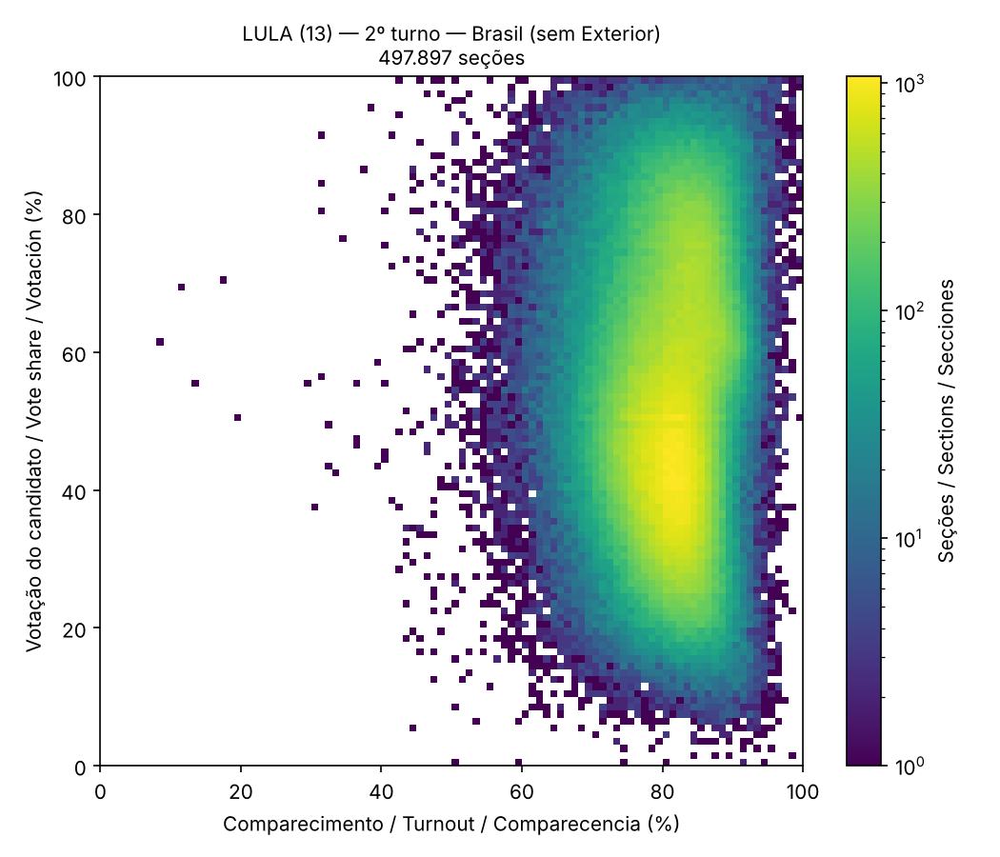
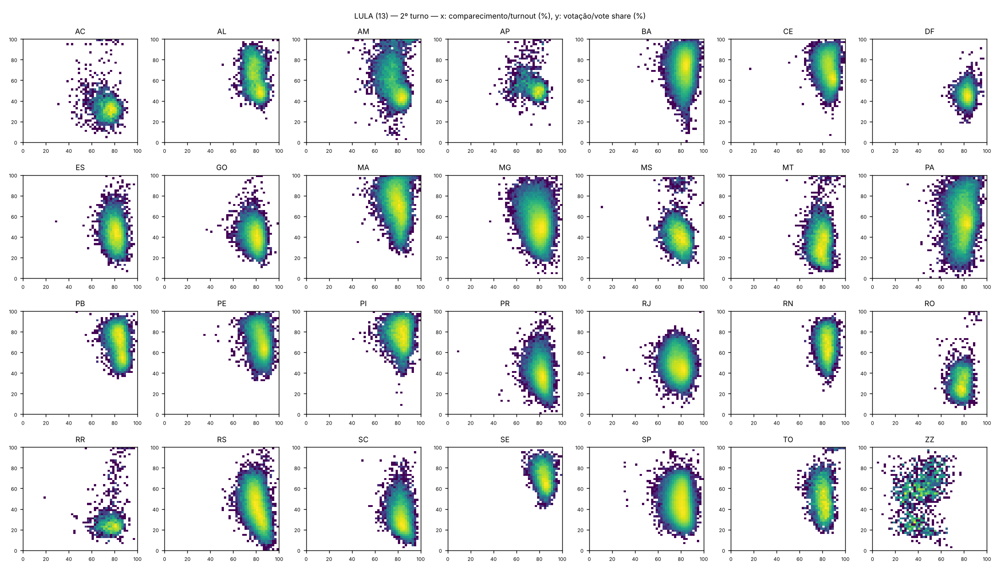
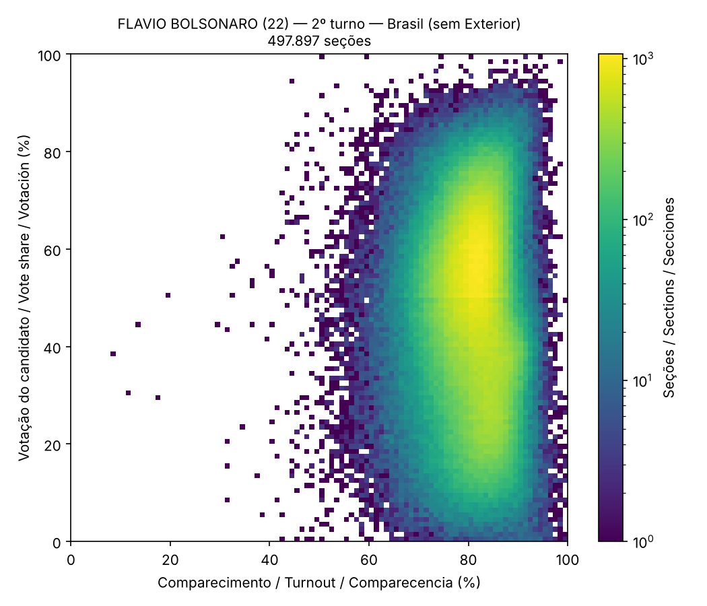
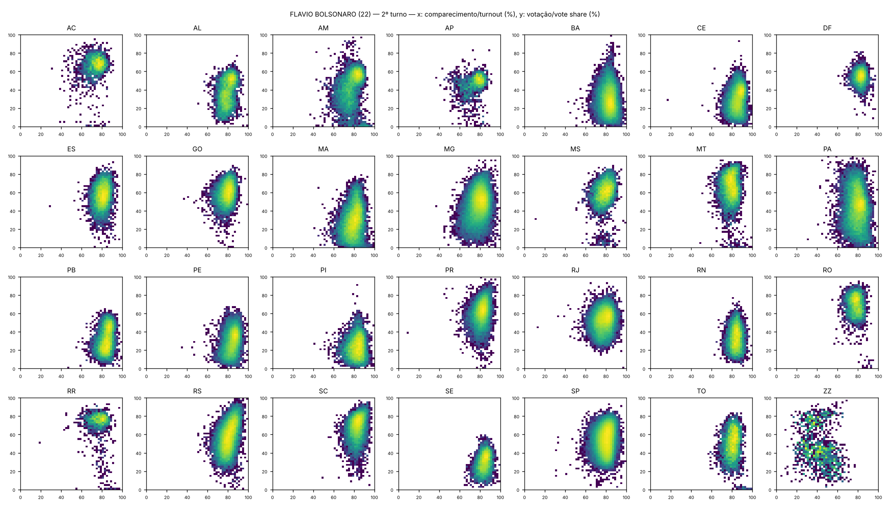

# Technical Report on the Statistical Audit of Ballot Box Reports

**Brazilian General Elections 2026 — round 2**

|  |  |
|---|---|
| Document identifier | `0222f8e4501a5d480c621816d05f3c16` |
| Issue date | 2026-11-01 |
| Analysis engine version | 3.1.1 |
| SHA-256 of the analytical core | `87a87735b063ad88d5c6620ff8ffcf86caec605bca80c5c1f509de876ed3e10e` |

> 🧾 **Integrity Status (Technical Determinism):** First run with these input files. The analytical core (15 methodologies, without date, time or duration) has been recorded as the **homologation report**, with SHA-256 `87a87735b063ad88d5c6620ff8ffcf86caec605bca80c5c1f509de876ed3e10e`. Every new run with the same files will be compared with this record.

**Color legend:** 🔴 Statistical anomaly (ballot box listed for verification) · 🟡 Informational event (recorded for checking, below the anomaly criterion) · 🟢 No occurrence · ⚠️ Test execution failure · ⚪ Not applicable in this run

<!-- nota-edicao:inicio -->
> 📌 **Editorial note (01/11/2026).** This report has been supplemented with **Addendum A — Change in presidential votes between round 1 and round 2**, at the end of the document, including the author's note explaining the edit. The rest of the report has not been changed.

<!-- nota-edicao:fim -->

## 1. Nature of the document and disclaimers

This document is a technical report of exploratory statistical analysis (*election forensics*) applied to the official public Ballot Box Report (Boletim de Urna, BU) data released by Brazil's Superior Electoral Court (Tribunal Superior Eleitoral, TSE) on its Open Data Portal.

This report **is not an official forensic expert report** (Articles 159 et seq. of the Brazilian Code of Criminal Procedure) and **does not attribute any conduct to any person or institution**.

A statistical flag identifies an observation that is improbable under the reference model stated in this document. **A statistical anomaly is not proof of fraud, error or irregularity.** Every flag must undergo documentary and technical verification: the printed BU, the signed digital files of the voting machine (.bu, .imgbu, .rdv, .logjez), polling station minutes and incident records.

In analyses covering hundreds of thousands of units, a non-zero number of flags is expected even in a sound electoral process, owing to natural variability, local particularities and simplifying model assumptions. The false discovery rate is controlled at 0.01 (Section 8.4) for the inferential tests.

## 2. Authorship and technical responsibility

|  |  |
|---|---|
| Author | Eduardo Santana dos Santos Beira de Lima |
| Field of expertise | Specialist in Prompt Engineering and AI-Driven Analytical Architecture |
| Place of execution | Downtown Curitiba, Paraná, Brazil |
| Instagram | @edu.limaoficial |

## 3. Executive summary

A total of 2,088,107 records from 28 official files (28 federative units) were processed, corresponding to 499,207 section reports (499,207 distinct polling sections; round 2) and 538,946 section–office reports. 29 statistical and consistency tests were applied.

File integrity: 56 of 56 files with SHA-512 hash matching the official hash published by the TSE; 0 mismatching; 0 without possible official verification.

Sections with at least one anomaly flag: 279 (0.06% of the sections analyzed). Sections with convergent flags (two or more distinct tests): 0.

**Consolidated results**

| Test | Units analyzed | Flags (anomaly) | Informational events | Raw occurrences | Rate |
|---|---:|---:|---:|---:|---:|
| 🟢 1. Ballot Report Arithmetic Closure | 538,946 | 0 | 0 | — | 0.000% |
| 🟢 2. Vote Total Inconsistency | 538,946 | 0 | 0 | — | 0.000% |
| 🔴 3. In-Section Unanimity | 538,940 | 28 | 114 | 142 | 0.005% |
| 🔴 4. Zero Abstention | 499,207 | 1 | 0 | 12 | 0.000% |
| 🔴 5. Excess Blank and Null Votes | 538,771 | 20 | 0 | — | 0.004% |
| 🟢 6. Extreme Split-Ticket Voting | 0 | 0 | 0 | 0 | — |
| 🟢 7. Party-List Vote Anomaly | 0 | 0 | 0 | — | — |
| 🔴 8. Neighboring-Section Contrast | 488,530 | 17 | 0 | — | 0.003% |
| 🔴 9. Sections with Identical Results | 534,392 | 2 | 0 | 117,328 | 0.000% |
| 🔴 10. Low Biometric Validation | 499,042 | 161 | 0 | — | 0.032% |
| 🔴 11. Atypical Timestamps | 499,178 | 2 | 86 | — | 0.000% |
| 🔴 12. Voting Machine Replacement and Paper-Ballot Voting | 499,207 | 51 | 2,670 | — | 0.010% |
| 🟢 13. Second-Digit Test (Mebane 2BL) | 70 | 0 | 0 | — | 0.000% |
| 🟢 14. Last-Digit Test (Beber–Scacco) | 70 | 0 | 0 | — | 0.000% |
| 🟡 15. Election Fingerprint (Klimek) | 58 | 0 | 9 | — | 0.000% |

The six tests of change in presidential votes between round 1 and round 2 (V1 to V6, Appendix A) require the Ballot Box Reports of both rounds in the same data folder and were not applied in this run.

### The engine's 35 tests in this run

The engine has 35 tests: 15 on the Ballot Box Reports (tests 1 to 15), 6 on the change in presidential votes between round 1 and round 2 (V1 to V6, Appendix A) and 14 on the voting machine logs (L01 to L14, Appendix B). 29 were applied in this run. The table shows the result of each one.

| Test | Data | Anomalies (🔴) | Informational events (🟡) | Units analyzed |
|---|---|---:|---:|---:|
| 🟢 1. Ballot Report Arithmetic Closure | Ballot Box Reports | 0 | 0 | 538,946 |
| 🟢 2. Vote Total Inconsistency | Ballot Box Reports | 0 | 0 | 538,946 |
| 🔴 3. In-Section Unanimity | Ballot Box Reports | 28 | 114 | 538,940 |
| 🔴 4. Zero Abstention | Ballot Box Reports | 1 | 0 | 499,207 |
| 🔴 5. Excess Blank and Null Votes | Ballot Box Reports | 20 | 0 | 538,771 |
| 🟢 6. Extreme Split-Ticket Voting | Ballot Box Reports | 0 | 0 | 0 |
| 🟢 7. Party-List Vote Anomaly | Ballot Box Reports | 0 | 0 | 0 |
| 🔴 8. Neighboring-Section Contrast | Ballot Box Reports | 17 | 0 | 488,530 |
| 🔴 9. Sections with Identical Results | Ballot Box Reports | 2 | 0 | 534,392 |
| 🔴 10. Low Biometric Validation | Ballot Box Reports | 161 | 0 | 499,042 |
| 🔴 11. Atypical Timestamps | Ballot Box Reports | 2 | 86 | 499,178 |
| 🔴 12. Voting Machine Replacement and Paper-Ballot Voting | Ballot Box Reports | 51 | 2,670 | 499,207 |
| 🟢 13. Second-Digit Test (Mebane 2BL) | Ballot Box Reports | 0 | 0 | 70 |
| 🟢 14. Last-Digit Test (Beber–Scacco) | Ballot Box Reports | 0 | 0 | 70 |
| 🟡 15. Election Fingerprint (Klimek) | Ballot Box Reports | 0 | 9 | 58 |
| ⚪ V1. Atypical transfer in the state | Round 1 × round 2 | not applicable | — | — |
| ⚪ V2. Atypical transfer in the municipality | Round 1 × round 2 | not applicable | — | — |
| ⚪ V3. Atypical transfer in the section | Round 1 × round 2 | not applicable | — | — |
| ⚪ V4. Atypical change in turnout | Round 1 × round 2 | not applicable | — | — |
| ⚪ V5. Gain above the ceiling of available votes | Round 1 × round 2 | not applicable | — | — |
| ⚪ V6. Voter roll changed between rounds | Round 1 × round 2 | not applicable | — | — |
| 🟢 L01. Votes after the official closing time | Voting machine logs | 0 | 0 | 499,177 |
| 🔴 L02. Time per vote (fast votes and bursts) | Voting machine logs | 17 | 78 | 499,177 |
| 🔴 L03. Releases without fingerprint in a row | Voting machine logs | 229 | 2,767 | 499,177 |
| 🔴 L04. Votes after “has everyone voted? YES” | Voting machine logs | 1 | 1,069 | 499,177 |
| 🔴 L05. Power failures and interruptions | Voting machine logs | 1,876 | 76,752 | 499,177 |
| 🔴 L06. Machine replacement | Voting machine logs | 1 | 1,416 | 499,177 |
| 🔴 L07. Repeated attempts (already voted, not found, barred) | Voting machine logs | 69 | 27,487 | 499,177 |
| 🔴 L08. Unfinished votes | Voting machine logs | 4 | 0 | 499,177 |
| 🔴 L09. Closing attempts | Voting machine logs | 13,284 | 22,820 | 499,177 |
| 🔴 L10. Time of the zero report and power-on | Voting machine logs | 1 | 2,829 | 499,177 |
| 🔴 L11. Machine clock | Voting machine logs | 61 | 152 | 499,177 |
| 🔴 L12. Model, software version and load code | Voting machine logs | 5 | 10 | 499,177 |
| 🔴 L13. Detailed biometrics | Voting machine logs | 628 | 14,201 | 499,177 |
| 🔴 L14. Log votes × tally sheet | Voting machine logs | 7 | 0 | 499,177 |

⚪ V1 to V6: they compare round 1 and round 2 votes and require the Ballot Box Reports of both rounds in the same data folder; this run has a single round.

### 🔎 How to check your ballot box

Each test in Section 9 includes the **full list** of the ballot boxes it flagged, with state, municipality (name and TSE code), zone, section, aggregated sections, polling place, ballot box number and load code.

1. Find your state, zone and section on your voter card or in the e-Título app.

2. Search for the zone and section in this report (Ctrl+F) or in the files `dados/busca_urnas.json` (one entry per section, with every test in which it appears) and `dados/secoes_sinalizadas.csv`.

3. If your section was **aggregated** into another, your votes appear under the number of the main section: look for your section number in the *Aggregated sections* column.

4. The ballot box number and the load code allow comparison with the printed report posted at the section and with the TSE's official correspondence files.

## 4. Scope, data sources and coverage

Primary source: TSE Open Data Portal, dataset "Resultados – 2026 – Boletim de Urna" (bweb files). Supplementary source: "Correspondências esperadas e efetivadas" (CESP files), used in test 12. The data are public and were processed without any alteration of content.

**Coverage by state**

| State | Round | File | Records | Sections |
|---|---|---|---:|---:|
| AC | 2 | bweb_2t_AC_261020260742.zip | 17,622 | 2,270 |
| AL | 2 | bweb_2t_AL_261020260742.zip | 27,419 | 7,101 |
| AM | 2 | bweb_2t_AM_261020260742.zip | 62,590 | 8,157 |
| AP | 2 | bweb_2t_AP_261020260742.zip | 6,973 | 1,914 |
| BA | 2 | bweb_2t_BA_261020260742.zip | 137,040 | 35,476 |
| CE | 2 | bweb_2t_CE_261020260742.zip | 91,087 | 23,765 |
| DF | 2 | bweb_2t_DF_261020260742.zip | 55,307 | 6,969 |
| ES | 2 | bweb_2t_ES_261020260742.zip | 78,082 | 9,844 |
| GO | 2 | bweb_2t_GO_261020260742.zip | 61,031 | 15,686 |
| MA | 2 | bweb_2t_MA_261020260742.zip | 66,190 | 18,093 |
| MG | 2 | bweb_2t_MG_261020260742.zip | 203,235 | 52,062 |
| MS | 2 | bweb_2t_MS_261020260742.zip | 26,734 | 7,106 |
| MT | 2 | bweb_2t_MT_261020260742.zip | 30,873 | 8,287 |
| PA | 2 | bweb_2t_PA_261020260742.zip | 76,003 | 20,827 |
| PB | 2 | bweb_2t_PB_261020260742.zip | 41,416 | 10,712 |
| PE | 2 | bweb_2t_PE_261020260742.zip | 83,243 | 21,418 |
| PI | 2 | bweb_2t_PI_261020260742.zip | 37,819 | 10,225 |
| PR | 2 | bweb_2t_PR_261020260742.zip | 105,761 | 27,142 |
| RJ | 2 | bweb_2t_RJ_261020260742.zip | 147,600 | 37,675 |
| RN | 2 | bweb_2t_RN_261020260742.zip | 63,676 | 8,115 |
| RO | 2 | bweb_2t_RO_261020260742.zip | 17,265 | 4,698 |
| RR | 2 | bweb_2t_RR_261020260742.zip | 5,332 | 1,519 |
| RS | 2 | bweb_2t_RS_261020260742.zip | 106,789 | 27,547 |
| SC | 2 | bweb_2t_SC_261020260742.zip | 67,266 | 17,326 |
| SE | 2 | bweb_2t_SE_261020260742.zip | 22,732 | 5,923 |
| SP | 2 | bweb_2t_SP_261020260742.zip | 410,145 | 103,656 |
| TO | 2 | bweb_2t_TO_261020260742.zip | 33,900 | 4,384 |
| ZZ | 2 | bweb_2t_ZZ_261020260742.zip | 4,977 | 1,310 |

All 27 federative units and voters abroad (ZZ) are present in the analyzed dataset.

## 5. Data integrity and digital chain of custody

For each input file, the SHA-512 cryptographic digest (FIPS 180-4) was computed — the same algorithm used by the TSE when publishing the files. Whenever available, the computed digest was compared with the official digest (.sha512 file published by the TSE next to each .zip file).

The TSE's official hash refers to the compressed file (.zip). Files supplied already decompressed (.csv) have their digest recorded but cannot be checked against the official hash.

The **manifest hash** is the SHA-512 of the sorted list "name;size;sha512" of all input files and uniquely identifies the analyzed dataset.

| File | Size (bytes) | SHA-512 (computed) | Official check |
|---|---:|---|---|
| bweb_2t_AC_261020260742.zip | 1,254,611 | `95f19aad9534d21ea703670030ea1d51b5a89c2b40f3ba5466d60de2765b9067f225fd863000c282fe47fb6457a9f43df5fd536dec7753f3813667c99b3efa3b` | MATCH |
| bweb_2t_AL_261020260742.zip | 1,945,168 | `392ebb110ac066be0bc1113b1cd4f15feadac11deb97c1786a2a9bc824affa5abce5fdfad051a6a3d4bf2b42909ba4b27b87af586dc888c17f8319401b24a848` | MATCH |
| bweb_2t_AM_261020260742.zip | 4,276,454 | `c87f558d88f478afaed40d452855e34eb99772fb4214b2c913824fd5adb816d324c6c040ab35d5e17e953e0d752b882c27304bd3c9139a9f96a765e2356c5ce8` | MATCH |
| bweb_2t_AP_261020260742.zip | 596,704 | `66f56ba91e90cd715994bba078014e57a9124e5667d5047b84cedeaf67dfbfc86a0c85537d65c49810817a73d0eaab6222fecdbb57d9077cc6a1da18a6d21cd6` | MATCH |
| bweb_2t_BA_261020260742.zip | 9,513,048 | `15db0c47b3b445ccbc1dd15ef77291e1bb5fe1af20a3e444381f7c32057794ed97e0c901cb46ea09cc7172a5d3d25cfe6435910e3f3fbdb8479c0c599f46e5c3` | MATCH |
| bweb_2t_CE_261020260742.zip | 6,151,144 | `4d0abf43322e353074782f533a728513924e7820898b8b3ef1ebbe45771dd61504e031f0efc62071442632669a11e1523890b5b49a196a04cc25884124e76357` | MATCH |
| bweb_2t_DF_261020260742.zip | 3,846,786 | `204e65d5d3eff30f7bbb27f3f21547d0146da31edaf15c27848452a245462144e2bf53ba520a0dfc09493231f2a43218d967cda1b6633af112ef3b1ac1a6c823` | MATCH |
| bweb_2t_ES_261020260742.zip | 5,275,706 | `e8805337ab66ffa5effea88a28ce74cc0fe1e856bcf58c2dad09f71cc04837d2113830aa6e1f4a4a17c14d1092a2cc2a6d88d578f64780e0a99627c0912f8883` | MATCH |
| bweb_2t_GO_261020260742.zip | 4,248,869 | `e5b6635dc3a05b7f6c175bdbe8a23e4daa3f4029f79cf3b7c82ac2cc48a43c315b00cac68162dd134f3187ba973bd3ddea5a26cb6f91c44449945bb094f93e0e` | MATCH |
| bweb_2t_MA_261020260742.zip | 4,609,442 | `90c1c9d2d1d0635c9e6900ee51dbb81b4a1f2dee113ed3a5145a2dacbe8d2da97bec55c78caa74fb635412cd29c413f2204a05d22ae6e0516ef249811c9d075c` | MATCH |
| bweb_2t_MG_261020260742.zip | 14,071,007 | `b2123700c7a520ccfb0e1be9aa3bab205c9c5f5b64cd537c80a1eaca69a9b96a67c440c88ca2a0f30f63aeed72a1c9dfca0e5ede8358eca1c64698e0c8054bb9` | MATCH |
| bweb_2t_MS_261020260742.zip | 1,863,398 | `c16d211246f35c9d1e7dfef39e6f718522987873d5304144744d9ba98783320710060844ca212800204c53d144d7cdea777aead343d817033fb5b49ada518db1` | MATCH |
| bweb_2t_MT_261020260742.zip | 2,204,666 | `cf0e1bf1c0af0af4326e9db2532d8ae0f3d28287d0c5ba48229e484696ef27d4e848922f73b1b7126847d2841b3bdea5ee36327c12a23d207860549640c5ce72` | MATCH |
| bweb_2t_PA_261020260742.zip | 5,158,441 | `5908978e998fc61b505c42971b3a29c7ffd858624e64b864e1c8dc8248172373bb59f5be3d27ad1d93703c73d9b11bc836eb9875c55180470b6e68061d773d9e` | MATCH |
| bweb_2t_PB_261020260742.zip | 2,871,353 | `79ec2b52387a8a1ac6f71cc330b54ce97fbefa49dfb925c15daa32e1f4a466cfd65c67eeef7e064d41231504afe5573d0fcd1a906b2856ad04dee0000ac15c7f` | MATCH |
| bweb_2t_PE_261020260742.zip | 5,761,723 | `5002c264cf9fff1b27bbbbc75d89b5aec5856b59a2888fef2b8c1577fe041bf60bcd6a4d8943023382579921d7f89926608aa7e550beb8581718cea1873f645a` | MATCH |
| bweb_2t_PI_261020260742.zip | 2,648,710 | `d864c6f671daf94d0c3a8464b74052f1827fe6ac43a7666bc1d4cd37f3a4375ccb51ccc83ef04832487349a40e1d73b72e2ab0934b99d62465422b80c4499b54` | MATCH |
| bweb_2t_PR_261020260742.zip | 7,189,112 | `949659949df4605749afdd1842d0f628bb4563d41f73578786702f679ee81276d7a4f5a4e52fe5292e681a75a7662d7925c1a15e76f0118b5870c29dbd20b3f5` | MATCH |
| bweb_2t_RJ_261020260742.zip | 10,004,912 | `dcb3131b618b9c394b50576ead626a85ebb115c9f984f9b464d21a64eb69a735f11123fb189a3f8b906c29f9511557f46565cc1d4adc10a68fa0ebf69a70a205` | MATCH |
| bweb_2t_RN_261020260742.zip | 4,424,654 | `3da1a65ad338f6ef0596de91e2c65f8fd1c0ee916c4ed26f2e1c64d4583603caa344482bfbda4e00142926244a79d7df63c1acb52dea56fc83d67b355feaf3a5` | MATCH |
| bweb_2t_RO_261020260742.zip | 1,250,142 | `4e25932384114f73eacfc0555234fd5cc31f2cde025404f9aed97286879e15571925d544ca83b744d2fe21e5711ec20b4bf7281011007d777b9a354c8fd1b577` | MATCH |
| bweb_2t_RR_261020260742.zip | 500,520 | `3986628e101b7a9fc24ab5377e0ed8b2eb94fa735b5999aa408df37d3be91d1c4d8ab11c8bec03398dcc0005b76782617a5045cb170e0efafdeabd1602d6d4cf` | MATCH |
| bweb_2t_RS_261020260742.zip | 7,410,270 | `39f0c7e216972216d52a1868c2396d72115453953227aa301cb92692421c171e5a24e8493a57f125ddf2096a7ea6d6b34ce1aa7a042ef26a4c550e3336a27cee` | MATCH |
| bweb_2t_SC_261020260742.zip | 4,487,185 | `01b1e9638654fa6914ad4d8a9001de33cb4fc5386d280ccdea7576d7c993c04e9162075db0a1fed8f571e87ce5349151e6a44bc4d5300b3e828a0123c6b90c8e` | MATCH |
| bweb_2t_SE_261020260742.zip | 1,645,477 | `ea1460385ab222e82ec7560eb3932bb3dc198333296876435d99c2755150ce1a9d703f21ca259279de610f1e31d2dbc8d3a5090c6c3f9e762de8d98f0fd73f0f` | MATCH |
| bweb_2t_SP_261020260742.zip | 28,188,300 | `3078f38754ced92476fd0e9c6661ecf5237774fc210d5e7eee1b55db9b8ddb321843f591440c2d350679326e1f1b86e60ac723c8ac65a92ca94b74ce674ecffe` | MATCH |
| bweb_2t_TO_261020260742.zip | 2,383,586 | `e667f9b68bb71065fec219cbf18b4621b0062ced6b09dec227d32f8621c9b6697b55d216bce0920de30eea37c16bc42a3a684d71bdb49051c68d850f1f74b0ef` | MATCH |
| bweb_2t_ZZ_261020260742.zip | 502,322 | `e024547f7d2c6e21e53c8a4f47823d7c76684976271ef395f7c66fe953caf49aa2c585b104f724cc2c39eb67f682e05a7e479f9558c3e38244036a3f90b429f1` | MATCH |
| CESP_2t_AC_251020261345.zip | 442,248 | `570b47349711d8c1f61da8d557b298d67958aec11e54e4036466d9e45a264e04ad9f5cdc87971e8d2c68cc0cde28bd2134daea327ec8f027294d840de6fa3c93` | MATCH |
| CESP_2t_AL_251020261345.zip | 646,058 | `68d923b170c4ce8ef31f5945f0d76624450d3c46ef885bacac93ff1f719c57de83bd1502be09dfe716191744e91051e8c5c94d454dc09b5de8c1924ec05647bd` | MATCH |
| CESP_2t_AM_251020261345.zip | 732,475 | `fecb6eb12ee6cb91107bd109831ee4e1ba8f6e2eef89ca2266f26b375960e661d9f05302ed2aa55a32e9f93be7e031b5687dc4562eada746f5f820499704018e` | MATCH |
| CESP_2t_AP_251020261345.zip | 420,857 | `f6d657624e4a994f88fa372fae6f2302c83ad56e14119d4908e39306ddaac66ac93560204ac96a5d0777a6892e057b5fbbc05ea1872aff18182d8045946a9281` | MATCH |
| CESP_2t_BA_251020261345.zip | 2,442,346 | `02bdbc82b32976b003dfef94397eee9e67ba002abf385f9859127e282c373d4062fd989e592d35670eeb9993256e155dda82201b5883c251b000cbd26d97da9b` | MATCH |
| CESP_2t_CE_251020261345.zip | 1,624,584 | `3fc76dab66ed7a5000ece340919bf655d98e86e9f37e973a05666e0ef05fa314a7254f3e859a50bb4dd34855399b1144574fedbe0902a4d9201ec5b0f2a6f484` | MATCH |
| CESP_2t_DF_251020261345.zip | 616,692 | `c34b30f33a65fccff6985689bb702102c5570a99bac5cd1e41294b2b614316cf2ef4a80c0e0117f75a03c79b61d472bc28bdd26aae33cbe63a8985dca8d2860c` | MATCH |
| CESP_2t_ES_251020261345.zip | 784,599 | `ddbc4f01a34e3a89320a7a4feb45fd84fd45db7eb8c573d9a57be7279355ad0d588f4a4988e587d34ba838ea453cc6597af4618b8f7680a0d56a66736319e0a0` | MATCH |
| CESP_2t_GO_251020261345.zip | 1,129,322 | `88dcf9f7aa0157f95e4e8b19913a9b1004c4d8e9d77e7ecedc4cbd97a1fa240591cf96b98c49eba53626247328623009e651a439861cf63e0c174032082b768b` | MATCH |
| CESP_2t_MA_251020261345.zip | 1,311,142 | `63c68776d55fefe24ecccb748d1c7f696a9961af13d7886a3af94d37dec9d7c9fb1cb112640457072977767575c0592758513eba18cfc8800fc64f4aba58ceb1` | MATCH |
| CESP_2t_MG_251020261345.zip | 3,410,696 | `2fbcaddf57f0e79850e7c047ade96f91d6caa1d8400328aefc326c7c167bde7ae1a272fc174886c09d6fbdd0bc12549bd9c77bdf1eba655b60ca732675f3a70f` | MATCH |
| CESP_2t_MS_251020261345.zip | 701,252 | `b2c771ccd6fcce11f8e3785d213a92140aa089f7cb4c92eb4a743b867f741a5107ae914d8f94200024478a3ad09b7513920b17dad9d3f70231d888040afc6b01` | MATCH |
| CESP_2t_MT_251020261345.zip | 770,327 | `01a1dd9b383f9d14527d2cc5e15199badbb544053e6fa30eaa404b78da4300b0c1e93728b77e5d689591c64822b24e2f4098150459a6bbe0df64ae4fc998084e` | MATCH |
| CESP_2t_PA_251020261345.zip | 1,443,903 | `9de071531443802e37206b7697bdc9c17426a9c4bfd5fb7efc716312fb37cbe4d709bef1863ddacebbd24fe05e4393856a16cbf9ec829afa93636cad7d397785` | MATCH |
| CESP_2t_PB_251020261345.zip | 837,205 | `e09d71528ff78dffb90cf5780acdfc6b5dc396f227e74eb318e1a8b55d0294771cae6fba86ef8a0a99a40e957f51b734b275a228a9b578314e29ddaa75550997` | MATCH |
| CESP_2t_PE_251020261345.zip | 1,491,126 | `60340215c78460161f08a6db1da6701180d53e3b887d23e57d1b74bdb84fd56661dd56516e36d525fe41e4ed5e88a2a079a5f91a7cc94f31af1c846f1c6e7b35` | MATCH |
| CESP_2t_PI_251020261345.zip | 880,337 | `edeff7ca526ef63c7a9b68184f47c2dca6be6a09efd22d5462cd10adb4bbecc88e55d92c27b41167e3b824be5b7d7feb20d0e45d45f513b0f0ee9f43a18c7ee5` | MATCH |
| CESP_2t_PR_251020261345.zip | 1,859,062 | `fe39dc16136ac696466c5e09ddc7ab3dc9ca5ec93d36ed8434355490167536285671d43fccc3b79085685db18af349ac7352eda0e529b2d55809d870a4d6321a` | MATCH |
| CESP_2t_RJ_251020261345.zip | 2,324,875 | `d975604521ffcbb1ead42e9b287873014dd5555a7efe3a0e983ce889f02c1c492f0342b9a810f35be58b8e60b7401cc9c76cb04e6e1193b4eeed4aa9c8ded93d` | MATCH |
| CESP_2t_RN_251020261345.zip | 715,563 | `99bdb2398d8798772fee2d5c09186847e27e937f1b3e56172efba17dcd901df9dbc958a68c86aa61bb1dce7e69582c9fce8cae44c01ed2ce45ef575bfb519a4b` | MATCH |
| CESP_2t_RO_251020261345.zip | 549,650 | `2d76f24041ee5208926ae8cd725f8c8a34d3004232fb5844cea9a9091f03b7983e8737da85d38585e320598b39a2390149ee97055f810990bda2137da796847d` | MATCH |
| CESP_2t_RR_251020261345.zip | 403,687 | `fbd867d24387e289aea71ad0f4a77b9f7d7177eb646c2ff009401fd5510d4cce1c1cde29577e494cbca740dc9d4add0775764192e5013c4fd0fb665e3e31caa6` | MATCH |
| CESP_2t_RS_251020261345.zip | 1,991,281 | `b31ebb6a5b5e42ac84fdfba4bb28cb3a6f64ff8bbb9db9fd44aad351aa02497382f367eb4ff34926724b894e14ca34f3b0f431f21cffacbd9ce860c199720e7c` | MATCH |
| CESP_2t_SC_251020261345.zip | 1,290,595 | `15f66ee158832107328f0a0a9e7f0ef2cc5ec5a2899614b8e8938f30a047cdea128c77d88f0dc87e2c7ea974b468f729009075914237993f2746dc1f05a1e2d0` | MATCH |
| CESP_2t_SE_251020261345.zip | 599,332 | `37033a2f45b2055523f18f5fea2d335b4a4739d29330d34c4f8b836e5c1f9ecb2dab67aef6781d16276f62c1dca87211b8cde36827dda04a9931051efb516b19` | MATCH |
| CESP_2t_SP_251020261345.zip | 7,095,285 | `5291bff574b82d64d46f2a9f339d1b085ab24354b83eb04c2bc371382ca61792b80545ee26f0abdd3933dca23ac7ea670479549188abe19ab661c6d39d03aecb` | MATCH |
| CESP_2t_TO_251020261345.zip | 544,487 | `8af1a2091093e86252e50ee3c211c77046f6cc9280224906561a673983a0e8edce7900366b1bf1f76dfe56165b0c21841bd226790ae267363a64f6edb3421082` | MATCH |
| CESP_2t_ZZ_251020261345.zip | 396,618 | `12bdb9ca6d772d56ea6368cc9fc6c258e15dad344212bc6dd334de24cb92cd78273bac4fd2b350bce53b33eb068e393318f7a818a020e7ffb74efe6788587956` | MATCH |

**Manifest hash (SHA-512):** `0222f8e4501a5d480c621816d05f3c16cd365cb901cac299b95d0e04970878af24bebc42e03378621a65cf121dc467d7e120c12caaeee00ea0ae6009a47e3c42`

## 6. Computing environment and execution timeline

|  |  |
|---|---|
| Processing start | 2026-11-01 21:26:17 |
| Processing end | 2026-11-01 21:40:06 |
| Total duration | 0h 13min 48s |
| Reference time zone | America/Sao_Paulo (UTC−03:00) |
| Operating system | Linux 6.18.44-fc-v185 (x86_64) |
| Python | 3.13.16 |
| Libraries | DuckDB 2.0.0; pandas 3.0.5; NumPy 2.5.3; SciPy 1.18.1; Matplotlib 3.11.2 |
| Processor cores | 4 |
| Physical memory | 15.7 GB |
| DuckDB memory limit | 7.1 GB |
| Compressed volume read | 0.13 GB |
| Decompressed volume processed | 0.86 GB |

## 7. Pre-processing and quality control

- Full reading of the CSV files (Latin-1 encoding, ";" separator) by a columnar analytical engine (DuckDB), without sampling.
- TSE sentinel values ("#NULO#", "#NE", −1, −3) converted to missing information in numeric and time fields.
- Voting-machine load codes normalized (removal of separators and leading zeros) for comparison with the expected correspondence.
- Section key: round, state, municipality code, electoral zone and section. Report key: section and office.
- Valid votes: candidate and party-list votes (types 1 and 4). Invalid: blank (type 2, option 95) and null (type 3, option 96). Annulled votes tallied separately (option 97) are included in the total but not among valid votes.

**Empirical validation of k (votes per voter)**

| Office | Reports | Modal ratio Σvotes/turnout | k |
|---|---:|---:|---:|
| — | 2 | — | 1 |
| President | 499,205 | 1.000 | 1 |
| Governor | 39,739 | 1.000 | 1 |

## 8. Methodological foundations

### 8.1 Unit of analysis

The elementary unit is the section–office report. Turnout, biometric, timestamp and machine tests use the section. The digit tests (13 and 14) and the election fingerprint (15) operate on aggregates (candidate × state).

### 8.2 Geographic reference groups

Each section is compared with the sections of its reference group, defined hierarchically: the electoral zone within the municipality (when it comprises at least 20 sections); otherwise, the municipality; then the remaining sections of the same electoral zone; then of the state; and finally of the round. This hierarchy preserves local homogeneity, including in large cities divided into several zones, without sacrificing the stability of the estimates.

### 8.3 Beta-binomial model and overdispersion

Section-level vote counts show greater variability than predicted by the binomial model, owing to heterogeneity of the electorate across sections. Proportion tests use the beta-binomial model (Skellam, 1948), with mean m and intraclass correlation ρ estimated within the reference group by the weighted moment estimator (Ridout, Demétrio and Firth, 1999): m = Σx/Σn; S = Σ nᵢ(yᵢ − m)²/(G − 1); n₀ = (Σn − Σn²/Σn)/(G − 1); ρ = [S/(m(1 − m)) − 1]/(n₀ − 1), restricted to [0.000001; 0.5]. Parameters: α = m(1/ρ − 1); β = (1 − m)(1/ρ − 1). The unit under test is excluded from its group's estimate (leave-one-out), so that an extreme value does not mask itself; groups with fewer than three units receive the maximum ρ (conservative).

### 8.4 Multiple comparisons

In each inferential test, the p-values of all eligible units are adjusted with the Benjamini and Hochberg (1995) procedure, which controls the expected false discovery rate (FDR) at 0.01. Units in which the tested event does not occur (e.g., no unanimity) or whose share does not exceed the group mean receive p = 1; since such units could not be flagged, this does not change the flags and makes the adjustment conservative.

### 8.5 Deterministic tests

Tests 1, 2, 11 and 12 verify arithmetic, chronological or documentary identities. There is no probabilistic model: any violation is flagged.

### 8.6 Parameters used

| Parameter | Value |
|---|---|
| `ALFA_FDR` | 0.01 |
| `MIN_SECOES_GRUPO` | 20 |
| `RHO_MIN / RHO_MAX` | 1e-06 / 0.5 |
| `MIN_VOTOS_UNANIMIDADE` | 10 |
| `MIN_APTOS_ABSTENCAO` | 20 |
| `MIN_VOTOS_PROPORCAO` | 30 |
| `LIMIAR_BLOCO` | 0.7 |
| `LIMIAR_Z_ROBUSTO` | 3.5 |
| `MIN_VOTOS_VOTO_CRUZADO` | 50 |
| `MIN_SECOES_LOCAL` | 3 |
| `LIMIAR_DIF_VIZINHANCA_PP` | 25.0 |
| `MIN_VOTOS_IDENTICOS` | 50 |
| `MIN_CATEGORIAS_IDENTICOS` | 3 |
| `LIMIAR_ESPERADO_IDENTICOS` | 0.01 |
| `HORA_INICIO_OFICIAL / HORA_FIM_OFICIAL` | 8 / 17 |
| `TOLERANCIA_MINUTOS` | 2 |
| `ATRASO_ABERTURA_MIN` | 60 |
| `MIN_CONTAGENS_DIGITOS` | 50 |
| `MIN_MEDIANA_DIGITOS` | 30 |
| `REPLICAS_DIGITOS / SEMENTE_SIMULACAO` | 50 / 20261004 |
| `MIN_SECOES_LOCAL_DIGITOS` | 4 |
| `KLIMEK_CANTO` | 0.9 |
| `KLIMEK_MIN_CANTO / KLIMEK_RAZAO` | 10 / 3.0 |
| `VAGAS_POR_CARGO` | President=1, Governor=1, Senator=2, Federal Deputy=1, State Deputy=1, District Deputy=1 |

## 9. Results by test

### 9.1 🟢 Ballot Report Arithmetic Closure

**Objective.** To verify the internal arithmetic and structural consistency of each Ballot Box Report (Boletim de Urna, BU).

**Method.** For each section–office pair the following identities are checked: (i) eligible voters = turnout + abstentions; (ii) turnout ≤ eligible voters; (iii) constancy of eligible voters, turnout and abstentions across all records of the same report; (iv) absence of duplicated vote options; (v) absence of negative counts. For each section: (vi) equal turnout across all state-level offices; (vii) presidential turnout greater than or equal to state-level turnout (a positive difference is explained by in-transit voters entitled to vote for President only); (viii) presence of every expected office in the report; (ix) constancy of the machine number, software load code, opening time and biometric count across all records of the section.

**Flagging criterion.** Deterministic test. Any violation is flagged as an anomaly.

**Limitations and alternative explanations.** A violation indicates a recording, extraction or processing error and must be checked against the printed BU and the signed digital files of the voting machine (.bu, .rdv, .logjez).

> 📊 **Result:** 🟢 **0 anomaly(ies)** in 538,946 units analyzed (0.000%) · 🟡 0 informational event(s).
>
> **What it means:** no ballot box met the anomaly criterion of this test.

🟢 No flags.

### 9.2 🟢 Vote Total Inconsistency

**Objective.** To verify whether the total number of votes recorded for each office is consistent with the number of voters who turned out.

**Method.** For each section–office: Σ votes (candidate, party-list, blank, null and annulled) = k × turnout, where k is the number of votes per voter for the office: k = 2 for Senator in 2026 (renewal of two thirds of the Federal Senate) and k = 1 for all other offices. The empirical validity of k is confirmed by the modal ratio Σ votes / turnout observed for each office.

**Flagging criterion.** Deterministic test. Any difference (Δ ≠ 0) is flagged as an anomaly.

**Limitations and alternative explanations.** Differences may stem from extraction or recording errors; definitive verification requires the printed BU and the signed .bu file.

> 📊 **Result:** 🟢 **0 anomaly(ies)** in 538,946 units analyzed (0.000%) · 🟡 0 informational event(s).
>
> **What it means:** no ballot box met the anomaly criterion of this test.

🟢 No flags.

### 9.3 🔴 In-Section Unanimity

**Objective.** To identify sections in which a single candidate received all valid votes and to assess the statistical rarity of the event.

**Method.** Eligible units are section–office pairs (President, Governor and Deputies) with at least 10 valid votes. For each unanimity, the probability of the event is computed under a beta-binomial model whose parameters (mean and intraclass correlation) are estimated by the method of moments from the same candidate's vote in all sections of the geographic reference group (Section 8.2). p = P(X = n). P-values are adjusted with the Benjamini–Hochberg procedure (Section 8.4).

**Flagging criterion.** Anomaly (🔴) when q < 0.01. All other sections with 100% of the valid votes for a single candidate are listed as informational events (🟡), with the count by candidate.

**Limitations and alternative explanations.** Small homogeneous communities (indigenous villages, isolated communities, specific facilities) may produce legitimate unanimity that the reference group does not capture.

> 📊 **Result:** 🔴 **28 anomaly(ies)** in 538,940 units analyzed (0.005%) · 🟡 114 informational event(s).
>
> Raw occurrences (before the statistical criterion): 142.
>
> **What it means:** each ballot box in the 🔴 list below showed a result that, under the criterion above, is arithmetically impossible (tests 1 and 2) or statistically improbable in its context. It is a statistical anomaly: it indicates priority for documentary verification (printed report, polling station minutes, ballot box records), but is not, by itself, proof of fraud.
>
> The 🟡 events are recorded for transparency and checking, but did not meet the anomaly criterion.

**Breakdown by category**

| Category | Count |
|---|---:|
| 🟡 100% for a single candidate | 114 |
| 🔴 Improbable unanimity | 28 |

**Sections with 100% of the valid votes for a single candidate, by candidate**

| State | Office | Candidate | 100% sections | 🔴 Improbable |
|---|---|---|---:|---:|
| All states | President | nº 13 — LULA | 106 | 25 |
| All states | President | nº 22 — FLAVIO BOLSONARO | 4 | 1 |
| AC | President | nº 13 — LULA | 3 | 1 |
| AM | President | nº 13 — LULA | 30 | 2 |
| BA | President | nº 13 — LULA | 4 | 0 |
| CE | President | nº 13 — LULA | 2 | 0 |
| ES | President | nº 13 — LULA | 1 | 0 |
| MA | President | nº 13 — LULA | 20 | 2 |
| MG | President | nº 13 — LULA | 2 | 0 |
| MS | President | nº 13 — LULA | 1 | 1 |
| MT | President | nº 13 — LULA | 5 | 5 |
| PA | President | nº 13 — LULA | 16 | 8 |
| PA | President | nº 22 — FLAVIO BOLSONARO | 2 | 1 |
| PB | President | nº 13 — LULA | 1 | 0 |
| PE | President | nº 13 — LULA | 1 | 1 |
| PI | President | nº 13 — LULA | 1 | 0 |
| PR | President | nº 13 — LULA | 1 | 1 |
| RO | President | nº 13 — LULA | 1 | 1 |
| RR | President | nº 13 — LULA | 8 | 1 |
| RS | President | nº 13 — LULA | 2 | 2 |
| RS | President | nº 22 — FLAVIO BOLSONARO | 2 | 0 |
| TO | President | nº 13 — LULA | 7 | 0 |
| AC | Governor | nº 11 — MAILZA ASSIS | 3 | 0 |
| AM | Governor | nº 55 — OMAR AZIZ | 28 | 1 |
| ES | Governor | nº 15 — RICARDO FERRAÇO | 1 | 1 |

#### 🔴 Ballot boxes with anomalies — full list (28)

| # | State | Municipality | Zone | Section | Aggregated sections | Place | Ballot box no. | Load code | Office | Observed | Reference | q (BH) | Detail |
|---:|---|---|---:|---:|---|---|---|---|---|---|---|---|---|
| 1 | MT | GUARANTÃ DO NORTE (99058) | 44 | 284 | — | 1171 | 2011320 | 566328743756215356321036 | President | 145/145 (100%) | 17.48% | 1.06e-44 | nº 13 — LULA |
| 2 | MT | CONFRESA (90280) | 28 | 200 | — | 1120 | 2456017 | 484950667769399559554249 | President | 309/309 (100%) | 24.59% | 5.50e-31 | nº 13 — LULA |
| 3 | AC | CRUZEIRO DO SUL (1074) | 4 | 457 | — | 2291 | 2264708 | 93153576434520797581571 | President | 137/137 (100%) | 28.68% | 1.77e-20 | nº 13 — LULA |
| 4 | MT | PEIXOTO DE AZEVEDO (98817) | 33 | 255 | — | 1139 | 2006504 | 949548023749521608651328 | President | 179/179 (100%) | 36.96% | 2.24e-16 | nº 13 — LULA |
| 5 | AM | JURUÁ (2470) | 50 | 19 | 26 / 27 / 36 / 40 / 44 | 1180 | 2316234 | 931628998051954512448123 | President | 149/149 (100%) | 58.73% | 5.98e-16 | nº 13 — LULA |
| 6 | PA | SÃO FÉLIX DO XINGU (5452) | 53 | 218 | — | 1350 | 2392159 | 75375200622742085477778 | President | 273/273 (100%) | 27.01% | 2.07e-14 | nº 13 — LULA |
| 7 | PA | PARAUAPEBAS (5835) | 106 | 330 | — | 1210 | 2191815 | 371612858261111991255705 | President | 212/212 (100%) | 40.91% | 5.06e-14 | nº 13 — LULA |
| 8 | PA | PARAUAPEBAS (5835) | 106 | 365 | — | 1210 | 2183419 | 664541902690794112041508 | President | 197/197 (100%) | 40.92% | 1.62e-13 | nº 13 — LULA |
| 9 | PA | SÃO FÉLIX DO XINGU (5452) | 53 | 217 | — | 1341 | 2324287 | 499517511164880586291396 | President | 145/145 (100%) | 27.3% | 1.93e-09 | nº 13 — LULA |
| 10 | RS | VIAMÃO (89630) | 59 | 591 | — | 2208 | 2007723 | 125646319138205055713445 | President | 65/65 (100%) | 52.52% | 4.68e-08 | nº 13 — LULA |
| 11 | MT | PORTO ALEGRE DO NORTE (98850) | 28 | 191 | — | 1090 | 2251676 | 78909907683703746396615 | President | 61/61 (100%) | 33.31% | 4.88e-08 | nº 13 — LULA |
| 12 | RO | PORTO VELHO (35) | 6 | 516 | — | 1767 | 2228253 | 937159111507218321254088 | President | 104/104 (100%) | 34.69% | 7.68e-08 | nº 13 — LULA |
| 13 | MA | MONTES ALTOS (8397) | 103 | 80 | — | 1090 | 2136242 | 288370841622116372636965 | President | 298/298 (100%) | 61.03% | 7.49e-07 | nº 13 — LULA |
| 14 | PR | ORTIGUEIRA (77275) | 167 | 96 | — | 1562 | 2436538 | 795507085296360816835824 | President | 314/314 (100%) | 51.84% | 3.99e-06 | nº 13 — LULA |
| 15 | PA | ALTAMIRA (4111) | 18 | 516 | — | 3018 | 2435673 | 662961843603081870364038 | President | 52/52 (100%) | 36.17% | 7.33e-06 | nº 13 — LULA |
| 16 | AM | JAPURÁ (2453) | 48 | 12 | — | 1074 | 2357890 | 204836493261232786697780 | President | 224/224 (100%) | 47.6% | 9.66e-06 | nº 13 — LULA |
| 17 | MT | BARRA DO GARÇAS (90352) | 9 | 531 | — | 1511 | 2011356 | 746773514274475795822139 | President | 119/119 (100%) | 38.72% | 1.34e-05 | nº 13 — LULA |
| 18 | PE | FLORESTA (24139) | 72 | 119 | — | 1287 | 2320194 | 270698423044291291024537 | President | 227/227 (100%) | 85.57% | 3.35e-05 | nº 13 — LULA |
| 19 | RR | CAROEBE (3000) | 4 | 141 | — | 1163 | 2283087 | 285572762668174112277933 | President | 44/44 (100%) | 20.17% | 4.93e-05 | nº 13 — LULA |
| 20 | RS | VIAMÃO (89630) | 59 | 590 | — | 2194 | 2002935 | 368070441362230911817299 | President | 39/39 (100%) | 52.54% | 0.0002 | nº 13 — LULA |
| 21 | PA | ALTAMIRA (4111) | 18 | 519 | — | 3000 | 2432252 | 188113690255192522644658 | President | 35/35 (100%) | 36.18% | 0.0004 | nº 13 — LULA |
| 22 | PA | PARAGOMINAS (5096) | 42 | 214 | — | 1503 | 1796710 | 969446656700451847515584 | President | 54/54 (100%) | 41.29% | 0.0015 | nº 13 — LULA |
| 23 | PA | ALMEIRIM (4090) | 55 | 128 | — | 1600 | 1782102 | 751065866488733879336592 | President | 156/156 (100%) | 68.7% | 0.0022 | nº 13 — LULA |
| 24 | PA | CHAVES (4499) | 17 | 41 | — | 1252 | 2419940 | 772161162208997063577605 | President | 48/48 (100%) | 29.98% | 0.0027 | nº 22 — FLAVIO BOLSONARO |
| 25 | MA | MARANHÃOZINHO (7927) | 101 | 78 | — | 1104 | 2125278 | 647584011909773495464340 | President | 176/176 (100%) | 75.84% | 0.0032 | nº 13 — LULA |
| 26 | ES | ARACRUZ (56111) | 20 | 232 | — | 1627 | 2216136 | 559169164666977586808161 | Governor | 40/40 (100%) | 46.75% | 0.0064 | nº 15 — RICARDO FERRAÇO |
| 27 | AM | NOVA OLINDA DO NORTE (2658) | 35 | 175 | — | 1198 | 2335394 | 210897349496247635077915 | Governor | 110/110 (100%) | 82.52% | 0.0072 | nº 55 — OMAR AZIZ |
| 28 | MS | ARAL MOREIRA (91715) | 19 | 313 | — | 1171 | 2151060 | 819487483665562412876018 | President | 56/56 (100%) | 43.27% | 0.0077 | nº 13 — LULA |

<b>🟡 Informational events — full list (114)</b>

| # | State | Municipality | Zone | Section | Aggregated sections | Place | Ballot box no. | Load code | Office | Observed | Reference | q (BH) | Detail |
|---:|---|---|---:|---:|---|---|---|---|---|---|---|---|---|
| 1 | ES | ARACRUZ (56111) | 20 | 232 | — | 1627 | 2216136 | 559169164666977586808161 | President | 41/41 (100%) | 44.29% | 0.0109 | nº 13 — LULA |
| 2 | AM | CARAUARI (2216) | 21 | 96 | — | 1414 | 2460256 | 494674788474281224489454 | President | 113/113 (100%) | 74.47% | 0.0140 | nº 13 — LULA |
| 3 | AC | JORDÃO (1104) | 5 | 66 | — | 1074 | 2273044 | 86063162441442089701437 | Governor | 139/139 (100%) | 70.53% | 0.0147 | nº 11 — MAILZA ASSIS |
| 4 | TO | TOCANTINÓPOLIS (96210) | 9 | 192 | — | 1252 | 2259977 | 28001967379852561832277 | President | 155/155 (100%) | 66.61% | 0.0235 | nº 13 — LULA |
| 5 | AM | SANTA ISABEL DO RIO NEGRO (2372) | 30 | 22 | — | 1139 | 2359864 | 740895100742981001794645 | President | 236/236 (100%) | 72.73% | 0.0256 | nº 13 — LULA |
| 6 | AM | SANTA ISABEL DO RIO NEGRO (2372) | 30 | 22 | — | 1139 | 2359864 | 740895100742981001794645 | Governor | 245/245 (100%) | 79.23% | 0.0256 | nº 55 — OMAR AZIZ |
| 7 | AC | JORDÃO (1104) | 5 | 65 | — | 1074 | 2285723 | 641619612797794095077374 | Governor | 127/127 (100%) | 70.63% | 0.0296 | nº 11 — MAILZA ASSIS |
| 8 | AM | SANTA ISABEL DO RIO NEGRO (2372) | 30 | 26 | — | 1139 | 2342321 | 23623825570575109396386 | President | 229/229 (100%) | 72.76% | 0.0299 | nº 13 — LULA |
| 9 | AM | SANTA ISABEL DO RIO NEGRO (2372) | 30 | 26 | — | 1139 | 2342321 | 23623825570575109396386 | Governor | 235/235 (100%) | 79.27% | 0.0329 | nº 55 — OMAR AZIZ |
| 10 | AC | JORDÃO (1104) | 5 | 125 | — | 1074 | 2256855 | 409295183773983336884034 | Governor | 120/120 (100%) | 70.69% | 0.0440 | nº 11 — MAILZA ASSIS |
| 11 | PA | ORIXIMINÁ (5053) | 38 | 260 | — | 2097 | 2398124 | 123921728706135398328421 | President | 152/152 (100%) | 55.0% | 0.0444 | nº 13 — LULA |
| 12 | AM | URUCURITUBA (2879) | 3 | 252 | — | 1112 | 2345569 | 589091336854801726921755 | President | 101/101 (100%) | 77.4% | 0.0552 | nº 13 — LULA |
| 13 | AC | JORDÃO (1104) | 5 | 65 | — | 1074 | 2285723 | 641619612797794095077374 | President | 126/126 (100%) | 54.61% | 0.0664 | nº 13 — LULA |
| 14 | MA | GRAJAÚ (7935) | 15 | 405 | — | 2100 | 2307579 | 838745747844235797663665 | President | 102/102 (100%) | 60.76% | 0.0664 | nº 13 — LULA |
| 15 | PA | ORIXIMINÁ (5053) | 38 | 259 | — | 2070 | 2282976 | 265335785820670082063548 | President | 133/133 (100%) | 55.02% | 0.0680 | nº 13 — LULA |
| 16 | PA | ALENQUER (4073) | 21 | 234 | — | 2216 | 1805374 | 731398561731226672292811 | President | 60/60 (100%) | 48.78% | 0.0680 | nº 13 — LULA |
| 17 | AC | JORDÃO (1104) | 5 | 125 | — | 1074 | 2256855 | 409295183773983336884034 | President | 123/123 (100%) | 54.65% | 0.0722 | nº 13 — LULA |
| 18 | MG | SALINAS (51390) | 244 | 256 | 54 | 1562 | 2101483 | 392329581680825942195798 | President | 47/47 (100%) | 60.48% | 0.0890 | nº 13 — LULA |
| 19 | RS | ARROIO DO PADRE (89028) | 34 | 433 | — | 1040 | 2159597 | 753840653390192170880271 | President | 116/116 (100%) | 61.16% | 0.1299 | nº 22 — FLAVIO BOLSONARO |
| 20 | MA | ÁGUA DOCE DO MARANHÃO (7005) | 12 | 145 | — | 1210 | 2281216 | 778506698500958740614838 | President | 189/189 (100%) | 82.82% | 0.1789 | nº 13 — LULA |
| 21 | AM | MAUÉS (2615) | 5 | 176 | — | 1406 | 2341225 | 860241105902238895738404 | President | 333/333 (100%) | 83.43% | 0.1837 | nº 13 — LULA |
| 22 | TO | GOIATINS (95338) | 32 | 84 | — | 1180 | 2153221 | 542497540607832869511086 | President | 174/174 (100%) | 67.5% | 0.1837 | nº 13 — LULA |
| 23 | MG | LUISLÂNDIA (41009) | 50 | 224 | — | 1139 | 2030910 | 457980217071642965842121 | President | 69/69 (100%) | 80.06% | 0.2052 | nº 13 — LULA |
| 24 | TO | GOIATINS (95338) | 32 | 61 | — | 1180 | 2151794 | 794922325232548838270411 | President | 162/162 (100%) | 67.56% | 0.2480 | nº 13 — LULA |
| 25 | AM | PARINTINS (2690) | 4 | 130 | 132 | 1600 | 2342318 | 228166522701607183739440 | President | 220/220 (100%) | 82.68% | 0.2588 | nº 13 — LULA |
| 26 | PA | NOVO REPARTIMENTO (4421) | 101 | 152 | — | 1546 | 1808129 | 757095412207256142914206 | President | 18/18 (100%) | 39.84% | 0.3706 | nº 13 — LULA |
| 27 | CE | AQUIRAZ (13196) | 66 | 334 | — | 2151 | 2281772 | 19909937424151744236426 | President | 32/32 (100%) | 64.83% | 0.4506 | nº 13 — LULA |
| 28 | AM | ATALAIA DO NORTE (2054) | 42 | 29 | 32 / 41 | 1112 | 2354152 | 263576393693131068886749 | President | 325/325 (100%) | 76.7% | 0.6209 | nº 13 — LULA |
| 29 | AM | CARAUARI (2216) | 21 | 96 | — | 1414 | 2460256 | 494674788474281224489454 | Governor | 113/113 (100%) | 85.72% | 0.7737 | nº 55 — OMAR AZIZ |
| 30 | AM | ATALAIA DO NORTE (2054) | 42 | 26 | 34 | 1120 | 2340939 | 324182129299433029754992 | President | 302/302 (100%) | 76.79% | 0.8204 | nº 13 — LULA |
| 31 | AM | SANTO ANTÔNIO DO IÇÁ (2739) | 47 | 9 | — | 1040 | 2340906 | 523357515265534932881504 | President | 329/329 (100%) | 73.52% | 0.8204 | nº 13 — LULA |
| 32 | AM | SANTO ANTÔNIO DO IÇÁ (2739) | 47 | 87 | — | 1180 | 2356185 | 109115439811593660372388 | President | 315/315 (100%) | 73.54% | 0.9267 | nº 13 — LULA |
| 33 | TO | GOIATINS (95338) | 32 | 60 | — | 1171 | 2459540 | 47447466557445433816028 | President | 108/108 (100%) | 67.81% | 1.0000 | nº 13 — LULA |
| 34 | PA | AVEIRO (4197) | 34 | 660 | — | 1481 | 2301485 | 737838698238961942554015 | President | 106/106 (100%) | 54.38% | 1.0000 | nº 13 — LULA |
| 35 | TO | TOCANTINÓPOLIS (96210) | 9 | 184 | — | 1406 | 2293117 | 785677871755632496185454 | President | 59/59 (100%) | 66.87% | 1.0000 | nº 13 — LULA |
| 36 | MA | VIANA (9490) | 20 | 258 | — | 1945 | 2307063 | 616975025621474245743482 | President | 100/100 (100%) | 71.87% | 1.0000 | nº 13 — LULA |
| 37 | AM | ATALAIA DO NORTE (2054) | 42 | 29 | 32 / 41 | 1112 | 2354152 | 263576393693131068886749 | Governor | 323/323 (100%) | 86.14% | 1.0000 | nº 55 — OMAR AZIZ |
| 38 | MA | TURIAÇU (9415) | 39 | 58 | — | 1309 | 2473085 | 198439420232725738885941 | President | 164/164 (100%) | 80.14% | 1.0000 | nº 13 — LULA |
| 39 | BA | IAÇU (35378) | 193 | 116 | — | 1210 | 2228387 | 883693708671192285552054 | President | 40/40 (100%) | 77.71% | 1.0000 | nº 13 — LULA |
| 40 | PA | MOJU (4936) | 37 | 120 | — | 1503 | 2187388 | 695567922691072232084828 | President | 41/41 (100%) | 70.36% | 1.0000 | nº 13 — LULA |
| 41 | MA | TURIAÇU (9415) | 39 | 162 | 193 | 2089 | 2289599 | 77227802320241952214654 | President | 157/157 (100%) | 80.15% | 1.0000 | nº 13 — LULA |
| 42 | AM | ATALAIA DO NORTE (2054) | 42 | 26 | 34 | 1120 | 2340939 | 324182129299433029754992 | Governor | 300/300 (100%) | 86.19% | 1.0000 | nº 55 — OMAR AZIZ |
| 43 | AM | BARREIRINHA (2119) | 26 | 62 | — | 1414 | 2356393 | 819861457645286018662935 | President | 261/261 (100%) | 90.77% | 1.0000 | nº 13 — LULA |
| 44 | AM | SANTO ANTÔNIO DO IÇÁ (2739) | 47 | 71 | — | 1180 | 2251565 | 58610654706109684273510 | Governor | 283/283 (100%) | 86.43% | 1.0000 | nº 55 — OMAR AZIZ |
| 45 | AM | TABATINGA (98477) | 36 | 61 | — | 1201 | 2332683 | 407927938744383297013109 | President | 354/354 (100%) | 67.52% | 1.0000 | nº 13 — LULA |
| 46 | AM | TABATINGA (98477) | 36 | 61 | — | 1201 | 2332683 | 407927938744383297013109 | Governor | 347/347 (100%) | 72.21% | 1.0000 | nº 55 — OMAR AZIZ |
| 47 | BA | SENTO SÉ (39039) | 96 | 119 | — | 1643 | 2251388 | 406869551709189182718667 | President | 62/62 (100%) | 69.56% | 1.0000 | nº 13 — LULA |
| 48 | AM | TABATINGA (98477) | 36 | 96 | — | 1260 | 2352217 | 771664067790413788373042 | President | 338/338 (100%) | 67.54% | 1.0000 | nº 13 — LULA |
| 49 | TO | PARANÃ (95214) | 18 | 87 | — | 1252 | 2029768 | 545949876269528743698983 | President | 33/33 (100%) | 74.07% | 1.0000 | nº 13 — LULA |
| 50 | AM | SANTA ISABEL DO RIO NEGRO (2372) | 30 | 30 | — | 1139 | 2460506 | 700491917138628687621118 | President | 72/72 (100%) | 73.48% | 1.0000 | nº 13 — LULA |
| 51 | PA | ORIXIMINÁ (5053) | 38 | 243 | — | 2046 | 2329438 | 447153231938676011994806 | President | 35/35 (100%) | 55.14% | 1.0000 | nº 13 — LULA |
| 52 | CE | PORANGA (15210) | 40 | 208 | — | 1368 | 1771927 | 836411897567653560622545 | President | 54/54 (100%) | 80.87% | 1.0000 | nº 13 — LULA |
| 53 | AM | MAUÉS (2615) | 5 | 179 | — | 1406 | 2335173 | 506605077866156623284188 | President | 123/123 (100%) | 83.56% | 1.0000 | nº 13 — LULA |
| 54 | MA | SÃO BENTO (9075) | 38 | 167 | — | 1368 | 2287758 | 747783023362528796414014 | President | 96/96 (100%) | 79.82% | 1.0000 | nº 13 — LULA |
| 55 | AM | PARINTINS (2690) | 4 | 280 | — | 2054 | 2339655 | 288772022399821049100294 | President | 88/88 (100%) | 82.73% | 1.0000 | nº 13 — LULA |
| 56 | AM | SANTA ISABEL DO RIO NEGRO (2372) | 30 | 30 | — | 1139 | 2460506 | 700491917138628687621118 | Governor | 74/74 (100%) | 79.83% | 1.0000 | nº 55 — OMAR AZIZ |
| 57 | AM | ATALAIA DO NORTE (2054) | 42 | 30 | — | 1155 | 2358043 | 879637082454929129132869 | President | 142/142 (100%) | 77.34% | 1.0000 | nº 13 — LULA |
| 58 | AM | ATALAIA DO NORTE (2054) | 42 | 28 | 33 | 1147 | 2352356 | 435293458510639541054292 | President | 136/136 (100%) | 77.36% | 1.0000 | nº 13 — LULA |
| 59 | AM | BENJAMIN CONSTANT (2135) | 20 | 89 | — | 1244 | 2373862 | 343748891733702512736919 | President | 238/238 (100%) | 81.04% | 1.0000 | nº 13 — LULA |
| 60 | AM | MAUÉS (2615) | 5 | 179 | — | 1406 | 2335173 | 506605077866156623284188 | Governor | 121/121 (100%) | 87.31% | 1.0000 | nº 55 — OMAR AZIZ |
| 61 | AM | BENJAMIN CONSTANT (2135) | 20 | 117 | — | 1341 | 2357238 | 30617967957336595313852 | President | 231/231 (100%) | 81.05% | 1.0000 | nº 13 — LULA |
| 62 | RS | CÂNDIDO GODÓI (85839) | 166 | 81 | — | 1228 | 2454088 | 970014649433027243988115 | President | 82/82 (100%) | 75.24% | 1.0000 | nº 22 — FLAVIO BOLSONARO |
| 63 | AM | CANUTAMA (2194) | 13 | 53 | — | 1180 | 2086288 | 763616441044933818619950 | Governor | 61/61 (100%) | 73.89% | 1.0000 | nº 55 — OMAR AZIZ |
| 64 | MA | TURIAÇU (9415) | 39 | 206 | — | 2267 | 2272757 | 592479435358126354782249 | President | 91/91 (100%) | 80.22% | 1.0000 | nº 13 — LULA |
| 65 | AM | BARREIRINHA (2119) | 26 | 62 | — | 1414 | 2356393 | 819861457645286018662935 | Governor | 261/261 (100%) | 93.64% | 1.0000 | nº 55 — OMAR AZIZ |
| 66 | AM | ATALAIA DO NORTE (2054) | 42 | 37 | — | 1171 | 2351092 | 435293416310783301432831 | President | 122/122 (100%) | 77.41% | 1.0000 | nº 13 — LULA |
| 67 | MA | SANTA HELENA (8958) | 83 | 179 | — | 1562 | 2130536 | 602249174092366034989837 | President | 55/55 (100%) | 75.71% | 1.0000 | nº 13 — LULA |
| 68 | AM | BENJAMIN CONSTANT (2135) | 20 | 89 | — | 1244 | 2373862 | 343748891733702512736919 | Governor | 240/240 (100%) | 86.02% | 1.0000 | nº 55 — OMAR AZIZ |
| 69 | MA | SANTA HELENA (8958) | 83 | 170 | — | 1538 | 2097347 | 6289580832099347235639 | President | 54/54 (100%) | 75.71% | 1.0000 | nº 13 — LULA |
| 70 | MA | BARREIRINHAS (7331) | 56 | 254 | — | 2259 | 2285823 | 861287835688602732224643 | President | 95/95 (100%) | 77.77% | 1.0000 | nº 13 — LULA |
| 71 | AM | BENJAMIN CONSTANT (2135) | 20 | 117 | — | 1341 | 2357238 | 30617967957336595313852 | Governor | 229/229 (100%) | 86.03% | 1.0000 | nº 55 — OMAR AZIZ |
| 72 | AM | BARREIRINHA (2119) | 26 | 14 | — | 1325 | 2356212 | 234003741496176496446358 | Governor | 240/240 (100%) | 93.65% | 1.0000 | nº 55 — OMAR AZIZ |
| 73 | AM | BENJAMIN CONSTANT (2135) | 20 | 96 | — | 1309 | 2351180 | 879001168541029608610473 | Governor | 208/208 (100%) | 86.05% | 1.0000 | nº 55 — OMAR AZIZ |
| 74 | PA | VISEU (5657) | 14 | 236 | — | 2151 | 2202784 | 283379335151331332099479 | President | 64/64 (100%) | 79.52% | 1.0000 | nº 13 — LULA |
| 75 | MA | TURIAÇU (9415) | 39 | 195 | — | 2224 | 2256880 | 642984914977260698817671 | President | 73/73 (100%) | 80.23% | 1.0000 | nº 13 — LULA |
| 76 | MA | CURURUPU (7714) | 14 | 195 | — | 1686 | 2356902 | 258476525417575981336596 | President | 54/54 (100%) | 82.13% | 1.0000 | nº 13 — LULA |
| 77 | BA | BARRA DO MENDES (33596) | 176 | 151 | — | 1422 | 2310291 | 944218496692443943586516 | President | 69/69 (100%) | 87.64% | 1.0000 | nº 13 — LULA |
| 78 | AM | ATALAIA DO NORTE (2054) | 42 | 30 | — | 1155 | 2358043 | 879637082454929129132869 | Governor | 142/142 (100%) | 86.52% | 1.0000 | nº 55 — OMAR AZIZ |
| 79 | AM | SÃO GABRIEL DA CACHOEIRA (2836) | 19 | 65 | — | 1546 | 2336271 | 430449406971705575652887 | Governor | 227/227 (100%) | 79.7% | 1.0000 | nº 55 — OMAR AZIZ |
| 80 | TO | TOCANTÍNIA (96199) | 5 | 55 | — | 1031 | 2029117 | 933348839540883344232841 | President | 196/196 (100%) | 72.78% | 1.0000 | nº 13 — LULA |
| 81 | MA | ALCÂNTARA (7030) | 52 | 85 | — | 1554 | 2252617 | 444001446568757657173688 | President | 79/79 (100%) | 80.82% | 1.0000 | nº 13 — LULA |
| 82 | AM | ATALAIA DO NORTE (2054) | 42 | 28 | 33 | 1147 | 2352356 | 435293458510639541054292 | Governor | 133/133 (100%) | 86.53% | 1.0000 | nº 55 — OMAR AZIZ |
| 83 | AM | ATALAIA DO NORTE (2054) | 42 | 37 | — | 1171 | 2351092 | 435293416310783301432831 | Governor | 125/125 (100%) | 86.55% | 1.0000 | nº 55 — OMAR AZIZ |
| 84 | AM | BARREIRINHA (2119) | 26 | 68 | — | 1414 | 2340257 | 516831816615126082499945 | Governor | 184/184 (100%) | 93.67% | 1.0000 | nº 55 — OMAR AZIZ |
| 85 | AM | SÃO GABRIEL DA CACHOEIRA (2836) | 19 | 65 | — | 1546 | 2336271 | 430449406971705575652887 | President | 224/224 (100%) | 79.8% | 1.0000 | nº 13 — LULA |
| 86 | AM | SÃO GABRIEL DA CACHOEIRA (2836) | 19 | 87 | — | 1600 | 2340183 | 844590178974280706745108 | President | 222/222 (100%) | 79.81% | 1.0000 | nº 13 — LULA |
| 87 | AM | JAPURÁ (2453) | 48 | 12 | — | 1074 | 2357890 | 204836493261232786697780 | Governor | 226/226 (100%) | 25.44% | 1.0000 | nº 55 — OMAR AZIZ |
| 88 | AM | AMATURÁ (2917) | 22 | 66 | — | 1074 | 2460847 | 641900723945317777605651 | Governor | 175/175 (100%) | 87.59% | 1.0000 | nº 55 — OMAR AZIZ |
| 89 | AM | SÃO GABRIEL DA CACHOEIRA (2836) | 19 | 92 | — | 1546 | 2359680 | 66712911196466104862160 | President | 215/215 (100%) | 79.81% | 1.0000 | nº 13 — LULA |
| 90 | AM | SÃO GABRIEL DA CACHOEIRA (2836) | 19 | 1 | — | 1090 | 2357805 | 794085903796437971826941 | Governor | 169/169 (100%) | 79.75% | 1.0000 | nº 55 — OMAR AZIZ |
| 91 | AM | SÃO PAULO DE OLIVENÇA (2755) | 22 | 71 | — | 1171 | 2355352 | 168352764936972305914550 | President | 298/298 (100%) | 83.13% | 1.0000 | nº 13 — LULA |
| 92 | AM | SÃO PAULO DE OLIVENÇA (2755) | 22 | 78 | — | 1198 | 2355852 | 188554558638802035095937 | Governor | 283/283 (100%) | 87.4% | 1.0000 | nº 55 — OMAR AZIZ |
| 93 | MA | SERRANO DO MARANHÃO (8524) | 107 | 87 | — | 1120 | 2091229 | 976283304060974917432940 | President | 83/83 (100%) | 89.98% | 1.0000 | nº 13 — LULA |
| 94 | PI | TERESINA (12190) | 97 | 168 | 147 / 148 / 149 / 150 | 1350 | 2397528 | 266166655694805088693729 | President | 16/16 (100%) | 67.87% | 1.0000 | nº 13 — LULA |
| 95 | AM | SÃO PAULO DE OLIVENÇA (2755) | 22 | 114 | 58 / 59 / 94 / 118 | 1228 | 2351934 | 87544684367094465012935 | President | 244/244 (100%) | 83.18% | 1.0000 | nº 13 — LULA |
| 96 | AM | SÃO GABRIEL DA CACHOEIRA (2836) | 19 | 1 | — | 1090 | 2357805 | 794085903796437971826941 | President | 167/167 (100%) | 79.85% | 1.0000 | nº 13 — LULA |
| 97 | AM | SÃO GABRIEL DA CACHOEIRA (2836) | 19 | 120 | — | 1708 | 2470611 | 662772895132021129025440 | Governor | 127/127 (100%) | 79.79% | 1.0000 | nº 55 — OMAR AZIZ |
| 98 | MA | SERRANO DO MARANHÃO (8524) | 107 | 89 | — | 1147 | 2129006 | 67192068851058085897920 | President | 74/74 (100%) | 90.0% | 1.0000 | nº 13 — LULA |
| 99 | AM | SÃO PAULO DE OLIVENÇA (2755) | 22 | 119 | — | 1260 | 2359903 | 249160398983903717785717 | Governor | 208/208 (100%) | 87.46% | 1.0000 | nº 55 — OMAR AZIZ |
| 100 | BA | ÉRICO CARDOSO (33090) | 111 | 250 | — | 1228 | 2306101 | 490876025819913503369714 | President | 44/44 (100%) | 77.39% | 1.0000 | nº 13 — LULA |
| 101 | AM | SÃO GABRIEL DA CACHOEIRA (2836) | 19 | 120 | — | 1708 | 2470611 | 662772895132021129025440 | President | 126/126 (100%) | 79.89% | 1.0000 | nº 13 — LULA |
| 102 | MA | ALCÂNTARA (7030) | 52 | 86 | — | 1562 | 2292867 | 262283486062277200269199 | President | 44/44 (100%) | 80.87% | 1.0000 | nº 13 — LULA |
| 103 | AM | AMATURÁ (2917) | 22 | 65 | 67 | 1082 | 2358592 | 702506678851635700687181 | Governor | 97/97 (100%) | 87.75% | 1.0000 | nº 55 — OMAR AZIZ |
| 104 | MA | PRIMEIRA CRUZ (8850) | 32 | 90 | — | 1384 | 2306595 | 372080000914829055116533 | President | 42/42 (100%) | 85.85% | 1.0000 | nº 13 — LULA |
| 105 | MA | PRIMEIRA CRUZ (8850) | 32 | 193 | — | 1147 | 2252387 | 917434966801139022161578 | President | 42/42 (100%) | 85.85% | 1.0000 | nº 13 — LULA |
| 106 | PA | JACAREACANGA (4200) | 102 | 44 | — | 1244 | 2422991 | 823213543995329732979338 | President | 50/50 (100%) | 49.56% | 1.0000 | nº 22 — FLAVIO BOLSONARO |
| 107 | RR | UIRAMUTÃ (3107) | 7 | 63 | 121 | 1147 | 2285392 | 595636346249250621147532 | President | 256/256 (100%) | 71.92% | 1.0000 | nº 13 — LULA |
| 108 | PB | SAPÉ (22071) | 4 | 290 | — | 1597 | 2455215 | 649008458086565173066680 | President | 10/10 (100%) | 69.72% | 1.0000 | nº 13 — LULA |
| 109 | RR | UIRAMUTÃ (3107) | 7 | 62 | — | 1139 | 2259277 | 878464510977797590291682 | President | 216/216 (100%) | 72.07% | 1.0000 | nº 13 — LULA |
| 110 | RR | UIRAMUTÃ (3107) | 7 | 113 | — | 1244 | 2275361 | 353212848576940751984509 | President | 190/190 (100%) | 72.17% | 1.0000 | nº 13 — LULA |
| 111 | RR | UIRAMUTÃ (3107) | 7 | 61 | — | 1120 | 2254486 | 555232084845268560980417 | President | 189/189 (100%) | 72.17% | 1.0000 | nº 13 — LULA |
| 112 | RR | UIRAMUTÃ (3107) | 7 | 104 | — | 1198 | 2258032 | 70484601748206601899061 | President | 138/138 (100%) | 72.37% | 1.0000 | nº 13 — LULA |
| 113 | RR | UIRAMUTÃ (3107) | 7 | 108 | — | 1139 | 2260678 | 444121413385922658262098 | President | 126/126 (100%) | 72.41% | 1.0000 | nº 13 — LULA |
| 114 | RR | UIRAMUTÃ (3107) | 7 | 124 | — | 1279 | 2276704 | 706747371811879937279798 | President | 48/48 (100%) | 72.69% | 1.0000 | nº 13 — LULA |

### 9.4 🔴 Zero Abstention

**Objective.** To identify sections with 100% turnout of eligible voters and to assess the statistical rarity of the event.

**Method.** Sections with at least 20 eligible voters. Turnout is modeled as beta-binomial (x = turnout; n = eligible voters), with parameters estimated within the reference group; p = P(X = n); Benjamini–Hochberg adjustment.

**Flagging criterion.** Flagged when q < 0.01. The raw count of sections with full turnout is also reported.

**Limitations and alternative explanations.** Small sections, special sections (prisons, juvenile detention units) and recently revised voter rolls may show legitimate full turnout. In-transit voters alter the denominator.

> 📊 **Result:** 🔴 **1 anomaly(ies)** in 499,207 units analyzed (0.000%) · 🟡 0 informational event(s).
>
> Raw occurrences (before the statistical criterion): 12.
>
> **What it means:** each ballot box in the 🔴 list below showed a result that, under the criterion above, is arithmetically impossible (tests 1 and 2) or statistically improbable in its context. It is a statistical anomaly: it indicates priority for documentary verification (printed report, polling station minutes, ballot box records), but is not, by itself, proof of fraud.

#### 🔴 Ballot boxes with anomalies — full list (1)

| # | State | Municipality | Zone | Section | Aggregated sections | Place | Ballot box no. | Load code | Office | Observed | Reference | q (BH) | Detail |
|---:|---|---|---:|---:|---|---|---|---|---|---|---|---|---|
| 1 | RN | CARAÚBAS (16454) | 36 | 69 | — | 1279 | 2359780 | 351922764758630364951921 | — | 163/163 | 84.78% | 0.0098 |  |

### 9.5 🔴 Excess Blank and Null Votes

**Objective.** To identify reports whose share of blank and null votes is significantly higher than that of the reference group.

**Method.** For each section–office with at least 30 votes: x = blank + null; n = total votes for the office. p = P(X ≥ x) under a beta-binomial model fitted to the reference group; Benjamini–Hochberg adjustment. The modified robust z-score of the share (group median and median absolute deviation) is also reported.

**Flagging criterion.** Flagged when q < 0.01.

**Limitations and alternative explanations.** Null-vote campaigns, rejected candidacies and difficulties in operating the voting machine among specific voter profiles legitimately raise the share of invalid votes.

> 📊 **Result:** 🔴 **20 anomaly(ies)** in 538,771 units analyzed (0.004%) · 🟡 0 informational event(s).
>
> **What it means:** each ballot box in the 🔴 list below showed a result that, under the criterion above, is arithmetically impossible (tests 1 and 2) or statistically improbable in its context. It is a statistical anomaly: it indicates priority for documentary verification (printed report, polling station minutes, ballot box records), but is not, by itself, proof of fraud.

#### 🔴 Ballot boxes with anomalies — full list (20)

| # | State | Municipality | Zone | Section | Aggregated sections | Place | Ballot box no. | Load code | Office | Observed | Reference | q (BH) | Detail |
|---:|---|---|---:|---:|---|---|---|---|---|---|---|---|---|
| 1 | MG | PASSA TEMPO (49530) | 208 | 53 | — | 1139 | 1836646 | 665972345855378959211302 | President | 28.23% (35/124) | 5.32% | < 1e-300 | z=21.8 |
| 2 | DF | BRASÍLIA (97012) | 5 | 303 | — | 1694 | 2457106 | 655620259010097096354256 | Governor | 21.32% (58/272) | 6.39% | 5.08e-07 | z=9.9 |
| 3 | MG | BRUMADINHO (41793) | 52 | 38 | — | 1430 | 2331105 | 932150022682655733037120 | President | 16.94% (31/183) | 3.44% | 8.33e-06 | z=10.2 |
| 4 | AC | TARAUACÁ (1473) | 5 | 103 | — | 1384 | 2292730 | 569711988798997067058987 | Governor | 38.3% (36/94) | 8.85% | 8.33e-06 | z=10.6 |
| 5 | PA | MOJU (4936) | 37 | 283 | — | 1945 | 2183496 | 584456657991674447670711 | President | 11.29% (35/310) | 1.59% | 3.84e-05 | z=9.5 |
| 6 | DF | BRASÍLIA (97012) | 5 | 303 | — | 1694 | 2457106 | 655620259010097096354256 | President | 13.55% (37/273) | 3.28% | 0.0002 | z=8.0 |
| 7 | AM | ITACOATIARA (2410) | 3 | 134 | — | 1759 | 2340724 | 793612536945786721574563 | President | 15.61% (32/205) | 2.91% | 0.0004 | z=9.6 |
| 8 | AM | IPIXUNA (2399) | 45 | 52 | — | 1139 | 2040399 | 648347212761742348705298 | President | 27.04% (53/196) | 4.95% | 0.0014 | z=11.3 |
| 9 | PE | ÁGUAS BELAS (23094) | 64 | 179 | — | 1252 | 1774256 | 725658296617005864191379 | President | 14.04% (25/178) | 2.96% | 0.0014 | z=10.1 |
| 10 | RJ | BOM JARDIM (58092) | 42 | 19 | — | 1171 | 2456741 | 883238944595961016926419 | President | 11.92% (31/260) | 3.8% | 0.0014 | z=9.2 |
| 11 | MG | VAZANTE (54194) | 295 | 39 | 40 / 50 | 1139 | 2334522 | 659801854827361118694651 | President | 10.53% (24/228) | 2.79% | 0.0019 | z=7.5 |
| 12 | MG | BOCAIÚVA (41459) | 44 | 133 | — | 1309 | 2059137 | 547126171100397509670979 | President | 11.61% (26/224) | 3.19% | 0.0032 | z=8.0 |
| 13 | AM | ITACOATIARA (2410) | 3 | 134 | — | 1759 | 2340724 | 793612536945786721574563 | Governor | 17.56% (36/205) | 4.16% | 0.0048 | z=7.7 |
| 14 | BA | SANTANA (38652) | 99 | 175 | — | 1317 | 1815431 | 961658098793169392185186 | President | 10.16% (26/256) | 3.08% | 0.0055 | z=5.9 |
| 15 | MG | RIO MANSO (51055) | 47 | 56 | — | 1031 | 2420153 | 865091874335535967907546 | President | 16.98% (18/106) | 3.98% | 0.0073 | z=14.0 |
| 16 | BA | CACHOEIRA (33979) | 118 | 27 | — | 1155 | 2052961 | 684972599771678953312634 | President | 10.1% (29/287) | 2.66% | 0.0073 | z=6.5 |
| 17 | AM | MANACAPURU (2534) | 6 | 84 | — | 1317 | 2335177 | 497115491361366271876205 | Governor | 15.03% (29/193) | 4.26% | 0.0090 | z=7.1 |
| 18 | AM | IPIXUNA (2399) | 45 | 52 | — | 1139 | 2040399 | 648347212761742348705298 | Governor | 22.96% (45/196) | 3.57% | 0.0090 | z=12.8 |
| 19 | PE | CAETÉS (23639) | 130 | 31 | — | 1040 | 1814972 | 162146488659491653435456 | President | 9.67% (26/269) | 2.8% | 0.0099 | z=6.7 |
| 20 | MG | FERROS (45179) | 113 | 20 | — | 1074 | 1755569 | 783227921855761927349329 | President | 12.15% (22/181) | 3.44% | 0.0099 | z=6.6 |

### 9.6 🟢 Extreme Split-Ticket Voting

**Objective.** To identify sections showing extreme ideological divergence between the executive and the legislative vote.

**Method.** Valid votes (candidate and party-list) are assigned to the party's spectrum (Section 12): Left (−2), Center-left (−1), Center (0), Center-right (+1) and Right (+2); federated parties take the classification of the party heading the federation; Center votes remain in the denominator. The pairs President × Federal Deputy and Governor × State/District Deputy are compared in sections with at least 50 valid votes in both offices. Criterion A (blocs): share ≥ 70% for the Left bloc (Left + Center-left) in one office and ≥ 70% for the Right bloc (Right + Center-right) in the other. Criterion B (local context): modified robust z-score (Iglewicz–Hoaglin) of the difference between the two offices' mean ideological scores, computed within the reference group, with |z| ≥ 3.5.

**Flagging criterion.** Flagged when criteria A and B are met simultaneously. Counts for criterion A alone are reported.

**Limitations and alternative explanations.** Split-ticket voting is legitimate and frequent electoral behavior in Brazil. The ideological classification is an analytical assumption of the author, not an official category.

> 📊 **Result:** 🟢 **0 anomaly(ies)** in 0 units analyzed (—) · 🟡 0 informational event(s).
>
> Sections meeting criterion A only (blocs): 0. Meeting A and B: 0.
>
> **What it means:** no ballot box met the anomaly criterion of this test.

🟢 No flags.

### 9.7 🟢 Party-List Vote Anomaly

**Objective.** To identify proportional-office reports whose share of party-list votes is significantly higher than that of the reference group.

**Method.** For Federal, State and District Deputy, with at least 30 valid votes: x = party-list votes; n = valid votes. p = P(X ≥ x) under a beta-binomial model fitted to the reference group; Benjamini–Hochberg adjustment.

**Flagging criterion.** Flagged when q < 0.01.

**Limitations and alternative explanations.** Party-list vote campaigns and the strength of specific parties in certain localities legitimately raise the share of party-list votes.

> 📊 **Result:** 🟢 **0 anomaly(ies)** in 0 units analyzed (—) · 🟡 0 informational event(s).
>
> **What it means:** no ballot box met the anomaly criterion of this test.

🟢 No flags.

### 9.8 🔴 Neighboring-Section Contrast

**Objective.** To identify sections whose vote diverges drastically from the other sections at the same polling place.

**Method.** For President (top candidate in the dataset) and Governor (top candidate in the state), at polling places with at least 3 sections and sections with at least 30 valid votes: the candidate's share in the section is compared with the share in the remaining sections of the same polling place using a two-proportion z statistic, corrected by an overdispersion factor φ robustly estimated within each reference group (φ = median(z²)/0.4549, with φ ≥ 1). Two-sided p; Benjamini–Hochberg adjustment.

**Flagging criterion.** Flagged when q < 0.01 and the absolute difference is ≥ 25 percentage points.

**Limitations and alternative explanations.** Voters are assigned to sections partly by registration order and address, which may produce distinct profiles (age, neighborhood of origin) within the same polling place.

> 📊 **Result:** 🔴 **17 anomaly(ies)** in 488,530 units analyzed (0.003%) · 🟡 0 informational event(s).
>
> **What it means:** each ballot box in the 🔴 list below showed a result that, under the criterion above, is arithmetically impossible (tests 1 and 2) or statistically improbable in its context. It is a statistical anomaly: it indicates priority for documentary verification (printed report, polling station minutes, ballot box records), but is not, by itself, proof of fraud.

#### 🔴 Ballot boxes with anomalies — full list (17)

| # | State | Municipality | Zone | Section | Aggregated sections | Place | Ballot box no. | Load code | Office | Observed | Reference | q (BH) | Detail |
|---:|---|---|---:|---:|---|---|---|---|---|---|---|---|---|
| 1 | MG | BELO HORIZONTE (41238) | 32 | 336 | — | 1040 | 2265899 | 684011824715523437063796 | President | 84.5% (nº 13) | 54.4% | 1.13e-18 | Δ=30.2 p.p.; φ=1.19 |
| 2 | MA | AÇAILÂNDIA (9610) | 71 | 468 | 466 / 467 | 1767 | 2210691 | 730733396627472836104233 | President | 36.6% (nº 13) | 79.3% | 4.44e-15 | Δ=-42.7 p.p.; φ=1.5 |
| 3 | SP | BOTUCATU (62499) | 26 | 402 | — | 1236 | 2322564 | 807260389641265150529124 | President | 75.9% (nº 13) | 41.0% | 2.46e-13 | Δ=34.8 p.p.; φ=1.68 |
| 4 | SP | SÃO CARLOS (70793) | 121 | 451 | — | 1988 | 1788042 | 126446949237629744088318 | President | 85.2% (nº 13) | 56.9% | 4.99e-10 | Δ=28.3 p.p.; φ=1.2 |
| 5 | PR | BOM SUCESSO DO SUL (74160) | 73 | 170 | — | 1155 | 2141754 | 776359359575480520114173 | President | 54.2% (nº 13) | 25.2% | 3.06e-09 | Δ=29.0 p.p.; φ=1.09 |
| 6 | RS | NÃO-ME-TOQUE (87556) | 117 | 66 | — | 1260 | 2323960 | 433836516080707147476589 | President | 15.8% (nº 13) | 44.4% | 3.97e-09 | Δ=-28.6 p.p.; φ=1.19 |
| 7 | SP | BAURU (62197) | 23 | 463 | — | 1228 | 2001439 | 581105692753899389435183 | President | 72.4% (nº 13) | 39.6% | 4.29e-07 | Δ=32.8 p.p.; φ=1.94 |
| 8 | RO | ALTA FLORESTA D'OESTE (310) | 17 | 97 | — | 1023 | 2283836 | 760860166616080342408631 | President | 66.3% (nº 13) | 30.4% | 4.02e-06 | Δ=35.9 p.p.; φ=1.0 |
| 9 | RJ | ARARUAMA (58033) | 92 | 102 | 232 | 1678 | 2397024 | 89593396739021635217184 | President | 59.0% (nº 13) | 32.2% | 6.92e-06 | Δ=26.8 p.p.; φ=1.74 |
| 10 | MA | AÇAILÂNDIA (9610) | 71 | 438 | — | 1767 | 2094202 | 488208933302278938472094 | President | 84.1% (nº 13) | 55.8% | 1.63e-05 | Δ=28.4 p.p.; φ=1.5 |
| 11 | PR | CURITIBA (75353) | 177 | 776 | — | 1783 | 2328042 | 659000436056816179432096 | President | 72.2% (nº 13) | 46.2% | 0.0001 | Δ=25.9 p.p.; φ=1.64 |
| 12 | MT | NOVA NAZARÉ (90964) | 30 | 108 | — | 1031 | 2447173 | 137734107703640814841819 | President | 58.5% (nº 13) | 30.4% | 0.0002 | Δ=28.2 p.p.; φ=1.58 |
| 13 | RN | TOUROS (18856) | 14 | 110 | — | 1082 | 2047361 | 378588535824385784708624 | President | 87.8% (nº 13) | 61.6% | 0.0003 | Δ=26.2 p.p.; φ=2.0 |
| 14 | SP | ARAÇATUBA (61557) | 299 | 290 | — | 2160 | 2214161 | 487628290995280119042384 | President | 60.3% (nº 13) | 34.6% | 0.0008 | Δ=25.7 p.p.; φ=1.01 |
| 15 | DF | BRASÍLIA (97012) | 2 | 477 | — | 1449 | 2445415 | 191041813884894672788413 | President | 74.6% (nº 13) | 49.0% | 0.0011 | Δ=25.5 p.p.; φ=2.12 |
| 16 | CE | MORRINHOS (14796) | 44 | 148 | — | 1244 | 1818503 | 964568210657845888180268 | President | 67.3% (nº 13) | 38.1% | 0.0014 | Δ=29.2 p.p.; φ=1.82 |
| 17 | SP | UBATUBA (72095) | 144 | 246 | — | 1066 | 2148315 | 660547788418546081591863 | President | 71.4% (nº 13) | 41.6% | 0.0050 | Δ=29.9 p.p.; φ=1.03 |

### 9.9 🔴 Sections with Identical Results

**Objective.** To identify distinct sections with exactly identical result vectors.

**Method.** For each section–office (President, Governor and Deputies) a signature (MD5) of the full result vector (vote options, blank and null) is computed. Reports with at least 50 votes and at least 3 categories with votes are considered. Matching signatures in distinct sections (same office; same state for state-level offices; whole dataset for President) are assessed through the approximate probability of a chance match between two multinomial vectors (normal approximation: P ≈ (4πn)^−(K−1)/2 · Π pᵢ^−1/2), multiplied by the number of section pairs with the same vote total within the scope, yielding the expected number of chance matches E.

**Flagging criterion.** Flagged when E < 0.01.

**Limitations and alternative explanations.** The approximation provides an order of magnitude. Matches may stem from duplicated records in the data extraction.

> 📊 **Result:** 🔴 **2 anomaly(ies)** in 534,392 units analyzed (0.000%) · 🟡 0 informational event(s).
>
> Raw occurrences (before the statistical criterion): 117,328.
>
> **What it means:** each ballot box in the 🔴 list below showed a result that, under the criterion above, is arithmetically impossible (tests 1 and 2) or statistically improbable in its context. It is a statistical anomaly: it indicates priority for documentary verification (printed report, polling station minutes, ballot box records), but is not, by itself, proof of fraud.

#### 🔴 Ballot boxes with anomalies — full list (2)

| # | State | Municipality | Zone | Section | Aggregated sections | Place | Ballot box no. | Load code | Office | Observed | Reference | Detail |
|---:|---|---|---:|---:|---|---|---|---|---|---|---|---|
| 1 | AM | MANAUS (2550) | 32 | 676 | — | 2127 | 2017555 | 313974005844518732687428 | Governor | n=349; K=4 | E=7.03e-03 | = AM/2550/63/485 |
| 2 | AM | MANAUS (2550) | 63 | 485 | — | 1791 | 2346405 | 798754268978360981485730 | Governor | n=349; K=4 | E=7.03e-03 | = AM/2550/32/676 |

### 9.10 🔴 Low Biometric Validation

**Objective.** To identify sections with an atypical share of biometrically registered voters who were enabled without biometric identification.

**Method.** x = QT_ELEI_BIOM_SEM_HABILITACAO (biometrically registered voters enabled by other means); n = turnout. Sections with at least 30 voters. p = P(X ≥ x) under a beta-binomial model fitted to the reference group; Benjamini–Hochberg adjustment.

**Flagging criterion.** Flagged when q < 0.01.

**Limitations and alternative explanations.** Fingerprint reading failures (elderly voters, manual workers), biometric reader defects and regional differences in registry quality explain legitimate increases. The BU does not report how many voters in the section have biometric records; the denominator used is total turnout.

> 📊 **Result:** 🔴 **161 anomaly(ies)** in 499,042 units analyzed (0.032%) · 🟡 0 informational event(s).
>
> **What it means:** each ballot box in the 🔴 list below showed a result that, under the criterion above, is arithmetically impossible (tests 1 and 2) or statistically improbable in its context. It is a statistical anomaly: it indicates priority for documentary verification (printed report, polling station minutes, ballot box records), but is not, by itself, proof of fraud.

#### 🔴 Ballot boxes with anomalies — full list (161)

| # | State | Municipality | Zone | Section | Aggregated sections | Place | Ballot box no. | Load code | Office | Observed | Reference | q (BH) | Detail |
|---:|---|---|---:|---:|---|---|---|---|---|---|---|---|---|
| 1 | AL | OLHO D'ÁGUA DAS FLORES (28134) | 11 | 119 | — | 1058 | 1675105 | 431361586879789458766861 | — | 95.3% (223/234) | 13.71% | < 1e-300 |  |
| 2 | CE | CAMOCIM (13510) | 32 | 175 | — | 2208 | 1657058 | 644807776028746678764179 | — | 91.76% (167/182) | 11.55% | < 1e-300 |  |
| 3 | CE | CHAVAL (13773) | 108 | 1 | — | 1023 | 1657035 | 49501155152692513271788 | — | 93.62% (176/188) | 10.64% | < 1e-300 |  |
| 4 | CE | MORADA NOVA (14753) | 47 | 36 | — | 1104 | 1659484 | 270532146687994098427761 | — | 79.37% (177/223) | 12.07% | < 1e-300 |  |
| 5 | GO | TRINDADE (96253) | 49 | 216 | — | 1465 | 1665155 | 45331957391682949025766 | — | 90.0% (198/220) | 12.44% | < 1e-300 |  |
| 6 | GO | NOVA CRIXÁS (96539) | 110 | 116 | — | 1040 | 1651674 | 858701675536539964156945 | — | 88.2% (157/178) | 14.84% | < 1e-300 |  |
| 7 | MA | PAÇO DO LUMIAR (8494) | 93 | 328 | — | 1481 | 1654402 | 54001349361790135390974 | — | 96.41% (188/195) | 10.58% | < 1e-300 |  |
| 8 | MA | SÃO LUÍS (9210) | 10 | 887 | — | 2356 | 1674613 | 707677751412244832730309 | — | 90.32% (28/31) | 8.02% | < 1e-300 |  |
| 9 | PA | PARAGOMINAS (5096) | 42 | 321 | — | 1104 | 1809696 | 222072746303673996699702 | — | 49.23% (128/260) | 6.45% | < 1e-300 |  |
| 10 | PE | BARREIROS (23272) | 42 | 46 | — | 1201 | 1660999 | 712921653176854216532339 | — | 92.55% (174/188) | 9.41% | < 1e-300 |  |
| 11 | PE | CARUARU (23817) | 105 | 324 | — | 1520 | 1676468 | 58469055324277595191648 | — | 91.54% (303/331) | 9.02% | < 1e-300 |  |
| 12 | PI | MIGUEL ALVES (11231) | 17 | 158 | — | 1600 | 1652668 | 553139875969629747943243 | — | 94.51% (86/91) | 9.66% | < 1e-300 |  |
| 13 | PR | FLORESTÓPOLIS (75574) | 65 | 6 | — | 1015 | 1658531 | 188815847366718509212236 | — | 63.79% (155/243) | 10.01% | < 1e-300 |  |
| 14 | PR | IBIPORÃ (75914) | 80 | 83 | — | 1058 | 1699508 | 296185186719781498375848 | — | 42.96% (125/291) | 9.17% | < 1e-300 |  |
| 15 | PR | MANDAGUAÇU (76759) | 102 | 8 | — | 1023 | 1661280 | 991530992709242439425954 | — | 46.84% (111/237) | 8.37% | < 1e-300 |  |
| 16 | PR | SANTA MARIANA (78530) | 109 | 2 | — | 1015 | 1674359 | 153223373623610428102248 | — | 81.07% (197/243) | 11.83% | < 1e-300 |  |
| 17 | PR | TAPEJARA (79111) | 86 | 218 | — | 1015 | 1680927 | 614683744846594572515578 | — | 87.43% (153/175) | 10.99% | < 1e-300 |  |
| 18 | RJ | NILÓPOLIS (58637) | 221 | 178 | — | 1333 | 1671464 | 400583400768739457571917 | — | 87.04% (188/216) | 10.37% | < 1e-300 |  |
| 19 | RJ | RIO DE JANEIRO (60011) | 8 | 74 | — | 1104 | 1671293 | 291517290675765283493058 | — | 89.67% (269/300) | 10.21% | < 1e-300 |  |
| 20 | RJ | RIO DE JANEIRO (60011) | 214 | 325 | — | 1457 | 1760689 | 847053841987732914564491 | — | 68.63% (210/306) | 10.84% | < 1e-300 |  |
| 21 | RS | BAGÉ (85316) | 7 | 50 | — | 2054 | 1653322 | 214098561570780721035439 | — | 68.33% (151/221) | 12.71% | < 1e-300 |  |
| 22 | SC | ITAPEMA (81639) | 91 | 5 | — | 1015 | 1677192 | 156889703033391380477525 | — | 83.95% (204/243) | 10.64% | < 1e-300 |  |
| 23 | SE | ARACAJU (31054) | 1 | 265 | — | 1406 | 1674148 | 195241190688554391835791 | — | 62.41% (181/290) | 8.51% | < 1e-300 |  |
| 24 | SP | INDAIATUBA (65110) | 211 | 302 | — | 2127 | 1676683 | 992835483836689042531543 | — | 51.17% (131/256) | 5.04% | < 1e-300 |  |
| 25 | SP | PEDREGULHO (68411) | 155 | 67 | — | 1970 | 1677143 | 180417378722799279849605 | — | 79.15% (205/259) | 7.37% | < 1e-300 |  |
| 26 | SP | SÃO PAULO (71072) | 6 | 427 | — | 2097 | 1668135 | 816247815503125228072052 | — | 64.26% (205/319) | 7.19% | < 1e-300 |  |
| 27 | SP | SÃO PAULO (71072) | 325 | 642 | — | 1872 | 1680392 | 765772805375976335197171 | — | 91.85% (169/184) | 6.39% | < 1e-300 |  |
| 28 | SP | SÃO PAULO (71072) | 347 | 171 | — | 1643 | 1848187 | 291061296850294216373477 | — | 38.3% (90/235) | 5.58% | < 1e-300 |  |
| 29 | SP | SÃO PAULO (71072) | 404 | 269 | — | 1309 | 1652165 | 341514937627655248143635 | — | 49.39% (122/247) | 5.3% | < 1e-300 |  |
| 30 | SP | SÃO VICENTE (71218) | 340 | 114 | — | 1228 | 1673887 | 89163687059790468040029 | — | 72.65% (170/234) | 5.81% | < 1e-300 |  |
| 31 | RJ | RIO DE JANEIRO (60011) | 9 | 262 | — | 1244 | 1658641 | 564255562924869079316949 | — | 59.0% (200/339) | 9.66% | 2.31e-10 |  |
| 32 | PE | SIRINHAÉM (25836) | 26 | 153 | — | 1120 | 1674577 | 910171683053047735329899 | — | 91.98% (149/162) | 10.63% | 2.75e-10 |  |
| 33 | MA | ANAJATUBA (7137) | 109 | 67 | 93 | 1260 | 1750560 | 592567787391139595157377 | — | 82.17% (106/129) | 12.72% | 3.34e-10 |  |
| 34 | RJ | RIO DE JANEIRO (60011) | 180 | 113 | — | 1260 | 1650469 | 392504392037801207392875 | — | 61.19% (164/268) | 9.54% | 3.67e-10 |  |
| 35 | PE | JATAÚBA (24597) | 54 | 185 | — | 1023 | 1659332 | 803559803976776620923207 | — | 82.11% (257/313) | 10.41% | 4.19e-10 |  |
| 36 | PR | UBIRATÃ (79332) | 98 | 100 | — | 1074 | 1660787 | 760627859386212765777765 | — | 97.1% (201/207) | 11.81% | 4.19e-10 |  |
| 37 | SP | SÃO BERNARDO DO CAMPO (70750) | 174 | 447 | — | 1074 | 1664476 | 917293320391981870559551 | — | 94.04% (205/218) | 5.38% | 5.16e-10 |  |
| 38 | PE | CARUARU (23817) | 105 | 390 | — | 1414 | 1673562 | 785742685282572216511937 | — | 97.12% (135/139) | 9.16% | 5.16e-10 |  |
| 39 | RS | SANTA MARIA DO HERVAL (86207) | 153 | 13 | — | 1260 | 1677821 | 607937003890017070277396 | — | 85.2% (190/223) | 12.37% | 5.16e-10 |  |
| 40 | SP | SÃO PAULO (71072) | 392 | 34 | — | 1058 | 1666870 | 523364175662507511355925 | — | 82.91% (165/199) | 6.03% | 5.35e-10 |  |
| 41 | BA | SÃO GONÇALO DOS CAMPOS (38857) | 108 | 148 | — | 1244 | 1681571 | 341331590384650140144950 | — | 88.89% (64/72) | 13.52% | 7.44e-10 |  |
| 42 | MA | SÃO LUÍS (9210) | 2 | 97 | — | 1228 | 1655151 | 475369876939932010608378 | — | 92.41% (146/158) | 8.58% | 7.44e-10 |  |
| 43 | PA | DOM ELISEU (5975) | 84 | 35 | — | 1040 | 1805362 | 972797731285225343711544 | — | 81.98% (141/172) | 8.18% | 9.66e-10 |  |
| 44 | PR | CENTENÁRIO DO SUL (74993) | 159 | 9 | — | 1015 | 1661675 | 141657130477555702996447 | — | 93.78% (196/209) | 10.43% | 1.01e-09 |  |
| 45 | SP | SANTOS (70718) | 118 | 325 | — | 1392 | 1823075 | 879691832384239778859648 | — | 89.47% (187/209) | 5.24% | 1.29e-09 |  |
| 46 | SP | SÃO CARLOS (70793) | 410 | 52 | — | 1066 | 1798120 | 885931884615114041883999 | — | 49.49% (147/297) | 4.95% | 1.47e-09 |  |
| 47 | RJ | RIO DE JANEIRO (60011) | 10 | 302 | — | 1660 | 1671779 | 746081741845007947558413 | — | 77.24% (241/312) | 10.73% | 1.47e-09 |  |
| 48 | SP | GUARUJÁ (64750) | 310 | 15 | — | 1040 | 1679585 | 162250789329250101150514 | — | 63.87% (99/155) | 5.78% | 1.60e-09 |  |
| 49 | MG | PORTO FIRME (50458) | 217 | 46 | — | 1031 | 1672891 | 223024223241609430072922 | — | 83.97% (220/262) | 9.65% | 1.83e-09 |  |
| 50 | BA | GLÓRIA (35270) | 84 | 340 | — | 1430 | 1762842 | 27102576241464620940902 | — | 74.19% (115/155) | 10.73% | 1.83e-09 |  |
| 51 | MS | ANGÉLICA (91693) | 27 | 108 | — | 1015 | 1672948 | 209611174565162877585151 | — | 90.32% (168/186) | 12.41% | 1.97e-09 |  |
| 52 | RS | COTIPORÃ (89770) | 88 | 113 | — | 1040 | 1666063 | 171261178129910286373629 | — | 95.92% (282/294) | 16.54% | 1.97e-09 |  |
| 53 | PA | SANTO ANTÔNIO DO TAUÁ (5398) | 36 | 424 | — | 1228 | 1656490 | 387525322594446169367374 | — | 88.39% (99/112) | 7.97% | 1.97e-09 |  |
| 54 | PR | SANTA ISABEL DO IVAÍ (78492) | 94 | 24 | — | 1031 | 1676127 | 374044371158664173206204 | — | 70.68% (135/191) | 12.38% | 1.97e-09 |  |
| 55 | RJ | RIO DE JANEIRO (60011) | 188 | 82 | — | 1589 | 1667962 | 645017649104615256574512 | — | 84.76% (228/269) | 9.82% | 2.51e-09 |  |
| 56 | BA | SÃO FRANCISCO DO CONDE (38830) | 162 | 14 | — | 1023 | 1669567 | 443817950687844441716652 | — | 94.42% (220/233) | 10.21% | 2.69e-09 |  |
| 57 | BA | MARAÚ (37150) | 78 | 158 | 159 | 1333 | 1657116 | 389675387933024854355792 | — | 61.11% (121/198) | 9.14% | 2.84e-09 |  |
| 58 | BA | TANQUE NOVO (39918) | 168 | 178 | 194 | 1198 | 1675729 | 844423300923011987627865 | — | 92.59% (275/297) | 12.02% | 3.02e-09 |  |
| 59 | RS | OSÓRIO (87734) | 77 | 93 | — | 1082 | 1674984 | 360562328799749841985316 | — | 88.31% (204/231) | 11.87% | 4.15e-09 |  |
| 60 | SP | SÃO PAULO (71072) | 408 | 361 | — | 1287 | 1677676 | 826306624645427697895037 | — | 97.84% (272/278) | 5.04% | 7.11e-09 |  |
| 61 | AM | ATALAIA DO NORTE (2054) | 42 | 37 | — | 1171 | 2351092 | 435293416310783301432831 | — | 22.66% (29/128) | 3.02% | 2.30e-08 |  |
| 62 | RJ | VOLTA REDONDA (59250) | 131 | 321 | — | 1341 | 2402048 | 172258699747183816578439 | — | 40.16% (100/249) | 7.02% | 2.51e-08 |  |
| 63 | CE | SOBRAL (15598) | 24 | 330 | — | 1236 | 1677960 | 6258002028176563402086 | — | 53.97% (163/302) | 9.33% | 5.78e-08 |  |
| 64 | DF | BRASÍLIA (97012) | 10 | 115 | — | 1210 | 1808612 | 696076407743155195092931 | — | 37.06% (116/313) | 6.22% | 6.43e-08 |  |
| 65 | SP | GUARULHOS (64777) | 394 | 417 | — | 1058 | 1665970 | 79841270910979492025200 | — | 27.13% (86/317) | 4.17% | 8.39e-08 |  |
| 66 | BA | DIAS D'ÁVILA (30872) | 186 | 134 | — | 1015 | 1657522 | 483279229274889600977916 | — | 96.89% (218/225) | 10.11% | 1.50e-07 |  |
| 67 | SC | BARRA VELHA (80411) | 68 | 191 | — | 1147 | 1844485 | 104640931684095524085329 | — | 43.12% (116/269) | 11.22% | 3.09e-07 |  |
| 68 | CE | JAGUARIBE (14397) | 10 | 6 | — | 1414 | 1675054 | 356542019972849275931589 | — | 89.3% (167/187) | 14.66% | 4.89e-07 |  |
| 69 | RJ | NOVA IGUAÇU (58696) | 156 | 4 | — | 1015 | 2155796 | 769886200358261183021068 | — | 33.72% (88/261) | 6.34% | 6.55e-07 |  |
| 70 | CE | APUIARÉS (13170) | 50 | 220 | — | 1074 | 1816055 | 103245424084497942443763 | — | 50.75% (135/266) | 10.95% | 7.80e-07 |  |
| 71 | ES | SERRA (56995) | 26 | 467 | — | 1848 | 1672242 | 385418936057226356679063 | — | 46.72% (128/274) | 7.67% | 1.96e-06 |  |
| 72 | SP | SÃO PAULO (71072) | 392 | 40 | — | 1058 | 1669846 | 189930467028322305013284 | — | 59.52% (125/210) | 6.08% | 1.96e-06 |  |
| 73 | SP | SÃO PAULO (71072) | 418 | 95 | — | 1090 | 1822970 | 240555426940063584417792 | — | 30.42% (87/286) | 5.28% | 5.61e-06 |  |
| 74 | SP | SÃO PAULO (71072) | 371 | 57 | — | 1155 | 1818225 | 513238638050358692887780 | — | 31.97% (94/294) | 5.57% | 6.63e-06 |  |
| 75 | PR | GUARACI (75795) | 64 | 4 | — | 1023 | 1669029 | 344920783590738820208600 | — | 44.2% (99/224) | 8.78% | 7.19e-06 |  |
| 76 | BA | SIMÕES FILHO (39136) | 33 | 222 | — | 1155 | 1675915 | 778531316959890096729192 | — | 90.27% (306/339) | 10.64% | 8.38e-06 |  |
| 77 | SP | SÃO PAULO (71072) | 373 | 335 | — | 1023 | 1826239 | 392048420896665070997020 | — | 28.99% (89/307) | 5.28% | 9.63e-06 |  |
| 78 | SP | SÃO PAULO (71072) | 372 | 78 | — | 1236 | 1815575 | 796077165701667913907967 | — | 32.63% (93/285) | 5.48% | 1.11e-05 |  |
| 79 | RS | PAROBÉ (98256) | 55 | 331 | — | 1139 | 1681115 | 129902122315804882652014 | — | 44.68% (105/235) | 9.04% | 1.23e-05 |  |
| 80 | PI | CRISTINO CASTRO (10618) | 59 | 1 | — | 1058 | 2471919 | 367270472301978615606777 | — | 25.37% (52/205) | 6.41% | 1.26e-05 |  |
| 81 | BA | DIAS D'ÁVILA (30872) | 186 | 21 | — | 1163 | 1656846 | 877118120146608880456316 | — | 93.1% (216/232) | 10.11% | 1.78e-05 |  |
| 82 | MG | PEÇANHA (49719) | 212 | 61 | — | 1120 | 2262356 | 774324302398001114271046 | — | 27.8% (67/241) | 6.57% | 2.62e-05 |  |
| 83 | MG | SÃO GONÇALO DO RIO ABAIXO (52370) | 22 | 97 | — | 1031 | 1783431 | 582994980109421780712402 | — | 49.38% (120/243) | 10.14% | 6.28e-05 |  |
| 84 | SC | VITOR MEIRELES (80128) | 14 | 128 | — | 1040 | 1681529 | 585809584492167362771276 | — | 50.43% (116/230) | 10.92% | 6.85e-05 |  |
| 85 | BA | SIMÕES FILHO (39136) | 33 | 241 | — | 1066 | 1669681 | 980652553580684784847865 | — | 88.06% (273/310) | 10.68% | 8.98e-05 |  |
| 86 | CE | GRANJEIRO (13978) | 62 | 162 | — | 1082 | 2242036 | 893953627099196648572142 | — | 26.22% (70/267) | 7.24% | 0.0001 |  |
| 87 | BA | SIMÕES FILHO (39136) | 33 | 139 | — | 1252 | 1657138 | 940248237535708701367828 | — | 88.99% (194/218) | 10.77% | 0.0002 |  |
| 88 | RJ | RIO DE JANEIRO (60011) | 14 | 446 | — | 1775 | 1760806 | 513702818589332480056409 | — | 34.98% (106/303) | 10.79% | 0.0002 |  |
| 89 | RS | FARROUPILHA (86550) | 61 | 94 | — | 1805 | 1676062 | 791132794592775602979786 | — | 40.6% (108/266) | 10.44% | 0.0003 |  |
| 90 | MT | VÁRZEA GRANDE (91677) | 49 | 301 | — | 1635 | 1650752 | 19128392901774213918127 | — | 34.17% (68/199) | 7.96% | 0.0003 |  |
| 91 | RJ | RIO DE JANEIRO (60011) | 167 | 40 | — | 1058 | 1671249 | 675395674369101699529645 | — | 35.22% (106/301) | 9.52% | 0.0003 |  |
| 92 | AL | DELMIRO GOUVEIA (27472) | 40 | 12 | — | 1040 | 1677076 | 970525971910366951670580 | — | 51.39% (74/144) | 11.03% | 0.0003 |  |
| 93 | BA | TANQUINHO (39217) | 160 | 116 | — | 1023 | 1770736 | 959746776621912107165294 | — | 27.02% (67/248) | 10.21% | 0.0004 |  |
| 94 | PR | TIJUCAS DO SUL (79251) | 199 | 117 | — | 1171 | 2063222 | 417712340685038172458029 | — | 22.17% (47/212) | 6.7% | 0.0004 |  |
| 95 | GO | CORUMBAÍBA (93190) | 5 | 65 | — | 1058 | 1666356 | 356790323661825171784334 | — | 41.81% (120/287) | 15.21% | 0.0005 |  |
| 96 | MG | ITUMIRIM (46850) | 343 | 15 | — | 1031 | 1778396 | 627150244308345608514363 | — | 28.28% (56/198) | 10.28% | 0.0005 |  |
| 97 | BA | LAURO DE FREITAS (36854) | 180 | 386 | — | 1660 | 1655626 | 74172567616091508023958 | — | 92.65% (315/340) | 10.86% | 0.0007 |  |
| 98 | RS | IVOTI (87173) | 118 | 143 | — | 1228 | 1680003 | 154619158158672854524232 | — | 42.3% (140/331) | 10.12% | 0.0007 |  |
| 99 | BA | TERRA NOVA (39330) | 128 | 190 | — | 1171 | 1657790 | 229033943929886845995936 | — | 92.81% (297/320) | 12.55% | 0.0007 |  |
| 100 | ES | SERRA (56995) | 53 | 978 | — | 1589 | 1652301 | 809648803438188797759485 | — | 40.78% (104/255) | 7.5% | 0.0007 |  |
| 101 | SP | COTIA (63614) | 227 | 367 | — | 1368 | 1676639 | 614370079986536224677230 | — | 28.46% (72/253) | 5.43% | 0.0007 |  |
| 102 | BA | LAURO DE FREITAS (36854) | 180 | 331 | — | 1597 | 1679832 | 811546409782994999556331 | — | 92.68% (291/314) | 10.88% | 0.0008 |  |
| 103 | CE | JAGUARIBE (14397) | 10 | 7 | 60 | 1040 | 1674619 | 265633032485888345997856 | — | 77.39% (202/261) | 14.57% | 0.0008 |  |
| 104 | BA | SÃO SEBASTIÃO DO PASSÉ (38890) | 128 | 17 | — | 1023 | 1664337 | 773788614765654852869741 | — | 85.48% (206/241) | 10.06% | 0.0008 |  |
| 105 | AM | NHAMUNDÁ (2631) | 43 | 47 | — | 1430 | 2341275 | 171978224528142552892404 | — | 23.36% (64/274) | 4.75% | 0.0008 |  |
| 106 | MG | BELO HORIZONTE (41238) | 36 | 321 | — | 1210 | 2270192 | 785065301194551756954414 | — | 19.03% (71/373) | 5.04% | 0.0009 |  |
| 107 | RN | BARAÚNA (30031) | 58 | 66 | — | 1015 | 2368201 | 674290756707719955081130 | — | 24.42% (84/344) | 7.79% | 0.0010 |  |
| 108 | RS | BARRA DO RIBEIRO (85375) | 151 | 7 | — | 1082 | 2324800 | 17756785496284389654061 | — | 25.47% (41/161) | 8.22% | 0.0010 |  |
| 109 | RS | XANGRI-LÁ (88145) | 150 | 37 | — | 1015 | 1802602 | 591503570261500489561718 | — | 31.95% (100/313) | 10.17% | 0.0010 |  |
| 110 | BA | CANDEIAS (34290) | 127 | 335 | — | 1341 | 1675804 | 513351541692251633101773 | — | 89.49% (281/314) | 10.07% | 0.0011 |  |
| 111 | BA | SÃO SEBASTIÃO DO PASSÉ (38890) | 128 | 59 | — | 1171 | 1654690 | 117122459402703480779636 | — | 84.11% (217/258) | 10.02% | 0.0011 |  |
| 112 | PA | ÓBIDOS (5010) | 22 | 241 | — | 2089 | 1847127 | 530989101769041899616902 | — | 48.1% (38/79) | 6.59% | 0.0011 |  |
| 113 | PR | IGUARAÇU (75957) | 67 | 139 | — | 1023 | 1845541 | 720591721412236379798690 | — | 42.25% (109/258) | 10.96% | 0.0012 |  |
| 114 | PR | CASTRO (74950) | 16 | 83 | — | 1244 | 2016450 | 871860765372106820610287 | — | 25.21% (30/119) | 5.31% | 0.0013 |  |
| 115 | PR | TOMAZINA (79294) | 19 | 55 | — | 1180 | 1660647 | 293635199516134304726454 | — | 99.12% (225/227) | 16.18% | 0.0013 |  |
| 116 | RS | FARROUPILHA (86550) | 61 | 39 | — | 1406 | 1670251 | 568809566269240045978345 | — | 39.34% (96/244) | 10.46% | 0.0013 |  |
| 117 | BA | LAURO DE FREITAS (36854) | 180 | 547 | — | 1155 | 1666658 | 316596317163254380865893 | — | 91.27% (324/355) | 10.86% | 0.0014 |  |
| 118 | BA | CANDEIAS (34290) | 127 | 326 | — | 1040 | 1680929 | 755775828016481019853204 | — | 88.96% (282/317) | 10.07% | 0.0014 |  |
| 119 | CE | URUOCA (15792) | 25 | 80 | — | 1171 | 1773435 | 577926132518803096435389 | — | 39.61% (101/255) | 12.04% | 0.0016 |  |
| 120 | SE | TOBIAS BARRETO (32476) | 23 | 64 | — | 1325 | 2276528 | 930340798542601602288153 | — | 28.57% (74/259) | 7.04% | 0.0017 |  |
| 121 | RJ | RIO DE JANEIRO (60011) | 24 | 700 | — | 2020 | 2008535 | 927850559507440676808092 | — | 21.4% (64/299) | 5.19% | 0.0024 |  |
| 122 | RN | NATAL (17612) | 3 | 473 | — | 2046 | 1784265 | 671200857488202064355067 | — | 32.3% (94/291) | 10.51% | 0.0024 |  |
| 123 | BA | SALVADOR (38490) | 11 | 527 | — | 1899 | 2302752 | 447662802312929460454510 | — | 17.2% (54/314) | 4.45% | 0.0025 |  |
| 124 | BA | SIMÕES FILHO (39136) | 33 | 228 | — | 1368 | 1658327 | 586612784240231924395090 | — | 82.59% (242/293) | 10.72% | 0.0025 |  |
| 125 | AL | LIMOEIRO DE ANADIA (27839) | 47 | 145 | — | 1392 | 2438947 | 86313002994560881735134 | — | 28.19% (84/298) | 7.11% | 0.0025 |  |
| 126 | MA | VIANA (9490) | 20 | 172 | — | 1651 | 2267227 | 667480462637416647905761 | — | 30.23% (39/129) | 6.69% | 0.0025 |  |
| 127 | RN | BREJINHO (16357) | 44 | 11 | — | 1058 | 2236440 | 535725714444721519133887 | — | 22.89% (65/284) | 6.69% | 0.0026 |  |
| 128 | BA | LAURO DE FREITAS (36854) | 180 | 236 | — | 1430 | 1676786 | 841849895781357939244114 | — | 90.51% (286/316) | 10.88% | 0.0026 |  |
| 129 | SC | ITAPEMA (81639) | 91 | 296 | — | 1040 | 1769603 | 490223492371490967246987 | — | 66.02% (171/259) | 10.71% | 0.0026 |  |
| 130 | MG | TAPARUBA (42420) | 129 | 40 | — | 1040 | 2067101 | 647686922799839072288228 | — | 36.47% (62/170) | 10.88% | 0.0027 |  |
| 131 | SP | SANTO ANDRÉ (70572) | 156 | 61 | — | 1074 | 1676014 | 505760507939843904743620 | — | 30.5% (79/259) | 7.33% | 0.0029 |  |
| 132 | RO | ROLIM DE MOURA (299) | 29 | 162 | — | 1163 | 2270522 | 625675354689380648682262 | — | 21.54% (53/246) | 6.46% | 0.0030 |  |
| 133 | MG | SENADOR JOSÉ BENTO (53155) | 227 | 151 | — | 1295 | 2132085 | 79616621605963020559909 | — | 16.4% (41/250) | 6.55% | 0.0030 |  |
| 134 | MS | ANASTÁCIO (90131) | 49 | 110 | — | 1333 | 1844468 | 227049383320650114762058 | — | 46.58% (109/234) | 12.97% | 0.0031 |  |
| 135 | MA | SÃO LUÍS (9210) | 3 | 331 | — | 1490 | 1673474 | 384471383416878247543879 | — | 31.44% (72/229) | 8.25% | 0.0032 |  |
| 136 | PR | UMUARAMA (79359) | 89 | 194 | — | 1350 | 1834911 | 991454151624662783954189 | — | 32.6% (89/273) | 9.03% | 0.0033 |  |
| 137 | MG | SÃO MIGUEL DO ANTA (52752) | 268 | 68 | — | 1023 | 1653283 | 207968208274358916426359 | — | 35.74% (89/249) | 12.54% | 0.0033 |  |
| 138 | BA | DIAS D'ÁVILA (30872) | 186 | 91 | — | 1015 | 1669609 | 917522651220700455084186 | — | 85.71% (192/224) | 10.17% | 0.0034 |  |
| 139 | BA | LAURO DE FREITAS (36854) | 180 | 280 | — | 1554 | 1670777 | 114576852808452416668669 | — | 89.81% (291/324) | 10.88% | 0.0034 |  |
| 140 | AL | MAJOR ISIDORO (27871) | 31 | 56 | — | 1015 | 1753506 | 396671406833581392159546 | — | 32.3% (94/291) | 11.29% | 0.0035 |  |
| 141 | GO | TRINDADE (96253) | 49 | 175 | — | 1325 | 1664632 | 116038115724682896804800 | — | 59.85% (164/274) | 12.49% | 0.0040 |  |
| 142 | PR | SÃO SEBASTIÃO DA AMOREIRA (78956) | 35 | 64 | — | 1031 | 1660858 | 779853637714092901061682 | — | 28.57% (60/210) | 9.71% | 0.0042 |  |
| 143 | SC | VIDEIRA (83798) | 36 | 30 | — | 1023 | 1667046 | 690456694737884969083861 | — | 37.26% (98/263) | 9.97% | 0.0043 |  |
| 144 | SP | SANTANA DE PARNAÍBA (70475) | 428 | 69 | — | 1040 | 1762751 | 123950126789990563346459 | — | 20.13% (60/298) | 4.54% | 0.0043 |  |
| 145 | BA | SENHOR DO BONFIM (39012) | 45 | 288 | — | 1724 | 2343862 | 408323029089909449261018 | — | 24.81% (67/270) | 6.1% | 0.0043 |  |
| 146 | SP | RIBEIRÃO PRETO (69698) | 265 | 51 | — | 1074 | 1806160 | 258540711759461080056434 | — | 25.93% (70/270) | 5.43% | 0.0045 |  |
| 147 | BA | CORIBE (34819) | 61 | 7 | — | 1023 | 1654345 | 203773207262545608552039 | — | 52.11% (111/213) | 16.84% | 0.0047 |  |
| 148 | PA | ALTAMIRA (4111) | 18 | 234 | — | 1325 | 2438242 | 602355438758509482209137 | — | 18.3% (41/224) | 4.24% | 0.0060 |  |
| 149 | MA | AMAPÁ DO MARANHÃO (7080) | 64 | 57 | — | 1015 | 2244875 | 843570967406323601229348 | — | 12.28% (21/171) | 3.44% | 0.0060 |  |
| 150 | RS | NOVA BOA VISTA (87203) | 83 | 77 | — | 1090 | 1801764 | 665855929187486091914578 | — | 50.93% (55/108) | 14.1% | 0.0060 |  |
| 151 | SP | BAURU (62197) | 23 | 129 | — | 1244 | 1812780 | 328579546362877502652723 | — | 35.87% (66/184) | 7.11% | 0.0064 |  |
| 152 | PR | MISSAL (84697) | 114 | 96 | — | 1082 | 2326862 | 719931002620642116105672 | — | 24.27% (58/239) | 9.41% | 0.0064 |  |
| 153 | SP | JACAREÍ (65897) | 62 | 150 | — | 1198 | 1811248 | 730237178899485897030475 | — | 27.35% (61/223) | 6.24% | 0.0070 |  |
| 154 | BA | CANDEIAS (34290) | 127 | 336 | — | 1180 | 1656722 | 311331458072218095506864 | — | 86.48% (243/281) | 10.13% | 0.0073 |  |
| 155 | SP | SERRA AZUL (71293) | 109 | 108 | — | 1015 | 1794360 | 467254432625589475137005 | — | 32.81% (84/256) | 9.72% | 0.0086 |  |
| 156 | CE | MARACANAÚ (15857) | 122 | 35 | — | 1066 | 2297524 | 902035667797682357479504 | — | 16.45% (50/304) | 5.02% | 0.0086 |  |
| 157 | SP | SÃO PAULO (71072) | 248 | 24 | — | 1023 | 1826961 | 553689133429342375181791 | — | 21.74% (60/276) | 5.42% | 0.0087 |  |
| 158 | MG | BOM DESPACHO (41475) | 45 | 67 | — | 1090 | 1783065 | 454828642989153148651569 | — | 38.76% (81/209) | 11.82% | 0.0087 |  |
| 159 | MG | GOVERNADOR VALADARES (45535) | 318 | 1 | — | 1015 | 2448826 | 485070594292881756243570 | — | 26.34% (69/262) | 6.43% | 0.0087 |  |
| 160 | BA | SOUTO SOARES (39152) | 174 | 35 | — | 1163 | 2312944 | 918593670224931342274486 | — | 31.25% (75/240) | 9.78% | 0.0091 |  |
| 161 | MG | GUANHÃES (45594) | 121 | 88 | — | 1473 | 1775906 | 329166762947157384495287 | — | 28.31% (47/166) | 8.07% | 0.0091 |  |

### 9.11 🔴 Atypical Timestamps

**Objective.** To verify the chronological consistency of the events recorded in the BU.

**Method.** For tallied electronic voting machines, the local time zone of each municipality is inferred, among the time zones possible for the state, from the 10th percentile of opening times (a regular opening never precedes the official time, and delays do not shift the reference) (opening, closing and report issuance are recorded in local time; receipt in Brasília time). Official voting hours: 8:00–17:00 (Brasília time), converted to local time; abroad, 8:00–17:00 local time. Tolerance: 2 min. Checks: opening before official time; closing before official time; closing earlier than opening; report issued before closing; report received before issuance (except abroad); opening or closing date different from election day; missing timestamps in a tallied electronic machine. Opening delays ≥ 60 min are reported as informational events. Late closing: closing 1 hour or more after the round's official end (5 pm Brasília time in round 1 and 7 pm in round 2, when closing was extended), in local time; early closing is still referred to 17:00 Brasília time in both rounds, the time from which the machine allows closing.

**Flagging criterion.** Deterministic test. Any violation is flagged as an anomaly; delays are informational.

**Limitations and alternative explanations.** Machine clock drift, replacement of a machine during voting and municipalities whose time zone differs from the majority may produce explainable flags. Closing after the official time is allowed when voters are still in line; the polling station minutes record it.

> 📊 **Result:** 🔴 **2 anomaly(ies)** in 499,178 units analyzed (0.000%) · 🟡 86 informational event(s).
>
> **What it means:** each ballot box in the 🔴 list below showed a result that, under the criterion above, is arithmetically impossible (tests 1 and 2) or statistically improbable in its context. It is a statistical anomaly: it indicates priority for documentary verification (printed report, polling station minutes, ballot box records), but is not, by itself, proof of fraud.
>
> The 🟡 events are recorded for transparency and checking, but did not meet the anomaly criterion.

**Breakdown by category**

| Category | Count |
|---|---:|
| 🟡 Delayed opening (informational) | 86 |
| 🔴 Closing 1 h or more after the official time | 2 |

#### 🔴 Late closing: machines that closed 1 hour or more after the official time

Official end: 5 pm Brasília time in round 1 and 7 pm in round 2 (extended closing), in local time. 2 sections are flagged. Given the number of sections, the list is not in this report: it is in `dados/secoes_sinalizadas.csv` (category `encerramento_tardio`) and, machine by machine, with the time of every vote, on the **Machines that closed late** page: https://paranacontraoscorruptos.org/#/encerramento-tardio

| Round | Sections analyzed | Flagged sections | % | 2 h or more after | 3 h or more after | 4 h or more after | Latest closing |
|---|---:|---:|---:|---:|---:|---:|---|
| 2 | 499,178 | 2 | 0.00% | 1 | 1 | 1 | 23:04:42 (+244 min) |

**Flagged sections by state**

| State | round 2 |
|---|---:|
| MG | 1 |
| RJ | 1 |

In the flagged sections with a readable log (2): 0 votes after the official time (0.00% of the day's votes in those sections).

<b>🟡 Informational events — full list (86)</b>

| # | State | Municipality | Zone | Section | Aggregated sections | Place | Ballot box no. | Load code | Office | Observed | Reference | Detail |
|---:|---|---|---:|---:|---|---|---|---|---|---|---|---|
| 1 | AM | SÃO GABRIEL DA CACHOEIRA (2836) | 19 | 120 | — | 1708 | 2470611 | 662772895132021129025440 | — | 08:02:04 | 07:00 | UTC-4 |
| 2 | AP | MAZAGÃO (6076) | 5 | 75 | — | 1309 | 2241451 | 422797461955976115906174 | — | 09:19:36 | 08:00 | UTC-3 |
| 3 | BA | ABARÉ (33030) | 158 | 122 | — | 1058 | 1671509 | 322564328575452954085239 | — | 09:23:47 | 08:00 | UTC-3 |
| 4 | BA | ÁGUA FRIA (33073) | 74 | 241 | 244 | 1465 | 1673837 | 43797041155713401610700 | — | 10:14:40 | 08:00 | UTC-3 |
| 5 | BA | ARACI (33413) | 123 | 93 | — | 1104 | 1675462 | 853041857001661815912979 | — | 09:31:21 | 08:00 | UTC-3 |
| 6 | BA | CAMAÇARI (34134) | 170 | 105 | — | 1104 | 1674939 | 580316589950869261196421 | — | 10:03:45 | 08:00 | UTC-3 |
| 7 | BA | CANDEIAS (34290) | 127 | 96 | — | 1457 | 1656561 | 836583835351457168870244 | — | 09:28:46 | 08:00 | UTC-3 |
| 8 | BA | CANDEIAS (34290) | 127 | 97 | — | 1457 | 1655958 | 836583832446258885206880 | — | 09:34:34 | 08:00 | UTC-3 |
| 9 | BA | CANDEIAS (34290) | 127 | 300 | — | 1490 | 1650854 | 392139669259864457180643 | — | 09:31:56 | 08:00 | UTC-3 |
| 10 | BA | PRESIDENTE TANCREDO NEVES (38164) | 197 | 169 | — | 1163 | 1778476 | 152964158190860906073821 | — | 09:01:31 | 08:00 | UTC-3 |
| 11 | BA | SANTO AMARO (38717) | 178 | 118 | — | 1279 | 1674211 | 942240949246806309310629 | — | 10:23:25 | 08:00 | UTC-3 |
| 12 | BA | SAUBARA (38946) | 178 | 126 | — | 1058 | 1671214 | 649210646277682356173968 | — | 09:19:50 | 08:00 | UTC-3 |
| 13 | BA | SIMÕES FILHO (39136) | 33 | 37 | — | 1058 | 1675024 | 404894407132598305950605 | — | 09:35:58 | 08:00 | UTC-3 |
| 14 | BA | SIMÕES FILHO (39136) | 33 | 76 | — | 1104 | 1655543 | 21056025912326591492664 | — | 09:06:28 | 08:00 | UTC-3 |
| 15 | BA | SIMÕES FILHO (39136) | 33 | 108 | — | 1163 | 1650747 | 21056026469833136837677 | — | 09:58:20 | 08:00 | UTC-3 |
| 16 | BA | SIMÕES FILHO (39136) | 33 | 109 | — | 1163 | 1657606 | 566410562166947410124368 | — | 09:34:00 | 08:00 | UTC-3 |
| 17 | BA | TABOCAS DO BREJO VELHO (39179) | 190 | 146 | — | 1155 | 1655868 | 121484125745347501876489 | — | 09:48:31 | 08:00 | UTC-3 |
| 18 | BA | VERA CRUZ (39632) | 141 | 32 | — | 1066 | 1796088 | 929940926362737201396972 | — | 09:40:28 | 08:00 | UTC-3 |
| 19 | CE | ARACOIABA (13234) | 67 | 125 | — | 1643 | 2242626 | 153634152794554640536437 | — | 09:01:36 | 08:00 | UTC-3 |
| 20 | CE | CANINDÉ (13552) | 33 | 379 | 462 | 2860 | 2041392 | 550109306491737338823124 | — | 10:22:40 | 08:00 | UTC-3 |
| 21 | CE | CANINDÉ (13552) | 33 | 414 | — | 2925 | 2209948 | 529806394440902162163540 | — | 09:41:12 | 08:00 | UTC-3 |
| 22 | ES | ECOPORANGA (56413) | 33 | 49 | — | 1228 | 2358355 | 472201743454930988498056 | — | 11:00:53 | 08:00 | UTC-3 |
| 23 | ES | ECOPORANGA (56413) | 33 | 83 | — | 1473 | 2366497 | 47958935319194337191516 | — | 10:28:40 | 08:00 | UTC-3 |
| 24 | ES | SANTA MARIA DE JETIBÁ (57932) | 9 | 27 | — | 1082 | 1840580 | 760875670898762366111489 | — | 09:24:11 | 08:00 | UTC-3 |
| 25 | MA | ANAJATUBA (7137) | 109 | 39 | — | 1082 | 1664080 | 855193852631870635042769 | — | 09:08:21 | 08:00 | UTC-3 |
| 26 | MA | ITAPECURU MIRIM (8079) | 16 | 241 | — | 1490 | 1681844 | 821255826609703970279257 | — | 09:46:14 | 08:00 | UTC-3 |
| 27 | MA | SANTA LUZIA (8974) | 70 | 165 | — | 1600 | 2074942 | 570506571351055115943655 | — | 10:07:57 | 08:00 | UTC-3 |
| 28 | MA | SÃO BENTO (9075) | 38 | 161 | — | 1350 | 2269906 | 464955084234502613785085 | — | 09:35:32 | 08:00 | UTC-3 |
| 29 | MA | VIANA (9490) | 20 | 89 | — | 1449 | 2254987 | 374551377442707735902207 | — | 09:13:45 | 08:00 | UTC-3 |
| 30 | MG | CONSELHEIRO PENA (43672) | 89 | 101 | — | 1325 | 2125206 | 288783288874708563337929 | — | 09:39:22 | 08:00 | UTC-3 |
| 31 | MG | GUARDA-MOR (45713) | 295 | 9 | — | 1058 | 2325822 | 835919828502440676084865 | — | 09:02:31 | 08:00 | UTC-3 |
| 32 | MG | ITAJUBÁ (46477) | 134 | 295 | — | 1457 | 2076047 | 824856183827134972290763 | — | 13:08:44 | 08:00 | UTC-3 |
| 33 | MG | MURIAÉ (48771) | 187 | 176 | 268 | 1562 | 2300758 | 914233150626743120512618 | — | 09:01:01 | 08:00 | UTC-3 |
| 34 | MG | MURIAÉ (48771) | 187 | 234 | — | 1597 | 2332594 | 146556977449329307227938 | — | 09:00:16 | 08:00 | UTC-3 |
| 35 | MG | TIMÓTEO (53732) | 98 | 20 | — | 1015 | 1782002 | 937544077572970225337904 | — | 09:02:32 | 08:00 | UTC-3 |
| 36 | MG | UNAÍ (54070) | 280 | 217 | — | 1392 | 2321975 | 643238661979645562912393 | — | 09:01:36 | 08:00 | UTC-3 |
| 37 | MG | VARZELÂNDIA (54178) | 255 | 118 | — | 1074 | 2080467 | 135421137691296286062418 | — | 09:12:49 | 08:00 | UTC-3 |
| 38 | MS | TRÊS LAGOAS (91650) | 51 | 44 | — | 1066 | 2001864 | 333879051899478914901870 | — | 08:13:13 | 07:00 | UTC-4 |
| 39 | PA | ACARÁ (4030) | 94 | 185 | — | 1767 | 2194075 | 501957503256124279422627 | — | 09:19:45 | 08:00 | UTC-3 |
| 40 | PA | AVEIRO (4197) | 34 | 504 | 654 | 1228 | 2402584 | 485313377181658460423499 | — | 09:15:33 | 08:00 | UTC-3 |
| 41 | PA | GURUPÁ (4618) | 26 | 41 | 112 | 1198 | 2422429 | 390019785665667642922324 | — | 09:21:43 | 08:00 | UTC-3 |
| 42 | PA | ÓBIDOS (5010) | 22 | 259 | — | 2143 | 1845460 | 924828924070845018294695 | — | 11:00:22 | 08:00 | UTC-3 |
| 43 | PA | ÓBIDOS (5010) | 22 | 275 | — | 2194 | 1805818 | 581494580774151369926201 | — | 09:08:54 | 08:00 | UTC-3 |
| 44 | PB | JOÃO PESSOA (20516) | 70 | 666 | — | 2119 | 1658320 | 476996476816877816055891 | — | 09:30:46 | 08:00 | UTC-3 |
| 45 | PB | LUCENA (20737) | 2 | 15 | — | 1031 | 1799458 | 431065053629138180702762 | — | 09:17:29 | 08:00 | UTC-3 |
| 46 | PB | LUCENA (20737) | 2 | 319 | — | 1074 | 1799773 | 670289675841016039588486 | — | 09:36:55 | 08:00 | UTC-3 |
| 47 | PB | SANTA RITA (21750) | 2 | 342 | — | 1767 | 1658534 | 3522008220599981441469 | — | 09:01:22 | 08:00 | UTC-3 |
| 48 | PE | CARUARU (23817) | 41 | 98 | — | 1392 | 1774429 | 614000126337793745685693 | — | 09:32:33 | 08:00 | UTC-3 |
| 49 | PE | ESCADA (24031) | 19 | 39 | 40 | 1155 | 2042917 | 535359537002772632652968 | — | 09:02:59 | 08:00 | UTC-3 |
| 50 | PE | SÃO CAITANO (25615) | 44 | 125 | — | 1422 | 1661185 | 612633612780138664121492 | — | 09:14:12 | 08:00 | UTC-3 |
| 51 | PI | AROAZES (10170) | 89 | 126 | — | 1112 | 2194444 | 29757917079201043596087 | — | 09:21:07 | 08:00 | UTC-3 |
| 52 | PR | CARLÓPOLIS (74918) | 56 | 37 | — | 1015 | 1797363 | 662567640021510456417105 | — | 10:02:54 | 08:00 | UTC-3 |
| 53 | PR | GUARAPUAVA (75833) | 43 | 397 | — | 1775 | 2462584 | 619922285065644557347040 | — | 10:51:03 | 08:00 | UTC-3 |
| 54 | PR | INÁCIO MARTINS (75990) | 34 | 14 | — | 1066 | 2063033 | 806445315161378667525760 | — | 10:41:51 | 08:00 | UTC-3 |
| 55 | PR | INÁCIO MARTINS (75990) | 34 | 117 | — | 1082 | 2092245 | 220687156003810148099895 | — | 10:49:09 | 08:00 | UTC-3 |
| 56 | PR | INÁCIO MARTINS (75990) | 34 | 133 | — | 1295 | 2060731 | 220687859799900016787257 | — | 10:05:01 | 08:00 | UTC-3 |
| 57 | PR | INÁCIO MARTINS (75990) | 34 | 182 | — | 1260 | 2245856 | 58970929182732717908273 | — | 10:58:53 | 08:00 | UTC-3 |
| 58 | PR | INÁCIO MARTINS (75990) | 34 | 189 | — | 1295 | 2060381 | 947859589671296112811846 | — | 10:02:45 | 08:00 | UTC-3 |
| 59 | PR | PRUDENTÓPOLIS (77917) | 30 | 101 | — | 1490 | 2394422 | 310852517355145056530105 | — | 09:26:41 | 08:00 | UTC-3 |
| 60 | RJ | ANGRA DOS REIS (58017) | 147 | 248 | — | 1465 | 2436295 | 252639591695127969827093 | — | 09:23:45 | 08:00 | UTC-3 |
| 61 | RJ | RIO DAS OSTRAS (58203) | 184 | 261 | — | 1406 | 2473285 | 562465565328408673837353 | — | 09:09:27 | 08:00 | UTC-3 |
| 62 | RJ | MACAÉ (58475) | 109 | 178 | — | 1520 | 2397217 | 724980186113488570382472 | — | 09:02:16 | 08:00 | UTC-3 |
| 63 | RJ | MACAÉ (58475) | 254 | 49 | — | 1074 | 2349793 | 139010135222083334476149 | — | 09:00:13 | 08:00 | UTC-3 |
| 64 | RJ | NILÓPOLIS (58637) | 201 | 39 | — | 1120 | 1824338 | 966125164549681841822531 | — | 09:07:49 | 08:00 | UTC-3 |
| 65 | RJ | RIO DE JANEIRO (60011) | 14 | 165 | — | 1341 | 1750885 | 998550050106641325791341 | — | 09:00:02 | 08:00 | UTC-3 |
| 66 | RJ | RIO DE JANEIRO (60011) | 162 | 258 | — | 1449 | 1666391 | 463219464673091566753162 | — | 09:06:25 | 08:00 | UTC-3 |
| 67 | RJ | RIO DE JANEIRO (60011) | 169 | 105 | — | 1210 | 1764534 | 665216663061938384041775 | — | 09:31:05 | 08:00 | UTC-3 |
| 68 | RJ | RIO DE JANEIRO (60011) | 169 | 208 | — | 1333 | 1821691 | 119761115761187388778707 | — | 09:10:55 | 08:00 | UTC-3 |
| 69 | RJ | RIO DE JANEIRO (60011) | 176 | 229 | — | 1309 | 1670074 | 342058347555549190752411 | — | 09:14:35 | 08:00 | UTC-3 |
| 70 | RJ | RIO DE JANEIRO (60011) | 185 | 255 | — | 1414 | 1664469 | 877311871597365718247167 | — | 09:12:09 | 08:00 | UTC-3 |
| 71 | RJ | RIO DE JANEIRO (60011) | 188 | 99 | — | 1120 | 1671736 | 291582290209337223352670 | — | 09:36:05 | 08:00 | UTC-3 |
| 72 | RJ | RIO DE JANEIRO (60011) | 188 | 208 | — | 1414 | 1669779 | 806633808598542301934287 | — | 09:35:04 | 08:00 | UTC-3 |
| 73 | RJ | RIO DE JANEIRO (60011) | 188 | 270 | — | 1490 | 1844023 | 826835497622017504410544 | — | 09:13:44 | 08:00 | UTC-3 |
| 74 | RN | NATAL (17612) | 69 | 352 | — | 1260 | 1786846 | 701511702439251671102025 | — | 09:31:19 | 08:00 | UTC-3 |
| 75 | RO | PORTO VELHO (35) | 6 | 576 | — | 1147 | 2252082 | 250391253679687544723878 | — | 08:04:46 | 07:00 | UTC-4 |
| 76 | RO | SÃO MIGUEL DO GUAPORÉ (418) | 35 | 96 | — | 1082 | 2292701 | 748550038185869735951945 | — | 08:12:00 | 07:00 | UTC-4 |
| 77 | RS | SÃO SEPÉ (88951) | 82 | 25 | — | 1236 | 2433700 | 847162533923041713427417 | — | 09:02:07 | 08:00 | UTC-3 |
| 78 | SC | APIÚNA (80063) | 15 | 77 | — | 1066 | 1828020 | 612623614275142550218243 | — | 09:34:52 | 08:00 | UTC-3 |
| 79 | SP | ARARAS (61654) | 14 | 228 | — | 1155 | 1796162 | 273578272915253637988697 | — | 09:05:54 | 08:00 | UTC-3 |
| 80 | SP | BAURU (62197) | 300 | 80 | — | 1104 | 2138415 | 773004779121715361561152 | — | 09:12:53 | 08:00 | UTC-3 |
| 81 | SP | GUARULHOS (64777) | 279 | 462 | — | 1295 | 2123266 | 49570041294603230343990 | — | 09:03:20 | 08:00 | UTC-3 |
| 82 | SP | IBIÚNA (64955) | 191 | 86 | — | 1945 | 1653948 | 875270879999664449580811 | — | 09:00:43 | 08:00 | UTC-3 |
| 83 | SP | JUNDIAÍ (66192) | 65 | 658 | — | 1066 | 1832271 | 418538415714353699932622 | — | 09:11:14 | 08:00 | UTC-3 |
| 84 | SP | SÃO PAULO (71072) | 408 | 407 | — | 1295 | 1823749 | 977821978579502478808068 | — | 09:23:42 | 08:00 | UTC-3 |
| 85 | ZZ | BARCELONA (29351) | 1 | 1562 | 3511 | 1015 | 1756134 | 665477860962010152436726 | — | 09:03:34 | 08:00 | local time |
| 86 | ZZ | LISBOA (29955) | 1 | 3705 | 3038 | 1080 | 1664222 | 521863035969124013410217 | — | 09:00:08 | 08:00 | local time |

### 9.12 🔴 Voting Machine Replacement and Paper-Ballot Voting

**Objective.** To verify the correspondence between the voting machine actually used in each section and the machine assigned in the official correspondence, and to identify sections tallied by counting boards or with machines not tallied, annulled or not installed.

**Method.** When the official expected-correspondence files (CESP/TSE) are available, the effective machine (number and software load code) is compared with the section's expected machine and with the state's official list of contingency machines. Categories: original machine (regular); replacement by an official contingency machine with matching load (informational); load differing from expected; missing load code; contingency machine with mismatched load; machine assigned to another section; machine absent from correspondences; section without published correspondence. Regardless of CESP: machine type other than "Tallied" and reports originating from counting boards (paper-ballot voting or data recovery, informational).

**Flagging criterion.** Non-regular, non-informational categories are flagged as anomalies.

**Limitations and alternative explanations.** Replacement by a contingency machine is a standard operational procedure. Paper-ballot voting has operational causes recorded in the polling station minutes.

> 📊 **Result:** 🔴 **51 anomaly(ies)** in 499,207 units analyzed (0.010%) · 🟡 2,670 informational event(s).
>
> Expected × effective machine correspondence verified in 499,207 sections (496,486 with regular machine and load). Round/state pairs without a CESP file (not verified): none.
>
> **What it means:** each ballot box in the 🔴 list below showed a result that, under the criterion above, is arithmetically impossible (tests 1 and 2) or statistically improbable in its context. It is a statistical anomaly: it indicates priority for documentary verification (printed report, polling station minutes, ballot box records), but is not, by itself, proof of fraud.
>
> The 🟡 events are recorded for transparency and checking, but did not meet the anomaly criterion.

**Breakdown by category**

| Category | Count |
|---|---:|
| 🟡 Official contingency machine (informational) | 2,641 |
| 🟡 Tallied by counting board (paper/recovery) (informational) | 29 |
| 🔴 Machine absent from official correspondences | 24 |
| 🔴 Contingency machine with mismatched load | 21 |
| 🔴 Software load differs from expected | 6 |

#### 🔴 Ballot boxes with anomalies — full list (51)

| # | State | Municipality | Zone | Section | Aggregated sections | Place | Ballot box no. | Load code | Office | Occurrence | Observed | Reference | Detail |
|---:|---|---|---:|---:|---|---|---|---|---|---|---|---|---|
| 1 | AC | ACRELÂNDIA (1120) | 8 | 72 | — | 1023 | 2045984 | 852373567949012969551427 | — | Contingency machine with mismatched load | urna 2045984; carga 852373567949012969551427 | urna 2046562; carga 640252359928579850718848 |  |
| 2 | AP | AMAPÁ (6017) | 1 | 18 | — | 1104 | 2016368 | 608871550298996378741044 | — | Contingency machine with mismatched load | urna 2016368; carga 608871550298996378741044 | urna 2016181; carga 972508928435583611202510 |  |
| 3 | AP | PORTO GRANDE (6025) | 12 | 31 | — | 1058 | 2341853 | 870816191719017286050058 | — | Contingency machine with mismatched load | urna 2341853; carga 870816191719017286050058 | urna 2469754; carga 82937404140480734281924 |  |
| 4 | AP | CALÇOENE (6033) | 1 | 59 | — | 1023 | 2016483 | 950906292167487750580786 | — | Contingency machine with mismatched load | urna 2016483; carga 950906292167487750580786 | urna 2019743; carga 890300231961367951082012 |  |
| 5 | AP | MAZAGÃO (6076) | 5 | 27 | — | 1228 | 2031338 | 362191272270939146016611 | — | Contingency machine with mismatched load | urna 2031338; carga 362191272270939146016611 | urna 2242362; carga 301585212964900775727105 |  |
| 6 | AP | MAZAGÃO (6076) | 5 | 64 | 126 | 1236 | 2240534 | 190474059953933470001398 | — | Contingency machine with mismatched load | urna 2240534; carga 190474059953933470001398 | urna 2241170; carga 493404351883570094772591 |  |
| 7 | AP | PEDRA BRANCA DO AMAPARI (6084) | 11 | 37 | — | 1015 | 2242659 | 947212926628288967427813 | — | Contingency machine with mismatched load | urna 2242659; carga 947212926628288967427813 | urna 2032264; carga 805898786514354516437739 |  |
| 8 | AP | FERREIRA GOMES (6114) | 12 | 51 | — | 1031 | 2353998 | 869415324159070014376835 | — | Contingency machine with mismatched load | urna 2353998; carga 869415324159070014376835 | urna 2355396; carga 182647643191494341115987 |  |
| 9 | AP | VITÓRIA DO JARI (6122) | 7 | 164 | — | 1082 | 2019470 | 990076941401657016234530 | — | Contingency machine with mismatched load | urna 2019470; carga 990076941401657016234530 | urna 2019795; carga 676844627056166277941144 |  |
| 10 | AP | LARANJAL DO JARI (6130) | 7 | 19 | — | 1120 | 2019172 | 373114434983038692379051 | — | Contingency machine with mismatched load | urna 2019172; carga 373114434983038692379051 | urna 2019951; carga 696346750659550219295104 |  |
| 11 | BA | BOM JESUS DA LAPA (33774) | 71 | 150 | — | 1589 | 1843885 | 416301856667254842604729 | — | Machine absent from official correspondences | 1843885 | 1780000 |  |
| 12 | BA | IBOTIRAMA (35653) | 173 | 2 | — | 1430 | 1753213 | 586049805022418276685191 | — | Machine absent from official correspondences | 1753213 | 1833178 |  |
| 13 | BA | SALVADOR (38490) | 8 | 432 | — | 1317 | 2208418 | 154703943008024666611140 | — | Contingency machine with mismatched load | urna 2208418; carga 154703943008024666611140 | urna 2414120; carga 437531226536578180771270 |  |
| 14 | BA | SALVADOR (38490) | 8 | 606 | — | 2283 | 2424785 | 528440723841434386684761 | — | Contingency machine with mismatched load | urna 2424785; carga 528440723841434386684761 | urna 2391278; carga 255713453514592682137449 |  |
| 15 | BA | SÍTIO DO MATO (39144) | 71 | 170 | — | 1066 | 1844077 | 565716144157294550666711 | — | Machine absent from official correspondences | 1844077 | 1771106 |  |
| 16 | MA | CAROLINA (7536) | 26 | 88 | — | 1171 | 2287775 | 129792566684128047003820 | — | Contingency machine with mismatched load | urna 2287775; carga 129792566684128047003820 | urna 2309878; carga 281308725300544039467109 |  |
| 17 | MA | SÃO LUÍS (9210) | 1 | 124 | — | 1821 | 1813889 | 778388440553633326167944 | — | Machine absent from official correspondences | 1813889 | 1656375 |  |
| 18 | MA | SÃO LUÍS (9210) | 1 | 125 | — | 1821 | 1813386 | 434954210919380372716104 | — | Machine absent from official correspondences | 1813386 | 1651908 |  |
| 19 | MG | BELO HORIZONTE (41238) | 331 | 1 | — | 1015 | 2441970 | 67865174524047500097990 | — | Machine absent from official correspondences | 2441970 | 2465586 |  |
| 20 | MG | BELO HORIZONTE (41238) | 331 | 197 | — | 1074 | 2474562 | 987057987642440679116026 | — | Machine absent from official correspondences | 2474562 | 2282675 |  |
| 21 | MG | CONTAGEM (43710) | 313 | 46 | — | 1040 | 2453541 | 275894214335598144075608 | — | Software load differs from expected | urna 2453541; carga 275894214335598144075608 | urna 2453541; carga 235490173931095421837144 |  |
| 22 | MT | CUIABÁ (90670) | 39 | 376 | 375 | 2305 | 2473230 | 668486086372322703727572 | — | Machine absent from official correspondences | 2473230 | 2447087 |  |
| 23 | MT | SANTO ANTÔNIO DO LEVERGER (91553) | 38 | 113 | — | 1031 | 2256442 | 588367078998484011962161 | — | Contingency machine with mismatched load | urna 2256442; carga 588367078998484011962161 | urna 2023944; carga 820791319222797630941685 |  |
| 24 | PA | ANANINDEUA (4154) | 107 | 161 | — | 1201 | 2165420 | 629648244818345373000751 | — | Software load differs from expected | urna 2165420; carga 629648244818345373000751 | urna 2165420; carga 397325012554588871211386 |  |
| 25 | PA | ANANINDEUA (4154) | 107 | 278 | — | 1317 | 2182404 | 124698670724209585813505 | — | Software load differs from expected | urna 2182404; carga 124698670724209585813505 | urna 2182404; carga 377123923255299162430590 |  |
| 26 | PA | ANANINDEUA (4154) | 107 | 296 | — | 1368 | 2148988 | 629648092627945822597863 | — | Software load differs from expected | urna 2148988; carga 629648092627945822597863 | urna 2148988; carga 952981425953877466373187 |  |
| 27 | PA | ANANINDEUA (4154) | 107 | 341 | — | 1295 | 2156728 | 882274546553255027727912 | — | Software load differs from expected | urna 2156728; carga 882274546553255027727912 | urna 2156728; carga 589244243591334535201448 |  |
| 28 | PA | BELÉM (4278) | 30 | 295 | — | 2879 | 2148509 | 373658739474600799986943 | — | Machine absent from official correspondences | 2148509 | 2155867 |  |
| 29 | PA | BELÉM (4278) | 76 | 475 | — | 1635 | 2026654 | 717086119889539554678439 | — | Contingency machine with mismatched load | urna 2026654; carga 717086119889539554678439 | urna 2148669; carga 717086110189675756667816 |  |
| 30 | PA | BELÉM (4278) | 98 | 273 | — | 1465 | 2157972 | 383789383912542125459628 | — | Contingency machine with mismatched load | urna 2157972; carga 383789383912542125459628 | urna 2169930; carga 807931804854290774896962 |  |
| 31 | PA | BRAGANÇA (4332) | 13 | 428 | — | 2399 | 2384148 | 919931297758867982280902 | — | Software load differs from expected | urna 2384148; carga 919931297758867982280902 | urna 2384148; carga 425082802809445811625286 |  |
| 32 | PA | PRIMAVERA (5215) | 33 | 158 | — | 1066 | 2318458 | 516605832872093112052125 | — | Machine absent from official correspondences | 2318458 | 2469714 |  |
| 33 | PA | SANTARÉM (5355) | 104 | 93 | — | 1066 | 2324636 | 905643901622045787955622 | — | Machine absent from official correspondences | 2324636 | 2403815 |  |
| 34 | PA | SANTARÉM (5355) | 104 | 279 | — | 1228 | 2423409 | 834936498746580419155069 | — | Contingency machine with mismatched load | urna 2423409; carga 834936498746580419155069 | urna 2410645; carga 127865780075070061108356 |  |
| 35 | PA | VIGIA (5630) | 8 | 325 | — | 1627 | 1656304 | 315119274867299089363633 | — | Contingency machine with mismatched load | urna 1656304; carga 315119274867299089363633 | urna 1824691; carga 729260684508334584907219 |  |
| 36 | PR | PALOTINA (77399) | 124 | 85 | — | 1082 | 1661979 | 701137811706675921930010 | — | Contingency machine with mismatched load | urna 1661979; carga 701137811706675921930010 | urna 1780809; carga 44571158740267929126999 |  |
| 37 | RO | JI-PARANÁ (51) | 30 | 123 | — | 1120 | 2273941 | 339754898593083775755550 | — | Contingency machine with mismatched load | urna 2273941; carga 339754898593083775755550 | urna 2293033; carga 663087228426956238661531 |  |
| 38 | SE | ARACAJU (31054) | 2 | 60 | — | 1112 | 1766766 | 215443216860320833587690 | — | Machine absent from official correspondences | 1766766 | 1785934 |  |
| 39 | SE | ARACAJU (31054) | 2 | 87 | — | 1791 | 1767744 | 831605839983271918600067 | — | Machine absent from official correspondences | 1767744 | 1790675 |  |
| 40 | SE | ARACAJU (31054) | 2 | 345 | — | 2348 | 1791305 | 538675538585783007361706 | — | Machine absent from official correspondences | 1791305 | 1771913 |  |
| 41 | SE | ARACAJU (31054) | 2 | 524 | — | 2720 | 1791181 | 43726047447068964669609 | — | Machine absent from official correspondences | 1791181 | 1676696 |  |
| 42 | SE | ARACAJU (31054) | 2 | 535 | — | 2500 | 1789920 | 861908869829268370782903 | — | Machine absent from official correspondences | 1789920 | 1784380 |  |
| 43 | SE | ARACAJU (31054) | 2 | 551 | — | 2526 | 1796060 | 579079573457166118219091 | — | Machine absent from official correspondences | 1796060 | 1768680 |  |
| 44 | SE | LAGARTO (31690) | 12 | 87 | — | 1210 | 2351482 | 786107111571195221231973 | — | Machine absent from official correspondences | 2351482 | 2302312 |  |
| 45 | SE | LARANJEIRAS (31712) | 13 | 82 | — | 1171 | 2048848 | 890929679527223587882049 | — | Machine absent from official correspondences | 2048848 | 2175982 |  |
| 46 | SE | MALHADA DOS BOIS (31755) | 5 | 143 | — | 1082 | 2283497 | 140569845194866449329504 | — | Machine absent from official correspondences | 2283497 | 2294017 |  |
| 47 | SE | TOBIAS BARRETO (32476) | 23 | 118 | — | 1074 | 2286014 | 708017749170825335204425 | — | Machine absent from official correspondences | 2286014 | 2354969 |  |
| 48 | SE | UMBAÚBA (32514) | 35 | 57 | — | 1023 | 2312114 | 185194304055360384628895 | — | Machine absent from official correspondences | 2312114 | 2174458 |  |
| 49 | SP | PRAIA GRANDE (69213) | 317 | 270 | — | 1325 | 2144351 | 818092817199460725696531 | — | Machine absent from official correspondences | 2144351 | 2307183 |  |
| 50 | SP | PRAIA GRANDE (69213) | 317 | 294 | — | 1570 | 2376839 | 50416054523827934639591 | — | Machine absent from official correspondences | 2376839 | 2144530 |  |
| 51 | SP | SANTA ISABEL (70378) | 115 | 155 | — | 1961 | 2288835 | 55276043108722529722799 | — | Contingency machine with mismatched load | urna 2288835; carga 55276043108722529722799 | urna 2256625; carga 115882106114586141217925 |  |

<b>🟡 Informational events — full list (2,670)</b>

| # | State | Municipality | Zone | Section | Aggregated sections | Place | Ballot box no. | Load code | Office | Occurrence | Observed | Reference | Detail |
|---:|---|---|---:|---:|---|---|---|---|---|---|---|---|---|
| 1 | AC | BUJARI (1007) | 9 | 2 | — | 1104 | 2047711 | 631074635700216869739589 | — | Official contingency machine (informational) | 2047711 | 2257895 |  |
| 2 | AC | CRUZEIRO DO SUL (1074) | 4 | 394 | — | 1198 | 2276040 | 86152081507929629803984 | — | Official contingency machine (informational) | 2276040 | 2278553 |  |
| 3 | AC | SENA MADUREIRA (1457) | 3 | 84 | — | 1503 | 2046522 | 963129968793131122178576 | — | Official contingency machine (informational) | 2046522 | 2046886 |  |
| 4 | AC | SENADOR GUIOMARD (1538) | 8 | 82 | — | 1155 | 2044974 | 954483956990674188162214 | — | Official contingency machine (informational) | 2044974 | 2045245 |  |
| 5 | AL | ANADIA (27030) | 48 | 200 | — | 1023 | 2433479 | 900806908296996021624562 | — | Official contingency machine (informational) | 2433479 | 2382020 |  |
| 6 | AL | ARAPIRACA (27057) | 55 | 114 | — | 1074 | 2073563 | 586148580837308355224721 | — | Official contingency machine (informational) | 2073563 | 2071468 |  |
| 7 | AL | ARAPIRACA (27057) | 55 | 143 | — | 1112 | 2038540 | 616451616340450802402946 | — | Official contingency machine (informational) | 2038540 | 2037642 |  |
| 8 | AL | ATALAIA (27073) | 6 | 49 | — | 1279 | 2069914 | 241390249911845778169786 | — | Official contingency machine (informational) | 2069914 | 2071417 |  |
| 9 | AL | CANAPI (27316) | 27 | 17 | — | 1015 | 1820031 | 812260811019726494429966 | — | Official contingency machine (informational) | 1820031 | 1672851 |  |
| 10 | AL | CANAPI (27316) | 27 | 154 | — | 1015 | 1667652 | 976888979271164720536150 | — | Official contingency machine (informational) | 1667652 | 1774525 |  |
| 11 | AL | DELMIRO GOUVEIA (27472) | 40 | 45 | — | 1333 | 1658840 | 526080523017865750111808 | — | Official contingency machine (informational) | 1658840 | 1821506 |  |
| 12 | AL | DELMIRO GOUVEIA (27472) | 40 | 74 | — | 1082 | 1670405 | 940222949548589095727964 | — | Official contingency machine (informational) | 1670405 | 1654643 |  |
| 13 | AL | DELMIRO GOUVEIA (27472) | 40 | 100 | — | 1180 | 1675435 | 657393654478145156827143 | — | Official contingency machine (informational) | 1675435 | 1673513 |  |
| 14 | AL | DOIS RIACHOS (27499) | 46 | 142 | — | 1015 | 1672644 | 383132380653661382727625 | — | Official contingency machine (informational) | 1672644 | 1670703 |  |
| 15 | AL | IGACI (27618) | 45 | 14 | — | 1104 | 1671097 | 667649666531525731750206 | — | Official contingency machine (informational) | 1671097 | 1667745 |  |
| 16 | AL | IGACI (27618) | 45 | 17 | — | 1090 | 1675036 | 701253703037839089644396 | — | Official contingency machine (informational) | 1675036 | 1673678 |  |
| 17 | AL | IGREJA NOVA (27634) | 37 | 143 | — | 1201 | 2442921 | 198517192180619662643563 | — | Official contingency machine (informational) | 2442921 | 2471048 |  |
| 18 | AL | MACEIÓ (27855) | 1 | 382 | — | 1716 | 2036798 | 802191800574597593460731 | — | Official contingency machine (informational) | 2036798 | 2037221 |  |
| 19 | AL | MACEIÓ (27855) | 1 | 395 | — | 1805 | 2036654 | 630474630150668510679872 | — | Official contingency machine (informational) | 2036654 | 2036662 |  |
| 20 | AL | MACEIÓ (27855) | 1 | 473 | — | 2046 | 2069773 | 953606951389625482060737 | — | Official contingency machine (informational) | 2069773 | 2074179 |  |
| 21 | AL | MACEIÓ (27855) | 2 | 206 | — | 1538 | 2036466 | 4122005387758327698659 | — | Official contingency machine (informational) | 2036466 | 2449022 |  |
| 22 | AL | MACEIÓ (27855) | 3 | 60 | — | 1880 | 2013542 | 276860278045991617804357 | — | Official contingency machine (informational) | 2013542 | 2473656 |  |
| 23 | AL | MACEIÓ (27855) | 3 | 78 | — | 1163 | 2205894 | 771856774571236040799178 | — | Official contingency machine (informational) | 2205894 | 2072290 |  |
| 24 | AL | MACEIÓ (27855) | 3 | 79 | — | 1171 | 2037189 | 135446130331643360106405 | — | Official contingency machine (informational) | 2037189 | 2070234 |  |
| 25 | AL | MACEIÓ (27855) | 3 | 139 | — | 1317 | 2052744 | 468779466664727035704821 | — | Official contingency machine (informational) | 2052744 | 2443720 |  |
| 26 | AL | MACEIÓ (27855) | 3 | 373 | — | 1902 | 2038487 | 135446131520462566494928 | — | Official contingency machine (informational) | 2038487 | 2068871 |  |
| 27 | AL | MACEIÓ (27855) | 3 | 399 | — | 1902 | 2038220 | 196052197826312380883256 | — | Official contingency machine (informational) | 2038220 | 2070711 |  |
| 28 | AL | MACEIÓ (27855) | 3 | 429 | — | 1333 | 2038503 | 327311321773743712544393 | — | Official contingency machine (informational) | 2038503 | 2473741 |  |
| 29 | AL | MACEIÓ (27855) | 3 | 438 | — | 1902 | 2038250 | 226355221496998192691772 | — | Official contingency machine (informational) | 2038250 | 2074324 |  |
| 30 | AL | MACEIÓ (27855) | 33 | 114 | — | 1082 | 2447077 | 95063090248287419123310 | — | Official contingency machine (informational) | 2447077 | 2472167 |  |
| 31 | AL | MACEIÓ (27855) | 33 | 232 | — | 1236 | 2439306 | 761730761174324909086137 | — | Official contingency machine (informational) | 2439306 | 2034949 |  |
| 32 | AL | MACEIÓ (27855) | 33 | 305 | — | 1350 | 2433472 | 84962083747116804013823 | — | Official contingency machine (informational) | 2433472 | 2053009 |  |
| 33 | AL | MACEIÓ (27855) | 54 | 476 | — | 1481 | 2134629 | 236402236217973886772359 | — | Official contingency machine (informational) | 2134629 | 2132260 |  |
| 34 | AL | MACEIÓ (27855) | 54 | 561 | — | 1180 | 2442452 | 620341627156138114836349 | — | Official contingency machine (informational) | 2442452 | 2072293 |  |
| 35 | AL | MACEIÓ (27855) | 54 | 576 | — | 1686 | 2437270 | 741553740763974918488284 | — | Official contingency machine (informational) | 2437270 | 2033457 |  |
| 36 | AL | MAJOR ISIDORO (27871) | 31 | 82 | — | 1015 | 1675952 | 134045132228719347451003 | — | Official contingency machine (informational) | 1675952 | 1672915 |  |
| 37 | AL | MAJOR ISIDORO (27871) | 31 | 163 | — | 1171 | 1671227 | 598691599574666545587561 | — | Official contingency machine (informational) | 1671227 | 1768178 |  |
| 38 | AL | MARECHAL DEODORO (27936) | 26 | 50 | — | 1201 | 2071023 | 508530500371040184978964 | — | Official contingency machine (informational) | 2071023 | 2031498 |  |
| 39 | AL | MATA GRANDE (27995) | 27 | 61 | — | 1015 | 1668382 | 524443526835906628384675 | — | Official contingency machine (informational) | 1668382 | 1664683 |  |
| 40 | AL | MATA GRANDE (27995) | 27 | 71 | — | 1031 | 1671608 | 776968772816404444642036 | — | Official contingency machine (informational) | 1671608 | 1807343 |  |
| 41 | AL | MINADOR DO NEGRÃO (28053) | 46 | 23 | — | 1031 | 1677015 | 755169752255154161371643 | — | Official contingency machine (informational) | 1677015 | 1763673 |  |
| 42 | AL | OLHO D'ÁGUA DAS FLORES (28134) | 11 | 97 | — | 1104 | 1682556 | 732391737460108740980435 | — | Official contingency machine (informational) | 1682556 | 1671233 |  |
| 43 | AL | OURO BRANCO (28215) | 50 | 79 | — | 1082 | 1667961 | 693304698763103805930016 | — | Official contingency machine (informational) | 1667961 | 1816310 |  |
| 44 | AL | PALMEIRA DOS ÍNDIOS (28258) | 10 | 85 | — | 1058 | 1769245 | 670846677569022542968235 | — | Official contingency machine (informational) | 1769245 | 1764215 |  |
| 45 | AL | PALMEIRA DOS ÍNDIOS (28258) | 10 | 97 | — | 1074 | 1773089 | 852664851687783986634132 | — | Official contingency machine (informational) | 1773089 | 1670614 |  |
| 46 | AL | PALMEIRA DOS ÍNDIOS (28258) | 10 | 116 | — | 1090 | 1675369 | 821789822378592890692821 | — | Official contingency machine (informational) | 1675369 | 1676260 |  |
| 47 | AL | PALMEIRA DOS ÍNDIOS (28258) | 10 | 160 | — | 1201 | 1773566 | 872866870489276433795429 | — | Official contingency machine (informational) | 1773566 | 1673456 |  |
| 48 | AL | PÃO DE AÇÚCAR (28274) | 11 | 8 | — | 1201 | 1672225 | 850603851258334116423373 | — | Official contingency machine (informational) | 1672225 | 1768287 |  |
| 49 | AL | PIAÇABUÇU (28355) | 13 | 171 | — | 1066 | 2454349 | 679607675010556892594483 | — | Official contingency machine (informational) | 2454349 | 2069721 |  |
| 50 | AL | PILAR (28371) | 8 | 67 | — | 1139 | 2442978 | 535441537388417095758194 | — | Official contingency machine (informational) | 2442978 | 2036956 |  |
| 51 | AL | PIRANHAS (28410) | 40 | 246 | — | 1155 | 1658739 | 265954266767933344995923 | — | Official contingency machine (informational) | 1658739 | 1669699 |  |
| 52 | AL | RIO LARGO (28533) | 15 | 24 | — | 1619 | 2069957 | 130275135995376097689755 | — | Official contingency machine (informational) | 2069957 | 2072380 |  |
| 53 | AL | RIO LARGO (28533) | 15 | 110 | — | 1511 | 2038263 | 160578164651550607341788 | — | Official contingency machine (informational) | 2038263 | 2074259 |  |
| 54 | AL | RIO LARGO (28533) | 15 | 188 | — | 1384 | 2038251 | 423104424350432692808876 | — | Official contingency machine (informational) | 2038251 | 2072129 |  |
| 55 | AL | RIO LARGO (28533) | 15 | 226 | — | 1414 | 2074075 | 59467055817733563229030 | — | Official contingency machine (informational) | 2074075 | 2071973 |  |
| 56 | AL | RIO LARGO (28533) | 15 | 263 | — | 1546 | 2135175 | 236402235564387337057940 | — | Official contingency machine (informational) | 2135175 | 2072026 |  |
| 57 | AL | SANTANA DO IPANEMA (28592) | 19 | 101 | — | 1260 | 1675290 | 519757513715701636357269 | — | Official contingency machine (informational) | 1675290 | 1816375 |  |
| 58 | AL | SANTANA DO IPANEMA (28592) | 19 | 295 | — | 1244 | 1674005 | 802686808916842954646422 | — | Official contingency machine (informational) | 1674005 | 1812809 |  |
| 59 | AL | SÃO BRÁS (28630) | 37 | 172 | — | 1040 | 2442139 | 744072740335741273990783 | — | Official contingency machine (informational) | 2442139 | 2035940 |  |
| 60 | AL | SÃO MIGUEL DOS CAMPOS (28711) | 18 | 177 | — | 1287 | 2445827 | 534948532907363103915056 | — | Official contingency machine (informational) | 2445827 | 2035820 |  |
| 61 | AL | SÃO MIGUEL DOS MILAGRES (28738) | 12 | 168 | — | 1015 | 2442518 | 418970416718436323687020 | — | Official contingency machine (informational) | 2442518 | 2454522 |  |
| 62 | AL | TANQUE D'ARCA (28797) | 48 | 81 | — | 1058 | 2442712 | 737889735992473271242572 | — | Official contingency machine (informational) | 2442712 | 2073353 |  |
| 63 | AL | TAQUARANA (28819) | 45 | 174 | 172 | 1066 | 1669231 | 981281985221759819004728 | — | Official contingency machine (informational) | 1669231 | 1675293 |  |
| 64 | AL | CRAÍBAS (28894) | 31 | 139 | — | 1074 | 1667618 | 766108768191946085749108 | — | Official contingency machine (informational) | 1667618 | 1667527 |  |
| 65 | AL | CRAÍBAS (28894) | 31 | 147 | — | 1074 | 1673263 | 513683511324715452260410 | — | Official contingency machine (informational) | 1673263 | 1772972 |  |
| 66 | AM | AUTAZES (2070) | 35 | 51 | — | 1252 | 2358205 | 39879032866935136264331 | — | Official contingency machine (informational) | 2358205 | 2355908 |  |
| 67 | AM | BARREIRINHA (2119) | 26 | 44 | — | 1350 | 2341113 | 436023438014743445635618 | — | Official contingency machine (informational) | 2341113 | 2341300 |  |
| 68 | AM | BARREIRINHA (2119) | 26 | 45 | — | 1384 | 2356628 | 597639594330115423551978 | — | Official contingency machine (informational) | 2356628 | 2357104 |  |
| 69 | AM | COARI (2259) | 8 | 53 | — | 1163 | 2086279 | 218909215313693187656746 | — | Official contingency machine (informational) | 2086279 | 2084510 |  |
| 70 | AM | HUMAITÁ (2356) | 17 | 102 | — | 1147 | 2337970 | 418925411679983368859500 | — | Official contingency machine (informational) | 2337970 | 2339429 |  |
| 71 | AM | ITACOATIARA (2410) | 3 | 132 | — | 1260 | 2346823 | 520985529490402411454613 | — | Official contingency machine (informational) | 2346823 | 2350676 |  |
| 72 | AM | ITAPIRANGA (2437) | 24 | 3 | — | 1015 | 2040426 | 287086289466211948135894 | — | Official contingency machine (informational) | 2040426 | 2350798 |  |
| 73 | AM | LÁBREA (2518) | 12 | 110 | — | 1325 | 2040797 | 932922936696500314300910 | — | Official contingency machine (informational) | 2040797 | 2016600 |  |
| 74 | AM | MANACAPURU (2534) | 6 | 142 | — | 1511 | 2345144 | 345600344975961917665015 | — | Official contingency machine (informational) | 2345144 | 2350335 |  |
| 75 | AM | MANAUS (2550) | 1 | 666 | — | 2488 | 1786695 | 384649382471919970977938 | — | Official contingency machine (informational) | 1786695 | 1786044 |  |
| 76 | AM | MANAUS (2550) | 1 | 924 | — | 2216 | 1789420 | 404851401748935197307228 | — | Official contingency machine (informational) | 1789420 | 1787162 |  |
| 77 | AM | MANAUS (2550) | 2 | 578 | — | 1996 | 2081356 | 556377550014914433904666 | — | Official contingency machine (informational) | 2081356 | 2017389 |  |
| 78 | AM | MANAUS (2550) | 2 | 595 | — | 1899 | 1837521 | 374559376462026991926347 | — | Official contingency machine (informational) | 1837521 | 1789215 |  |
| 79 | AM | MANAUS (2550) | 2 | 599 | — | 1880 | 1843233 | 717993718186366756427028 | — | Official contingency machine (informational) | 1843233 | 1838758 |  |
| 80 | AM | MANAUS (2550) | 2 | 799 | — | 1910 | 2085623 | 536175539591892085576268 | — | Official contingency machine (informational) | 2085623 | 2038447 |  |
| 81 | AM | MANAUS (2550) | 31 | 507 | — | 2062 | 2040468 | 627073629052194748910169 | — | Official contingency machine (informational) | 2040468 | 2017142 |  |
| 82 | AM | MANAUS (2550) | 31 | 737 | — | 2127 | 1811685 | 919923915111710116575268 | — | Official contingency machine (informational) | 1811685 | 1847266 |  |
| 83 | AM | MANAUS (2550) | 32 | 714 | — | 1899 | 1787490 | 748217741033907302536111 | — | Official contingency machine (informational) | 1787490 | 1750932 |  |
| 84 | AM | MANAUS (2550) | 32 | 848 | — | 1899 | 1760776 | 394750394360993065228658 | — | Official contingency machine (informational) | 1760776 | 1807528 |  |
| 85 | AM | MANAUS (2550) | 32 | 861 | — | 2216 | 2016638 | 465457467679106644816949 | — | Official contingency machine (informational) | 2016638 | 2015832 |  |
| 86 | AM | MANAUS (2550) | 40 | 434 | — | 1732 | 1787872 | 435171430330003762056642 | — | Official contingency machine (informational) | 1787872 | 1788680 |  |
| 87 | AM | MANAUS (2550) | 40 | 502 | — | 1457 | 1789803 | 667494667664372947106388 | — | Official contingency machine (informational) | 1789803 | 1839288 |  |
| 88 | AM | MANAUS (2550) | 40 | 504 | — | 1686 | 1798556 | 192730199252693651802489 | — | Official contingency machine (informational) | 1798556 | 1802660 |  |
| 89 | AM | MANAUS (2550) | 58 | 779 | — | 1988 | 1786047 | 728083727925484448150220 | — | Official contingency machine (informational) | 1786047 | 1786766 |  |
| 90 | AM | MANAUS (2550) | 58 | 849 | — | 2054 | 2340968 | 445267442810426439532318 | — | Official contingency machine (informational) | 2340968 | 2355512 |  |
| 91 | AM | MANAUS (2550) | 58 | 988 | — | 1902 | 1788865 | 687691685304202236297381 | — | Official contingency machine (informational) | 1788865 | 1787389 |  |
| 92 | AM | MANAUS (2550) | 58 | 1055 | — | 1945 | 2086936 | 475558475745214465723261 | — | Official contingency machine (informational) | 2086936 | 2346238 |  |
| 93 | AM | MANAUS (2550) | 59 | 563 | — | 2305 | 1788969 | 839194831113685707625184 | — | Official contingency machine (informational) | 1788969 | 1842935 |  |
| 94 | AM | MANAUS (2550) | 59 | 617 | — | 2100 | 1805109 | 526063525073355550416596 | — | Official contingency machine (informational) | 1805109 | 1787685 |  |
| 95 | AM | MANAUS (2550) | 59 | 618 | — | 2305 | 1759334 | 919925917565287693504635 | — | Official contingency machine (informational) | 1759334 | 1787597 |  |
| 96 | AM | MANAUS (2550) | 59 | 663 | — | 2283 | 1798845 | 667477664037281941997029 | — | Official contingency machine (informational) | 1798845 | 1789058 |  |
| 97 | AM | MANAUS (2550) | 63 | 511 | — | 1996 | 1786801 | 202831208524032200743082 | — | Official contingency machine (informational) | 1786801 | 1781006 |  |
| 98 | AM | MANAUS (2550) | 63 | 560 | — | 1945 | 1787800 | 192730198472970145351609 | — | Official contingency machine (informational) | 1787800 | 1843963 |  |
| 99 | AM | MANAUS (2550) | 63 | 615 | — | 2038 | 2082919 | 818956816014478677718349 | — | Official contingency machine (informational) | 2082919 | 2358025 |  |
| 100 | AM | MANAUS (2550) | 63 | 644 | — | 1821 | 1780367 | 384613383462673600992479 | — | Official contingency machine (informational) | 1780367 | 1763007 |  |
| 101 | AM | MANAUS (2550) | 63 | 664 | — | 1813 | 2086720 | 425017427375229778311752 | — | Official contingency machine (informational) | 2086720 | 2034918 |  |
| 102 | AM | MANAUS (2550) | 63 | 755 | — | 1996 | 1786759 | 475558473200146045635624 | — | Official contingency machine (informational) | 1786759 | 1789027 |  |
| 103 | AM | MANAUS (2550) | 65 | 250 | — | 1589 | 1845085 | 950392958281681686839117 | — | Official contingency machine (informational) | 1845085 | 1795853 |  |
| 104 | AM | MANAUS (2550) | 65 | 433 | — | 1589 | 1788950 | 889699882438737650122727 | — | Official contingency machine (informational) | 1788950 | 1786926 |  |
| 105 | AM | MANAUS (2550) | 65 | 522 | — | 1759 | 2086874 | 627073629171171157261527 | — | Official contingency machine (informational) | 2086874 | 2016567 |  |
| 106 | AM | MANAUS (2550) | 65 | 608 | — | 1783 | 1780640 | 303827306236177645767311 | — | Official contingency machine (informational) | 1780640 | 1798059 |  |
| 107 | AM | MANAUS (2550) | 65 | 675 | — | 1732 | 1788580 | 930104933499715093240666 | — | Official contingency machine (informational) | 1788580 | 1780405 |  |
| 108 | AM | MANAUS (2550) | 68 | 631 | — | 1732 | 1787614 | 465476464487614773929705 | — | Official contingency machine (informational) | 1787614 | 1779135 |  |
| 109 | AM | MANAUS (2550) | 70 | 662 | — | 1937 | 1787805 | 273576273705301241560198 | — | Official contingency machine (informational) | 1787805 | 1796876 |  |
| 110 | AM | MANICORÉ (2577) | 16 | 74 | — | 1406 | 2083016 | 686141686672542609088071 | — | Official contingency machine (informational) | 2083016 | 2040719 |  |
| 111 | AM | SÃO GABRIEL DA CACHOEIRA (2836) | 19 | 72 | — | 1716 | 2340850 | 693075696335549014373686 | — | Official contingency machine (informational) | 2340850 | 2337744 |  |
| 112 | AM | PRESIDENTE FIGUEIREDO (98418) | 51 | 32 | 44 | 1155 | 2357813 | 887034883950661368654566 | — | Official contingency machine (informational) | 2357813 | 2338275 |  |
| 113 | AM | TABATINGA (98477) | 36 | 52 | — | 1120 | 2350784 | 236210239027277345667093 | — | Official contingency machine (informational) | 2350784 | 2356244 |  |
| 114 | AP | ITAUBAL (6041) | 10 | 461 | — | 1104 | 2343260 | 940101948406515745546602 | — | Official contingency machine (informational) | 2343260 | 2358719 |  |
| 115 | AP | MACAPÁ (6050) | 2 | 525 | — | 1147 | 2357365 | 526174524103007406913514 | — | Official contingency machine (informational) | 2357365 | 2349432 |  |
| 116 | AP | MACAPÁ (6050) | 2 | 632 | — | 2070 | 2341279 | 526174521664867177365956 | — | Official contingency machine (informational) | 2341279 | 2339467 |  |
| 117 | AP | MACAPÁ (6050) | 10 | 173 | — | 1414 | 2358877 | 951006225564720360684 | — | Official contingency machine (informational) | 2358877 | 2358590 |  |
| 118 | AP | MAZAGÃO (6076) | 5 | 10 | 107 | 1066 | 2001411 | 18656017635852769694021 | — | Official contingency machine (informational) | 2001411 | 2241361 |  |
| 119 | AP | LARANJAL DO JARI (6130) | 7 | 27 | — | 1104 | 2020044 | 565033567610221316017614 | — | Official contingency machine (informational) | 2020044 | 2016902 |  |
| 120 | AP | SANTANA (6157) | 6 | 236 | — | 1392 | 2016371 | 886754887879438271509468 | — | Official contingency machine (informational) | 2016371 | 2016072 |  |
| 121 | BA | EUNÁPOLIS (30058) | 188 | 341 | — | 1767 | 2233079 | 733326732365812274902145 | — | Official contingency machine (informational) | 2233079 | 2154692 |  |
| 122 | BA | EUNÁPOLIS (30058) | 203 | 279 | 280 | 1422 | 2238504 | 501001505822311790134233 | — | Official contingency machine (informational) | 2238504 | 2174892 |  |
| 123 | BA | CANUDOS (30856) | 83 | 77 | — | 1015 | 2261524 | 882277888844332689518691 | — | Official contingency machine (informational) | 2261524 | 2252457 |  |
| 124 | BA | DIAS D'ÁVILA (30872) | 186 | 60 | — | 1104 | 1657789 | 210552210856764642590180 | — | Official contingency machine (informational) | 1657789 | 1656176 |  |
| 125 | BA | DIAS D'ÁVILA (30872) | 186 | 102 | — | 1198 | 1654852 | 129643128347720003930726 | — | Official contingency machine (informational) | 1654852 | 1656971 |  |
| 126 | BA | DIAS D'ÁVILA (30872) | 186 | 116 | — | 1198 | 1675073 | 220653229982137852186478 | — | Official contingency machine (informational) | 1675073 | 1657553 |  |
| 127 | BA | DIAS D'ÁVILA (30872) | 186 | 141 | — | 1236 | 1672999 | 533784534213429625092245 | — | Official contingency machine (informational) | 1672999 | 1657840 |  |
| 128 | BA | DIAS D'ÁVILA (30872) | 186 | 154 | — | 1236 | 1680602 | 644895646324072263050026 | — | Official contingency machine (informational) | 1680602 | 1650154 |  |
| 129 | BA | GAVIÃO (30937) | 191 | 108 | — | 1023 | 2198254 | 406223404107851301236829 | — | Official contingency machine (informational) | 2198254 | 2232297 |  |
| 130 | BA | GAVIÃO (30937) | 191 | 109 | — | 1023 | 2151715 | 406223403407345076841521 | — | Official contingency machine (informational) | 2151715 | 2245664 |  |
| 131 | BA | ABARÉ (33030) | 158 | 122 | — | 1058 | 1671509 | 322564328575452954085239 | — | Official contingency machine (informational) | 1671509 | 1774021 |  |
| 132 | BA | ACAJUTIBA (33057) | 21 | 120 | — | 1104 | 2022156 | 498174492399906423700146 | — | Official contingency machine (informational) | 2022156 | 2247765 |  |
| 133 | BA | ÁGUA FRIA (33073) | 74 | 241 | 244 | 1465 | 1673837 | 43797041155713401610700 | — | Official contingency machine (informational) | 1673837 | 1803313 |  |
| 134 | BA | ALAGOINHAS (33138) | 163 | 108 | — | 1163 | 2225399 | 653749656547681304236467 | — | Official contingency machine (informational) | 2225399 | 2244830 |  |
| 135 | BA | ALAGOINHAS (33138) | 163 | 111 | — | 1163 | 2234794 | 744658745910206692957372 | — | Official contingency machine (informational) | 2234794 | 2215470 |  |
| 136 | BA | ALAGOINHAS (33138) | 163 | 228 | — | 2003 | 2245153 | 875971879723130973423328 | — | Official contingency machine (informational) | 2245153 | 2246155 |  |
| 137 | BA | ALAGOINHAS (33138) | 163 | 286 | — | 1627 | 2234964 | 381022380474418785980238 | — | Official contingency machine (informational) | 2234964 | 2177690 |  |
| 138 | BA | ALAGOINHAS (33138) | 163 | 417 | — | 1791 | 2247296 | 926476929874745485303971 | — | Official contingency machine (informational) | 2247296 | 2233694 |  |
| 139 | BA | ALCOBAÇA (33154) | 112 | 239 | — | 1023 | 2353096 | 894727896379681631496303 | — | Official contingency machine (informational) | 2353096 | 2427532 |  |
| 140 | BA | AMARGOSA (33197) | 36 | 208 | — | 1015 | 2151983 | 218608218814146523213763 | — | Official contingency machine (informational) | 2151983 | 2152863 |  |
| 141 | BA | ANGICAL (33278) | 126 | 55 | 16 | 1155 | 2238621 | 982187980807782336344098 | — | Official contingency machine (informational) | 2238621 | 2216253 |  |
| 142 | BA | ARACI (33413) | 123 | 58 | — | 1015 | 1675623 | 721728723678537430835397 | — | Official contingency machine (informational) | 1675623 | 1847854 |  |
| 143 | BA | ARACI (33413) | 123 | 93 | — | 1104 | 1675462 | 853041857001661815912979 | — | Official contingency machine (informational) | 1675462 | 1790024 |  |
| 144 | BA | BAIXA GRANDE (33510) | 86 | 147 | — | 1120 | 2221043 | 889410882208868067995647 | — | Official contingency machine (informational) | 2221043 | 2198208 |  |
| 145 | BA | BARRA (33537) | 77 | 242 | — | 1210 | 2306223 | 221348227879874414111440 | — | Official contingency machine (informational) | 2306223 | 2309762 |  |
| 146 | BA | BARREIRAS (33634) | 70 | 61 | — | 1120 | 2234784 | 855634855917718488573398 | — | Official contingency machine (informational) | 2234784 | 2245097 |  |
| 147 | BA | BARREIRAS (33634) | 70 | 99 | — | 1287 | 2226154 | 593008596591314392121364 | — | Official contingency machine (informational) | 2226154 | 2233796 |  |
| 148 | BA | BARREIRAS (33634) | 75 | 137 | — | 1074 | 2240143 | 330437338780332186662358 | — | Official contingency machine (informational) | 2240143 | 2222131 |  |
| 149 | BA | BOA NOVA (33731) | 59 | 341 | 299 | 1074 | 2039808 | 490583490911142455941901 | — | Official contingency machine (informational) | 2039808 | 2051218 |  |
| 150 | BA | BONITO (33804) | 69 | 110 | — | 1040 | 2232398 | 378978371246626253055922 | — | Official contingency machine (informational) | 2232398 | 2195984 |  |
| 151 | BA | BREJÕES (33855) | 36 | 183 | — | 1040 | 2163282 | 743961741267755751580943 | — | Official contingency machine (informational) | 2163282 | 2039562 |  |
| 152 | BA | CAATIBA (33952) | 201 | 101 | — | 1120 | 2414617 | 757104758436677875135983 | — | Official contingency machine (informational) | 2414617 | 2222858 |  |
| 153 | BA | CABACEIRAS DO PARAGUAÇU (33960) | 131 | 197 | — | 1015 | 2198271 | 360977363227435332549231 | — | Official contingency machine (informational) | 2198271 | 2195811 |  |
| 154 | BA | CACHOEIRA (33979) | 118 | 25 | — | 1023 | 2049114 | 391043393698278561390093 | — | Official contingency machine (informational) | 2049114 | 2212963 |  |
| 155 | BA | CAEM (34010) | 167 | 20 | — | 1120 | 2425407 | 684896687232212588614516 | — | Official contingency machine (informational) | 2425407 | 2351390 |  |
| 156 | BA | CAIRU (34070) | 31 | 276 | — | 1015 | 1767559 | 620894622073201625777230 | — | Official contingency machine (informational) | 1767559 | 1750908 |  |
| 157 | BA | CAMACAN (34118) | 133 | 25 | — | 1058 | 2171706 | 490812496336604525521038 | — | Official contingency machine (informational) | 2171706 | 2179138 |  |
| 158 | BA | CAMAÇARI (34134) | 170 | 44 | — | 1074 | 1656939 | 873245872477331311897786 | — | Official contingency machine (informational) | 1656939 | 1789953 |  |
| 159 | BA | CAMAÇARI (34134) | 170 | 93 | — | 1104 | 1674110 | 75265078967003673386658 | — | Official contingency machine (informational) | 1674110 | 1756391 |  |
| 160 | BA | CAMAÇARI (34134) | 170 | 105 | — | 1104 | 1674939 | 580316589950869261196421 | — | Official contingency machine (informational) | 1674939 | 1765718 |  |
| 161 | BA | CAMAÇARI (34134) | 171 | 166 | — | 1449 | 1658717 | 549923545520215758976697 | — | Official contingency machine (informational) | 1658717 | 1757577 |  |
| 162 | BA | CAMAÇARI (34134) | 171 | 203 | — | 1384 | 1681945 | 65175060692086137446675 | — | Official contingency machine (informational) | 1681945 | 1765954 |  |
| 163 | BA | CAMAÇARI (34134) | 171 | 335 | — | 1490 | 1656832 | 822751824968841551112064 | — | Official contingency machine (informational) | 1656832 | 1763924 |  |
| 164 | BA | CAMPO FORMOSO (34193) | 53 | 220 | 221 / 297 | 1589 | 2393632 | 769344763478457257284167 | — | Official contingency machine (informational) | 2393632 | 2424958 |  |
| 165 | BA | CAMPO FORMOSO (34193) | 53 | 274 | — | 1910 | 2415284 | 828450822280225233295783 | — | Official contingency machine (informational) | 2415284 | 2396010 |  |
| 166 | BA | CANÁPOLIS (34215) | 99 | 27 | — | 1023 | 1657771 | 981860980281266809720734 | — | Official contingency machine (informational) | 1657771 | 1759856 |  |
| 167 | BA | CANÁPOLIS (34215) | 99 | 198 | — | 1040 | 1666169 | 123274123795423447232725 | — | Official contingency machine (informational) | 1666169 | 1766862 |  |
| 168 | BA | CANDEIAS (34290) | 127 | 53 | — | 1201 | 1656536 | 614361614329361242367405 | — | Official contingency machine (informational) | 1656536 | 1657842 |  |
| 169 | BA | CANDEIAS (34290) | 127 | 93 | 359 | 1422 | 1669017 | 977997976938155604784293 | — | Official contingency machine (informational) | 1669017 | 1668773 |  |
| 170 | BA | CANDEIAS (34290) | 127 | 96 | — | 1457 | 1656561 | 836583835351457168870244 | — | Official contingency machine (informational) | 1656561 | 1657592 |  |
| 171 | BA | CANDEIAS (34290) | 127 | 97 | — | 1457 | 1655958 | 836583832446258885206880 | — | Official contingency machine (informational) | 1655958 | 1670296 |  |
| 172 | BA | CANDEIAS (34290) | 127 | 203 | — | 1040 | 1655224 | 876987871055658088223391 | — | Official contingency machine (informational) | 1655224 | 1655549 |  |
| 173 | BA | CANDEIAS (34290) | 127 | 210 | — | 1198 | 1655966 | 483048488211878560209085 | — | Official contingency machine (informational) | 1655966 | 1656363 |  |
| 174 | BA | CANDEIAS (34290) | 127 | 216 | — | 1295 | 1654890 | 392139393601947296777790 | — | Official contingency machine (informational) | 1654890 | 1667178 |  |
| 175 | BA | CANDEIAS (34290) | 127 | 221 | — | 1449 | 1676694 | 412341410082363101015795 | — | Official contingency machine (informational) | 1676694 | 1676224 |  |
| 176 | BA | CANDEIAS (34290) | 127 | 312 | — | 1392 | 1654567 | 190119192587620021051333 | — | Official contingency machine (informational) | 1654567 | 1658845 |  |
| 177 | BA | CANDEIAS (34290) | 127 | 344 | — | 1481 | 1664400 | 765876765739079132895050 | — | Official contingency machine (informational) | 1664400 | 1673916 |  |
| 178 | BA | CANDEIAS (34290) | 127 | 365 | — | 1490 | 1650233 | 169816169657595007779549 | — | Official contingency machine (informational) | 1650233 | 1654578 |  |
| 179 | BA | CATU (34495) | 129 | 218 | — | 1503 | 2244076 | 317253317404076774946313 | — | Official contingency machine (informational) | 2244076 | 2247287 |  |
| 180 | BA | CATURAMA (34509) | 111 | 43 | — | 1023 | 2302453 | 378964370443714411718906 | — | Official contingency machine (informational) | 2302453 | 2323132 |  |
| 181 | BA | CONCEIÇÃO DA FEIRA (34630) | 108 | 119 | — | 1171 | 1655621 | 357932355977362423926364 | — | Official contingency machine (informational) | 1655621 | 1814076 |  |
| 182 | BA | CONCEIÇÃO DO COITÉ (34673) | 132 | 39 | — | 1139 | 2238881 | 464398463618612115241669 | — | Official contingency machine (informational) | 2238881 | 2091157 |  |
| 183 | BA | CONCEIÇÃO DO JACUÍPE (34690) | 192 | 45 | — | 1139 | 1672428 | 673361673525685976030927 | — | Official contingency machine (informational) | 1672428 | 1764237 |  |
| 184 | BA | CONDE (34711) | 21 | 200 | — | 1082 | 2145249 | 275952278066197613579091 | — | Official contingency machine (informational) | 2145249 | 2233931 |  |
| 185 | BA | CORIBE (34819) | 61 | 7 | — | 1023 | 1654345 | 203773207262545608552039 | — | Official contingency machine (informational) | 1654345 | 1768795 |  |
| 186 | BA | CRUZ DAS ALMAS (34959) | 142 | 263 | — | 1490 | 2154777 | 279586273246450381803049 | — | Official contingency machine (informational) | 2154777 | 2052822 |  |
| 187 | BA | ENTRE RIOS (35092) | 144 | 47 | — | 1376 | 2240153 | 959076956018241488781289 | — | Official contingency machine (informational) | 2240153 | 2233731 |  |
| 188 | BA | FEIRA DE SANTANA (35157) | 154 | 137 | — | 1112 | 1762508 | 464934469581579331328529 | — | Official contingency machine (informational) | 1762508 | 1751433 |  |
| 189 | BA | FEIRA DE SANTANA (35157) | 154 | 256 | — | 1252 | 1675409 | 303318301298528714705684 | — | Official contingency machine (informational) | 1675409 | 1848327 |  |
| 190 | BA | FEIRA DE SANTANA (35157) | 154 | 346 | — | 1449 | 1765577 | 464934469082824406328450 | — | Official contingency machine (informational) | 1765577 | 1769193 |  |
| 191 | BA | FEIRA DE SANTANA (35157) | 154 | 349 | — | 1392 | 1825926 | 838671835424896297723071 | — | Official contingency machine (informational) | 1825926 | 1765838 |  |
| 192 | BA | FEIRA DE SANTANA (35157) | 155 | 89 | — | 1112 | 1766403 | 808379801361148986428161 | — | Official contingency machine (informational) | 1766403 | 1765385 |  |
| 193 | BA | FEIRA DE SANTANA (35157) | 155 | 210 | — | 1171 | 1794397 | 697257694591983885400692 | — | Official contingency machine (informational) | 1794397 | 1656389 |  |
| 194 | BA | FEIRA DE SANTANA (35157) | 155 | 271 | — | 1341 | 1764427 | 969995966919915716561016 | — | Official contingency machine (informational) | 1764427 | 1769615 |  |
| 195 | BA | FEIRA DE SANTANA (35157) | 156 | 257 | — | 1465 | 1679156 | 666976669126131239694088 | — | Official contingency machine (informational) | 1679156 | 1775454 |  |
| 196 | BA | FEIRA DE SANTANA (35157) | 156 | 361 | — | 1961 | 1650744 | 636673639823559020490162 | — | Official contingency machine (informational) | 1650744 | 1769392 |  |
| 197 | BA | FEIRA DE SANTANA (35157) | 157 | 68 | — | 1066 | 1672724 | 384159389157185269242083 | — | Official contingency machine (informational) | 1672724 | 1766240 |  |
| 198 | BA | FEIRA DE SANTANA (35157) | 157 | 220 | — | 1120 | 1656327 | 505371501662651834645188 | — | Official contingency machine (informational) | 1656327 | 1760327 |  |
| 199 | BA | FEIRA DE SANTANA (35157) | 157 | 292 | — | 1350 | 1676704 | 747795744193246811586169 | — | Official contingency machine (informational) | 1676704 | 1768167 |  |
| 200 | BA | FEIRA DE SANTANA (35157) | 157 | 399 | — | 1457 | 1676614 | 717492714283267662918840 | — | Official contingency machine (informational) | 1676614 | 1767457 |  |
| 201 | BA | GANDU (35238) | 151 | 19 | — | 1058 | 1656336 | 759930754361058638119109 | — | Official contingency machine (informational) | 1656336 | 1793537 |  |
| 202 | BA | GANDU (35238) | 151 | 20 | — | 1015 | 1656113 | 535008535864766549879923 | — | Official contingency machine (informational) | 1656113 | 1752804 |  |
| 203 | BA | GLÓRIA (35270) | 84 | 16 | — | 1082 | 1656197 | 37203033253856135448002 | — | Official contingency machine (informational) | 1656197 | 1808895 |  |
| 204 | BA | IBIRATAIA (35599) | 24 | 195 | — | 1090 | 2239569 | 460604467423793325433309 | — | Official contingency machine (informational) | 2239569 | 2043461 |  |
| 205 | BA | IBOTIRAMA (35653) | 173 | 235 | — | 1325 | 1656557 | 588049587188858411884990 | — | Official contingency machine (informational) | 1656557 | 1681986 |  |
| 206 | BA | ILHÉUS (35734) | 25 | 206 | — | 1716 | 2175774 | 393508394899960187309455 | — | Official contingency machine (informational) | 2175774 | 2168475 |  |
| 207 | BA | ILHÉUS (35734) | 25 | 246 | — | 1457 | 2176577 | 171386174805841202441741 | — | Official contingency machine (informational) | 2176577 | 2177587 |  |
| 208 | BA | ITABELA (35947) | 189 | 88 | — | 1031 | 2227723 | 915455910634490793845721 | — | Official contingency machine (informational) | 2227723 | 2067510 |  |
| 209 | BA | ITABUNA (35971) | 27 | 109 | — | 1295 | 2170494 | 861377865147015742008972 | — | Official contingency machine (informational) | 2170494 | 2172862 |  |
| 210 | BA | ITABUNA (35971) | 27 | 131 | — | 1260 | 2168270 | 265317268087714367646911 | — | Official contingency machine (informational) | 2168270 | 2169450 |  |
| 211 | BA | ITABUNA (35971) | 27 | 270 | — | 1481 | 2178585 | 659256650742667511509294 | — | Official contingency machine (informational) | 2178585 | 2176195 |  |
| 212 | BA | ITABUNA (35971) | 27 | 280 | — | 1120 | 2174973 | 406731404501841260189769 | — | Official contingency machine (informational) | 2174973 | 2173865 |  |
| 213 | BA | ITABUNA (35971) | 28 | 18 | — | 1732 | 2170221 | 93611095696366327217124 | — | Official contingency machine (informational) | 2170221 | 2170241 |  |
| 214 | BA | ITABUNA (35971) | 28 | 123 | — | 1872 | 2165230 | 689570685155394548890047 | — | Official contingency machine (informational) | 2165230 | 2177306 |  |
| 215 | BA | ITAETÉ (36013) | 119 | 127 | — | 1163 | 2308818 | 63121065606742473964491 | — | Official contingency machine (informational) | 2308818 | 2310298 |  |
| 216 | BA | ITAPETINGA (36293) | 140 | 158 | — | 1414 | 2230519 | 921929928409115197188057 | — | Official contingency machine (informational) | 2230519 | 2220711 |  |
| 217 | BA | ITAPETINGA (36293) | 140 | 204 | — | 1481 | 2233784 | 659202653054518021809290 | — | Official contingency machine (informational) | 2233784 | 2172251 |  |
| 218 | BA | ITATIM (36382) | 107 | 103 | — | 1120 | 2156021 | 718557713698600296471049 | — | Official contingency machine (informational) | 2156021 | 2165457 |  |
| 219 | BA | ITIÚBA (36412) | 149 | 1 | — | 1015 | 2413691 | 610597619522169569808118 | — | Official contingency machine (informational) | 2413691 | 2424372 |  |
| 220 | BA | ITIÚBA (36412) | 149 | 49 | — | 1350 | 2401680 | 873123877248706905593159 | — | Official contingency machine (informational) | 2401680 | 2414200 |  |
| 221 | BA | ITORORÓ (36439) | 137 | 37 | — | 1201 | 2246026 | 346341344034926478962429 | — | Official contingency machine (informational) | 2246026 | 2415280 |  |
| 222 | BA | ITORORÓ (36439) | 137 | 49 | — | 1074 | 2231941 | 376644372737606459565529 | — | Official contingency machine (informational) | 2231941 | 2233433 |  |
| 223 | BA | JACOBINA (36510) | 46 | 262 | — | 1490 | 2414453 | 892283899259910082558416 | — | Official contingency machine (informational) | 2414453 | 2413486 |  |
| 224 | BA | JAGUARIPE (36579) | 30 | 228 | — | 1198 | 1657450 | 747095742605583833688693 | — | Official contingency machine (informational) | 1657450 | 1782065 |  |
| 225 | BA | JANDAÍRA (36595) | 49 | 10 | — | 1180 | 2177673 | 198546193046930871776949 | — | Official contingency machine (informational) | 2177673 | 2244490 |  |
| 226 | BA | JEREMOABO (36633) | 51 | 52 | — | 1244 | 1767383 | 645310648787439636260449 | — | Official contingency machine (informational) | 1767383 | 1753967 |  |
| 227 | BA | JEREMOABO (36633) | 51 | 160 | — | 1031 | 1655882 | 665512667989937059041111 | — | Official contingency machine (informational) | 1655882 | 1835556 |  |
| 228 | BA | JEREMOABO (36633) | 51 | 225 | — | 1775 | 1655829 | 887734889811716555924338 | — | Official contingency machine (informational) | 1655829 | 1767556 |  |
| 229 | BA | LAJE (36773) | 109 | 55 | — | 1040 | 2056337 | 731381731752569050340736 | — | Official contingency machine (informational) | 2056337 | 2154227 |  |
| 230 | BA | LAURO DE FREITAS (36854) | 180 | 19 | — | 1422 | 1668737 | 215586215505147892609318 | — | Official contingency machine (informational) | 1668737 | 1672480 |  |
| 231 | BA | LAURO DE FREITAS (36854) | 180 | 149 | — | 1422 | 1666960 | 104475101042438726675875 | — | Official contingency machine (informational) | 1666960 | 1657143 |  |
| 232 | BA | LAURO DE FREITAS (36854) | 180 | 159 | — | 1147 | 1657880 | 558920556864385484585590 | — | Official contingency machine (informational) | 1657880 | 1657861 |  |
| 233 | BA | LAURO DE FREITAS (36854) | 180 | 288 | — | 1520 | 1668918 | 437708437875729997321457 | — | Official contingency machine (informational) | 1668918 | 1667370 |  |
| 234 | BA | LAURO DE FREITAS (36854) | 180 | 332 | — | 1597 | 1653191 | 407405408841646855555723 | — | Official contingency machine (informational) | 1653191 | 1650894 |  |
| 235 | BA | LAURO DE FREITAS (36854) | 180 | 406 | — | 1678 | 1655806 | 165081167700727008562063 | — | Official contingency machine (informational) | 1655806 | 1650322 |  |
| 236 | BA | LAURO DE FREITAS (36854) | 180 | 449 | — | 1716 | 1680409 | 478112479548944109903295 | — | Official contingency machine (informational) | 1680409 | 1674395 |  |
| 237 | BA | LAURO DE FREITAS (36854) | 180 | 486 | — | 1724 | 1650334 | 680233686400884989450694 | — | Official contingency machine (informational) | 1650334 | 1656526 |  |
| 238 | BA | LAURO DE FREITAS (36854) | 180 | 547 | — | 1155 | 1666658 | 316596317163254380865893 | — | Official contingency machine (informational) | 1666658 | 1655960 |  |
| 239 | BA | LAURO DE FREITAS (36854) | 180 | 561 | — | 1287 | 1676612 | 872152874071563559101345 | — | Official contingency machine (informational) | 1676612 | 1657849 |  |
| 240 | BA | MARAGOGIPE (37133) | 118 | 233 | — | 1490 | 2155320 | 400344400833253512043804 | — | Official contingency machine (informational) | 2155320 | 2023153 |  |
| 241 | BA | MARAÚ (37150) | 78 | 158 | 159 | 1333 | 1657116 | 389675387933024854355792 | — | Official contingency machine (informational) | 1657116 | 1766785 |  |
| 242 | BA | MATA DE SÃO JOÃO (37214) | 185 | 15 | — | 1015 | 2216402 | 500770509317613052556869 | — | Official contingency machine (informational) | 2216402 | 2234587 |  |
| 243 | BA | MATA DE SÃO JOÃO (37214) | 185 | 88 | — | 1155 | 2233927 | 541174549421492469963498 | — | Official contingency machine (informational) | 2233927 | 2209287 |  |
| 244 | BA | MEDEIROS NETO (37230) | 153 | 68 | 69 | 1210 | 2427055 | 14478013228734226025398 | — | Official contingency machine (informational) | 2427055 | 2267166 |  |
| 245 | BA | MEDEIROS NETO (37230) | 153 | 167 | 168 | 1384 | 2429057 | 772054774404126964562059 | — | Official contingency machine (informational) | 2429057 | 2380370 |  |
| 246 | BA | MORRO DO CHAPÉU (37354) | 55 | 141 | — | 1821 | 2293578 | 606850600259225995291862 | — | Official contingency machine (informational) | 2293578 | 2314121 |  |
| 247 | BA | MORTUGABA (37370) | 92 | 40 | — | 1074 | 2052696 | 473975473357362237858025 | — | Official contingency machine (informational) | 2052696 | 2153728 |  |
| 248 | BA | MUCURI (37419) | 35 | 338 | — | 1210 | 2289965 | 809656805545122414959085 | — | Official contingency machine (informational) | 2289965 | 2428972 |  |
| 249 | BA | MUNIZ FERREIRA (37451) | 202 | 69 | — | 1120 | 2017684 | 375177379564536395873195 | — | Official contingency machine (informational) | 2017684 | 2208646 |  |
| 250 | BA | NILO PEÇANHA (37532) | 32 | 102 | — | 1112 | 1656665 | 2743001396468384087516 | — | Official contingency machine (informational) | 1656665 | 1780033 |  |
| 251 | BA | PAULO AFONSO (37818) | 84 | 291 | — | 1406 | 1699720 | 441344444694310040178717 | — | Official contingency machine (informational) | 1699720 | 1662804 |  |
| 252 | BA | PAULO AFONSO (37818) | 84 | 306 | — | 1457 | 1658361 | 259425259964771386101500 | — | Official contingency machine (informational) | 1658361 | 1795690 |  |
| 253 | BA | PAULO AFONSO (37818) | 84 | 395 | — | 1171 | 1652891 | 542354544293452039274586 | — | Official contingency machine (informational) | 1652891 | 1767057 |  |
| 254 | BA | PAULO AFONSO (37818) | 181 | 220 | — | 1198 | 1655222 | 761152768102602982264749 | — | Official contingency machine (informational) | 1655222 | 1805670 |  |
| 255 | BA | PEDRO ALEXANDRE (37850) | 51 | 146 | — | 1260 | 1676700 | 768322760752094135061576 | — | Official contingency machine (informational) | 1676700 | 1681984 |  |
| 256 | BA | POÇÕES (38032) | 59 | 226 | 360 | 1708 | 2013261 | 389472388300726535802438 | — | Official contingency machine (informational) | 2013261 | 2011303 |  |
| 257 | BA | POJUCA (38059) | 200 | 6 | — | 1023 | 2241723 | 165734169955968775134564 | — | Official contingency machine (informational) | 2241723 | 2232463 |  |
| 258 | BA | POJUCA (38059) | 200 | 119 | — | 1236 | 2242976 | 408158402879187576368245 | — | Official contingency machine (informational) | 2242976 | 2230731 |  |
| 259 | BA | PORTO SEGURO (38075) | 122 | 586 | — | 1520 | 2038208 | 366381364588682508627408 | — | Official contingency machine (informational) | 2038208 | 2212254 |  |
| 260 | BA | PORTO SEGURO (38075) | 122 | 587 | — | 1473 | 2244794 | 780523787430953308384674 | — | Official contingency machine (informational) | 2244794 | 2197383 |  |
| 261 | BA | PRESIDENTE JÂNIO QUADROS (38156) | 60 | 169 | — | 1090 | 2049308 | 416283417779837173894577 | — | Official contingency machine (informational) | 2049308 | 2051154 |  |
| 262 | BA | PRESIDENTE TANCREDO NEVES (38164) | 197 | 169 | — | 1163 | 1778476 | 152964158190860906073821 | — | Official contingency machine (informational) | 1778476 | 1793686 |  |
| 263 | BA | RIACHÃO DO JACUÍPE (38270) | 114 | 265 | — | 1449 | 2223884 | 291089299036082241672212 | — | Official contingency machine (informational) | 2223884 | 2247470 |  |
| 264 | BA | RUY BARBOSA (38458) | 87 | 117 | — | 1066 | 2195347 | 218154211826385912809470 | — | Official contingency machine (informational) | 2195347 | 2198012 |  |
| 265 | BA | RUY BARBOSA (38458) | 87 | 193 | — | 1058 | 2195558 | 117144114216315469313777 | — | Official contingency machine (informational) | 2195558 | 2129342 |  |
| 266 | BA | SALVADOR (38490) | 1 | 1 | — | 1988 | 2380929 | 568867564950377413222074 | — | Official contingency machine (informational) | 2380929 | 2428153 |  |
| 267 | BA | SALVADOR (38490) | 1 | 343 | — | 1767 | 2391890 | 851796858720221084765863 | — | Official contingency machine (informational) | 2391890 | 2428948 |  |
| 268 | BA | SALVADOR (38490) | 2 | 533 | — | 1830 | 2353735 | 962818964455185637925236 | — | Official contingency machine (informational) | 2353735 | 2424330 |  |
| 269 | BA | SALVADOR (38490) | 3 | 591 | — | 1520 | 2424359 | 821415824322163615607935 | — | Official contingency machine (informational) | 2424359 | 2414767 |  |
| 270 | BA | SALVADOR (38490) | 4 | 181 | — | 1368 | 2408446 | 508294509455928203929698 | — | Official contingency machine (informational) | 2408446 | 2426848 |  |
| 271 | BA | SALVADOR (38490) | 4 | 314 | — | 1333 | 2424946 | 387082380306673921231075 | — | Official contingency machine (informational) | 2424946 | 2423833 |  |
| 272 | BA | SALVADOR (38490) | 4 | 495 | — | 2011 | 2414029 | 265870262245608781095398 | — | Official contingency machine (informational) | 2414029 | 2423925 |  |
| 273 | BA | SALVADOR (38490) | 5 | 422 | — | 1708 | 2354112 | 912346915796460479083201 | — | Official contingency machine (informational) | 2354112 | 2429315 |  |
| 274 | BA | SALVADOR (38490) | 5 | 439 | — | 1732 | 2427439 | 366891360941971652283859 | — | Official contingency machine (informational) | 2427439 | 2352608 |  |
| 275 | BA | SALVADOR (38490) | 6 | 367 | — | 1538 | 2429154 | 245690247193100990348989 | — | Official contingency machine (informational) | 2429154 | 2250622 |  |
| 276 | BA | SALVADOR (38490) | 6 | 491 | — | 1686 | 2275211 | 174983170556030323630621 | — | Official contingency machine (informational) | 2275211 | 2424079 |  |
| 277 | BA | SALVADOR (38490) | 7 | 190 | — | 1376 | 2429657 | 3277000998336120829790 | — | Official contingency machine (informational) | 2429657 | 2251321 |  |
| 278 | BA | SALVADOR (38490) | 10 | 508 | — | 2186 | 2428854 | 558762554204603338506636 | — | Official contingency machine (informational) | 2428854 | 2391215 |  |
| 279 | BA | SALVADOR (38490) | 11 | 486 | — | 1856 | 2391275 | 599177594227468510637272 | — | Official contingency machine (informational) | 2391275 | 2392468 |  |
| 280 | BA | SALVADOR (38490) | 13 | 215 | — | 1120 | 2428965 | 629402627604155029392646 | — | Official contingency machine (informational) | 2428965 | 2352481 |  |
| 281 | BA | SALVADOR (38490) | 14 | 354 | — | 1562 | 2428881 | 983049989173909048942510 | — | Official contingency machine (informational) | 2428881 | 2354405 |  |
| 282 | BA | SALVADOR (38490) | 16 | 24 | — | 1040 | 2342063 | 376910373103760804597404 | — | Official contingency machine (informational) | 2342063 | 2428004 |  |
| 283 | BA | SALVADOR (38490) | 19 | 71 | — | 1082 | 2327816 | 558761550050318096481890 | — | Official contingency machine (informational) | 2327816 | 2352441 |  |
| 284 | BA | SALVADOR (38490) | 19 | 450 | — | 1597 | 2387642 | 952701958990263800615284 | — | Official contingency machine (informational) | 2387642 | 2429338 |  |
| 285 | BA | SANTA CRUZ CABRÁLIA (38555) | 121 | 245 | — | 1201 | 2155089 | 610195615570593192288193 | — | Official contingency machine (informational) | 2155089 | 2051361 |  |
| 286 | BA | SANTA MARIA DA VITÓRIA (38636) | 72 | 106 | — | 1287 | 1668934 | 296300295002146092334828 | — | Official contingency machine (informational) | 1668934 | 1791405 |  |
| 287 | BA | SANTO AMARO (38717) | 178 | 118 | — | 1279 | 1674211 | 942240949246806309310629 | — | Official contingency machine (informational) | 1674211 | 1656201 |  |
| 288 | BA | SANTO AMARO (38717) | 178 | 172 | — | 1120 | 1650740 | 87454080759772821747038 | — | Official contingency machine (informational) | 1650740 | 1699560 |  |
| 289 | BA | SÃO DESIDÉRIO (38776) | 100 | 140 | — | 1589 | 2233528 | 644973648576087610956150 | — | Official contingency machine (informational) | 2233528 | 2219991 |  |
| 290 | BA | SÃO FELIPE (38814) | 184 | 108 | — | 1317 | 2210737 | 51314059307456687186873 | — | Official contingency machine (informational) | 2210737 | 2154611 |  |
| 291 | BA | SÃO FÉLIX DO CORIBE (38822) | 72 | 230 | — | 1147 | 1843984 | 868757860946561448236208 | — | Official contingency machine (informational) | 1843984 | 1829057 |  |
| 292 | BA | SÃO FRANCISCO DO CONDE (38830) | 162 | 33 | — | 1104 | 1674258 | 816054818664440560572461 | — | Official contingency machine (informational) | 1674258 | 1656256 |  |
| 293 | BA | SÃO FRANCISCO DO CONDE (38830) | 162 | 59 | — | 1058 | 1650432 | 452418453080010916300444 | — | Official contingency machine (informational) | 1650432 | 1675792 |  |
| 294 | BA | SÃO FRANCISCO DO CONDE (38830) | 162 | 113 | — | 1198 | 1654921 | 615534619704459381554998 | — | Official contingency machine (informational) | 1654921 | 1656283 |  |
| 295 | BA | SÃO GONÇALO DOS CAMPOS (38857) | 108 | 52 | — | 1309 | 1658225 | 95306096851996678773016 | — | Official contingency machine (informational) | 1658225 | 1765558 |  |
| 296 | BA | SÃO GONÇALO DOS CAMPOS (38857) | 108 | 131 | — | 1120 | 1656155 | 105407107737964698647932 | — | Official contingency machine (informational) | 1656155 | 1825079 |  |
| 297 | BA | SÃO MIGUEL DAS MATAS (38873) | 36 | 199 | — | 1236 | 2212032 | 471234475940666346381536 | — | Official contingency machine (informational) | 2212032 | 2072571 |  |
| 298 | BA | SÃO SEBASTIÃO DO PASSÉ (38890) | 128 | 2 | — | 1015 | 1656763 | 197930192107346307271450 | — | Official contingency machine (informational) | 1656763 | 1658069 |  |
| 299 | BA | SÃO SEBASTIÃO DO PASSÉ (38890) | 128 | 54 | — | 1147 | 1658793 | 480859480136013459845392 | — | Official contingency machine (informational) | 1658793 | 1651356 |  |
| 300 | BA | SÃO SEBASTIÃO DO PASSÉ (38890) | 128 | 75 | — | 1090 | 1675282 | 46415049792295636408736 | — | Official contingency machine (informational) | 1675282 | 1672859 |  |
| 301 | BA | SÃO SEBASTIÃO DO PASSÉ (38890) | 128 | 202 | — | 1295 | 1672283 | 339344330821835098038206 | — | Official contingency machine (informational) | 1672283 | 1654895 |  |
| 302 | BA | SAPEAÇU (38911) | 142 | 218 | — | 1074 | 2155896 | 685627680298013279858281 | — | Official contingency machine (informational) | 2155896 | 2170476 |  |
| 303 | BA | SAUBARA (38946) | 178 | 126 | — | 1058 | 1671214 | 649210646277682356173968 | — | Official contingency machine (informational) | 1671214 | 1656275 |  |
| 304 | BA | SAUBARA (38946) | 178 | 135 | — | 1031 | 1673408 | 538199530886164041497577 | — | Official contingency machine (informational) | 1673408 | 1667426 |  |
| 305 | BA | SAUBARA (38946) | 178 | 141 | — | 1139 | 1670591 | 174563178869939744109633 | — | Official contingency machine (informational) | 1670591 | 1681967 |  |
| 306 | BA | SAUBARA (38946) | 178 | 179 | — | 1104 | 1658820 | 437189439995636889548654 | — | Official contingency machine (informational) | 1658820 | 1656755 |  |
| 307 | BA | SAUBARA (38946) | 178 | 187 | — | 1104 | 1652779 | 588604588910884209827314 | — | Official contingency machine (informational) | 1652779 | 1665609 |  |
| 308 | BA | SERRA DO RAMALHO (39047) | 71 | 142 | — | 1104 | 1656071 | 335493337926900952155669 | — | Official contingency machine (informational) | 1656071 | 1823683 |  |
| 309 | BA | SERRINHA (39098) | 150 | 38 | — | 1090 | 1657741 | 180362188985133130885199 | — | Official contingency machine (informational) | 1657741 | 1674402 |  |
| 310 | BA | SERRINHA (39098) | 150 | 269 | — | 1490 | 1674375 | 978241970419738807426154 | — | Official contingency machine (informational) | 1674375 | 1757122 |  |
| 311 | BA | SERRINHA (39098) | 150 | 326 | — | 1988 | 1652059 | 301574309052535908385625 | — | Official contingency machine (informational) | 1652059 | 1766279 |  |
| 312 | BA | SERRINHA (39098) | 150 | 336 | — | 1279 | 1656151 | 564100568723059553907829 | — | Official contingency machine (informational) | 1656151 | 1761300 |  |
| 313 | BA | SIMÕES FILHO (39136) | 33 | 21 | — | 1040 | 1680499 | 707824701780735736345343 | — | Official contingency machine (informational) | 1680499 | 1654342 |  |
| 314 | BA | SIMÕES FILHO (39136) | 33 | 37 | — | 1058 | 1675024 | 404894407132598305950605 | — | Official contingency machine (informational) | 1675024 | 1672155 |  |
| 315 | BA | SIMÕES FILHO (39136) | 33 | 68 | — | 1090 | 1669945 | 637117631373356915295206 | — | Official contingency machine (informational) | 1669945 | 1673838 |  |
| 316 | BA | SIMÕES FILHO (39136) | 33 | 76 | — | 1104 | 1655543 | 21056025912326591492664 | — | Official contingency machine (informational) | 1655543 | 1664289 |  |
| 317 | BA | SIMÕES FILHO (39136) | 33 | 100 | — | 1147 | 1664439 | 384692383348365646324422 | — | Official contingency machine (informational) | 1664439 | 1655209 |  |
| 318 | BA | SIMÕES FILHO (39136) | 33 | 108 | — | 1163 | 1650747 | 21056026469833136837677 | — | Official contingency machine (informational) | 1650747 | 1654524 |  |
| 319 | BA | SIMÕES FILHO (39136) | 33 | 109 | — | 1163 | 1657606 | 566410562166947410124368 | — | Official contingency machine (informational) | 1657606 | 1655619 |  |
| 320 | BA | SIMÕES FILHO (39136) | 33 | 156 | — | 1295 | 1667166 | 940248940104141238575858 | — | Official contingency machine (informational) | 1667166 | 1654323 |  |
| 321 | BA | SIMÕES FILHO (39136) | 33 | 197 | — | 1317 | 1676685 | 556309551247929753035074 | — | Official contingency machine (informational) | 1676685 | 1657783 |  |
| 322 | BA | SIMÕES FILHO (39136) | 33 | 204 | — | 1368 | 1673499 | 687622683178694496693103 | — | Official contingency machine (informational) | 1673499 | 1656135 |  |
| 323 | BA | TABOCAS DO BREJO VELHO (39179) | 190 | 146 | — | 1155 | 1655868 | 121484125745347501876489 | — | Official contingency machine (informational) | 1655868 | 1766713 |  |
| 324 | BA | TEOFILÂNDIA (39292) | 123 | 38 | — | 1112 | 1656007 | 519607517467480594762805 | — | Official contingency machine (informational) | 1656007 | 1767747 |  |
| 325 | BA | TEOFILÂNDIA (39292) | 123 | 44 | — | 1163 | 1652039 | 527808529098244967528613 | — | Official contingency machine (informational) | 1652039 | 1699848 |  |
| 326 | BA | TEOFILÂNDIA (39292) | 123 | 157 | — | 1279 | 1764677 | 760232761820802522967545 | — | Official contingency machine (informational) | 1764677 | 1767342 |  |
| 327 | BA | UBATÃ (39454) | 134 | 94 | — | 1279 | 2231601 | 756049750015430962313708 | — | Official contingency machine (informational) | 2231601 | 2015517 |  |
| 328 | BA | UNA (39497) | 116 | 53 | — | 1236 | 2178491 | 434725435365255294598272 | — | Official contingency machine (informational) | 2178491 | 2168623 |  |
| 329 | BA | UTINGA (39551) | 69 | 106 | — | 1023 | 2014642 | 815922815012896105880965 | — | Official contingency machine (informational) | 2014642 | 2197504 |  |
| 330 | BA | VALENÇA (39578) | 31 | 20 | — | 1880 | 1758545 | 716903718048047465805317 | — | Official contingency machine (informational) | 1758545 | 1791608 |  |
| 331 | BA | VERA CRUZ (39632) | 141 | 32 | — | 1066 | 1796088 | 929940926362737201396972 | — | Official contingency machine (informational) | 1796088 | 1819665 |  |
| 332 | BA | VERA CRUZ (39632) | 141 | 101 | — | 1325 | 1652533 | 717819719041090980515300 | — | Official contingency machine (informational) | 1652533 | 1811329 |  |
| 333 | BA | VITÓRIA DA CONQUISTA (39659) | 39 | 207 | — | 1503 | 2153055 | 675987677482740791535941 | — | Official contingency machine (informational) | 2153055 | 2051509 |  |
| 334 | BA | VITÓRIA DA CONQUISTA (39659) | 40 | 284 | — | 2151 | 2052687 | 554794553984350316926570 | — | Official contingency machine (informational) | 2052687 | 2152952 |  |
| 335 | BA | VITÓRIA DA CONQUISTA (39659) | 40 | 805 | — | 3581 | 2154862 | 69826066297205899032286 | — | Official contingency machine (informational) | 2154862 | 2049005 |  |
| 336 | BA | VITÓRIA DA CONQUISTA (39659) | 41 | 116 | — | 1732 | 2155075 | 342654348149787564983087 | — | Official contingency machine (informational) | 2155075 | 2051680 |  |
| 337 | BA | MADRE DE DEUS (39748) | 162 | 115 | — | 1066 | 1675564 | 523125526235762081339954 | — | Official contingency machine (informational) | 1675564 | 1652308 |  |
| 338 | BA | MADRE DE DEUS (39748) | 162 | 162 | — | 1082 | 1657601 | 211594214164748234850411 | — | Official contingency machine (informational) | 1657601 | 1650388 |  |
| 339 | BA | RAFAEL JAMBEIRO (39853) | 43 | 68 | — | 1023 | 2154731 | 532314536033873358111414 | — | Official contingency machine (informational) | 2154731 | 2101814 |  |
| 340 | BA | SANTA LUZIA (39870) | 133 | 184 | — | 1023 | 2176991 | 115874113835006304917948 | — | Official contingency machine (informational) | 2176991 | 2172386 |  |
| 341 | BA | SÃO GABRIEL (39896) | 95 | 225 | — | 1066 | 2305512 | 527570520006840772086660 | — | Official contingency machine (informational) | 2305512 | 2287185 |  |
| 342 | BA | TANQUE NOVO (39918) | 168 | 164 | — | 1058 | 1650627 | 502389508377143701385767 | — | Official contingency machine (informational) | 1650627 | 1794457 |  |
| 343 | BA | SÃO JOSÉ DA VITÓRIA (39926) | 166 | 71 | — | 1023 | 2171719 | 884105884000212825227114 | — | Official contingency machine (informational) | 2171719 | 2034849 |  |
| 344 | BA | TEIXEIRA DE FREITAS (39934) | 183 | 3 | — | 1015 | 2414446 | 590557597822283381751129 | — | Official contingency machine (informational) | 2414446 | 2414822 |  |
| 345 | BA | TEIXEIRA DE FREITAS (39934) | 183 | 44 | 45 | 1104 | 2302121 | 711769716634544552316213 | — | Official contingency machine (informational) | 2302121 | 2423935 |  |
| 346 | BA | TEIXEIRA DE FREITAS (39934) | 183 | 153 | — | 1473 | 2424214 | 883486885351595323961210 | — | Official contingency machine (informational) | 2424214 | 2427713 |  |
| 347 | BA | TEIXEIRA DE FREITAS (39934) | 183 | 294 | — | 1368 | 2380400 | 731971732836068080223447 | — | Official contingency machine (informational) | 2380400 | 2428528 |  |
| 348 | CE | ALTANEIRA (13110) | 53 | 79 | — | 1139 | 2203522 | 884456882293648813093486 | — | Official contingency machine (informational) | 2203522 | 2014624 |  |
| 349 | CE | ALTO SANTO (13137) | 86 | 3 | — | 1376 | 1656647 | 842506849329833700088155 | — | Official contingency machine (informational) | 1656647 | 1817859 |  |
| 350 | CE | ACARAPE (13145) | 52 | 109 | — | 1244 | 1655921 | 144871145965648830246036 | — | Official contingency machine (informational) | 1655921 | 1757642 |  |
| 351 | CE | AQUIRAZ (13196) | 66 | 220 | — | 1902 | 2314946 | 110919115888366096111653 | — | Official contingency machine (informational) | 2314946 | 2282430 |  |
| 352 | CE | ARACOIABA (13234) | 67 | 125 | — | 1643 | 2242626 | 153634152794554640536437 | — | Official contingency machine (informational) | 2242626 | 2278147 |  |
| 353 | CE | BELA CRUZ (13455) | 96 | 77 | 183 | 1260 | 2203634 | 148043148488660715679560 | — | Official contingency machine (informational) | 2203634 | 2181782 |  |
| 354 | CE | CAMOCIM (13510) | 32 | 28 | 30 | 1198 | 1657724 | 816524815765986065771922 | — | Official contingency machine (informational) | 1657724 | 1818830 |  |
| 355 | CE | CAMOCIM (13510) | 32 | 189 | 190 | 1929 | 1657991 | 261069266690367510035034 | — | Official contingency machine (informational) | 1657991 | 1757371 |  |
| 356 | CE | CAMOCIM (13510) | 32 | 202 | — | 1082 | 1659424 | 564099562994380695028643 | — | Official contingency machine (informational) | 1659424 | 1659433 |  |
| 357 | CE | CAMOCIM (13510) | 32 | 208 | — | 1953 | 1659404 | 654908651603829128891949 | — | Official contingency machine (informational) | 1659404 | 1657946 |  |
| 358 | CE | CARIRÉ (13617) | 65 | 25 | — | 1210 | 1767937 | 244321247089238338120725 | — | Official contingency machine (informational) | 1767937 | 1657193 |  |
| 359 | CE | CAUCAIA (13730) | 37 | 8 | — | 1058 | 2317775 | 62604069020191936605202 | — | Official contingency machine (informational) | 2317775 | 2292953 |  |
| 360 | CE | CHAVAL (13773) | 108 | 16 | — | 1031 | 1667023 | 554652558478738991464394 | — | Official contingency machine (informational) | 1667023 | 1656380 |  |
| 361 | CE | COREAÚ (13811) | 64 | 4 | 59 | 1082 | 1784345 | 354921352702061160271926 | — | Official contingency machine (informational) | 1784345 | 1659471 |  |
| 362 | CE | COREAÚ (13811) | 64 | 5 | 12 | 1031 | 1657059 | 102496101577216773683084 | — | Official contingency machine (informational) | 1657059 | 1656537 |  |
| 363 | CE | COREAÚ (13811) | 64 | 109 | 136 | 1481 | 1660072 | 21688021479762595494288 | — | Official contingency machine (informational) | 1660072 | 1659635 |  |
| 364 | CE | FORTALEZA (13897) | 93 | 280 | — | 1180 | 2474416 | 904686904283491836853557 | — | Official contingency machine (informational) | 2474416 | 2275366 |  |
| 365 | CE | FORTALEZA (13897) | 114 | 51 | — | 1090 | 2452531 | 985458989489277476287789 | — | Official contingency machine (informational) | 2452531 | 2299608 |  |
| 366 | CE | GRANJA (13951) | 25 | 18 | — | 1074 | 1767112 | 938362931665428198732235 | — | Official contingency machine (informational) | 1767112 | 1669716 |  |
| 367 | CE | GRANJA (13951) | 25 | 117 | — | 1368 | 1671945 | 214390211082032298878871 | — | Official contingency machine (informational) | 1671945 | 1659994 |  |
| 368 | CE | GRANJA (13951) | 25 | 122 | — | 1465 | 1657007 | 695938690141080412349426 | — | Official contingency machine (informational) | 1657007 | 1659333 |  |
| 369 | CE | IBIAPINA (14079) | 73 | 199 | — | 1449 | 2207378 | 424724420700528979078915 | — | Official contingency machine (informational) | 2207378 | 2041382 |  |
| 370 | CE | ICÓ (14095) | 15 | 52 | 105 | 1171 | 2237005 | 191081199214939473111639 | — | Official contingency machine (informational) | 2237005 | 2246817 |  |
| 371 | CE | IGUATU (14117) | 13 | 206 | — | 2267 | 2243015 | 285668288730706755652758 | — | Official contingency machine (informational) | 2243015 | 2241954 |  |
| 372 | CE | IPU (14176) | 21 | 51 | — | 1317 | 2043476 | 722697722042443029158574 | — | Official contingency machine (informational) | 2043476 | 2186087 |  |
| 373 | CE | IPUEIRAS (14192) | 40 | 5 | — | 2127 | 1818988 | 230451239407836214449216 | — | Official contingency machine (informational) | 1818988 | 1769425 |  |
| 374 | CE | IPUEIRAS (14192) | 40 | 25 | — | 1198 | 1656295 | 966724961477752643125900 | — | Official contingency machine (informational) | 1656295 | 1667565 |  |
| 375 | CE | ITAPAJÉ (14273) | 41 | 291 | — | 1562 | 2042514 | 865125864834990109890410 | — | Official contingency machine (informational) | 2042514 | 2246009 |  |
| 376 | CE | ITAPIPOCA (14290) | 17 | 43 | — | 1147 | 2043371 | 6084009612312383116554 | — | Official contingency machine (informational) | 2043371 | 2208335 |  |
| 377 | CE | ITAPIPOCA (14290) | 17 | 242 | — | 1139 | 2042282 | 399923393951752150175266 | — | Official contingency machine (informational) | 2042282 | 2237670 |  |
| 378 | CE | ITAPIÚNA (14311) | 105 | 147 | — | 1368 | 2246631 | 311995314555765187748343 | — | Official contingency machine (informational) | 2246631 | 2100806 |  |
| 379 | CE | JAGUARETAMA (14354) | 72 | 96 | — | 1392 | 1818768 | 5971003588386474534922 | — | Official contingency machine (informational) | 1818768 | 1767162 |  |
| 380 | CE | JAGUARIBARA (14370) | 72 | 78 | — | 1368 | 1659671 | 226793223709798177723650 | — | Official contingency machine (informational) | 1659671 | 1817183 |  |
| 381 | CE | JUAZEIRO DO NORTE (14478) | 119 | 137 | — | 1295 | 2241719 | 153930154194496976798234 | — | Official contingency machine (informational) | 2241719 | 2236991 |  |
| 382 | CE | JUCÁS (14494) | 43 | 134 | — | 1457 | 2226063 | 266187262707478837784762 | — | Official contingency machine (informational) | 2226063 | 2207903 |  |
| 383 | CE | LAVRAS DA MANGABEIRA (14516) | 14 | 46 | 92 | 1295 | 2246589 | 721923720624475584246264 | — | Official contingency machine (informational) | 2246589 | 2227190 |  |
| 384 | CE | LIMOEIRO DO NORTE (14532) | 29 | 64 | — | 1295 | 1659527 | 13414010867714080530057 | — | Official contingency machine (informational) | 1659527 | 1659397 |  |
| 385 | CE | LIMOEIRO DO NORTE (14532) | 29 | 109 | — | 1368 | 1659625 | 154828151101036152539202 | — | Official contingency machine (informational) | 1659625 | 1654422 |  |
| 386 | CE | MARANGUAPE (14559) | 4 | 612 | — | 2500 | 2285421 | 951339951902528491739866 | — | Official contingency machine (informational) | 2285421 | 2291804 |  |
| 387 | CE | MARANGUAPE (14559) | 4 | 623 | — | 2437 | 2288409 | 840228848583526944342919 | — | Official contingency machine (informational) | 2288409 | 2284332 |  |
| 388 | CE | MASSAPÊ (14613) | 45 | 17 | — | 1112 | 1659733 | 982581989434325896320583 | — | Official contingency machine (informational) | 1659733 | 1659729 |  |
| 389 | CE | MASSAPÊ (14613) | 45 | 78 | — | 1430 | 1659675 | 861369863722174725022281 | — | Official contingency machine (informational) | 1659675 | 1750384 |  |
| 390 | CE | MASSAPÊ (14613) | 45 | 92 | — | 1171 | 1652491 | 507733501086508596512867 | — | Official contingency machine (informational) | 1652491 | 1818460 |  |
| 391 | CE | MERUOCA (14656) | 24 | 606 | — | 1244 | 1671966 | 97167092967762621953529 | — | Official contingency machine (informational) | 1671966 | 1793765 |  |
| 392 | CE | MUCAMBO (14818) | 79 | 214 | — | 1023 | 1671949 | 801228800588273607911691 | — | Official contingency machine (informational) | 1671949 | 1794159 |  |
| 393 | CE | MUCAMBO (14818) | 79 | 241 | — | 1090 | 1819939 | 680016680276125215375933 | — | Official contingency machine (informational) | 1819939 | 1766001 |  |
| 394 | CE | MUCAMBO (14818) | 79 | 243 | — | 1120 | 1671711 | 942642940034020618705303 | — | Official contingency machine (informational) | 1671711 | 1759968 |  |
| 395 | CE | NOVO ORIENTE (14893) | 99 | 4 | — | 1023 | 2248094 | 649326644731424247875038 | — | Official contingency machine (informational) | 2248094 | 2237300 |  |
| 396 | CE | PACATUBA (14958) | 57 | 73 | — | 1724 | 2452269 | 165328169602251597235797 | — | Official contingency machine (informational) | 2452269 | 2395842 |  |
| 397 | CE | PACATUBA (14958) | 57 | 182 | — | 1201 | 2264825 | 195631197670750599121467 | — | Official contingency machine (informational) | 2264825 | 2323974 |  |
| 398 | CE | PARACURU (15059) | 109 | 67 | — | 1309 | 2323557 | 989006983954483656296704 | — | Official contingency machine (informational) | 2323557 | 2295200 |  |
| 399 | CE | PENTECOSTE (15156) | 50 | 98 | 91 / 105 | 1228 | 1659985 | 269861260929596406695829 | — | Official contingency machine (informational) | 1659985 | 1660053 |  |
| 400 | CE | PENTECOSTE (15156) | 50 | 162 | 231 | 1538 | 1670485 | 331268332215157698614249 | — | Official contingency machine (informational) | 1670485 | 1772546 |  |
| 401 | CE | PORANGA (15210) | 40 | 143 | — | 1260 | 1817373 | 643592642837239626182154 | — | Official contingency machine (informational) | 1817373 | 1820125 |  |
| 402 | CE | QUIXADÁ (15270) | 6 | 389 | — | 1287 | 2239142 | 530019536849915405665084 | — | Official contingency machine (informational) | 2239142 | 2207849 |  |
| 403 | CE | QUIXERAMOBIM (15296) | 11 | 287 | 318 | 2828 | 1659746 | 517469518583443392549318 | — | Official contingency machine (informational) | 1659746 | 1657380 |  |
| 404 | CE | REDENÇÃO (15334) | 52 | 50 | — | 1295 | 1819497 | 772334772456688003206800 | — | Official contingency machine (informational) | 1819497 | 1659928 |  |
| 405 | CE | RUSSAS (15377) | 9 | 220 | — | 1090 | 1653228 | 860385862716584115779262 | — | Official contingency machine (informational) | 1653228 | 1767247 |  |
| 406 | CE | RUSSAS (15377) | 9 | 253 | — | 1147 | 1657263 | 234022239953088330331049 | — | Official contingency machine (informational) | 1657263 | 1659443 |  |
| 407 | CE | RUSSAS (15377) | 9 | 319 | — | 1147 | 1656266 | 294628292348892183494533 | — | Official contingency machine (informational) | 1656266 | 1659643 |  |
| 408 | CE | SABOEIRO (15393) | 43 | 258 | — | 1112 | 2042289 | 495210491273857218402581 | — | Official contingency machine (informational) | 2042289 | 2247111 |  |
| 409 | CE | SANTANA DO ACARAÚ (15415) | 44 | 31 | 107 | 1023 | 1791052 | 165688165530859354702797 | — | Official contingency machine (informational) | 1791052 | 1659621 |  |
| 410 | CE | SANTANA DO ACARAÚ (15415) | 44 | 99 | — | 1031 | 1656129 | 802052805087244648083724 | — | Official contingency machine (informational) | 1656129 | 1657209 |  |
| 411 | CE | SÃO BENEDITO (15474) | 22 | 123 | — | 1384 | 2043393 | 565392569238479344468485 | — | Official contingency machine (informational) | 2043393 | 2186269 |  |
| 412 | CE | SENADOR POMPEU (15555) | 12 | 116 | — | 1597 | 2208293 | 372866378185190425867324 | — | Official contingency machine (informational) | 2208293 | 2042458 |  |
| 413 | CE | SOBRAL (15598) | 24 | 81 | — | 1236 | 1680804 | 915349912243001440533690 | — | Official contingency machine (informational) | 1680804 | 1680965 |  |
| 414 | CE | SOBRAL (15598) | 24 | 189 | — | 1872 | 1667127 | 339591330589279698257494 | — | Official contingency machine (informational) | 1667127 | 1668283 |  |
| 415 | CE | SOBRAL (15598) | 24 | 330 | — | 1236 | 1677960 | 6258002028176563402086 | — | Official contingency machine (informational) | 1677960 | 1652409 |  |
| 416 | CE | SOBRAL (15598) | 24 | 336 | — | 2550 | 1666861 | 56763050761472065638126 | — | Official contingency machine (informational) | 1666861 | 1757719 |  |
| 417 | CE | SOBRAL (15598) | 24 | 354 | — | 2585 | 1680816 | 521410521208868576204065 | — | Official contingency machine (informational) | 1680816 | 1819457 |  |
| 418 | CE | SOBRAL (15598) | 24 | 547 | — | 1384 | 1667582 | 137571133469160051824142 | — | Official contingency machine (informational) | 1667582 | 1768598 |  |
| 419 | CE | SOBRAL (15598) | 121 | 128 | 336 | 1740 | 1660817 | 258759257228024489713569 | — | Official contingency machine (informational) | 1660817 | 1669755 |  |
| 420 | CE | SOBRAL (15598) | 121 | 171 | — | 1953 | 1650950 | 723406729684558389724290 | — | Official contingency machine (informational) | 1650950 | 1769867 |  |
| 421 | CE | SOBRAL (15598) | 121 | 293 | — | 1902 | 1667322 | 662800660769005743948397 | — | Official contingency machine (informational) | 1667322 | 1679085 |  |
| 422 | CE | SOLONÓPOLE (15610) | 55 | 3 | — | 1023 | 1815317 | 384728385486405016483472 | — | Official contingency machine (informational) | 1815317 | 1659413 |  |
| 423 | CE | SOLONÓPOLE (15610) | 55 | 8 | — | 1627 | 1750692 | 263516269874251718206541 | — | Official contingency machine (informational) | 1750692 | 1772805 |  |
| 424 | CE | TIANGUÁ (15695) | 81 | 33 | — | 1031 | 2230999 | 398106394760572415266830 | — | Official contingency machine (informational) | 2230999 | 2185874 |  |
| 425 | CE | VIÇOSA DO CEARÁ (15830) | 35 | 133 | — | 1767 | 2238312 | 651041655217901181358881 | — | Official contingency machine (informational) | 2238312 | 2246923 |  |
| 426 | CE | MARACANAÚ (15857) | 122 | 233 | — | 1058 | 2285803 | 457590459393038258695995 | — | Official contingency machine (informational) | 2285803 | 2275087 |  |
| 427 | CE | CRUZ (15890) | 30 | 76 | — | 1074 | 2234335 | 354656353594042326712866 | — | Official contingency machine (informational) | 2234335 | 2240692 |  |
| 428 | CE | CRUZ (15890) | 30 | 99 | — | 1163 | 2243188 | 647585643442870748347252 | — | Official contingency machine (informational) | 2243188 | 2240641 |  |
| 429 | CE | CRUZ (15890) | 30 | 208 | — | 1333 | 2207397 | 950616957373230742119272 | — | Official contingency machine (informational) | 2207397 | 2239889 |  |
| 430 | CE | DEPUTADO IRAPUAN PINHEIRO (15989) | 55 | 127 | — | 1414 | 1659508 | 574547575185342142787557 | — | Official contingency machine (informational) | 1659508 | 1762121 |  |
| 431 | CE | VARJOTA (98574) | 65 | 153 | — | 1040 | 1657912 | 32200036468977801831238 | — | Official contingency machine (informational) | 1657912 | 1754756 |  |
| 432 | DF | BRASÍLIA (97012) | 2 | 244 | — | 1350 | 2453349 | 584980583258815583062767 | — | Official contingency machine (informational) | 2453349 | 2454155 |  |
| 433 | DF | BRASÍLIA (97012) | 4 | 351 | — | 1180 | 1778076 | 756619751307518419249847 | — | Official contingency machine (informational) | 1778076 | 1811390 |  |
| 434 | DF | BRASÍLIA (97012) | 4 | 562 | — | 1457 | 1828215 | 393083396898751195329613 | — | Official contingency machine (informational) | 1828215 | 1790353 |  |
| 435 | DF | BRASÍLIA (97012) | 8 | 720 | — | 1830 | 2233284 | 332499336397984513095828 | — | Official contingency machine (informational) | 2233284 | 2228877 |  |
| 436 | DF | BRASÍLIA (97012) | 8 | 792 | — | 1880 | 2032279 | 130401135401650287232582 | — | Official contingency machine (informational) | 2032279 | 2224209 |  |
| 437 | DF | BRASÍLIA (97012) | 8 | 914 | — | 1996 | 2014076 | 332499332997219267121707 | — | Official contingency machine (informational) | 2014076 | 2027255 |  |
| 438 | DF | BRASÍLIA (97012) | 9 | 327 | — | 1309 | 2027619 | 524351528951178417673596 | — | Official contingency machine (informational) | 2027619 | 2028466 |  |
| 439 | DF | BRASÍLIA (97012) | 10 | 87 | — | 1171 | 1846629 | 79814071580464503346448 | — | Official contingency machine (informational) | 1846629 | 1843040 |  |
| 440 | DF | BRASÍLIA (97012) | 14 | 126 | — | 1040 | 2028557 | 140565147987198314019064 | — | Official contingency machine (informational) | 2028557 | 2029337 |  |
| 441 | DF | BRASÍLIA (97012) | 14 | 234 | — | 1384 | 2229743 | 595010591441761113805800 | — | Official contingency machine (informational) | 2229743 | 2228926 |  |
| 442 | DF | BRASÍLIA (97012) | 15 | 388 | — | 1457 | 2453704 | 302192304345380710865740 | — | Official contingency machine (informational) | 2453704 | 2028801 |  |
| 443 | DF | BRASÍLIA (97012) | 15 | 504 | — | 1384 | 2454888 | 999061995205119331905768 | — | Official contingency machine (informational) | 2454888 | 2028864 |  |
| 444 | DF | BRASÍLIA (97012) | 16 | 42 | — | 1058 | 2029026 | 564722565320076715798162 | — | Official contingency machine (informational) | 2029026 | 2029362 |  |
| 445 | DF | BRASÍLIA (97012) | 16 | 195 | — | 1155 | 2233046 | 362709362616898020604400 | — | Official contingency machine (informational) | 2233046 | 2219622 |  |
| 446 | DF | BRASÍLIA (97012) | 16 | 234 | — | 1260 | 2033222 | 231489235585235164407263 | — | Official contingency machine (informational) | 2033222 | 2011656 |  |
| 447 | DF | BRASÍLIA (97012) | 16 | 298 | — | 1295 | 2029384 | 261792269201952600563970 | — | Official contingency machine (informational) | 2029384 | 2013938 |  |
| 448 | DF | BRASÍLIA (97012) | 16 | 350 | — | 1368 | 2229458 | 978870978727574727287334 | — | Official contingency machine (informational) | 2229458 | 2033022 |  |
| 449 | DF | BRASÍLIA (97012) | 17 | 57 | — | 1040 | 1779757 | 130497139600471745854761 | — | Official contingency machine (informational) | 1779757 | 1765710 |  |
| 450 | DF | BRASÍLIA (97012) | 17 | 141 | — | 1090 | 1810177 | 534437537640317277960945 | — | Official contingency machine (informational) | 1810177 | 1846850 |  |
| 451 | DF | BRASÍLIA (97012) | 17 | 188 | — | 1104 | 1764859 | 19285015357471336337167 | — | Official contingency machine (informational) | 1764859 | 1807658 |  |
| 452 | DF | BRASÍLIA (97012) | 17 | 393 | — | 1180 | 1836401 | 160700160572397589858156 | — | Official contingency machine (informational) | 1836401 | 1825965 |  |
| 453 | DF | BRASÍLIA (97012) | 18 | 317 | — | 1120 | 2013922 | 857680854483628494013866 | — | Official contingency machine (informational) | 2013922 | 2023430 |  |
| 454 | DF | BRASÍLIA (97012) | 19 | 124 | — | 1120 | 2229082 | 726338721345537244115317 | — | Official contingency machine (informational) | 2229082 | 2101412 |  |
| 455 | DF | BRASÍLIA (97012) | 20 | 124 | — | 1120 | 2229861 | 988964986460448678674198 | — | Official contingency machine (informational) | 2229861 | 2012168 |  |
| 456 | DF | BRASÍLIA (97012) | 21 | 36 | 37 | 1031 | 1759741 | 978822979373595936377870 | — | Official contingency machine (informational) | 1759741 | 1828530 |  |
| 457 | DF | BRASÍLIA (97012) | 21 | 71 | — | 1058 | 1843603 | 302155303537508146738279 | — | Official contingency machine (informational) | 1843603 | 1764052 |  |
| 458 | ES | MARATAÍZES (56120) | 43 | 43 | — | 1023 | 2007370 | 895450896830473689128408 | — | Official contingency machine (informational) | 2007370 | 2042269 |  |
| 459 | ES | BARRA DE SÃO FRANCISCO (56170) | 23 | 8 | — | 1589 | 2391291 | 787125784766390815061745 | — | Official contingency machine (informational) | 2391291 | 2363946 |  |
| 460 | ES | VILA VALÉRIO (56227) | 37 | 116 | — | 1058 | 2348674 | 793877798995242907703672 | — | Official contingency machine (informational) | 2348674 | 2392911 |  |
| 461 | ES | CARIACICA (56251) | 34 | 142 | — | 1252 | 1760781 | 685533683877833191542433 | — | Official contingency machine (informational) | 1760781 | 1841180 |  |
| 462 | ES | CARIACICA (56251) | 34 | 972 | — | 2151 | 1778215 | 917856916800384151399673 | — | Official contingency machine (informational) | 1778215 | 1774359 |  |
| 463 | ES | CARIACICA (56251) | 34 | 976 | — | 2151 | 1758484 | 897654892656328886475273 | — | Official contingency machine (informational) | 1758484 | 1844986 |  |
| 464 | ES | CARIACICA (56251) | 34 | 1096 | — | 1228 | 1761125 | 907755909799390506687488 | — | Official contingency machine (informational) | 1761125 | 1843832 |  |
| 465 | ES | CARIACICA (56251) | 54 | 81 | — | 1120 | 1842398 | 837062830202997300172492 | — | Official contingency machine (informational) | 1842398 | 1846116 |  |
| 466 | ES | CARIACICA (56251) | 54 | 103 | — | 1180 | 1846222 | 958274951242614239329542 | — | Official contingency machine (informational) | 1846222 | 1780102 |  |
| 467 | ES | CARIACICA (56251) | 54 | 580 | — | 2070 | 1754770 | 99688098456612776872534 | — | Official contingency machine (informational) | 1754770 | 1841884 |  |
| 468 | ES | FUNDÃO (56430) | 14 | 157 | — | 1090 | 2039963 | 966647968407429829518199 | — | Official contingency machine (informational) | 2039963 | 2005514 |  |
| 469 | ES | FUNDÃO (56430) | 14 | 160 | — | 1104 | 2007322 | 259576256736479561773382 | — | Official contingency machine (informational) | 2007322 | 2205109 |  |
| 470 | ES | GUARAPARI (56472) | 24 | 7 | — | 1546 | 1756575 | 568814568047292219200481 | — | Official contingency machine (informational) | 1756575 | 1842560 |  |
| 471 | ES | GUARAPARI (56472) | 24 | 26 | — | 1120 | 1845989 | 558713554181285470982081 | — | Official contingency machine (informational) | 1845989 | 1811285 |  |
| 472 | ES | GUARAPARI (56472) | 24 | 104 | — | 1490 | 1751052 | 447602443945324780923253 | — | Official contingency machine (informational) | 1751052 | 1755140 |  |
| 473 | ES | GUARAPARI (56472) | 24 | 309 | — | 1503 | 1770757 | 679925676937806829220735 | — | Official contingency machine (informational) | 1770757 | 1758233 |  |
| 474 | ES | JOÃO NEIVA (56626) | 14 | 112 | — | 1066 | 2038987 | 527903528992476085947655 | — | Official contingency machine (informational) | 2038987 | 2199293 |  |
| 475 | ES | LINHARES (56634) | 25 | 544 | — | 2623 | 2391460 | 486817488908979847484406 | — | Official contingency machine (informational) | 2391460 | 2457181 |  |
| 476 | ES | NOVA VENÉCIA (56774) | 30 | 297 | — | 1694 | 2341750 | 505671504681868134753431 | — | Official contingency machine (informational) | 2341750 | 2392407 |  |
| 477 | ES | PIÚMA (56839) | 17 | 136 | — | 1112 | 2205466 | 159499154027299152080570 | — | Official contingency machine (informational) | 2205466 | 2233871 |  |
| 478 | ES | SÃO MATEUS (56979) | 21 | 1053 | — | 1945 | 2341311 | 83833084178369633880543 | — | Official contingency machine (informational) | 2341311 | 2339640 |  |
| 479 | ES | SERRA (56995) | 26 | 8 | — | 1015 | 1839055 | 900670906909166312763131 | — | Official contingency machine (informational) | 1839055 | 1672320 |  |
| 480 | ES | SERRA (56995) | 26 | 17 | — | 1031 | 1667085 | 890569890238956373948698 | — | Official contingency machine (informational) | 1667085 | 1671052 |  |
| 481 | ES | SERRA (56995) | 26 | 280 | — | 1155 | 1840688 | 284408283977091725471654 | — | Official contingency machine (informational) | 1840688 | 1662838 |  |
| 482 | ES | SERRA (56995) | 26 | 290 | — | 1058 | 1759518 | 617741617300370031368801 | — | Official contingency machine (informational) | 1759518 | 1681980 |  |
| 483 | ES | SERRA (56995) | 26 | 309 | — | 1120 | 1769985 | 1680000149409355697397 | — | Official contingency machine (informational) | 1769985 | 1681767 |  |
| 484 | ES | SERRA (56995) | 26 | 436 | — | 1775 | 1847896 | 334913331482421981864117 | — | Official contingency machine (informational) | 1847896 | 1671295 |  |
| 485 | ES | SERRA (56995) | 26 | 462 | — | 1783 | 1834493 | 809660806829944896595198 | — | Official contingency machine (informational) | 1834493 | 1679652 |  |
| 486 | ES | SERRA (56995) | 26 | 476 | — | 1031 | 1672926 | 304610301569764150137057 | — | Official contingency machine (informational) | 1672926 | 1673423 |  |
| 487 | ES | SERRA (56995) | 26 | 488 | — | 1708 | 1672301 | 961276967291238486511567 | — | Official contingency machine (informational) | 1672301 | 1675554 |  |
| 488 | ES | SERRA (56995) | 26 | 527 | — | 1899 | 1755865 | 910771911630038076619880 | — | Official contingency machine (informational) | 1755865 | 1651098 |  |
| 489 | ES | SERRA (56995) | 26 | 528 | — | 1090 | 1682188 | 930973931742768485814894 | — | Official contingency machine (informational) | 1682188 | 1650908 |  |
| 490 | ES | SERRA (56995) | 26 | 543 | — | 1031 | 1667795 | 193599199299591163872293 | — | Official contingency machine (informational) | 1667795 | 1666802 |  |
| 491 | ES | SERRA (56995) | 26 | 595 | — | 1791 | 1762589 | 223802226841474890807571 | — | Official contingency machine (informational) | 1762589 | 1666701 |  |
| 492 | ES | SERRA (56995) | 53 | 14 | — | 1023 | 1656698 | 617729613419451746793317 | — | Official contingency machine (informational) | 1656698 | 1699863 |  |
| 493 | ES | SERRA (56995) | 53 | 58 | — | 1082 | 1666060 | 52173054233287915230248 | — | Official contingency machine (informational) | 1666060 | 1672115 |  |
| 494 | ES | SERRA (56995) | 53 | 93 | — | 1112 | 1674979 | 365204362194113706653515 | — | Official contingency machine (informational) | 1674979 | 1670282 |  |
| 495 | ES | SERRA (56995) | 53 | 266 | — | 1325 | 1673183 | 708638704728738379977003 | — | Official contingency machine (informational) | 1673183 | 1682192 |  |
| 496 | ES | SERRA (56995) | 53 | 323 | — | 1066 | 1673495 | 345002346192349785485868 | — | Official contingency machine (informational) | 1673495 | 1672129 |  |
| 497 | ES | SERRA (56995) | 53 | 978 | — | 1589 | 1652301 | 809648803438188797759485 | — | Official contingency machine (informational) | 1652301 | 1667042 |  |
| 498 | ES | SERRA (56995) | 53 | 993 | — | 1597 | 1650604 | 163284160074669256652569 | — | Official contingency machine (informational) | 1650604 | 1652310 |  |
| 499 | ES | SERRA (56995) | 59 | 85 | — | 1104 | 1837554 | 11735018804197612015816 | — | Official contingency machine (informational) | 1837554 | 1780072 |  |
| 500 | ES | SERRA (56995) | 59 | 232 | — | 1171 | 1755868 | 173351176998937541621729 | — | Official contingency machine (informational) | 1755868 | 1769591 |  |
| 501 | ES | SERRA (56995) | 59 | 281 | — | 1090 | 1761743 | 860220863984133910927831 | — | Official contingency machine (informational) | 1761743 | 1783167 |  |
| 502 | ES | SERRA (56995) | 59 | 290 | — | 1201 | 1843958 | 850119851130935638251675 | — | Official contingency machine (informational) | 1843958 | 1826611 |  |
| 503 | ES | VILA VELHA (57037) | 32 | 586 | — | 1392 | 2204920 | 112554116495741272486255 | — | Official contingency machine (informational) | 2204920 | 2001442 |  |
| 504 | ES | VILA VELHA (57037) | 57 | 297 | — | 1341 | 2039957 | 253937253807923175987184 | — | Official contingency machine (informational) | 2039957 | 2036305 |  |
| 505 | ES | VITÓRIA (57053) | 1 | 574 | — | 1996 | 2353044 | 353546353629403798510407 | — | Official contingency machine (informational) | 2353044 | 2192576 |  |
| 506 | ES | VITÓRIA (57053) | 1 | 922 | — | 2267 | 2004508 | 959506955670946012489942 | — | Official contingency machine (informational) | 2004508 | 2004383 |  |
| 507 | ES | PEDRO CANÁRIO (57150) | 27 | 120 | — | 1040 | 2380361 | 432334436618372213539755 | — | Official contingency machine (informational) | 2380361 | 2391974 |  |
| 508 | ES | SANTA MARIA DE JETIBÁ (57932) | 9 | 112 | — | 1406 | 1758779 | 397538393122127293033577 | — | Official contingency machine (informational) | 1758779 | 1750820 |  |
| 509 | ES | SANTA MARIA DE JETIBÁ (57932) | 9 | 147 | — | 1368 | 1776328 | 397138394381379041424859 | — | Official contingency machine (informational) | 1776328 | 1841306 |  |
| 510 | GO | ABADIÂNIA (92010) | 87 | 90 | — | 1074 | 2013102 | 790712796027061035015131 | — | Official contingency machine (informational) | 2013102 | 2183749 |  |
| 511 | GO | BONFINÓPOLIS (92029) | 141 | 280 | — | 1015 | 2376361 | 988546986455459866528192 | — | Official contingency machine (informational) | 2376361 | 2362520 |  |
| 512 | GO | COLINAS DO SUL (92126) | 143 | 57 | — | 1015 | 1664753 | 546124543883355368420480 | — | Official contingency machine (informational) | 1664753 | 1834943 |  |
| 513 | GO | ALVORADA DO NORTE (92150) | 123 | 6 | — | 1023 | 1837428 | 140270149790456648877553 | — | Official contingency machine (informational) | 1837428 | 1839963 |  |
| 514 | GO | ANÁPOLIS (92215) | 3 | 494 | — | 2100 | 2306608 | 89589081501461467189463 | — | Official contingency machine (informational) | 2306608 | 2338677 |  |
| 515 | GO | ANÁPOLIS (92215) | 3 | 513 | — | 2127 | 2445217 | 493682497206116719038766 | — | Official contingency machine (informational) | 2445217 | 2365817 |  |
| 516 | GO | ANÁPOLIS (92215) | 144 | 226 | — | 1341 | 2307066 | 210802214314706661993450 | — | Official contingency machine (informational) | 2307066 | 2301456 |  |
| 517 | GO | APARECIDA DE GOIÂNIA (92274) | 132 | 623 | — | 1031 | 2338559 | 85260082376321807969790 | — | Official contingency machine (informational) | 2338559 | 2338854 |  |
| 518 | GO | APARECIDA DE GOIÂNIA (92274) | 145 | 130 | — | 1317 | 2373646 | 974189978070243047875389 | — | Official contingency machine (informational) | 2373646 | 2335200 |  |
| 519 | GO | APARECIDA DE GOIÂNIA (92274) | 145 | 148 | — | 1333 | 2461099 | 54997050605255198772083 | — | Official contingency machine (informational) | 2461099 | 2366644 |  |
| 520 | GO | PALESTINA DE GOIÁS (92460) | 102 | 49 | — | 1015 | 2156997 | 869717864594147116520620 | — | Official contingency machine (informational) | 2156997 | 2191433 |  |
| 521 | GO | BARRO ALTO (92630) | 74 | 213 | — | 1023 | 1759068 | 844277841668975438315929 | — | Official contingency machine (informational) | 1759068 | 1826958 |  |
| 522 | GO | BOM JARDIM DE GOIÁS (92673) | 35 | 33 | — | 1082 | 2031923 | 6376007249763833052737 | — | Official contingency machine (informational) | 2031923 | 2102399 |  |
| 523 | GO | BOM JESUS (92690) | 124 | 26 | — | 1066 | 2202527 | 596826592917988188865077 | — | Official contingency machine (informational) | 2202527 | 2032193 |  |
| 524 | GO | TROMBAS (92789) | 125 | 48 | 16 | 1031 | 1761187 | 155093150627089860795875 | — | Official contingency machine (informational) | 1761187 | 1812174 |  |
| 525 | GO | CACHOEIRA ALTA (92819) | 97 | 5 | — | 1015 | 2005540 | 743914741670766002574334 | — | Official contingency machine (informational) | 2005540 | 2100996 |  |
| 526 | GO | CALDAS NOVAS (92894) | 7 | 127 | — | 1163 | 2005013 | 899766899092514117162815 | — | Official contingency machine (informational) | 2005013 | 2202744 |  |
| 527 | GO | CASTELÂNDIA (92967) | 124 | 69 | — | 1040 | 2202436 | 652332653026692792212331 | — | Official contingency machine (informational) | 2202436 | 2030643 |  |
| 528 | GO | CAMPOS BELOS (92975) | 105 | 24 | — | 1120 | 1760177 | 747638744522907321034550 | — | Official contingency machine (informational) | 1760177 | 1817773 |  |
| 529 | GO | CARMO DO RIO VERDE (92991) | 76 | 95 | — | 1015 | 1760408 | 433358436724708409454769 | — | Official contingency machine (informational) | 1760408 | 1761395 |  |
| 530 | GO | CATALÃO (93017) | 8 | 30 | — | 1074 | 2026594 | 220410228633770904278065 | — | Official contingency machine (informational) | 2026594 | 2005698 |  |
| 531 | GO | CATALÃO (93017) | 8 | 69 | 150 | 1546 | 2202373 | 921380926772499748386186 | — | Official contingency machine (informational) | 2202373 | 2245274 |  |
| 532 | GO | CIDADE OCIDENTAL (93025) | 42 | 58 | — | 1139 | 2184223 | 302380304288735398434667 | — | Official contingency machine (informational) | 2184223 | 2001877 |  |
| 533 | GO | CAVALCANTE (93050) | 99 | 8 | — | 1031 | 1761893 | 836445839804873103314135 | — | Official contingency machine (informational) | 1761893 | 1792430 |  |
| 534 | GO | CAVALCANTE (93050) | 99 | 30 | — | 1031 | 1785614 | 823244826273495586051025 | — | Official contingency machine (informational) | 1785614 | 1798900 |  |
| 535 | GO | CAVALCANTE (93050) | 99 | 55 | — | 1210 | 1761279 | 917253919612513266601277 | — | Official contingency machine (informational) | 1761279 | 1791616 |  |
| 536 | GO | GUARAÍTA (93149) | 77 | 68 | — | 1023 | 1661442 | 985624981440554814152186 | — | Official contingency machine (informational) | 1661442 | 1650168 |  |
| 537 | GO | CRISTALINA (93254) | 36 | 36 | — | 1074 | 2158229 | 397026390807998354884549 | — | Official contingency machine (informational) | 2158229 | 2201973 |  |
| 538 | GO | CRIXÁS (93297) | 85 | 119 | — | 1198 | 1760839 | 131524130757560429812706 | — | Official contingency machine (informational) | 1760839 | 1836435 |  |
| 539 | GO | VALPARAÍSO DE GOIÁS (93300) | 33 | 45 | — | 1058 | 2028405 | 570411574261869233085639 | — | Official contingency machine (informational) | 2028405 | 2159138 |  |
| 540 | GO | VALPARAÍSO DE GOIÁS (93300) | 33 | 275 | — | 1163 | 2030632 | 519805519529928626544772 | — | Official contingency machine (informational) | 2030632 | 2157877 |  |
| 541 | GO | ABADIA DE GOIÁS (93360) | 56 | 141 | — | 1031 | 2188440 | 256326258243618169217476 | — | Official contingency machine (informational) | 2188440 | 2013183 |  |
| 542 | GO | PORTEIRÃO (93424) | 124 | 70 | — | 1015 | 2033715 | 995766998260382232938792 | — | Official contingency machine (informational) | 2033715 | 2066129 |  |
| 543 | GO | GOIANÉSIA (93718) | 74 | 61 | — | 1139 | 1662656 | 591752594595684722037206 | — | Official contingency machine (informational) | 1662656 | 1817683 |  |
| 544 | GO | GOIÂNIA (93734) | 2 | 239 | — | 1465 | 2469484 | 559955550043027623206830 | — | Official contingency machine (informational) | 2469484 | 2370604 |  |
| 545 | GO | GOIÂNIA (93734) | 127 | 318 | — | 1414 | 2286797 | 438754432819816287104546 | — | Official contingency machine (informational) | 2286797 | 2375796 |  |
| 546 | GO | GOIÂNIA (93734) | 133 | 62 | — | 1120 | 2190237 | 903486902457758900854717 | — | Official contingency machine (informational) | 2190237 | 2342302 |  |
| 547 | GO | GOIÂNIA (93734) | 133 | 218 | — | 1309 | 2012075 | 933715936241968635370498 | — | Official contingency machine (informational) | 2012075 | 2344675 |  |
| 548 | GO | GOIÂNIA (93734) | 134 | 534 | — | 1864 | 2201698 | 751997752988572122834451 | — | Official contingency machine (informational) | 2201698 | 2360877 |  |
| 549 | GO | GOIÂNIA (93734) | 146 | 176 | — | 1201 | 2139574 | 570142574406926806222490 | — | Official contingency machine (informational) | 2139574 | 2300953 |  |
| 550 | GO | GOIÂNIA (93734) | 146 | 359 | — | 1457 | 2380075 | 428656429178272117365673 | — | Official contingency machine (informational) | 2380075 | 2346599 |  |
| 551 | GO | GUAPÓ (93815) | 56 | 111 | — | 1040 | 2158526 | 609861602378982833204429 | — | Official contingency machine (informational) | 2158526 | 2202443 |  |
| 552 | GO | GUAPÓ (93815) | 56 | 164 | — | 1031 | 2202488 | 41705044274862663725873 | — | Official contingency machine (informational) | 2202488 | 2188857 |  |
| 553 | GO | IPORÁ (93998) | 53 | 25 | — | 1058 | 2156958 | 299397295391331386944116 | — | Official contingency machine (informational) | 2156958 | 2190540 |  |
| 554 | GO | ITAPURANGA (94196) | 77 | 77 | — | 1023 | 1679608 | 938819931659941212180713 | — | Official contingency machine (informational) | 1679608 | 1666183 |  |
| 555 | GO | ITUMBIARA (94250) | 16 | 265 | — | 1708 | 2012501 | 384211382969472959496405 | — | Official contingency machine (informational) | 2012501 | 2179936 |  |
| 556 | GO | JARAGUÁ (94315) | 17 | 114 | — | 1228 | 1759225 | 849668845928117260932121 | — | Official contingency machine (informational) | 1759225 | 1754414 |  |
| 557 | GO | JATAÍ (94331) | 18 | 3 | — | 1023 | 2390267 | 393734392085975489518252 | — | Official contingency machine (informational) | 2390267 | 2375443 |  |
| 558 | GO | JATAÍ (94331) | 18 | 234 | — | 1015 | 2285105 | 939188931021583216688455 | — | Official contingency machine (informational) | 2285105 | 2378050 |  |
| 559 | GO | JATAÍ (94331) | 18 | 295 | — | 1457 | 2382476 | 666461667097385953562253 | — | Official contingency machine (informational) | 2382476 | 2298053 |  |
| 560 | GO | LUZIÂNIA (94455) | 19 | 615 | — | 2380 | 2004761 | 36609038167737060979343 | — | Official contingency machine (informational) | 2004761 | 2157281 |  |
| 561 | GO | MINEIROS (94595) | 21 | 137 | — | 1252 | 2013320 | 930718939203046094696981 | — | Official contingency machine (informational) | 2013320 | 2189613 |  |
| 562 | GO | MORRINHOS (94730) | 22 | 50 | — | 1023 | 2031610 | 617897617499666530286657 | — | Official contingency machine (informational) | 2031610 | 2201087 |  |
| 563 | GO | MOZARLÂNDIA (94773) | 110 | 104 | — | 1120 | 1759360 | 938109937448318701202740 | — | Official contingency machine (informational) | 1759360 | 1757908 |  |
| 564 | GO | NIQUELÂNDIA (94897) | 41 | 66 | — | 1252 | 1793641 | 379076371649818816295627 | — | Official contingency machine (informational) | 1793641 | 1761680 |  |
| 565 | GO | NOVO BRASIL (95010) | 79 | 23 | — | 1040 | 2004579 | 833831833088159425555159 | — | Official contingency machine (informational) | 2004579 | 2026470 |  |
| 566 | GO | PADRE BERNARDO (95095) | 131 | 79 | — | 1376 | 1836768 | 426383428183051643072500 | — | Official contingency machine (informational) | 1836768 | 1834363 |  |
| 567 | GO | PALMEIRAS DE GOIÁS (95117) | 20 | 7 | — | 1015 | 2006125 | 426656428839209245519744 | — | Official contingency machine (informational) | 2006125 | 2201254 |  |
| 568 | GO | PIRENÓPOLIS (95435) | 26 | 113 | — | 1104 | 2200173 | 759055751894345951009572 | — | Official contingency machine (informational) | 2200173 | 2158097 |  |
| 569 | GO | POSSE (95613) | 29 | 127 | — | 1210 | 1758950 | 42817040756479065489694 | — | Official contingency machine (informational) | 1758950 | 1662941 |  |
| 570 | GO | QUIRINÓPOLIS (95630) | 46 | 52 | — | 1104 | 2184894 | 789772781816749219114924 | — | Official contingency machine (informational) | 2184894 | 2102366 |  |
| 571 | GO | RIO VERDE (95710) | 30 | 230 | — | 1465 | 2032620 | 397076397209512875951867 | — | Official contingency machine (informational) | 2032620 | 2027302 |  |
| 572 | GO | RIO VERDE (95710) | 140 | 47 | — | 1104 | 2027102 | 374174376555293474902809 | — | Official contingency machine (informational) | 2027102 | 2202724 |  |
| 573 | GO | SANTA HELENA DE GOIÁS (95818) | 66 | 24 | — | 1040 | 2005677 | 654873651074392368235485 | — | Official contingency machine (informational) | 2005677 | 2202539 |  |
| 574 | GO | SANTA HELENA DE GOIÁS (95818) | 66 | 44 | — | 1112 | 2158857 | 745782740006660972051370 | — | Official contingency machine (informational) | 2158857 | 2032038 |  |
| 575 | GO | SANTA HELENA DE GOIÁS (95818) | 66 | 107 | — | 1120 | 2030569 | 755883750807770069143444 | — | Official contingency machine (informational) | 2030569 | 2202617 |  |
| 576 | GO | SÃO LUÍS DE MONTES BELOS (95990) | 80 | 1 | — | 1120 | 2010395 | 566212565071295809582857 | — | Official contingency machine (informational) | 2010395 | 2005621 |  |
| 577 | GO | SÃO MIGUEL DO ARAGUAIA (96016) | 94 | 38 | — | 1155 | 1664518 | 52212057613654590081829 | — | Official contingency machine (informational) | 1664518 | 1825484 |  |
| 578 | GO | TRINDADE (96253) | 49 | 1 | — | 1015 | 1665095 | 166543162203511005863677 | — | Official contingency machine (informational) | 1665095 | 1663644 |  |
| 579 | GO | TRINDADE (96253) | 49 | 6 | — | 1015 | 1664556 | 217048211888759435598862 | — | Official contingency machine (informational) | 1664556 | 1652081 |  |
| 580 | GO | TRINDADE (96253) | 49 | 18 | — | 1031 | 1662945 | 782705786586298825833969 | — | Official contingency machine (informational) | 1662945 | 1664873 |  |
| 581 | GO | TRINDADE (96253) | 49 | 22 | — | 1066 | 1665385 | 136240132994456672045237 | — | Official contingency machine (informational) | 1665385 | 1652439 |  |
| 582 | GO | TRINDADE (96253) | 49 | 36 | — | 1082 | 1654469 | 459472456298993941671466 | — | Official contingency machine (informational) | 1654469 | 1661890 |  |
| 583 | GO | TRINDADE (96253) | 49 | 72 | — | 1155 | 1650250 | 217048219629805951689136 | — | Official contingency machine (informational) | 1650250 | 1658011 |  |
| 584 | GO | TRINDADE (96253) | 49 | 78 | — | 1171 | 1661691 | 540381543007243675967094 | — | Official contingency machine (informational) | 1661691 | 1650543 |  |
| 585 | GO | TRINDADE (96253) | 49 | 79 | — | 1180 | 1663884 | 247351244865819559996407 | — | Official contingency machine (informational) | 1663884 | 1651437 |  |
| 586 | GO | TRINDADE (96253) | 49 | 95 | — | 1252 | 1650399 | 691896697650234966945802 | — | Official contingency machine (informational) | 1650399 | 1663232 |  |
| 587 | GO | TRINDADE (96253) | 49 | 123 | — | 1317 | 1662747 | 25129029378673414613913 | — | Official contingency machine (informational) | 1662747 | 1665386 |  |
| 588 | GO | TRINDADE (96253) | 49 | 132 | — | 1333 | 1665073 | 944321946010733836745086 | — | Official contingency machine (informational) | 1665073 | 1664394 |  |
| 589 | GO | TRINDADE (96253) | 49 | 143 | — | 1600 | 1664707 | 661593663153106129285075 | — | Official contingency machine (informational) | 1664707 | 1663237 |  |
| 590 | GO | TRINDADE (96253) | 49 | 159 | — | 1341 | 1665159 | 944321949961661665482209 | — | Official contingency machine (informational) | 1665159 | 1662182 |  |
| 591 | GO | TRINDADE (96253) | 49 | 171 | — | 1163 | 1662709 | 540381541907132263532162 | — | Official contingency machine (informational) | 1662709 | 1664175 |  |
| 592 | GO | TRINDADE (96253) | 49 | 175 | — | 1325 | 1664632 | 116038115724682896804800 | — | Official contingency machine (informational) | 1664632 | 1658697 |  |
| 593 | GO | TRINDADE (96253) | 49 | 191 | — | 1023 | 1662106 | 782705787486131402718162 | — | Official contingency machine (informational) | 1662106 | 1659104 |  |
| 594 | GO | TRINDADE (96253) | 49 | 328 | — | 1660 | 1663628 | 237250230385582004928285 | — | Official contingency machine (informational) | 1663628 | 1661468 |  |
| 595 | GO | CACHOEIRA DOURADA (96733) | 16 | 175 | — | 1066 | 2190269 | 677140675294947225263686 | — | Official contingency machine (informational) | 2190269 | 2005825 |  |
| 596 | GO | SANTO ANTÔNIO DO DESCOBERTO (96776) | 24 | 100 | — | 1066 | 2183682 | 841742847240302987946540 | — | Official contingency machine (informational) | 2183682 | 2005030 |  |
| 597 | GO | CAMPINAÇU (96873) | 125 | 75 | — | 1031 | 1759202 | 600038608665441076454784 | — | Official contingency machine (informational) | 1759202 | 1840546 |  |
| 598 | MA | ALCÂNTARA (7030) | 52 | 32 | — | 1120 | 2295302 | 181475183354327069832475 | — | Official contingency machine (informational) | 2295302 | 2307731 |  |
| 599 | MA | ALCÂNTARA (7030) | 52 | 65 | — | 1406 | 2306460 | 605617604796778271476414 | — | Official contingency machine (informational) | 2306460 | 2309817 |  |
| 600 | MA | ALCÂNTARA (7030) | 52 | 68 | — | 1228 | 2472930 | 736771731010763046850231 | — | Official contingency machine (informational) | 2472930 | 2308289 |  |
| 601 | MA | ALTO ALEGRE DO PINDARÉ (7048) | 70 | 184 | — | 1031 | 2129857 | 997848990170531022580169 | — | Official contingency machine (informational) | 2129857 | 2083663 |  |
| 602 | MA | AMARANTE DO MARANHÃO (7110) | 99 | 22 | — | 1031 | 2139594 | 934155930221505314791126 | — | Official contingency machine (informational) | 2139594 | 2124517 |  |
| 603 | MA | ANAJATUBA (7137) | 109 | 39 | — | 1082 | 1664080 | 855193852631870635042769 | — | Official contingency machine (informational) | 1664080 | 1812436 |  |
| 604 | MA | ANAJATUBA (7137) | 109 | 62 | — | 1228 | 1650727 | 521860529269637411726467 | — | Official contingency machine (informational) | 1650727 | 1810906 |  |
| 605 | MA | ARAIOSES (7170) | 12 | 119 | 184 | 1805 | 2286325 | 348163349617830188712659 | — | Official contingency machine (informational) | 2286325 | 2279100 |  |
| 606 | MA | ARAIOSES (7170) | 12 | 126 | — | 1643 | 2023376 | 524202527144665000706620 | — | Official contingency machine (informational) | 2023376 | 2269372 |  |
| 607 | MA | BACABAL (7234) | 13 | 40 | 69 | 1120 | 2383045 | 176357176061773997256153 | — | Official contingency machine (informational) | 2383045 | 2267004 |  |
| 608 | MA | BOM JESUS DAS SELVAS (7269) | 95 | 126 | — | 1023 | 2086876 | 355953358299397819162853 | — | Official contingency machine (informational) | 2086876 | 2099394 |  |
| 609 | MA | BALSAS (7277) | 22 | 278 | — | 1899 | 2130785 | 143150145463037121979280 | — | Official contingency machine (informational) | 2130785 | 2083741 |  |
| 610 | MA | BOM LUGAR (7285) | 66 | 52 | — | 1139 | 2083698 | 657273651128056844034390 | — | Official contingency machine (informational) | 2083698 | 2133527 |  |
| 611 | MA | BOM LUGAR (7285) | 66 | 68 | 95 | 1236 | 2023274 | 758283756938057032241758 | — | Official contingency machine (informational) | 2023274 | 2246002 |  |
| 612 | MA | BARRA DO CORDA (7315) | 23 | 410 | — | 2542 | 2272758 | 549401545769493616949829 | — | Official contingency machine (informational) | 2272758 | 2310095 |  |
| 613 | MA | BREJO (7390) | 24 | 132 | 174 | 1473 | 2288843 | 601218607906799943514125 | — | Official contingency machine (informational) | 2288843 | 2264852 |  |
| 614 | MA | CIDELÂNDIA (7480) | 98 | 188 | — | 1139 | 2126401 | 692120690705700545526112 | — | Official contingency machine (informational) | 2126401 | 2128204 |  |
| 615 | MA | CÂNDIDO MENDES (7498) | 64 | 1 | — | 1015 | 2213905 | 403696401815855986802911 | — | Official contingency machine (informational) | 2213905 | 2300972 |  |
| 616 | MA | FEIRA NOVA DO MARANHÃO (7528) | 75 | 55 | — | 1104 | 2122504 | 736577730975562095700719 | — | Official contingency machine (informational) | 2122504 | 2074648 |  |
| 617 | MA | CAROLINA (7536) | 26 | 73 | — | 1171 | 2307161 | 38883038753309383091028 | — | Official contingency machine (informational) | 2307161 | 2288559 |  |
| 618 | MA | CAROLINA (7536) | 26 | 83 | — | 1171 | 2282106 | 644944646336198557806290 | — | Official contingency machine (informational) | 2282106 | 2259799 |  |
| 619 | MA | CAXIAS (7579) | 4 | 63 | — | 1210 | 2101549 | 500694504467722204987514 | — | Official contingency machine (informational) | 2101549 | 2130106 |  |
| 620 | MA | CAXIAS (7579) | 4 | 337 | — | 2100 | 2026101 | 160782162697321575838637 | — | Official contingency machine (informational) | 2026101 | 2137500 |  |
| 621 | MA | CHAPADINHA (7617) | 42 | 46 | — | 1198 | 2130748 | 120262123597162972808467 | — | Official contingency machine (informational) | 2130748 | 2026699 |  |
| 622 | MA | CHAPADINHA (7617) | 42 | 71 | 175 | 1902 | 2126540 | 908040907068713931694380 | — | Official contingency machine (informational) | 2126540 | 2100604 |  |
| 623 | MA | GOVERNADOR NEWTON BELLO (7641) | 96 | 143 | 144 / 150 | 1090 | 2125200 | 551384556140336730204412 | — | Official contingency machine (informational) | 2125200 | 2140246 |  |
| 624 | MA | GOVERNADOR NEWTON BELLO (7641) | 96 | 159 | 218 | 1279 | 2099770 | 834112830768332608229918 | — | Official contingency machine (informational) | 2099770 | 2122820 |  |
| 625 | MA | GOVERNADOR NEWTON BELLO (7641) | 96 | 232 | — | 1260 | 2082843 | 521081520337002787010306 | — | Official contingency machine (informational) | 2082843 | 2131008 |  |
| 626 | MA | COLINAS (7676) | 29 | 73 | — | 1090 | 2103913 | 589471581113138414653619 | — | Official contingency machine (informational) | 2103913 | 2311917 |  |
| 627 | MA | COLINAS (7676) | 29 | 89 | — | 1333 | 2098633 | 629975625304797970035815 | — | Official contingency machine (informational) | 2098633 | 2252834 |  |
| 628 | MA | CURURUPU (7714) | 14 | 7 | — | 1023 | 2028208 | 541305545276028505638677 | — | Official contingency machine (informational) | 2028208 | 2062594 |  |
| 629 | MA | CURURUPU (7714) | 14 | 88 | — | 1023 | 2473578 | 995850993348338073454021 | — | Official contingency machine (informational) | 2473578 | 2312586 |  |
| 630 | MA | CURURUPU (7714) | 14 | 137 | — | 1465 | 2124975 | 171115178597650047547358 | — | Official contingency machine (informational) | 2124975 | 2266788 |  |
| 631 | MA | ITINGA DO MARANHÃO (7722) | 98 | 7 | — | 1023 | 2099456 | 887139882377840881833961 | — | Official contingency machine (informational) | 2099456 | 2045111 |  |
| 632 | MA | JATOBÁ (7749) | 29 | 75 | — | 1066 | 2402753 | 84521080350589044714964 | — | Official contingency machine (informational) | 2402753 | 2129839 |  |
| 633 | MA | ESPERANTINÓPOLIS (7773) | 61 | 53 | — | 1120 | 2130094 | 82461080178117093895502 | — | Official contingency machine (informational) | 2130094 | 2099499 |  |
| 634 | MA | HUMBERTO DE CAMPOS (7978) | 32 | 135 | 214 | 1023 | 2311568 | 593402599158080154241862 | — | Official contingency machine (informational) | 2311568 | 2251561 |  |
| 635 | MA | IMPERATRIZ (8036) | 33 | 684 | — | 2402 | 2075015 | 581712585476598855016055 | — | Official contingency machine (informational) | 2075015 | 2081449 |  |
| 636 | MA | IMPERATRIZ (8036) | 65 | 565 | — | 1619 | 2093655 | 379634372325897592515122 | — | Official contingency machine (informational) | 2093655 | 2130252 |  |
| 637 | MA | ITAPECURU MIRIM (8079) | 16 | 14 | — | 1031 | 1813420 | 124285126513430813030813 | — | Official contingency machine (informational) | 1813420 | 1765447 |  |
| 638 | MA | ITAPECURU MIRIM (8079) | 16 | 18 | — | 1341 | 1650108 | 437316432844595167676747 | — | Official contingency machine (informational) | 1650108 | 1809120 |  |
| 639 | MA | ITAPECURU MIRIM (8079) | 16 | 108 | — | 1236 | 1656383 | 669639666241564307621237 | — | Official contingency machine (informational) | 1656383 | 1809316 |  |
| 640 | MA | ITAPECURU MIRIM (8079) | 16 | 241 | — | 1490 | 1681844 | 821255826609703970279257 | — | Official contingency machine (informational) | 1681844 | 1757089 |  |
| 641 | MA | ITAPECURU MIRIM (8079) | 16 | 309 | — | 1643 | 1751022 | 487821481049709023074945 | — | Official contingency machine (informational) | 1751022 | 1790880 |  |
| 642 | MA | JOÃO LISBOA (8095) | 58 | 159 | — | 1040 | 2264864 | 880411888032235988031377 | — | Official contingency machine (informational) | 2264864 | 2303005 |  |
| 643 | MA | LAGO DA PEDRA (8133) | 74 | 85 | — | 1236 | 2092721 | 286221284306156648368894 | — | Official contingency machine (informational) | 2092721 | 2096719 |  |
| 644 | MA | PRESIDENTE SARNEY (8141) | 106 | 74 | — | 1210 | 2126181 | 33578030822362769376056 | — | Official contingency machine (informational) | 2126181 | 2092971 |  |
| 645 | MA | RAPOSA (8168) | 93 | 158 | — | 1015 | 1657005 | 335029334740428944436365 | — | Official contingency machine (informational) | 1657005 | 1813944 |  |
| 646 | MA | RAPOSA (8168) | 93 | 162 | — | 1023 | 1655557 | 215617212521487155122000 | — | Official contingency machine (informational) | 1655557 | 1790784 |  |
| 647 | MA | RAPOSA (8168) | 93 | 188 | — | 1090 | 1662769 | 407536407108720401095633 | — | Official contingency machine (informational) | 1662769 | 1814743 |  |
| 648 | MA | MONÇÃO (8370) | 43 | 175 | — | 1295 | 2308847 | 431304431731636753971765 | — | Official contingency machine (informational) | 2308847 | 2287552 |  |
| 649 | MA | SENADOR ALEXANDRE COSTA (8486) | 6 | 171 | — | 1023 | 2258302 | 9166009881725780681769 | — | Official contingency machine (informational) | 2258302 | 2263151 |  |
| 650 | MA | PAÇO DO LUMIAR (8494) | 93 | 73 | — | 1147 | 1675940 | 670263674723014070060221 | — | Official contingency machine (informational) | 1675940 | 1662231 |  |
| 651 | MA | PAÇO DO LUMIAR (8494) | 93 | 94 | — | 1171 | 1659050 | 730869731522339691999674 | — | Official contingency machine (informational) | 1659050 | 1659024 |  |
| 652 | MA | PAÇO DO LUMIAR (8494) | 93 | 106 | — | 1120 | 1652131 | 912687916470519938612781 | — | Official contingency machine (informational) | 1652131 | 1659136 |  |
| 653 | MA | PAÇO DO LUMIAR (8494) | 93 | 138 | — | 1384 | 1654311 | 609556604339376391638971 | — | Official contingency machine (informational) | 1654311 | 1810475 |  |
| 654 | MA | PAÇO DO LUMIAR (8494) | 93 | 248 | — | 1163 | 1662296 | 213817212363235409321817 | — | Official contingency machine (informational) | 1662296 | 1656715 |  |
| 655 | MA | PAÇO DO LUMIAR (8494) | 93 | 260 | — | 1279 | 1681671 | 506746502608028967038250 | — | Official contingency machine (informational) | 1681671 | 1674641 |  |
| 656 | MA | PAÇO DO LUMIAR (8494) | 93 | 315 | — | 1384 | 1657430 | 577453578715606515379104 | — | Official contingency machine (informational) | 1657430 | 1811622 |  |
| 657 | MA | PAÇO DO LUMIAR (8494) | 93 | 318 | — | 1147 | 1670665 | 639859634463103492358521 | — | Official contingency machine (informational) | 1670665 | 1663097 |  |
| 658 | MA | PAÇO DO LUMIAR (8494) | 93 | 323 | — | 1511 | 1664079 | 589354586937084407645448 | — | Official contingency machine (informational) | 1664079 | 1660582 |  |
| 659 | MA | PAÇO DO LUMIAR (8494) | 93 | 326 | — | 1481 | 1674993 | 700566702349616332095115 | — | Official contingency machine (informational) | 1674993 | 1674116 |  |
| 660 | MA | PAÇO DO LUMIAR (8494) | 93 | 370 | — | 1147 | 1656374 | 508546504418261311169990 | — | Official contingency machine (informational) | 1656374 | 1659693 |  |
| 661 | MA | PAÇO DO LUMIAR (8494) | 93 | 377 | — | 1279 | 1681741 | 385534388888812468123573 | — | Official contingency machine (informational) | 1681741 | 1662285 |  |
| 662 | MA | PAÇO DO LUMIAR (8494) | 93 | 399 | — | 1503 | 1657136 | 215617218428702735745028 | — | Official contingency machine (informational) | 1657136 | 1811363 |  |
| 663 | MA | SERRANO DO MARANHÃO (8524) | 107 | 89 | — | 1147 | 2129006 | 67192068851058085897920 | — | Official contingency machine (informational) | 2129006 | 2136092 |  |
| 664 | MA | PARNARAMA (8559) | 36 | 44 | — | 1155 | 2420946 | 367923366559917799315500 | — | Official contingency machine (informational) | 2420946 | 2265991 |  |
| 665 | MA | PENALVA (8630) | 45 | 109 | — | 1503 | 2311624 | 166399167563258791103078 | — | Official contingency machine (informational) | 2311624 | 2318843 |  |
| 666 | MA | PINHEIRO (8699) | 37 | 326 | — | 1252 | 2093777 | 706468700317335140321796 | — | Official contingency machine (informational) | 2093777 | 2129489 |  |
| 667 | MA | PRESIDENTE DUTRA (8796) | 54 | 79 | — | 1252 | 2287776 | 765355763982954782335917 | — | Official contingency machine (informational) | 2287776 | 2300298 |  |
| 668 | MA | PRIMEIRA CRUZ (8850) | 32 | 89 | — | 1341 | 2287399 | 674210675166684718324552 | — | Official contingency machine (informational) | 2287399 | 2298768 |  |
| 669 | MA | RIACHÃO (8877) | 75 | 1 | — | 1015 | 2080860 | 908294901892087374907055 | — | Official contingency machine (informational) | 2080860 | 2095675 |  |
| 670 | MA | RIACHÃO (8877) | 75 | 21 | — | 1295 | 2303758 | 234059236572709933457323 | — | Official contingency machine (informational) | 2303758 | 2128501 |  |
| 671 | MA | RIACHÃO (8877) | 75 | 34 | — | 1031 | 2127621 | 340238341723873775007436 | — | Official contingency machine (informational) | 2127621 | 2094716 |  |
| 672 | MA | RIACHÃO (8877) | 75 | 77 | — | 1104 | 2130241 | 514355517653603890612000 | — | Official contingency machine (informational) | 2130241 | 2093456 |  |
| 673 | MA | SÃO JOSÉ DE RIBAMAR (8893) | 47 | 15 | — | 1074 | 1680539 | 106415109845322465796705 | — | Official contingency machine (informational) | 1680539 | 1790898 |  |
| 674 | MA | SÃO JOSÉ DE RIBAMAR (8893) | 47 | 91 | — | 2496 | 1656093 | 480253483413770265031586 | — | Official contingency machine (informational) | 1656093 | 1792781 |  |
| 675 | MA | SÃO JOSÉ DE RIBAMAR (8893) | 47 | 166 | — | 1740 | 1672687 | 237728236210917823539355 | — | Official contingency machine (informational) | 1672687 | 1663611 |  |
| 676 | MA | SÃO JOSÉ DE RIBAMAR (8893) | 47 | 167 | — | 1732 | 1663676 | 76112072494433550152889 | — | Official contingency machine (informational) | 1663676 | 1775072 |  |
| 677 | MA | SÃO JOSÉ DE RIBAMAR (8893) | 47 | 368 | — | 2232 | 1653638 | 550960553539599705404173 | — | Official contingency machine (informational) | 1653638 | 1675654 |  |
| 678 | MA | SÃO JOSÉ DE RIBAMAR (8893) | 47 | 374 | — | 1384 | 1659610 | 217526216150817496722556 | — | Official contingency machine (informational) | 1659610 | 1790818 |  |
| 679 | MA | SÃO JOSÉ DE RIBAMAR (8893) | 47 | 415 | — | 1929 | 1662817 | 308435309517031907239965 | — | Official contingency machine (informational) | 1662817 | 1651351 |  |
| 680 | MA | SÃO JOSÉ DE RIBAMAR (8893) | 47 | 445 | — | 1945 | 1654381 | 146819147479154472154634 | — | Official contingency machine (informational) | 1654381 | 1813459 |  |
| 681 | MA | SÃO JOSÉ DE RIBAMAR (8893) | 47 | 454 | — | 1856 | 1814541 | 591364595994996989118258 | — | Official contingency machine (informational) | 1814541 | 1815193 |  |
| 682 | MA | SÃO JOSÉ DE RIBAMAR (8893) | 47 | 470 | 416 | 2038 | 1658459 | 601465600218897735462999 | — | Official contingency machine (informational) | 1658459 | 1660176 |  |
| 683 | MA | SÃO JOSÉ DE RIBAMAR (8893) | 47 | 533 | — | 2232 | 1674217 | 954900954760400838037957 | — | Official contingency machine (informational) | 1674217 | 1657241 |  |
| 684 | MA | SÃO JOSÉ DE RIBAMAR (8893) | 47 | 540 | — | 1236 | 1658912 | 722677724254760363283700 | — | Official contingency machine (informational) | 1658912 | 1792304 |  |
| 685 | MA | SÃO JOSÉ DE RIBAMAR (8893) | 47 | 580 | — | 2410 | 1658174 | 323839323074974245782243 | — | Official contingency machine (informational) | 1658174 | 1650860 |  |
| 686 | MA | SÃO JOSÉ DE RIBAMAR (8893) | 47 | 600 | — | 1082 | 1661952 | 823687824466972414682325 | — | Official contingency machine (informational) | 1661952 | 1663090 |  |
| 687 | MA | SÃO JOSÉ DE RIBAMAR (8893) | 47 | 609 | — | 2100 | 1664037 | 459950459427252714058826 | — | Official contingency machine (informational) | 1664037 | 1663580 |  |
| 688 | MA | ROSÁRIO (8915) | 18 | 6 | — | 1015 | 1658976 | 807175805210649256452363 | — | Official contingency machine (informational) | 1658976 | 1807923 |  |
| 689 | MA | ROSÁRIO (8915) | 18 | 101 | — | 1040 | 1658920 | 887983885176935721880699 | — | Official contingency machine (informational) | 1658920 | 1663504 |  |
| 690 | MA | SANTA LUZIA (8974) | 70 | 165 | — | 1600 | 2074942 | 570506571351055115943655 | — | Official contingency machine (informational) | 2074942 | 2083766 |  |
| 691 | MA | SANTA RITA (9016) | 18 | 180 | — | 1228 | 1809496 | 494044497667093801252175 | — | Official contingency machine (informational) | 1809496 | 1792822 |  |
| 692 | MA | SANTA RITA (9016) | 18 | 239 | — | 1015 | 1671637 | 706165704500231940279735 | — | Official contingency machine (informational) | 1671637 | 1792726 |  |
| 693 | MA | SANTO ANTÔNIO DOS LOPES (9032) | 69 | 256 | — | 1090 | 2093563 | 942635946660165332683792 | — | Official contingency machine (informational) | 2093563 | 2125957 |  |
| 694 | MA | SÃO BENEDITO DO RIO PRETO (9059) | 73 | 122 | — | 1309 | 2407475 | 597641591830343393658798 | — | Official contingency machine (informational) | 2407475 | 2311423 |  |
| 695 | MA | SÃO DOMINGOS DO MARANHÃO (9113) | 60 | 196 | — | 1201 | 2075042 | 477389474951739657339050 | — | Official contingency machine (informational) | 2075042 | 2092673 |  |
| 696 | MA | SÃO FRANCISCO DO MARANHÃO (9156) | 21 | 99 | 100 | 1120 | 2288482 | 535078537947237693812214 | — | Official contingency machine (informational) | 2288482 | 2298716 |  |
| 697 | MA | SÃO LUÍS (9210) | 1 | 87 | — | 1147 | 1655863 | 838994838364296147173776 | — | Official contingency machine (informational) | 1655863 | 1662455 |  |
| 698 | MA | SÃO LUÍS (9210) | 1 | 94 | — | 1147 | 1677687 | 687479685270633580882735 | — | Official contingency machine (informational) | 1677687 | 1663857 |  |
| 699 | MA | SÃO LUÍS (9210) | 1 | 103 | — | 2119 | 1663133 | 626873627338154325082992 | — | Official contingency machine (informational) | 1663133 | 1663767 |  |
| 700 | MA | SÃO LUÍS (9210) | 1 | 299 | — | 2100 | 1660661 | 697580690384436663888174 | — | Official contingency machine (informational) | 1660661 | 1811739 |  |
| 701 | MA | SÃO LUÍS (9210) | 2 | 146 | — | 1279 | 1664195 | 172339172197830948997498 | — | Official contingency machine (informational) | 1664195 | 1790590 |  |
| 702 | MA | SÃO LUÍS (9210) | 2 | 169 | — | 1260 | 1674838 | 919713911676778166749662 | — | Official contingency machine (informational) | 1674838 | 1663382 |  |
| 703 | MA | SÃO LUÍS (9210) | 2 | 174 | — | 1228 | 1670305 | 859107857921028983222541 | — | Official contingency machine (informational) | 1670305 | 1654900 |  |
| 704 | MA | SÃO LUÍS (9210) | 2 | 219 | — | 1392 | 1657623 | 657187652531570581207172 | — | Official contingency machine (informational) | 1657623 | 1813036 |  |
| 705 | MA | SÃO LUÍS (9210) | 2 | 236 | — | 1619 | 1663817 | 758197754911530045811932 | — | Official contingency machine (informational) | 1663817 | 1661401 |  |
| 706 | MA | SÃO LUÍS (9210) | 2 | 293 | — | 1660 | 1663702 | 818703819247680778329320 | — | Official contingency machine (informational) | 1663702 | 1814862 |  |
| 707 | MA | SÃO LUÍS (9210) | 2 | 384 | — | 1821 | 1654743 | 838905834563891482644228 | — | Official contingency machine (informational) | 1654743 | 1753833 |  |
| 708 | MA | SÃO LUÍS (9210) | 2 | 387 | — | 1830 | 1657295 | 697591699654836891458758 | — | Official contingency machine (informational) | 1657295 | 1658276 |  |
| 709 | MA | SÃO LUÍS (9210) | 2 | 423 | — | 1880 | 1656484 | 566278566841430028367595 | — | Official contingency machine (informational) | 1656484 | 1662488 |  |
| 710 | MA | SÃO LUÍS (9210) | 2 | 470 | — | 1945 | 1675659 | 859107853621954029243071 | — | Official contingency machine (informational) | 1675659 | 1655589 |  |
| 711 | MA | SÃO LUÍS (9210) | 2 | 502 | — | 1961 | 1663175 | 707692704395699943292796 | — | Official contingency machine (informational) | 1663175 | 1670411 |  |
| 712 | MA | SÃO LUÍS (9210) | 3 | 295 | — | 1457 | 1664159 | 869219868216098051292071 | — | Official contingency machine (informational) | 1664159 | 1813496 |  |
| 713 | MA | SÃO LUÍS (9210) | 3 | 331 | — | 1490 | 1673474 | 384471383416878247543879 | — | Official contingency machine (informational) | 1673474 | 1652459 |  |
| 714 | MA | SÃO LUÍS (9210) | 3 | 397 | — | 1619 | 1676730 | 283461289282328734368348 | — | Official contingency machine (informational) | 1676730 | 1808970 |  |
| 715 | MA | SÃO LUÍS (9210) | 3 | 406 | — | 1619 | 1662929 | 869219868740129565896993 | — | Official contingency machine (informational) | 1662929 | 1813140 |  |
| 716 | MA | SÃO LUÍS (9210) | 3 | 494 | — | 1775 | 1660277 | 404673401133744354109648 | — | Official contingency machine (informational) | 1660277 | 1657474 |  |
| 717 | MA | SÃO LUÍS (9210) | 10 | 543 | — | 1805 | 1659335 | 243031241074404732352394 | — | Official contingency machine (informational) | 1659335 | 1656473 |  |
| 718 | MA | SÃO LUÍS (9210) | 10 | 550 | — | 1805 | 1676808 | 667273667679404327178173 | — | Official contingency machine (informational) | 1676808 | 1657860 |  |
| 719 | MA | SÃO LUÍS (9210) | 10 | 802 | — | 2224 | 1655787 | 495556490025071295532022 | — | Official contingency machine (informational) | 1655787 | 1792527 |  |
| 720 | MA | SÃO LUÍS (9210) | 10 | 821 | — | 2267 | 1664152 | 758182750894514584786587 | — | Official contingency machine (informational) | 1664152 | 1812559 |  |
| 721 | MA | SÃO LUÍS (9210) | 10 | 878 | — | 2267 | 1653600 | 960203967181751872241475 | — | Official contingency machine (informational) | 1653600 | 1814538 |  |
| 722 | MA | SÃO LUÍS (9210) | 76 | 47 | — | 1082 | 1764265 | 172332170279002390396071 | — | Official contingency machine (informational) | 1764265 | 1813996 |  |
| 723 | MA | SÃO LUÍS (9210) | 76 | 211 | — | 1198 | 1815021 | 374392378983580364371140 | — | Official contingency machine (informational) | 1815021 | 1813077 |  |
| 724 | MA | SÃO LUÍS (9210) | 76 | 379 | — | 1490 | 1813224 | 535968532861559897170738 | — | Official contingency machine (informational) | 1813224 | 1759933 |  |
| 725 | MA | SÃO LUÍS (9210) | 76 | 387 | — | 1490 | 1699839 | 667281666727930527295573 | — | Official contingency machine (informational) | 1699839 | 1812151 |  |
| 726 | MA | SÃO LUÍS (9210) | 76 | 463 | — | 1554 | 1785552 | 323839323112532999776658 | — | Official contingency machine (informational) | 1785552 | 1814912 |  |
| 727 | MA | SÃO LUÍS (9210) | 76 | 464 | — | 1554 | 1845089 | 495564497274814679989275 | — | Official contingency machine (informational) | 1845089 | 1791593 |  |
| 728 | MA | SÃO LUÍS (9210) | 76 | 472 | — | 1554 | 1810952 | 657180657773723230186354 | — | Official contingency machine (informational) | 1810952 | 1813834 |  |
| 729 | MA | SÃO LUÍS (9210) | 76 | 643 | — | 1821 | 1844177 | 101617100236705948064192 | — | Official contingency machine (informational) | 1844177 | 1813770 |  |
| 730 | MA | SÃO LUÍS (9210) | 89 | 144 | — | 1708 | 1675698 | 10756018723296161446415 | — | Official contingency machine (informational) | 1675698 | 1760619 |  |
| 731 | MA | SÃO LUÍS (9210) | 89 | 462 | — | 1660 | 1658978 | 121867120285899629380706 | — | Official contingency machine (informational) | 1658978 | 1674285 |  |
| 732 | MA | SÃO LUÍS (9210) | 89 | 498 | — | 1597 | 1660081 | 606615607452535295443191 | — | Official contingency machine (informational) | 1660081 | 1807076 |  |
| 733 | MA | TIMON (9377) | 19 | 199 | — | 1252 | 2280572 | 549660540467678503316913 | — | Official contingency machine (informational) | 2280572 | 2282819 |  |
| 734 | MA | TIMON (9377) | 19 | 340 | — | 1368 | 2418023 | 347640341270473977746144 | — | Official contingency machine (informational) | 2418023 | 2285912 |  |
| 735 | MA | TIMON (9377) | 19 | 432 | — | 1678 | 2287309 | 34509038896113026377146 | — | Official contingency machine (informational) | 2287309 | 2252848 |  |
| 736 | MA | TIMON (9377) | 19 | 545 | — | 1880 | 2305703 | 408246400053255744310117 | — | Official contingency machine (informational) | 2305703 | 2310430 |  |
| 737 | MA | TUTÓIA (9431) | 40 | 53 | — | 1520 | 2311980 | 894017899949102614738394 | — | Official contingency machine (informational) | 2311980 | 2309023 |  |
| 738 | MA | VIANA (9490) | 20 | 89 | — | 1449 | 2254987 | 374551377442707735902207 | — | Official contingency machine (informational) | 2254987 | 2301594 |  |
| 739 | MA | SANTA INÊS (9571) | 57 | 60 | — | 1384 | 2125577 | 575969572482144897036023 | — | Official contingency machine (informational) | 2125577 | 2131069 |  |
| 740 | MA | AÇAILÂNDIA (9610) | 71 | 473 | — | 1856 | 2213175 | 700430706938561619146668 | — | Official contingency machine (informational) | 2213175 | 2026703 |  |
| 741 | MA | ZÉ DOCA (9717) | 96 | 54 | 53 | 1112 | 2129434 | 596388598470951372328879 | — | Official contingency machine (informational) | 2129434 | 2093101 |  |
| 742 | MG | BRASILÂNDIA DE MINAS (40045) | 151 | 203 | — | 1023 | 2061206 | 225577228315660400758841 | — | Official contingency machine (informational) | 2061206 | 2066331 |  |
| 743 | MG | AÇUCENA (40096) | 3 | 100 | — | 1155 | 2274636 | 272460270110055080372205 | — | Official contingency machine (informational) | 2274636 | 2275937 |  |
| 744 | MG | AGUANIL (40150) | 64 | 6 | — | 1031 | 1776495 | 762162763778532755889284 | — | Official contingency machine (informational) | 1776495 | 1834384 |  |
| 745 | MG | JAÍBA (40282) | 63 | 81 | — | 1015 | 2091118 | 349809345009096551197044 | — | Official contingency machine (informational) | 2091118 | 2079076 |  |
| 746 | MG | JAÍBA (40282) | 63 | 140 | — | 1139 | 2136884 | 410516413316519349098984 | — | Official contingency machine (informational) | 2136884 | 2096376 |  |
| 747 | MG | MATIAS CARDOSO (40444) | 63 | 181 | — | 1058 | 2092013 | 349809340709929643294924 | — | Official contingency machine (informational) | 2092013 | 2080079 |  |
| 748 | MG | ANDRELÂNDIA (40550) | 14 | 114 | 10 | 1058 | 2065131 | 872138876505411393267955 | — | Official contingency machine (informational) | 2065131 | 2069986 |  |
| 749 | MG | ARAGUARI (40690) | 16 | 128 | 112 | 1155 | 2070596 | 745947745707211872955070 | — | Official contingency machine (informational) | 2070596 | 2091271 |  |
| 750 | MG | ARAGUARI (40690) | 16 | 257 | — | 1643 | 2054238 | 503523507883813627496851 | — | Official contingency machine (informational) | 2054238 | 2086579 |  |
| 751 | MG | ARAGUARI (40690) | 16 | 264 | — | 1651 | 2092884 | 170290173259837375874151 | — | Official contingency machine (informational) | 2092884 | 2129190 |  |
| 752 | MG | ARAGUARI (40690) | 16 | 267 | — | 1635 | 2097337 | 493422494664695452803664 | — | Official contingency machine (informational) | 2097337 | 2085674 |  |
| 753 | MG | ARAXÁ (40797) | 17 | 10 | — | 1040 | 2053435 | 96493091583543533818688 | — | Official contingency machine (informational) | 2053435 | 2245186 |  |
| 754 | MG | SEM PEIXE (40827) | 12 | 72 | — | 1040 | 1838803 | 584387581108490537748405 | — | Official contingency machine (informational) | 1838803 | 1651432 |  |
| 755 | MG | BELO HORIZONTE (41238) | 28 | 300 | — | 1023 | 2404922 | 896191897460041018388779 | — | Official contingency machine (informational) | 2404922 | 2449110 |  |
| 756 | MG | BELO HORIZONTE (41238) | 28 | 315 | — | 1023 | 2426086 | 471949471160629795148066 | — | Official contingency machine (informational) | 2426086 | 2332437 |  |
| 757 | MG | BELO HORIZONTE (41238) | 30 | 263 | — | 1031 | 2413581 | 360857365229529905977571 | — | Official contingency machine (informational) | 2413581 | 2324086 |  |
| 758 | MG | BELO HORIZONTE (41238) | 30 | 267 | — | 1406 | 2262011 | 997120993592818142577298 | — | Official contingency machine (informational) | 2262011 | 2331573 |  |
| 759 | MG | BELO HORIZONTE (41238) | 35 | 96 | — | 1236 | 2422612 | 148690147160871393960433 | — | Official contingency machine (informational) | 2422612 | 2415189 |  |
| 760 | MG | BELO HORIZONTE (41238) | 38 | 148 | — | 1210 | 2258505 | 724481721186631652265050 | — | Official contingency machine (informational) | 2258505 | 2417093 |  |
| 761 | MG | BELO HORIZONTE (41238) | 38 | 468 | — | 1104 | 2413426 | 583067584672252541955297 | — | Official contingency machine (informational) | 2413426 | 2413983 |  |
| 762 | MG | BELO HORIZONTE (41238) | 331 | 11 | — | 1015 | 2325087 | 401299409790983722130467 | — | Official contingency machine (informational) | 2325087 | 2290961 |  |
| 763 | MG | BELO HORIZONTE (41238) | 333 | 77 | — | 1074 | 2415638 | 633544631282651895004205 | — | Official contingency machine (informational) | 2415638 | 2292619 |  |
| 764 | MG | BELO HORIZONTE (41238) | 334 | 103 | — | 1090 | 2468775 | 694161692492696316704666 | — | Official contingency machine (informational) | 2468775 | 2415905 |  |
| 765 | MG | BELO HORIZONTE (41238) | 334 | 253 | — | 1244 | 2267852 | 320424322255048501496964 | — | Official contingency machine (informational) | 2267852 | 2401507 |  |
| 766 | MG | BETIM (41335) | 319 | 24 | — | 1040 | 2416621 | 985031988220069550363696 | — | Official contingency machine (informational) | 2416621 | 2035321 |  |
| 767 | MG | BETIM (41335) | 319 | 384 | — | 1473 | 2452595 | 823415828001088871936573 | — | Official contingency machine (informational) | 2452595 | 2282982 |  |
| 768 | MG | BOM JESUS DO AMPARO (41530) | 22 | 40 | — | 1171 | 1653941 | 705406701923971227268930 | — | Official contingency machine (informational) | 1653941 | 1653284 |  |
| 769 | MG | BRÁS PIRES (41734) | 261 | 4 | — | 1023 | 1652218 | 694040699004099174850612 | — | Official contingency machine (informational) | 1652218 | 1770933 |  |
| 770 | MG | BONITO DE MINAS (41742) | 148 | 378 | — | 1376 | 2129350 | 55430050959293434127452 | — | Official contingency machine (informational) | 2129350 | 2066590 |  |
| 771 | MG | BRAÚNAS (41750) | 176 | 144 | — | 1074 | 1652452 | 207844204573145772279185 | — | Official contingency machine (informational) | 1652452 | 1841552 |  |
| 772 | MG | CATAS ALTAS (41840) | 245 | 92 | — | 1040 | 1653514 | 181519183371175476965312 | — | Official contingency machine (informational) | 1653514 | 1838040 |  |
| 773 | MG | CHAPADA GAÚCHA (41882) | 320 | 185 | — | 1074 | 2066579 | 660107669781933549361902 | — | Official contingency machine (informational) | 2066579 | 2079428 |  |
| 774 | MG | CACHOEIRA DE MINAS (41939) | 300 | 5 | — | 1040 | 2134037 | 196146190983122746422620 | — | Official contingency machine (informational) | 2134037 | 2075471 |  |
| 775 | MG | CÓRREGO FUNDO (41947) | 114 | 208 | — | 1040 | 1654559 | 492609496225806785943271 | — | Official contingency machine (informational) | 1654559 | 1756936 |  |
| 776 | MG | CAETANÓPOLIS (41971) | 206 | 66 | — | 1015 | 1675584 | 698853690198033717772342 | — | Official contingency machine (informational) | 1675584 | 1783073 |  |
| 777 | MG | DELTA (42021) | 276 | 189 | — | 1015 | 2085772 | 110444110611951648742693 | — | Official contingency machine (informational) | 2085772 | 2100125 |  |
| 778 | MG | DELTA (42021) | 276 | 191 | — | 1015 | 2092467 | 49737049604913059614224 | — | Official contingency machine (informational) | 2092467 | 2079191 |  |
| 779 | MG | CAMPO BELO (42234) | 64 | 193 | — | 1210 | 1834680 | 923778925654461309101056 | — | Official contingency machine (informational) | 1834680 | 1842641 |  |
| 780 | MG | CAPELINHA (42455) | 67 | 145 | — | 1384 | 2134946 | 817100813655296178058244 | — | Official contingency machine (informational) | 2134946 | 2134392 |  |
| 781 | MG | CAPELINHA (42455) | 67 | 169 | — | 1023 | 2064196 | 453564452519047088897778 | — | Official contingency machine (informational) | 2064196 | 2092098 |  |
| 782 | MG | CARANDAÍ (42633) | 68 | 88 | — | 1023 | 2055230 | 339763339821000552634776 | — | Official contingency machine (informational) | 2055230 | 2416457 |  |
| 783 | MG | CARATINGA (42676) | 71 | 393 | — | 1368 | 2419722 | 912651911875656158053218 | — | Official contingency machine (informational) | 2419722 | 2446815 |  |
| 784 | MG | CARATINGA (42676) | 72 | 135 | — | 1198 | 2415054 | 599930595224589755150702 | — | Official contingency machine (informational) | 2415054 | 2266672 |  |
| 785 | MG | CARMO DO CAJURU (42838) | 287 | 14 | — | 1058 | 1652938 | 593510595130224812053247 | — | Official contingency machine (informational) | 1652938 | 1782100 |  |
| 786 | MG | CARMO DO CAJURU (42838) | 287 | 45 | — | 1058 | 1654259 | 421893423413962824115789 | — | Official contingency machine (informational) | 1654259 | 1752392 |  |
| 787 | MG | CONCEIÇÃO DO RIO VERDE (43532) | 80 | 145 | — | 1074 | 2135461 | 601716606669548783622133 | — | Official contingency machine (informational) | 2135461 | 2067202 |  |
| 788 | MG | CONGONHAL (43575) | 227 | 3 | — | 1368 | 2011666 | 432552434317103168326444 | — | Official contingency machine (informational) | 2011666 | 2065897 |  |
| 789 | MG | CONSELHEIRO LAFAIETE (43656) | 87 | 99 | — | 1406 | 2056669 | 628495627888459446704795 | — | Official contingency machine (informational) | 2056669 | 2454731 |  |
| 790 | MG | CONSELHEIRO PENA (43672) | 89 | 101 | — | 1325 | 2125206 | 288783288874708563337929 | — | Official contingency machine (informational) | 2125206 | 2054941 |  |
| 791 | MG | CONTAGEM (43710) | 90 | 20 | — | 1040 | 2407351 | 457608453904044450032562 | — | Official contingency machine (informational) | 2407351 | 2407742 |  |
| 792 | MG | CONTAGEM (43710) | 313 | 255 | — | 1201 | 2472225 | 467713466803935882303297 | — | Official contingency machine (informational) | 2472225 | 2418616 |  |
| 793 | MG | CORINTO (43818) | 95 | 121 | — | 1155 | 1786673 | 546472540009726252595426 | — | Official contingency machine (informational) | 1786673 | 1653193 |  |
| 794 | MG | CORONEL FABRICIANO (43877) | 97 | 143 | — | 1325 | 1754328 | 747014743848228832884491 | — | Official contingency machine (informational) | 1754328 | 1783604 |  |
| 795 | MG | CORONEL FABRICIANO (43877) | 97 | 261 | — | 1546 | 1651562 | 966336963084128216037788 | — | Official contingency machine (informational) | 1651562 | 1755062 |  |
| 796 | MG | CURVELO (44172) | 100 | 17 | — | 1040 | 1833710 | 655974655021460302977101 | — | Official contingency machine (informational) | 1833710 | 1791423 |  |
| 797 | MG | CURVELO (44172) | 100 | 18 | — | 1040 | 1841051 | 621271624493473241027902 | — | Official contingency machine (informational) | 1841051 | 1650803 |  |
| 798 | MG | CURVELO (44172) | 100 | 243 | — | 1074 | 1791398 | 762685763407601137739635 | — | Official contingency machine (informational) | 1791398 | 1758390 |  |
| 799 | MG | ESMERALDAS (44814) | 108 | 100 | — | 1228 | 1675255 | 634660635076740951115183 | — | Official contingency machine (informational) | 1675255 | 1653000 |  |
| 800 | MG | ESMERALDAS (44814) | 108 | 107 | — | 1295 | 1754985 | 281125287349344568116309 | — | Official contingency machine (informational) | 1754985 | 1653925 |  |
| 801 | MG | ESPERA FELIZ (44830) | 303 | 111 | — | 1015 | 2077443 | 512011510833623047332417 | — | Official contingency machine (informational) | 2077443 | 2056946 |  |
| 802 | MG | ESPINOSA (44857) | 109 | 64 | — | 1554 | 2135307 | 801888806750547246066388 | — | Official contingency machine (informational) | 2135307 | 2058505 |  |
| 803 | MG | FELIXLÂNDIA (45136) | 100 | 118 | — | 1031 | 1837592 | 887097880132576299877154 | — | Official contingency machine (informational) | 1837592 | 1794816 |  |
| 804 | MG | FELIXLÂNDIA (45136) | 100 | 119 | — | 1040 | 1758263 | 149623140609824417938265 | — | Official contingency machine (informational) | 1758263 | 1842616 |  |
| 805 | MG | GOVERNADOR VALADARES (45535) | 118 | 254 | — | 1350 | 2265159 | 131517139960604325390388 | — | Official contingency machine (informational) | 2265159 | 2401574 |  |
| 806 | MG | GOVERNADOR VALADARES (45535) | 318 | 90 | — | 1139 | 2458460 | 555777552299778348637193 | — | Official contingency machine (informational) | 2458460 | 2262717 |  |
| 807 | MG | GRÃO MOGOL (45551) | 120 | 37 | — | 1147 | 2063796 | 580681587193871890093115 | — | Official contingency machine (informational) | 2063796 | 2124375 |  |
| 808 | MG | GUAXUPÉ (45730) | 125 | 11 | — | 1155 | 2054136 | 705048707374819985687487 | — | Official contingency machine (informational) | 2054136 | 2086045 |  |
| 809 | MG | GURINHATÃ (45810) | 141 | 275 | — | 1090 | 2075679 | 728620721236891348122548 | — | Official contingency machine (informational) | 2075679 | 2122550 |  |
| 810 | MG | IBITURUNA (45993) | 46 | 32 | — | 1015 | 1652806 | 230117235724148710006490 | — | Official contingency machine (informational) | 1652806 | 1777753 |  |
| 811 | MG | IGARAPÉ (46019) | 41 | 205 | — | 1139 | 2421700 | 403879406626479524392797 | — | Official contingency machine (informational) | 2421700 | 2297649 |  |
| 812 | MG | IPIAÇU (46272) | 141 | 395 | — | 1040 | 2134760 | 82256081772302586551884 | — | Official contingency machine (informational) | 2134760 | 2122252 |  |
| 813 | MG | ITABIRA (46337) | 132 | 25 | — | 1090 | 1840360 | 435895433992924460754813 | — | Official contingency machine (informational) | 1840360 | 1652094 |  |
| 814 | MG | ITABIRA (46337) | 132 | 26 | — | 1090 | 1754281 | 41956046491108936698419 | — | Official contingency machine (informational) | 1754281 | 1673903 |  |
| 815 | MG | ITABIRA (46337) | 132 | 65 | — | 1201 | 1653361 | 456097457438611433263161 | — | Official contingency machine (informational) | 1653361 | 1752183 |  |
| 816 | MG | ITABIRITO (46370) | 133 | 14 | — | 1589 | 1755625 | 433906431002654822441119 | — | Official contingency machine (informational) | 1755625 | 1763149 |  |
| 817 | MG | ITAJUBÁ (46477) | 134 | 226 | — | 1210 | 2090082 | 178791174044480920710515 | — | Official contingency machine (informational) | 2090082 | 2075960 |  |
| 818 | MG | ITAMBACURI (46531) | 136 | 53 | — | 1252 | 2064544 | 300526306574777594990438 | — | Official contingency machine (informational) | 2064544 | 2152062 |  |
| 819 | MG | ITAMONTE (46590) | 306 | 20 | — | 1031 | 2020155 | 33596035019695722069596 | — | Official contingency machine (informational) | 2020155 | 2055316 |  |
| 820 | MG | ITAÚNA (46752) | 140 | 36 | — | 1090 | 1653479 | 133350133286983661122886 | — | Official contingency machine (informational) | 1653479 | 1834547 |  |
| 821 | MG | ITAÚNA (46752) | 140 | 54 | — | 1210 | 1842644 | 123249126185739758088385 | — | Official contingency machine (informational) | 1842644 | 1655150 |  |
| 822 | MG | ITAÚNA (46752) | 140 | 152 | — | 1279 | 1655487 | 385875386811246205785213 | — | Official contingency machine (informational) | 1655487 | 1836499 |  |
| 823 | MG | ITAÚNA (46752) | 140 | 249 | — | 1317 | 1653392 | 52542057678751475239117 | — | Official contingency machine (informational) | 1653392 | 1654035 |  |
| 824 | MG | ITINGA (46795) | 15 | 165 | — | 1031 | 2055356 | 352697358304670136292408 | — | Official contingency machine (informational) | 2055356 | 2031074 |  |
| 825 | MG | JACUÍ (46957) | 260 | 231 | — | 1015 | 2034700 | 836243831953976619599421 | — | Official contingency machine (informational) | 2034700 | 2060329 |  |
| 826 | MG | JACUÍ (46957) | 260 | 236 | — | 1015 | 2090752 | 146074145324567139989196 | — | Official contingency machine (informational) | 2090752 | 2069335 |  |
| 827 | MG | JACUÍ (46957) | 260 | 244 | — | 1031 | 2076360 | 327092326856605987040891 | — | Official contingency machine (informational) | 2076360 | 2134797 |  |
| 828 | MG | JANUÁRIA (47031) | 148 | 42 | 44 | 1120 | 2131115 | 45329043431147748095130 | — | Official contingency machine (informational) | 2131115 | 2131794 |  |
| 829 | MG | JOÃO MONLEVADE (47236) | 150 | 259 | — | 1155 | 1654818 | 586602583952381188866864 | — | Official contingency machine (informational) | 1654818 | 1755683 |  |
| 830 | MG | JOÃO PINHEIRO (47252) | 151 | 114 | — | 1325 | 2132362 | 201475200123469184797940 | — | Official contingency machine (informational) | 2132362 | 2076304 |  |
| 831 | MG | JUIZ DE FORA (47333) | 152 | 7 | — | 1414 | 2326867 | 847250848497979483948099 | — | Official contingency machine (informational) | 2326867 | 2445547 |  |
| 832 | MG | JUIZ DE FORA (47333) | 315 | 237 | — | 1457 | 2297391 | 241213244786641956431701 | — | Official contingency machine (informational) | 2297391 | 2446560 |  |
| 833 | MG | LAGOA DA PRATA (47430) | 156 | 51 | — | 1155 | 1653597 | 532163538343282556632915 | — | Official contingency machine (informational) | 1653597 | 1842249 |  |
| 834 | MG | LAMBARI (47554) | 159 | 71 | — | 1023 | 2007867 | 700313703666629721398761 | — | Official contingency machine (informational) | 2007867 | 2090990 |  |
| 835 | MG | LAMIM (47570) | 87 | 343 | — | 1023 | 2055560 | 971930971623158234634018 | — | Official contingency machine (informational) | 2055560 | 2472058 |  |
| 836 | MG | MALACACHETA (47830) | 165 | 31 | — | 1090 | 2079513 | 464252469563084822455623 | — | Official contingency machine (informational) | 2079513 | 2130889 |  |
| 837 | MG | MANGA (47856) | 166 | 57 | — | 1317 | 2125123 | 37520035121978592189871 | — | Official contingency machine (informational) | 2125123 | 2095811 |  |
| 838 | MG | MANHUMIRIM (47899) | 168 | 29 | — | 1139 | 2419341 | 176056172903004339982273 | — | Official contingency machine (informational) | 2419341 | 2270065 |  |
| 839 | MG | MARIANA (47996) | 171 | 35 | — | 1074 | 1675161 | 749743742999983752024705 | — | Official contingency machine (informational) | 1675161 | 1751674 |  |
| 840 | MG | MARIANA (47996) | 171 | 90 | — | 1384 | 1674424 | 578026570782420017557952 | — | Official contingency machine (informational) | 1674424 | 1835427 |  |
| 841 | MG | MARIANA (47996) | 171 | 116 | — | 1155 | 1653366 | 719440714596439984319171 | — | Official contingency machine (informational) | 1653366 | 1753010 |  |
| 842 | MG | MARIANA (47996) | 171 | 128 | — | 1147 | 1654745 | 254894250550557614540713 | — | Official contingency machine (informational) | 1654745 | 1654095 |  |
| 843 | MG | MARIANA (47996) | 171 | 145 | — | 1490 | 1655277 | 275096273252454493226250 | — | Official contingency machine (informational) | 1655277 | 1755365 |  |
| 844 | MG | MARTINHO CAMPOS (48097) | 45 | 176 | — | 1058 | 1754826 | 699052695013380205534822 | — | Official contingency machine (informational) | 1754826 | 1832828 |  |
| 845 | MG | MEDEIROS (48259) | 21 | 111 | — | 1040 | 1654712 | 952220951509269470184933 | — | Official contingency machine (informational) | 1654712 | 1755207 |  |
| 846 | MG | MOEMA (48470) | 45 | 78 | — | 1058 | 1779172 | 899272890760020185566952 | — | Official contingency machine (informational) | 1779172 | 1653577 |  |
| 847 | MG | MONTE CARMELO (48615) | 181 | 107 | — | 1058 | 2078327 | 425618421544722015334530 | — | Official contingency machine (informational) | 2078327 | 2134430 |  |
| 848 | MG | MONTES CLAROS (48658) | 184 | 163 | — | 1350 | 2011733 | 644973641158926624164742 | — | Official contingency machine (informational) | 2011733 | 2089910 |  |
| 849 | MG | MONTES CLAROS (48658) | 185 | 84 | — | 1104 | 2083003 | 634883632314665889763411 | — | Official contingency machine (informational) | 2083003 | 2063422 |  |
| 850 | MG | MONTES CLAROS (48658) | 185 | 280 | — | 1155 | 2029770 | 665186661317287322550248 | — | Official contingency machine (informational) | 2029770 | 2131228 |  |
| 851 | MG | MONTES CLAROS (48658) | 317 | 419 | — | 1325 | 2061321 | 48915044985520532220739 | — | Official contingency machine (informational) | 2061321 | 2120749 |  |
| 852 | MG | MUZAMBINHO (48810) | 189 | 34 | — | 1015 | 2070500 | 685132689899738999222380 | — | Official contingency machine (informational) | 2070500 | 2092334 |  |
| 853 | MG | NANUQUE (48852) | 190 | 151 | — | 1090 | 2121048 | 115683118325521311730452 | — | Official contingency machine (informational) | 2121048 | 2091308 |  |
| 854 | MG | NEPOMUCENO (48917) | 192 | 3 | — | 1015 | 1834051 | 318425312981023447602294 | — | Official contingency machine (informational) | 1834051 | 1653483 |  |
| 855 | MG | NEPOMUCENO (48917) | 192 | 7 | — | 1023 | 1652879 | 870381872510817693480625 | — | Official contingency machine (informational) | 1652879 | 1776423 |  |
| 856 | MG | NEPOMUCENO (48917) | 192 | 16 | — | 1023 | 1653548 | 62200069029882305781802 | — | Official contingency machine (informational) | 1653548 | 1847340 |  |
| 857 | MG | NOVA SERRANA (49034) | 298 | 75 | — | 1147 | 1676647 | 547523548510482336893420 | — | Official contingency machine (informational) | 1676647 | 1758155 |  |
| 858 | MG | NOVA SERRANA (49034) | 298 | 197 | — | 1198 | 1655013 | 214290211077610904125203 | — | Official contingency machine (informational) | 1655013 | 1758227 |  |
| 859 | MG | NOVO CRUZEIRO (49050) | 196 | 167 | — | 1120 | 2090952 | 997937995293017637023961 | — | Official contingency machine (informational) | 2090952 | 2062966 |  |
| 860 | MG | OLIVEIRA (49115) | 197 | 153 | — | 1511 | 1753569 | 657514658726514182537744 | — | Official contingency machine (informational) | 1753569 | 1842691 |  |
| 861 | MG | OURO PRETO (49212) | 200 | 102 | — | 1414 | 1673266 | 501868503912013841580769 | — | Official contingency machine (informational) | 1673266 | 1757152 |  |
| 862 | MG | PARAOPEBA (49476) | 206 | 60 | — | 1210 | 1834110 | 961580964825213590559372 | — | Official contingency machine (informational) | 1834110 | 1848001 |  |
| 863 | MG | PASSOS (49573) | 209 | 149 | — | 1562 | 2076794 | 915508912495872514411782 | — | Official contingency machine (informational) | 2076794 | 2012228 |  |
| 864 | MG | PASSOS (49573) | 209 | 212 | — | 1570 | 2071227 | 562073565958898329143172 | — | Official contingency machine (informational) | 2071227 | 2061864 |  |
| 865 | MG | PASSOS (49573) | 209 | 255 | — | 1902 | 2060197 | 420659429544181043298587 | — | Official contingency machine (informational) | 2060197 | 2054822 |  |
| 866 | MG | PATOS DE MINAS (49590) | 210 | 402 | — | 1856 | 2010053 | 410066415287050930372323 | — | Official contingency machine (informational) | 2010053 | 2097472 |  |
| 867 | MG | PITANGUI (50270) | 219 | 201 | — | 1139 | 1651804 | 307654303773968472382977 | — | Official contingency machine (informational) | 1651804 | 1830985 |  |
| 868 | MG | PIUMHI (50296) | 220 | 49 | — | 1066 | 1653526 | 957527953986434708539891 | — | Official contingency machine (informational) | 1653526 | 1776492 |  |
| 869 | MG | PIUMHI (50296) | 220 | 88 | — | 1082 | 1836642 | 775709773368781291917940 | — | Official contingency machine (informational) | 1836642 | 1774052 |  |
| 870 | MG | PONTE NOVA (50415) | 224 | 6 | — | 1040 | 2292316 | 847360841925872897973563 | — | Official contingency machine (informational) | 2292316 | 2423126 |  |
| 871 | MG | POUSO ALEGRE (50490) | 227 | 39 | — | 1023 | 2037329 | 291138296703756523494883 | — | Official contingency machine (informational) | 2037329 | 2052230 |  |
| 872 | MG | POUSO ALEGRE (50490) | 227 | 77 | — | 1074 | 2132691 | 108719103622009462320715 | — | Official contingency machine (informational) | 2132691 | 2089716 |  |
| 873 | MG | POUSO ALEGRE (50490) | 227 | 236 | — | 1058 | 2096172 | 624471623536386916737299 | — | Official contingency machine (informational) | 2096172 | 2092296 |  |
| 874 | MG | POUSO ALEGRE (50490) | 227 | 462 | — | 1287 | 2123893 | 796188793553621794927798 | — | Official contingency machine (informational) | 2123893 | 2042573 |  |
| 875 | MG | PRATA (50555) | 229 | 64 | — | 1180 | 2063485 | 86739088053615765761727 | — | Official contingency machine (informational) | 2063485 | 2089040 |  |
| 876 | MG | RESENDE COSTA (50830) | 232 | 40 | 38 | 1147 | 1783286 | 236784235221242175066555 | — | Official contingency machine (informational) | 1783286 | 1775919 |  |
| 877 | MG | RIBEIRÃO DAS NEVES (50911) | 321 | 2 | — | 1015 | 2260910 | 256377259795111034887154 | — | Official contingency machine (informational) | 2260910 | 2258194 |  |
| 878 | MG | RIO PARDO DE MINAS (51110) | 237 | 56 | — | 1406 | 2056541 | 866802860183677650509374 | — | Official contingency machine (informational) | 2056541 | 2133999 |  |
| 879 | MG | RIO PIRACICABA (51136) | 150 | 243 | — | 1058 | 1654101 | 268470268412648714156867 | — | Official contingency machine (informational) | 1654101 | 1751655 |  |
| 880 | MG | SANTA MARGARIDA (51578) | 2 | 73 | — | 1023 | 2098259 | 22824024143292983445740 | — | Official contingency machine (informational) | 2098259 | 2032489 |  |
| 881 | MG | SANTA RITA DO SAPUCAÍ (51918) | 248 | 32 | — | 1082 | 2103134 | 374771376549452089609012 | — | Official contingency machine (informational) | 2103134 | 2078626 |  |
| 882 | MG | SÃO FRANCISCO (52213) | 252 | 27 | — | 1066 | 2062772 | 757750752165139380306007 | — | Official contingency machine (informational) | 2062772 | 2080199 |  |
| 883 | MG | SÃO FRANCISCO DE SALES (52256) | 297 | 10 | — | 1058 | 2097611 | 911749913379037433059394 | — | Official contingency machine (informational) | 2097611 | 2134202 |  |
| 884 | MG | SÃO GONÇALO DO RIO ABAIXO (52370) | 22 | 93 | — | 1015 | 1834726 | 956631955446571291418615 | — | Official contingency machine (informational) | 1834726 | 1682246 |  |
| 885 | MG | SÃO GOTARDO (52418) | 254 | 89 | — | 1155 | 2291938 | 155012152332822883197380 | — | Official contingency machine (informational) | 2291938 | 2265989 |  |
| 886 | MG | SÃO JOÃO DEL REI (52493) | 328 | 145 | — | 1325 | 1652696 | 571586577631883738450291 | — | Official contingency machine (informational) | 1652696 | 1783963 |  |
| 887 | MG | SÃO JOÃO DEL REI (52493) | 328 | 307 | — | 1813 | 1652681 | 547083541717393257328355 | — | Official contingency machine (informational) | 1652681 | 1755816 |  |
| 888 | MG | SÃO JOÃO DEL REI (52493) | 328 | 325 | — | 1864 | 1652945 | 15930017775210380920965 | — | Official contingency machine (informational) | 1652945 | 1837245 |  |
| 889 | MG | SÃO JOÃO DEL REI (52493) | 328 | 327 | 328 | 1872 | 1654562 | 763405763750840352206593 | — | Official contingency machine (informational) | 1654562 | 1751002 |  |
| 890 | MG | SÃO JOÃO DEL REI (52493) | 328 | 339 | — | 1767 | 1751593 | 561485563930209322269891 | — | Official contingency machine (informational) | 1751593 | 1756530 |  |
| 891 | MG | SÃO MIGUEL DO ANTA (52752) | 268 | 68 | — | 1023 | 1653283 | 207968208274358916426359 | — | Official contingency machine (informational) | 1653283 | 1751846 |  |
| 892 | MG | SÃO SEBASTIÃO DO PARAÍSO (52930) | 260 | 84 | — | 1090 | 2129744 | 367496369360774013076143 | — | Official contingency machine (informational) | 2129744 | 2049361 |  |
| 893 | MG | SÃO SEBASTIÃO DO PARAÍSO (52930) | 260 | 142 | — | 1171 | 2097572 | 432203435313823466232760 | — | Official contingency machine (informational) | 2097572 | 2080047 |  |
| 894 | MG | SAPUCAÍ-MIRIM (53074) | 205 | 58 | — | 1252 | 2132641 | 50078057696736573329804 | — | Official contingency machine (informational) | 2132641 | 2099063 |  |
| 895 | MG | SERRO (53414) | 262 | 42 | — | 1015 | 1652988 | 359217358238637913373043 | — | Official contingency machine (informational) | 1652988 | 1752071 |  |
| 896 | MG | TEÓFILO OTONI (53716) | 269 | 8 | — | 1120 | 2092328 | 884847883838648696437382 | — | Official contingency machine (informational) | 2092328 | 2130058 |  |
| 897 | MG | UBÁ (53970) | 275 | 59 | — | 1511 | 1654813 | 166338165217415888205194 | — | Official contingency machine (informational) | 1654813 | 1755129 |  |
| 898 | MG | UBERLÂNDIA (54038) | 278 | 675 | — | 1732 | 2080605 | 494504494230377462476877 | — | Official contingency machine (informational) | 2080605 | 2120966 |  |
| 899 | MG | UBERLÂNDIA (54038) | 299 | 339 | — | 1333 | 2408347 | 555135550161040437479143 | — | Official contingency machine (informational) | 2408347 | 2037239 |  |
| 900 | MG | UBERLÂNDIA (54038) | 299 | 344 | — | 1350 | 2030896 | 555135551561536021047526 | — | Official contingency machine (informational) | 2030896 | 2071686 |  |
| 901 | MG | UBERLÂNDIA (54038) | 314 | 332 | — | 1384 | 2131647 | 151193153169988706791613 | — | Official contingency machine (informational) | 2131647 | 2129050 |  |
| 902 | MG | UNAÍ (54070) | 280 | 298 | — | 1457 | 2473653 | 592733593328770159100857 | — | Official contingency machine (informational) | 2473653 | 2273658 |  |
| 903 | MG | UNAÍ (54070) | 280 | 334 | — | 1295 | 2323580 | 835157839452706394131061 | — | Official contingency machine (informational) | 2323580 | 2446806 |  |
| 904 | MG | VARZELÂNDIA (54178) | 255 | 118 | — | 1074 | 2080467 | 135421137691296286062418 | — | Official contingency machine (informational) | 2080467 | 2101470 |  |
| 905 | MG | VISCONDE DO RIO BRANCO (54410) | 284 | 100 | — | 1201 | 1682242 | 477765478064045232391975 | — | Official contingency machine (informational) | 1682242 | 1751800 |  |
| 906 | MG | VISCONDE DO RIO BRANCO (54410) | 284 | 120 | 124 | 1171 | 1699554 | 360354369303297441264555 | — | Official contingency machine (informational) | 1699554 | 1836328 |  |
| 907 | MG | VISCONDE DO RIO BRANCO (54410) | 284 | 149 | — | 1180 | 1665268 | 228940223689784469835257 | — | Official contingency machine (informational) | 1665268 | 1756302 |  |
| 908 | MG | ITAÚ DE MINAS (54453) | 293 | 33 | — | 1031 | 2077951 | 959609958014301689282810 | — | Official contingency machine (informational) | 2077951 | 2000669 |  |
| 909 | MS | ANASTÁCIO (90131) | 49 | 90 | — | 1198 | 1651395 | 186645189856954282939727 | — | Official contingency machine (informational) | 1651395 | 1845037 |  |
| 910 | MS | AQUIDAUANA (90212) | 10 | 70 | — | 1031 | 1653141 | 155722150813158078480756 | — | Official contingency machine (informational) | 1653141 | 1760207 |  |
| 911 | MS | CAMPO GRANDE (90514) | 8 | 79 | — | 1236 | 2358349 | 361708364817104588022273 | — | Official contingency machine (informational) | 2358349 | 2347968 |  |
| 912 | MS | CAMPO GRANDE (90514) | 8 | 460 | — | 1376 | 2363460 | 614249618730831616950014 | — | Official contingency machine (informational) | 2363460 | 2351171 |  |
| 913 | MS | CAMPO GRANDE (90514) | 35 | 688 | — | 1856 | 2363004 | 897065895767036245931941 | — | Official contingency machine (informational) | 2363004 | 2439209 |  |
| 914 | MS | CAMPO GRANDE (90514) | 36 | 87 | — | 1546 | 2346846 | 927379928385499841265274 | — | Official contingency machine (informational) | 2346846 | 2360852 |  |
| 915 | MS | CAMPO GRANDE (90514) | 36 | 173 | — | 1775 | 2350597 | 856672857605619482743331 | — | Official contingency machine (informational) | 2350597 | 2338511 |  |
| 916 | MS | CAMPO GRANDE (90514) | 44 | 65 | — | 1155 | 2338710 | 331405333764119099932338 | — | Official contingency machine (informational) | 2338710 | 2337924 |  |
| 917 | MS | CAMPO GRANDE (90514) | 53 | 21 | 22 | 1066 | 2447732 | 785950783134176787349358 | — | Official contingency machine (informational) | 2447732 | 2338080 |  |
| 918 | MS | CAMPO GRANDE (90514) | 53 | 238 | — | 1449 | 2359378 | 866754863140869727598981 | — | Official contingency machine (informational) | 2359378 | 2350491 |  |
| 919 | MS | COXIM (90654) | 12 | 17 | — | 1023 | 1665660 | 730502734308474911883362 | — | Official contingency machine (informational) | 1665660 | 1665948 |  |
| 920 | MS | COXIM (90654) | 12 | 28 | — | 1031 | 1673124 | 73936072700345879940961 | — | Official contingency machine (informational) | 1673124 | 1666502 |  |
| 921 | MS | COXIM (90654) | 12 | 70 | — | 1066 | 1674802 | 437572438136367071350157 | — | Official contingency machine (informational) | 1674802 | 1664861 |  |
| 922 | MS | COXIM (90654) | 12 | 116 | — | 1341 | 1679718 | 13330014206756739107539 | — | Official contingency machine (informational) | 1679718 | 1665781 |  |
| 923 | MS | DOURADOS (90735) | 18 | 403 | — | 1856 | 2001592 | 43099048397549400265602 | — | Official contingency machine (informational) | 2001592 | 2000201 |  |
| 924 | MS | DOURADOS (90735) | 43 | 75 | — | 1171 | 2362039 | 329593326966581878115326 | — | Official contingency machine (informational) | 2362039 | 2337757 |  |
| 925 | MS | FÁTIMA DO SUL (90751) | 4 | 3 | — | 1015 | 1822935 | 253769257146223883196836 | — | Official contingency machine (informational) | 1822935 | 1673915 |  |
| 926 | MS | FÁTIMA DO SUL (90751) | 4 | 33 | — | 1040 | 1678830 | 900234907974110544083731 | — | Official contingency machine (informational) | 1678830 | 1651931 |  |
| 927 | MS | IVINHEMA (90930) | 27 | 130 | — | 1163 | 1847021 | 29793020525434613481618 | — | Official contingency machine (informational) | 1847021 | 1762323 |  |
| 928 | MS | NOVA ANDRADINA (91235) | 5 | 125 | — | 1120 | 2149762 | 313186311464263623361694 | — | Official contingency machine (informational) | 2149762 | 2024000 |  |
| 929 | MS | DEODÁPOLIS (91758) | 39 | 73 | — | 1023 | 1681196 | 574177576547871795029512 | — | Official contingency machine (informational) | 1681196 | 1762796 |  |
| 930 | MS | CHAPADÃO DO SUL (91782) | 48 | 25 | — | 1015 | 2009384 | 56821054901194863026319 | — | Official contingency machine (informational) | 2009384 | 2001034 |  |
| 931 | MS | COSTA RICA (98035) | 38 | 72 | — | 1023 | 2002768 | 873696871000494012159456 | — | Official contingency machine (informational) | 2002768 | 2152990 |  |
| 932 | MS | CORONEL SAPUCAIA (98590) | 19 | 305 | — | 1104 | 2148508 | 141920146224598864360493 | — | Official contingency machine (informational) | 2148508 | 2005350 |  |
| 933 | MT | COLÍDER (89796) | 23 | 10 | — | 1023 | 2000723 | 805127809667980781882840 | — | Official contingency machine (informational) | 2000723 | 2026336 |  |
| 934 | MT | COLÍDER (89796) | 23 | 330 | — | 1538 | 2006866 | 613208610948351940541435 | — | Official contingency machine (informational) | 2006866 | 2007003 |  |
| 935 | MT | PARANATINGA (89834) | 57 | 9 | — | 1023 | 2137695 | 332745334025476959962851 | — | Official contingency machine (informational) | 2137695 | 2008760 |  |
| 936 | MT | SINOP (89850) | 22 | 266 | — | 1236 | 2023737 | 149450142627483964153144 | — | Official contingency machine (informational) | 2023737 | 2024390 |  |
| 937 | MT | SINOP (89850) | 22 | 463 | — | 1538 | 2136855 | 583894582671429582947428 | — | Official contingency machine (informational) | 2136855 | 2001245 |  |
| 938 | MT | SINOP (89850) | 22 | 564 | — | 1759 | 2024294 | 179753174230068698053083 | — | Official contingency machine (informational) | 2024294 | 2243570 |  |
| 939 | MT | SINOP (89850) | 22 | 570 | — | 1538 | 2131026 | 896925893202832012335890 | — | Official contingency machine (informational) | 2131026 | 2136640 |  |
| 940 | MT | RONDOLÂNDIA (89960) | 61 | 83 | — | 1015 | 2134579 | 640017645105828014895894 | — | Official contingency machine (informational) | 2134579 | 2003291 |  |
| 941 | MT | QUERÊNCIA (90069) | 53 | 165 | — | 1120 | 2268233 | 742042741838737037738300 | — | Official contingency machine (informational) | 2268233 | 2271731 |  |
| 942 | MT | SÃO JOSÉ DO XINGU (90247) | 28 | 174 | — | 1015 | 2271031 | 941496945478703744688881 | — | Official contingency machine (informational) | 2271031 | 2283976 |  |
| 943 | MT | COTRIGUAÇU (90425) | 48 | 101 | — | 1252 | 2276722 | 29618025408401177097111 | — | Official contingency machine (informational) | 2276722 | 2474511 |  |
| 944 | MT | CÁCERES (90476) | 6 | 218 | — | 1627 | 2004945 | 339199333995482304969209 | — | Official contingency machine (informational) | 2004945 | 2006260 |  |
| 945 | MT | CÁCERES (90476) | 6 | 253 | — | 1660 | 2134619 | 76573073569537276786770 | — | Official contingency machine (informational) | 2134619 | 2134958 |  |
| 946 | MT | CAMPO VERDE (90506) | 12 | 27 | — | 1023 | 2445389 | 8829002546756675347994 | — | Official contingency machine (informational) | 2445389 | 2266914 |  |
| 947 | MT | LUCAS DO RIO VERDE (90603) | 21 | 173 | — | 1139 | 2004507 | 875512873913273059905731 | — | Official contingency machine (informational) | 2004507 | 2134261 |  |
| 948 | MT | LUCAS DO RIO VERDE (90603) | 21 | 198 | — | 1139 | 2006688 | 16926017513580461668044 | — | Official contingency machine (informational) | 2006688 | 2009935 |  |
| 949 | MT | CUIABÁ (90670) | 1 | 873 | — | 2488 | 1665927 | 496760495986994801847500 | — | Official contingency machine (informational) | 1665927 | 1662467 |  |
| 950 | MT | CUIABÁ (90670) | 1 | 879 | — | 2488 | 1660543 | 820002820568966168737956 | — | Official contingency machine (informational) | 1660543 | 1651808 |  |
| 951 | MT | CUIABÁ (90670) | 39 | 565 | — | 1970 | 2445498 | 112922114503120090962674 | — | Official contingency machine (informational) | 2445498 | 2462302 |  |
| 952 | MT | CUIABÁ (90670) | 51 | 1 | — | 1015 | 2444114 | 244270240437255390419987 | — | Official contingency machine (informational) | 2444114 | 2447253 |  |
| 953 | MT | CUIABÁ (90670) | 51 | 105 | — | 1546 | 1847467 | 234169235250003971575849 | — | Official contingency machine (informational) | 1847467 | 1763350 |  |
| 954 | MT | CUIABÁ (90670) | 55 | 58 | — | 1503 | 1665985 | 213911217919606628623751 | — | Official contingency machine (informational) | 1665985 | 1838329 |  |
| 955 | MT | CUIABÁ (90670) | 55 | 71 | — | 1503 | 1665321 | 42294041887234148071633 | — | Official contingency machine (informational) | 1665321 | 1809872 |  |
| 956 | MT | CUIABÁ (90670) | 55 | 79 | — | 1058 | 1663627 | 628052623362349418237116 | — | Official contingency machine (informational) | 1663627 | 1761960 |  |
| 957 | MT | CUIABÁ (90670) | 55 | 118 | — | 1503 | 1663891 | 991789990707187965288647 | — | Official contingency machine (informational) | 1663891 | 1759839 |  |
| 958 | MT | CUIABÁ (90670) | 55 | 130 | — | 1260 | 1761757 | 92799090918879712959679 | — | Official contingency machine (informational) | 1761757 | 1763427 |  |
| 959 | MT | CUIABÁ (90670) | 55 | 187 | — | 1333 | 1758157 | 820072829289609249721428 | — | Official contingency machine (informational) | 1758157 | 1760970 |  |
| 960 | MT | CUIABÁ (90670) | 55 | 217 | — | 1414 | 1662861 | 456335451142553798669677 | — | Official contingency machine (informational) | 1662861 | 1653268 |  |
| 961 | MT | CARLINDA (90760) | 24 | 203 | — | 1066 | 2007038 | 602518604657345251041931 | — | Official contingency machine (informational) | 2007038 | 2026153 |  |
| 962 | MT | NOVA NAZARÉ (90964) | 30 | 63 | — | 1015 | 2447964 | 157936153305301999753134 | — | Official contingency machine (informational) | 2447964 | 2447182 |  |
| 963 | MT | POCONÉ (91294) | 4 | 22 | — | 1155 | 2447074 | 520996521890850507835643 | — | Official contingency machine (informational) | 2447074 | 2447135 |  |
| 964 | MT | POCONÉ (91294) | 4 | 31 | — | 1155 | 2446632 | 288572286515551784813069 | — | Official contingency machine (informational) | 2446632 | 2447278 |  |
| 965 | MT | POCONÉ (91294) | 4 | 82 | — | 1554 | 2270540 | 15845018988008668218953 | — | Official contingency machine (informational) | 2270540 | 2462945 |  |
| 966 | MT | POXORÉU (91391) | 47 | 245 | — | 1317 | 2131797 | 215826219998792155527443 | — | Official contingency machine (informational) | 2131797 | 2001606 |  |
| 967 | MT | RONDONÓPOLIS (91510) | 10 | 467 | — | 2020 | 2007975 | 818188814788377030278884 | — | Official contingency machine (informational) | 2007975 | 2136573 |  |
| 968 | MT | RONDONÓPOLIS (91510) | 46 | 102 | — | 1228 | 2447200 | 702464703717880562534161 | — | Official contingency machine (informational) | 2447200 | 2446880 |  |
| 969 | MT | VÁRZEA GRANDE (91677) | 20 | 347 | 348 | 1554 | 2288965 | 130327137928483173225932 | — | Official contingency machine (informational) | 2288965 | 2455009 |  |
| 970 | MT | VÁRZEA GRANDE (91677) | 20 | 419 | — | 1716 | 1833261 | 547244546822004587671205 | — | Official contingency machine (informational) | 1833261 | 1759448 |  |
| 971 | MT | VÁRZEA GRANDE (91677) | 20 | 441 | — | 1775 | 1661974 | 655579656777912089677590 | — | Official contingency machine (informational) | 1661974 | 1667079 |  |
| 972 | MT | VÁRZEA GRANDE (91677) | 20 | 584 | — | 2097 | 1664631 | 29229023948652809778948 | — | Official contingency machine (informational) | 1664631 | 1763590 |  |
| 973 | MT | VÁRZEA GRANDE (91677) | 20 | 669 | — | 1937 | 1663797 | 213911217689091347787647 | — | Official contingency machine (informational) | 1663797 | 1761162 |  |
| 974 | MT | VÁRZEA GRANDE (91677) | 20 | 694 | — | 1546 | 1663179 | 251539253437551963741081 | — | Official contingency machine (informational) | 1663179 | 1751320 |  |
| 975 | MT | VÁRZEA GRANDE (91677) | 49 | 11 | — | 1015 | 1663907 | 352562350538933116443124 | — | Official contingency machine (informational) | 1663907 | 1658819 |  |
| 976 | MT | VÁRZEA GRANDE (91677) | 49 | 310 | — | 1635 | 1664935 | 493976494335459218292317 | — | Official contingency machine (informational) | 1664935 | 1664019 |  |
| 977 | MT | PEDRA PRETA (91812) | 45 | 224 | — | 1104 | 2024389 | 90292097552019874612351 | — | Official contingency machine (informational) | 2024389 | 2137190 |  |
| 978 | MT | TANGARÁ DA SERRA (91855) | 19 | 105 | — | 1155 | 2124789 | 152221151660136364122743 | — | Official contingency machine (informational) | 2124789 | 2135513 |  |
| 979 | MT | NOVA XAVANTINA (91952) | 26 | 35 | — | 1236 | 2136623 | 509430505337050846148520 | — | Official contingency machine (informational) | 2136623 | 2009345 |  |
| 980 | MT | JUARA (98191) | 27 | 11 | — | 1023 | 2006200 | 357026352120074889838385 | — | Official contingency machine (informational) | 2006200 | 2455151 |  |
| 981 | MT | COCALINHO (98671) | 30 | 40 | — | 1040 | 2448027 | 897110893668945431814418 | — | Official contingency machine (informational) | 2448027 | 2271551 |  |
| 982 | MT | PEIXOTO DE AZEVEDO (98817) | 33 | 34 | 38 | 1201 | 2005529 | 192073192074418204719007 | — | Official contingency machine (informational) | 2005529 | 2001076 |  |
| 983 | MT | PORTO ALEGRE DO NORTE (98850) | 28 | 216 | — | 1031 | 2445624 | 907292902566321952375688 | — | Official contingency machine (informational) | 2445624 | 2472815 |  |
| 984 | MT | PORTO ESPERIDIÃO (98876) | 18 | 171 | — | 1074 | 2448543 | 47499047268794741576751 | — | Official contingency machine (informational) | 2448543 | 2289265 |  |
| 985 | MT | TERRA NOVA DO NORTE (98957) | 33 | 269 | 79 / 97 / 145 | 1040 | 2135352 | 500204504739321799910795 | — | Official contingency machine (informational) | 2135352 | 2135563 |  |
| 986 | MT | VERA (98973) | 36 | 71 | — | 1015 | 2005945 | 842271849919192620957589 | — | Official contingency machine (informational) | 2005945 | 2009440 |  |
| 987 | MT | COMODORO (99015) | 61 | 18 | — | 1040 | 2003007 | 215774212949439554207675 | — | Official contingency machine (informational) | 2003007 | 2023167 |  |
| 988 | PA | GOIANÉSIA DO PARÁ (4006) | 103 | 108 | 100 | 1015 | 2193478 | 402082406806767923697323 | — | Official contingency machine (informational) | 2193478 | 2187410 |  |
| 989 | PA | ACARÁ (4030) | 94 | 185 | — | 1767 | 2194075 | 501957503256124279422627 | — | Official contingency machine (informational) | 2194075 | 2200672 |  |
| 990 | PA | ALENQUER (4073) | 21 | 40 | — | 1228 | 1847163 | 952420956722389023335242 | — | Official contingency machine (informational) | 1847163 | 1836200 |  |
| 991 | PA | ALENQUER (4073) | 21 | 120 | 300 | 1074 | 1780535 | 13026016028134072874870 | — | Official contingency machine (informational) | 1780535 | 1792622 |  |
| 992 | PA | ANAJÁS (4138) | 90 | 61 | — | 1031 | 2285329 | 429005423121995487764361 | — | Official contingency machine (informational) | 2285329 | 2432265 |  |
| 993 | PA | ANANINDEUA (4154) | 72 | 120 | — | 1414 | 2169914 | 720643725487913052379856 | — | Official contingency machine (informational) | 2169914 | 2148456 |  |
| 994 | PA | ANANINDEUA (4154) | 72 | 256 | — | 2020 | 2149983 | 660037669471448023846189 | — | Official contingency machine (informational) | 2149983 | 2154102 |  |
| 995 | PA | ANANINDEUA (4154) | 72 | 398 | — | 2143 | 2193259 | 609431606193451131896855 | — | Official contingency machine (informational) | 2193259 | 2149508 |  |
| 996 | PA | ANANINDEUA (4154) | 107 | 62 | — | 1074 | 2156313 | 144800140779857767200148 | — | Official contingency machine (informational) | 2156313 | 2156685 |  |
| 997 | PA | ANANINDEUA (4154) | 107 | 310 | — | 1376 | 2188768 | 266012269810418260705264 | — | Official contingency machine (informational) | 2188768 | 2184719 |  |
| 998 | PA | JACAREACANGA (4200) | 102 | 7 | — | 1040 | 2432368 | 176748177385867991623734 | — | Official contingency machine (informational) | 2432368 | 2409506 |  |
| 999 | PA | BAIÃO (4235) | 35 | 25 | — | 1198 | 2199106 | 608836602673028819866866 | — | Official contingency machine (informational) | 2199106 | 2168987 |  |
| 1000 | PA | SANTA BÁRBARA DO PARÁ (4243) | 36 | 191 | — | 1023 | 1805574 | 288615288618587248999280 | — | Official contingency machine (informational) | 1805574 | 1830059 |  |
| 1001 | PA | BARCARENA (4251) | 65 | 244 | — | 1554 | 2273497 | 930790931952475000833772 | — | Official contingency machine (informational) | 2273497 | 2399772 |  |
| 1002 | PA | BARCARENA (4251) | 65 | 247 | — | 1627 | 2412816 | 647861646023415390735552 | — | Official contingency machine (informational) | 2412816 | 2332189 |  |
| 1003 | PA | BELÉM (4278) | 28 | 100 | — | 1198 | 2196385 | 30205033546705211668885 | — | Official contingency machine (informational) | 2196385 | 2248116 |  |
| 1004 | PA | BELÉM (4278) | 28 | 643 | — | 1929 | 2188361 | 494851493087900905712875 | — | Official contingency machine (informational) | 2188361 | 2188074 |  |
| 1005 | PA | BELÉM (4278) | 28 | 668 | — | 1937 | 2182916 | 252427258468899409452753 | — | Official contingency machine (informational) | 2182916 | 2183656 |  |
| 1006 | PA | BELÉM (4278) | 29 | 675 | — | 2089 | 2142682 | 616074619683128588362838 | — | Official contingency machine (informational) | 2142682 | 2180924 |  |
| 1007 | PA | BELÉM (4278) | 30 | 493 | — | 1066 | 2147598 | 111032114931330942038458 | — | Official contingency machine (informational) | 2147598 | 2188149 |  |
| 1008 | PA | BELÉM (4278) | 30 | 638 | — | 2623 | 2192332 | 807901809467017805620593 | — | Official contingency machine (informational) | 2192332 | 2146677 |  |
| 1009 | PA | BELÉM (4278) | 73 | 447 | — | 3344 | 2157340 | 727154728001667666575737 | — | Official contingency machine (informational) | 2157340 | 2168909 |  |
| 1010 | PA | BELÉM (4278) | 73 | 535 | — | 3395 | 2149102 | 20184027798244385379509 | — | Official contingency machine (informational) | 2149102 | 2169851 |  |
| 1011 | PA | BELÉM (4278) | 73 | 607 | — | 3131 | 2187787 | 555437553151265643194360 | — | Official contingency machine (informational) | 2187787 | 2186329 |  |
| 1012 | PA | BELÉM (4278) | 73 | 690 | — | 3247 | 2183809 | 858467856214079518104835 | — | Official contingency machine (informational) | 2183809 | 2183638 |  |
| 1013 | PA | BELÉM (4278) | 73 | 707 | — | 3247 | 2181757 | 100992109906207758156147 | — | Official contingency machine (informational) | 2181757 | 2148026 |  |
| 1014 | PA | BELÉM (4278) | 95 | 90 | — | 1066 | 2186135 | 494867490122619453406158 | — | Official contingency machine (informational) | 2186135 | 2180470 |  |
| 1015 | PA | BELÉM (4278) | 96 | 219 | — | 1350 | 2200677 | 838212839708132220201849 | — | Official contingency machine (informational) | 2200677 | 2170000 |  |
| 1016 | PA | BELÉM (4278) | 96 | 280 | — | 1414 | 2147947 | 262555262851674446537949 | — | Official contingency machine (informational) | 2147947 | 2146708 |  |
| 1017 | PA | BELÉM (4278) | 96 | 292 | — | 1422 | 2183449 | 353464352816787352976461 | — | Official contingency machine (informational) | 2183449 | 2204273 |  |
| 1018 | PA | BELÉM (4278) | 96 | 304 | — | 1430 | 2182511 | 666595665291115941632577 | — | Official contingency machine (informational) | 2182511 | 2170660 |  |
| 1019 | PA | BELÉM (4278) | 97 | 454 | — | 1694 | 2168576 | 504990507904717674932934 | — | Official contingency machine (informational) | 2168576 | 2157375 |  |
| 1020 | PA | BELÉM (4278) | 97 | 514 | — | 1040 | 2169118 | 80748087062203091097614 | — | Official contingency machine (informational) | 2169118 | 2186246 |  |
| 1021 | PA | BELÉM (4278) | 98 | 294 | — | 1465 | 2192172 | 494800499373534022104116 | — | Official contingency machine (informational) | 2192172 | 2156713 |  |
| 1022 | PA | BELÉM (4278) | 98 | 307 | — | 1368 | 2186691 | 858436850209957293135107 | — | Official contingency machine (informational) | 2186691 | 2150472 |  |
| 1023 | PA | BRAGANÇA (4332) | 13 | 447 | — | 1961 | 2393527 | 425082422787638092288014 | — | Official contingency machine (informational) | 2393527 | 2397044 |  |
| 1024 | PA | BREVES (4359) | 15 | 25 | — | 1040 | 2384553 | 408202402098712011290784 | — | Official contingency machine (informational) | 2384553 | 2265499 |  |
| 1025 | PA | BREVES (4359) | 15 | 72 | — | 1287 | 2387729 | 782040782036807612099083 | — | Official contingency machine (informational) | 2387729 | 2422906 |  |
| 1026 | PA | BREVES (4359) | 15 | 193 | — | 1457 | 2329310 | 948756946800946030562754 | — | Official contingency machine (informational) | 2329310 | 2380531 |  |
| 1027 | PA | BUJARU (4375) | 87 | 276 | — | 1058 | 1656269 | 957428951655308998482614 | — | Official contingency machine (informational) | 1656269 | 1753970 |  |
| 1028 | PA | CAMETÁ (4413) | 12 | 280 | — | 1716 | 2026992 | 232552239756921015937459 | — | Official contingency machine (informational) | 2026992 | 2026157 |  |
| 1029 | PA | CAMETÁ (4413) | 12 | 321 | — | 2070 | 2191208 | 535582537245195338919630 | — | Official contingency machine (informational) | 2191208 | 2183018 |  |
| 1030 | PA | CAMETÁ (4413) | 12 | 432 | — | 2437 | 2026908 | 747603740305085857605794 | — | Official contingency machine (informational) | 2026908 | 2157625 |  |
| 1031 | PA | NOVO REPARTIMENTO (4421) | 101 | 157 | 117 | 1058 | 1796747 | 757095754243208238705061 | — | Official contingency machine (informational) | 1796747 | 1805389 |  |
| 1032 | PA | CASTANHAL (4472) | 4 | 217 | — | 1244 | 1655821 | 430287438174905208869361 | — | Official contingency machine (informational) | 1655821 | 1807541 |  |
| 1033 | PA | CASTANHAL (4472) | 4 | 277 | — | 2089 | 1651015 | 496793492030681384288077 | — | Official contingency machine (informational) | 1651015 | 1787623 |  |
| 1034 | PA | CASTANHAL (4472) | 4 | 297 | — | 1252 | 1657760 | 460590463080795425825507 | — | Official contingency machine (informational) | 1657760 | 1808580 |  |
| 1035 | PA | CASTANHAL (4472) | 4 | 349 | — | 2020 | 1657990 | 106954104126432443976924 | — | Official contingency machine (informational) | 1657990 | 1805708 |  |
| 1036 | PA | CASTANHAL (4472) | 50 | 429 | — | 1295 | 1656297 | 46439044079835686927584 | — | Official contingency machine (informational) | 1656297 | 1752902 |  |
| 1037 | PA | COLARES (4510) | 8 | 320 | — | 1295 | 1664420 | 664854666902530690984629 | — | Official contingency machine (informational) | 1664420 | 1847641 |  |
| 1038 | PA | COLARES (4510) | 8 | 350 | — | 1287 | 1656805 | 382026389954437165310879 | — | Official contingency machine (informational) | 1656805 | 1657373 |  |
| 1039 | PA | MARITUBA (4642) | 78 | 257 | — | 1082 | 2199298 | 781815786817494952887744 | — | Official contingency machine (informational) | 2199298 | 2193583 |  |
| 1040 | PA | MARITUBA (4642) | 78 | 281 | — | 1112 | 2192585 | 927729920227981977653518 | — | Official contingency machine (informational) | 2192585 | 2199988 |  |
| 1041 | PA | MARITUBA (4642) | 78 | 476 | — | 1430 | 2144111 | 711108710332257708100312 | — | Official contingency machine (informational) | 2144111 | 2157917 |  |
| 1042 | PA | QUATIPURU (4685) | 33 | 175 | — | 1040 | 2318447 | 485902480520247845763467 | — | Official contingency machine (informational) | 2318447 | 2331485 |  |
| 1043 | PA | CANAÃ DOS CARAJÁS (4707) | 75 | 643 | — | 1090 | 2193589 | 247228247905814674648704 | — | Official contingency machine (informational) | 2193589 | 2157933 |  |
| 1044 | PA | CANAÃ DOS CARAJÁS (4707) | 75 | 674 | — | 1180 | 2187576 | 126016125493595211313607 | — | Official contingency machine (informational) | 2187576 | 2200009 |  |
| 1045 | PA | JURUTI (4774) | 105 | 15 | — | 1058 | 1798282 | 454309459488267307138241 | — | Official contingency machine (informational) | 1798282 | 1797448 |  |
| 1046 | PA | JURUTI (4774) | 105 | 92 | — | 1481 | 1795920 | 918955917861341199912490 | — | Official contingency machine (informational) | 1795920 | 1797147 |  |
| 1047 | PA | MARABÁ (4839) | 100 | 251 | — | 1147 | 2148976 | 394548397485263466011157 | — | Official contingency machine (informational) | 2148976 | 2190083 |  |
| 1048 | PA | MARABÁ (4839) | 100 | 293 | — | 1538 | 2025196 | 61215065152487165660301 | — | Official contingency machine (informational) | 2025196 | 2181177 |  |
| 1049 | PA | MARACANÃ (4855) | 31 | 13 | — | 1104 | 1753109 | 150747154339909002746987 | — | Official contingency machine (informational) | 1753109 | 1796663 |  |
| 1050 | PA | MARACANÃ (4855) | 31 | 128 | — | 1716 | 1655547 | 564888564995430568124026 | — | Official contingency machine (informational) | 1655547 | 1753851 |  |
| 1051 | PA | MARACANÃ (4855) | 31 | 143 | — | 1791 | 1655717 | 29434027626168508649001 | — | Official contingency machine (informational) | 1655717 | 1781569 |  |
| 1052 | PA | MOJUÍ DOS CAMPOS (4863) | 20 | 849 | — | 1252 | 2276230 | 491563495951167536304363 | — | Official contingency machine (informational) | 2276230 | 2410051 |  |
| 1053 | PA | MARAPANIM (4871) | 32 | 95 | — | 1449 | 1652876 | 824225829338923682827605 | — | Official contingency machine (informational) | 1652876 | 1806757 |  |
| 1054 | PA | MELGAÇO (4898) | 99 | 5 | 7 | 1040 | 2398114 | 561918562019439412379692 | — | Official contingency machine (informational) | 2398114 | 2265631 |  |
| 1055 | PA | MELGAÇO (4898) | 99 | 62 | — | 1210 | 2415360 | 875049877675021447687337 | — | Official contingency machine (informational) | 2415360 | 2396886 |  |
| 1056 | PA | MOCAJUBA (4910) | 35 | 230 | — | 1112 | 2026975 | 677743674674366948619991 | — | Official contingency machine (informational) | 2026975 | 2185049 |  |
| 1057 | PA | MONTE ALEGRE (4952) | 19 | 312 | — | 1910 | 1798143 | 98115091675209844892106 | — | Official contingency machine (informational) | 1798143 | 1809216 |  |
| 1058 | PA | NOVA TIMBOTEUA (4995) | 33 | 74 | — | 1090 | 2282555 | 813335815439765100161340 | — | Official contingency machine (informational) | 2282555 | 2329989 |  |
| 1059 | PA | ÓBIDOS (5010) | 22 | 106 | — | 1597 | 1845176 | 854121857736384379284334 | — | Official contingency machine (informational) | 1845176 | 1807568 |  |
| 1060 | PA | ÓBIDOS (5010) | 22 | 136 | — | 1678 | 1808442 | 429878426958958658286143 | — | Official contingency machine (informational) | 1808442 | 1797488 |  |
| 1061 | PA | ÓBIDOS (5010) | 22 | 275 | — | 2194 | 1805818 | 581494580774151369926201 | — | Official contingency machine (informational) | 1805818 | 1787840 |  |
| 1062 | PA | PARAGOMINAS (5096) | 42 | 168 | — | 1422 | 1804388 | 605810604241612355751773 | — | Official contingency machine (informational) | 1804388 | 1809060 |  |
| 1063 | PA | PORTO DE MOZ (5177) | 82 | 65 | — | 1376 | 1809042 | 160894162447516259325937 | — | Official contingency machine (informational) | 1809042 | 1807755 |  |
| 1064 | PA | SANTA IZABEL DO PARÁ (5290) | 36 | 61 | — | 1058 | 1792442 | 803867804521927615478024 | — | Official contingency machine (informational) | 1792442 | 1806586 |  |
| 1065 | PA | SANTA IZABEL DO PARÁ (5290) | 36 | 67 | — | 1120 | 1805416 | 187605182112205211707561 | — | Official contingency machine (informational) | 1805416 | 1807987 |  |
| 1066 | PA | SANTA IZABEL DO PARÁ (5290) | 36 | 298 | — | 1058 | 1759123 | 177504176798305158363049 | — | Official contingency machine (informational) | 1759123 | 1808125 |  |
| 1067 | PA | SANTA IZABEL DO PARÁ (5290) | 36 | 441 | — | 1023 | 1808117 | 288615284609450330607078 | — | Official contingency machine (informational) | 1808117 | 1790728 |  |
| 1068 | PA | SANTANA DO ARAGUAIA (5339) | 46 | 6 | — | 1201 | 2435159 | 543448542137055991907824 | — | Official contingency machine (informational) | 2435159 | 2437418 |  |
| 1069 | PA | SANTARÉM (5355) | 20 | 57 | — | 1236 | 2329126 | 663280669108424640345136 | — | Official contingency machine (informational) | 2329126 | 2384489 |  |
| 1070 | PA | SANTARÉM (5355) | 83 | 108 | — | 1287 | 2417321 | 511740512342998705355884 | — | Official contingency machine (informational) | 2417321 | 2258283 |  |
| 1071 | PA | SANTARÉM NOVO (5371) | 33 | 127 | — | 1082 | 2329465 | 348688341577409969395625 | — | Official contingency machine (informational) | 2329465 | 2469559 |  |
| 1072 | PA | SANTO ANTÔNIO DO TAUÁ (5398) | 36 | 369 | — | 1104 | 1804273 | 207807203910139729764668 | — | Official contingency machine (informational) | 1804273 | 1816350 |  |
| 1073 | PA | SÃO CAETANO DE ODIVELAS (5410) | 8 | 207 | — | 1295 | 1656499 | 503438501893720632835766 | — | Official contingency machine (informational) | 1656499 | 1787560 |  |
| 1074 | PA | SÃO DOMINGOS DO CAPIM (5436) | 50 | 155 | — | 2070 | 1655092 | 349469340209743551423307 | — | Official contingency machine (informational) | 1655092 | 1796960 |  |
| 1075 | PA | SÃO DOMINGOS DO CAPIM (5436) | 50 | 162 | — | 1988 | 1658074 | 521287524355063739185118 | — | Official contingency machine (informational) | 1658074 | 1807378 |  |
| 1076 | PA | SÃO MIGUEL DO GUAMÁ (5517) | 11 | 165 | — | 1082 | 1655883 | 843802840640956937827370 | — | Official contingency machine (informational) | 1655883 | 1790490 |  |
| 1077 | PA | TOMÉ-AÇU (5592) | 39 | 84 | — | 1309 | 2188812 | 898609895958163902287937 | — | Official contingency machine (informational) | 2188812 | 2186761 |  |
| 1078 | PA | TUCURUÍ (5614) | 40 | 304 | — | 1309 | 2387577 | 882216885364101169719172 | — | Official contingency machine (informational) | 2387577 | 2307564 |  |
| 1079 | PA | URUARÁ (5754) | 79 | 26 | — | 1120 | 1798338 | 200568207522312732387222 | — | Official contingency machine (informational) | 1798338 | 1798191 |  |
| 1080 | PA | URUARÁ (5754) | 79 | 117 | — | 1325 | 1806866 | 574205575259848239522427 | — | Official contingency machine (informational) | 1806866 | 1809266 |  |
| 1081 | PA | CONCÓRDIA DO PARÁ (5819) | 87 | 205 | — | 1341 | 1651724 | 391872396199809941074309 | — | Official contingency machine (informational) | 1651724 | 1796430 |  |
| 1082 | PA | CONCÓRDIA DO PARÁ (5819) | 87 | 215 | 198 | 1333 | 1764423 | 997832993685437319008583 | — | Official contingency machine (informational) | 1764423 | 1797184 |  |
| 1083 | PA | PARAUAPEBAS (5835) | 75 | 50 | — | 1066 | 2187659 | 300934308416474248401761 | — | Official contingency machine (informational) | 2187659 | 2025327 |  |
| 1084 | PA | PARAUAPEBAS (5835) | 106 | 17 | — | 1023 | 2168900 | 947369942037590310966457 | — | Official contingency machine (informational) | 2168900 | 2183237 |  |
| 1085 | PA | PARAUAPEBAS (5835) | 106 | 35 | — | 1031 | 2149196 | 755450758599142577878543 | — | Official contingency machine (informational) | 2149196 | 2183427 |  |
| 1086 | PA | PARAUAPEBAS (5835) | 106 | 230 | — | 1198 | 2148675 | 240399242967609246654557 | — | Official contingency machine (informational) | 2148675 | 2148983 |  |
| 1087 | PA | PARAUAPEBAS (5835) | 106 | 236 | — | 1201 | 2023534 | 755450754665153233978511 | — | Official contingency machine (informational) | 2023534 | 2199047 |  |
| 1088 | PA | PACAJÁ (5916) | 80 | 132 | — | 1023 | 1797467 | 23658027926101735420934 | — | Official contingency machine (informational) | 1797467 | 1797013 |  |
| 1089 | PA | BREJO GRANDE DO ARAGUAIA (5932) | 57 | 51 | — | 1058 | 1796543 | 632275638091027586754727 | — | Official contingency machine (informational) | 1796543 | 1791649 |  |
| 1090 | PA | DOM ELISEU (5975) | 84 | 169 | — | 1066 | 1807250 | 82308080576626858361271 | — | Official contingency machine (informational) | 1807250 | 1803618 |  |
| 1091 | PB | ALHANDRA (19119) | 73 | 219 | — | 1228 | 1674330 | 827364820039451787389836 | — | Official contingency machine (informational) | 1674330 | 1799720 |  |
| 1092 | PB | ARARA (19178) | 48 | 118 | — | 1066 | 2203721 | 548270549388932825724715 | — | Official contingency machine (informational) | 2203721 | 2227192 |  |
| 1093 | PB | AROEIRAS (19259) | 49 | 1 | — | 1023 | 2027818 | 245351246679574729046685 | — | Official contingency machine (informational) | 2027818 | 2209369 |  |
| 1094 | PB | BAYEUX (19372) | 61 | 219 | — | 1392 | 2330859 | 455398450991792445928031 | — | Official contingency machine (informational) | 2330859 | 2458726 |  |
| 1095 | PB | MARIZÓPOLIS (19461) | 35 | 107 | — | 1023 | 2450604 | 778653775696488062143344 | — | Official contingency machine (informational) | 2450604 | 2337294 |  |
| 1096 | PB | BOQUEIRÃO (19518) | 62 | 100 | — | 1066 | 2217215 | 209684209633852179441535 | — | Official contingency machine (informational) | 2217215 | 2230830 |  |
| 1097 | PB | CABEDELO (19658) | 57 | 66 | — | 1031 | 1659462 | 248536242387784347997308 | — | Official contingency machine (informational) | 1659462 | 1799729 |  |
| 1098 | PB | CAMPINA GRANDE (19810) | 16 | 284 | — | 1660 | 2217462 | 882161880601933717047679 | — | Official contingency machine (informational) | 2217462 | 2168141 |  |
| 1099 | PB | CAMPINA GRANDE (19810) | 17 | 136 | — | 1384 | 2204008 | 288712286862611499030757 | — | Official contingency machine (informational) | 2204008 | 2085750 |  |
| 1100 | PB | CAMPINA GRANDE (19810) | 17 | 210 | — | 1546 | 2168922 | 733257733952961855870813 | — | Official contingency machine (informational) | 2168922 | 2217560 |  |
| 1101 | PB | CAMPINA GRANDE (19810) | 17 | 224 | — | 1791 | 2034371 | 995883999367759614143215 | — | Official contingency machine (informational) | 2034371 | 2209686 |  |
| 1102 | PB | CAMPINA GRANDE (19810) | 17 | 353 | — | 1775 | 2034276 | 955479952758114142767680 | — | Official contingency machine (informational) | 2034276 | 2166891 |  |
| 1103 | PB | CAMPINA GRANDE (19810) | 72 | 95 | — | 1228 | 2230803 | 632234631150409592520634 | — | Official contingency machine (informational) | 2230803 | 2032150 |  |
| 1104 | PB | CONDE (19933) | 3 | 259 | — | 1082 | 1667313 | 518684519095783228339166 | — | Official contingency machine (informational) | 1667313 | 1799274 |  |
| 1105 | PB | DONA INÊS (20150) | 14 | 95 | — | 1171 | 2032227 | 55656057395323214305873 | — | Official contingency machine (informational) | 2032227 | 2166850 |  |
| 1106 | PB | GUARABIRA (20273) | 10 | 44 | — | 1074 | 2167732 | 690976692356035210345816 | — | Official contingency machine (informational) | 2167732 | 2015567 |  |
| 1107 | PB | GUARABIRA (20273) | 10 | 188 | — | 1325 | 2169433 | 913198915126836380597432 | — | Official contingency machine (informational) | 2169433 | 2230775 |  |
| 1108 | PB | GUARABIRA (20273) | 10 | 224 | — | 1473 | 2231008 | 64613065245005540403109 | — | Official contingency machine (informational) | 2231008 | 2169532 |  |
| 1109 | PB | INGÁ (20370) | 8 | 21 | — | 1040 | 2034832 | 28690029626442729987397 | — | Official contingency machine (informational) | 2034832 | 2031255 |  |
| 1110 | PB | JOÃO PESSOA (20516) | 1 | 17 | — | 1082 | 1672975 | 881099881940210816727656 | — | Official contingency machine (informational) | 1672975 | 1682287 |  |
| 1111 | PB | JOÃO PESSOA (20516) | 1 | 297 | — | 1694 | 1659991 | 52716056378948701928269 | — | Official contingency machine (informational) | 1659991 | 1797582 |  |
| 1112 | PB | JOÃO PESSOA (20516) | 1 | 309 | — | 1716 | 1674302 | 628473626544127460760933 | — | Official contingency machine (informational) | 1674302 | 1659179 |  |
| 1113 | PB | JOÃO PESSOA (20516) | 1 | 320 | — | 1732 | 1655828 | 2211000197135058270345 | — | Official contingency machine (informational) | 1655828 | 1654833 |  |
| 1114 | PB | JOÃO PESSOA (20516) | 64 | 9 | — | 1759 | 1659109 | 184004189365464723304835 | — | Official contingency machine (informational) | 1659109 | 1673648 |  |
| 1115 | PB | JOÃO PESSOA (20516) | 64 | 67 | — | 1872 | 1667415 | 547640541802150477688570 | — | Official contingency machine (informational) | 1667415 | 1658181 |  |
| 1116 | PB | JOÃO PESSOA (20516) | 64 | 84 | — | 1244 | 1680690 | 668852664613097066974011 | — | Official contingency machine (informational) | 1680690 | 1679478 |  |
| 1117 | PB | JOÃO PESSOA (20516) | 64 | 312 | — | 1244 | 1699559 | 638549636510651357811961 | — | Official contingency machine (informational) | 1699559 | 1659302 |  |
| 1118 | PB | JOÃO PESSOA (20516) | 64 | 404 | — | 1929 | 1663749 | 396125395787466982824735 | — | Official contingency machine (informational) | 1663749 | 1668943 |  |
| 1119 | PB | JOÃO PESSOA (20516) | 64 | 467 | — | 1996 | 1699761 | 426428429790205652097404 | — | Official contingency machine (informational) | 1699761 | 1674790 |  |
| 1120 | PB | JOÃO PESSOA (20516) | 70 | 210 | — | 1511 | 1675476 | 678916679953127612455904 | — | Official contingency machine (informational) | 1675476 | 1798891 |  |
| 1121 | PB | JOÃO PESSOA (20516) | 70 | 218 | — | 1538 | 1680580 | 456794450731393042705159 | — | Official contingency machine (informational) | 1680580 | 1798769 |  |
| 1122 | PB | JOÃO PESSOA (20516) | 70 | 385 | — | 1902 | 1659633 | 961845968593184974824332 | — | Official contingency machine (informational) | 1659633 | 1799070 |  |
| 1123 | PB | JOÃO PESSOA (20516) | 70 | 460 | — | 1953 | 1658374 | 830532839500883882356197 | — | Official contingency machine (informational) | 1658374 | 1658560 |  |
| 1124 | PB | JOÃO PESSOA (20516) | 70 | 468 | — | 1821 | 1682119 | 881037884458682664562694 | — | Official contingency machine (informational) | 1682119 | 1799990 |  |
| 1125 | PB | JOÃO PESSOA (20516) | 70 | 540 | — | 1856 | 1664992 | 992148993246654709417541 | — | Official contingency machine (informational) | 1664992 | 1763162 |  |
| 1126 | PB | JOÃO PESSOA (20516) | 70 | 666 | — | 2119 | 1658320 | 476996476816877816055891 | — | Official contingency machine (informational) | 1658320 | 1798299 |  |
| 1127 | PB | JOÃO PESSOA (20516) | 76 | 20 | — | 1066 | 1672709 | 103225108609082142619361 | — | Official contingency machine (informational) | 1672709 | 1794521 |  |
| 1128 | PB | JOÃO PESSOA (20516) | 76 | 55 | — | 1139 | 1653213 | 618376614688348303045130 | — | Official contingency machine (informational) | 1653213 | 1799022 |  |
| 1129 | PB | JOÃO PESSOA (20516) | 76 | 183 | — | 1341 | 1666922 | 951710956974355996142456 | — | Official contingency machine (informational) | 1666922 | 1673004 |  |
| 1130 | PB | JOÃO PESSOA (20516) | 76 | 256 | — | 1449 | 1654241 | 113326112027517577262900 | — | Official contingency machine (informational) | 1654241 | 1800339 |  |
| 1131 | PB | JOÃO PESSOA (20516) | 76 | 270 | — | 1562 | 1652814 | 325447325959091751113703 | — | Official contingency machine (informational) | 1652814 | 1671248 |  |
| 1132 | PB | JOÃO PESSOA (20516) | 76 | 305 | — | 1961 | 1681234 | 133528134430670752166371 | — | Official contingency machine (informational) | 1681234 | 1800499 |  |
| 1133 | PB | JOÃO PESSOA (20516) | 77 | 51 | — | 1104 | 1652449 | 638589634084506350390505 | — | Official contingency machine (informational) | 1652449 | 1663059 |  |
| 1134 | PB | JOÃO PESSOA (20516) | 77 | 262 | — | 1376 | 1668990 | 214347217234948939363973 | — | Official contingency machine (informational) | 1668990 | 1660734 |  |
| 1135 | PB | JOÃO PESSOA (20516) | 77 | 358 | — | 1600 | 1674070 | 658791650615172431342757 | — | Official contingency machine (informational) | 1674070 | 1650226 |  |
| 1136 | PB | LUCENA (20737) | 2 | 319 | — | 1074 | 1799773 | 670289675841016039588486 | — | Official contingency machine (informational) | 1799773 | 1798962 |  |
| 1137 | PB | MATARACA (20877) | 7 | 122 | — | 1082 | 2330895 | 780255785039650070901148 | — | Official contingency machine (informational) | 2330895 | 2451704 |  |
| 1138 | PB | PILAR (21318) | 44 | 109 | — | 1066 | 2218045 | 93681091373193072153881 | — | Official contingency machine (informational) | 2218045 | 2169503 |  |
| 1139 | PB | PRATA (21458) | 43 | 107 | — | 1023 | 2167961 | 230884231500568778283040 | — | Official contingency machine (informational) | 2167961 | 2210345 |  |
| 1140 | PB | PUXINANÃ (21490) | 50 | 46 | — | 1040 | 2167283 | 233858230611322443321512 | — | Official contingency machine (informational) | 2167283 | 2169086 |  |
| 1141 | PB | PUXINANÃ (21490) | 50 | 53 | — | 1163 | 2034719 | 516686517939514379274874 | — | Official contingency machine (informational) | 2034719 | 2033231 |  |
| 1142 | PB | SALGADINHO (21610) | 65 | 152 | — | 1066 | 2371033 | 821879826772617754256152 | — | Official contingency machine (informational) | 2371033 | 2365647 |  |
| 1143 | PB | SANTA RITA (21750) | 2 | 299 | — | 1686 | 1794944 | 306552306633101597118977 | — | Official contingency machine (informational) | 1794944 | 1798953 |  |
| 1144 | PB | SANTA RITA (21750) | 2 | 342 | — | 1767 | 1658534 | 3522008220599981441469 | — | Official contingency machine (informational) | 1658534 | 1799739 |  |
| 1145 | PB | SANTA RITA (21750) | 2 | 405 | — | 1899 | 1680543 | 377259378230736868974921 | — | Official contingency machine (informational) | 1680543 | 1797616 |  |
| 1146 | PB | SANTA RITA (21750) | 3 | 163 | — | 1155 | 1651057 | 892422892294747637441475 | — | Official contingency machine (informational) | 1651057 | 1799093 |  |
| 1147 | PB | SÃO BENTO (21792) | 69 | 7 | — | 1031 | 2211243 | 890730892690386108818520 | — | Official contingency machine (informational) | 2211243 | 2203714 |  |
| 1148 | PB | SÃO JOÃO DO CARIRI (21814) | 22 | 37 | — | 1015 | 2169122 | 762612769570529227488918 | — | Official contingency machine (informational) | 2169122 | 2217004 |  |
| 1149 | PB | SÃO MIGUEL DE TAIPU (22012) | 44 | 166 | — | 1023 | 2231142 | 740946741744649858522499 | — | Official contingency machine (informational) | 2231142 | 2169427 |  |
| 1150 | PB | SÃO SEBASTIÃO DE LAGOA DE ROÇA (22039) | 19 | 133 | — | 1066 | 2227115 | 200326200086126001428768 | — | Official contingency machine (informational) | 2227115 | 2210085 |  |
| 1151 | PB | SERRA REDONDA (22179) | 72 | 345 | — | 1023 | 2230887 | 106981108299138873385135 | — | Official contingency machine (informational) | 2230887 | 2026891 |  |
| 1152 | PB | SOLEDADE (22233) | 23 | 82 | — | 1147 | 2225925 | 13448013017740909882456 | — | Official contingency machine (informational) | 2225925 | 2015214 |  |
| 1153 | PB | TAPEROÁ (22314) | 27 | 17 | — | 1023 | 2451127 | 371928373996649976106271 | — | Official contingency machine (informational) | 2451127 | 2451493 |  |
| 1154 | PE | AGRESTINA (23051) | 86 | 15 | — | 1287 | 1651126 | 748596747205157048355442 | — | Official contingency machine (informational) | 1651126 | 1672509 |  |
| 1155 | PE | ÁGUAS BELAS (23094) | 64 | 8 | 9 | 1481 | 1680372 | 18587015677830719931781 | — | Official contingency machine (informational) | 1680372 | 1765629 |  |
| 1156 | PE | JUCATI (23124) | 92 | 448 | — | 1066 | 1673601 | 253910253191522560452124 | — | Official contingency machine (informational) | 1673601 | 1674655 |  |
| 1157 | PE | CARNAUBEIRA DA PENHA (23167) | 69 | 90 | 92 | 1082 | 2357874 | 32644032917146921686347 | — | Official contingency machine (informational) | 2357874 | 2335582 |  |
| 1158 | PE | ANGELIM (23191) | 116 | 61 | — | 1023 | 1671757 | 360018364000249070799095 | — | Official contingency machine (informational) | 1671757 | 1673466 |  |
| 1159 | PE | TAMANDARÉ (23280) | 26 | 87 | — | 1155 | 1774797 | 132393139574935425904885 | — | Official contingency machine (informational) | 1774797 | 1770244 |  |
| 1160 | PE | TAMANDARÉ (23280) | 26 | 99 | — | 1120 | 1673016 | 520332527242739449625277 | — | Official contingency machine (informational) | 1673016 | 1821641 |  |
| 1161 | PE | BELO JARDIM (23337) | 45 | 34 | — | 1090 | 1669220 | 693552690331374607597107 | — | Official contingency machine (informational) | 1669220 | 1772686 |  |
| 1162 | PE | BELO JARDIM (23337) | 45 | 86 | — | 1236 | 1672292 | 572340573419267993679587 | — | Official contingency machine (informational) | 1672292 | 1806915 |  |
| 1163 | PE | BELO JARDIM (23337) | 45 | 130 | — | 1090 | 1670963 | 168299160078219913050613 | — | Official contingency machine (informational) | 1670963 | 1671264 |  |
| 1164 | PE | BELO JARDIM (23337) | 45 | 145 | — | 1074 | 1669378 | 340017340244392373107691 | — | Official contingency machine (informational) | 1669378 | 1810847 |  |
| 1165 | PE | BEZERROS (23370) | 35 | 21 | — | 1252 | 1658800 | 752251750944994937419686 | — | Official contingency machine (informational) | 1658800 | 1774023 |  |
| 1166 | PE | BOM CONSELHO (23418) | 61 | 39 | 40 / 41 | 1090 | 1658533 | 743427744727596259319963 | — | Official contingency machine (informational) | 1658533 | 1762406 |  |
| 1167 | PE | BOM JARDIM (23434) | 33 | 146 | — | 1287 | 2165239 | 641018642856523425800603 | — | Official contingency machine (informational) | 2165239 | 2184145 |  |
| 1168 | PE | BREJO DA MADRE DE DEUS (23515) | 54 | 35 | — | 1147 | 1658513 | 872766873826166372952478 | — | Official contingency machine (informational) | 1658513 | 1822233 |  |
| 1169 | PE | BREJO DA MADRE DE DEUS (23515) | 54 | 84 | — | 1350 | 1672408 | 509029509693951016344274 | — | Official contingency machine (informational) | 1672408 | 1660923 |  |
| 1170 | PE | BUENOS AIRES (23531) | 23 | 99 | — | 1058 | 2039265 | 161063167335329768202736 | — | Official contingency machine (informational) | 2039265 | 2162331 |  |
| 1171 | PE | CABO DE SANTO AGOSTINHO (23574) | 15 | 30 | — | 1465 | 2218292 | 292691297522790521787702 | — | Official contingency machine (informational) | 2218292 | 2193866 |  |
| 1172 | PE | CABO DE SANTO AGOSTINHO (23574) | 15 | 64 | — | 1295 | 2179448 | 908752901777852325432839 | — | Official contingency machine (informational) | 2179448 | 2185491 |  |
| 1173 | PE | CABO DE SANTO AGOSTINHO (23574) | 121 | 209 | — | 1023 | 2171243 | 605794605633106046004081 | — | Official contingency machine (informational) | 2171243 | 2044043 |  |
| 1174 | PE | CABO DE SANTO AGOSTINHO (23574) | 121 | 217 | — | 1392 | 2173817 | 272461278600864184728942 | — | Official contingency machine (informational) | 2173817 | 2171960 |  |
| 1175 | PE | CAETÉS (23639) | 130 | 82 | — | 1279 | 1673428 | 788308785579171399919749 | — | Official contingency machine (informational) | 1673428 | 1772261 |  |
| 1176 | PE | CARPINA (23795) | 20 | 180 | — | 1317 | 2170161 | 841898846837706507655510 | — | Official contingency machine (informational) | 2170161 | 2186392 |  |
| 1177 | PE | CARPINA (23795) | 20 | 229 | 227 | 1627 | 2193744 | 367850361638315300806116 | — | Official contingency machine (informational) | 2193744 | 2173547 |  |
| 1178 | PE | CARUARU (23817) | 41 | 42 | — | 1252 | 1660349 | 230262238641207570575678 | — | Official contingency machine (informational) | 1660349 | 1775094 |  |
| 1179 | PE | CARUARU (23817) | 105 | 196 | — | 1384 | 1666216 | 967560964610213705872935 | — | Official contingency machine (informational) | 1666216 | 1815705 |  |
| 1180 | PE | CARUARU (23817) | 105 | 331 | — | 1538 | 1660587 | 78671071088437905542493 | — | Official contingency machine (informational) | 1660587 | 1660000 |  |
| 1181 | PE | CARUARU (23817) | 105 | 344 | — | 1503 | 1660445 | 755439750989310996017903 | — | Official contingency machine (informational) | 1660445 | 1816449 |  |
| 1182 | PE | CARUARU (23817) | 105 | 376 | — | 1546 | 1676850 | 78671070021425150949005 | — | Official contingency machine (informational) | 1676850 | 1821887 |  |
| 1183 | PE | CARUARU (23817) | 106 | 2 | — | 1562 | 1673085 | 745349746269307620101102 | — | Official contingency machine (informational) | 1673085 | 1773321 |  |
| 1184 | PE | CARUARU (23817) | 106 | 126 | — | 1082 | 1662876 | 987773982012504299665129 | — | Official contingency machine (informational) | 1662876 | 1768796 |  |
| 1185 | PE | CARUARU (23817) | 106 | 141 | — | 1287 | 1682277 | 270602273847548036286772 | — | Official contingency machine (informational) | 1682277 | 1813114 |  |
| 1186 | PE | CARUARU (23817) | 106 | 234 | — | 1660 | 1679282 | 412016417093309435848062 | — | Official contingency machine (informational) | 1679282 | 1814685 |  |
| 1187 | PE | CARUARU (23817) | 106 | 262 | — | 1457 | 1673793 | 725147720292559243158352 | — | Official contingency machine (informational) | 1673793 | 1664202 |  |
| 1188 | PE | CUPIRA (23990) | 86 | 123 | — | 1066 | 1666921 | 748596743959807353644378 | — | Official contingency machine (informational) | 1666921 | 1814893 |  |
| 1189 | PE | ESCADA (24031) | 19 | 39 | 40 | 1155 | 2042917 | 535359537002772632652968 | — | Official contingency machine (informational) | 2042917 | 2192258 |  |
| 1190 | PE | GAMELEIRA (24171) | 28 | 146 | — | 1015 | 1672792 | 706772708225677896552394 | — | Official contingency machine (informational) | 1672792 | 1827740 |  |
| 1191 | PE | GARANHUNS (24198) | 56 | 91 | — | 1325 | 1672326 | 690570691206079006303159 | — | Official contingency machine (informational) | 1672326 | 1809648 |  |
| 1192 | PE | GARANHUNS (24198) | 56 | 102 | — | 1481 | 1661055 | 357136356197762505271052 | — | Official contingency machine (informational) | 1661055 | 1848058 |  |
| 1193 | PE | GARANHUNS (24198) | 56 | 427 | — | 1775 | 1673454 | 276328270113949432094064 | — | Official contingency machine (informational) | 1673454 | 1774552 |  |
| 1194 | PE | GOIANA (24236) | 25 | 123 | — | 1236 | 2179500 | 117080112959826807979273 | — | Official contingency machine (informational) | 2179500 | 2185748 |  |
| 1195 | PE | IATI (24295) | 136 | 62 | — | 1031 | 1675862 | 229918223570714531139808 | — | Official contingency machine (informational) | 1675862 | 1661080 |  |
| 1196 | PE | IBIMIRIM (24317) | 128 | 30 | 31 / 32 | 1201 | 2320218 | 540765541262777762009162 | — | Official contingency machine (informational) | 2320218 | 2316031 |  |
| 1197 | PE | IBIRAJUBA (24333) | 48 | 98 | 102 | 1120 | 1672084 | 781794784842371864562005 | — | Official contingency machine (informational) | 1672084 | 1822289 |  |
| 1198 | PE | IGARASSU (24350) | 85 | 184 | — | 1694 | 2194841 | 932704936280564083635976 | — | Official contingency machine (informational) | 2194841 | 2162775 |  |
| 1199 | PE | ITAQUITINGA (24554) | 125 | 43 | — | 1090 | 2026190 | 970475979710115739275142 | — | Official contingency machine (informational) | 2026190 | 2169904 |  |
| 1200 | PE | JABOATÃO DOS GUARARAPES (24570) | 101 | 539 | — | 1244 | 2222392 | 360656364656719295167548 | — | Official contingency machine (informational) | 2222392 | 2185220 |  |
| 1201 | PE | JABOATÃO DOS GUARARAPES (24570) | 101 | 554 | — | 1503 | 2171135 | 986818989479312439258817 | — | Official contingency machine (informational) | 2171135 | 2101699 |  |
| 1202 | PE | JABOATÃO DOS GUARARAPES (24570) | 101 | 657 | — | 1694 | 2158667 | 542474547774563232685924 | — | Official contingency machine (informational) | 2158667 | 2172011 |  |
| 1203 | PE | JABOATÃO DOS GUARARAPES (24570) | 101 | 750 | — | 1503 | 2193692 | 461666465678110242145820 | — | Official contingency machine (informational) | 2193692 | 2172317 |  |
| 1204 | PE | JABOATÃO DOS GUARARAPES (24570) | 118 | 179 | — | 1481 | 2043017 | 663670662942496433222089 | — | Official contingency machine (informational) | 2043017 | 2223833 |  |
| 1205 | PE | JABOATÃO DOS GUARARAPES (24570) | 147 | 338 | — | 1457 | 2193683 | 986812980666437868517392 | — | Official contingency machine (informational) | 2193683 | 2237642 |  |
| 1206 | PE | JATAÚBA (24597) | 54 | 166 | — | 1228 | 1814816 | 864165861913133354458914 | — | Official contingency machine (informational) | 1814816 | 1822258 |  |
| 1207 | PE | JOÃO ALFREDO (24619) | 88 | 12 | — | 1040 | 2187014 | 908234901340693568112999 | — | Official contingency machine (informational) | 2187014 | 2193928 |  |
| 1208 | PE | JOAQUIM NABUCO (24635) | 38 | 115 | — | 1074 | 1659361 | 838192836626575732962729 | — | Official contingency machine (informational) | 1659361 | 1666178 |  |
| 1209 | PE | JUPI (24651) | 92 | 436 | — | 1210 | 1660616 | 77192073185415628815355 | — | Official contingency machine (informational) | 1660616 | 1673041 |  |
| 1210 | PE | JUREMA (24678) | 94 | 146 | — | 1112 | 1672407 | 887995882513462483188915 | — | Official contingency machine (informational) | 1672407 | 1815439 |  |
| 1211 | PE | LAJEDO (24759) | 94 | 89 | — | 1112 | 1652064 | 231430234979447269543903 | — | Official contingency machine (informational) | 1652064 | 1816408 |  |
| 1212 | PE | MACAPARANA (24791) | 90 | 24 | — | 1031 | 2045402 | 385301389106791608733627 | — | Official contingency machine (informational) | 2045402 | 2184400 |  |
| 1213 | PE | MORENO (24872) | 14 | 57 | — | 1139 | 2041243 | 495800490573647076129059 | — | Official contingency machine (informational) | 2041243 | 2171261 |  |
| 1214 | PE | MORENO (24872) | 14 | 96 | — | 1058 | 2222108 | 697820692031835509472701 | — | Official contingency machine (informational) | 2222108 | 2195309 |  |
| 1215 | PE | OLINDA (24910) | 10 | 19 | — | 1074 | 2044068 | 447651448002054032480183 | — | Official contingency machine (informational) | 2044068 | 2160596 |  |
| 1216 | PE | OLINDA (24910) | 10 | 256 | — | 1414 | 2041173 | 710378715328841585844269 | — | Official contingency machine (informational) | 2041173 | 2040186 |  |
| 1217 | PE | OLINDA (24910) | 10 | 288 | — | 1350 | 2182975 | 528459526810043710003110 | — | Official contingency machine (informational) | 2182975 | 2191340 |  |
| 1218 | PE | PALMARES (24996) | 37 | 39 | — | 1074 | 1767758 | 946892945791736068166290 | — | Official contingency machine (informational) | 1767758 | 1774246 |  |
| 1219 | PE | PAUDALHO (25119) | 17 | 78 | — | 1198 | 2045563 | 521836528725125947986593 | — | Official contingency machine (informational) | 2045563 | 2170070 |  |
| 1220 | PE | PESQUEIRA (25178) | 55 | 250 | 254 | 1597 | 2353682 | 275917279674197868210960 | — | Official contingency machine (informational) | 2353682 | 2333553 |  |
| 1221 | PE | RECIFE (25313) | 1 | 448 | — | 1023 | 2370703 | 396550393167229423594764 | — | Official contingency machine (informational) | 2370703 | 2361020 |  |
| 1222 | PE | RECIFE (25313) | 3 | 806 | — | 2097 | 2369852 | 265259264121233082375739 | — | Official contingency machine (informational) | 2369852 | 2378998 |  |
| 1223 | PE | RECIFE (25313) | 4 | 245 | — | 1562 | 2388504 | 719715714153934782422862 | — | Official contingency machine (informational) | 2388504 | 2369891 |  |
| 1224 | PE | RECIFE (25313) | 6 | 210 | — | 1341 | 2376861 | 346000343528206889541432 | — | Official contingency machine (informational) | 2376861 | 2365415 |  |
| 1225 | PE | RECIFE (25313) | 6 | 446 | — | 1643 | 2378686 | 406606401234881639918817 | — | Official contingency machine (informational) | 2378686 | 2346207 |  |
| 1226 | PE | RECIFE (25313) | 6 | 480 | — | 1767 | 2336971 | 366202361186572947699771 | — | Official contingency machine (informational) | 2336971 | 2355179 |  |
| 1227 | PE | RECIFE (25313) | 7 | 182 | — | 1490 | 2335969 | 234900235097592825357872 | — | Official contingency machine (informational) | 2335969 | 2370780 |  |
| 1228 | PE | RECIFE (25313) | 8 | 194 | — | 1376 | 2350935 | 598547599435843339737204 | — | Official contingency machine (informational) | 2350935 | 2341220 |  |
| 1229 | PE | RECIFE (25313) | 149 | 386 | — | 1457 | 2365562 | 22838027110459901885047 | — | Official contingency machine (informational) | 2365562 | 2333969 |  |
| 1230 | PE | RIACHO DAS ALMAS (25330) | 41 | 173 | — | 1031 | 1682785 | 133452135290383806230673 | — | Official contingency machine (informational) | 1682785 | 1807488 |  |
| 1231 | PE | RIBEIRÃO (25356) | 28 | 99 | — | 1090 | 1661028 | 221924224272896692693271 | — | Official contingency machine (informational) | 1661028 | 1767557 |  |
| 1232 | PE | RIO FORMOSO (25372) | 26 | 15 | — | 1015 | 1661213 | 637343634124940248350272 | — | Official contingency machine (informational) | 1661213 | 1774131 |  |
| 1233 | PE | SALOÁ (25453) | 136 | 8 | — | 1015 | 1669621 | 341130340504621138746331 | — | Official contingency machine (informational) | 1669621 | 1759494 |  |
| 1234 | PE | SALOÁ (25453) | 136 | 25 | — | 1066 | 1659441 | 937089936141241561999322 | — | Official contingency machine (informational) | 1659441 | 1678095 |  |
| 1235 | PE | SANHARÓ (25470) | 45 | 211 | — | 1031 | 1660524 | 815364819164863318430361 | — | Official contingency machine (informational) | 1660524 | 1847885 |  |
| 1236 | PE | SANHARÓ (25470) | 45 | 215 | — | 1031 | 1669874 | 511734511813349609916509 | — | Official contingency machine (informational) | 1669874 | 1814679 |  |
| 1237 | PE | SANHARÓ (25470) | 45 | 230 | — | 1015 | 1679152 | 764259766538756599697942 | — | Official contingency machine (informational) | 1679152 | 1816436 |  |
| 1238 | PE | SANTA MARIA DA BOA VISTA (25518) | 81 | 85 | — | 1074 | 2371277 | 554022553422697055765888 | — | Official contingency machine (informational) | 2371277 | 2374742 |  |
| 1239 | PE | SÃO BENEDITO DO SUL (25577) | 47 | 45 | — | 1082 | 1673026 | 966801962762743253628035 | — | Official contingency machine (informational) | 1673026 | 1815754 |  |
| 1240 | PE | SÃO BENTO DO UNA (25593) | 52 | 38 | — | 1023 | 1652401 | 709827703131712049871659 | — | Official contingency machine (informational) | 1652401 | 1768329 |  |
| 1241 | PE | SÃO BENTO DO UNA (25593) | 52 | 69 | — | 1058 | 1660475 | 780635784598070083132148 | — | Official contingency machine (informational) | 1660475 | 1814999 |  |
| 1242 | PE | SÃO BENTO DO UNA (25593) | 52 | 132 | — | 1201 | 1673391 | 649221644826315708659717 | — | Official contingency machine (informational) | 1673391 | 1774913 |  |
| 1243 | PE | SÃO CAITANO (25615) | 44 | 28 | — | 1139 | 1659205 | 956067954114027834851095 | — | Official contingency machine (informational) | 1659205 | 1773019 |  |
| 1244 | PE | SÃO CAITANO (25615) | 44 | 125 | — | 1422 | 1661185 | 612633612780138664121492 | — | Official contingency machine (informational) | 1661185 | 1815782 |  |
| 1245 | PE | SÃO JOSÉ DA COROA GRANDE (25674) | 42 | 132 | — | 1058 | 1664427 | 426492420846548851007529 | — | Official contingency machine (informational) | 1664427 | 1773475 |  |
| 1246 | PE | TACAIMBÓ (25933) | 44 | 197 | — | 1287 | 1805106 | 612633613234353795901343 | — | Official contingency machine (informational) | 1805106 | 1767991 |  |
| 1247 | PE | TACARATU (25950) | 89 | 36 | — | 1074 | 2319143 | 875242879671985300167724 | — | Official contingency machine (informational) | 2319143 | 2339713 |  |
| 1248 | PE | TEREZINHA (26018) | 61 | 91 | — | 1031 | 1653041 | 107063109640170037620997 | — | Official contingency machine (informational) | 1653041 | 1661167 |  |
| 1249 | PE | TORITAMA (26077) | 112 | 71 | — | 1198 | 2221751 | 870325876335051595319556 | — | Official contingency machine (informational) | 2221751 | 2172379 |  |
| 1250 | PE | TORITAMA (26077) | 112 | 98 | — | 1325 | 2192960 | 405678401171719719014038 | — | Official contingency machine (informational) | 2192960 | 2161664 |  |
| 1251 | PE | VITÓRIA DE SANTO ANTÃO (26271) | 18 | 218 | — | 1341 | 2042618 | 442039444985929091809844 | — | Official contingency machine (informational) | 2042618 | 2172717 |  |
| 1252 | PE | CAMARAGIBE (26298) | 127 | 28 | — | 1058 | 2357242 | 905190902397401003297912 | — | Official contingency machine (informational) | 2357242 | 2337446 |  |
| 1253 | PI | CABECEIRAS DO PIAUÍ (10120) | 6 | 61 | — | 1023 | 1787301 | 509016508907241442839617 | — | Official contingency machine (informational) | 1787301 | 1656069 |  |
| 1254 | PI | BARRAS (10235) | 6 | 107 | — | 1252 | 1761234 | 868952860227489502379501 | — | Official contingency machine (informational) | 1761234 | 1661809 |  |
| 1255 | PI | BARRO DURO (10278) | 74 | 36 | 124 | 1031 | 1651002 | 731966730627893074377574 | — | Official contingency machine (informational) | 1651002 | 1663119 |  |
| 1256 | PI | BATALHA (10294) | 45 | 10 | — | 1058 | 1800534 | 278710279677883722583613 | — | Official contingency machine (informational) | 1800534 | 1663537 |  |
| 1257 | PI | BATALHA (10294) | 45 | 32 | 33 | 1147 | 1662258 | 723255724822523625550404 | — | Official contingency machine (informational) | 1662258 | 1659268 |  |
| 1258 | PI | BENEDITINOS (10316) | 47 | 55 | 206 | 1503 | 1657907 | 604365605559436620438906 | — | Official contingency machine (informational) | 1657907 | 1801557 |  |
| 1259 | PI | PASSAGEM FRANCA DO PIAUÍ (10405) | 74 | 104 | 103 | 1023 | 1663317 | 389331387793996439065780 | — | Official contingency machine (informational) | 1663317 | 1800552 |  |
| 1260 | PI | CAMPO MAIOR (10430) | 7 | 192 | — | 1554 | 1675443 | 88085088071795217844012 | — | Official contingency machine (informational) | 1675443 | 1788817 |  |
| 1261 | PI | CAMPO MAIOR (10430) | 96 | 16 | 23 | 1058 | 1662240 | 875916878066562983626612 | — | Official contingency machine (informational) | 1662240 | 1800795 |  |
| 1262 | PI | CAMPO MAIOR (10430) | 96 | 41 | — | 1155 | 1650450 | 461875463525684381799384 | — | Official contingency machine (informational) | 1650450 | 1800682 |  |
| 1263 | PI | CAMPO MAIOR (10430) | 96 | 52 | — | 1376 | 1800546 | 239552232102960702969953 | — | Official contingency machine (informational) | 1800546 | 1802132 |  |
| 1264 | PI | CASTELO DO PIAUÍ (10510) | 34 | 131 | 188 | 1473 | 2202997 | 955260957027704104306760 | — | Official contingency machine (informational) | 2202997 | 2194968 |  |
| 1265 | PI | CORRENTE (10570) | 22 | 1 | — | 1104 | 2194752 | 921528927485851949637032 | — | Official contingency machine (informational) | 2194752 | 2033585 |  |
| 1266 | PI | CORRENTE (10570) | 22 | 49 | — | 1287 | 2218980 | 325568329825023502463033 | — | Official contingency machine (informational) | 2218980 | 2196222 |  |
| 1267 | PI | BELA VISTA DO PIAUÍ (10626) | 37 | 115 | — | 1015 | 2124025 | 417039419194275147405904 | — | Official contingency machine (informational) | 2124025 | 2034209 |  |
| 1268 | PI | BOA HORA (10669) | 6 | 56 | — | 1023 | 1675678 | 878753875142872632162925 | — | Official contingency machine (informational) | 1675678 | 1803488 |  |
| 1269 | PI | ESPERANTINA (10731) | 41 | 1 | — | 1155 | 1675321 | 212360214608207809159130 | — | Official contingency machine (informational) | 1675321 | 1654820 |  |
| 1270 | PI | ESPERANTINA (10731) | 41 | 5 | — | 1317 | 1662899 | 303269300117950292901055 | — | Official contingency machine (informational) | 1662899 | 1755268 |  |
| 1271 | PI | FLORIANO (10774) | 9 | 350 | — | 2054 | 2412013 | 724571728579133409849768 | — | Official contingency machine (informational) | 2412013 | 2343203 |  |
| 1272 | PI | GUARIBAS (10804) | 79 | 19 | — | 1023 | 2412194 | 628110627927598578666131 | — | Official contingency machine (informational) | 2412194 | 2336426 |  |
| 1273 | PI | MORRO CABEÇA NO TEMPO (10880) | 88 | 39 | — | 1040 | 2194406 | 480392489085292083372236 | — | Official contingency machine (informational) | 2194406 | 2196490 |  |
| 1274 | PI | INHUMA (10936) | 64 | 21 | — | 1058 | 2034458 | 907976903250709461145688 | — | Official contingency machine (informational) | 2034458 | 2217051 |  |
| 1275 | PI | JOAQUIM PIRES (11070) | 41 | 192 | — | 1031 | 1660493 | 959234956634024673019109 | — | Official contingency machine (informational) | 1660493 | 1658711 |  |
| 1276 | PI | JOAQUIM PIRES (11070) | 41 | 199 | — | 1040 | 1674941 | 423981422281446253399582 | — | Official contingency machine (informational) | 1674941 | 1782935 |  |
| 1277 | PI | JOSÉ DE FREITAS (11096) | 24 | 14 | — | 1066 | 1801441 | 17459015600309735917752 | — | Official contingency machine (informational) | 1801441 | 1800245 |  |
| 1278 | PI | MIGUEL ALVES (11231) | 17 | 91 | — | 1368 | 1658985 | 128896128626219085669852 | — | Official contingency machine (informational) | 1658985 | 1801068 |  |
| 1279 | PI | MIGUEL ALVES (11231) | 17 | 124 | — | 1325 | 1799142 | 724856727986972637895591 | — | Official contingency machine (informational) | 1799142 | 1800143 |  |
| 1280 | PI | MONSENHOR GIL (11274) | 58 | 11 | — | 1082 | 1801264 | 248547241499325519395546 | — | Official contingency machine (informational) | 1801264 | 1800999 |  |
| 1281 | PI | PEDRO II (11576) | 12 | 103 | 201 | 1457 | 2357580 | 291558290989089302473098 | — | Official contingency machine (informational) | 2357580 | 2340852 |  |
| 1282 | PI | PEDRO II (11576) | 12 | 109 | — | 1449 | 2337929 | 836912838406273284214095 | — | Official contingency machine (informational) | 2337929 | 2359137 |  |
| 1283 | PI | PIRIPIRI (11673) | 11 | 107 | — | 1210 | 2471695 | 279345274502717349525641 | — | Official contingency machine (informational) | 2471695 | 2356113 |  |
| 1284 | PI | PORTO (11690) | 49 | 21 | — | 1031 | 1662897 | 268753267952614252115405 | — | Official contingency machine (informational) | 1662897 | 1802221 |  |
| 1285 | PI | REDENÇÃO DO GURGUÉIA (11738) | 15 | 33 | — | 1147 | 2205054 | 129274128034676465274932 | — | Official contingency machine (informational) | 2205054 | 2033491 |  |
| 1286 | PI | SANTA CRUZ DO PIAUÍ (11819) | 62 | 274 | — | 1074 | 2464034 | 697133698655218588844335 | — | Official contingency machine (informational) | 2464034 | 2357867 |  |
| 1287 | PI | SANTO ANTÔNIO DE LISBOA (11878) | 28 | 95 | — | 1040 | 2343140 | 199321198029818095948113 | — | Official contingency machine (informational) | 2343140 | 2357680 |  |
| 1288 | PI | SÃO FRANCISCO DO PIAUÍ (11932) | 94 | 117 | 142 | 1104 | 2126309 | 354542353816555134410097 | — | Official contingency machine (informational) | 2126309 | 2194541 |  |
| 1289 | PI | SÃO JOÃO DA SERRA (11975) | 47 | 136 | 207 | 1244 | 1659773 | 402345408039486560930476 | — | Official contingency machine (informational) | 1659773 | 1797894 |  |
| 1290 | PI | SÃO RAIMUNDO NONATO (12114) | 13 | 56 | — | 1082 | 2156178 | 351875352528756353708122 | — | Official contingency machine (informational) | 2156178 | 2206071 |  |
| 1291 | PI | TERESINA (12190) | 2 | 74 | — | 1503 | 2357081 | 963118965053673358342402 | — | Official contingency machine (informational) | 2357081 | 2473927 |  |
| 1292 | PI | TERESINA (12190) | 2 | 387 | — | 2445 | 2405773 | 650087650967419703133015 | — | Official contingency machine (informational) | 2405773 | 2309686 |  |
| 1293 | PI | TERESINA (12190) | 97 | 27 | — | 1090 | 2400545 | 237763239328968329685134 | — | Official contingency machine (informational) | 2400545 | 2409065 |  |
| 1294 | PI | TERESINA (12190) | 97 | 95 | — | 1287 | 2387496 | 235863239477801214649359 | — | Official contingency machine (informational) | 2387496 | 2394092 |  |
| 1295 | PI | TERESINA (12190) | 97 | 478 | — | 2143 | 2403302 | 23742021485249936619637 | — | Official contingency machine (informational) | 2403302 | 2357004 |  |
| 1296 | PI | TERESINA (12190) | 98 | 21 | — | 1040 | 2400324 | 791430790418455368191730 | — | Official contingency machine (informational) | 2400324 | 2383068 |  |
| 1297 | PI | UNIÃO (12211) | 16 | 43 | 46 | 1112 | 1658546 | 551828556601223928274046 | — | Official contingency machine (informational) | 1658546 | 1799903 |  |
| 1298 | PI | UNIÃO (12211) | 16 | 122 | — | 1554 | 1663136 | 312104316988863679889361 | — | Official contingency machine (informational) | 1663136 | 1801423 |  |
| 1299 | PI | UNIÃO (12211) | 16 | 144 | — | 1520 | 1662078 | 359808351967373117993220 | — | Official contingency machine (informational) | 1662078 | 1800811 |  |
| 1300 | PI | MASSAPÊ DO PIAUÍ (12467) | 19 | 128 | — | 1066 | 2218024 | 978303977016243823161381 | — | Official contingency machine (informational) | 2218024 | 2034327 |  |
| 1301 | PI | OLHO D'ÁGUA DO PIAUÍ (12483) | 52 | 109 | — | 1066 | 1802507 | 633520634463916601608390 | — | Official contingency machine (informational) | 1802507 | 1663390 |  |
| 1302 | PI | FLORESTA DO PIAUÍ (12637) | 90 | 125 | — | 1040 | 2030922 | 673430672129817299362780 | — | Official contingency machine (informational) | 2030922 | 2196550 |  |
| 1303 | PI | CAXINGÓ (12688) | 33 | 98 | — | 1023 | 2194399 | 327286329350553265020711 | — | Official contingency machine (informational) | 2194399 | 2124549 |  |
| 1304 | PR | ADRIANÓPOLIS (74039) | 48 | 6 | 85 | 1023 | 2068650 | 760392762924133343938184 | — | Official contingency machine (informational) | 2068650 | 2091707 |  |
| 1305 | PR | ADRIANÓPOLIS (74039) | 48 | 18 | — | 1015 | 2102864 | 194635192067680647964835 | — | Official contingency machine (informational) | 2102864 | 2090480 |  |
| 1306 | PR | ALMIRANTE TAMANDARÉ (74071) | 171 | 118 | — | 1155 | 2065542 | 838252830905913580150766 | — | Official contingency machine (informational) | 2065542 | 2094855 |  |
| 1307 | PR | ALMIRANTE TAMANDARÉ (74071) | 171 | 194 | — | 1040 | 2081212 | 717040712993755478628560 | — | Official contingency machine (informational) | 2081212 | 2128650 |  |
| 1308 | PR | ALTO PARANÁ (74098) | 87 | 53 | — | 1058 | 1660108 | 957128959182150823576118 | — | Official contingency machine (informational) | 1660108 | 1840708 |  |
| 1309 | PR | ALTO PIQUIRI (74110) | 128 | 54 | — | 1058 | 1658156 | 659676655997357509144704 | — | Official contingency machine (informational) | 1658156 | 1661926 |  |
| 1310 | PR | ÂNGULO (74128) | 150 | 144 | — | 1015 | 1681993 | 144658145195980607185097 | — | Official contingency machine (informational) | 1681993 | 1661479 |  |
| 1311 | PR | APUCARANA (74250) | 28 | 180 | — | 1180 | 2399022 | 816383814094834295577136 | — | Official contingency machine (informational) | 2399022 | 2387911 |  |
| 1312 | PR | APUCARANA (74250) | 28 | 242 | — | 1279 | 2405757 | 674969672580469684159454 | — | Official contingency machine (informational) | 2405757 | 2401811 |  |
| 1313 | PR | ARAPONGAS (74276) | 61 | 162 | — | 1210 | 2382923 | 551308551222855890609771 | — | Official contingency machine (informational) | 2382923 | 2394427 |  |
| 1314 | PR | ARAPONGAS (74276) | 61 | 317 | — | 1449 | 2403241 | 298782296996605919840563 | — | Official contingency machine (informational) | 2403241 | 2409175 |  |
| 1315 | PR | ARARUNA (74314) | 74 | 26 | — | 1082 | 1841065 | 466139467568178584771393 | — | Official contingency machine (informational) | 1841065 | 1660531 |  |
| 1316 | PR | MARILÂNDIA DO SUL (74330) | 76 | 121 | — | 1350 | 2461812 | 754290758105919930399470 | — | Official contingency machine (informational) | 2461812 | 2268962 |  |
| 1317 | PR | ARAUCÁRIA (74357) | 50 | 78 | — | 1228 | 2127421 | 906425905982178217725628 | — | Official contingency machine (informational) | 2127421 | 2089981 |  |
| 1318 | PR | ARAUCÁRIA (74357) | 50 | 87 | — | 1287 | 2090219 | 863821860927711738546449 | — | Official contingency machine (informational) | 2090219 | 2091034 |  |
| 1319 | PR | ARAUCÁRIA (74357) | 50 | 134 | — | 1031 | 2178096 | 480083487544056497092874 | — | Official contingency machine (informational) | 2178096 | 2081458 |  |
| 1320 | PR | ARAUCÁRIA (74357) | 50 | 140 | — | 1562 | 2125252 | 247659240320209408210377 | — | Official contingency machine (informational) | 2125252 | 2088829 |  |
| 1321 | PR | ARAUCÁRIA (74357) | 50 | 180 | — | 1570 | 2125110 | 621497627258302336733946 | — | Official contingency machine (informational) | 2125110 | 2089780 |  |
| 1322 | PR | ARAUCÁRIA (74357) | 50 | 185 | — | 1090 | 2140702 | 227457225877583211615149 | — | Official contingency machine (informational) | 2140702 | 2051747 |  |
| 1323 | PR | ARAUCÁRIA (74357) | 50 | 208 | — | 1597 | 2125115 | 651700652015150413097078 | — | Official contingency machine (informational) | 2125115 | 2089230 |  |
| 1324 | PR | ARAUCÁRIA (74357) | 50 | 267 | — | 1481 | 2080937 | 732508733814191040422351 | — | Official contingency machine (informational) | 2080937 | 2125410 |  |
| 1325 | PR | ARAUCÁRIA (74357) | 50 | 390 | — | 1686 | 2142598 | 530588534610323961245478 | — | Official contingency machine (informational) | 2142598 | 2092201 |  |
| 1326 | PR | ARAUCÁRIA (74357) | 50 | 429 | — | 1600 | 2141089 | 914326913848432797897601 | — | Official contingency machine (informational) | 2141089 | 2081050 |  |
| 1327 | PR | ASTORGA (74390) | 67 | 33 | — | 1104 | 1661590 | 351954359590684047130087 | — | Official contingency machine (informational) | 1661590 | 1846758 |  |
| 1328 | PR | BALSA NOVA (74438) | 182 | 21 | — | 1090 | 2076422 | 482935486507150020421548 | — | Official contingency machine (informational) | 2076422 | 2076468 |  |
| 1329 | PR | BALSA NOVA (74438) | 182 | 146 | — | 1082 | 2124030 | 624349627821047595142700 | — | Official contingency machine (informational) | 2124030 | 2124270 |  |
| 1330 | PR | BALSA NOVA (74438) | 182 | 219 | — | 1104 | 2075532 | 38490032962291652967901 | — | Official contingency machine (informational) | 2075532 | 2097892 |  |
| 1331 | PR | IVATÉ (74462) | 172 | 46 | — | 1015 | 1781045 | 285308287213675136463530 | — | Official contingency machine (informational) | 1781045 | 1656625 |  |
| 1332 | PR | BARRA DO JACARÉ (74519) | 57 | 60 | — | 1015 | 1661639 | 408052402278915067835204 | — | Official contingency machine (informational) | 1661639 | 1668438 |  |
| 1333 | PR | MERCEDES (74560) | 121 | 264 | — | 1104 | 1841326 | 446478445981840738445255 | — | Official contingency machine (informational) | 1841326 | 1654059 |  |
| 1334 | PR | CAMBARÁ (74691) | 25 | 26 | — | 1031 | 1673224 | 258894255294448988013193 | — | Official contingency machine (informational) | 1673224 | 1778812 |  |
| 1335 | PR | CAMBÉ (74713) | 78 | 200 | — | 1430 | 1660252 | 656502656935529043232154 | — | Official contingency machine (informational) | 1660252 | 1661716 |  |
| 1336 | PR | CAMBÉ (74713) | 78 | 201 | — | 1449 | 1671469 | 949431940604932620885037 | — | Official contingency machine (informational) | 1671469 | 1651519 |  |
| 1337 | PR | CAMBÉ (74713) | 78 | 253 | — | 1481 | 1658857 | 626299621430037394588353 | — | Official contingency machine (informational) | 1658857 | 1650761 |  |
| 1338 | PR | CAMPINA GRANDE DO SUL (74772) | 195 | 100 | — | 1147 | 2143186 | 490776499496910016281743 | — | Official contingency machine (informational) | 2143186 | 2079532 |  |
| 1339 | PR | CAMPINA GRANDE DO SUL (74772) | 195 | 135 | — | 1120 | 2092211 | 753302754441172609758028 | — | Official contingency machine (informational) | 2092211 | 2141855 |  |
| 1340 | PR | CAMPINA GRANDE DO SUL (74772) | 195 | 151 | — | 1112 | 2140879 | 662493664913295146780651 | — | Official contingency machine (informational) | 2140879 | 2091526 |  |
| 1341 | PR | CAMPO DO TENENTE (74799) | 11 | 8 | — | 1031 | 2140629 | 482566486243671657096060 | — | Official contingency machine (informational) | 2140629 | 2075909 |  |
| 1342 | PR | CAMPO LARGO (74810) | 9 | 93 | — | 1155 | 2092750 | 361635367575325117396226 | — | Official contingency machine (informational) | 2092750 | 2124046 |  |
| 1343 | PR | CAMPO LARGO (74810) | 9 | 278 | — | 1260 | 2072086 | 624261621701475854230693 | — | Official contingency machine (informational) | 2072086 | 2091982 |  |
| 1344 | PR | SÃO PEDRO DO IGUAÇU (74861) | 148 | 44 | — | 1066 | 1663488 | 663191669881330358552027 | — | Official contingency machine (informational) | 1663488 | 1662012 |  |
| 1345 | PR | VENTANIA (74900) | 17 | 66 | — | 1015 | 2076964 | 893973890367553785518066 | — | Official contingency machine (informational) | 2076964 | 2124169 |  |
| 1346 | PR | CASCAVEL (74934) | 68 | 476 | — | 1716 | 2436586 | 95439091916203232397337 | — | Official contingency machine (informational) | 2436586 | 2402126 |  |
| 1347 | PR | CASCAVEL (74934) | 143 | 459 | — | 1872 | 2408802 | 335303332572344472876924 | — | Official contingency machine (informational) | 2408802 | 2407315 |  |
| 1348 | PR | CENTENÁRIO DO SUL (74993) | 159 | 10 | — | 1015 | 1661072 | 212964214252178466200457 | — | Official contingency machine (informational) | 1661072 | 1660294 |  |
| 1349 | PR | ITAIPULÂNDIA (75000) | 122 | 85 | — | 1015 | 2282134 | 406285405418624179971752 | — | Official contingency machine (informational) | 2282134 | 2319505 |  |
| 1350 | PR | PINHAIS (75043) | 188 | 164 | — | 1058 | 2090386 | 958848957538134383549093 | — | Official contingency machine (informational) | 2090386 | 2090715 |  |
| 1351 | PR | PINHAIS (75043) | 188 | 273 | — | 1317 | 2076951 | 302383300673206122166936 | — | Official contingency machine (informational) | 2076951 | 2076717 |  |
| 1352 | PR | PINHAIS (75043) | 188 | 358 | — | 1554 | 2089670 | 292282293536533420892657 | — | Official contingency machine (informational) | 2089670 | 2089329 |  |
| 1353 | PR | CIANORTE (75051) | 88 | 99 | — | 1023 | 1663420 | 321876322642982322768605 | — | Official contingency machine (informational) | 1663420 | 1769237 |  |
| 1354 | PR | CIANORTE (75051) | 88 | 128 | — | 1023 | 1778890 | 786422784088336699160504 | — | Official contingency machine (informational) | 1778890 | 1775457 |  |
| 1355 | PR | CIANORTE (75051) | 88 | 167 | — | 1058 | 1778959 | 38947030914258130314011 | — | Official contingency machine (informational) | 1778959 | 1661668 |  |
| 1356 | PR | CIDADE GAÚCHA (75078) | 127 | 14 | — | 1066 | 1661522 | 356435353642260279856664 | — | Official contingency machine (informational) | 1661522 | 1841272 |  |
| 1357 | PR | COLOMBO (75132) | 49 | 57 | — | 1139 | 2387024 | 846411843246392509200001 | — | Official contingency machine (informational) | 2387024 | 2435714 |  |
| 1358 | PR | COLORADO (75159) | 95 | 128 | — | 1082 | 1660466 | 592477592409350008824328 | — | Official contingency machine (informational) | 1660466 | 1776178 |  |
| 1359 | PR | CORNÉLIO PROCÓPIO (75256) | 26 | 35 | — | 1082 | 1660168 | 681348683029109177305517 | — | Official contingency machine (informational) | 1660168 | 1659255 |  |
| 1360 | PR | CORNÉLIO PROCÓPIO (75256) | 26 | 121 | — | 1155 | 1771639 | 408520404001801487048997 | — | Official contingency machine (informational) | 1771639 | 1677577 |  |
| 1361 | PR | CORUMBATAÍ DO SUL (75280) | 133 | 58 | — | 1040 | 2075828 | 699332695902391801975394 | — | Official contingency machine (informational) | 2075828 | 2069776 |  |
| 1362 | PR | CRUZEIRO DO OESTE (75299) | 86 | 12 | — | 1163 | 1659041 | 819703812184162362160694 | — | Official contingency machine (informational) | 1659041 | 1681175 |  |
| 1363 | PR | CURITIBA (75353) | 1 | 357 | — | 1740 | 2039318 | 760187761225944991684962 | — | Official contingency machine (informational) | 2039318 | 2139237 |  |
| 1364 | PR | CURITIBA (75353) | 1 | 429 | — | 1872 | 2075675 | 537864535702033201335911 | — | Official contingency machine (informational) | 2075675 | 2075736 |  |
| 1365 | PR | CURITIBA (75353) | 1 | 730 | — | 2399 | 2094647 | 527763525401710166805591 | — | Official contingency machine (informational) | 2094647 | 2140354 |  |
| 1366 | PR | CURITIBA (75353) | 2 | 205 | — | 1805 | 2327125 | 426764424096692050009821 | — | Official contingency machine (informational) | 2327125 | 2318325 |  |
| 1367 | PR | CURITIBA (75353) | 3 | 599 | — | 1201 | 2317932 | 962129962351277580178194 | — | Official contingency machine (informational) | 2317932 | 2328403 |  |
| 1368 | PR | CURITIBA (75353) | 3 | 600 | — | 1082 | 2326810 | 285361281083921158450026 | — | Official contingency machine (informational) | 2326810 | 2323180 |  |
| 1369 | PR | CURITIBA (75353) | 4 | 599 | — | 1694 | 2267381 | 123756129172704045067531 | — | Official contingency machine (informational) | 2267381 | 2327020 |  |
| 1370 | PR | CURITIBA (75353) | 145 | 300 | — | 1538 | 2327460 | 325724325015510309500612 | — | Official contingency machine (informational) | 2327460 | 2471064 |  |
| 1371 | PR | CURITIBA (75353) | 174 | 146 | — | 1210 | 2288119 | 194421191047191020227470 | — | Official contingency machine (informational) | 2288119 | 2336828 |  |
| 1372 | PR | CURITIBA (75353) | 174 | 343 | — | 1732 | 2296071 | 982300986946121736398527 | — | Official contingency machine (informational) | 2296071 | 2326402 |  |
| 1373 | PR | CURITIBA (75353) | 175 | 369 | — | 1449 | 2471261 | 103523103163274668637970 | — | Official contingency machine (informational) | 2471261 | 2265299 |  |
| 1374 | PR | CURITIBA (75353) | 176 | 99 | — | 1147 | 2139744 | 366160360455062398949889 | — | Official contingency machine (informational) | 2139744 | 2021411 |  |
| 1375 | PR | CURITIBA (75353) | 176 | 380 | — | 1538 | 2063863 | 32827036322404916932297 | — | Official contingency machine (informational) | 2063863 | 2140782 |  |
| 1376 | PR | CURITIBA (75353) | 176 | 517 | — | 1678 | 2141645 | 285352283747861280079922 | — | Official contingency machine (informational) | 2141645 | 2142031 |  |
| 1377 | PR | CURITIBA (75353) | 176 | 556 | — | 1465 | 2062001 | 255049253644508672976950 | — | Official contingency machine (informational) | 2062001 | 2064048 |  |
| 1378 | PR | CURITIBA (75353) | 177 | 799 | — | 1961 | 2268791 | 507585507741189312018847 | — | Official contingency machine (informational) | 2268791 | 2278728 |  |
| 1379 | PR | CURITIBA (75353) | 178 | 324 | — | 1643 | 2262131 | 214667218656517949264229 | — | Official contingency machine (informational) | 2262131 | 2266845 |  |
| 1380 | PR | DOIS VIZINHOS (75418) | 115 | 25 | — | 1058 | 2387586 | 508321501780171517412509 | — | Official contingency machine (informational) | 2387586 | 2392609 |  |
| 1381 | PR | PEROBAL (75507) | 142 | 109 | — | 1023 | 1654255 | 928851924863126935241777 | — | Official contingency machine (informational) | 1654255 | 1660306 |  |
| 1382 | PR | PEROBAL (75507) | 142 | 136 | — | 1031 | 1660545 | 625821620333638454594013 | — | Official contingency machine (informational) | 1660545 | 1825741 |  |
| 1383 | PR | PONTAL DO PARANÁ (75523) | 194 | 219 | — | 1147 | 2082378 | 566272565020050340808322 | — | Official contingency machine (informational) | 2082378 | 2141489 |  |
| 1384 | PR | FLORESTÓPOLIS (75574) | 65 | 5 | — | 1015 | 1676334 | 599056593138919879380435 | — | Official contingency machine (informational) | 1676334 | 1662526 |  |
| 1385 | PR | FLORESTÓPOLIS (75574) | 65 | 75 | — | 1066 | 1673865 | 430340436538250795405458 | — | Official contingency machine (informational) | 1673865 | 1824600 |  |
| 1386 | PR | FOZ DO IGUAÇU (75639) | 46 | 234 | — | 1341 | 2007263 | 543248544269491030064409 | — | Official contingency machine (informational) | 2007263 | 2062333 |  |
| 1387 | PR | FOZ DO IGUAÇU (75639) | 46 | 239 | — | 1015 | 2004570 | 785672784442813688485002 | — | Official contingency machine (informational) | 2004570 | 2003086 |  |
| 1388 | PR | FOZ DO IGUAÇU (75639) | 104 | 39 | — | 1023 | 2019223 | 856338855816854619158071 | — | Official contingency machine (informational) | 2019223 | 2065432 |  |
| 1389 | PR | FOZ DO IGUAÇU (75639) | 104 | 156 | — | 1104 | 2008503 | 98762096191248171274324 | — | Official contingency machine (informational) | 2008503 | 2008408 |  |
| 1390 | PR | SERRANÓPOLIS DO IGUAÇU (75647) | 114 | 66 | — | 1023 | 2271732 | 692929698779975373752470 | — | Official contingency machine (informational) | 2271732 | 2274763 |  |
| 1391 | PR | GOIOERÊ (75698) | 92 | 31 | — | 1040 | 1678357 | 882373882715088506222053 | — | Official contingency machine (informational) | 1678357 | 1770138 |  |
| 1392 | PR | GUARATUBA (75876) | 161 | 5 | — | 1023 | 2088050 | 283790286163404373689538 | — | Official contingency machine (informational) | 2088050 | 2077432 |  |
| 1393 | PR | GUARATUBA (75876) | 161 | 10 | — | 1031 | 2141017 | 263588267861442372526909 | — | Official contingency machine (informational) | 2141017 | 2090888 |  |
| 1394 | PR | GUARATUBA (75876) | 161 | 92 | — | 1031 | 2081370 | 112073112446716985883487 | — | Official contingency machine (informational) | 2081370 | 2090829 |  |
| 1395 | PR | IBIPORÃ (75914) | 80 | 185 | — | 1163 | 1660835 | 366892368713764038874209 | — | Official contingency machine (informational) | 1660835 | 1670301 |  |
| 1396 | PR | IBIPORÃ (75914) | 80 | 188 | — | 1090 | 1677394 | 3256004777707815521783 | — | Official contingency machine (informational) | 1677394 | 1652408 |  |
| 1397 | PR | ICARAÍMA (75930) | 172 | 68 | — | 1031 | 1804171 | 739153736761578413343876 | — | Official contingency machine (informational) | 1804171 | 1658997 |  |
| 1398 | PR | IGUARAÇU (75957) | 67 | 139 | — | 1023 | 1845541 | 720591721412236379798690 | — | Official contingency machine (informational) | 1845541 | 1662736 |  |
| 1399 | PR | IPORÃ (76058) | 97 | 102 | — | 1201 | 1660315 | 254565251960079224553987 | — | Official contingency machine (informational) | 1660315 | 1660467 |  |
| 1400 | PR | JABOTI (76279) | 19 | 7 | — | 1074 | 1664475 | 151821151896600447680444 | — | Official contingency machine (informational) | 1664475 | 1840378 |  |
| 1401 | PR | JABOTI (76279) | 19 | 75 | — | 1015 | 1662091 | 50811054886418065360165 | — | Official contingency machine (informational) | 1662091 | 1671069 |  |
| 1402 | PR | JACAREZINHO (76295) | 24 | 104 | — | 1384 | 1771942 | 89766087779740849267800 | — | Official contingency machine (informational) | 1771942 | 1777976 |  |
| 1403 | PR | JACAREZINHO (76295) | 24 | 111 | — | 1422 | 1662087 | 322190321803697007012076 | — | Official contingency machine (informational) | 1662087 | 1659852 |  |
| 1404 | PR | JAPIRA (76392) | 79 | 64 | — | 1066 | 1838078 | 534801537223534711400484 | — | Official contingency machine (informational) | 1838078 | 1654124 |  |
| 1405 | PR | LARANJEIRAS DO SUL (76597) | 45 | 156 | — | 1058 | 2396702 | 719954713013278815199466 | — | Official contingency machine (informational) | 2396702 | 2411834 |  |
| 1406 | PR | LOANDA (76635) | 85 | 150 | — | 1104 | 1680883 | 469757465603348388420980 | — | Official contingency machine (informational) | 1680883 | 1678080 |  |
| 1407 | PR | LONDRINA (76678) | 42 | 284 | — | 1414 | 2078086 | 487098485753356674521180 | — | Official contingency machine (informational) | 2078086 | 2141018 |  |
| 1408 | PR | LONDRINA (76678) | 42 | 286 | — | 1414 | 2082642 | 254775255330635239566819 | — | Official contingency machine (informational) | 2082642 | 2127277 |  |
| 1409 | PR | MANDAGUAÇU (76759) | 102 | 8 | — | 1023 | 1661280 | 991530992709242439425954 | — | Official contingency machine (informational) | 1661280 | 1653086 |  |
| 1410 | PR | MARIA HELENA (76856) | 142 | 39 | 134 | 1031 | 1661059 | 315190319353846507318874 | — | Official contingency machine (informational) | 1661059 | 1758202 |  |
| 1411 | PR | MARINGÁ (76910) | 66 | 379 | — | 1600 | 2282157 | 414649410486808118166228 | — | Official contingency machine (informational) | 2282157 | 2314401 |  |
| 1412 | PR | MARINGÁ (76910) | 137 | 305 | — | 1260 | 2030444 | 141921147366556306612193 | — | Official contingency machine (informational) | 2030444 | 2124200 |  |
| 1413 | PR | MARINGÁ (76910) | 137 | 316 | — | 1236 | 2000881 | 737880734497494523877235 | — | Official contingency machine (informational) | 2000881 | 2083882 |  |
| 1414 | PR | MARINGÁ (76910) | 137 | 434 | — | 1228 | 2074781 | 828789825934351812637209 | — | Official contingency machine (informational) | 2074781 | 2055790 |  |
| 1415 | PR | MARINGÁ (76910) | 192 | 211 | — | 1171 | 2268649 | 152009155253646903890009 | — | Official contingency machine (informational) | 2268649 | 2316514 |  |
| 1416 | PR | MOREIRA SALES (77070) | 92 | 116 | — | 1031 | 1661591 | 900775905996072275725865 | — | Official contingency machine (informational) | 1661591 | 1661959 |  |
| 1417 | PR | NOVA ALIANÇA DO IVAÍ (77151) | 72 | 205 | — | 1015 | 1760374 | 935064935181044779509577 | — | Official contingency machine (informational) | 1760374 | 1780608 |  |
| 1418 | PR | NOVA ESPERANÇA (77216) | 71 | 52 | — | 1104 | 1771766 | 703130708308164691544909 | — | Official contingency machine (informational) | 1771766 | 1824872 |  |
| 1419 | PR | NOVA LONDRINA (77259) | 96 | 39 | — | 1023 | 1780714 | 675796670919551540518411 | — | Official contingency machine (informational) | 1780714 | 1663375 |  |
| 1420 | PR | NOVA LONDRINA (77259) | 96 | 41 | — | 1023 | 1844096 | 948423949271651690689434 | — | Official contingency machine (informational) | 1844096 | 1662721 |  |
| 1421 | PR | NOVA LONDRINA (77259) | 96 | 86 | — | 1040 | 1761531 | 49433041456220706323588 | — | Official contingency machine (informational) | 1761531 | 1661566 |  |
| 1422 | PR | ORTIGUEIRA (77275) | 167 | 10 | — | 1031 | 2438929 | 704698708787750252040274 | — | Official contingency machine (informational) | 2438929 | 2439168 |  |
| 1423 | PR | PALMEIRA (77356) | 13 | 11 | — | 1031 | 2001926 | 158555158181060126249909 | — | Official contingency machine (informational) | 2001926 | 2002372 |  |
| 1424 | PR | PALMEIRA (77356) | 13 | 86 | — | 1058 | 2022236 | 350575359401424847264688 | — | Official contingency machine (informational) | 2022236 | 2008680 |  |
| 1425 | PR | PALOTINA (77399) | 124 | 80 | — | 1465 | 1651521 | 994066998011046356504110 | — | Official contingency machine (informational) | 1651521 | 1658906 |  |
| 1426 | PR | PARAÍSO DO NORTE (77410) | 100 | 80 | — | 1040 | 1652050 | 690378694870120059376830 | — | Official contingency machine (informational) | 1652050 | 1661276 |  |
| 1427 | PR | PARANACITY (77437) | 91 | 22 | — | 1040 | 1669419 | 450919456316455961585843 | — | Official contingency machine (informational) | 1669419 | 1771749 |  |
| 1428 | PR | PARANACITY (77437) | 91 | 32 | — | 1015 | 1778782 | 369010369815428424822248 | — | Official contingency machine (informational) | 1778782 | 1778401 |  |
| 1429 | PR | PARANAVAÍ (77496) | 72 | 66 | — | 1082 | 1752284 | 517222512090412125234628 | — | Official contingency machine (informational) | 1752284 | 1788608 |  |
| 1430 | PR | PARANAVAÍ (77496) | 72 | 70 | — | 1090 | 1679471 | 699040699208038940645892 | — | Official contingency machine (informational) | 1679471 | 1792173 |  |
| 1431 | PR | PARANAVAÍ (77496) | 72 | 88 | — | 1074 | 1660174 | 547525549193119813480164 | — | Official contingency machine (informational) | 1660174 | 1651133 |  |
| 1432 | PR | PARANAVAÍ (77496) | 72 | 92 | — | 1082 | 1661570 | 103181104879174898174327 | — | Official contingency machine (informational) | 1661570 | 1653754 |  |
| 1433 | PR | PARANAVAÍ (77496) | 72 | 93 | — | 1074 | 1770006 | 667737665583495985815474 | — | Official contingency machine (informational) | 1770006 | 1660624 |  |
| 1434 | PR | PARANAVAÍ (77496) | 72 | 97 | — | 1015 | 1660205 | 375808371306735500468453 | — | Official contingency machine (informational) | 1660205 | 1824244 |  |
| 1435 | PR | PARANAVAÍ (77496) | 72 | 184 | — | 1228 | 1660485 | 133484139149708767542335 | — | Official contingency machine (informational) | 1660485 | 1837276 |  |
| 1436 | PR | PARANAVAÍ (77496) | 72 | 238 | — | 1295 | 1661412 | 405111402357398149333052 | — | Official contingency machine (informational) | 1661412 | 1661482 |  |
| 1437 | PR | PIRAQUARA (77690) | 155 | 338 | — | 1279 | 2061945 | 58604055067627879195900 | — | Official contingency machine (informational) | 2061945 | 2090636 |  |
| 1438 | PR | PONTA GROSSA (77771) | 14 | 11 | — | 1333 | 2081696 | 492400495905260856790423 | — | Official contingency machine (informational) | 2081696 | 2062048 |  |
| 1439 | PR | PONTA GROSSA (77771) | 14 | 51 | — | 1236 | 2066392 | 462197462202284293708143 | — | Official contingency machine (informational) | 2066392 | 2096608 |  |
| 1440 | PR | PONTA GROSSA (77771) | 14 | 122 | — | 1341 | 2095126 | 179268176274912812543912 | — | Official contingency machine (informational) | 2095126 | 2080549 |  |
| 1441 | PR | PONTA GROSSA (77771) | 15 | 354 | — | 1848 | 2081109 | 88370081157826259898270 | — | Official contingency machine (informational) | 2081109 | 2082167 |  |
| 1442 | PR | PRIMEIRO DE MAIO (77895) | 40 | 48 | — | 1015 | 1824124 | 270355271536802024847714 | — | Official contingency machine (informational) | 1824124 | 1652016 |  |
| 1443 | PR | PRIMEIRO DE MAIO (77895) | 40 | 50 | — | 1015 | 1839795 | 690997694125220480018643 | — | Official contingency machine (informational) | 1839795 | 1667089 |  |
| 1444 | PR | PRIMEIRO DE MAIO (77895) | 40 | 53 | — | 1023 | 1829352 | 462274460886268458533849 | — | Official contingency machine (informational) | 1829352 | 1678623 |  |
| 1445 | PR | PRUDENTÓPOLIS (77917) | 30 | 10 | — | 1015 | 2391196 | 492670495651114908807563 | — | Official contingency machine (informational) | 2391196 | 2384120 |  |
| 1446 | PR | QUITANDINHA (78018) | 11 | 163 | — | 1228 | 2075956 | 125430122458000422718641 | — | Official contingency machine (informational) | 2075956 | 2075642 |  |
| 1447 | PR | REALEZA (78050) | 130 | 174 | — | 1040 | 2142069 | 697399690329268073067559 | — | Official contingency machine (informational) | 2142069 | 2142099 |  |
| 1448 | PR | REBOUÇAS (78077) | 62 | 75 | — | 1023 | 2141323 | 441308449235180252238065 | — | Official contingency machine (informational) | 2141323 | 2008795 |  |
| 1449 | PR | RESERVA (78115) | 39 | 9 | — | 1031 | 2067861 | 445664442216505740559787 | — | Official contingency machine (informational) | 2067861 | 2090270 |  |
| 1450 | PR | RIBEIRÃO CLARO (78131) | 23 | 2 | — | 1015 | 1668900 | 989645985008217741656447 | — | Official contingency machine (informational) | 1668900 | 1773137 |  |
| 1451 | PR | RIBEIRÃO DO PINHAL (78158) | 82 | 36 | — | 1023 | 1657289 | 715449712316695695523514 | — | Official contingency machine (informational) | 1657289 | 1679075 |  |
| 1452 | PR | RIO BRANCO DO SUL (78212) | 156 | 154 | — | 1341 | 2127168 | 989008985351322502500441 | — | Official contingency machine (informational) | 2127168 | 2127259 |  |
| 1453 | PR | RIO NEGRO (78239) | 11 | 202 | — | 1155 | 2385837 | 225440224645898763558049 | — | Official contingency machine (informational) | 2385837 | 2080558 |  |
| 1454 | PR | ROLÂNDIA (78255) | 59 | 7 | — | 1015 | 1663547 | 652899655171191825623779 | — | Official contingency machine (informational) | 1663547 | 1661517 |  |
| 1455 | PR | ROLÂNDIA (78255) | 59 | 147 | — | 1201 | 1661122 | 703304704327998125051177 | — | Official contingency machine (informational) | 1661122 | 1827476 |  |
| 1456 | PR | RONCADOR (78271) | 141 | 129 | — | 1023 | 2315845 | 619109610124909421653818 | — | Official contingency machine (informational) | 2315845 | 2435745 |  |
| 1457 | PR | SANTA CRUZ DE MONTE CASTELO (78433) | 94 | 69 | — | 1031 | 1673113 | 640171646492452460343372 | — | Official contingency machine (informational) | 1673113 | 1659586 |  |
| 1458 | PR | SANTA INÊS (78476) | 95 | 65 | — | 1023 | 1681326 | 855003853035129137741721 | — | Official contingency machine (informational) | 1681326 | 1839810 |  |
| 1459 | PR | SANTA ISABEL DO IVAÍ (78492) | 94 | 24 | — | 1031 | 1676127 | 374044371158664173206204 | — | Official contingency machine (informational) | 1676127 | 1663472 |  |
| 1460 | PR | SANTO ANTÔNIO DA PLATINA (78590) | 22 | 88 | — | 1066 | 1658465 | 170053173425672257810824 | — | Official contingency machine (informational) | 1658465 | 1780601 |  |
| 1461 | PR | SÃO JOSÉ DOS PINHAIS (78859) | 8 | 145 | — | 1481 | 2192545 | 95097097561194201101111 | — | Official contingency machine (informational) | 2192545 | 2124300 |  |
| 1462 | PR | SÃO JOSÉ DOS PINHAIS (78859) | 8 | 243 | — | 1198 | 2214597 | 276815270351403049987252 | — | Official contingency machine (informational) | 2214597 | 2069012 |  |
| 1463 | PR | SÃO JOSÉ DOS PINHAIS (78859) | 8 | 255 | — | 1449 | 2124328 | 529340525076820670088766 | — | Official contingency machine (informational) | 2124328 | 2069579 |  |
| 1464 | PR | SÃO JOSÉ DOS PINHAIS (78859) | 8 | 443 | — | 1961 | 2002005 | 286916280980689044030409 | — | Official contingency machine (informational) | 2002005 | 2094595 |  |
| 1465 | PR | SÃO JOSÉ DOS PINHAIS (78859) | 8 | 465 | — | 1392 | 2124116 | 206108207572025151305049 | — | Official contingency machine (informational) | 2124116 | 2097884 |  |
| 1466 | PR | SÃO JOSÉ DOS PINHAIS (78859) | 199 | 138 | — | 1023 | 2063114 | 235994238867386735918063 | — | Official contingency machine (informational) | 2063114 | 2124020 |  |
| 1467 | PR | SÃO MATEUS DO SUL (78875) | 12 | 65 | — | 1465 | 2008798 | 503779506079901060566156 | — | Official contingency machine (informational) | 2008798 | 2022164 |  |
| 1468 | PR | SAPOPEMA (78999) | 119 | 23 | — | 1015 | 2127594 | 652880654584141492081532 | — | Official contingency machine (informational) | 2127594 | 2064956 |  |
| 1469 | PR | SIQUEIRA CAMPOS (79073) | 21 | 20 | — | 1015 | 1777191 | 784003789138994277288888 | — | Official contingency machine (informational) | 1777191 | 1661563 |  |
| 1470 | PR | TEIXEIRA SOARES (79138) | 53 | 34 | — | 1180 | 2020866 | 825250829863993416224447 | — | Official contingency machine (informational) | 2020866 | 2018826 |  |
| 1471 | PR | TERRA RICA (79197) | 105 | 13 | — | 1023 | 1653463 | 803844803481942476773352 | — | Official contingency machine (informational) | 1653463 | 1661711 |  |
| 1472 | PR | TOLEDO (79278) | 75 | 20 | — | 1040 | 1660762 | 648568641448599213606563 | — | Official contingency machine (informational) | 1660762 | 1825608 |  |
| 1473 | PR | TOLEDO (79278) | 75 | 151 | — | 1031 | 1659088 | 183922186506954309162634 | — | Official contingency machine (informational) | 1659088 | 1661091 |  |
| 1474 | PR | TOLEDO (79278) | 75 | 301 | — | 1627 | 1661761 | 587962580844563568966616 | — | Official contingency machine (informational) | 1661761 | 1811582 |  |
| 1475 | PR | TOLEDO (79278) | 75 | 362 | — | 1759 | 1678199 | 82912089588046375904825 | — | Official contingency machine (informational) | 1678199 | 1778322 |  |
| 1476 | PR | UMUARAMA (79359) | 89 | 243 | — | 1120 | 1661606 | 961151961812863559606441 | — | Official contingency machine (informational) | 1661606 | 1764064 |  |
| 1477 | PR | UNIÃO DA VITÓRIA (79375) | 33 | 71 | — | 1163 | 2089842 | 141568141905168067418372 | — | Official contingency machine (informational) | 2089842 | 2059763 |  |
| 1478 | PR | WENCESLAU BRAZ (79430) | 20 | 53 | — | 1023 | 1670748 | 405954403352413336988620 | — | Official contingency machine (informational) | 1670748 | 1829871 |  |
| 1479 | PR | ALTÔNIA (79510) | 123 | 16 | — | 1031 | 1769082 | 808436809105695880495416 | — | Official contingency machine (informational) | 1769082 | 1847605 |  |
| 1480 | PR | ALTÔNIA (79510) | 123 | 54 | — | 1023 | 1775798 | 848840848409827826021972 | — | Official contingency machine (informational) | 1775798 | 1663526 |  |
| 1481 | PR | ASSIS CHATEAUBRIAND (79537) | 113 | 78 | — | 1210 | 1650630 | 564505563731238871589404 | — | Official contingency machine (informational) | 1650630 | 1843802 |  |
| 1482 | PR | ASSIS CHATEAUBRIAND (79537) | 113 | 122 | — | 1023 | 1661898 | 948343944768687831286548 | — | Official contingency machine (informational) | 1661898 | 1661260 |  |
| 1483 | PR | GRANDES RIOS (79596) | 136 | 2 | — | 1023 | 2065286 | 210717210649194616625301 | — | Official contingency machine (informational) | 2065286 | 2008992 |  |
| 1484 | PR | NOVA AURORA (79650) | 120 | 134 | — | 1015 | 1667548 | 433666437466628857573151 | — | Official contingency machine (informational) | 1667548 | 1775631 |  |
| 1485 | PR | NOVA OLÍMPIA (79677) | 127 | 53 | — | 1023 | 1680909 | 148514149754416266665450 | — | Official contingency machine (informational) | 1680909 | 1778957 |  |
| 1486 | PR | TUPÃSSI (79936) | 148 | 172 | — | 1023 | 1676313 | 673292670882968125952095 | — | Official contingency machine (informational) | 1676313 | 1775852 |  |
| 1487 | PR | SARANDI (84611) | 206 | 82 | — | 1171 | 2076978 | 665250662702726948936896 | — | Official contingency machine (informational) | 2076978 | 2081337 |  |
| 1488 | PR | SARANDI (84611) | 206 | 131 | — | 1180 | 2003103 | 281412280764533007710337 | — | Official contingency machine (informational) | 2003103 | 2141236 |  |
| 1489 | PR | SARANDI (84611) | 206 | 166 | — | 1074 | 2059455 | 109694109285604626980928 | — | Official contingency machine (informational) | 2059455 | 2057596 |  |
| 1490 | PR | SANTA TEREZINHA DE ITAIPU (84670) | 147 | 420 | — | 1236 | 2061444 | 28016020313510822889278 | — | Official contingency machine (informational) | 2061444 | 2021117 |  |
| 1491 | RJ | BELFORD ROXO (58041) | 152 | 34 | — | 1040 | 2231722 | 927258925538173379410325 | — | Official contingency machine (informational) | 2231722 | 2070939 |  |
| 1492 | RJ | BOM JARDIM (58092) | 42 | 15 | — | 1082 | 2461621 | 85258080215045518865998 | — | Official contingency machine (informational) | 2461621 | 2462494 |  |
| 1493 | RJ | QUEIMADOS (58122) | 138 | 170 | — | 1384 | 2395194 | 866004861190209198303278 | — | Official contingency machine (informational) | 2395194 | 2468944 |  |
| 1494 | RJ | CABO FRIO (58130) | 96 | 361 | — | 1996 | 2177649 | 340163346670585724456877 | — | Official contingency machine (informational) | 2177649 | 2179882 |  |
| 1495 | RJ | CABO FRIO (58130) | 96 | 508 | — | 2194 | 2187785 | 87537086644644734143533 | — | Official contingency machine (informational) | 2187785 | 2217233 |  |
| 1496 | RJ | CABO FRIO (58130) | 96 | 519 | — | 2100 | 2175926 | 330062331969618434990008 | — | Official contingency machine (informational) | 2175926 | 2236238 |  |
| 1497 | RJ | CABO FRIO (58130) | 256 | 191 | — | 1279 | 2189661 | 673486677804340716800521 | — | Official contingency machine (informational) | 2189661 | 2049506 |  |
| 1498 | RJ | JAPERI (58149) | 139 | 124 | — | 1112 | 2440936 | 117040115156529709838362 | — | Official contingency machine (informational) | 2440936 | 2461901 |  |
| 1499 | RJ | CAMPOS DOS GOYTACAZES (58190) | 75 | 150 | — | 1015 | 2468484 | 942798943072992061617295 | — | Official contingency machine (informational) | 2468484 | 2430768 |  |
| 1500 | RJ | CAMPOS DOS GOYTACAZES (58190) | 98 | 135 | — | 1201 | 2438489 | 639614631113000751128411 | — | Official contingency machine (informational) | 2438489 | 2431818 |  |
| 1501 | RJ | CAMPOS DOS GOYTACAZES (58190) | 98 | 190 | — | 1368 | 2430390 | 811432818031389099484738 | — | Official contingency machine (informational) | 2430390 | 2465067 |  |
| 1502 | RJ | CAMPOS DOS GOYTACAZES (58190) | 129 | 183 | — | 1376 | 2465558 | 659887658411481707332999 | — | Official contingency machine (informational) | 2465558 | 2457570 |  |
| 1503 | RJ | RIO DAS OSTRAS (58203) | 184 | 12 | — | 1058 | 2432128 | 461455464488684279447922 | — | Official contingency machine (informational) | 2432128 | 2395452 |  |
| 1504 | RJ | RIO DAS OSTRAS (58203) | 184 | 261 | — | 1406 | 2473285 | 562465565328408673837353 | — | Official contingency machine (informational) | 2473285 | 2436299 |  |
| 1505 | RJ | RIO DAS OSTRAS (58203) | 184 | 282 | — | 1139 | 2340122 | 663475669608412605160737 | — | Official contingency machine (informational) | 2340122 | 2340501 |  |
| 1506 | RJ | CASIMIRO DE ABREU (58254) | 50 | 15 | — | 1082 | 2346021 | 538588532142476841026660 | — | Official contingency machine (informational) | 2346021 | 2346195 |  |
| 1507 | RJ | PORTO REAL (58327) | 183 | 122 | — | 1040 | 2385553 | 983196988758313429850100 | — | Official contingency machine (informational) | 2385553 | 2384860 |  |
| 1508 | RJ | PORTO REAL (58327) | 183 | 144 | — | 1040 | 2384831 | 868084864772867504174202 | — | Official contingency machine (informational) | 2384831 | 2371443 |  |
| 1509 | RJ | DUQUE DE CAXIAS (58335) | 78 | 85 | — | 1228 | 2219906 | 113748115215199985800334 | — | Official contingency machine (informational) | 2219906 | 2155988 |  |
| 1510 | RJ | DUQUE DE CAXIAS (58335) | 78 | 104 | — | 1031 | 2236447 | 992536995308284073056809 | — | Official contingency machine (informational) | 2236447 | 2221834 |  |
| 1511 | RJ | DUQUE DE CAXIAS (58335) | 78 | 121 | — | 1198 | 2248326 | 113729115621792775364945 | — | Official contingency machine (informational) | 2248326 | 2229640 |  |
| 1512 | RJ | DUQUE DE CAXIAS (58335) | 78 | 192 | — | 1295 | 2217476 | 871324875203864467853333 | — | Official contingency machine (informational) | 2217476 | 2231938 |  |
| 1513 | RJ | DUQUE DE CAXIAS (58335) | 79 | 550 | — | 1694 | 2221694 | 53153054570468456749396 | — | Official contingency machine (informational) | 2221694 | 2057480 |  |
| 1514 | RJ | DUQUE DE CAXIAS (58335) | 79 | 635 | — | 2208 | 2223162 | 457193451710293202138601 | — | Official contingency machine (informational) | 2223162 | 2241441 |  |
| 1515 | RJ | DUQUE DE CAXIAS (58335) | 127 | 179 | — | 1376 | 2223580 | 830983838761963067623973 | — | Official contingency machine (informational) | 2223580 | 2008450 |  |
| 1516 | RJ | DUQUE DE CAXIAS (58335) | 128 | 100 | — | 1015 | 2221675 | 851196851286724489382508 | — | Official contingency machine (informational) | 2221675 | 2232474 |  |
| 1517 | RJ | DUQUE DE CAXIAS (58335) | 200 | 16 | — | 1023 | 2244156 | 204638204830068075516689 | — | Official contingency machine (informational) | 2244156 | 2231882 |  |
| 1518 | RJ | DUQUE DE CAXIAS (58335) | 200 | 122 | — | 1031 | 2045725 | 133931133680445298375177 | — | Official contingency machine (informational) | 2045725 | 2007366 |  |
| 1519 | RJ | DUQUE DE CAXIAS (58335) | 200 | 141 | — | 1457 | 2005176 | 426860424363641889785973 | — | Official contingency machine (informational) | 2005176 | 2225053 |  |
| 1520 | RJ | DUQUE DE CAXIAS (58335) | 200 | 182 | — | 1554 | 2214370 | 992517997633760999650276 | — | Official contingency machine (informational) | 2214370 | 2247502 |  |
| 1521 | RJ | ITABORAÍ (58378) | 104 | 209 | — | 1619 | 2440934 | 868339860872830880469908 | — | Official contingency machine (informational) | 2440934 | 2469657 |  |
| 1522 | RJ | ITABORAÍ (58378) | 104 | 268 | — | 1481 | 2448548 | 555208556807776234450893 | — | Official contingency machine (informational) | 2448548 | 2459653 |  |
| 1523 | RJ | ITABORAÍ (58378) | 151 | 261 | — | 1376 | 2448058 | 423997423110556968765767 | — | Official contingency machine (informational) | 2448058 | 2470195 |  |
| 1524 | RJ | ITAGUAÍ (58394) | 105 | 5 | — | 1694 | 2433008 | 574021573566504248960087 | — | Official contingency machine (informational) | 2433008 | 2350418 |  |
| 1525 | RJ | ITAGUAÍ (58394) | 105 | 318 | — | 1872 | 2440158 | 119475113528177756901462 | — | Official contingency machine (informational) | 2440158 | 2441475 |  |
| 1526 | RJ | ITAOCARA (58416) | 106 | 89 | — | 1775 | 2433881 | 789853783746106351495471 | — | Official contingency machine (informational) | 2433881 | 2425505 |  |
| 1527 | RJ | MESQUITA (58467) | 83 | 12 | — | 1341 | 1665875 | 725661721232265550619722 | — | Official contingency machine (informational) | 1665875 | 1835342 |  |
| 1528 | RJ | MESQUITA (58467) | 83 | 109 | — | 1090 | 1671793 | 432732435578918206488740 | — | Official contingency machine (informational) | 1671793 | 1811351 |  |
| 1529 | RJ | MESQUITA (58467) | 150 | 12 | — | 1210 | 1676095 | 341878346027831042327345 | — | Official contingency machine (informational) | 1676095 | 1840410 |  |
| 1530 | RJ | MESQUITA (58467) | 150 | 72 | — | 1279 | 1680561 | 968040964553643275097585 | — | Official contingency machine (informational) | 1680561 | 1824925 |  |
| 1531 | RJ | MESQUITA (58467) | 150 | 76 | — | 1147 | 1670066 | 220666227022735661999692 | — | Official contingency machine (informational) | 1670066 | 1836608 |  |
| 1532 | RJ | MESQUITA (58467) | 150 | 112 | — | 1155 | 1671505 | 301474304722708410151158 | — | Official contingency machine (informational) | 1671505 | 1762746 |  |
| 1533 | RJ | MACAÉ (58475) | 254 | 49 | — | 1074 | 2349793 | 139010135222083334476149 | — | Official contingency machine (informational) | 2349793 | 2439408 |  |
| 1534 | RJ | MACAÉ (58475) | 254 | 257 | — | 1333 | 2460651 | 997696991708422700183958 | — | Official contingency machine (informational) | 2460651 | 2432099 |  |
| 1535 | RJ | MAGÉ (58491) | 110 | 237 | — | 1503 | 2446323 | 925508920664803878618588 | — | Official contingency machine (informational) | 2446323 | 2460548 |  |
| 1536 | RJ | MAGÉ (58491) | 110 | 407 | — | 1562 | 2448201 | 208336200543282037400446 | — | Official contingency machine (informational) | 2448201 | 2446330 |  |
| 1537 | RJ | MAGÉ (58491) | 110 | 496 | — | 2917 | 2447980 | 693285697386295556003894 | — | Official contingency machine (informational) | 2447980 | 2446285 |  |
| 1538 | RJ | MAGÉ (58491) | 110 | 497 | — | 2917 | 2460342 | 561972565173097439871747 | — | Official contingency machine (informational) | 2460342 | 2441386 |  |
| 1539 | RJ | MARICÁ (58530) | 55 | 378 | — | 1260 | 2216128 | 908580908846219970607971 | — | Official contingency machine (informational) | 2216128 | 2042287 |  |
| 1540 | RJ | MARICÁ (58530) | 55 | 413 | — | 1236 | 2164139 | 686358681688999101855561 | — | Official contingency machine (informational) | 2164139 | 2155611 |  |
| 1541 | RJ | MARICÁ (58530) | 55 | 417 | — | 1422 | 2240999 | 898479890811135175852484 | — | Official contingency machine (informational) | 2240999 | 2230123 |  |
| 1542 | RJ | MARICÁ (58530) | 55 | 577 | — | 1635 | 2206616 | 60196069977670643784883 | — | Official contingency machine (informational) | 2206616 | 2229909 |  |
| 1543 | RJ | MARICÁ (58530) | 55 | 671 | — | 1422 | 2192938 | 514641516139899792471599 | — | Official contingency machine (informational) | 2192938 | 2178565 |  |
| 1544 | RJ | MARICÁ (58530) | 55 | 725 | — | 1066 | 2045908 | 847974842673291119756570 | — | Official contingency machine (informational) | 2045908 | 2243373 |  |
| 1545 | RJ | NILÓPOLIS (58637) | 201 | 25 | — | 1384 | 1669599 | 218650213436056827228804 | — | Official contingency machine (informational) | 1669599 | 1826068 |  |
| 1546 | RJ | NILÓPOLIS (58637) | 201 | 94 | — | 1244 | 1669420 | 764105762491500601928884 | — | Official contingency machine (informational) | 1669420 | 1759828 |  |
| 1547 | RJ | NILÓPOLIS (58637) | 201 | 126 | — | 1260 | 1650954 | 774206773733630506515526 | — | Official contingency machine (informational) | 1650954 | 1775071 |  |
| 1548 | RJ | NILÓPOLIS (58637) | 201 | 146 | — | 1287 | 1680150 | 531882535471227335379754 | — | Official contingency machine (informational) | 1680150 | 1761856 |  |
| 1549 | RJ | NILÓPOLIS (58637) | 201 | 157 | — | 1309 | 1676008 | 703599702416106596800175 | — | Official contingency machine (informational) | 1676008 | 1672062 |  |
| 1550 | RJ | NILÓPOLIS (58637) | 221 | 32 | — | 1074 | 1671527 | 592402591670255977513776 | — | Official contingency machine (informational) | 1671527 | 1782057 |  |
| 1551 | RJ | NILÓPOLIS (58637) | 221 | 50 | — | 1074 | 1671157 | 26745026448854483177754 | — | Official contingency machine (informational) | 1671157 | 1770304 |  |
| 1552 | RJ | NILÓPOLIS (58637) | 221 | 140 | — | 1295 | 1671268 | 430886433271395152424043 | — | Official contingency machine (informational) | 1671268 | 1809327 |  |
| 1553 | RJ | NILÓPOLIS (58637) | 221 | 154 | — | 1317 | 1670706 | 531896538421235555107729 | — | Official contingency machine (informational) | 1670706 | 1771836 |  |
| 1554 | RJ | NILÓPOLIS (58637) | 221 | 178 | — | 1333 | 1671464 | 400583400768739457571917 | — | Official contingency machine (informational) | 1671464 | 1765904 |  |
| 1555 | RJ | NITERÓI (58653) | 71 | 133 | — | 1392 | 2229958 | 419201416695316819036688 | — | Official contingency machine (informational) | 2229958 | 2102860 |  |
| 1556 | RJ | NITERÓI (58653) | 71 | 284 | — | 1546 | 2239767 | 954655951909679927157677 | — | Official contingency machine (informational) | 2239767 | 2177926 |  |
| 1557 | RJ | NITERÓI (58653) | 72 | 139 | — | 1171 | 2179871 | 974868972201611879902705 | — | Official contingency machine (informational) | 2179871 | 2179278 |  |
| 1558 | RJ | NITERÓI (58653) | 72 | 210 | — | 1074 | 2156283 | 489919481152086874614776 | — | Official contingency machine (informational) | 2156283 | 2040016 |  |
| 1559 | RJ | NITERÓI (58653) | 72 | 274 | — | 1597 | 2224828 | 186989185822769748045431 | — | Official contingency machine (informational) | 2224828 | 2244160 |  |
| 1560 | RJ | NITERÓI (58653) | 144 | 3 | — | 1090 | 2190742 | 217202215677050933700125 | — | Official contingency machine (informational) | 2190742 | 2045947 |  |
| 1561 | RJ | NITERÓI (58653) | 144 | 20 | — | 1090 | 2235275 | 914272913721475267676972 | — | Official contingency machine (informational) | 2235275 | 2231704 |  |
| 1562 | RJ | NITERÓI (58653) | 144 | 39 | — | 1090 | 2238825 | 146595147465659352410913 | — | Official contingency machine (informational) | 2238825 | 2028108 |  |
| 1563 | RJ | NITERÓI (58653) | 144 | 101 | — | 1031 | 2015151 | 752656752031612247030945 | — | Official contingency machine (informational) | 2015151 | 2179297 |  |
| 1564 | RJ | NITERÓI (58653) | 144 | 247 | — | 1570 | 2226853 | 166797166276820339108197 | — | Official contingency machine (informational) | 2226853 | 2219678 |  |
| 1565 | RJ | NITERÓI (58653) | 199 | 144 | — | 1139 | 2044008 | 914262916193603008013971 | — | Official contingency machine (informational) | 2044008 | 2101793 |  |
| 1566 | RJ | NITERÓI (58653) | 199 | 234 | — | 1325 | 2226737 | 813252813483018506174555 | — | Official contingency machine (informational) | 2226737 | 2228725 |  |
| 1567 | RJ | NITERÓI (58653) | 199 | 246 | — | 1104 | 2231568 | 560727560358279227381605 | — | Official contingency machine (informational) | 2231568 | 2236193 |  |
| 1568 | RJ | NOVA FRIBURGO (58670) | 222 | 20 | — | 1074 | 2466222 | 984452981872591776824812 | — | Official contingency machine (informational) | 2466222 | 2457021 |  |
| 1569 | RJ | NOVA IGUAÇU (58696) | 27 | 201 | — | 1627 | 2155557 | 992190997748077604172152 | — | Official contingency machine (informational) | 2155557 | 2043681 |  |
| 1570 | RJ | NOVA IGUAÇU (58696) | 84 | 331 | — | 1147 | 2189272 | 749665747734430035472744 | — | Official contingency machine (informational) | 2189272 | 2041441 |  |
| 1571 | RJ | NOVA IGUAÇU (58696) | 84 | 486 | — | 2003 | 2041670 | 860886867643725955581338 | — | Official contingency machine (informational) | 2041670 | 2046785 |  |
| 1572 | RJ | NOVA IGUAÇU (58696) | 157 | 139 | 282 | 1244 | 2155809 | 143635147614467126814216 | — | Official contingency machine (informational) | 2155809 | 2155596 |  |
| 1573 | RJ | PIRAÍ (58793) | 30 | 134 | — | 1198 | 2402522 | 272948276687077438193842 | — | Official contingency machine (informational) | 2402522 | 2406929 |  |
| 1574 | RJ | RESENDE (58831) | 31 | 67 | — | 1813 | 2371302 | 931825935798163331635451 | — | Official contingency machine (informational) | 2371302 | 2375011 |  |
| 1575 | RJ | RESENDE (58831) | 198 | 50 | — | 1031 | 2462031 | 356095350748493019498100 | — | Official contingency machine (informational) | 2462031 | 2410546 |  |
| 1576 | RJ | RESENDE (58831) | 198 | 84 | — | 1112 | 2429467 | 133873131926417219287614 | — | Official contingency machine (informational) | 2429467 | 2372871 |  |
| 1577 | RJ | RESENDE (58831) | 198 | 137 | — | 1279 | 2457017 | 750035751388334568013110 | — | Official contingency machine (informational) | 2457017 | 2388731 |  |
| 1578 | RJ | SÃO GONÇALO (58971) | 68 | 154 | — | 1180 | 2164896 | 108640104641710327986655 | — | Official contingency machine (informational) | 2164896 | 2226870 |  |
| 1579 | RJ | SÃO GONÇALO (58971) | 69 | 519 | — | 1155 | 2026184 | 138954133820507077103628 | — | Official contingency machine (informational) | 2026184 | 2228583 |  |
| 1580 | RJ | SÃO GONÇALO (58971) | 87 | 184 | — | 1120 | 2238698 | 502683500066581807734354 | — | Official contingency machine (informational) | 2238698 | 2172702 |  |
| 1581 | RJ | SÃO GONÇALO (58971) | 87 | 229 | — | 1295 | 2173934 | 209653208136971881366894 | — | Official contingency machine (informational) | 2173934 | 2205598 |  |
| 1582 | RJ | SÃO GONÇALO (58971) | 132 | 45 | — | 1082 | 2038700 | 482400482049301354162170 | — | Official contingency machine (informational) | 2038700 | 2219702 |  |
| 1583 | RJ | SÃO GONÇALO (58971) | 132 | 165 | — | 1015 | 2219048 | 805632802081463348862626 | — | Official contingency machine (informational) | 2219048 | 2223871 |  |
| 1584 | RJ | SÃO GONÇALO (58971) | 133 | 155 | — | 1040 | 2223502 | 330996336756253122730450 | — | Official contingency machine (informational) | 2223502 | 2229397 |  |
| 1585 | RJ | SÃO GONÇALO (58971) | 135 | 19 | — | 1023 | 2224092 | 462231465306261841797871 | — | Official contingency machine (informational) | 2224092 | 2220325 |  |
| 1586 | RJ | SÃO GONÇALO (58971) | 135 | 93 | — | 1090 | 2220313 | 704655708330531283016818 | — | Official contingency machine (informational) | 2220313 | 2219029 |  |
| 1587 | RJ | SÃO GONÇALO (58971) | 135 | 159 | — | 1082 | 2219972 | 633948634523593870899631 | — | Official contingency machine (informational) | 2219972 | 2235910 |  |
| 1588 | RJ | SÃO GONÇALO (58971) | 135 | 318 | — | 1287 | 2163673 | 734958733750897786829790 | — | Official contingency machine (informational) | 2163673 | 2042684 |  |
| 1589 | RJ | SÃO GONÇALO (58971) | 135 | 322 | — | 1287 | 2178658 | 48089044751406986455946 | — | Official contingency machine (informational) | 2178658 | 2223558 |  |
| 1590 | RJ | SÃO JOÃO DE MERITI (59013) | 89 | 101 | — | 1864 | 2231771 | 148856142321261816170003 | — | Official contingency machine (informational) | 2231771 | 2164432 |  |
| 1591 | RJ | SÃO JOÃO DE MERITI (59013) | 186 | 5 | — | 1260 | 2164539 | 633707633997772215805314 | — | Official contingency machine (informational) | 2164539 | 2213268 |  |
| 1592 | RJ | SÃO JOÃO DE MERITI (59013) | 186 | 98 | — | 1180 | 2243926 | 492393499183988125486217 | — | Official contingency machine (informational) | 2243926 | 2050587 |  |
| 1593 | RJ | SÃO JOÃO DE MERITI (59013) | 186 | 217 | — | 1511 | 2042404 | 684212681202441399223679 | — | Official contingency machine (informational) | 2042404 | 2241273 |  |
| 1594 | RJ | SÃO JOÃO DE MERITI (59013) | 187 | 57 | — | 1120 | 2006205 | 563011568750930346262254 | — | Official contingency machine (informational) | 2006205 | 2037950 |  |
| 1595 | RJ | SÃO JOÃO DE MERITI (59013) | 187 | 91 | — | 1376 | 2165200 | 674122671792705286712557 | — | Official contingency machine (informational) | 2165200 | 2226471 |  |
| 1596 | RJ | SÃO JOÃO DE MERITI (59013) | 187 | 122 | — | 1210 | 2231714 | 967040966652490992562870 | — | Official contingency machine (informational) | 2231714 | 2100860 |  |
| 1597 | RJ | SÃO PEDRO DA ALDEIA (59030) | 59 | 185 | — | 1384 | 2378136 | 249358240661818596582238 | — | Official contingency machine (informational) | 2378136 | 2376615 |  |
| 1598 | RJ | SAQUAREMA (59099) | 62 | 163 | — | 1260 | 2383856 | 738937739212311858363188 | — | Official contingency machine (informational) | 2383856 | 2374752 |  |
| 1599 | RJ | ARRAIAL DO CABO (59277) | 146 | 74 | — | 1031 | 2200486 | 504053505240217966973037 | — | Official contingency machine (informational) | 2200486 | 2163458 |  |
| 1600 | RJ | ARRAIAL DO CABO (59277) | 146 | 171 | — | 1120 | 2155059 | 706073703160087390891433 | — | Official contingency machine (informational) | 2155059 | 2179872 |  |
| 1601 | RJ | ARRAIAL DO CABO (59277) | 146 | 178 | — | 1155 | 2237991 | 675770676659590904188656 | — | Official contingency machine (informational) | 2237991 | 2041825 |  |
| 1602 | RJ | PATY DO ALFERES (59315) | 48 | 79 | — | 1040 | 2463167 | 890205896416617339983927 | — | Official contingency machine (informational) | 2463167 | 2455860 |  |
| 1603 | RJ | RIO DE JANEIRO (60011) | 4 | 113 | — | 1279 | 2206485 | 826826822944466957271508 | — | Official contingency machine (informational) | 2206485 | 2207513 |  |
| 1604 | RJ | RIO DE JANEIRO (60011) | 4 | 123 | — | 1279 | 2204202 | 655109656550547596520340 | — | Official contingency machine (informational) | 2204202 | 2009078 |  |
| 1605 | RJ | RIO DE JANEIRO (60011) | 4 | 243 | — | 1481 | 2009037 | 554199555056413237712868 | — | Official contingency machine (informational) | 2009037 | 2148550 |  |
| 1606 | RJ | RIO DE JANEIRO (60011) | 4 | 281 | — | 1546 | 2208444 | 988442981008941704455605 | — | Official contingency machine (informational) | 2208444 | 2226470 |  |
| 1607 | RJ | RIO DE JANEIRO (60011) | 4 | 366 | — | 1740 | 2194909 | 372381374147237761360630 | — | Official contingency machine (informational) | 2194909 | 2205431 |  |
| 1608 | RJ | RIO DE JANEIRO (60011) | 5 | 424 | — | 2372 | 2208485 | 867241865162090237096328 | — | Official contingency machine (informational) | 2208485 | 2187444 |  |
| 1609 | RJ | RIO DE JANEIRO (60011) | 5 | 512 | — | 2526 | 2206707 | 887443888653133300874096 | — | Official contingency machine (informational) | 2206707 | 2203174 |  |
| 1610 | RJ | RIO DE JANEIRO (60011) | 7 | 44 | — | 2038 | 1668324 | 362213360447295821266178 | — | Official contingency machine (informational) | 1668324 | 1791338 |  |
| 1611 | RJ | RIO DE JANEIRO (60011) | 7 | 162 | — | 1635 | 1666494 | 988475983208786297179694 | — | Official contingency machine (informational) | 1666494 | 1775957 |  |
| 1612 | RJ | RIO DE JANEIRO (60011) | 7 | 192 | — | 1937 | 1823745 | 453195459720440556271038 | — | Official contingency machine (informational) | 1823745 | 1789927 |  |
| 1613 | RJ | RIO DE JANEIRO (60011) | 7 | 486 | — | 2143 | 1670232 | 584435585168311873771716 | — | Official contingency machine (informational) | 1670232 | 1789433 |  |
| 1614 | RJ | RIO DE JANEIRO (60011) | 8 | 90 | — | 1112 | 1671259 | 735961736006145317419187 | — | Official contingency machine (informational) | 1671259 | 1794900 |  |
| 1615 | RJ | RIO DE JANEIRO (60011) | 8 | 402 | — | 1368 | 1652514 | 937981939917034161160406 | — | Official contingency machine (informational) | 1652514 | 1792212 |  |
| 1616 | RJ | RIO DE JANEIRO (60011) | 9 | 236 | — | 1155 | 1666896 | 897588896998548938706643 | — | Official contingency machine (informational) | 1666896 | 1671776 |  |
| 1617 | RJ | RIO DE JANEIRO (60011) | 9 | 262 | — | 1244 | 1658641 | 564255562924869079316949 | — | Official contingency machine (informational) | 1658641 | 1812905 |  |
| 1618 | RJ | RIO DE JANEIRO (60011) | 9 | 273 | — | 1201 | 1677975 | 210720219758799709513634 | — | Official contingency machine (informational) | 1677975 | 1781276 |  |
| 1619 | RJ | RIO DE JANEIRO (60011) | 9 | 360 | — | 1317 | 1650927 | 907689904448020453298690 | — | Official contingency machine (informational) | 1650927 | 1762620 |  |
| 1620 | RJ | RIO DE JANEIRO (60011) | 9 | 449 | — | 1201 | 1667314 | 695568691706585370166873 | — | Official contingency machine (informational) | 1667314 | 1824767 |  |
| 1621 | RJ | RIO DE JANEIRO (60011) | 9 | 464 | — | 1406 | 1667924 | 503649505108460543545951 | — | Official contingency machine (informational) | 1667924 | 1758499 |  |
| 1622 | RJ | RIO DE JANEIRO (60011) | 10 | 307 | — | 1686 | 1669935 | 422849428178962742695897 | — | Official contingency machine (informational) | 1669935 | 1841121 |  |
| 1623 | RJ | RIO DE JANEIRO (60011) | 14 | 444 | — | 1775 | 1658846 | 796530791124505137100599 | — | Official contingency machine (informational) | 1658846 | 1789830 |  |
| 1624 | RJ | RIO DE JANEIRO (60011) | 14 | 487 | — | 1864 | 1671432 | 604611607602977229979963 | — | Official contingency machine (informational) | 1671432 | 1752453 |  |
| 1625 | RJ | RIO DE JANEIRO (60011) | 16 | 207 | — | 1449 | 2174519 | 988471986348454219318598 | — | Official contingency machine (informational) | 2174519 | 2205723 |  |
| 1626 | RJ | RIO DE JANEIRO (60011) | 17 | 132 | — | 1600 | 2208240 | 533937531551303911967039 | — | Official contingency machine (informational) | 2208240 | 2208057 |  |
| 1627 | RJ | RIO DE JANEIRO (60011) | 21 | 301 | — | 1775 | 1658723 | 806605805666361420536560 | — | Official contingency machine (informational) | 1658723 | 1786428 |  |
| 1628 | RJ | RIO DE JANEIRO (60011) | 21 | 309 | — | 2097 | 1654098 | 251150253866290646486785 | — | Official contingency machine (informational) | 1654098 | 1781752 |  |
| 1629 | RJ | RIO DE JANEIRO (60011) | 21 | 333 | — | 1856 | 1671648 | 917716918633434859752038 | — | Official contingency machine (informational) | 1671648 | 1763224 |  |
| 1630 | RJ | RIO DE JANEIRO (60011) | 21 | 339 | — | 1856 | 1671683 | 453170453986635627748530 | — | Official contingency machine (informational) | 1671683 | 1795164 |  |
| 1631 | RJ | RIO DE JANEIRO (60011) | 21 | 476 | — | 2089 | 1669692 | 523877520993056716573967 | — | Official contingency machine (informational) | 1669692 | 1765479 |  |
| 1632 | RJ | RIO DE JANEIRO (60011) | 21 | 486 | — | 2100 | 1668082 | 958120959062299322622413 | — | Official contingency machine (informational) | 1668082 | 1667927 |  |
| 1633 | RJ | RIO DE JANEIRO (60011) | 21 | 539 | — | 2208 | 1668907 | 776302779236514742844379 | — | Official contingency machine (informational) | 1668907 | 1758952 |  |
| 1634 | RJ | RIO DE JANEIRO (60011) | 21 | 544 | — | 2232 | 1652268 | 604685603645259212228578 | — | Official contingency machine (informational) | 1652268 | 1758671 |  |
| 1635 | RJ | RIO DE JANEIRO (60011) | 21 | 583 | — | 2291 | 1674878 | 776302774666518183383633 | — | Official contingency machine (informational) | 1674878 | 1818896 |  |
| 1636 | RJ | RIO DE JANEIRO (60011) | 22 | 109 | — | 1171 | 1650673 | 513787510379026270651201 | — | Official contingency machine (informational) | 1650673 | 1764628 |  |
| 1637 | RJ | RIO DE JANEIRO (60011) | 24 | 788 | — | 2143 | 2213948 | 897547893804385771202451 | — | Official contingency machine (informational) | 2213948 | 2213631 |  |
| 1638 | RJ | RIO DE JANEIRO (60011) | 25 | 827 | — | 1694 | 2164510 | 554124552896230119739433 | — | Official contingency machine (informational) | 2164510 | 2155982 |  |
| 1639 | RJ | RIO DE JANEIRO (60011) | 25 | 884 | — | 2488 | 2165668 | 584427587491429139613405 | — | Official contingency machine (informational) | 2165668 | 2164579 |  |
| 1640 | RJ | RIO DE JANEIRO (60011) | 25 | 1040 | — | 2631 | 2200514 | 907659900431415387402692 | — | Official contingency machine (informational) | 2200514 | 2164731 |  |
| 1641 | RJ | RIO DE JANEIRO (60011) | 118 | 113 | — | 1198 | 1670399 | 604664608937275117061524 | — | Official contingency machine (informational) | 1670399 | 1823714 |  |
| 1642 | RJ | RIO DE JANEIRO (60011) | 119 | 228 | — | 1473 | 1652224 | 170332171312037580509928 | — | Official contingency machine (informational) | 1652224 | 1781007 |  |
| 1643 | RJ | RIO DE JANEIRO (60011) | 119 | 342 | — | 1589 | 1670739 | 776392776872219542287221 | — | Official contingency machine (informational) | 1670739 | 1780164 |  |
| 1644 | RJ | RIO DE JANEIRO (60011) | 119 | 368 | — | 1600 | 1670273 | 28817024809715995334088 | — | Official contingency machine (informational) | 1670273 | 1764810 |  |
| 1645 | RJ | RIO DE JANEIRO (60011) | 161 | 15 | — | 1023 | 1667411 | 513713517981905647467643 | — | Official contingency machine (informational) | 1667411 | 1777941 |  |
| 1646 | RJ | RIO DE JANEIRO (60011) | 161 | 25 | — | 1023 | 1673313 | 8662001405719087207549 | — | Official contingency machine (informational) | 1673313 | 1825270 |  |
| 1647 | RJ | RIO DE JANEIRO (60011) | 161 | 67 | — | 1074 | 1672932 | 119773117116204482363160 | — | Official contingency machine (informational) | 1672932 | 1825758 |  |
| 1648 | RJ | RIO DE JANEIRO (60011) | 161 | 98 | — | 1139 | 1677403 | 564218560231292704132635 | — | Official contingency machine (informational) | 1677403 | 1795341 |  |
| 1649 | RJ | RIO DE JANEIRO (60011) | 161 | 126 | — | 1023 | 1669403 | 140076146704836592439359 | — | Official contingency machine (informational) | 1669403 | 1824396 |  |
| 1650 | RJ | RIO DE JANEIRO (60011) | 162 | 68 | — | 1201 | 1759775 | 847057844911045094701330 | — | Official contingency machine (informational) | 1759775 | 1811372 |  |
| 1651 | RJ | RIO DE JANEIRO (60011) | 162 | 81 | — | 1139 | 1671724 | 38976034730232428326402 | — | Official contingency machine (informational) | 1671724 | 1825191 |  |
| 1652 | RJ | RIO DE JANEIRO (60011) | 162 | 89 | — | 1155 | 1764142 | 715744710067909902362461 | — | Official contingency machine (informational) | 1764142 | 1826045 |  |
| 1653 | RJ | RIO DE JANEIRO (60011) | 162 | 111 | — | 1155 | 1651614 | 917764919518444822637561 | — | Official contingency machine (informational) | 1651614 | 1781159 |  |
| 1654 | RJ | RIO DE JANEIRO (60011) | 162 | 132 | — | 1260 | 1669385 | 69279065835030364423680 | — | Official contingency machine (informational) | 1669385 | 1758605 |  |
| 1655 | RJ | RIO DE JANEIRO (60011) | 162 | 203 | — | 1350 | 1653930 | 412714417025881243567567 | — | Official contingency machine (informational) | 1653930 | 1825774 |  |
| 1656 | RJ | RIO DE JANEIRO (60011) | 162 | 248 | — | 1430 | 1672048 | 261299268811867692048579 | — | Official contingency machine (informational) | 1672048 | 1774419 |  |
| 1657 | RJ | RIO DE JANEIRO (60011) | 162 | 254 | — | 1430 | 1653701 | 28875029386930357427400 | — | Official contingency machine (informational) | 1653701 | 1809880 |  |
| 1658 | RJ | RIO DE JANEIRO (60011) | 162 | 258 | — | 1449 | 1666391 | 463219464673091566753162 | — | Official contingency machine (informational) | 1666391 | 1765857 |  |
| 1659 | RJ | RIO DE JANEIRO (60011) | 162 | 263 | — | 1449 | 1668469 | 321805329617978093829098 | — | Official contingency machine (informational) | 1668469 | 1671000 |  |
| 1660 | RJ | RIO DE JANEIRO (60011) | 162 | 272 | — | 1465 | 1672330 | 69279060635397977320904 | — | Official contingency machine (informational) | 1672330 | 1793134 |  |
| 1661 | RJ | RIO DE JANEIRO (60011) | 162 | 334 | — | 1538 | 1669859 | 28875029208401304493918 | — | Official contingency machine (informational) | 1669859 | 1822956 |  |
| 1662 | RJ | RIO DE JANEIRO (60011) | 167 | 40 | — | 1058 | 1671249 | 675395674369101699529645 | — | Official contingency machine (informational) | 1671249 | 1795399 |  |
| 1663 | RJ | RIO DE JANEIRO (60011) | 167 | 41 | — | 1058 | 1668087 | 746002741456028940994653 | — | Official contingency machine (informational) | 1668087 | 1788502 |  |
| 1664 | RJ | RIO DE JANEIRO (60011) | 167 | 142 | — | 1104 | 1671969 | 614789610820944509588731 | — | Official contingency machine (informational) | 1671969 | 1759536 |  |
| 1665 | RJ | RIO DE JANEIRO (60011) | 169 | 74 | — | 1180 | 1826154 | 533903539291229660849524 | — | Official contingency machine (informational) | 1826154 | 1839462 |  |
| 1666 | RJ | RIO DE JANEIRO (60011) | 169 | 105 | — | 1210 | 1764534 | 665216663061938384041775 | — | Official contingency machine (informational) | 1764534 | 1824736 |  |
| 1667 | RJ | RIO DE JANEIRO (60011) | 169 | 111 | — | 1252 | 1809192 | 99559097947718113947820 | — | Official contingency machine (informational) | 1809192 | 1807825 |  |
| 1668 | RJ | RIO DE JANEIRO (60011) | 169 | 208 | — | 1333 | 1821691 | 119761115761187388778707 | — | Official contingency machine (informational) | 1821691 | 1825819 |  |
| 1669 | RJ | RIO DE JANEIRO (60011) | 170 | 160 | — | 1120 | 1670729 | 725830725211369668475072 | — | Official contingency machine (informational) | 1670729 | 1788632 |  |
| 1670 | RJ | RIO DE JANEIRO (60011) | 170 | 333 | — | 1465 | 1664660 | 877345874808511378831590 | — | Official contingency machine (informational) | 1664660 | 1795200 |  |
| 1671 | RJ | RIO DE JANEIRO (60011) | 176 | 96 | — | 1082 | 1671302 | 210745219733282022912253 | — | Official contingency machine (informational) | 1671302 | 1759979 |  |
| 1672 | RJ | RIO DE JANEIRO (60011) | 176 | 98 | — | 1082 | 1670985 | 49028042828993821528302 | — | Official contingency machine (informational) | 1670985 | 1824529 |  |
| 1673 | RJ | RIO DE JANEIRO (60011) | 176 | 204 | — | 1279 | 1678323 | 836907835351453779011032 | — | Official contingency machine (informational) | 1678323 | 1808679 |  |
| 1674 | RJ | RIO DE JANEIRO (60011) | 176 | 229 | — | 1309 | 1670074 | 342058347555549190752411 | — | Official contingency machine (informational) | 1670074 | 1788266 |  |
| 1675 | RJ | RIO DE JANEIRO (60011) | 179 | 24 | — | 1058 | 1670557 | 746031745533146959207752 | — | Official contingency machine (informational) | 1670557 | 1776211 |  |
| 1676 | RJ | RIO DE JANEIRO (60011) | 179 | 331 | — | 1520 | 1665849 | 584415580117615417206495 | — | Official contingency machine (informational) | 1665849 | 1776138 |  |
| 1677 | RJ | RIO DE JANEIRO (60011) | 180 | 6 | — | 1309 | 1680657 | 59170050492567645267604 | — | Official contingency machine (informational) | 1680657 | 1772306 |  |
| 1678 | RJ | RIO DE JANEIRO (60011) | 180 | 14 | — | 1058 | 1674875 | 735938731558669206050343 | — | Official contingency machine (informational) | 1674875 | 1781009 |  |
| 1679 | RJ | RIO DE JANEIRO (60011) | 180 | 85 | — | 1198 | 1665650 | 513716511045829174862863 | — | Official contingency machine (informational) | 1665650 | 1807874 |  |
| 1680 | RJ | RIO DE JANEIRO (60011) | 180 | 105 | — | 1015 | 1667352 | 978362977121345443773846 | — | Official contingency machine (informational) | 1667352 | 1780130 |  |
| 1681 | RJ | RIO DE JANEIRO (60011) | 180 | 113 | — | 1260 | 1650469 | 392504392037801207392875 | — | Official contingency machine (informational) | 1650469 | 1825567 |  |
| 1682 | RJ | RIO DE JANEIRO (60011) | 180 | 156 | — | 1287 | 1666322 | 210786215315207183840244 | — | Official contingency machine (informational) | 1666322 | 1791483 |  |
| 1683 | RJ | RIO DE JANEIRO (60011) | 180 | 166 | — | 1295 | 1668840 | 554120554453276327950346 | — | Official contingency machine (informational) | 1668840 | 1766332 |  |
| 1684 | RJ | RIO DE JANEIRO (60011) | 180 | 261 | — | 1260 | 1667534 | 988463988292994820604717 | — | Official contingency machine (informational) | 1667534 | 1752536 |  |
| 1685 | RJ | RIO DE JANEIRO (60011) | 182 | 24 | — | 1031 | 1681950 | 109697107664542429469358 | — | Official contingency machine (informational) | 1681950 | 1775157 |  |
| 1686 | RJ | RIO DE JANEIRO (60011) | 182 | 47 | — | 1066 | 1668964 | 665253662040672706356565 | — | Official contingency machine (informational) | 1668964 | 1807203 |  |
| 1687 | RJ | RIO DE JANEIRO (60011) | 182 | 114 | — | 1210 | 1671614 | 816768810760551649418170 | — | Official contingency machine (informational) | 1671614 | 1825141 |  |
| 1688 | RJ | RIO DE JANEIRO (60011) | 182 | 122 | — | 1040 | 1665026 | 877374872561787344128846 | — | Official contingency machine (informational) | 1665026 | 1822387 |  |
| 1689 | RJ | RIO DE JANEIRO (60011) | 182 | 148 | — | 1198 | 1674975 | 806667802904149618784361 | — | Official contingency machine (informational) | 1674975 | 1824216 |  |
| 1690 | RJ | RIO DE JANEIRO (60011) | 182 | 158 | — | 1350 | 1664068 | 907677908145110792555011 | — | Official contingency machine (informational) | 1664068 | 1758991 |  |
| 1691 | RJ | RIO DE JANEIRO (60011) | 182 | 226 | — | 1430 | 1670979 | 564243560535980426936196 | — | Official contingency machine (informational) | 1670979 | 1763263 |  |
| 1692 | RJ | RIO DE JANEIRO (60011) | 182 | 231 | — | 1449 | 1668272 | 685455686676123879982080 | — | Official contingency machine (informational) | 1668272 | 1778720 |  |
| 1693 | RJ | RIO DE JANEIRO (60011) | 185 | 43 | — | 1074 | 1680978 | 402660409189277639546424 | — | Official contingency machine (informational) | 1680978 | 1791712 |  |
| 1694 | RJ | RIO DE JANEIRO (60011) | 185 | 62 | — | 1236 | 1668090 | 735997736181555064745820 | — | Official contingency machine (informational) | 1668090 | 1795100 |  |
| 1695 | RJ | RIO DE JANEIRO (60011) | 185 | 116 | — | 1180 | 1679791 | 119731117785716130146774 | — | Official contingency machine (informational) | 1679791 | 1761142 |  |
| 1696 | RJ | RIO DE JANEIRO (60011) | 185 | 147 | — | 1309 | 1667672 | 847004840139348047683337 | — | Official contingency machine (informational) | 1667672 | 1764843 |  |
| 1697 | RJ | RIO DE JANEIRO (60011) | 185 | 238 | — | 1236 | 1651776 | 725892726721626446105775 | — | Official contingency machine (informational) | 1651776 | 1820212 |  |
| 1698 | RJ | RIO DE JANEIRO (60011) | 185 | 255 | — | 1414 | 1664469 | 877311871597365718247167 | — | Official contingency machine (informational) | 1664469 | 1750990 |  |
| 1699 | RJ | RIO DE JANEIRO (60011) | 188 | 82 | — | 1589 | 1667962 | 645017649104615256574512 | — | Official contingency machine (informational) | 1667962 | 1774197 |  |
| 1700 | RJ | RIO DE JANEIRO (60011) | 188 | 99 | — | 1120 | 1671736 | 291582290209337223352670 | — | Official contingency machine (informational) | 1671736 | 1824624 |  |
| 1701 | RJ | RIO DE JANEIRO (60011) | 188 | 131 | — | 1309 | 1674063 | 796532793646635880250411 | — | Official contingency machine (informational) | 1674063 | 1763965 |  |
| 1702 | RJ | RIO DE JANEIRO (60011) | 188 | 196 | — | 1392 | 1651468 | 655118654663448802124113 | — | Official contingency machine (informational) | 1651468 | 1824273 |  |
| 1703 | RJ | RIO DE JANEIRO (60011) | 188 | 208 | — | 1414 | 1669779 | 806633808598542301934287 | — | Official contingency machine (informational) | 1669779 | 1837847 |  |
| 1704 | RJ | RIO DE JANEIRO (60011) | 191 | 27 | — | 1040 | 1671665 | 483431483853050673322078 | — | Official contingency machine (informational) | 1671665 | 1779516 |  |
| 1705 | RJ | RIO DE JANEIRO (60011) | 191 | 28 | — | 1040 | 1665872 | 857168859867473047717002 | — | Official contingency machine (informational) | 1665872 | 1785817 |  |
| 1706 | RJ | RIO DE JANEIRO (60011) | 191 | 78 | — | 1104 | 1651094 | 513734510165349035933324 | — | Official contingency machine (informational) | 1651094 | 1795355 |  |
| 1707 | RJ | RIO DE JANEIRO (60011) | 191 | 93 | — | 1023 | 1670767 | 786461788440499489385425 | — | Official contingency machine (informational) | 1670767 | 1793333 |  |
| 1708 | RJ | RIO DE JANEIRO (60011) | 191 | 203 | — | 1260 | 1667602 | 28885024255652158138130 | — | Official contingency machine (informational) | 1667602 | 1835221 |  |
| 1709 | RJ | RIO DE JANEIRO (60011) | 191 | 204 | — | 1260 | 1652315 | 988481989941379994176569 | — | Official contingency machine (informational) | 1652315 | 1757220 |  |
| 1710 | RJ | RIO DE JANEIRO (60011) | 191 | 245 | — | 1317 | 1669915 | 230906234015963773455783 | — | Official contingency machine (informational) | 1669915 | 1755424 |  |
| 1711 | RJ | RIO DE JANEIRO (60011) | 191 | 248 | — | 1325 | 1671396 | 756158758645024666440763 | — | Official contingency machine (informational) | 1671396 | 1790147 |  |
| 1712 | RJ | RIO DE JANEIRO (60011) | 191 | 261 | — | 1333 | 1663585 | 49087041650010525816503 | — | Official contingency machine (informational) | 1663585 | 1806917 |  |
| 1713 | RJ | RIO DE JANEIRO (60011) | 192 | 82 | — | 1104 | 1664073 | 533947531002638998298448 | — | Official contingency machine (informational) | 1664073 | 1809783 |  |
| 1714 | RJ | RIO DE JANEIRO (60011) | 192 | 98 | — | 1120 | 1669405 | 382432380951671772021620 | — | Official contingency machine (informational) | 1669405 | 1760455 |  |
| 1715 | RJ | RIO DE JANEIRO (60011) | 192 | 114 | — | 1139 | 1671362 | 513745519365987934899571 | — | Official contingency machine (informational) | 1671362 | 1791971 |  |
| 1716 | RJ | RIO DE JANEIRO (60011) | 192 | 119 | — | 1031 | 1671127 | 766270760590120851765752 | — | Official contingency machine (informational) | 1671127 | 1809720 |  |
| 1717 | RJ | RIO DE JANEIRO (60011) | 192 | 136 | — | 1147 | 1668923 | 473341474846619753026144 | — | Official contingency machine (informational) | 1668923 | 1760984 |  |
| 1718 | RJ | RIO DE JANEIRO (60011) | 192 | 148 | — | 1147 | 1664944 | 695563696574994748388635 | — | Official contingency machine (informational) | 1664944 | 1773148 |  |
| 1719 | RJ | RIO DE JANEIRO (60011) | 204 | 312 | 319 / 320 | 1619 | 1788520 | 756137755058227457165159 | — | Official contingency machine (informational) | 1788520 | 1797148 |  |
| 1720 | RJ | RIO DE JANEIRO (60011) | 204 | 313 | 317 / 318 | 1619 | 1668731 | 867248866665582105894872 | — | Official contingency machine (informational) | 1668731 | 1809723 |  |
| 1721 | RJ | RIO DE JANEIRO (60011) | 204 | 346 | — | 1643 | 1670632 | 311793315289968811067310 | — | Official contingency machine (informational) | 1670632 | 1825971 |  |
| 1722 | RJ | RIO DE JANEIRO (60011) | 211 | 243 | — | 1724 | 2207514 | 59141058276578819960958 | — | Official contingency machine (informational) | 2207514 | 2242138 |  |
| 1723 | RJ | RIO DE JANEIRO (60011) | 214 | 1 | — | 1155 | 1672098 | 887457880597240348554034 | — | Official contingency machine (informational) | 1672098 | 1795369 |  |
| 1724 | RJ | RIO DE JANEIRO (60011) | 214 | 32 | — | 1074 | 1675328 | 402609402851874011454092 | — | Official contingency machine (informational) | 1675328 | 1775074 |  |
| 1725 | RJ | RIO DE JANEIRO (60011) | 214 | 87 | — | 1171 | 1671524 | 69275063664264099137836 | — | Official contingency machine (informational) | 1671524 | 1837033 |  |
| 1726 | RJ | RIO DE JANEIRO (60011) | 214 | 100 | — | 1201 | 1819594 | 857154851205778926944380 | — | Official contingency machine (informational) | 1819594 | 1794549 |  |
| 1727 | RJ | RIO DE JANEIRO (60011) | 214 | 200 | — | 1309 | 1668676 | 604629602223826240716773 | — | Official contingency machine (informational) | 1668676 | 1754897 |  |
| 1728 | RJ | RIO DE JANEIRO (60011) | 214 | 205 | — | 1317 | 1670013 | 190588198582351436384174 | — | Official contingency machine (informational) | 1670013 | 1785504 |  |
| 1729 | RJ | RIO DE JANEIRO (60011) | 214 | 226 | — | 1350 | 1670472 | 69275065709704471885386 | — | Official contingency machine (informational) | 1670472 | 1760964 |  |
| 1730 | RJ | RIO DE JANEIRO (60011) | 214 | 306 | — | 1430 | 1750318 | 38972032023004594937041 | — | Official contingency machine (informational) | 1750318 | 1760720 |  |
| 1731 | RJ | RIO DE JANEIRO (60011) | 214 | 325 | — | 1457 | 1760689 | 847053841987732914564491 | — | Official contingency machine (informational) | 1760689 | 1664203 |  |
| 1732 | RJ | RIO DE JANEIRO (60011) | 216 | 188 | — | 1309 | 1671179 | 816772818378464264021599 | — | Official contingency machine (informational) | 1671179 | 1777277 |  |
| 1733 | RJ | RIO DE JANEIRO (60011) | 218 | 6 | — | 1228 | 1659747 | 735986731672140173049344 | — | Official contingency machine (informational) | 1659747 | 1825895 |  |
| 1734 | RJ | RIO DE JANEIRO (60011) | 218 | 69 | — | 1163 | 1668945 | 776390771845114598521272 | — | Official contingency machine (informational) | 1668945 | 1808871 |  |
| 1735 | RJ | RIO DE JANEIRO (60011) | 218 | 158 | — | 1244 | 1667950 | 49017040239927654426469 | — | Official contingency machine (informational) | 1667950 | 1809683 |  |
| 1736 | RJ | RIO DE JANEIRO (60011) | 218 | 244 | — | 1341 | 1671240 | 28815029742802961928707 | — | Official contingency machine (informational) | 1671240 | 1819981 |  |
| 1737 | RJ | RIO DE JANEIRO (60011) | 219 | 18 | — | 1040 | 1791535 | 79331078616565170373477 | — | Official contingency machine (informational) | 1791535 | 1810791 |  |
| 1738 | RJ | RIO DE JANEIRO (60011) | 219 | 58 | — | 1082 | 1671399 | 342058347295605487616384 | — | Official contingency machine (informational) | 1671399 | 1838375 |  |
| 1739 | RJ | RIO DE JANEIRO (60011) | 219 | 229 | — | 1333 | 1670430 | 533977534262143606921571 | — | Official contingency machine (informational) | 1670430 | 1789185 |  |
| 1740 | RJ | RIO DE JANEIRO (60011) | 219 | 267 | — | 1279 | 1667381 | 362260363488523589564199 | — | Official contingency machine (informational) | 1667381 | 1760724 |  |
| 1741 | RJ | RIO DE JANEIRO (60011) | 219 | 270 | — | 1368 | 1668002 | 998523990607866766811806 | — | Official contingency machine (informational) | 1668002 | 1772930 |  |
| 1742 | RJ | RIO DE JANEIRO (60011) | 229 | 15 | — | 1023 | 1679341 | 786409786101931448848305 | — | Official contingency machine (informational) | 1679341 | 1775558 |  |
| 1743 | RJ | RIO DE JANEIRO (60011) | 229 | 22 | — | 1023 | 1676097 | 463277469054330244646599 | — | Official contingency machine (informational) | 1676097 | 1781211 |  |
| 1744 | RJ | RIO DE JANEIRO (60011) | 229 | 23 | — | 1023 | 1671337 | 533984530760290827711106 | — | Official contingency machine (informational) | 1671337 | 1788320 |  |
| 1745 | RJ | RIO DE JANEIRO (60011) | 229 | 57 | — | 1082 | 1671287 | 786409788086432585769669 | — | Official contingency machine (informational) | 1671287 | 1757601 |  |
| 1746 | RJ | RIO DE JANEIRO (60011) | 233 | 33 | — | 1040 | 2212619 | 412713413616372742176642 | — | Official contingency machine (informational) | 2212619 | 2213955 |  |
| 1747 | RJ | RIO DE JANEIRO (60011) | 234 | 50 | — | 1082 | 2214425 | 210704219598583736343425 | — | Official contingency machine (informational) | 2214425 | 2208851 |  |
| 1748 | RJ | RIO DE JANEIRO (60011) | 238 | 177 | — | 1228 | 2208765 | 675394673179195751326661 | — | Official contingency machine (informational) | 2208765 | 2156623 |  |
| 1749 | RJ | RIO DE JANEIRO (60011) | 241 | 10 | — | 1015 | 2164734 | 261283267178365854864353 | — | Official contingency machine (informational) | 2164734 | 2165336 |  |
| 1750 | RJ | RIO DE JANEIRO (60011) | 241 | 84 | — | 1163 | 2165099 | 291586294581067332981312 | — | Official contingency machine (informational) | 2165099 | 2163463 |  |
| 1751 | RJ | RIO DE JANEIRO (60011) | 241 | 172 | — | 1104 | 2156269 | 8679009506396144621286 | — | Official contingency machine (informational) | 2156269 | 2162328 |  |
| 1752 | RJ | RIO DE JANEIRO (60011) | 242 | 118 | — | 1155 | 2180459 | 109678108731306213919493 | — | Official contingency machine (informational) | 2180459 | 2216647 |  |
| 1753 | RJ | RIO DE JANEIRO (60011) | 242 | 192 | — | 1325 | 2213545 | 544022544876618899427766 | — | Official contingency machine (informational) | 2213545 | 2217120 |  |
| 1754 | RJ | RIO DE JANEIRO (60011) | 245 | 93 | — | 1155 | 2216817 | 927893921971374367566073 | — | Official contingency machine (informational) | 2216817 | 2216744 |  |
| 1755 | RJ | RIO DE JANEIRO (60011) | 245 | 211 | — | 1260 | 2217182 | 544055547309067656987592 | — | Official contingency machine (informational) | 2217182 | 2217415 |  |
| 1756 | RJ | RIO DE JANEIRO (60011) | 246 | 2 | — | 1120 | 2190512 | 190531190795081475445075 | — | Official contingency machine (informational) | 2190512 | 2226589 |  |
| 1757 | RJ | RIO DE JANEIRO (60011) | 246 | 185 | — | 1341 | 2239013 | 170329170196637343124477 | — | Official contingency machine (informational) | 2239013 | 2164447 |  |
| 1758 | RN | ASSÚ (16039) | 29 | 252 | — | 1414 | 2372712 | 937206930576026704992608 | — | Official contingency machine (informational) | 2372712 | 2381728 |  |
| 1759 | RN | SÃO MIGUEL DO GOSTOSO (16063) | 14 | 26 | — | 1040 | 2050956 | 177568176213786463376751 | — | Official contingency machine (informational) | 2050956 | 2051063 |  |
| 1760 | RN | CAICÓ (16390) | 25 | 109 | — | 1058 | 2052676 | 604529602469913338342869 | — | Official contingency machine (informational) | 2052676 | 2385602 |  |
| 1761 | RN | CORONEL JOÃO PESSOA (16578) | 43 | 2 | — | 1090 | 2350400 | 355896355752623911637166 | — | Official contingency machine (informational) | 2350400 | 2339569 |  |
| 1762 | RN | GOIANINHA (16810) | 9 | 132 | — | 1171 | 2052072 | 245623241094843044966136 | — | Official contingency machine (informational) | 2052072 | 2058124 |  |
| 1763 | RN | IELMO MARINHO (16896) | 46 | 93 | — | 1309 | 2051779 | 219515211020346337521267 | — | Official contingency machine (informational) | 2051779 | 2089030 |  |
| 1764 | RN | JUCURUTU (17191) | 27 | 37 | — | 1171 | 2057224 | 423133425074275484456860 | — | Official contingency machine (informational) | 2057224 | 2064201 |  |
| 1765 | RN | LUCRÉCIA (17370) | 39 | 85 | — | 1040 | 2356296 | 310351314600008510880703 | — | Official contingency machine (informational) | 2356296 | 2359006 |  |
| 1766 | RN | MACAÍBA (17418) | 5 | 84 | — | 1236 | 2051999 | 917646911678928341705781 | — | Official contingency machine (informational) | 2051999 | 2054399 |  |
| 1767 | RN | MACAÍBA (17418) | 5 | 225 | — | 1422 | 2052403 | 796434792566784873964026 | — | Official contingency machine (informational) | 2052403 | 2052576 |  |
| 1768 | RN | MACAÍBA (17418) | 5 | 227 | 269 | 1783 | 2052429 | 766131769863074647905983 | — | Official contingency machine (informational) | 2052429 | 2054261 |  |
| 1769 | RN | MACAU (17434) | 30 | 71 | — | 1180 | 2064304 | 90730098624553552454521 | — | Official contingency machine (informational) | 2064304 | 2064113 |  |
| 1770 | RN | MACAU (17434) | 30 | 118 | — | 1147 | 2064302 | 454366450460358359993789 | — | Official contingency machine (informational) | 2064302 | 2064256 |  |
| 1771 | RN | MOSSORÓ (17590) | 33 | 1 | — | 1155 | 2053652 | 920046920719642355530561 | — | Official contingency machine (informational) | 2053652 | 2049061 |  |
| 1772 | RN | MOSSORÓ (17590) | 33 | 30 | — | 1066 | 2368097 | 798733791806241852618397 | — | Official contingency machine (informational) | 2368097 | 2373592 |  |
| 1773 | RN | MOSSORÓ (17590) | 34 | 327 | — | 1287 | 2361159 | 859350854217211355333374 | — | Official contingency machine (informational) | 2361159 | 2360194 |  |
| 1774 | RN | NATAL (17612) | 1 | 85 | — | 1279 | 1847398 | 731884733715806675625791 | — | Official contingency machine (informational) | 1847398 | 1790727 |  |
| 1775 | RN | NATAL (17612) | 1 | 516 | — | 2356 | 1793627 | 4511001147053628501340 | — | Official contingency machine (informational) | 1793627 | 1794574 |  |
| 1776 | RN | NATAL (17612) | 2 | 95 | — | 1252 | 1794117 | 44926047872286625835272 | — | Official contingency machine (informational) | 1794117 | 1792246 |  |
| 1777 | RN | NATAL (17612) | 2 | 208 | — | 1716 | 1793283 | 529774526520192239691440 | — | Official contingency machine (informational) | 1793283 | 1794953 |  |
| 1778 | RN | NATAL (17612) | 2 | 362 | — | 2330 | 1793206 | 95431096177872502410729 | — | Official contingency machine (informational) | 1793206 | 1793925 |  |
| 1779 | RN | NATAL (17612) | 2 | 381 | — | 2070 | 1784570 | 923714928660122786135844 | — | Official contingency machine (informational) | 1784570 | 1790188 |  |
| 1780 | RN | NATAL (17612) | 2 | 415 | — | 2127 | 1790018 | 741996741442950469952525 | — | Official contingency machine (informational) | 1790018 | 1791040 |  |
| 1781 | RN | NATAL (17612) | 2 | 447 | — | 2160 | 1848249 | 368158365604994988529101 | — | Official contingency machine (informational) | 1848249 | 1794199 |  |
| 1782 | RN | NATAL (17612) | 2 | 515 | — | 2259 | 1784622 | 661188663034240673505970 | — | Official contingency machine (informational) | 1784622 | 1780659 |  |
| 1783 | RN | NATAL (17612) | 3 | 122 | — | 1309 | 1794136 | 459078453253252334129109 | — | Official contingency machine (informational) | 1794136 | 1764406 |  |
| 1784 | RN | NATAL (17612) | 4 | 307 | — | 1856 | 1792130 | 711615718690190144503779 | — | Official contingency machine (informational) | 1792130 | 1794940 |  |
| 1785 | RN | NATAL (17612) | 4 | 389 | — | 1937 | 1777817 | 630807639101719773369165 | — | Official contingency machine (informational) | 1777817 | 1785000 |  |
| 1786 | RN | NATAL (17612) | 69 | 352 | — | 1260 | 1786846 | 701511702439251671102025 | — | Official contingency machine (informational) | 1786846 | 1762832 |  |
| 1787 | RN | NATAL (17612) | 69 | 365 | — | 1660 | 1795058 | 368177366505756807841686 | — | Official contingency machine (informational) | 1795058 | 1842905 |  |
| 1788 | RN | NOVA CRUZ (17655) | 12 | 218 | — | 1015 | 2058621 | 944523941206598755180914 | — | Official contingency machine (informational) | 2058621 | 2054286 |  |
| 1789 | RN | PARNAMIRIM (17795) | 50 | 60 | — | 1813 | 2050883 | 764311762050516031083658 | — | Official contingency machine (informational) | 2050883 | 2053683 |  |
| 1790 | RN | PARNAMIRIM (17795) | 50 | 339 | — | 1813 | 2157709 | 653200653839882066306068 | — | Official contingency machine (informational) | 2157709 | 2054729 |  |
| 1791 | RN | PARNAMIRIM (17795) | 50 | 345 | — | 1546 | 2052383 | 643199649138514178422939 | — | Official contingency machine (informational) | 2052383 | 2053723 |  |
| 1792 | RN | PARNAMIRIM (17795) | 50 | 390 | — | 2259 | 2015389 | 713806713545862525733203 | — | Official contingency machine (informational) | 2015389 | 2053790 |  |
| 1793 | RN | PARNAMIRIM (17795) | 50 | 582 | — | 1970 | 2053594 | 380573380812097518332164 | — | Official contingency machine (informational) | 2053594 | 2050405 |  |
| 1794 | RN | SÃO JOSÉ DE MIPIBU (18414) | 7 | 78 | — | 1066 | 2238237 | 154392156212081886850678 | — | Official contingency machine (informational) | 2238237 | 2238172 |  |
| 1795 | RN | SÃO JOSÉ DE MIPIBU (18414) | 7 | 108 | — | 1031 | 2238353 | 662443660646897300709001 | — | Official contingency machine (informational) | 2238353 | 2238220 |  |
| 1796 | RN | TOUROS (18856) | 14 | 60 | — | 1058 | 2052783 | 995750995495623802334557 | — | Official contingency machine (informational) | 2052783 | 2052750 |  |
| 1797 | RO | GUAJARÁ-MIRIM (19) | 1 | 146 | — | 1210 | 2251666 | 181029187632413512868945 | — | Official contingency machine (informational) | 2251666 | 2268666 |  |
| 1798 | RO | PORTO VELHO (35) | 6 | 303 | 304 | 1376 | 2451173 | 603826608115384491415599 | — | Official contingency machine (informational) | 2451173 | 2018169 |  |
| 1799 | RO | PORTO VELHO (35) | 6 | 393 | — | 1147 | 2472644 | 149280147769958064359812 | — | Official contingency machine (informational) | 2472644 | 2239051 |  |
| 1800 | RO | PORTO VELHO (35) | 6 | 549 | — | 1384 | 2453068 | 88674087464535623925938 | — | Official contingency machine (informational) | 2453068 | 2215551 |  |
| 1801 | RO | PORTO VELHO (35) | 6 | 556 | — | 1619 | 2471887 | 684634680722986608138064 | — | Official contingency machine (informational) | 2471887 | 2248004 |  |
| 1802 | RO | PORTO VELHO (35) | 6 | 576 | — | 1147 | 2252082 | 250391253679687544723878 | — | Official contingency machine (informational) | 2252082 | 2054283 |  |
| 1803 | RO | PORTO VELHO (35) | 21 | 46 | — | 1040 | 2240446 | 603885606238655527173469 | — | Official contingency machine (informational) | 2240446 | 2239482 |  |
| 1804 | RO | JI-PARANÁ (51) | 30 | 52 | — | 1040 | 2254576 | 551976554458517784246679 | — | Official contingency machine (informational) | 2254576 | 2259027 |  |
| 1805 | RO | JI-PARANÁ (51) | 30 | 233 | — | 1244 | 2261812 | 865007867842012611108921 | — | Official contingency machine (informational) | 2261812 | 2260977 |  |
| 1806 | RO | ARIQUEMES (78) | 7 | 223 | — | 1376 | 2264263 | 358412357681530450877537 | — | Official contingency machine (informational) | 2264263 | 2261801 |  |
| 1807 | RO | CACOAL (94) | 11 | 251 | — | 1481 | 2018721 | 104528109164264755300825 | — | Official contingency machine (informational) | 2018721 | 2054110 |  |
| 1808 | RO | CACOAL (94) | 11 | 387 | — | 1597 | 2016976 | 296447290616525282958284 | — | Official contingency machine (informational) | 2016976 | 2018361 |  |
| 1809 | RO | CACOAL (94) | 11 | 392 | — | 1597 | 2019322 | 700588704144939344137182 | — | Official contingency machine (informational) | 2019322 | 2054553 |  |
| 1810 | RO | CASTANHEIRAS (531) | 15 | 184 | — | 1023 | 2258587 | 533015539891486599331879 | — | Official contingency machine (informational) | 2258587 | 2261887 |  |
| 1811 | RO | THEOBROMA (590) | 27 | 67 | — | 1031 | 2260201 | 518542517243969790057861 | — | Official contingency machine (informational) | 2260201 | 2251446 |  |
| 1812 | RO | THEOBROMA (590) | 27 | 132 | — | 1082 | 2289428 | 245815244769017553086779 | — | Official contingency machine (informational) | 2289428 | 2292739 |  |
| 1813 | RO | SÃO FELIPE D'OESTE (710) | 19 | 50 | — | 1031 | 2261668 | 571763574488758636682662 | — | Official contingency machine (informational) | 2261668 | 2269103 |  |
| 1814 | RO | BURITIS (779) | 34 | 17 | — | 1023 | 2289403 | 313896318733194551856126 | — | Official contingency machine (informational) | 2289403 | 2264458 |  |
| 1815 | RR | BOA VISTA (3018) | 1 | 710 | — | 3638 | 2021505 | 819136811009856002511134 | — | Official contingency machine (informational) | 2021505 | 2228696 |  |
| 1816 | RR | BOA VISTA (3018) | 1 | 844 | — | 3344 | 2232750 | 788833786578555653932726 | — | Official contingency machine (informational) | 2232750 | 2233016 |  |
| 1817 | RR | BOA VISTA (3018) | 5 | 279 | — | 1902 | 2227798 | 536308539083889675076299 | — | Official contingency machine (informational) | 2227798 | 2020377 |  |
| 1818 | RR | RORAINÓPOLIS (3085) | 8 | 80 | — | 1210 | 2260634 | 824270829154471546483859 | — | Official contingency machine (informational) | 2260634 | 2230440 |  |
| 1819 | RR | MUCAJAÍ (3093) | 6 | 78 | — | 1252 | 2258101 | 200397209544251595224715 | — | Official contingency machine (informational) | 2258101 | 2261081 |  |
| 1820 | RS | TRÊS ARROIOS (84743) | 20 | 38 | — | 1627 | 1658871 | 782792789884996796570797 | — | Official contingency machine (informational) | 1658871 | 1752462 |  |
| 1821 | RS | SÃO DOMINGOS DO SUL (84832) | 138 | 132 | — | 1040 | 2265027 | 436861437160079084326984 | — | Official contingency machine (informational) | 2265027 | 2329192 |  |
| 1822 | RS | VANINI (84913) | 138 | 14 | — | 1058 | 2334491 | 612779610504231456059811 | — | Official contingency machine (informational) | 2334491 | 2282678 |  |
| 1823 | RS | FAGUNDES VARELA (84930) | 88 | 6 | — | 1163 | 1679492 | 507094500403367746024178 | — | Official contingency machine (informational) | 1679492 | 1828341 |  |
| 1824 | RS | BROCHIER (85065) | 31 | 157 | — | 1619 | 2407856 | 725904724630221226419876 | — | Official contingency machine (informational) | 2407856 | 2419260 |  |
| 1825 | RS | ALEGRETE (85073) | 5 | 33 | — | 1082 | 2326958 | 135068131821417701872785 | — | Official contingency machine (informational) | 2326958 | 2427844 |  |
| 1826 | RS | ALPESTRE (85090) | 144 | 63 | — | 1244 | 1802302 | 871968870954587126167833 | — | Official contingency machine (informational) | 1802302 | 1779533 |  |
| 1827 | RS | ALVORADA (85111) | 74 | 337 | — | 1236 | 2230556 | 16194011081301996051319 | — | Official contingency machine (informational) | 2230556 | 2220607 |  |
| 1828 | RS | ALVORADA (85111) | 124 | 78 | — | 1074 | 2243931 | 268693263434441585121214 | — | Official contingency machine (informational) | 2243931 | 2211320 |  |
| 1829 | RS | TERRA DE AREIA (85162) | 77 | 141 | — | 1546 | 1679104 | 431269439544805182879907 | — | Official contingency machine (informational) | 1679104 | 1752881 |  |
| 1830 | RS | IPIRANGA DO SUL (85243) | 70 | 28 | — | 1430 | 2417591 | 42253046714875457990432 | — | Official contingency machine (informational) | 2417591 | 2419147 |  |
| 1831 | RS | BAGÉ (85316) | 7 | 45 | — | 1147 | 1681257 | 203997200077883753674942 | — | Official contingency machine (informational) | 1681257 | 1657480 |  |
| 1832 | RS | BAGÉ (85316) | 7 | 197 | — | 1171 | 1666878 | 981775987477022949846932 | — | Official contingency machine (informational) | 1666878 | 1772917 |  |
| 1833 | RS | BAGÉ (85316) | 7 | 207 | — | 1171 | 1680597 | 113088114788656408702401 | — | Official contingency machine (informational) | 1680597 | 1791909 |  |
| 1834 | RS | BAGÉ (85316) | 7 | 325 | — | 1600 | 1670270 | 486725486797065911169999 | — | Official contingency machine (informational) | 1670270 | 1651798 |  |
| 1835 | RS | BAGÉ (85316) | 142 | 258 | — | 1058 | 1666196 | 668525669770320143457332 | — | Official contingency machine (informational) | 1666196 | 1665564 |  |
| 1836 | RS | BAGÉ (85316) | 142 | 263 | — | 1244 | 1681151 | 52464052437312558354101 | — | Official contingency machine (informational) | 1681151 | 1652966 |  |
| 1837 | RS | BAGÉ (85316) | 142 | 347 | — | 1295 | 1678368 | 698828692801297552562903 | — | Official contingency machine (informational) | 1678368 | 1652482 |  |
| 1838 | RS | BAGÉ (85316) | 142 | 367 | — | 1260 | 1678427 | 648323647796779330016155 | — | Official contingency machine (informational) | 1678427 | 1667065 |  |
| 1839 | RS | BENTO GONÇALVES (85413) | 8 | 85 | — | 1244 | 2174398 | 724760720273026250533609 | — | Official contingency machine (informational) | 2174398 | 2175062 |  |
| 1840 | RS | BENTO GONÇALVES (85413) | 8 | 131 | — | 1066 | 2020022 | 479535472723429333351577 | — | Official contingency machine (informational) | 2020022 | 2174715 |  |
| 1841 | RS | BENTO GONÇALVES (85413) | 8 | 230 | — | 1724 | 2159328 | 916679916792491582207356 | — | Official contingency machine (informational) | 2159328 | 2175142 |  |
| 1842 | RS | ALEGRIA (85545) | 89 | 127 | — | 1546 | 2435574 | 884043886072148531367726 | — | Official contingency machine (informational) | 2435574 | 2434605 |  |
| 1843 | RS | CACHOEIRINHA (85618) | 143 | 102 | — | 1066 | 2201440 | 753345758864947605183745 | — | Official contingency machine (informational) | 2201440 | 2200190 |  |
| 1844 | RS | CACHOEIRINHA (85618) | 143 | 140 | — | 1171 | 2202002 | 137183138102698118638173 | — | Official contingency machine (informational) | 2202002 | 2200366 |  |
| 1845 | RS | CACHOEIRINHA (85618) | 143 | 198 | — | 1171 | 2201214 | 15971010390995224810745 | — | Official contingency machine (informational) | 2201214 | 2199566 |  |
| 1846 | RS | CACIQUE DOBLE (85634) | 103 | 37 | — | 1104 | 1680997 | 114753117530097757236607 | — | Official contingency machine (informational) | 1680997 | 1674550 |  |
| 1847 | RS | IMBÉ (85685) | 110 | 144 | — | 1023 | 1680268 | 829098827392012880422269 | — | Official contingency machine (informational) | 1680268 | 1767432 |  |
| 1848 | RS | IMBÉ (85685) | 110 | 147 | — | 1074 | 1673876 | 446960448620514240309045 | — | Official contingency machine (informational) | 1673876 | 1823601 |  |
| 1849 | RS | IMBÉ (85685) | 110 | 157 | — | 1210 | 1651131 | 194435198395240853018730 | — | Official contingency machine (informational) | 1651131 | 1841220 |  |
| 1850 | RS | IMBÉ (85685) | 110 | 163 | — | 1074 | 1680637 | 537869533042395118299865 | — | Official contingency machine (informational) | 1680637 | 1769882 |  |
| 1851 | RS | IMBÉ (85685) | 110 | 243 | — | 1228 | 1678976 | 31119039713912830817228 | — | Official contingency machine (informational) | 1678976 | 1673607 |  |
| 1852 | RS | CAMAQUÃ (85693) | 12 | 12 | — | 1228 | 1679552 | 222351223948762408932512 | — | Official contingency machine (informational) | 1679552 | 1664988 |  |
| 1853 | RS | CAMAQUÃ (85693) | 12 | 212 | — | 2437 | 1678672 | 149943145183578798777962 | — | Official contingency machine (informational) | 1678672 | 1658955 |  |
| 1854 | RS | CAMPINAS DO SUL (85758) | 148 | 343 | — | 1074 | 1668410 | 495874497783550809330976 | — | Official contingency machine (informational) | 1668410 | 1828229 |  |
| 1855 | RS | CANDELÁRIA (85812) | 13 | 24 | 126 | 1210 | 2420059 | 123052121617331482840563 | — | Official contingency machine (informational) | 2420059 | 2375902 |  |
| 1856 | RS | VISTA GAÚCHA (85847) | 101 | 71 | — | 1465 | 2329299 | 576777579302148719066488 | — | Official contingency machine (informational) | 2329299 | 2332320 |  |
| 1857 | RS | VISTA ALEGRE DO PRATA (85863) | 75 | 55 | — | 1074 | 2452779 | 4604002632725891348081 | — | Official contingency machine (informational) | 2452779 | 2467739 |  |
| 1858 | RS | CANGUÇU (85871) | 14 | 105 | — | 1090 | 2250036 | 68157068088481847191897 | — | Official contingency machine (informational) | 2250036 | 2465877 |  |
| 1859 | RS | CANGUÇU (85871) | 14 | 161 | — | 1902 | 2427851 | 886339883910042901333832 | — | Official contingency machine (informational) | 2427851 | 2443971 |  |
| 1860 | RS | CARLOS BARBOSA (85936) | 152 | 41 | — | 1392 | 1793081 | 825248826313482514750539 | — | Official contingency machine (informational) | 1793081 | 1810748 |  |
| 1861 | RS | CARLOS BARBOSA (85936) | 152 | 76 | — | 1465 | 1843421 | 734339736804439320833014 | — | Official contingency machine (informational) | 1843421 | 1678645 |  |
| 1862 | RS | CARLOS BARBOSA (85936) | 152 | 180 | — | 1538 | 1771336 | 57571055736431602555383 | — | Official contingency machine (informational) | 1771336 | 1666306 |  |
| 1863 | RS | PARAÍSO DO SUL (85987) | 157 | 478 | — | 1139 | 2350225 | 4721007588630645710835 | — | Official contingency machine (informational) | 2350225 | 2261127 |  |
| 1864 | RS | CAXIAS DO SUL (85995) | 16 | 57 | — | 1473 | 2152599 | 44477041706595062507092 | — | Official contingency machine (informational) | 2152599 | 2150599 |  |
| 1865 | RS | CAXIAS DO SUL (85995) | 16 | 211 | — | 1139 | 2150772 | 165689164031500019162149 | — | Official contingency machine (informational) | 2150772 | 2152257 |  |
| 1866 | RS | CAXIAS DO SUL (85995) | 136 | 466 | — | 1899 | 2230505 | 771773772293380042423158 | — | Official contingency machine (informational) | 2230505 | 2150483 |  |
| 1867 | RS | CAXIAS DO SUL (85995) | 136 | 471 | — | 1368 | 2224147 | 448440444877051040934523 | — | Official contingency machine (informational) | 2224147 | 2150524 |  |
| 1868 | RS | CAXIAS DO SUL (85995) | 169 | 201 | — | 1457 | 2150107 | 630313631371275859661924 | — | Official contingency machine (informational) | 2150107 | 2149475 |  |
| 1869 | RS | CAXIAS DO SUL (85995) | 169 | 233 | — | 1333 | 2150105 | 94959094129735763148740 | — | Official contingency machine (informational) | 2150105 | 2146622 |  |
| 1870 | RS | CAXIAS DO SUL (85995) | 169 | 282 | — | 1414 | 2150830 | 711121714048135492545276 | — | Official contingency machine (informational) | 2150830 | 2149130 |  |
| 1871 | RS | CAXIAS DO SUL (85995) | 169 | 341 | — | 1589 | 2149588 | 488898489373123715257261 | — | Official contingency machine (informational) | 2149588 | 2150654 |  |
| 1872 | RS | MORRO REDONDO (86185) | 164 | 976 | — | 1040 | 2160053 | 307325300353439214059888 | — | Official contingency machine (informational) | 2160053 | 2160046 |  |
| 1873 | RS | CRUZ ALTA (86193) | 17 | 103 | — | 1171 | 2326922 | 98493092721031885218937 | — | Official contingency machine (informational) | 2326922 | 2327284 |  |
| 1874 | RS | CRUZEIRO DO SUL (86215) | 29 | 13 | — | 1198 | 1785202 | 132526133620172645733981 | — | Official contingency machine (informational) | 1785202 | 1795547 |  |
| 1875 | RS | CRUZEIRO DO SUL (86215) | 29 | 426 | — | 1210 | 1835236 | 475960479154589940126427 | — | Official contingency machine (informational) | 1835236 | 1760209 |  |
| 1876 | RS | ELDORADO DO SUL (86240) | 90 | 203 | — | 1694 | 2201572 | 622425623365923891049084 | — | Official contingency machine (informational) | 2201572 | 2201613 |  |
| 1877 | RS | DOIS IRMÃOS (86258) | 153 | 96 | — | 1350 | 1665345 | 210498219369413280137018 | — | Official contingency machine (informational) | 1665345 | 1767558 |  |
| 1878 | RS | DOM FELICIANO (86274) | 12 | 252 | — | 1139 | 1665623 | 444573449772478065393403 | — | Official contingency machine (informational) | 1665623 | 1798711 |  |
| 1879 | RS | ERECHIM (86371) | 20 | 46 | — | 1341 | 1666767 | 762590762582813531407256 | — | Official contingency machine (informational) | 1666767 | 1838162 |  |
| 1880 | RS | ERECHIM (86371) | 20 | 115 | — | 1295 | 1678175 | 348348346340401790437703 | — | Official contingency machine (informational) | 1678175 | 1671667 |  |
| 1881 | RS | ERECHIM (86371) | 20 | 247 | — | 1740 | 1653162 | 217035214527672998072667 | — | Official contingency machine (informational) | 1653162 | 1824442 |  |
| 1882 | RS | ERECHIM (86371) | 148 | 156 | — | 1325 | 1795800 | 903915904875974751555935 | — | Official contingency machine (informational) | 1795800 | 1803693 |  |
| 1883 | RS | ERVAL SECO (86436) | 132 | 10 | — | 1040 | 2453433 | 904742900666283766805520 | — | Official contingency machine (informational) | 2453433 | 2445895 |  |
| 1884 | RS | ESTÂNCIA VELHA (86495) | 118 | 95 | — | 1040 | 1666077 | 870191879863603799600638 | — | Official contingency machine (informational) | 1666077 | 1801875 |  |
| 1885 | RS | ESTÂNCIA VELHA (86495) | 118 | 157 | — | 1228 | 1665179 | 860090861362242366134342 | — | Official contingency machine (informational) | 1665179 | 1802645 |  |
| 1886 | RS | ESTEIO (86517) | 97 | 4 | — | 1023 | 2004741 | 984938985487592936992064 | — | Official contingency machine (informational) | 2004741 | 2005048 |  |
| 1887 | RS | ESTEIO (86517) | 97 | 100 | — | 1040 | 2003394 | 793019798068682945527434 | — | Official contingency machine (informational) | 2003394 | 2004738 |  |
| 1888 | RS | FARROUPILHA (86550) | 61 | 39 | — | 1406 | 1670251 | 568809566269240045978345 | — | Official contingency machine (informational) | 1670251 | 1676512 |  |
| 1889 | RS | FARROUPILHA (86550) | 61 | 64 | — | 1112 | 1678463 | 306283305143291753098149 | — | Official contingency machine (informational) | 1678463 | 1661738 |  |
| 1890 | RS | FARROUPILHA (86550) | 61 | 87 | — | 1236 | 1678651 | 760829768224831509117889 | — | Official contingency machine (informational) | 1678651 | 1680855 |  |
| 1891 | RS | FARROUPILHA (86550) | 61 | 94 | — | 1805 | 1676062 | 791132794592775602979786 | — | Official contingency machine (informational) | 1676062 | 1667266 |  |
| 1892 | RS | FARROUPILHA (86550) | 61 | 111 | — | 1589 | 1828424 | 336586337822902252125178 | — | Official contingency machine (informational) | 1828424 | 1803014 |  |
| 1893 | RS | FARROUPILHA (86550) | 61 | 165 | — | 1554 | 1669537 | 781031780726608239235171 | — | Official contingency machine (informational) | 1669537 | 1680685 |  |
| 1894 | RS | CHARRUA (86568) | 100 | 1 | — | 1058 | 2325843 | 405549407350859786759523 | — | Official contingency machine (informational) | 2325843 | 2324310 |  |
| 1895 | RS | FELIZ (86592) | 165 | 105 | — | 1252 | 1777710 | 622468622074326179689133 | — | Official contingency machine (informational) | 1777710 | 1650767 |  |
| 1896 | RS | FLORES DA CUNHA (86614) | 68 | 25 | — | 1201 | 2447673 | 968326969599445877688500 | — | Official contingency machine (informational) | 2447673 | 2450141 |  |
| 1897 | RS | FREDERICO WESTPHALEN (86673) | 94 | 118 | — | 1139 | 2398643 | 840691840783863210984502 | — | Official contingency machine (informational) | 2398643 | 2326630 |  |
| 1898 | RS | GRAMADO (86819) | 65 | 158 | — | 1422 | 2053324 | 342431341349244961730190 | — | Official contingency machine (informational) | 2053324 | 2013236 |  |
| 1899 | RS | GRAMADO (86819) | 65 | 229 | — | 1325 | 2013242 | 766673760891221595081053 | — | Official contingency machine (informational) | 2013242 | 2021131 |  |
| 1900 | RS | GRAVATAÍ (86835) | 71 | 59 | — | 1503 | 2009716 | 633923637614534509682412 | — | Official contingency machine (informational) | 2009716 | 2245291 |  |
| 1901 | RS | GRAVATAÍ (86835) | 71 | 426 | — | 1805 | 2017328 | 442004445195498046750448 | — | Official contingency machine (informational) | 2017328 | 2160004 |  |
| 1902 | RS | GRAVATAÍ (86835) | 173 | 101 | — | 1163 | 2159863 | 452136455557641134983394 | — | Official contingency machine (informational) | 2159863 | 2159249 |  |
| 1903 | RS | GRAVATAÍ (86835) | 173 | 164 | — | 1287 | 2159586 | 250116256337373117949745 | — | Official contingency machine (informational) | 2159586 | 2149460 |  |
| 1904 | RS | CHARQUEADAS (86932) | 50 | 214 | — | 1430 | 2239706 | 844019843352234548465246 | — | Official contingency machine (informational) | 2239706 | 2248228 |  |
| 1905 | RS | MAQUINÉ (86967) | 77 | 67 | — | 1074 | 1803310 | 61432063081111045437461 | — | Official contingency machine (informational) | 1803310 | 1829877 |  |
| 1906 | RS | IBIRUBÁ (87017) | 121 | 125 | — | 1384 | 2418060 | 265160262102571069855774 | — | Official contingency machine (informational) | 2418060 | 2418432 |  |
| 1907 | RS | IGREJINHA (87033) | 149 | 73 | — | 1139 | 1839841 | 425378423092821526519340 | — | Official contingency machine (informational) | 1839841 | 1679874 |  |
| 1908 | RS | IGREJINHA (87033) | 149 | 86 | — | 1139 | 1666969 | 228958220383895007584507 | — | Official contingency machine (informational) | 1666969 | 1676637 |  |
| 1909 | RS | IJUÍ (87050) | 23 | 18 | — | 1244 | 2310922 | 525899520578923399346947 | — | Official contingency machine (informational) | 2310922 | 2296563 |  |
| 1910 | RS | INDEPENDÊNCIA (87092) | 89 | 25 | — | 1023 | 2435569 | 651720657149705313019988 | — | Official contingency machine (informational) | 2435569 | 2472477 |  |
| 1911 | RS | IVOTI (87173) | 118 | 143 | — | 1228 | 1680003 | 154619158158672854524232 | — | Official contingency machine (informational) | 1680003 | 1830528 |  |
| 1912 | RS | JAGUARÃO (87211) | 25 | 60 | — | 1171 | 2420236 | 968165966586612295391141 | — | Official contingency machine (informational) | 2420236 | 2421725 |  |
| 1913 | RS | NOVO TIRADENTES (87300) | 64 | 68 | — | 1139 | 2385960 | 170603171899658145982466 | — | Official contingency machine (informational) | 2385960 | 2422840 |  |
| 1914 | RS | MACHADINHO (87351) | 103 | 74 | — | 1066 | 1681556 | 821824827401285274406860 | — | Official contingency machine (informational) | 1681556 | 1653311 |  |
| 1915 | RS | MARAU (87378) | 62 | 156 | — | 1686 | 2260223 | 385902389968652850353020 | — | Official contingency machine (informational) | 2260223 | 2333681 |  |
| 1916 | RS | PINHAL GRANDE (87386) | 27 | 13 | — | 1023 | 2391935 | 500641503836074413081709 | — | Official contingency machine (informational) | 2391935 | 2384519 |  |
| 1917 | RS | MARIANO MORO (87416) | 20 | 196 | — | 1040 | 1652609 | 55419055234195142194639 | — | Official contingency machine (informational) | 1652609 | 1781451 |  |
| 1918 | RS | SAGRADA FAMÍLIA (87564) | 32 | 47 | — | 1031 | 2291735 | 673110673420582524681038 | — | Official contingency machine (informational) | 2291735 | 2263367 |  |
| 1919 | RS | NONOAI (87572) | 99 | 35 | — | 1090 | 1763334 | 856647852663503517371403 | — | Official contingency machine (informational) | 1763334 | 1678637 |  |
| 1920 | RS | NOVA ARAÇÁ (87599) | 138 | 99 | — | 1066 | 2326985 | 794597799022663208695629 | — | Official contingency machine (informational) | 2326985 | 2262660 |  |
| 1921 | RS | NOVA PETRÓPOLIS (87670) | 129 | 12 | — | 1031 | 1794597 | 542476544416205320343719 | — | Official contingency machine (informational) | 1794597 | 1790178 |  |
| 1922 | RS | NOVA PETRÓPOLIS (87670) | 129 | 72 | — | 1066 | 1826432 | 299951294991669561518485 | — | Official contingency machine (informational) | 1826432 | 1778783 |  |
| 1923 | RS | NOVO HAMBURGO (87718) | 172 | 72 | — | 1082 | 2162689 | 210401214102952029823276 | — | Official contingency machine (informational) | 2162689 | 2162388 |  |
| 1924 | RS | NOVO HAMBURGO (87718) | 172 | 185 | — | 1228 | 2162397 | 503330504231753792972692 | — | Official contingency machine (informational) | 2162397 | 2162279 |  |
| 1925 | RS | OSÓRIO (87734) | 77 | 131 | — | 1210 | 1845377 | 515977516626083988773339 | — | Official contingency machine (informational) | 1845377 | 1666049 |  |
| 1926 | RS | OSÓRIO (87734) | 77 | 154 | — | 1643 | 1679107 | 118037119049039218606812 | — | Official contingency machine (informational) | 1679107 | 1651031 |  |
| 1927 | RS | PALMEIRA DAS MISSÕES (87777) | 32 | 163 | — | 1473 | 2332509 | 834726838936724496754227 | — | Official contingency machine (informational) | 2332509 | 2334390 |  |
| 1928 | RS | PALMEIRA DAS MISSÕES (87777) | 32 | 204 | — | 1520 | 2325409 | 397982395414240337026312 | — | Official contingency machine (informational) | 2325409 | 2325031 |  |
| 1929 | RS | SÃO PEDRO DA SERRA (87807) | 152 | 142 | — | 1031 | 1791870 | 663632666597109249745373 | — | Official contingency machine (informational) | 1791870 | 1681029 |  |
| 1930 | RS | PASSO FUNDO (87858) | 33 | 17 | — | 1937 | 2177814 | 869540865427437878769662 | — | Official contingency machine (informational) | 2177814 | 2177339 |  |
| 1931 | RS | PASSO FUNDO (87858) | 33 | 34 | — | 1937 | 2177399 | 526106521893464430502739 | — | Official contingency machine (informational) | 2177399 | 2176070 |  |
| 1932 | RS | PASSO FUNDO (87858) | 33 | 138 | — | 1350 | 2176652 | 627116623303705044455108 | — | Official contingency machine (informational) | 2176652 | 2175868 |  |
| 1933 | RS | PASSO FUNDO (87858) | 33 | 139 | — | 1350 | 2176240 | 647318647805797852459912 | — | Official contingency machine (informational) | 2176240 | 2175684 |  |
| 1934 | RS | PASSO FUNDO (87858) | 128 | 52 | — | 1031 | 2173902 | 457956455522011311204304 | — | Official contingency machine (informational) | 2173902 | 2176385 |  |
| 1935 | RS | PELOTAS (87912) | 34 | 45 | — | 1449 | 2146816 | 842749842852931224619148 | — | Official contingency machine (informational) | 2146816 | 2160086 |  |
| 1936 | RS | PELOTAS (87912) | 34 | 187 | — | 1147 | 2102884 | 105375103323548482400809 | — | Official contingency machine (informational) | 2102884 | 2160225 |  |
| 1937 | RS | PELOTAS (87912) | 34 | 424 | — | 1805 | 2159922 | 196284198345637088730866 | — | Official contingency machine (informational) | 2159922 | 2158510 |  |
| 1938 | RS | PELOTAS (87912) | 60 | 45 | — | 1775 | 2158773 | 54847051022864034977654 | — | Official contingency machine (informational) | 2158773 | 2159349 |  |
| 1939 | RS | PELOTAS (87912) | 60 | 58 | — | 1716 | 2159907 | 711413715888294580799585 | — | Official contingency machine (informational) | 2159907 | 2159759 |  |
| 1940 | RS | PELOTAS (87912) | 164 | 137 | — | 1171 | 2159680 | 448739443546990365596245 | — | Official contingency machine (informational) | 2159680 | 2158375 |  |
| 1941 | RS | PLANALTO (87971) | 144 | 42 | — | 1180 | 1802765 | 555536559898154559627563 | — | Official contingency machine (informational) | 1802765 | 1650669 |  |
| 1942 | RS | PORTO ALEGRE (88013) | 1 | 130 | — | 1651 | 2234382 | 100821103845483679331951 | — | Official contingency machine (informational) | 2234382 | 2408915 |  |
| 1943 | RS | PORTO ALEGRE (88013) | 2 | 272 | — | 1732 | 2228163 | 121034123885136652361345 | — | Official contingency machine (informational) | 2228163 | 2412624 |  |
| 1944 | RS | PORTO ALEGRE (88013) | 111 | 96 | — | 1341 | 2228359 | 19928018496372579687497 | — | Official contingency machine (informational) | 2228359 | 2427260 |  |
| 1945 | RS | PORTO ALEGRE (88013) | 112 | 296 | — | 1171 | 2228119 | 878525871245614171474503 | — | Official contingency machine (informational) | 2228119 | 2405143 |  |
| 1946 | RS | PORTO ALEGRE (88013) | 114 | 93 | — | 1260 | 2212199 | 151375156388342274715434 | — | Official contingency machine (informational) | 2212199 | 2466638 |  |
| 1947 | RS | PORTO ALEGRE (88013) | 114 | 463 | — | 1643 | 2082483 | 181678188507440270618937 | — | Official contingency machine (informational) | 2082483 | 2412114 |  |
| 1948 | RS | PORTO ALEGRE (88013) | 114 | 516 | — | 1619 | 2213066 | 787638786899047843674032 | — | Official contingency machine (informational) | 2213066 | 2408989 |  |
| 1949 | RS | PORTO ALEGRE (88013) | 158 | 486 | — | 1112 | 2176674 | 484680485950824276762994 | — | Official contingency machine (informational) | 2176674 | 2412162 |  |
| 1950 | RS | PORTO ALEGRE (88013) | 159 | 461 | — | 2151 | 2200187 | 716914716137834993578627 | — | Official contingency machine (informational) | 2200187 | 2466891 |  |
| 1951 | RS | PORTO ALEGRE (88013) | 160 | 308 | — | 1600 | 2236131 | 939144936178809198855191 | — | Official contingency machine (informational) | 2236131 | 2410070 |  |
| 1952 | RS | PORTO ALEGRE (88013) | 161 | 469 | — | 1902 | 2228645 | 767438763383950778744326 | — | Official contingency machine (informational) | 2228645 | 2429493 |  |
| 1953 | RS | PORTO ALEGRE (88013) | 161 | 470 | — | 1392 | 2244953 | 403802409794852071631197 | — | Official contingency machine (informational) | 2244953 | 2455996 |  |
| 1954 | RS | TUPANCI DO SUL (88021) | 103 | 28 | — | 1023 | 1674387 | 468288468265292371210779 | — | Official contingency machine (informational) | 1674387 | 1761410 |  |
| 1955 | RS | PUTINGA (88072) | 145 | 16 | — | 1040 | 2433561 | 159707153146489273811790 | — | Official contingency machine (informational) | 2433561 | 2435340 |  |
| 1956 | RS | XANGRI-LÁ (88145) | 150 | 112 | — | 1023 | 1666333 | 174861176943721314092418 | — | Official contingency machine (informational) | 1666333 | 1802039 |  |
| 1957 | RS | RIO GRANDE (88153) | 37 | 274 | — | 1279 | 2229000 | 661564660177084860945998 | — | Official contingency machine (informational) | 2229000 | 2248194 |  |
| 1958 | RS | RIO GRANDE (88153) | 37 | 312 | — | 1236 | 2220840 | 368534369085113209942348 | — | Official contingency machine (informational) | 2220840 | 2031190 |  |
| 1959 | RS | RIO GRANDE (88153) | 163 | 102 | — | 1066 | 2210793 | 358419355367106554785454 | — | Official contingency machine (informational) | 2210793 | 2230575 |  |
| 1960 | RS | RIO GRANDE (88153) | 163 | 307 | — | 1260 | 2224869 | 287712282174263379008227 | — | Official contingency machine (informational) | 2224869 | 2245353 |  |
| 1961 | RS | RIO GRANDE (88153) | 163 | 309 | — | 1210 | 2224776 | 25186027286603240789760 | — | Official contingency machine (informational) | 2224776 | 2226919 |  |
| 1962 | RS | RIO GRANDE (88153) | 163 | 329 | — | 1309 | 2248007 | 701954708116278432946048 | — | Official contingency machine (informational) | 2248007 | 2246404 |  |
| 1963 | RS | RIO GRANDE (88153) | 163 | 408 | — | 1376 | 2242454 | 328116324578727835422897 | — | Official contingency machine (informational) | 2242454 | 2101024 |  |
| 1964 | RS | RIO GRANDE (88153) | 163 | 447 | — | 1457 | 2247954 | 25186029534732752950154 | — | Official contingency machine (informational) | 2247954 | 2246288 |  |
| 1965 | RS | RIO PARDO (88170) | 38 | 110 | — | 1147 | 2419680 | 361145360455169256017314 | — | Official contingency machine (informational) | 2419680 | 2422737 |  |
| 1966 | RS | ROLANTE (88234) | 55 | 109 | — | 1015 | 1679410 | 574447570560052067564476 | — | Official contingency machine (informational) | 1679410 | 1804097 |  |
| 1967 | RS | ROLANTE (88234) | 55 | 274 | — | 1201 | 1678668 | 534043533356130954815522 | — | Official contingency machine (informational) | 1678668 | 1801726 |  |
| 1968 | RS | ROQUE GONZALES (88293) | 96 | 114 | — | 1031 | 2334254 | 905319900370785154070754 | — | Official contingency machine (informational) | 2334254 | 2329686 |  |
| 1969 | RS | ROSÁRIO DO SUL (88315) | 39 | 1 | — | 1228 | 1680771 | 135033138745563995155648 | — | Official contingency machine (informational) | 1680771 | 1651391 |  |
| 1970 | RS | FAZENDA VILANOVA (88366) | 21 | 188 | — | 1058 | 1681122 | 781503787379223443794469 | — | Official contingency machine (informational) | 1681122 | 1802466 |  |
| 1971 | RS | SANTA CRUZ DO SUL (88390) | 162 | 346 | — | 1171 | 2176091 | 88881087216110612466295 | — | Official contingency machine (informational) | 2176091 | 2226942 |  |
| 1972 | RS | SANTA MARIA (88412) | 41 | 89 | — | 1384 | 2163574 | 415880410768131691559969 | — | Official contingency machine (informational) | 2163574 | 2163607 |  |
| 1973 | RS | SANTA MARIA (88412) | 41 | 520 | — | 2100 | 2163662 | 809719802407326950184650 | — | Official contingency machine (informational) | 2163662 | 2165018 |  |
| 1974 | RS | SANTA MARIA (88412) | 135 | 53 | — | 1201 | 2162594 | 951280957463520680457982 | — | Official contingency machine (informational) | 2162594 | 2162660 |  |
| 1975 | RS | SANTA MARIA (88412) | 135 | 184 | — | 1783 | 2162616 | 62391062274849664365417 | — | Official contingency machine (informational) | 2162616 | 2165042 |  |
| 1976 | RS | SANT'ANA DO LIVRAMENTO (88455) | 30 | 49 | — | 1627 | 2202566 | 655386657092340521243956 | — | Official contingency machine (informational) | 2202566 | 2100974 |  |
| 1977 | RS | SANT'ANA DO LIVRAMENTO (88455) | 30 | 64 | — | 1279 | 2244897 | 928013922221878567205278 | — | Official contingency machine (informational) | 2244897 | 2243797 |  |
| 1978 | RS | SANT'ANA DO LIVRAMENTO (88455) | 30 | 136 | — | 1333 | 2216003 | 594780598388070647029564 | — | Official contingency machine (informational) | 2216003 | 2228648 |  |
| 1979 | RS | SANTO CRISTO (88617) | 102 | 8 | — | 1031 | 2423585 | 906621905369040226857594 | — | Official contingency machine (informational) | 2423585 | 2434613 |  |
| 1980 | RS | BARRA DO QUARAÍ (88625) | 57 | 45 | — | 1023 | 2465868 | 926104924302152128937550 | — | Official contingency machine (informational) | 2465868 | 2409717 |  |
| 1981 | RS | SÃO FRANCISCO DE PAULA (88676) | 48 | 29 | — | 1554 | 2441000 | 579073575613872314413294 | — | Official contingency machine (informational) | 2441000 | 2446389 |  |
| 1982 | RS | SÃO GABRIEL (88692) | 49 | 190 | — | 1961 | 1677759 | 678694674324621922551334 | — | Official contingency machine (informational) | 1677759 | 1846480 |  |
| 1983 | RS | SÃO GABRIEL (88692) | 49 | 199 | — | 1996 | 1801425 | 284755289752135863161441 | — | Official contingency machine (informational) | 1801425 | 1680575 |  |
| 1984 | RS | TABAÍ (88722) | 56 | 36 | — | 1015 | 1664246 | 937594935880624646406496 | — | Official contingency machine (informational) | 1664246 | 1803510 |  |
| 1985 | RS | SÃO LEOPOLDO (88773) | 51 | 428 | — | 1589 | 2202149 | 768922765805837138150140 | — | Official contingency machine (informational) | 2202149 | 2198598 |  |
| 1986 | RS | SÃO LEOPOLDO (88773) | 73 | 93 | — | 1074 | 2140166 | 233605231918780839041483 | — | Official contingency machine (informational) | 2140166 | 2196827 |  |
| 1987 | RS | SÃO LEOPOLDO (88773) | 73 | 329 | — | 1201 | 2198629 | 445726448539894309765865 | — | Official contingency machine (informational) | 2198629 | 2199762 |  |
| 1988 | RS | SÃO LEOPOLDO (88773) | 73 | 358 | — | 1171 | 2198703 | 61988067801095068669798 | — | Official contingency machine (informational) | 2198703 | 2199534 |  |
| 1989 | RS | SÃO LEOPOLDO (88773) | 73 | 426 | — | 1147 | 2093832 | 334615338428876685892507 | — | Official contingency machine (informational) | 2093832 | 2200154 |  |
| 1990 | RS | SÃO LOURENÇO DO SUL (88790) | 80 | 35 | — | 1694 | 2332319 | 162472161992203363739750 | — | Official contingency machine (informational) | 2332319 | 2330127 |  |
| 1991 | RS | SÃO LUIZ GONZAGA (88811) | 52 | 130 | — | 1244 | 2290127 | 326889325536452238196508 | — | Official contingency machine (informational) | 2290127 | 2315804 |  |
| 1992 | RS | MARQUES DE SOUZA (88820) | 29 | 57 | — | 1074 | 1846843 | 913004918188306941660946 | — | Official contingency machine (informational) | 1846843 | 1846465 |  |
| 1993 | RS | BALNEÁRIO PINHAL (88927) | 110 | 198 | — | 1279 | 1665119 | 71523076874689819387713 | — | Official contingency machine (informational) | 1665119 | 1770277 |  |
| 1994 | RS | SÃO SEBASTIÃO DO CAÍ (88935) | 11 | 31 | — | 1228 | 2237317 | 558673557810957271691803 | — | Official contingency machine (informational) | 2237317 | 2228624 |  |
| 1995 | RS | SÃO SEBASTIÃO DO CAÍ (88935) | 11 | 41 | — | 1120 | 2231731 | 548572541909199043229703 | — | Official contingency machine (informational) | 2231731 | 2244861 |  |
| 1996 | RS | ACEGUÁ (88986) | 7 | 75 | — | 1040 | 1673132 | 440921445726581928320100 | — | Official contingency machine (informational) | 1673132 | 1788043 |  |
| 1997 | RS | SAPIRANGA (88994) | 131 | 7 | — | 1058 | 2224944 | 197760195274823742417254 | — | Official contingency machine (informational) | 2224944 | 2247920 |  |
| 1998 | RS | SAPIRANGA (88994) | 131 | 8 | — | 1139 | 2229049 | 228063228210472006933497 | — | Official contingency machine (informational) | 2229049 | 2224933 |  |
| 1999 | RS | SAPIRANGA (88994) | 131 | 171 | — | 1260 | 2244384 | 217962217844609881715176 | — | Official contingency machine (informational) | 2244384 | 2228738 |  |
| 2000 | RS | SARANDI (89036) | 83 | 57 | — | 1023 | 1679413 | 561245563199992314339109 | — | Official contingency machine (informational) | 1679413 | 1801753 |  |
| 2001 | RS | BOA VISTA DO INCRA (89060) | 17 | 191 | — | 1058 | 2317450 | 553039555167002599198538 | — | Official contingency machine (informational) | 2317450 | 2320374 |  |
| 2002 | RS | SERTÃO (89117) | 70 | 114 | — | 1058 | 2416701 | 619110613001454646761250 | — | Official contingency machine (informational) | 2416701 | 2417678 |  |
| 2003 | RS | CAPÃO DA CANOA (89150) | 150 | 48 | — | 1716 | 1652201 | 902134903706615531939430 | — | Official contingency machine (informational) | 1652201 | 1668227 |  |
| 2004 | RS | CAPÃO DA CANOA (89150) | 150 | 113 | — | 1058 | 1680016 | 902134909448908259991928 | — | Official contingency machine (informational) | 1680016 | 1803407 |  |
| 2005 | RS | CAPÃO DA CANOA (89150) | 150 | 128 | — | 1066 | 1681304 | 63750061164311856660796 | — | Official contingency machine (informational) | 1681304 | 1663869 |  |
| 2006 | RS | CORONEL PILAR (89184) | 98 | 15 | — | 1015 | 1676272 | 321583322391677628709144 | — | Official contingency machine (informational) | 1676272 | 1846902 |  |
| 2007 | RS | CRUZALTENSE (89206) | 148 | 25 | — | 1104 | 1678715 | 3725000502110505236921 | — | Official contingency machine (informational) | 1678715 | 1788791 |  |
| 2008 | RS | TAPEJARA (89214) | 100 | 57 | — | 1031 | 2325728 | 365145368546122694078112 | — | Official contingency machine (informational) | 2325728 | 2329701 |  |
| 2009 | RS | TAQUARA (89273) | 55 | 6 | — | 1082 | 1678490 | 181208184507299565726318 | — | Official contingency machine (informational) | 1678490 | 1810247 |  |
| 2010 | RS | TAQUARA (89273) | 55 | 138 | — | 1333 | 1679871 | 948184944517683579901374 | — | Official contingency machine (informational) | 1679871 | 1801631 |  |
| 2011 | RS | TAQUARI (89290) | 56 | 69 | — | 1104 | 1678912 | 230524231510062904860357 | — | Official contingency machine (informational) | 1678912 | 1790406 |  |
| 2012 | RS | TRAMANDAÍ (89354) | 110 | 3 | — | 1031 | 1674748 | 780394780767762379602764 | — | Official contingency machine (informational) | 1674748 | 1847898 |  |
| 2013 | RS | TRAMANDAÍ (89354) | 110 | 84 | — | 1058 | 1677304 | 647280641231817511186835 | — | Official contingency machine (informational) | 1677304 | 1679322 |  |
| 2014 | RS | TRAMANDAÍ (89354) | 110 | 123 | — | 1090 | 1679099 | 598475594848990666310703 | — | Official contingency machine (informational) | 1679099 | 1665843 |  |
| 2015 | RS | TRAMANDAÍ (89354) | 110 | 155 | — | 1163 | 1674793 | 223038226132063720624842 | — | Official contingency machine (informational) | 1674793 | 1828200 |  |
| 2016 | RS | TRAMANDAÍ (89354) | 110 | 240 | — | 1147 | 1650390 | 768492760222866838631419 | — | Official contingency machine (informational) | 1650390 | 1770870 |  |
| 2017 | RS | TRAMANDAÍ (89354) | 110 | 241 | — | 1376 | 1667702 | 608576600749812303191929 | — | Official contingency machine (informational) | 1667702 | 1845847 |  |
| 2018 | RS | TRAMANDAÍ (89354) | 110 | 257 | — | 1414 | 1650309 | 990715990745030271967036 | — | Official contingency machine (informational) | 1650309 | 1829355 |  |
| 2019 | RS | TRÊS COROAS (89370) | 149 | 76 | — | 1147 | 1804643 | 703706708431786542319377 | — | Official contingency machine (informational) | 1804643 | 1848064 |  |
| 2020 | RS | TRÊS COROAS (89370) | 149 | 119 | — | 1040 | 1775538 | 960732961646455531524619 | — | Official contingency machine (informational) | 1775538 | 1804333 |  |
| 2021 | RS | TRÊS DE MAIO (89397) | 89 | 31 | — | 1163 | 2435580 | 560811560340727982270257 | — | Official contingency machine (informational) | 2435580 | 2431661 |  |
| 2022 | RS | TRÊS DE MAIO (89397) | 89 | 125 | — | 1015 | 2433795 | 954750959479600156689371 | — | Official contingency machine (informational) | 2433795 | 2430674 |  |
| 2023 | RS | TRÊS PASSOS (89419) | 86 | 19 | — | 1090 | 2433541 | 473669474135192659605045 | — | Official contingency machine (informational) | 2433541 | 2434711 |  |
| 2024 | RS | TUCUNDUVA (89451) | 120 | 100 | — | 1023 | 2423699 | 865609860382066774941159 | — | Official contingency machine (informational) | 2423699 | 2422870 |  |
| 2025 | RS | VERA CRUZ (89575) | 162 | 10 | — | 1040 | 2176328 | 907063906198633280303966 | — | Official contingency machine (informational) | 2176328 | 2175956 |  |
| 2026 | RS | VIAMÃO (89630) | 59 | 105 | — | 2186 | 2007172 | 822616826508109592777440 | — | Official contingency machine (informational) | 2007172 | 2003839 |  |
| 2027 | RS | VIAMÃO (89630) | 59 | 331 | — | 1023 | 2000190 | 640898648873970190141993 | — | Official contingency machine (informational) | 2000190 | 2000466 |  |
| 2028 | RS | VIAMÃO (89630) | 59 | 508 | — | 2011 | 2004180 | 368070368536520022154776 | — | Official contingency machine (informational) | 2004180 | 2007351 |  |
| 2029 | RS | VIAMÃO (89630) | 59 | 532 | — | 2100 | 2003572 | 903424906595418830369320 | — | Official contingency machine (informational) | 2003572 | 2004014 |  |
| 2030 | RS | COTIPORÃ (89770) | 88 | 113 | — | 1040 | 1666063 | 171261178129910286373629 | — | Official contingency machine (informational) | 1666063 | 1765438 |  |
| 2031 | RS | PAROBÉ (98256) | 55 | 226 | — | 1074 | 1674611 | 978487972300604311410189 | — | Official contingency machine (informational) | 1674611 | 1673936 |  |
| 2032 | RS | PAROBÉ (98256) | 55 | 262 | — | 1074 | 1666786 | 948184945697594182355246 | — | Official contingency machine (informational) | 1666786 | 1665757 |  |
| 2033 | RS | PAROBÉ (98256) | 55 | 308 | — | 1015 | 1679487 | 59995059394015721801813 | — | Official contingency machine (informational) | 1679487 | 1651807 |  |
| 2034 | RS | PAROBÉ (98256) | 55 | 331 | — | 1139 | 1681115 | 129902122315804882652014 | — | Official contingency machine (informational) | 1681115 | 1681400 |  |
| 2035 | RS | PAROBÉ (98256) | 55 | 341 | — | 1180 | 1680868 | 776467771080471419115253 | — | Official contingency machine (informational) | 1680868 | 1674392 |  |
| 2036 | RS | PAROBÉ (98256) | 55 | 344 | — | 1198 | 1666142 | 272117276716250835518231 | — | Official contingency machine (informational) | 1666142 | 1652494 |  |
| 2037 | SC | APIÚNA (80063) | 15 | 77 | — | 1066 | 1828020 | 612623614275142550218243 | — | Official contingency machine (informational) | 1828020 | 1755623 |  |
| 2038 | SC | APIÚNA (80063) | 15 | 138 | — | 1198 | 1803316 | 147976149238399844005113 | — | Official contingency machine (informational) | 1803316 | 1678160 |  |
| 2039 | SC | ÁGUA DOCE (80071) | 85 | 200 | — | 1015 | 2000202 | 548165540427990676964205 | — | Official contingency machine (informational) | 2000202 | 2191934 |  |
| 2040 | SC | VITOR MEIRELES (80128) | 14 | 128 | — | 1040 | 1681529 | 585809584492167362771276 | — | Official contingency machine (informational) | 1681529 | 1681047 |  |
| 2041 | SC | ALFREDO WAGNER (80136) | 4 | 6 | — | 1015 | 2460834 | 131557135021163825986406 | — | Official contingency machine (informational) | 2460834 | 2374897 |  |
| 2042 | SC | TIMBÓ GRANDE (80209) | 51 | 41 | — | 1082 | 1843109 | 91555093344367640946632 | — | Official contingency machine (informational) | 1843109 | 1681160 |  |
| 2043 | SC | TIMBÓ GRANDE (80209) | 51 | 42 | 54 | 1082 | 1804076 | 374383376972989542238110 | — | Official contingency machine (informational) | 1804076 | 1677965 |  |
| 2044 | SC | TIMBÓ GRANDE (80209) | 51 | 49 | — | 1015 | 1681501 | 121858120495130030781613 | — | Official contingency machine (informational) | 1681501 | 1843143 |  |
| 2045 | SC | ABDON BATISTA (80225) | 52 | 102 | — | 1015 | 1784102 | 17058010859813472619589 | — | Official contingency machine (informational) | 1784102 | 1846038 |  |
| 2046 | SC | ANTÔNIO CARLOS (80233) | 2 | 91 | — | 1031 | 2017310 | 435065436769503920584718 | — | Official contingency machine (informational) | 2017310 | 2047263 |  |
| 2047 | SC | ANTÔNIO CARLOS (80233) | 2 | 216 | — | 1015 | 2195698 | 521474523432088112892367 | — | Official contingency machine (informational) | 2195698 | 2132028 |  |
| 2048 | SC | ARARANGUÁ (80276) | 1 | 7 | — | 1023 | 2047437 | 711182712031417120704448 | — | Official contingency machine (informational) | 2047437 | 2044310 |  |
| 2049 | SC | ARARANGUÁ (80276) | 1 | 67 | — | 1210 | 2049829 | 659876656772737083698577 | — | Official contingency machine (informational) | 2049829 | 2181296 |  |
| 2050 | SC | ARARANGUÁ (80276) | 1 | 180 | — | 1210 | 2044455 | 347445346094879374415699 | — | Official contingency machine (informational) | 2044455 | 2190296 |  |
| 2051 | SC | ARARANGUÁ (80276) | 1 | 214 | — | 1120 | 2191157 | 286139288635647754934702 | — | Official contingency machine (informational) | 2191157 | 2023587 |  |
| 2052 | SC | COCAL DO SUL (80306) | 34 | 76 | — | 1015 | 1681269 | 331198334225186738014151 | — | Official contingency machine (informational) | 1681269 | 1843527 |  |
| 2053 | SC | MIRIM DOCE (80365) | 46 | 80 | — | 1040 | 1844552 | 255819257852544100502762 | — | Official contingency machine (informational) | 1844552 | 1839898 |  |
| 2054 | SC | BALNEÁRIO CAMBORIÚ (80390) | 103 | 116 | — | 1031 | 2181300 | 130855135679526356330457 | — | Official contingency machine (informational) | 2181300 | 2003782 |  |
| 2055 | SC | BRAÇO DO TROMBUDO (80420) | 57 | 53 | — | 1015 | 1678507 | 988210989621980129264194 | — | Official contingency machine (informational) | 1678507 | 1843204 |  |
| 2056 | SC | BENEDITO NOVO (80438) | 32 | 134 | — | 1082 | 2048508 | 736316731455400057839365 | — | Official contingency machine (informational) | 2048508 | 2180610 |  |
| 2057 | SC | SUL BRASIL (80446) | 83 | 63 | — | 1023 | 2003517 | 124601126612478093651887 | — | Official contingency machine (informational) | 2003517 | 2050240 |  |
| 2058 | SC | BIGUAÇU (80454) | 2 | 192 | — | 1201 | 2122428 | 758297756201760220043649 | — | Official contingency machine (informational) | 2122428 | 2190373 |  |
| 2059 | SC | BLUMENAU (80470) | 3 | 69 | — | 1180 | 2369032 | 797212791627928285822608 | — | Official contingency machine (informational) | 2369032 | 2442562 |  |
| 2060 | SC | BLUMENAU (80470) | 3 | 481 | — | 1066 | 2389389 | 837616838131516687977962 | — | Official contingency machine (informational) | 2389389 | 2374369 |  |
| 2061 | SC | BLUMENAU (80470) | 3 | 659 | — | 2208 | 2460332 | 332666331781769869239383 | — | Official contingency machine (informational) | 2460332 | 2375885 |  |
| 2062 | SC | BLUMENAU (80470) | 88 | 50 | — | 1104 | 2445034 | 575001576137305057602024 | — | Official contingency machine (informational) | 2445034 | 2372278 |  |
| 2063 | SC | BLUMENAU (80470) | 88 | 159 | — | 1325 | 2441904 | 968940969476101759302232 | — | Official contingency machine (informational) | 2441904 | 2367485 |  |
| 2064 | SC | BRUSQUE (80551) | 5 | 220 | — | 1597 | 2022292 | 887543887787983561931157 | — | Official contingency machine (informational) | 2022292 | 2002003 |  |
| 2065 | SC | CAÇADOR (80578) | 6 | 65 | — | 1015 | 2003388 | 178983174357133035472580 | — | Official contingency machine (informational) | 2003388 | 2048492 |  |
| 2066 | SC | CAÇADOR (80578) | 6 | 74 | — | 1422 | 2022953 | 360802363940837948977345 | — | Official contingency machine (informational) | 2022953 | 2046284 |  |
| 2067 | SC | CAMBORIÚ (80616) | 103 | 58 | — | 1201 | 2007403 | 514693518717626728403168 | — | Official contingency machine (informational) | 2007403 | 2023718 |  |
| 2068 | SC | CAMBORIÚ (80616) | 103 | 167 | — | 1210 | 2020175 | 859327855454913109055600 | — | Official contingency machine (informational) | 2020175 | 2020918 |  |
| 2069 | SC | CAMBORIÚ (80616) | 103 | 236 | — | 1287 | 2003207 | 454087456711931474265399 | — | Official contingency machine (informational) | 2003207 | 2004241 |  |
| 2070 | SC | BALNEÁRIO BARRA DO SUL (80683) | 27 | 124 | — | 1058 | 1680691 | 975488978694602452517257 | — | Official contingency machine (informational) | 1680691 | 1828383 |  |
| 2071 | SC | CATANDUVAS (80772) | 18 | 312 | — | 1295 | 2004828 | 973192970145406569245154 | — | Official contingency machine (informational) | 2004828 | 2022904 |  |
| 2072 | SC | CHAPECÓ (80810) | 35 | 486 | — | 1171 | 2369658 | 672243672273045941651489 | — | Official contingency machine (informational) | 2369658 | 2364385 |  |
| 2073 | SC | CHAPECÓ (80810) | 94 | 327 | — | 1600 | 2386460 | 8707007501289417104889 | — | Official contingency machine (informational) | 2386460 | 2457540 |  |
| 2074 | SC | CRICIÚMA (80896) | 10 | 136 | — | 1252 | 2469849 | 969303967033969217726518 | — | Official contingency machine (informational) | 2469849 | 2469688 |  |
| 2075 | SC | CRICIÚMA (80896) | 92 | 166 | — | 1155 | 2438029 | 555240550985519093367868 | — | Official contingency machine (informational) | 2438029 | 2469770 |  |
| 2076 | SC | CRICIÚMA (80896) | 92 | 252 | — | 1317 | 2468105 | 979482973376949670669004 | — | Official contingency machine (informational) | 2468105 | 2388891 |  |
| 2077 | SC | CRICIÚMA (80896) | 98 | 43 | — | 1015 | 2452370 | 999650991612180478020771 | — | Official contingency machine (informational) | 2452370 | 2445350 |  |
| 2078 | SC | CUNHA PORÃ (80918) | 83 | 30 | — | 1031 | 2198509 | 579146576957575365363375 | — | Official contingency machine (informational) | 2198509 | 2180525 |  |
| 2079 | SC | DESCANSO (80950) | 45 | 20 | — | 1104 | 2121595 | 880471882336842542032885 | — | Official contingency machine (informational) | 2121595 | 2179778 |  |
| 2080 | SC | FLORIANÓPOLIS (81051) | 12 | 463 | — | 2062 | 2383432 | 672896670040172114110366 | — | Official contingency machine (informational) | 2383432 | 2437111 |  |
| 2081 | SC | FLORIANÓPOLIS (81051) | 12 | 465 | — | 2062 | 2438041 | 491078495322654208633747 | — | Official contingency machine (informational) | 2438041 | 2364586 |  |
| 2082 | SC | FORQUILHINHA (81060) | 98 | 172 | — | 1180 | 2445396 | 211872213014947998837061 | — | Official contingency machine (informational) | 2445396 | 2474670 |  |
| 2083 | SC | GASPAR (81175) | 64 | 61 | — | 1341 | 1681533 | 447030448770106188142536 | — | Official contingency machine (informational) | 1681533 | 1803790 |  |
| 2084 | SC | GASPAR (81175) | 64 | 135 | — | 1430 | 1677986 | 7186009695383884827227 | — | Official contingency machine (informational) | 1677986 | 1681064 |  |
| 2085 | SC | GASPAR (81175) | 64 | 154 | — | 1112 | 1681504 | 734459739268745085044894 | — | Official contingency machine (informational) | 1681504 | 1830444 |  |
| 2086 | SC | GASPAR (81175) | 64 | 214 | — | 1090 | 1681379 | 992585992625249070809554 | — | Official contingency machine (informational) | 1681379 | 1778784 |  |
| 2087 | SC | GUARACIABA (81256) | 82 | 98 | — | 1031 | 2042463 | 200298202131350275771638 | — | Official contingency machine (informational) | 2042463 | 2192119 |  |
| 2088 | SC | GUARAMIRIM (81272) | 60 | 102 | — | 1074 | 2181391 | 325174328396224750991891 | — | Official contingency machine (informational) | 2181391 | 2192023 |  |
| 2089 | SC | IBIRAMA (81353) | 14 | 19 | — | 1015 | 1650463 | 111162113893481661910765 | — | Official contingency machine (informational) | 1650463 | 1670020 |  |
| 2090 | SC | IBIRAMA (81353) | 14 | 21 | — | 1015 | 1679123 | 565607562138964367206641 | — | Official contingency machine (informational) | 1679123 | 1667497 |  |
| 2091 | SC | IÇARA (81370) | 79 | 283 | — | 1040 | 1674321 | 454093456178658696177238 | — | Official contingency machine (informational) | 1674321 | 1674374 |  |
| 2092 | SC | IÇARA (81370) | 79 | 398 | — | 1384 | 1681299 | 686316681062683829750516 | — | Official contingency machine (informational) | 1681299 | 1665104 |  |
| 2093 | SC | IÇARA (81370) | 79 | 418 | — | 1473 | 1676355 | 504598505383573231917937 | — | Official contingency machine (informational) | 1676355 | 1777574 |  |
| 2094 | SC | IÇARA (81370) | 79 | 422 | — | 1350 | 1677955 | 484396480281648320143073 | — | Official contingency machine (informational) | 1677955 | 1828056 |  |
| 2095 | SC | BOM JESUS (81388) | 43 | 71 | — | 1015 | 2022704 | 217982216491609410763329 | — | Official contingency machine (informational) | 2022704 | 2190074 |  |
| 2096 | SC | IMBITUBA (81434) | 73 | 25 | — | 1015 | 1678681 | 706452700913554032183474 | — | Official contingency machine (informational) | 1678681 | 1666168 |  |
| 2097 | SC | IMBITUBA (81434) | 73 | 131 | — | 1031 | 1678413 | 282210289499893266182641 | — | Official contingency machine (informational) | 1678413 | 1827141 |  |
| 2098 | SC | IMBITUBA (81434) | 73 | 145 | — | 1112 | 1840635 | 262008265517180745445611 | — | Official contingency machine (informational) | 1840635 | 1843552 |  |
| 2099 | SC | IMBITUBA (81434) | 73 | 147 | — | 1201 | 1653093 | 868068864557975068687020 | — | Official contingency machine (informational) | 1653093 | 1753393 |  |
| 2100 | SC | IMBITUBA (81434) | 73 | 185 | — | 1090 | 1664261 | 29684024445334400490127 | — | Official contingency machine (informational) | 1664261 | 1650254 |  |
| 2101 | SC | ITAJAÍ (81612) | 97 | 36 | — | 1104 | 2460453 | 562496567849515721158291 | — | Official contingency machine (informational) | 2460453 | 2389309 |  |
| 2102 | SC | ITAJAÍ (81612) | 97 | 272 | — | 1740 | 2372529 | 926032926485785896170464 | — | Official contingency machine (informational) | 2372529 | 2460596 |  |
| 2103 | SC | ITAJAÍ (81612) | 97 | 375 | — | 1570 | 2459766 | 107850106103549856774647 | — | Official contingency machine (informational) | 2459766 | 2364573 |  |
| 2104 | SC | ITAPEMA (81639) | 91 | 73 | — | 1031 | 1845044 | 985172983216272758864225 | — | Official contingency machine (informational) | 1845044 | 1677017 |  |
| 2105 | SC | ITAPEMA (81639) | 91 | 89 | — | 1180 | 1681428 | 985172986816534757133117 | — | Official contingency machine (informational) | 1681428 | 1828202 |  |
| 2106 | SC | ITAPEMA (81639) | 91 | 100 | — | 1058 | 1841207 | 581132585391582528981322 | — | Official contingency machine (informational) | 1841207 | 1776972 |  |
| 2107 | SC | ITAPEMA (81639) | 91 | 168 | — | 1066 | 1678268 | 86182086026402561805616 | — | Official contingency machine (informational) | 1678268 | 1803665 |  |
| 2108 | SC | ITAPEMA (81639) | 91 | 289 | — | 1210 | 1777383 | 813455811599718306307667 | — | Official contingency machine (informational) | 1777383 | 1829299 |  |
| 2109 | SC | ITAPEMA (81639) | 91 | 296 | — | 1040 | 1769603 | 490223492371490967246987 | — | Official contingency machine (informational) | 1769603 | 1678378 |  |
| 2110 | SC | ITAPEMA (81639) | 91 | 301 | — | 1228 | 1768200 | 964970960614636734891085 | — | Official contingency machine (informational) | 1768200 | 1835040 |  |
| 2111 | SC | ITUPORANGA (81671) | 39 | 27 | — | 1023 | 2004953 | 886808888768861862065994 | — | Official contingency machine (informational) | 2004953 | 2049847 |  |
| 2112 | SC | BALNEÁRIO GAIVOTA (81744) | 54 | 76 | — | 1015 | 1844260 | 174396174269158635523850 | — | Official contingency machine (informational) | 1844260 | 1666569 |  |
| 2113 | SC | JOAÇABA (81779) | 18 | 309 | — | 1260 | 2177190 | 316526310279657547549220 | — | Official contingency machine (informational) | 2177190 | 2188582 |  |
| 2114 | SC | JOAÇABA (81779) | 18 | 320 | — | 1236 | 2020737 | 346829341982088283697505 | — | Official contingency machine (informational) | 2020737 | 2187625 |  |
| 2115 | SC | JOINVILLE (81795) | 19 | 348 | — | 1724 | 2445819 | 776783776012316508490818 | — | Official contingency machine (informational) | 2445819 | 2440311 |  |
| 2116 | SC | JOINVILLE (81795) | 76 | 237 | — | 1457 | 2372491 | 867601865660065433420742 | — | Official contingency machine (informational) | 2372491 | 2386485 |  |
| 2117 | SC | JOINVILLE (81795) | 76 | 549 | — | 1821 | 2460318 | 251540254199441278973660 | — | Official contingency machine (informational) | 2460318 | 2386566 |  |
| 2118 | SC | JOINVILLE (81795) | 95 | 61 | — | 1210 | 2452067 | 807098802823691363732619 | — | Official contingency machine (informational) | 2452067 | 2368836 |  |
| 2119 | SC | JOINVILLE (81795) | 95 | 116 | — | 1198 | 2459172 | 968614968039061119627218 | — | Official contingency machine (informational) | 2459172 | 2451057 |  |
| 2120 | SC | JOINVILLE (81795) | 95 | 193 | — | 1252 | 2430355 | 251543252568083465423370 | — | Official contingency machine (informational) | 2430355 | 2437016 |  |
| 2121 | SC | JOINVILLE (81795) | 96 | 43 | — | 1104 | 2369509 | 908019909288683820042038 | — | Official contingency machine (informational) | 2369509 | 2384945 |  |
| 2122 | SC | ZORTÉA (81825) | 37 | 144 | — | 1031 | 2023094 | 30401030581704559650748 | — | Official contingency machine (informational) | 2023094 | 2047409 |  |
| 2123 | SC | LAGES (81833) | 104 | 132 | — | 1244 | 2430193 | 849737849657586487288564 | — | Official contingency machine (informational) | 2430193 | 2372473 |  |
| 2124 | SC | LONTRAS (81957) | 102 | 67 | — | 1082 | 2022673 | 836014838749556771096182 | — | Official contingency machine (informational) | 2022673 | 2191164 |  |
| 2125 | SC | MAFRA (81990) | 22 | 4 | — | 1015 | 1666395 | 975633973320575946320794 | — | Official contingency machine (informational) | 1666395 | 1778461 |  |
| 2126 | SC | MAFRA (81990) | 22 | 47 | — | 1082 | 1682297 | 106946104325149492849748 | — | Official contingency machine (informational) | 1682297 | 1755101 |  |
| 2127 | SC | MAFRA (81990) | 22 | 69 | — | 1201 | 1652877 | 531289537337977439632125 | — | Official contingency machine (informational) | 1652877 | 1772981 |  |
| 2128 | SC | MAFRA (81990) | 22 | 101 | — | 1252 | 1680430 | 278663272742548648772897 | — | Official contingency machine (informational) | 1680430 | 1680875 |  |
| 2129 | SC | NAVEGANTES (82210) | 106 | 19 | — | 1015 | 1681441 | 892064891835643244251930 | — | Official contingency machine (informational) | 1681441 | 1678471 |  |
| 2130 | SC | NAVEGANTES (82210) | 106 | 92 | — | 1201 | 1677014 | 356610357381144564915695 | — | Official contingency machine (informational) | 1677014 | 1777510 |  |
| 2131 | SC | NAVEGANTES (82210) | 106 | 237 | — | 1104 | 1677236 | 326307322478995184315816 | — | Official contingency machine (informational) | 1677236 | 1776070 |  |
| 2132 | SC | ORLEANS (82295) | 23 | 55 | — | 1066 | 1665904 | 461093460783554705312041 | — | Official contingency machine (informational) | 1665904 | 1842528 |  |
| 2133 | SC | PALHOÇA (82333) | 24 | 418 | — | 2003 | 2003053 | 130071134011864087016095 | — | Official contingency machine (informational) | 2003053 | 2191023 |  |
| 2134 | SC | PAULO LOPES (82414) | 107 | 10 | — | 1058 | 2004213 | 129398121892609434593456 | — | Official contingency machine (informational) | 2004213 | 2003494 |  |
| 2135 | SC | PAULO LOPES (82414) | 107 | 25 | — | 1201 | 2181217 | 533439536333736026724829 | — | Official contingency machine (informational) | 2181217 | 2015666 |  |
| 2136 | SC | BALNEÁRIO PIÇARRAS (82511) | 68 | 58 | — | 1015 | 1674893 | 5230004611296309705399 | — | Official contingency machine (informational) | 1674893 | 1651791 |  |
| 2137 | SC | PIRATUBA (82570) | 37 | 138 | — | 1015 | 2005387 | 80906084386874856090888 | — | Official contingency machine (informational) | 2005387 | 2188559 |  |
| 2138 | SC | POMERODE (82597) | 55 | 37 | — | 1082 | 1681422 | 828572829875056979933510 | — | Official contingency machine (informational) | 1681422 | 1846220 |  |
| 2139 | SC | PORTO BELO (82651) | 31 | 284 | — | 1090 | 1681341 | 968028961868547965015811 | — | Official contingency machine (informational) | 1681341 | 1836299 |  |
| 2140 | SC | PORTO UNIÃO (82678) | 25 | 143 | — | 1481 | 2173510 | 495418492465031933668783 | — | Official contingency machine (informational) | 2173510 | 2181433 |  |
| 2141 | SC | PRESIDENTE GETÚLIO (82759) | 14 | 120 | — | 1031 | 1678649 | 313182319865791447714188 | — | Official contingency machine (informational) | 1678649 | 1841040 |  |
| 2142 | SC | RIO DAS ANTAS (82830) | 6 | 103 | — | 1031 | 2023013 | 27468020706765257237586 | — | Official contingency machine (informational) | 2023013 | 2191371 |  |
| 2143 | SC | RIO DOS CEDROS (82899) | 55 | 70 | — | 1015 | 1681308 | 367826367740713997694875 | — | Official contingency machine (informational) | 1681308 | 1751232 |  |
| 2144 | SC | RIO DO SUL (82910) | 26 | 172 | — | 1236 | 2022764 | 270707273633646936828782 | — | Official contingency machine (informational) | 2022764 | 2179487 |  |
| 2145 | SC | RIO DO SUL (82910) | 26 | 244 | — | 1023 | 2196120 | 604040606738401867027276 | — | Official contingency machine (informational) | 2196120 | 2179758 |  |
| 2146 | SC | RIO FORTUNA (82937) | 44 | 56 | — | 1031 | 2178099 | 360108369083521348205107 | — | Official contingency machine (informational) | 2178099 | 2049798 |  |
| 2147 | SC | RIO NEGRINHO (82953) | 74 | 85 | — | 1139 | 1681155 | 873880874273078107543855 | — | Official contingency machine (informational) | 1681155 | 1828165 |  |
| 2148 | SC | SANTA CECÍLIA (83054) | 51 | 40 | — | 1260 | 1680017 | 546000546789525151166307 | — | Official contingency machine (informational) | 1680017 | 1830406 |  |
| 2149 | SC | SÃO BONIFÁCIO (83135) | 67 | 147 | — | 1058 | 2002799 | 131932137818058245635579 | — | Official contingency machine (informational) | 2002799 | 2191534 |  |
| 2150 | SC | SÃO FRANCISCO DO SUL (83194) | 27 | 179 | — | 1104 | 1680842 | 874478874484705365637085 | — | Official contingency machine (informational) | 1680842 | 1663284 |  |
| 2151 | SC | SÃO JOAQUIM (83259) | 28 | 93 | — | 1325 | 1678099 | 46506048493354551405462 | — | Official contingency machine (informational) | 1678099 | 1776503 |  |
| 2152 | SC | SÃO JOSÉ (83275) | 29 | 201 | — | 1384 | 2460568 | 163529160192392220810389 | — | Official contingency machine (informational) | 2460568 | 2364330 |  |
| 2153 | SC | SÃO LOURENÇO DO OESTE (83330) | 49 | 13 | — | 1031 | 2048277 | 77634079544761561133050 | — | Official contingency machine (informational) | 2048277 | 2000579 |  |
| 2154 | SC | SÃO MIGUEL DO OESTE (83399) | 45 | 147 | — | 1163 | 2050753 | 547037545802245683624150 | — | Official contingency machine (informational) | 2050753 | 2196441 |  |
| 2155 | SC | SÃO MIGUEL DO OESTE (83399) | 45 | 218 | — | 1600 | 2044671 | 971380972345515893708127 | — | Official contingency machine (informational) | 2044671 | 2050112 |  |
| 2156 | SC | SÃO MIGUEL DO OESTE (83399) | 45 | 267 | — | 1260 | 2000457 | 829865824630031030727667 | — | Official contingency machine (informational) | 2000457 | 2178005 |  |
| 2157 | SC | SOMBRIO (83496) | 54 | 102 | — | 1295 | 1844779 | 365615368870691329702001 | — | Official contingency machine (informational) | 1844779 | 1678928 |  |
| 2158 | SC | SOMBRIO (83496) | 54 | 164 | — | 1279 | 1844239 | 18180017451618369397460 | — | Official contingency machine (informational) | 1844239 | 1680802 |  |
| 2159 | SC | TIJUCAS (83550) | 31 | 133 | — | 1260 | 1681567 | 644896647636993787977884 | — | Official contingency machine (informational) | 1681567 | 1828554 |  |
| 2160 | SC | TIMBÓ (83577) | 32 | 164 | — | 1031 | 2187656 | 746417740135566206843742 | — | Official contingency machine (informational) | 2187656 | 2048694 |  |
| 2161 | SC | TUBARÃO (83674) | 33 | 434 | — | 1066 | 2022026 | 77761074106957016983565 | — | Official contingency machine (informational) | 2022026 | 2021569 |  |
| 2162 | SC | TUBARÃO (83674) | 99 | 173 | — | 1058 | 2049767 | 209082204189860259818589 | — | Official contingency machine (informational) | 2049767 | 2044366 |  |
| 2163 | SC | URUSSANGA (83739) | 34 | 102 | — | 1228 | 1824257 | 856350854077845376641925 | — | Official contingency machine (informational) | 1824257 | 1770377 |  |
| 2164 | SC | VIDEIRA (83798) | 36 | 30 | — | 1023 | 1667046 | 690456694737884969083861 | — | Official contingency machine (informational) | 1667046 | 1680598 |  |
| 2165 | SC | VIDEIRA (83798) | 36 | 98 | — | 1023 | 1677882 | 538840530685341533104390 | — | Official contingency machine (informational) | 1677882 | 1823701 |  |
| 2166 | SC | XANXERÊ (83836) | 43 | 78 | — | 1295 | 2180541 | 5861000170346564318295 | — | Official contingency machine (informational) | 2180541 | 2182059 |  |
| 2167 | SE | AQUIDABÃ (31038) | 3 | 123 | — | 1287 | 2046322 | 762309765379889195225705 | — | Official contingency machine (informational) | 2046322 | 2174036 |  |
| 2168 | SE | ARACAJU (31054) | 1 | 77 | — | 1120 | 1676451 | 538664532732977057759273 | — | Official contingency machine (informational) | 1676451 | 1768560 |  |
| 2169 | SE | ARACAJU (31054) | 1 | 130 | — | 1295 | 1794072 | 983120988678761890849258 | — | Official contingency machine (informational) | 1794072 | 1654092 |  |
| 2170 | SE | ARACAJU (31054) | 1 | 134 | — | 1325 | 1791287 | 195241195051993996300072 | — | Official contingency machine (informational) | 1791287 | 1676783 |  |
| 2171 | SE | ARACAJU (31054) | 1 | 159 | — | 1368 | 1777220 | 750897750936398419749340 | — | Official contingency machine (informational) | 1777220 | 1677590 |  |
| 2172 | SE | ARACAJU (31054) | 1 | 169 | — | 1376 | 1791226 | 750897753144532999069364 | — | Official contingency machine (informational) | 1791226 | 1678933 |  |
| 2173 | SE | ARACAJU (31054) | 1 | 170 | — | 1376 | 1675504 | 154837155984771466214746 | — | Official contingency machine (informational) | 1675504 | 1784456 |  |
| 2174 | SE | ARACAJU (31054) | 1 | 231 | — | 1112 | 1670953 | 821504825532860078461087 | — | Official contingency machine (informational) | 1670953 | 1767299 |  |
| 2175 | SE | ARACAJU (31054) | 1 | 242 | — | 1023 | 1676734 | 306341303050845697564429 | — | Official contingency machine (informational) | 1676734 | 1847968 |  |
| 2176 | SE | ARACAJU (31054) | 1 | 253 | — | 1422 | 1681738 | 498260495128963158531016 | — | Official contingency machine (informational) | 1681738 | 1793277 |  |
| 2177 | SE | ARACAJU (31054) | 1 | 265 | — | 1406 | 1674148 | 195241190688554391835791 | — | Official contingency machine (informational) | 1674148 | 1675631 |  |
| 2178 | SE | ARACAJU (31054) | 1 | 291 | — | 1422 | 1751799 | 417463419241261560827559 | — | Official contingency machine (informational) | 1751799 | 1674952 |  |
| 2179 | SE | ARACAJU (31054) | 1 | 315 | — | 1368 | 1795880 | 942716944094885913412254 | — | Official contingency machine (informational) | 1795880 | 1675692 |  |
| 2180 | SE | ARACAJU (31054) | 1 | 317 | — | 1570 | 1781961 | 296251292268161805534908 | — | Official contingency machine (informational) | 1781961 | 1654679 |  |
| 2181 | SE | ARACAJU (31054) | 1 | 321 | — | 1422 | 1674629 | 568967566576468068633136 | — | Official contingency machine (informational) | 1674629 | 1796320 |  |
| 2182 | SE | ARACAJU (31054) | 1 | 330 | — | 1473 | 1794814 | 154837151158006449153105 | — | Official contingency machine (informational) | 1794814 | 1670341 |  |
| 2183 | SE | ARACAJU (31054) | 1 | 346 | — | 1325 | 1775296 | 94231095670682845976406 | — | Official contingency machine (informational) | 1775296 | 1751434 |  |
| 2184 | SE | ARACAJU (31054) | 1 | 357 | — | 1392 | 1655566 | 993221990560084894644425 | — | Official contingency machine (informational) | 1655566 | 1768158 |  |
| 2185 | SE | ARACAJU (31054) | 1 | 379 | — | 1040 | 1654940 | 84130085789754273121139 | — | Official contingency machine (informational) | 1654940 | 1768569 |  |
| 2186 | SE | ARACAJU (31054) | 1 | 405 | — | 1848 | 1676611 | 760987762043561087873468 | — | Official contingency machine (informational) | 1676611 | 1760630 |  |
| 2187 | SE | ARACAJU (31054) | 1 | 427 | — | 1376 | 1650122 | 579079571026853862818875 | — | Official contingency machine (informational) | 1650122 | 1766027 |  |
| 2188 | SE | ARACAJU (31054) | 1 | 519 | — | 1830 | 1764974 | 134635134945911474175263 | — | Official contingency machine (informational) | 1764974 | 1676883 |  |
| 2189 | SE | ARACAJU (31054) | 2 | 23 | — | 2232 | 1676485 | 902312903381478876204257 | — | Official contingency machine (informational) | 1676485 | 1769084 |  |
| 2190 | SE | ARACAJU (31054) | 2 | 134 | 135 | 1856 | 1676600 | 922514921618210155202259 | — | Official contingency machine (informational) | 1676600 | 1759369 |  |
| 2191 | SE | ARACAJU (31054) | 2 | 168 | — | 1899 | 1791133 | 397261397297242873285315 | — | Official contingency machine (informational) | 1791133 | 1771941 |  |
| 2192 | SE | ARACAJU (31054) | 2 | 233 | — | 1988 | 1656705 | 326554328636900738463076 | — | Official contingency machine (informational) | 1656705 | 1769047 |  |
| 2193 | SE | ARACAJU (31054) | 2 | 323 | — | 2305 | 1676574 | 619483619108107284208269 | — | Official contingency machine (informational) | 1676574 | 1795726 |  |
| 2194 | SE | ARACAJU (31054) | 2 | 332 | — | 2313 | 1674943 | 518473514942546407652615 | — | Official contingency machine (informational) | 1674943 | 1795723 |  |
| 2195 | SE | ARACAJU (31054) | 2 | 377 | — | 2380 | 1677606 | 680190685559873411433749 | — | Official contingency machine (informational) | 1677606 | 1839993 |  |
| 2196 | SE | ARACAJU (31054) | 2 | 528 | — | 2496 | 1788723 | 235645233992102603558249 | — | Official contingency machine (informational) | 1788723 | 1763790 |  |
| 2197 | SE | ARACAJU (31054) | 2 | 575 | — | 2550 | 1792187 | 33625033603003265899037 | — | Official contingency machine (informational) | 1792187 | 1764789 |  |
| 2198 | SE | ARACAJU (31054) | 2 | 999 | 1027 | 2887 | 1670370 | 801302800627504890771469 | — | Official contingency machine (informational) | 1670370 | 1768964 |  |
| 2199 | SE | ARACAJU (31054) | 27 | 58 | — | 1147 | 2070901 | 13492016874832459920864 | — | Official contingency machine (informational) | 2070901 | 2172965 |  |
| 2200 | SE | ARACAJU (31054) | 27 | 301 | — | 1015 | 2276539 | 680159688029660154102072 | — | Official contingency machine (informational) | 2276539 | 2173982 |  |
| 2201 | SE | ARACAJU (31054) | 27 | 305 | — | 1333 | 2270333 | 356826352596643718515980 | — | Official contingency machine (informational) | 2270333 | 2044449 |  |
| 2202 | SE | CANINDÉ DE SÃO FRANCISCO (31232) | 28 | 11 | — | 1015 | 2174456 | 51207058049534729612932 | — | Official contingency machine (informational) | 2174456 | 2174287 |  |
| 2203 | SE | CANINDÉ DE SÃO FRANCISCO (31232) | 28 | 79 | — | 1023 | 2047583 | 192621199463210243907644 | — | Official contingency machine (informational) | 2047583 | 2341837 |  |
| 2204 | SE | CUMBE (31372) | 16 | 77 | — | 1058 | 2046475 | 805953804669459076218253 | — | Official contingency machine (informational) | 2046475 | 2046349 |  |
| 2205 | SE | ESTÂNCIA (31410) | 6 | 170 | — | 1350 | 2174498 | 291095296608193591776497 | — | Official contingency machine (informational) | 2174498 | 2047756 |  |
| 2206 | SE | ESTÂNCIA (31410) | 6 | 213 | — | 1473 | 2290671 | 48570046330546340360021 | — | Official contingency machine (informational) | 2290671 | 2175757 |  |
| 2207 | SE | ESTÂNCIA (31410) | 6 | 222 | 250 | 1473 | 2274117 | 240590245012094368518385 | — | Official contingency machine (informational) | 2274117 | 2293540 |  |
| 2208 | SE | ESTÂNCIA (31410) | 6 | 247 | — | 1090 | 2174082 | 179883176160386238203545 | — | Official contingency machine (informational) | 2174082 | 2175206 |  |
| 2209 | SE | GRACCHO CARDOSO (31518) | 3 | 47 | — | 1163 | 2173822 | 125945123715262614998257 | — | Official contingency machine (informational) | 2173822 | 2048761 |  |
| 2210 | SE | INDIAROBA (31550) | 35 | 17 | — | 1082 | 2175429 | 134689139130669015596469 | — | Official contingency machine (informational) | 2175429 | 2342079 |  |
| 2211 | SE | INDIAROBA (31550) | 35 | 141 | — | 1082 | 2044633 | 861862868631205197568850 | — | Official contingency machine (informational) | 2044633 | 2273329 |  |
| 2212 | SE | INDIAROBA (31550) | 35 | 165 | — | 1139 | 2273027 | 104386103127505146933698 | — | Official contingency machine (informational) | 2273027 | 2289616 |  |
| 2213 | SE | ITABAIANA (31577) | 9 | 36 | — | 1023 | 2281350 | 375436374272214953368560 | — | Official contingency machine (informational) | 2281350 | 2047684 |  |
| 2214 | SE | ITABAIANA (31577) | 9 | 234 | — | 1384 | 2302118 | 557254550279376830971345 | — | Official contingency machine (informational) | 2302118 | 2047587 |  |
| 2215 | SE | ITAPORANGA D'AJUDA (31631) | 31 | 89 | — | 1139 | 2341606 | 316422311957786847601123 | — | Official contingency machine (informational) | 2341606 | 2049834 |  |
| 2216 | SE | LARANJEIRAS (31712) | 13 | 20 | — | 1015 | 2102061 | 680159688694705435199137 | — | Official contingency machine (informational) | 2102061 | 2046221 |  |
| 2217 | SE | NOSSA SENHORA DA GLÓRIA (31895) | 17 | 118 | — | 1112 | 2200711 | 438527434497051279054565 | — | Official contingency machine (informational) | 2200711 | 2285932 |  |
| 2218 | SE | NOSSA SENHORA DA GLÓRIA (31895) | 17 | 150 | — | 1066 | 2175118 | 145698145159761101939649 | — | Official contingency machine (informational) | 2175118 | 2044472 |  |
| 2219 | SE | NOSSA SENHORA DE LOURDES (31933) | 8 | 50 | — | 1015 | 2171090 | 325520324272743953961958 | — | Official contingency machine (informational) | 2171090 | 2290798 |  |
| 2220 | SE | NOSSA SENHORA DO SOCORRO (31950) | 34 | 166 | — | 1341 | 2309418 | 804045801124987900235889 | — | Official contingency machine (informational) | 2309418 | 2174836 |  |
| 2221 | SE | PINHÃO (32034) | 29 | 88 | — | 1082 | 2175156 | 179530178010437473843653 | — | Official contingency machine (informational) | 2175156 | 2341398 |  |
| 2222 | SE | POÇO REDONDO (32077) | 28 | 29 | — | 1198 | 2045337 | 323934325688895165022891 | — | Official contingency machine (informational) | 2045337 | 2044480 |  |
| 2223 | SE | PORTO DA FOLHA (32115) | 18 | 114 | — | 1236 | 2173932 | 498240499222190992488674 | — | Official contingency machine (informational) | 2173932 | 2250820 |  |
| 2224 | SE | RIACHÃO DO DANTAS (32158) | 4 | 199 | — | 1368 | 2286259 | 940738941816340203526202 | — | Official contingency machine (informational) | 2286259 | 2352771 |  |
| 2225 | SE | RIACHÃO DO DANTAS (32158) | 4 | 201 | — | 1295 | 2311992 | 144858145360647702474122 | — | Official contingency machine (informational) | 2311992 | 2305177 |  |
| 2226 | SE | RIBEIRÓPOLIS (32190) | 26 | 156 | — | 1090 | 2046693 | 389518382204429180266338 | — | Official contingency machine (informational) | 2046693 | 2277941 |  |
| 2227 | SE | SÃO CRISTÓVÃO (32336) | 21 | 127 | — | 1244 | 2044901 | 612086613129803948680879 | — | Official contingency machine (informational) | 2044901 | 2312131 |  |
| 2228 | SE | SIMÃO DIAS (32417) | 22 | 39 | — | 1031 | 2274550 | 853821852055148003495689 | — | Official contingency machine (informational) | 2274550 | 2252274 |  |
| 2229 | SE | SIMÃO DIAS (32417) | 22 | 64 | — | 1031 | 2174443 | 712407710876028361675500 | — | Official contingency machine (informational) | 2174443 | 2043962 |  |
| 2230 | SE | SIMÃO DIAS (32417) | 22 | 127 | — | 1198 | 2276062 | 146750146160388319833275 | — | Official contingency machine (informational) | 2276062 | 2174764 |  |
| 2231 | SE | SIMÃO DIAS (32417) | 22 | 145 | — | 1350 | 2283535 | 823518824274246450301858 | — | Official contingency machine (informational) | 2283535 | 2047733 |  |
| 2232 | SE | SIRIRI (32433) | 5 | 120 | — | 1090 | 2351460 | 807235807730734561812148 | — | Official contingency machine (informational) | 2351460 | 2305851 |  |
| 2233 | SE | SIRIRI (32433) | 5 | 130 | — | 1023 | 2174855 | 827437827610436234321295 | — | Official contingency machine (informational) | 2174855 | 2272988 |  |
| 2234 | SP | TARUMÃ (61042) | 290 | 124 | — | 1058 | 1668546 | 528933527492750189149518 | — | Official contingency machine (informational) | 1668546 | 1780852 |  |
| 2235 | SP | ÁGUAS DA PRATA (61077) | 122 | 7 | — | 1031 | 2370742 | 411686416884295505565156 | — | Official contingency machine (informational) | 2370742 | 2313380 |  |
| 2236 | SP | AGUDOS (61131) | 7 | 18 | — | 1031 | 2065948 | 992376990761484814893444 | — | Official contingency machine (informational) | 2065948 | 2291462 |  |
| 2237 | SP | ALUMÍNIO (61220) | 131 | 31 | — | 1058 | 1667490 | 725413727983916354549885 | — | Official contingency machine (informational) | 1667490 | 1679883 |  |
| 2238 | SP | AMERICANA (61310) | 158 | 272 | — | 1384 | 1836252 | 697601690821212830627106 | — | Official contingency machine (informational) | 1836252 | 1668536 |  |
| 2239 | SP | AMERICANA (61310) | 384 | 213 | — | 1350 | 2446515 | 162343165131424903558393 | — | Official contingency machine (informational) | 2446515 | 2394262 |  |
| 2240 | SP | AMERICANA (61310) | 384 | 230 | — | 1155 | 1805762 | 586585580165172280848280 | — | Official contingency machine (informational) | 1805762 | 1665555 |  |
| 2241 | SP | EMILIANÓPOLIS (61387) | 165 | 30 | — | 1031 | 2312267 | 188324182928135179869834 | — | Official contingency machine (informational) | 2312267 | 2281769 |  |
| 2242 | SP | ANGATUBA (61433) | 215 | 10 | — | 1023 | 1835228 | 289108287947681691358230 | — | Official contingency machine (informational) | 1835228 | 1826602 |  |
| 2243 | SP | ARANDU (61611) | 301 | 4 | — | 1015 | 2159831 | 195657197865249874313919 | — | Official contingency machine (informational) | 2159831 | 2183226 |  |
| 2244 | SP | TUIUTI (61620) | 298 | 70 | — | 1058 | 2384770 | 24171029168090202883585 | — | Official contingency machine (informational) | 2384770 | 2379543 |  |
| 2245 | SP | ARARAQUARA (61638) | 385 | 223 | — | 1279 | 1832625 | 567894568146703578079832 | — | Official contingency machine (informational) | 1832625 | 1806271 |  |
| 2246 | SP | ARARAS (61654) | 14 | 19 | — | 1031 | 2308639 | 182669188536068433697249 | — | Official contingency machine (informational) | 2308639 | 2144213 |  |
| 2247 | SP | ARARAS (61654) | 14 | 228 | — | 1155 | 1796162 | 273578272915253637988697 | — | Official contingency machine (informational) | 1796162 | 1669174 |  |
| 2248 | SP | ARARAS (61654) | 14 | 250 | — | 1287 | 1794345 | 152366151803290759831020 | — | Official contingency machine (informational) | 1794345 | 1786184 |  |
| 2249 | SP | HORTOLÂNDIA (61727) | 361 | 210 | — | 1104 | 2020322 | 172697171863430132291542 | — | Official contingency machine (informational) | 2020322 | 2154358 |  |
| 2250 | SP | ARUJÁ (61778) | 335 | 117 | — | 1961 | 1848320 | 502353507499419459665131 | — | Official contingency machine (informational) | 1848320 | 1782345 |  |
| 2251 | SP | ASSIS (61794) | 15 | 32 | — | 1031 | 2070021 | 662528669282997525586599 | — | Official contingency machine (informational) | 2070021 | 2072911 |  |
| 2252 | SP | ASSIS (61794) | 15 | 191 | — | 2054 | 1805069 | 288790288560064047697475 | — | Official contingency machine (informational) | 1805069 | 1803247 |  |
| 2253 | SP | AVARÉ (61891) | 17 | 91 | — | 1015 | 2209148 | 610045619799845382317398 | — | Official contingency machine (informational) | 2209148 | 2292217 |  |
| 2254 | SP | AVARÉ (61891) | 17 | 203 | — | 2020 | 1803992 | 630247633519785766059678 | — | Official contingency machine (informational) | 1803992 | 1794407 |  |
| 2255 | SP | BARRA DO TURVO (62073) | 228 | 158 | — | 1031 | 1794664 | 140234145176871219522759 | — | Official contingency machine (informational) | 1794664 | 1782096 |  |
| 2256 | SP | BARRETOS (62090) | 21 | 20 | — | 1023 | 1833694 | 382163384092507067176203 | — | Official contingency machine (informational) | 1833694 | 1833670 |  |
| 2257 | SP | BARRETOS (62090) | 21 | 207 | — | 1147 | 1833730 | 412466414895997930253375 | — | Official contingency machine (informational) | 1833730 | 1676938 |  |
| 2258 | SP | BARUERI (62138) | 199 | 71 | — | 1090 | 2148197 | 656136657547528135324852 | — | Official contingency machine (informational) | 2148197 | 2277671 |  |
| 2259 | SP | BARUERI (62138) | 199 | 376 | — | 1112 | 2135067 | 817752811359843270203978 | — | Official contingency machine (informational) | 2135067 | 2277071 |  |
| 2260 | SP | BARUERI (62138) | 199 | 390 | — | 1244 | 1821554 | 29873022405162734348941 | — | Official contingency machine (informational) | 1821554 | 1821529 |  |
| 2261 | SP | BARUERI (62138) | 199 | 492 | — | 1422 | 2146584 | 231994230501052039664321 | — | Official contingency machine (informational) | 2146584 | 2148899 |  |
| 2262 | SP | BARUERI (62138) | 386 | 76 | — | 1481 | 2147036 | 151164153462726028610824 | — | Official contingency machine (informational) | 2147036 | 2148743 |  |
| 2263 | SP | BAURU (62197) | 300 | 80 | — | 1104 | 2138415 | 773004779121715361561152 | — | Official contingency machine (informational) | 2138415 | 2370296 |  |
| 2264 | SP | BIRIGUI (62294) | 25 | 277 | — | 1937 | 2146601 | 639632633709247331944285 | — | Official contingency machine (informational) | 2146601 | 2296189 |  |
| 2265 | SP | BOTUCATU (62499) | 26 | 119 | — | 1040 | 2072744 | 827462822432588966251325 | — | Official contingency machine (informational) | 2072744 | 2073428 |  |
| 2266 | SP | BOTUCATU (62499) | 26 | 214 | — | 1058 | 2072417 | 332513334823595042032475 | — | Official contingency machine (informational) | 2072417 | 2074160 |  |
| 2267 | SP | BOTUCATU (62499) | 26 | 232 | — | 1287 | 2322825 | 271907272977419411903268 | — | Official contingency machine (informational) | 2322825 | 2295590 |  |
| 2268 | SP | BOTUCATU (62499) | 26 | 264 | — | 1171 | 2016064 | 383018382388383118535554 | — | Official contingency machine (informational) | 2016064 | 2073905 |  |
| 2269 | SP | BOTUCATU (62499) | 26 | 351 | — | 1511 | 1825103 | 728452723817164806855042 | — | Official contingency machine (informational) | 1825103 | 1666375 |  |
| 2270 | SP | BOTUCATU (62499) | 26 | 376 | — | 1287 | 2322340 | 595139590309749353696645 | — | Official contingency machine (informational) | 2322340 | 2321711 |  |
| 2271 | SP | BRAGANÇA PAULISTA (62510) | 298 | 91 | — | 1023 | 2068018 | 43473044357676683701873 | — | Official contingency machine (informational) | 2068018 | 2070782 |  |
| 2272 | SP | BURITAMA (62634) | 214 | 3 | — | 1015 | 1682541 | 544923549965651123077610 | — | Official contingency machine (informational) | 1682541 | 1805493 |  |
| 2273 | SP | CAMPINAS (62910) | 33 | 44 | — | 1074 | 2167796 | 753329753146445368640904 | — | Official contingency machine (informational) | 2167796 | 2288401 |  |
| 2274 | SP | CAMPINAS (62910) | 274 | 129 | — | 1155 | 1774907 | 591770595644608319549536 | — | Official contingency machine (informational) | 1774907 | 1665572 |  |
| 2275 | SP | CAMPINAS (62910) | 275 | 41 | — | 1074 | 1817723 | 460468468382666413056676 | — | Official contingency machine (informational) | 1817723 | 1820234 |  |
| 2276 | SP | CAMPINAS (62910) | 378 | 281 | — | 1163 | 2166403 | 925056929201771314634731 | — | Official contingency machine (informational) | 2166403 | 2311033 |  |
| 2277 | SP | CAMPINAS (62910) | 379 | 450 | — | 1317 | 2307779 | 217996213076317081522665 | — | Official contingency machine (informational) | 2307779 | 2396319 |  |
| 2278 | SP | CAMPINAS (62910) | 380 | 76 | — | 1180 | 1668718 | 864469860740673175466660 | — | Official contingency machine (informational) | 1668718 | 1818983 |  |
| 2279 | SP | CAMPINAS (62910) | 380 | 221 | — | 1422 | 2366954 | 339116334678344618759412 | — | Official contingency machine (informational) | 2366954 | 2167851 |  |
| 2280 | SP | CAMPINAS (62910) | 380 | 341 | — | 1171 | 2168223 | 369419366281741026990583 | — | Official contingency machine (informational) | 2168223 | 2307456 |  |
| 2281 | SP | CAMPINAS (62910) | 423 | 191 | — | 1155 | 1821620 | 450328450588376821365172 | — | Official contingency machine (informational) | 1821620 | 1669881 |  |
| 2282 | SP | CAMPO LIMPO PAULISTA (62936) | 344 | 15 | — | 1031 | 2161733 | 558954556409131526227680 | — | Official contingency machine (informational) | 2161733 | 2161947 |  |
| 2283 | SP | CAMPO LIMPO PAULISTA (62936) | 344 | 60 | — | 1147 | 2162074 | 457944456799444474435264 | — | Official contingency machine (informational) | 2162074 | 2067900 |  |
| 2284 | SP | CAMPO LIMPO PAULISTA (62936) | 344 | 131 | — | 1147 | 2162051 | 670166674021673907560650 | — | Official contingency machine (informational) | 2162051 | 2068503 |  |
| 2285 | SP | CAMPO LIMPO PAULISTA (62936) | 344 | 137 | — | 1210 | 2162057 | 912590911845059067514726 | — | Official contingency machine (informational) | 2162057 | 2167157 |  |
| 2286 | SP | CARAPICUÍBA (63134) | 303 | 353 | — | 1210 | 2383739 | 724132728949857878166361 | — | Official contingency machine (informational) | 2383739 | 2073618 |  |
| 2287 | SP | CARAPICUÍBA (63134) | 388 | 165 | — | 1082 | 2148601 | 835254837598976056718173 | — | Official contingency machine (informational) | 2148601 | 2148260 |  |
| 2288 | SP | CASA BRANCA (63177) | 39 | 69 | — | 1970 | 2384891 | 84828083501386211166657 | — | Official contingency machine (informational) | 2384891 | 2372118 |  |
| 2289 | SP | CATANDUVA (63231) | 40 | 9 | — | 1015 | 1794658 | 35231036593923359307760 | — | Official contingency machine (informational) | 1794658 | 1794780 |  |
| 2290 | SP | CATANDUVA (63231) | 40 | 73 | — | 1120 | 2322307 | 509978501341273663274729 | — | Official contingency machine (informational) | 2322307 | 2069770 |  |
| 2291 | SP | CATANDUVA (63231) | 40 | 241 | — | 1236 | 2292515 | 105938105082365706760036 | — | Official contingency machine (informational) | 2292515 | 2056258 |  |
| 2292 | SP | CORDEIRÓPOLIS (63495) | 243 | 71 | — | 1090 | 1787049 | 552034558935754080069864 | — | Official contingency machine (informational) | 1787049 | 1795803 |  |
| 2293 | SP | CORONEL MACEDO (63533) | 236 | 3 | — | 1015 | 1807656 | 483653482780268960457659 | — | Official contingency machine (informational) | 1807656 | 1793240 |  |
| 2294 | SP | CORONEL MACEDO (63533) | 236 | 31 | — | 1015 | 1783132 | 311936316263893989897422 | — | Official contingency machine (informational) | 1783132 | 1828817 |  |
| 2295 | SP | COSMÓPOLIS (63576) | 360 | 48 | — | 1040 | 1839297 | 692838692494851661783498 | — | Official contingency machine (informational) | 1839297 | 1786728 |  |
| 2296 | SP | COSMÓPOLIS (63576) | 360 | 112 | — | 1120 | 2166149 | 298898290658329073432361 | — | Official contingency machine (informational) | 2166149 | 2132137 |  |
| 2297 | SP | COTIA (63614) | 227 | 277 | — | 1163 | 2140745 | 604269606761935814885493 | — | Official contingency machine (informational) | 2140745 | 2142434 |  |
| 2298 | SP | COTIA (63614) | 227 | 350 | — | 1457 | 1836583 | 250734252783281331227240 | — | Official contingency machine (informational) | 1836583 | 1839285 |  |
| 2299 | SP | COTIA (63614) | 227 | 520 | — | 1252 | 2140850 | 331542331367936800682097 | — | Official contingency machine (informational) | 2140850 | 2140748 |  |
| 2300 | SP | CRUZEIRO (63690) | 42 | 31 | — | 1040 | 1668276 | 457995457962301955093276 | — | Official contingency machine (informational) | 1668276 | 1835461 |  |
| 2301 | SP | CRUZEIRO (63690) | 42 | 179 | — | 1074 | 1785287 | 710521712788573167020661 | — | Official contingency machine (informational) | 1785287 | 1654037 |  |
| 2302 | SP | CUBATÃO (63711) | 119 | 92 | — | 1384 | 2097223 | 551770559897504209205873 | — | Official contingency machine (informational) | 2097223 | 2278133 |  |
| 2303 | SP | DIADEMA (63770) | 222 | 81 | — | 1155 | 1665967 | 840338843861385910852777 | — | Official contingency machine (informational) | 1665967 | 1831299 |  |
| 2304 | SP | DIADEMA (63770) | 222 | 247 | — | 1120 | 1668911 | 708924704247296747251192 | — | Official contingency machine (informational) | 1668911 | 1831521 |  |
| 2305 | SP | DIADEMA (63770) | 329 | 319 | — | 1465 | 2219516 | 719011719546059755963090 | — | Official contingency machine (informational) | 2219516 | 2219693 |  |
| 2306 | SP | ELDORADO (63975) | 148 | 47 | — | 1139 | 2273390 | 442269440002760764950818 | — | Official contingency machine (informational) | 2273390 | 2334808 |  |
| 2307 | SP | EMBU DAS ARTES (64017) | 341 | 296 | — | 1309 | 1672953 | 704636706125197503683808 | — | Official contingency machine (informational) | 1672953 | 1805290 |  |
| 2308 | SP | EMBU DAS ARTES (64017) | 341 | 324 | — | 1970 | 1654446 | 936959936159496714213344 | — | Official contingency machine (informational) | 1654446 | 1673895 |  |
| 2309 | SP | EMBU DAS ARTES (64017) | 391 | 6 | — | 1015 | 2394242 | 835984833340680919278321 | — | Official contingency machine (informational) | 2394242 | 2138471 |  |
| 2310 | SP | FERRAZ DE VASCONCELOS (64157) | 401 | 21 | — | 1023 | 1668978 | 43151040598709154650044 | — | Official contingency machine (informational) | 1668978 | 1843801 |  |
| 2311 | SP | FERRAZ DE VASCONCELOS (64157) | 401 | 121 | — | 1112 | 1650286 | 63353066800916168740688 | — | Official contingency machine (informational) | 1650286 | 1843613 |  |
| 2312 | SP | FERRAZ DE VASCONCELOS (64157) | 401 | 422 | — | 1279 | 2392933 | 831030836288901645466747 | — | Official contingency machine (informational) | 2392933 | 2381149 |  |
| 2313 | SP | FERRAZ DE VASCONCELOS (64157) | 401 | 426 | — | 1317 | 2393265 | 53252059537510227277518 | — | Official contingency machine (informational) | 2393265 | 2367746 |  |
| 2314 | SP | FLÓRIDA PAULISTA (64211) | 157 | 46 | — | 1015 | 1794324 | 640085643619985210226827 | — | Official contingency machine (informational) | 1794324 | 1759896 |  |
| 2315 | SP | FRANCA (64254) | 46 | 181 | — | 1201 | 2189286 | 132007136338621029417367 | — | Official contingency machine (informational) | 2189286 | 2309785 |  |
| 2316 | SP | FRANCA (64254) | 46 | 313 | — | 1546 | 1671050 | 806374807294815008291505 | — | Official contingency machine (informational) | 1671050 | 1802711 |  |
| 2317 | SP | FRANCA (64254) | 291 | 21 | — | 1023 | 2380235 | 778469779647525806102253 | — | Official contingency machine (informational) | 2380235 | 2188416 |  |
| 2318 | SP | FRANCISCO MORATO (64270) | 367 | 21 | — | 1031 | 1782183 | 817427816768102144709119 | — | Official contingency machine (informational) | 1782183 | 1782690 |  |
| 2319 | SP | FRANCISCO MORATO (64270) | 367 | 217 | — | 1252 | 2387460 | 524598523605615649920870 | — | Official contingency machine (informational) | 2387460 | 2391058 |  |
| 2320 | SP | GETULINA (64416) | 297 | 177 | — | 1023 | 2145415 | 252083252356744903729747 | — | Official contingency machine (informational) | 2145415 | 2375131 |  |
| 2321 | SP | GUAÍRA (64491) | 169 | 38 | — | 1023 | 1806788 | 357385356386656780379633 | — | Official contingency machine (informational) | 1806788 | 1796176 |  |
| 2322 | SP | GUARANI D'OESTE (64610) | 302 | 3 | — | 1015 | 1835500 | 419690411920293299099537 | — | Official contingency machine (informational) | 1835500 | 1679511 |  |
| 2323 | SP | GUARAREMA (64670) | 319 | 162 | — | 1082 | 2140171 | 557688551745307380994017 | — | Official contingency machine (informational) | 2140171 | 2299782 |  |
| 2324 | SP | GUARIBA (64734) | 197 | 119 | — | 1147 | 1794675 | 597908591650463858520808 | — | Official contingency machine (informational) | 1794675 | 1805859 |  |
| 2325 | SP | GUARUJÁ (64750) | 212 | 20 | — | 1031 | 2133105 | 91556094688818094595165 | — | Official contingency machine (informational) | 2133105 | 2259597 |  |
| 2326 | SP | GUARUJÁ (64750) | 212 | 239 | — | 1058 | 2276861 | 414788413551649764266278 | — | Official contingency machine (informational) | 2276861 | 2131940 |  |
| 2327 | SP | GUARUJÁ (64750) | 310 | 303 | — | 1260 | 2146123 | 566290563515833608745898 | — | Official contingency machine (informational) | 2146123 | 2145779 |  |
| 2328 | SP | GUARULHOS (64777) | 176 | 352 | — | 2003 | 2329621 | 362760365131592946426961 | — | Official contingency machine (informational) | 2329621 | 2334731 |  |
| 2329 | SP | GUARULHOS (64777) | 185 | 162 | — | 1180 | 2471688 | 352655356947096007450877 | — | Official contingency machine (informational) | 2471688 | 2124615 |  |
| 2330 | SP | GUARULHOS (64777) | 185 | 414 | — | 1449 | 1804701 | 999019995895841725844775 | — | Official contingency machine (informational) | 1804701 | 1803622 |  |
| 2331 | SP | GUARULHOS (64777) | 278 | 178 | — | 1155 | 1666479 | 130468137082861426342947 | — | Official contingency machine (informational) | 1666479 | 1782549 |  |
| 2332 | SP | GUARULHOS (64777) | 393 | 97 | — | 1120 | 1669504 | 100133107946873167542607 | — | Official contingency machine (informational) | 1669504 | 1804161 |  |
| 2333 | SP | GUARULHOS (64777) | 393 | 123 | — | 1155 | 2468751 | 615284615860208457205517 | — | Official contingency machine (informational) | 2468751 | 2402660 |  |
| 2334 | SP | GUARULHOS (64777) | 394 | 307 | — | 1066 | 1666641 | 554689552116608892506493 | — | Official contingency machine (informational) | 1666641 | 1847785 |  |
| 2335 | SP | GUARULHOS (64777) | 394 | 530 | — | 1074 | 1786262 | 211255211982556751876526 | — | Official contingency machine (informational) | 1786262 | 1785326 |  |
| 2336 | SP | GUARULHOS (64777) | 395 | 48 | — | 1155 | 1812142 | 413286410471288763852824 | — | Official contingency machine (informational) | 1812142 | 1751867 |  |
| 2337 | SP | HERCULÂNDIA (64815) | 184 | 68 | — | 1023 | 2138112 | 31712036930258662114980 | — | Official contingency machine (informational) | 2138112 | 2138366 |  |
| 2338 | SP | IBIÚNA (64955) | 191 | 86 | — | 1945 | 1653948 | 875270879999664449580811 | — | Official contingency machine (informational) | 1653948 | 1665455 |  |
| 2339 | SP | IBIÚNA (64955) | 191 | 141 | — | 2097 | 1841546 | 400523409152208121930952 | — | Official contingency machine (informational) | 1841546 | 1652585 |  |
| 2340 | SP | INDAIATUBA (65110) | 211 | 129 | — | 2038 | 2038553 | 103946105041358233396572 | — | Official contingency machine (informational) | 2038553 | 2122078 |  |
| 2341 | SP | IPORANGA (65250) | 148 | 48 | — | 1015 | 2097342 | 593984592274026882018330 | — | Official contingency machine (informational) | 2097342 | 2094481 |  |
| 2342 | SP | IRAPUÃ (65315) | 207 | 6 | — | 1023 | 2180954 | 379332370406336505274263 | — | Official contingency machine (informational) | 2180954 | 2288906 |  |
| 2343 | SP | ITANHAÉM (65439) | 189 | 23 | — | 1040 | 1823784 | 459809453284717674716475 | — | Official contingency machine (informational) | 1823784 | 1838202 |  |
| 2344 | SP | ITANHAÉM (65439) | 189 | 55 | — | 1023 | 2144135 | 439607433393067452714522 | — | Official contingency machine (informational) | 2144135 | 2143999 |  |
| 2345 | SP | ITANHAÉM (65439) | 189 | 136 | — | 1147 | 1810547 | 732637739112501133871273 | — | Official contingency machine (informational) | 1810547 | 1836064 |  |
| 2346 | SP | ITANHAÉM (65439) | 189 | 180 | — | 1180 | 2143844 | 530617538503288083164906 | — | Official contingency machine (informational) | 2143844 | 2144075 |  |
| 2347 | SP | ITAPECERICA DA SERRA (65455) | 201 | 45 | — | 1023 | 1831419 | 54434053252825002816385 | — | Official contingency machine (informational) | 1831419 | 1844340 |  |
| 2348 | SP | ITAPECERICA DA SERRA (65455) | 201 | 71 | — | 1961 | 2136791 | 690898693851002124128364 | — | Official contingency machine (informational) | 2136791 | 2299803 |  |
| 2349 | SP | ITAPECERICA DA SERRA (65455) | 201 | 102 | — | 1139 | 2277012 | 862515868738962270941724 | — | Official contingency machine (informational) | 2277012 | 2349005 |  |
| 2350 | SP | ITAPETININGA (65471) | 52 | 382 | — | 2216 | 1841153 | 22759020924543791442248 | — | Official contingency machine (informational) | 1841153 | 1785719 |  |
| 2351 | SP | ITAPEVI (65510) | 359 | 106 | — | 1082 | 2370980 | 328993329950998225460815 | — | Official contingency machine (informational) | 2370980 | 2142888 |  |
| 2352 | SP | ITAPEVI (65510) | 359 | 215 | — | 1163 | 2370969 | 743135740092138094098040 | — | Official contingency machine (informational) | 2370969 | 2133852 |  |
| 2353 | SP | ITAQUAQUECETUBA (65633) | 377 | 502 | — | 1546 | 2377355 | 738626737360806318770542 | — | Official contingency machine (informational) | 2377355 | 2140312 |  |
| 2354 | SP | ITAQUAQUECETUBA (65633) | 419 | 83 | — | 1074 | 2374430 | 304372304339398519449887 | — | Official contingency machine (informational) | 2374430 | 2391204 |  |
| 2355 | SP | ITAQUAQUECETUBA (65633) | 419 | 229 | — | 1139 | 2376650 | 132655138022937589015283 | — | Official contingency machine (informational) | 2376650 | 2298526 |  |
| 2356 | SP | ITARARÉ (65650) | 57 | 75 | — | 1058 | 2140675 | 960408962941141197562309 | — | Official contingency machine (informational) | 2140675 | 2139384 |  |
| 2357 | SP | ITATINGA (65714) | 26 | 95 | — | 1015 | 1839153 | 344614340279422972119502 | — | Official contingency machine (informational) | 1839153 | 1785712 |  |
| 2358 | SP | ITUPEVA (65811) | 65 | 176 | — | 1015 | 2264051 | 610558615955114414961661 | — | Official contingency machine (informational) | 2264051 | 2214988 |  |
| 2359 | SP | ITUPEVA (65811) | 65 | 650 | — | 1090 | 2212554 | 392636392626257116314938 | — | Official contingency machine (informational) | 2212554 | 2213263 |  |
| 2360 | SP | JACAREÍ (65897) | 62 | 160 | — | 1937 | 2322201 | 679631676974802333895285 | — | Official contingency machine (informational) | 2322201 | 2317278 |  |
| 2361 | SP | JAÚ (66079) | 63 | 135 | — | 1201 | 2076361 | 422017428756457996992650 | — | Official contingency machine (informational) | 2076361 | 2084322 |  |
| 2362 | SP | JUNDIAÍ (66192) | 65 | 60 | — | 1058 | 1834391 | 610558612434150438563669 | — | Official contingency machine (informational) | 1834391 | 1762491 |  |
| 2363 | SP | JUNDIAÍ (66192) | 65 | 145 | — | 1066 | 1780481 | 256922259690460519486114 | — | Official contingency machine (informational) | 1780481 | 1834433 |  |
| 2364 | SP | JUNDIAÍ (66192) | 65 | 309 | — | 1163 | 2319908 | 145811148011151165978814 | — | Official contingency machine (informational) | 2319908 | 2214262 |  |
| 2365 | SP | JUNDIAÍ (66192) | 65 | 426 | — | 1422 | 1780214 | 196316192692770272461323 | — | Official contingency machine (informational) | 1780214 | 1669245 |  |
| 2366 | SP | JUNDIAÍ (66192) | 65 | 658 | — | 1066 | 1832271 | 418538415714353699932622 | — | Official contingency machine (informational) | 1832271 | 1780528 |  |
| 2367 | SP | JUNDIAÍ (66192) | 281 | 108 | — | 1082 | 1780209 | 428627428377300666922098 | — | Official contingency machine (informational) | 1780209 | 1785340 |  |
| 2368 | SP | JUNDIAÍ (66192) | 424 | 51 | — | 1074 | 2149048 | 802474804673066823335484 | — | Official contingency machine (informational) | 2149048 | 2154844 |  |
| 2369 | SP | JUNQUEIRÓPOLIS (66214) | 196 | 36 | — | 1023 | 2024248 | 917229919769630858097083 | — | Official contingency machine (informational) | 2024248 | 2015899 |  |
| 2370 | SP | JUQUIÁ (66230) | 223 | 46 | — | 1031 | 2369120 | 47169041962557378291455 | — | Official contingency machine (informational) | 2369120 | 2373037 |  |
| 2371 | SP | LENÇÓIS PAULISTA (66370) | 161 | 21 | — | 1031 | 1669000 | 62468060497473689325623 | — | Official contingency machine (informational) | 1669000 | 1826556 |  |
| 2372 | SP | LENÇÓIS PAULISTA (66370) | 161 | 179 | — | 1961 | 2074713 | 537115537160714647783755 | — | Official contingency machine (informational) | 2074713 | 2084130 |  |
| 2373 | SP | LIMEIRA (66397) | 399 | 48 | — | 1040 | 2014724 | 394228391189855722443914 | — | Official contingency machine (informational) | 2014724 | 2143603 |  |
| 2374 | SP | LIMEIRA (66397) | 399 | 236 | — | 1287 | 1826264 | 767965763353600639237823 | — | Official contingency machine (informational) | 1826264 | 1826579 |  |
| 2375 | SP | LINS (66435) | 67 | 135 | — | 1210 | 2145549 | 982417987214039714792987 | — | Official contingency machine (informational) | 2145549 | 2146121 |  |
| 2376 | SP | LOUVEIRA (66478) | 345 | 82 | — | 1031 | 1825914 | 545164549619711603764850 | — | Official contingency machine (informational) | 1825914 | 1780379 |  |
| 2377 | SP | LOUVEIRA (66478) | 345 | 245 | — | 1163 | 1826373 | 171427178382976044023228 | — | Official contingency machine (informational) | 1826373 | 1656836 |  |
| 2378 | SP | MARABÁ PAULISTA (66753) | 102 | 101 | — | 1023 | 1790237 | 651696653266097802097600 | — | Official contingency machine (informational) | 1790237 | 1793567 |  |
| 2379 | SP | MARÍLIA (66818) | 70 | 111 | — | 1139 | 1839135 | 66555067092216824768696 | — | Official contingency machine (informational) | 1839135 | 1838042 |  |
| 2380 | SP | MARÍLIA (66818) | 400 | 62 | — | 1104 | 2471679 | 450481457706216567388990 | — | Official contingency machine (informational) | 2471679 | 2165603 |  |
| 2381 | SP | MARÍLIA (66818) | 400 | 117 | — | 1180 | 1679399 | 369572364668022935725216 | — | Official contingency machine (informational) | 1679399 | 1804158 |  |
| 2382 | SP | MARÍLIA (66818) | 400 | 130 | — | 1228 | 1678347 | 76643073539566807098324 | — | Official contingency machine (informational) | 1678347 | 1808741 |  |
| 2383 | SP | MARÍLIA (66818) | 400 | 193 | — | 1252 | 1803654 | 500986507582223495226185 | — | Official contingency machine (informational) | 1803654 | 1678758 |  |
| 2384 | SP | MARÍLIA (66818) | 400 | 245 | — | 1309 | 2364430 | 36239030564525944514499 | — | Official contingency machine (informational) | 2364430 | 2137804 |  |
| 2385 | SP | MARTINÓPOLIS (66850) | 71 | 26 | — | 1040 | 2332140 | 114271115223276385250608 | — | Official contingency machine (informational) | 2332140 | 2027127 |  |
| 2386 | SP | MAUÁ (66893) | 217 | 143 | — | 1074 | 2138454 | 464848469578691191411751 | — | Official contingency machine (informational) | 2138454 | 2137492 |  |
| 2387 | SP | MAUÁ (66893) | 217 | 318 | — | 2100 | 2102369 | 545656546535616895538152 | — | Official contingency machine (informational) | 2102369 | 2138244 |  |
| 2388 | SP | MAUÁ (66893) | 365 | 14 | — | 1074 | 1803280 | 525476524656620635759219 | — | Official contingency machine (informational) | 1803280 | 1803906 |  |
| 2389 | SP | MAUÁ (66893) | 365 | 343 | — | 1325 | 1801953 | 454769456449471051282487 | — | Official contingency machine (informational) | 1801953 | 1803095 |  |
| 2390 | SP | MINEIROS DO TIETÊ (66974) | 241 | 67 | — | 1090 | 1663963 | 736930737301759692404345 | — | Official contingency machine (informational) | 1663963 | 1808933 |  |
| 2391 | SP | MIRASSOL (67075) | 72 | 192 | — | 1139 | 2265439 | 934464937871748237777848 | — | Official contingency machine (informational) | 2265439 | 2182398 |  |
| 2392 | SP | MOCOCA (67113) | 73 | 22 | — | 1023 | 1677629 | 421624427859239251270775 | — | Official contingency machine (informational) | 1677629 | 1824619 |  |
| 2393 | SP | MOGI DAS CRUZES (67130) | 74 | 223 | — | 1015 | 2286236 | 370630371246320777876611 | — | Official contingency machine (informational) | 2286236 | 2095905 |  |
| 2394 | SP | MOGI DAS CRUZES (67130) | 287 | 17 | — | 1023 | 1842307 | 602911607121778217423560 | — | Official contingency machine (informational) | 1842307 | 1783504 |  |
| 2395 | SP | MOGI DAS CRUZES (67130) | 287 | 120 | — | 1090 | 2373771 | 946345947251878030765217 | — | Official contingency machine (informational) | 2373771 | 2365746 |  |
| 2396 | SP | MOGI GUAÇU (67156) | 216 | 118 | — | 1040 | 1835546 | 65197068202402018315005 | — | Official contingency machine (informational) | 1835546 | 1784873 |  |
| 2397 | SP | MOGI GUAÇU (67156) | 216 | 290 | — | 1155 | 1835756 | 691460697065304898763448 | — | Official contingency machine (informational) | 1835756 | 1835808 |  |
| 2398 | SP | MONGAGUÁ (67237) | 189 | 310 | — | 1236 | 2143718 | 530617538103233384497697 | — | Official contingency machine (informational) | 2143718 | 2255404 |  |
| 2399 | SP | MONTE AZUL PAULISTA (67318) | 171 | 26 | — | 1031 | 2179429 | 255894253971848696750087 | — | Official contingency machine (informational) | 2179429 | 2179460 |  |
| 2400 | SP | MONTE MOR (67377) | 358 | 16 | — | 1023 | 2065709 | 413191410033759714567443 | — | Official contingency machine (informational) | 2065709 | 2103436 |  |
| 2401 | SP | MONTE MOR (67377) | 358 | 103 | — | 1112 | 1779406 | 110161110901428482905547 | — | Official contingency machine (informational) | 1779406 | 1782355 |  |
| 2402 | SP | NAZARÉ PAULISTA (67490) | 16 | 366 | — | 1112 | 1667589 | 965269968079559285149228 | — | Official contingency machine (informational) | 1667589 | 1825152 |  |
| 2403 | SP | ORLÂNDIA (67873) | 81 | 13 | — | 1023 | 1763314 | 746341749313514405280180 | — | Official contingency machine (informational) | 1763314 | 1780805 |  |
| 2404 | SP | OSASCO (67890) | 213 | 216 | — | 1309 | 2285460 | 129670127110287794072570 | — | Official contingency machine (informational) | 2285460 | 2071117 |  |
| 2405 | SP | OSASCO (67890) | 315 | 172 | — | 1937 | 1827826 | 634752634521957341696147 | — | Official contingency machine (informational) | 1827826 | 1651486 |  |
| 2406 | SP | OSASCO (67890) | 331 | 38 | — | 1139 | 2256639 | 877146878403660720635555 | — | Official contingency machine (informational) | 2256639 | 2372057 |  |
| 2407 | SP | OSASCO (67890) | 331 | 173 | — | 1074 | 1830640 | 877146877183458548947511 | — | Official contingency machine (informational) | 1830640 | 1830267 |  |
| 2408 | SP | OSASCO (67890) | 331 | 193 | — | 1120 | 2380415 | 392398395071228936903363 | — | Official contingency machine (informational) | 2380415 | 2101286 |  |
| 2409 | SP | OSASCO (67890) | 331 | 271 | — | 1104 | 2303213 | 432702436175497220458631 | — | Official contingency machine (informational) | 2303213 | 2372134 |  |
| 2410 | SP | OSASCO (67890) | 332 | 49 | — | 1058 | 2209305 | 826652826100484887478262 | — | Official contingency machine (informational) | 2209305 | 2203902 |  |
| 2411 | SP | OURINHOS (67954) | 82 | 151 | — | 1112 | 2296383 | 240702244581016547533105 | — | Official contingency machine (informational) | 2296383 | 2318669 |  |
| 2412 | SP | PAULÍNIA (68314) | 323 | 270 | — | 2020 | 2309994 | 818755819941604127814865 | — | Official contingency machine (informational) | 2309994 | 2140010 |  |
| 2413 | SP | PEDERNEIRAS (68357) | 86 | 38 | — | 1023 | 2084165 | 371459379785162577899686 | — | Official contingency machine (informational) | 2084165 | 2083214 |  |
| 2414 | SP | PENÁPOLIS (68470) | 87 | 11 | — | 1031 | 2139443 | 388171387610319684722826 | — | Official contingency machine (informational) | 2139443 | 2147784 |  |
| 2415 | SP | PIEDADE (68578) | 89 | 199 | — | 1090 | 2142773 | 412396418187981373517488 | — | Official contingency machine (informational) | 2142773 | 2140949 |  |
| 2416 | SP | PIRACAIA (68730) | 92 | 53 | — | 1066 | 2069352 | 193904197891906264643311 | — | Official contingency machine (informational) | 2069352 | 2069347 |  |
| 2417 | SP | PIRACICABA (68756) | 93 | 424 | — | 1597 | 2265366 | 90505099320588510499450 | — | Official contingency machine (informational) | 2265366 | 2276394 |  |
| 2418 | SP | PIRACICABA (68756) | 270 | 46 | — | 1066 | 1786530 | 80475087699713157588182 | — | Official contingency machine (informational) | 1786530 | 1786680 |  |
| 2419 | SP | PIRACICABA (68756) | 270 | 267 | — | 2054 | 1699873 | 383405382942150387989062 | — | Official contingency machine (informational) | 1699873 | 1780560 |  |
| 2420 | SP | PIRACICABA (68756) | 270 | 331 | — | 1031 | 1786921 | 706637706474250902884927 | — | Official contingency machine (informational) | 1786921 | 1821663 |  |
| 2421 | SP | PIRACICABA (68756) | 270 | 504 | — | 2216 | 2215241 | 302697308523532158018295 | — | Official contingency machine (informational) | 2215241 | 2214922 |  |
| 2422 | SP | POÁ (68977) | 219 | 173 | — | 1015 | 1782953 | 640588647314401595345559 | — | Official contingency machine (informational) | 1782953 | 1677971 |  |
| 2423 | SP | PRAIA GRANDE (69213) | 317 | 215 | — | 1368 | 2380421 | 333244331911647588220897 | — | Official contingency machine (informational) | 2380421 | 2144605 |  |
| 2424 | SP | PRAIA GRANDE (69213) | 317 | 263 | — | 1430 | 2056262 | 949305941987187388996401 | — | Official contingency machine (informational) | 2056262 | 2145212 |  |
| 2425 | SP | PRAIA GRANDE (69213) | 317 | 364 | — | 1317 | 2375648 | 969507961507204641049227 | — | Official contingency machine (informational) | 2375648 | 2307527 |  |
| 2426 | SP | PRAIA GRANDE (69213) | 406 | 74 | — | 1767 | 2145774 | 878689876370649132812057 | — | Official contingency machine (informational) | 2145774 | 2144023 |  |
| 2427 | SP | PRESIDENTE PRUDENTE (69299) | 402 | 283 | — | 1171 | 2391186 | 589916585487765645332669 | — | Official contingency machine (informational) | 2391186 | 2047957 |  |
| 2428 | SP | RANCHARIA (69450) | 106 | 43 | — | 1066 | 2289013 | 356510357413076999929220 | — | Official contingency machine (informational) | 2289013 | 2198830 |  |
| 2429 | SP | RIBEIRÃO PRETO (69698) | 108 | 67 | — | 1937 | 2280908 | 773774773215004554818063 | — | Official contingency machine (informational) | 2280908 | 2197895 |  |
| 2430 | SP | RIBEIRÃO PRETO (69698) | 108 | 162 | — | 2011 | 1677150 | 531350530672780392151826 | — | Official contingency machine (informational) | 1677150 | 1832501 |  |
| 2431 | SP | RIBEIRÃO PRETO (69698) | 108 | 260 | — | 2062 | 2198164 | 925289929730509311869893 | — | Official contingency machine (informational) | 2198164 | 2198775 |  |
| 2432 | SP | RIBEIRÃO PRETO (69698) | 108 | 365 | — | 2143 | 1832392 | 238320237742574157843216 | — | Official contingency machine (informational) | 1832392 | 1682100 |  |
| 2433 | SP | RIBEIRÃO PRETO (69698) | 266 | 174 | — | 2011 | 1678344 | 218147212254965855639133 | — | Official contingency machine (informational) | 1678344 | 1678742 |  |
| 2434 | SP | RIBEIRÃO PRETO (69698) | 305 | 40 | — | 1058 | 2010778 | 905072901728602956857938 | — | Official contingency machine (informational) | 2010778 | 2380067 |  |
| 2435 | SP | RIO CLARO (69795) | 110 | 52 | — | 1112 | 1840419 | 468662467524984303982388 | — | Official contingency machine (informational) | 1840419 | 1820925 |  |
| 2436 | SP | RIO CLARO (69795) | 110 | 57 | — | 1112 | 1840400 | 721288720950284468964922 | — | Official contingency machine (informational) | 1840400 | 1838101 |  |
| 2437 | SP | RIO CLARO (69795) | 110 | 70 | — | 1147 | 1836560 | 488864480126673095826503 | — | Official contingency machine (informational) | 1836560 | 1840391 |  |
| 2438 | SP | RIO CLARO (69795) | 288 | 206 | — | 1279 | 1819724 | 701032703409902428602316 | — | Official contingency machine (informational) | 1819724 | 1842016 |  |
| 2439 | SP | RIO DAS PEDRAS (69817) | 244 | 103 | — | 2054 | 2214832 | 371427372342625209135553 | — | Official contingency machine (informational) | 2214832 | 2212318 |  |
| 2440 | SP | RIO GRANDE DA SERRA (69833) | 382 | 107 | — | 1082 | 1823528 | 694474691294926632812765 | — | Official contingency machine (informational) | 1823528 | 1843248 |  |
| 2441 | SP | RIO GRANDE DA SERRA (69833) | 382 | 216 | — | 1058 | 1841589 | 512656517376316121867265 | — | Official contingency machine (informational) | 1841589 | 1841583 |  |
| 2442 | SP | SALTO (70050) | 221 | 127 | — | 1120 | 2374031 | 255768251945977654049917 | — | Official contingency machine (informational) | 2374031 | 2287976 |  |
| 2443 | SP | SALTO (70050) | 221 | 212 | — | 1112 | 2122770 | 104253100130479862831454 | — | Official contingency machine (informational) | 2122770 | 2122225 |  |
| 2444 | SP | SALTO DE PIRAPORA (70076) | 294 | 27 | — | 1015 | 2102246 | 879512874262603958589426 | — | Official contingency machine (informational) | 2102246 | 2143651 |  |
| 2445 | SP | SANTA BÁRBARA D'OESTE (70173) | 186 | 120 | — | 1112 | 1784004 | 665497668422760470589906 | — | Official contingency machine (informational) | 1784004 | 1757185 |  |
| 2446 | SP | SANTA BÁRBARA D'OESTE (70173) | 186 | 207 | — | 1180 | 2145169 | 766407764414108517368932 | — | Official contingency machine (informational) | 2145169 | 2145949 |  |
| 2447 | SP | SANTA BÁRBARA D'OESTE (70173) | 186 | 374 | — | 1252 | 1760537 | 746205742980322706303707 | — | Official contingency machine (informational) | 1760537 | 1679402 |  |
| 2448 | SP | SANTA CRUZ DAS PALMEIRAS (70270) | 39 | 125 | — | 1066 | 2209182 | 804800800690860520477521 | — | Official contingency machine (informational) | 2209182 | 2013118 |  |
| 2449 | SP | SANTA CRUZ DO RIO PARDO (70297) | 114 | 142 | — | 1040 | 1677406 | 156875158812973159559261 | — | Official contingency machine (informational) | 1677406 | 1841422 |  |
| 2450 | SP | SANTA FÉ DO SUL (70335) | 187 | 109 | — | 1066 | 1820604 | 886430885307357784017446 | — | Official contingency machine (informational) | 1820604 | 1820251 |  |
| 2451 | SP | SANTA ISABEL (70378) | 115 | 139 | — | 1945 | 1816767 | 671438677547369867865595 | — | Official contingency machine (informational) | 1816767 | 1758493 |  |
| 2452 | SP | SANTANA DE PARNAÍBA (70475) | 428 | 58 | — | 1023 | 1819805 | 93647096762532585090624 | — | Official contingency machine (informational) | 1819805 | 1650588 |  |
| 2453 | SP | SANTANA DE PARNAÍBA (70475) | 428 | 69 | — | 1040 | 1762751 | 123950126789990563346459 | — | Official contingency machine (informational) | 1762751 | 1762095 |  |
| 2454 | SP | SANTANA DE PARNAÍBA (70475) | 428 | 333 | 353 | 1384 | 2050047 | 184556189844558570985155 | — | Official contingency machine (informational) | 2050047 | 2365361 |  |
| 2455 | SP | SANTA RITA DO PASSA QUATRO (70513) | 116 | 37 | — | 1082 | 1771313 | 994981990256411657965998 | — | Official contingency machine (informational) | 1771313 | 1788354 |  |
| 2456 | SP | SANTO ANDRÉ (70572) | 263 | 150 | — | 2011 | 1833237 | 808773801542716450148209 | — | Official contingency machine (informational) | 1833237 | 1833118 |  |
| 2457 | SP | SANTO ANDRÉ (70572) | 264 | 80 | — | 1090 | 1835578 | 253229255211470101133062 | — | Official contingency machine (informational) | 1835578 | 1833932 |  |
| 2458 | SP | SANTO ANDRÉ (70572) | 306 | 125 | — | 2020 | 2050224 | 637056630866995646886536 | — | Official contingency machine (informational) | 2050224 | 2154209 |  |
| 2459 | SP | SANTO ANDRÉ (70572) | 307 | 394 | — | 1368 | 1811565 | 202724205132264446362341 | — | Official contingency machine (informational) | 1811565 | 1811180 |  |
| 2460 | SP | SANTO ANDRÉ (70572) | 307 | 417 | — | 1147 | 2379397 | 61310068658227929157022 | — | Official contingency machine (informational) | 2379397 | 2303131 |  |
| 2461 | SP | SANTO ANTÔNIO DE POSSE (70610) | 333 | 249 | — | 1066 | 2389901 | 623343624270812788152274 | — | Official contingency machine (informational) | 2389901 | 2380626 |  |
| 2462 | SP | SANTÓPOLIS DO AGUAPEÍ (70696) | 25 | 156 | — | 1015 | 2145314 | 114480119357818090293248 | — | Official contingency machine (informational) | 2145314 | 2262284 |  |
| 2463 | SP | SANTOS (70718) | 118 | 51 | — | 2186 | 2473200 | 101914107448631463718139 | — | Official contingency machine (informational) | 2473200 | 2332190 |  |
| 2464 | SP | SANTOS (70718) | 118 | 276 | — | 2151 | 2125927 | 728176721296437332250803 | — | Official contingency machine (informational) | 2125927 | 2131344 |  |
| 2465 | SP | SANTOS (70718) | 118 | 402 | — | 1023 | 2281749 | 930297939617398565095508 | — | Official contingency machine (informational) | 2281749 | 2131803 |  |
| 2466 | SP | SANTOS (70718) | 273 | 195 | — | 1180 | 1845124 | 738273739241023510061897 | — | Official contingency machine (informational) | 1845124 | 1665172 |  |
| 2467 | SP | SANTOS (70718) | 273 | 224 | — | 1180 | 1823664 | 112011116979964351020558 | — | Official contingency machine (informational) | 1823664 | 1651932 |  |
| 2468 | SP | SANTOS (70718) | 273 | 286 | — | 1210 | 1823398 | 909990909621885646162865 | — | Official contingency machine (informational) | 1823398 | 1666398 |  |
| 2469 | SP | SÃO BERNARDO DO CAMPO (70750) | 174 | 10 | — | 1031 | 2233327 | 109112100800808216087752 | — | Official contingency machine (informational) | 2233327 | 2120889 |  |
| 2470 | SP | SÃO BERNARDO DO CAMPO (70750) | 174 | 272 | — | 1066 | 2278122 | 169718164419381343408839 | — | Official contingency machine (informational) | 2278122 | 2098877 |  |
| 2471 | SP | SÃO BERNARDO DO CAMPO (70750) | 283 | 512 | — | 1503 | 2323657 | 361743368471829995106700 | — | Official contingency machine (informational) | 2323657 | 2138253 |  |
| 2472 | SP | SÃO BERNARDO DO CAMPO (70750) | 284 | 294 | — | 1295 | 2302903 | 987916984594429206464833 | — | Official contingency machine (informational) | 2302903 | 2029969 |  |
| 2473 | SP | SÃO BERNARDO DO CAMPO (70750) | 296 | 319 | — | 1317 | 1782717 | 139460130086440406913391 | — | Official contingency machine (informational) | 1782717 | 1782805 |  |
| 2474 | SP | SÃO BERNARDO DO CAMPO (70750) | 414 | 335 | — | 1295 | 2217961 | 674854671162624506603212 | — | Official contingency machine (informational) | 2217961 | 2311482 |  |
| 2475 | SP | SÃO CARLOS (70793) | 410 | 52 | — | 1066 | 1798120 | 885931884615114041883999 | — | Official contingency machine (informational) | 1798120 | 1670363 |  |
| 2476 | SP | SÃO CARLOS (70793) | 410 | 114 | — | 1120 | 2143990 | 603103601853988807553684 | — | Official contingency machine (informational) | 2143990 | 2143735 |  |
| 2477 | SP | SÃO CARLOS (70793) | 410 | 227 | — | 1147 | 1804748 | 510394511730207419908707 | — | Official contingency machine (informational) | 1804748 | 1801322 |  |
| 2478 | SP | SÃO JOÃO DA BOA VISTA (70831) | 122 | 53 | — | 1058 | 2313180 | 255570259749591613046791 | — | Official contingency machine (informational) | 2313180 | 2133121 |  |
| 2479 | SP | SÃO JOSÉ DO RIO PARDO (70955) | 124 | 119 | — | 1066 | 2133354 | 387805383525118713102951 | — | Official contingency machine (informational) | 2133354 | 2132510 |  |
| 2480 | SP | SÃO JOSÉ DO RIO PARDO (70955) | 124 | 127 | — | 1120 | 2132548 | 711138719858313201981619 | — | Official contingency machine (informational) | 2132548 | 2286110 |  |
| 2481 | SP | SÃO JOSÉ DO RIO PRETO (70971) | 125 | 230 | — | 2194 | 2197956 | 416719410044340490137057 | — | Official contingency machine (informational) | 2197956 | 2128503 |  |
| 2482 | SP | SÃO JOSÉ DO RIO PRETO (70971) | 268 | 226 | — | 1350 | 1835278 | 942042940051727361882564 | — | Official contingency machine (informational) | 1835278 | 1832503 |  |
| 2483 | SP | SÃO JOSÉ DOS CAMPOS (70998) | 411 | 399 | — | 1449 | 2410556 | 435497434480558796648837 | — | Official contingency machine (informational) | 2410556 | 2097292 |  |
| 2484 | SP | SÃO JOSÉ DOS CAMPOS (70998) | 412 | 138 | — | 1635 | 2375463 | 374802371913719864278218 | — | Official contingency machine (informational) | 2375463 | 2383079 |  |
| 2485 | SP | SÃO JOSÉ DOS CAMPOS (70998) | 412 | 334 | — | 1503 | 1834570 | 910256913705530867008776 | — | Official contingency machine (informational) | 1834570 | 1827741 |  |
| 2486 | SP | SÃO PAULO (71072) | 1 | 72 | — | 1058 | 1840023 | 967707965471545059737246 | — | Official contingency machine (informational) | 1840023 | 1843381 |  |
| 2487 | SP | SÃO PAULO (71072) | 2 | 7 | — | 1015 | 1666817 | 371859373829324102652161 | — | Official contingency machine (informational) | 1666817 | 1821713 |  |
| 2488 | SP | SÃO PAULO (71072) | 3 | 67 | — | 1104 | 2030497 | 190052196061779665106579 | — | Official contingency machine (informational) | 2030497 | 2101573 |  |
| 2489 | SP | SÃO PAULO (71072) | 4 | 116 | — | 1112 | 1670543 | 826326821684094712656743 | — | Official contingency machine (informational) | 1670543 | 1810848 |  |
| 2490 | SP | SÃO PAULO (71072) | 5 | 54 | — | 1040 | 2314582 | 341589346129440557585877 | — | Official contingency machine (informational) | 2314582 | 2050757 |  |
| 2491 | SP | SÃO PAULO (71072) | 5 | 83 | — | 1074 | 1670010 | 644519640327034805953996 | — | Official contingency machine (informational) | 1670010 | 1835838 |  |
| 2492 | SP | SÃO PAULO (71072) | 5 | 327 | — | 1139 | 2315121 | 654620659814002662077499 | — | Official contingency machine (informational) | 2315121 | 2047485 |  |
| 2493 | SP | SÃO PAULO (71072) | 6 | 51 | — | 1040 | 2050238 | 493015494150600726059805 | — | Official contingency machine (informational) | 2050238 | 2089620 |  |
| 2494 | SP | SÃO PAULO (71072) | 6 | 427 | — | 2097 | 1668135 | 816247815503125228072052 | — | Official contingency machine (informational) | 1668135 | 1666590 |  |
| 2495 | SP | SÃO PAULO (71072) | 20 | 6 | — | 1023 | 1816451 | 200134204247692038461004 | — | Official contingency machine (informational) | 1816451 | 1820847 |  |
| 2496 | SP | SÃO PAULO (71072) | 20 | 226 | — | 1163 | 2316386 | 48518047191443612797478 | — | Official contingency machine (informational) | 2316386 | 2269886 |  |
| 2497 | SP | SÃO PAULO (71072) | 20 | 273 | — | 1198 | 2320963 | 523366526939435006114455 | — | Official contingency machine (informational) | 2320963 | 2024259 |  |
| 2498 | SP | SÃO PAULO (71072) | 20 | 399 | — | 1325 | 1820244 | 785992785992925612965351 | — | Official contingency machine (informational) | 1820244 | 1821244 |  |
| 2499 | SP | SÃO PAULO (71072) | 247 | 939 | — | 2089 | 2049678 | 351658356939762844542289 | — | Official contingency machine (informational) | 2049678 | 2049492 |  |
| 2500 | SP | SÃO PAULO (71072) | 248 | 16 | — | 1015 | 2336321 | 614295613964041456015167 | — | Official contingency machine (informational) | 2336321 | 2051512 |  |
| 2501 | SP | SÃO PAULO (71072) | 249 | 62 | — | 1074 | 2251230 | 654610650812990288943616 | — | Official contingency machine (informational) | 2251230 | 2252087 |  |
| 2502 | SP | SÃO PAULO (71072) | 249 | 81 | — | 1090 | 2340004 | 927337921139000850121165 | — | Official contingency machine (informational) | 2340004 | 2044718 |  |
| 2503 | SP | SÃO PAULO (71072) | 249 | 519 | — | 1031 | 1670712 | 967741960276136117142462 | — | Official contingency machine (informational) | 1670712 | 1667699 |  |
| 2504 | SP | SÃO PAULO (71072) | 249 | 605 | — | 1082 | 1669738 | 543599540682353424476376 | — | Official contingency machine (informational) | 1669738 | 1818051 |  |
| 2505 | SP | SÃO PAULO (71072) | 250 | 83 | — | 1104 | 1679548 | 987951985892530837875510 | — | Official contingency machine (informational) | 1679548 | 1847533 |  |
| 2506 | SP | SÃO PAULO (71072) | 250 | 142 | — | 1180 | 1679210 | 230476235747820013749833 | — | Official contingency machine (informational) | 1679210 | 1819008 |  |
| 2507 | SP | SÃO PAULO (71072) | 250 | 321 | — | 1090 | 1680080 | 664719669360057046014157 | — | Official contingency machine (informational) | 1680080 | 1820229 |  |
| 2508 | SP | SÃO PAULO (71072) | 252 | 289 | — | 1287 | 1671374 | 897064896069453839706057 | — | Official contingency machine (informational) | 1671374 | 1832720 |  |
| 2509 | SP | SÃO PAULO (71072) | 253 | 154 | — | 1198 | 1651279 | 139499130005745278929949 | — | Official contingency machine (informational) | 1651279 | 1811348 |  |
| 2510 | SP | SÃO PAULO (71072) | 253 | 306 | — | 1139 | 1817232 | 462732465038157653509675 | — | Official contingency machine (informational) | 1817232 | 1807336 |  |
| 2511 | SP | SÃO PAULO (71072) | 255 | 113 | — | 1112 | 2047245 | 442552447271055413082894 | — | Official contingency machine (informational) | 2047245 | 2051520 |  |
| 2512 | SP | SÃO PAULO (71072) | 258 | 197 | — | 1147 | 1665686 | 190060196566498791572469 | — | Official contingency machine (informational) | 1665686 | 1823411 |  |
| 2513 | SP | SÃO PAULO (71072) | 258 | 279 | — | 1198 | 1650904 | 119252111620414722794754 | — | Official contingency machine (informational) | 1650904 | 1820386 |  |
| 2514 | SP | SÃO PAULO (71072) | 260 | 219 | — | 1244 | 2262715 | 482908486963440835712590 | — | Official contingency machine (informational) | 2262715 | 2261832 |  |
| 2515 | SP | SÃO PAULO (71072) | 260 | 274 | — | 1287 | 1783685 | 402100408840235936271233 | — | Official contingency machine (informational) | 1783685 | 1783691 |  |
| 2516 | SP | SÃO PAULO (71072) | 260 | 329 | — | 2119 | 2058381 | 472807471062591391133801 | — | Official contingency machine (informational) | 2058381 | 2269262 |  |
| 2517 | SP | SÃO PAULO (71072) | 260 | 482 | — | 1287 | 1840732 | 927352920132385132947491 | — | Official contingency machine (informational) | 1840732 | 1667407 |  |
| 2518 | SP | SÃO PAULO (71072) | 280 | 789 | — | 1988 | 1825372 | 998073994746901452210715 | — | Official contingency machine (informational) | 1825372 | 1677472 |  |
| 2519 | SP | SÃO PAULO (71072) | 280 | 815 | — | 1988 | 1826606 | 917265912837034945198128 | — | Official contingency machine (informational) | 1826606 | 1677197 |  |
| 2520 | SP | SÃO PAULO (71072) | 320 | 44 | — | 1031 | 2064411 | 917232915969247107572779 | — | Official contingency machine (informational) | 2064411 | 2065609 |  |
| 2521 | SP | SÃO PAULO (71072) | 325 | 71 | — | 1066 | 2029874 | 937489938380109478856333 | — | Official contingency machine (informational) | 2029874 | 2010931 |  |
| 2522 | SP | SÃO PAULO (71072) | 325 | 121 | — | 1104 | 1808756 | 99005090408307254149496 | — | Official contingency machine (informational) | 1808756 | 1829554 |  |
| 2523 | SP | SÃO PAULO (71072) | 325 | 508 | — | 1562 | 2390767 | 967792961283883777076525 | — | Official contingency machine (informational) | 2390767 | 2364624 |  |
| 2524 | SP | SÃO PAULO (71072) | 325 | 703 | — | 2216 | 1810972 | 38499033702302941080769 | — | Official contingency machine (informational) | 1810972 | 1811932 |  |
| 2525 | SP | SÃO PAULO (71072) | 326 | 618 | — | 1643 | 2078481 | 967703968894007763091015 | — | Official contingency machine (informational) | 2078481 | 2078829 |  |
| 2526 | SP | SÃO PAULO (71072) | 326 | 673 | — | 1902 | 2394499 | 998006998160072885798553 | — | Official contingency machine (informational) | 2394499 | 2009938 |  |
| 2527 | SP | SÃO PAULO (71072) | 327 | 231 | — | 1180 | 1831464 | 169734165310232517162480 | — | Official contingency machine (informational) | 1831464 | 1831392 |  |
| 2528 | SP | SÃO PAULO (71072) | 327 | 378 | — | 1180 | 1831394 | 462764460940368982249609 | — | Official contingency machine (informational) | 1831394 | 1651252 |  |
| 2529 | SP | SÃO PAULO (71072) | 327 | 646 | — | 1686 | 2312748 | 674885670059606285862407 | — | Official contingency machine (informational) | 2312748 | 2365195 |  |
| 2530 | SP | SÃO PAULO (71072) | 328 | 30 | — | 1031 | 1677088 | 392068399070000776853877 | — | Official contingency machine (informational) | 1677088 | 1677603 |  |
| 2531 | SP | SÃO PAULO (71072) | 328 | 947 | — | 1023 | 1825638 | 594088593890574004857562 | — | Official contingency machine (informational) | 1825638 | 1820677 |  |
| 2532 | SP | SÃO PAULO (71072) | 346 | 66 | — | 1040 | 2298041 | 210242217741947832669319 | — | Official contingency machine (informational) | 2298041 | 2356841 |  |
| 2533 | SP | SÃO PAULO (71072) | 347 | 111 | — | 1112 | 1786594 | 88940087829164317872689 | — | Official contingency machine (informational) | 1786594 | 1652572 |  |
| 2534 | SP | SÃO PAULO (71072) | 347 | 171 | — | 1643 | 1848187 | 291061296850294216373477 | — | Official contingency machine (informational) | 1848187 | 1669743 |  |
| 2535 | SP | SÃO PAULO (71072) | 348 | 274 | — | 1139 | 2073642 | 139456133901314760614528 | — | Official contingency machine (informational) | 2073642 | 2035493 |  |
| 2536 | SP | SÃO PAULO (71072) | 350 | 301 | — | 1228 | 2061957 | 220384229611724173139171 | — | Official contingency machine (informational) | 2061957 | 2062144 |  |
| 2537 | SP | SÃO PAULO (71072) | 350 | 593 | — | 2003 | 1830664 | 664728660802237654355231 | — | Official contingency machine (informational) | 1830664 | 1816629 |  |
| 2538 | SP | SÃO PAULO (71072) | 350 | 656 | — | 2402 | 1665752 | 816243816517165793373176 | — | Official contingency machine (informational) | 1665752 | 1831265 |  |
| 2539 | SP | SÃO PAULO (71072) | 351 | 18 | — | 1023 | 1832645 | 200193206709955910409066 | — | Official contingency machine (informational) | 1832645 | 1832982 |  |
| 2540 | SP | SÃO PAULO (71072) | 351 | 353 | — | 1341 | 2062797 | 260799263908761518263642 | — | Official contingency machine (informational) | 2062797 | 2062944 |  |
| 2541 | SP | SÃO PAULO (71072) | 352 | 15 | — | 1015 | 1821132 | 836467833713020090785240 | — | Official contingency machine (informational) | 1821132 | 1666413 |  |
| 2542 | SP | SÃO PAULO (71072) | 352 | 184 | — | 1139 | 1821112 | 614245619391704645274364 | — | Official contingency machine (informational) | 1821112 | 1818195 |  |
| 2543 | SP | SÃO PAULO (71072) | 353 | 684 | — | 1538 | 2061595 | 8195007228537378962860 | — | Official contingency machine (informational) | 2061595 | 2059385 |  |
| 2544 | SP | SÃO PAULO (71072) | 371 | 695 | — | 1953 | 2070803 | 68793068432230676416882 | — | Official contingency machine (informational) | 2070803 | 2046324 |  |
| 2545 | SP | SÃO PAULO (71072) | 371 | 774 | — | 2259 | 2271074 | 159602154622130563782600 | — | Official contingency machine (informational) | 2271074 | 2068172 |  |
| 2546 | SP | SÃO PAULO (71072) | 372 | 58 | — | 1228 | 1815797 | 725370720417240172634543 | — | Official contingency machine (informational) | 1815797 | 1807023 |  |
| 2547 | SP | SÃO PAULO (71072) | 372 | 62 | — | 1228 | 1678766 | 785976784723654232372637 | — | Official contingency machine (informational) | 1678766 | 1813371 |  |
| 2548 | SP | SÃO PAULO (71072) | 372 | 626 | — | 2224 | 2060605 | 967794966785880057126924 | — | Official contingency machine (informational) | 2060605 | 2063157 |  |
| 2549 | SP | SÃO PAULO (71072) | 373 | 392 | — | 2062 | 2064741 | 725381729403466800429472 | — | Official contingency machine (informational) | 2064741 | 2051337 |  |
| 2550 | SP | SÃO PAULO (71072) | 373 | 567 | — | 2283 | 1827133 | 876896870444019189381978 | — | Official contingency machine (informational) | 1827133 | 1827160 |  |
| 2551 | SP | SÃO PAULO (71072) | 374 | 152 | — | 1520 | 1677758 | 735493734033337165761280 | — | Official contingency machine (informational) | 1677758 | 1805167 |  |
| 2552 | SP | SÃO PAULO (71072) | 374 | 339 | — | 1201 | 1677247 | 755695758763137427292625 | — | Official contingency machine (informational) | 1677247 | 1803845 |  |
| 2553 | SP | SÃO PAULO (71072) | 374 | 370 | — | 1597 | 1677637 | 280948285788611655991200 | — | Official contingency machine (informational) | 1677637 | 1802852 |  |
| 2554 | SP | SÃO PAULO (71072) | 374 | 421 | — | 1953 | 2366956 | 119231114279820571326499 | — | Official contingency machine (informational) | 2366956 | 2072659 |  |
| 2555 | SP | SÃO PAULO (71072) | 374 | 549 | — | 1201 | 1677547 | 917211912479638925495492 | — | Official contingency machine (informational) | 1677547 | 1803938 |  |
| 2556 | SP | SÃO PAULO (71072) | 374 | 693 | — | 1961 | 2072096 | 432463430944263379235323 | — | Official contingency machine (informational) | 2072096 | 2053097 |  |
| 2557 | SP | SÃO PAULO (71072) | 375 | 218 | — | 1457 | 1679865 | 291060290569662805289019 | — | Official contingency machine (informational) | 1679865 | 1816598 |  |
| 2558 | SP | SÃO PAULO (71072) | 375 | 263 | — | 1490 | 1653983 | 624393627302119052105067 | — | Official contingency machine (informational) | 1653983 | 1816543 |  |
| 2559 | SP | SÃO PAULO (71072) | 375 | 795 | — | 2160 | 2329976 | 674898670316397175764889 | — | Official contingency machine (informational) | 2329976 | 2070250 |  |
| 2560 | SP | SÃO PAULO (71072) | 381 | 82 | — | 1074 | 1815864 | 371831371640478437148397 | — | Official contingency machine (informational) | 1815864 | 1816499 |  |
| 2561 | SP | SÃO PAULO (71072) | 381 | 300 | — | 1180 | 1847918 | 392033395742700140381591 | — | Official contingency machine (informational) | 1847918 | 1678387 |  |
| 2562 | SP | SÃO PAULO (71072) | 381 | 479 | — | 1457 | 2377436 | 806174807431431725127144 | — | Official contingency machine (informational) | 2377436 | 2078834 |  |
| 2563 | SP | SÃO PAULO (71072) | 389 | 357 | — | 1058 | 2080701 | 482930481263662134129977 | — | Official contingency machine (informational) | 2080701 | 2383383 |  |
| 2564 | SP | SÃO PAULO (71072) | 397 | 73 | — | 1074 | 1813848 | 987965987329424390989885 | — | Official contingency machine (informational) | 1813848 | 1791247 |  |
| 2565 | SP | SÃO PAULO (71072) | 403 | 72 | — | 1082 | 2083152 | 361705364907176770170008 | — | Official contingency machine (informational) | 2083152 | 2010922 |  |
| 2566 | SP | SÃO PAULO (71072) | 405 | 142 | — | 1112 | 1668864 | 190010196693956560101243 | — | Official contingency machine (informational) | 1668864 | 1832095 |  |
| 2567 | SP | SÃO PAULO (71072) | 408 | 301 | — | 1287 | 1663944 | 8124008763529823140508 | — | Official contingency machine (informational) | 1663944 | 1677058 |  |
| 2568 | SP | SÃO PAULO (71072) | 408 | 407 | — | 1295 | 1823749 | 977821978579502478808068 | — | Official contingency machine (informational) | 1823749 | 1821950 |  |
| 2569 | SP | SÃO PAULO (71072) | 408 | 415 | — | 1392 | 2083977 | 755699751139607155145856 | — | Official contingency machine (informational) | 2083977 | 2009513 |  |
| 2570 | SP | SÃO PAULO (71072) | 417 | 16 | — | 1015 | 2086294 | 553675556493144307121543 | — | Official contingency machine (informational) | 2086294 | 2253926 |  |
| 2571 | SP | SÃO PAULO (71072) | 417 | 151 | — | 1082 | 1680572 | 179837178655323569614833 | — | Official contingency machine (informational) | 1680572 | 1833490 |  |
| 2572 | SP | SÃO PAULO (71072) | 417 | 164 | — | 1104 | 2011483 | 816201816225681060167001 | — | Official contingency machine (informational) | 2011483 | 2101189 |  |
| 2573 | SP | SÃO PAULO (71072) | 417 | 217 | — | 1180 | 2010795 | 907110901257494709426620 | — | Official contingency machine (informational) | 2010795 | 2087991 |  |
| 2574 | SP | SÃO PAULO (71072) | 418 | 187 | — | 1163 | 2398894 | 866717868752616822908417 | — | Official contingency machine (informational) | 2398894 | 2404213 |  |
| 2575 | SP | SÃO PAULO (71072) | 418 | 469 | — | 1317 | 1667700 | 937424932264329478417583 | — | Official contingency machine (informational) | 1667700 | 1651984 |  |
| 2576 | SP | SÃO PAULO (71072) | 420 | 92 | — | 1066 | 2404431 | 8150005272614516956087 | — | Official contingency machine (informational) | 2404431 | 2403334 |  |
| 2577 | SP | SÃO PAULO (71072) | 420 | 131 | — | 1082 | 2103011 | 967746966868731960851155 | — | Official contingency machine (informational) | 2103011 | 2398686 |  |
| 2578 | SP | SÃO PAULO (71072) | 420 | 264 | — | 1180 | 2094259 | 917241919463794335572042 | — | Official contingency machine (informational) | 2094259 | 2075100 |  |
| 2579 | SP | SÃO PAULO (71072) | 420 | 287 | — | 1260 | 1832860 | 775827771582901969393877 | — | Official contingency machine (informational) | 1832860 | 1834694 |  |
| 2580 | SP | SÃO PAULO (71072) | 420 | 311 | — | 1112 | 1837440 | 38453033608592467077847 | — | Official contingency machine (informational) | 1837440 | 1835251 |  |
| 2581 | SP | SÃO PAULO (71072) | 420 | 365 | — | 1244 | 1671081 | 745524740879571452185422 | — | Official contingency machine (informational) | 1671081 | 1653119 |  |
| 2582 | SP | SÃO PAULO (71072) | 421 | 53 | — | 1031 | 2092738 | 240585241332178052209351 | — | Official contingency machine (informational) | 2092738 | 2087398 |  |
| 2583 | SP | SÃO PAULO (71072) | 421 | 401 | — | 1260 | 2093332 | 775838779389604561773393 | — | Official contingency machine (informational) | 2093332 | 2143546 |  |
| 2584 | SP | SÃO PAULO (71072) | 421 | 485 | — | 1384 | 2122154 | 806141804388621820652806 | — | Official contingency machine (informational) | 2122154 | 2087144 |  |
| 2585 | SP | SÃO PAULO (71072) | 422 | 222 | — | 1198 | 1830519 | 210293214692322943010428 | — | Official contingency machine (informational) | 1830519 | 1830833 |  |
| 2586 | SP | SÃO PAULO (71072) | 422 | 373 | — | 1112 | 2389498 | 624334626974267701829791 | — | Official contingency machine (informational) | 2389498 | 2368721 |  |
| 2587 | SP | SÃO ROQUE (71137) | 131 | 99 | — | 1082 | 2140733 | 186059189615588317005445 | — | Official contingency machine (informational) | 2140733 | 2143580 |  |
| 2588 | SP | SÃO SEBASTIÃO (71153) | 132 | 98 | — | 1090 | 2367852 | 926744928947488484652430 | — | Official contingency machine (informational) | 2367852 | 2148382 |  |
| 2589 | SP | SÃO VICENTE (71218) | 177 | 255 | — | 1180 | 2132974 | 957830954710231195478739 | — | Official contingency machine (informational) | 2132974 | 2131557 |  |
| 2590 | SP | SERRA AZUL (71293) | 109 | 146 | — | 1147 | 1669296 | 699577693448292998421602 | — | Official contingency machine (informational) | 1669296 | 1781755 |  |
| 2591 | SP | SERTÃOZINHO (71358) | 135 | 67 | — | 1040 | 2351244 | 346819343194195911104300 | — | Official contingency machine (informational) | 2351244 | 2198609 |  |
| 2592 | SP | SERTÃOZINHO (71358) | 135 | 423 | — | 1058 | 2174237 | 316516317917724474570442 | — | Official contingency machine (informational) | 2174237 | 2199730 |  |
| 2593 | SP | SETE BARRAS (71374) | 172 | 98 | — | 1058 | 2325050 | 567636561708995544415829 | — | Official contingency machine (informational) | 2325050 | 2078355 |  |
| 2594 | SP | SOROCABA (71455) | 137 | 95 | — | 1112 | 2148353 | 476154479138942207670303 | — | Official contingency machine (informational) | 2148353 | 2273936 |  |
| 2595 | SP | SOROCABA (71455) | 342 | 219 | — | 1201 | 2144045 | 11578019543137269907017 | — | Official contingency machine (informational) | 2144045 | 2147746 |  |
| 2596 | SP | SOROCABA (71455) | 342 | 323 | — | 2232 | 2146390 | 859962852827071019393504 | — | Official contingency machine (informational) | 2146390 | 2302627 |  |
| 2597 | SP | SOROCABA (71455) | 356 | 93 | — | 1163 | 1669909 | 819509812347502402145107 | — | Official contingency machine (informational) | 1669909 | 1825323 |  |
| 2598 | SP | SOROCABA (71455) | 356 | 108 | — | 1171 | 2145037 | 142842142492778135463972 | — | Official contingency machine (informational) | 2145037 | 2386777 |  |
| 2599 | SP | SOROCABA (71455) | 356 | 398 | — | 1309 | 2074668 | 385266384931156298403310 | — | Official contingency machine (informational) | 2074668 | 2144867 |  |
| 2600 | SP | SUMARÉ (71498) | 230 | 232 | — | 1414 | 1814949 | 715610717188363939961674 | — | Official contingency machine (informational) | 1814949 | 1838460 |  |
| 2601 | SP | SUZANO (71510) | 181 | 68 | — | 1058 | 1665909 | 144690142013324021430910 | — | Official contingency machine (informational) | 1665909 | 1837256 |  |
| 2602 | SP | SUZANO (71510) | 181 | 308 | — | 1449 | 1677800 | 659741651274227285322667 | — | Official contingency machine (informational) | 1677800 | 1816429 |  |
| 2603 | SP | TABOÃO DA SERRA (71579) | 324 | 77 | — | 1082 | 2227021 | 18086014947864052240601 | — | Official contingency machine (informational) | 2227021 | 2472818 |  |
| 2604 | SP | TABOÃO DA SERRA (71579) | 324 | 91 | — | 1090 | 1833414 | 88793080843720279935470 | — | Official contingency machine (informational) | 1833414 | 1665824 |  |
| 2605 | SP | TABOÃO DA SERRA (71579) | 324 | 310 | — | 2003 | 2137203 | 553440551701201037698323 | — | Official contingency machine (informational) | 2137203 | 2137721 |  |
| 2606 | SP | TAIAÇU (71633) | 61 | 65 | — | 1015 | 1794532 | 317584311091559799149458 | — | Official contingency machine (informational) | 1794532 | 1806712 |  |
| 2607 | SP | TANABI (71692) | 138 | 25 | — | 1023 | 1786904 | 600578605971102235791014 | — | Official contingency machine (informational) | 1786904 | 1789414 |  |
| 2608 | SP | TAQUARITINGA (71757) | 139 | 35 | — | 2232 | 1805800 | 672096673329832393280336 | — | Official contingency machine (informational) | 1805800 | 1677052 |  |
| 2609 | SP | TATUÍ (71811) | 140 | 53 | — | 1023 | 1840906 | 380075386407486046713631 | — | Official contingency machine (informational) | 1840906 | 1808003 |  |
| 2610 | SP | TAUBATÉ (71838) | 141 | 16 | — | 1465 | 1820192 | 964344960784591295548910 | — | Official contingency machine (informational) | 1820192 | 1824122 |  |
| 2611 | SP | TAUBATÉ (71838) | 141 | 24 | — | 1465 | 1824210 | 459293459392017239075792 | — | Official contingency machine (informational) | 1824210 | 1822738 |  |
| 2612 | SP | TAUBATÉ (71838) | 141 | 269 | — | 1287 | 2087720 | 923940923269380284735053 | — | Official contingency machine (informational) | 2087720 | 2285579 |  |
| 2613 | SP | TAUBATÉ (71838) | 141 | 336 | — | 1392 | 1823671 | 439091438590137103726296 | — | Official contingency machine (informational) | 1823671 | 1819513 |  |
| 2614 | SP | TAUBATÉ (71838) | 407 | 66 | — | 1074 | 2104059 | 247137242154813966525913 | — | Official contingency machine (informational) | 2104059 | 2089104 |  |
| 2615 | SP | TEJUPÁ (71854) | 94 | 66 | — | 1023 | 2139130 | 820989826146730231625943 | — | Official contingency machine (informational) | 2139130 | 2139667 |  |
| 2616 | SP | TREMEMBÉ (71978) | 314 | 86 | — | 1090 | 1677545 | 302808304526571036707485 | — | Official contingency machine (informational) | 1677545 | 1819006 |  |
| 2617 | SP | TUPÃ (72010) | 143 | 5 | — | 1015 | 1677328 | 879357879374709494494932 | — | Official contingency machine (informational) | 1677328 | 1827816 |  |
| 2618 | SP | TUPÃ (72010) | 143 | 123 | — | 1155 | 2125077 | 61276063877013219279387 | — | Official contingency machine (informational) | 2125077 | 2328549 |  |
| 2619 | SP | TUPI PAULISTA (72036) | 175 | 93 | — | 1015 | 2330295 | 893502891921389108644274 | — | Official contingency machine (informational) | 2330295 | 2137391 |  |
| 2620 | SP | UBATUBA (72095) | 144 | 13 | — | 1023 | 1840488 | 539234535022995849688584 | — | Official contingency machine (informational) | 1840488 | 1838887 |  |
| 2621 | SP | VALINHOS (72257) | 34 | 71 | — | 1139 | 1668590 | 497614497243338470215667 | — | Official contingency machine (informational) | 1668590 | 1840851 |  |
| 2622 | SP | VÁRZEA PAULISTA (72338) | 242 | 108 | — | 1120 | 2162097 | 123380128304592197608494 | — | Official contingency machine (informational) | 2162097 | 2165813 |  |
| 2623 | SP | VÁRZEA PAULISTA (72338) | 242 | 163 | — | 1260 | 1667639 | 385906387409839003234128 | — | Official contingency machine (informational) | 1667639 | 1668557 |  |
| 2624 | SP | VOTUPORANGA (72451) | 147 | 143 | — | 1198 | 1806045 | 796693798789003394813004 | — | Official contingency machine (informational) | 1806045 | 1805944 |  |
| 2625 | TO | ARAGUAÍNA (92410) | 1 | 351 | — | 1252 | 2255169 | 874398877319969877151894 | — | Official contingency machine (informational) | 2255169 | 2255526 |  |
| 2626 | TO | CONCEIÇÃO DO TOCANTINS (93130) | 22 | 62 | — | 1031 | 2029127 | 319767314484988215891693 | — | Official contingency machine (informational) | 2029127 | 2250589 |  |
| 2627 | TO | PIUM (95478) | 13 | 28 | — | 1015 | 2025217 | 951635956831156163186026 | — | Official contingency machine (informational) | 2025217 | 2271835 |  |
| 2628 | TO | AUGUSTINÓPOLIS (96857) | 21 | 106 | — | 1112 | 2153919 | 93634097189631826380092 | — | Official contingency machine (informational) | 2153919 | 2153450 |  |
| 2629 | ZZ | KATMANDU (29173) | 1 | 494 | — | 1015 | 1808076 | 723283724025687430931213 | — | Tallied by counting board (paper/recovery) (informational) | 1 |  |  |
| 2630 | ZZ | ABIDJÃ (29254) | 1 | 1 | — | 1015 | 1762246 | 905001904443682739040437 | — | Tallied by counting board (paper/recovery) (informational) | 1 |  |  |
| 2631 | ZZ | ACCRA (29270) | 1 | 3 | — | 1015 | 1808076 | 723283724025687430931213 | — | Tallied by counting board (paper/recovery) (informational) | 1 |  |  |
| 2632 | ZZ | ANCARA (29297) | 1 | 495 | — | 1015 | 1808076 | 723283724025687430931213 | — | Tallied by counting board (paper/recovery) (informational) | 1 |  |  |
| 2633 | ZZ | ARGEL (29300) | 1 | 6 | — | 1015 | 1762246 | 905001904443682739040437 | — | Tallied by counting board (paper/recovery) (informational) | 1 |  |  |
| 2634 | ZZ | BARCELONA (29351) | 1 | 956 | 3842 | 1015 | 1672532 | 241235245650768202886938 | — | Official contingency machine (informational) | 1672532 | 1666869 |  |
| 2635 | ZZ | BERLIM (29386) | 1 | 1715 | 3135 | 1015 | 1770289 | 935904931156756368963862 | — | Official contingency machine (informational) | 1770289 | 1672863 |  |
| 2636 | ZZ | BISSAU (29394) | 1 | 28 | — | 1015 | 1762246 | 905001904443682739040437 | — | Tallied by counting board (paper/recovery) (informational) | 1 |  |  |
| 2637 | ZZ | BOSTON (29416) | 1 | 859 | 943 | 1023 | 1679829 | 726883724097369864291969 | — | Official contingency machine (informational) | 1679829 | 1662686 |  |
| 2638 | ZZ | BOSTON (29416) | 1 | 1142 | 3375 | 1090 | 1667210 | 969207960121086573655522 | — | Official contingency machine (informational) | 1667210 | 1674223 |  |
| 2639 | ZZ | CIUDAD GUAYANA (29564) | 1 | 91 | — | 1015 | 1808076 | 723283724025687430931213 | — | Tallied by counting board (paper/recovery) (informational) | 1 |  |  |
| 2640 | ZZ | CONCEPCIÓN (29580) | 1 | 96 | — | 1015 | 1808076 | 723283724025687430931213 | — | Tallied by counting board (paper/recovery) (informational) | 1 |  |  |
| 2641 | ZZ | DÍLI (29645) | 1 | 380 | — | 1015 | 1808076 | 723283724025687430931213 | — | Tallied by counting board (paper/recovery) (informational) | 1 |  |  |
| 2642 | ZZ | HANÓI (29750) | 1 | 1703 | — | 1015 | 1762246 | 905001904443682739040437 | — | Tallied by counting board (paper/recovery) (informational) | 1 |  |  |
| 2643 | ZZ | HAVANA (29777) | 1 | 127 | — | 1015 | 1808076 | 723283724025687430931213 | — | Tallied by counting board (paper/recovery) (informational) | 1 |  |  |
| 2644 | ZZ | KIEV (29858) | 1 | 1183 | — | 1015 | 1762246 | 905001904443682739040437 | — | Tallied by counting board (paper/recovery) (informational) | 1 |  |  |
| 2645 | ZZ | LAGOS (29912) | 1 | 150 | — | 1015 | 1808076 | 723283724025687430931213 | — | Tallied by counting board (paper/recovery) (informational) | 1 |  |  |
| 2646 | ZZ | LISBOA (29955) | 1 | 3674 | 3374 | 1080 | 1652911 | 693580697685165487423351 | — | Official contingency machine (informational) | 1652911 | 1670470 |  |
| 2647 | ZZ | LONDRES (29971) | 1 | 1630 | 3294 | 1015 | 1847184 | 25413020587727283891806 | — | Official contingency machine (informational) | 1847184 | 1665057 |  |
| 2648 | ZZ | LONDRES (29971) | 1 | 1632 | 3275 | 1015 | 1844209 | 480059488833200358068627 | — | Official contingency machine (informational) | 1844209 | 1651040 |  |
| 2649 | ZZ | LOS ANGELES (29980) | 1 | 3651 | 3777 | 1244 | 1670053 | 631774637385830313083859 | — | Official contingency machine (informational) | 1670053 | 1651618 |  |
| 2650 | ZZ | MILÃO (30120) | 1 | 422 | 3096 | 1040 | 1779875 | 915302918570456048084108 | — | Official contingency machine (informational) | 1779875 | 1664456 |  |
| 2651 | ZZ | MOSCOU (30163) | 1 | 647 | — | 1015 | 1762246 | 905001904443682739040437 | — | Tallied by counting board (paper/recovery) (informational) | 1 |  |  |
| 2652 | ZZ | MUMBAI (30171) | 1 | 1340 | — | 1015 | 1762246 | 905001904443682739040437 | — | Tallied by counting board (paper/recovery) (informational) | 1 |  |  |
| 2653 | ZZ | NOVA YORK (30228) | 1 | 510 | 3077 | 1082 | 1672596 | 266737266019550254754561 | — | Official contingency machine (informational) | 1672596 | 1658776 |  |
| 2654 | ZZ | PARIS (30287) | 1 | 797 | 830 | 1066 | 1673387 | 121023123958213741398496 | — | Official contingency machine (informational) | 1673387 | 1680725 |  |
| 2655 | ZZ | PASO LOS LIBRES (30295) | 1 | 348 | — | 1015 | 1808076 | 723283724025687430931213 | — | Tallied by counting board (paper/recovery) (informational) | 1 |  |  |
| 2656 | ZZ | PORT OF SPAIN (30325) | 1 | 352 | — | 1015 | 1808076 | 723283724025687430931213 | — | Tallied by counting board (paper/recovery) (informational) | 1 |  |  |
| 2657 | ZZ | PORTO PRÍNCIPE (30333) | 1 | 353 | — | 1015 | 1808076 | 723283724025687430931213 | — | Tallied by counting board (paper/recovery) (informational) | 1 |  |  |
| 2658 | ZZ | RIO BRANCO (30430) | 1 | 384 | 3468 | 1015 | 1808076 | 723283724025687430931213 | — | Tallied by counting board (paper/recovery) (informational) | 1 |  |  |
| 2659 | ZZ | SÓFIA (30546) | 1 | 1764 | — | 1015 | 1808076 | 723283724025687430931213 | — | Tallied by counting board (paper/recovery) (informational) | 1 |  |  |
| 2660 | ZZ | SYDNEY (30562) | 1 | 1952 | 3114 | 1015 | 1836310 | 742685745828584375280214 | — | Official contingency machine (informational) | 1836310 | 1670754 |  |
| 2661 | ZZ | TEERÃ (30597) | 1 | 1182 | — | 1015 | 1808076 | 723283724025687430931213 | — | Tallied by counting board (paper/recovery) (informational) | 1 |  |  |
| 2662 | ZZ | TRÍPOLI (30686) | 1 | 443 | — | 1015 | 1808076 | 723283724025687430931213 | — | Tallied by counting board (paper/recovery) (informational) | 1 |  |  |
| 2663 | ZZ | TUNIS (30708) | 1 | 444 | — | 1015 | 1762246 | 905001904443682739040437 | — | Tallied by counting board (paper/recovery) (informational) | 1 |  |  |
| 2664 | ZZ | WINDHOEK (30821) | 1 | 1524 | — | 1023 | 1762246 | 905001904443682739040437 | — | Tallied by counting board (paper/recovery) (informational) | 1 |  |  |
| 2665 | ZZ | ZURIQUE (30864) | 1 | 329 | 367 | 1082 | 1846731 | 342545348816705183613563 | — | Official contingency machine (informational) | 1846731 | 1676768 |  |
| 2666 | ZZ | DAR ES SALAAM (38962) | 1 | 558 | — | 1015 | 1808076 | 723283724025687430931213 | — | Tallied by counting board (paper/recovery) (informational) | 1 |  |  |
| 2667 | ZZ | MASCATE (39102) | 1 | 712 | — | 1015 | 1808076 | 723283724025687430931213 | — | Tallied by counting board (paper/recovery) (informational) | 1 |  |  |
| 2668 | ZZ | PUERTO IGUAZÚ (99155) | 1 | 1504 | — | 1023 | 1808076 | 723283724025687430931213 | — | Tallied by counting board (paper/recovery) (informational) | 1 |  |  |
| 2669 | ZZ | NASSAU (99180) | 1 | 1228 | — | 1015 | 1808076 | 723283724025687430931213 | — | Tallied by counting board (paper/recovery) (informational) | 1 |  |  |
| 2670 | ZZ | BAREIN (99473) | 1 | 1327 | — | 1015 | 1808076 | 723283724025687430931213 | — | Tallied by counting board (paper/recovery) (informational) | 1 |  |  |

### 9.13 🟢 Second-Digit Test (Mebane 2BL)

**Objective.** To assess the distribution of the second digit of section-level vote counts (Mebane's 2BL test), using a reference distribution conditioned on the actual shape of the counts.

**Method.** For each candidate for President and Governor, by state (and, for President, also aggregated across all loaded states), section-level counts with at least two digits (≥ 10 votes) are considered, requiring at least 50 counts and a median count of at least 30 votes (series of small, strongly skewed counts do not admit a reliable reference). The expected second-digit distribution is not Benford's, which is unsuitable for counts concentrated in a narrow range of values, but the distribution conditional on the actual shape of the candidate's vote, obtained by Monte Carlo simulation (50 replicates; fixed seed 20261004) from a beta-binomial model fitted by the method of moments to the candidate's vote at each polling place (or, for polling places with fewer than 4 sections, within the reference group), preserving each section's number of valid votes. The model reproduces the shape of the count distribution and contains no irregularities at the scale of the digits. The χ² goodness-of-fit statistic (9 degrees of freedom, corrected for Monte Carlo uncertainty) and the observed and expected second-digit means are computed; Benford's second-digit mean (4.187; Mebane, 2006) is reported for comparison with the literature. Benjamini–Hochberg adjustment.

**Flagging criterion.** Flagged when q < 0.01.

**Limitations and alternative explanations.** Deviations indicate irregularity in the fine-grained distribution of counts and may stem, among other causes, from strategic behavior or geographic concentration (Mebane, 2006, 2008). The test assumes that the reference model adequately describes the shape of the distribution; residual model misfit may also produce deviations. The first-digit test (1BL) was excluded as methodologically unsuitable for section-level counts (Deckert, Myagkov and Ordeshook, 2011).

> 📊 **Result:** 🟢 **0 anomaly(ies)** in 70 units analyzed (0.000%) · 🟡 0 informational event(s).
>
> Candidate × state series excluded because the median count is below 30 votes: 0.
>
> **What it means:** the unit of analysis of this test is the candidate in each state (not the section); the table below shows all results.

**Results by candidate and state (full list, sorted by q)**

| State | Office | Candidate | Counts | Obs. mean 2nd digit | Expected mean (model) | Benford 2BL mean | χ² | p | q (BH) | Flagged |
|---|---|---|---:|---:|---:|---:|---:|---:|---:|---|
| RJ | President | LULA (13) | 37,674 | 3.322 | 3.369 | 4.187 | 30.1 | 0.0004 | 0.0292 | 🟢 no |
| DF | Governor | LEANDRO GRASS (13) | 6,967 | 2.833 | 2.805 | 4.187 | 22.4 | 0.0078 | 0.2727 | 🟢 no |
| AC | President | LULA (13) | 2,268 | 4.338 | 4.336 | 4.187 | 10.9 | 0.2852 | 0.9865 | 🟢 no |
| AC | President | FLAVIO BOLSONARO (22) | 2,248 | 3.769 | 3.735 | 4.187 | 3.8 | 0.9231 | 0.9865 | 🟢 no |
| AC | Governor | ALAN RICK (10) | 2,251 | 4.285 | 4.389 | 4.187 | 10.0 | 0.3499 | 0.9865 | 🟢 no |
| AC | Governor | MAILZA ASSIS (11) | 2,270 | 3.366 | 3.346 | 4.187 | 10.6 | 0.3062 | 0.9865 | 🟢 no |
| AL | President | LULA (13) | 7,101 | 4.474 | 4.463 | 4.187 | 6.4 | 0.6950 | 0.9865 | 🟢 no |
| AL | President | FLAVIO BOLSONARO (22) | 7,088 | 4.052 | 4.029 | 4.187 | 5.3 | 0.8105 | 0.9865 | 🟢 no |
| AM | President | FLAVIO BOLSONARO (22) | 7,918 | 4.563 | 4.510 | 4.187 | 8.8 | 0.4555 | 0.9865 | 🟢 no |
| AM | Governor | PROFESSORA MARIA DO CARMO (22) | 7,838 | 4.083 | 4.080 | 4.187 | 9.6 | 0.3828 | 0.9865 | 🟢 no |
| AP | President | LULA (13) | 1,913 | 3.212 | 3.199 | 4.187 | 7.5 | 0.5826 | 0.9865 | 🟢 no |
| AP | President | FLAVIO BOLSONARO (22) | 1,887 | 3.581 | 3.553 | 4.187 | 5.3 | 0.8099 | 0.9865 | 🟢 no |
| BA | President | LULA (13) | 35,475 | 4.338 | 4.332 | 4.187 | 5.5 | 0.7885 | 0.9865 | 🟢 no |
| BA | President | FLAVIO BOLSONARO (22) | 35,083 | 3.996 | 4.016 | 4.187 | 8.5 | 0.4816 | 0.9865 | 🟢 no |
| All states | President | LULA (13) | 499,016 | 3.858 | 3.862 | 4.187 | 5.3 | 0.8042 | 0.9865 | 🟢 no |
| All states | President | FLAVIO BOLSONARO (22) | 496,587 | 3.971 | 3.970 | 4.187 | 8.5 | 0.4879 | 0.9865 | 🟢 no |
| CE | President | LULA (13) | 23,764 | 4.723 | 4.690 | 4.187 | 6.9 | 0.6462 | 0.9865 | 🟢 no |
| CE | President | FLAVIO BOLSONARO (22) | 23,580 | 3.758 | 3.781 | 4.187 | 6.2 | 0.7155 | 0.9865 | 🟢 no |
| DF | President | LULA (13) | 6,968 | 2.737 | 2.762 | 4.187 | 4.8 | 0.8478 | 0.9865 | 🟢 no |
| DF | President | FLAVIO BOLSONARO (22) | 6,965 | 3.981 | 3.992 | 4.187 | 3.9 | 0.9162 | 0.9865 | 🟢 no |
| DF | Governor | CELINA LEÃO (11) | 6,966 | 4.066 | 4.067 | 4.187 | 11.0 | 0.2733 | 0.9865 | 🟢 no |
| ES | President | LULA (13) | 9,843 | 3.314 | 3.366 | 4.187 | 6.4 | 0.6957 | 0.9865 | 🟢 no |
| ES | President | FLAVIO BOLSONARO (22) | 9,835 | 3.738 | 3.735 | 4.187 | 9.1 | 0.4307 | 0.9865 | 🟢 no |
| ES | Governor | LORENZO PAZOLINI (10) | 9,835 | 3.256 | 3.275 | 4.187 | 3.7 | 0.9287 | 0.9865 | 🟢 no |
| ES | Governor | RICARDO FERRAÇO (15) | 9,842 | 2.984 | 3.028 | 4.187 | 8.9 | 0.4480 | 0.9865 | 🟢 no |
| GO | President | LULA (13) | 15,682 | 3.256 | 3.282 | 4.187 | 14.6 | 0.1021 | 0.9865 | 🟢 no |
| GO | President | FLAVIO BOLSONARO (22) | 15,675 | 4.361 | 4.363 | 4.187 | 5.0 | 0.8361 | 0.9865 | 🟢 no |
| MA | President | LULA (13) | 18,093 | 4.285 | 4.264 | 4.187 | 8.5 | 0.4862 | 0.9865 | 🟢 no |
| MA | President | FLAVIO BOLSONARO (22) | 17,401 | 4.044 | 4.034 | 4.187 | 9.1 | 0.4311 | 0.9865 | 🟢 no |
| MG | President | LULA (13) | 52,044 | 3.569 | 3.581 | 4.187 | 7.8 | 0.5594 | 0.9865 | 🟢 no |
| MG | President | FLAVIO BOLSONARO (22) | 51,908 | 3.802 | 3.810 | 4.187 | 11.9 | 0.2195 | 0.9865 | 🟢 no |
| MS | President | LULA (13) | 7,105 | 3.718 | 3.658 | 4.187 | 14.2 | 0.1148 | 0.9865 | 🟢 no |
| MS | President | FLAVIO BOLSONARO (22) | 7,068 | 3.721 | 3.721 | 4.187 | 4.6 | 0.8664 | 0.9865 | 🟢 no |
| MT | President | LULA (13) | 8,277 | 3.814 | 3.819 | 4.187 | 16.8 | 0.0525 | 0.9865 | 🟢 no |
| MT | President | FLAVIO BOLSONARO (22) | 8,239 | 4.345 | 4.348 | 4.187 | 4.0 | 0.9108 | 0.9865 | 🟢 no |
| PA | President | LULA (13) | 20,791 | 4.042 | 4.048 | 4.187 | 5.1 | 0.8223 | 0.9865 | 🟢 no |
| PB | President | LULA (13) | 10,712 | 4.833 | 4.849 | 4.187 | 5.8 | 0.7572 | 0.9865 | 🟢 no |
| PB | President | FLAVIO BOLSONARO (22) | 10,689 | 4.003 | 3.991 | 4.187 | 5.2 | 0.8157 | 0.9865 | 🟢 no |
| PE | President | LULA (13) | 21,418 | 4.442 | 4.431 | 4.187 | 7.0 | 0.6340 | 0.9865 | 🟢 no |
| PE | President | FLAVIO BOLSONARO (22) | 21,344 | 3.594 | 3.615 | 4.187 | 12.3 | 0.1966 | 0.9865 | 🟢 no |
| PI | President | LULA (13) | 10,225 | 4.502 | 4.490 | 4.187 | 4.5 | 0.8729 | 0.9865 | 🟢 no |
| PI | President | FLAVIO BOLSONARO (22) | 9,980 | 4.325 | 4.294 | 4.187 | 11.1 | 0.2707 | 0.9865 | 🟢 no |
| PR | President | LULA (13) | 27,126 | 3.378 | 3.374 | 4.187 | 8.6 | 0.4745 | 0.9865 | 🟢 no |
| PR | President | FLAVIO BOLSONARO (22) | 27,130 | 4.659 | 4.675 | 4.187 | 4.3 | 0.8884 | 0.9865 | 🟢 no |
| RJ | President | FLAVIO BOLSONARO (22) | 37,673 | 3.947 | 3.946 | 4.187 | 6.2 | 0.7226 | 0.9865 | 🟢 no |
| RN | President | LULA (13) | 8,115 | 4.640 | 4.665 | 4.187 | 4.4 | 0.8864 | 0.9865 | 🟢 no |
| RN | President | FLAVIO BOLSONARO (22) | 8,109 | 3.961 | 3.904 | 4.187 | 11.6 | 0.2390 | 0.9865 | 🟢 no |
| RN | Governor | CADU DE LULA (13) | 8,115 | 3.740 | 3.743 | 4.187 | 8.6 | 0.4719 | 0.9865 | 🟢 no |
| RN | Governor | ALLYSON (44) | 8,114 | 4.049 | 4.024 | 4.187 | 4.3 | 0.8890 | 0.9865 | 🟢 no |
| RO | President | LULA (13) | 4,696 | 4.192 | 4.251 | 4.187 | 12.6 | 0.1815 | 0.9865 | 🟢 no |
| RO | President | FLAVIO BOLSONARO (22) | 4,684 | 4.270 | 4.281 | 4.187 | 4.4 | 0.8827 | 0.9865 | 🟢 no |
| RR | President | LULA (13) | 1,518 | 4.395 | 4.423 | 4.187 | 6.6 | 0.6799 | 0.9865 | 🟢 no |
| RR | President | FLAVIO BOLSONARO (22) | 1,503 | 4.759 | 4.797 | 4.187 | 7.7 | 0.5602 | 0.9865 | 🟢 no |
| RS | President | LULA (13) | 27,488 | 3.697 | 3.703 | 4.187 | 9.1 | 0.4290 | 0.9865 | 🟢 no |
| RS | President | FLAVIO BOLSONARO (22) | 27,525 | 3.898 | 3.897 | 4.187 | 3.7 | 0.9301 | 0.9865 | 🟢 no |
| SC | President | LULA (13) | 17,318 | 3.918 | 3.929 | 4.187 | 6.5 | 0.6910 | 0.9865 | 🟢 no |
| SC | President | FLAVIO BOLSONARO (22) | 17,319 | 4.302 | 4.296 | 4.187 | 7.6 | 0.5718 | 0.9865 | 🟢 no |
| SE | President | LULA (13) | 5,923 | 4.840 | 4.835 | 4.187 | 7.8 | 0.5524 | 0.9865 | 🟢 no |
| SE | President | FLAVIO BOLSONARO (22) | 5,911 | 3.961 | 3.884 | 4.187 | 9.0 | 0.4335 | 0.9865 | 🟢 no |
| SP | President | LULA (13) | 103,649 | 3.692 | 3.691 | 4.187 | 5.8 | 0.7586 | 0.9865 | 🟢 no |
| SP | President | FLAVIO BOLSONARO (22) | 103,612 | 3.827 | 3.823 | 4.187 | 9.8 | 0.3659 | 0.9865 | 🟢 no |
| TO | President | LULA (13) | 4,384 | 3.214 | 3.184 | 4.187 | 5.0 | 0.8340 | 0.9865 | 🟢 no |
| TO | President | FLAVIO BOLSONARO (22) | 4,343 | 3.928 | 3.928 | 4.187 | 11.3 | 0.2581 | 0.9865 | 🟢 no |
| TO | Governor | VICENTINHO JÚNIOR (45) | 4,383 | 3.849 | 3.863 | 4.187 | 6.9 | 0.6496 | 0.9865 | 🟢 no |
| ZZ | President | LULA (13) | 1,294 | 4.243 | 4.127 | 4.187 | 12.0 | 0.2133 | 0.9865 | 🟢 no |
| ZZ | President | FLAVIO BOLSONARO (22) | 1,295 | 4.076 | 4.078 | 4.187 | 10.2 | 0.3363 | 0.9865 | 🟢 no |
| TO | Governor | PROFESSORA DORINHA (44) | 4,381 | 4.067 | 4.129 | 4.187 | 3.3 | 0.9508 | 0.9934 | 🟢 no |
| AM | President | LULA (13) | 8,152 | 3.600 | 3.601 | 4.187 | 2.7 | 0.9745 | 0.9955 | 🟢 no |
| AM | Governor | OMAR AZIZ (55) | 8,152 | 4.180 | 4.192 | 4.187 | 1.7 | 0.9955 | 0.9955 | 🟢 no |
| PA | President | FLAVIO BOLSONARO (22) | 20,575 | 3.847 | 3.846 | 4.187 | 2.0 | 0.9911 | 0.9955 | 🟢 no |

### 9.14 🟢 Last-Digit Test (Beber–Scacco)

**Objective.** To assess the uniformity of the last digit of section-level vote counts.

**Method.** For each candidate for President, Governor and Senator, by state (and, for President, also aggregated across all loaded states), counts ≥ 10 votes are considered, requiring at least 50 counts and a median count of at least 30 votes (series of small, strongly skewed counts do not admit a reliable reference). For counts concentrated in a narrow range (e.g., between 10 and 20 votes), the last digit is not uniform for purely arithmetic reasons; therefore the expected distribution is obtained from the same beta-binomial model with Monte Carlo simulation used in test 13, which preserves the actual shape of the distribution and isolates any irregularity in the units place. χ² statistic (9 degrees of freedom, corrected for Monte Carlo uncertainty); Benjamini–Hochberg adjustment.

**Flagging criterion.** Flagged when q < 0.01.

**Limitations and alternative explanations.** Small sets of counts have low statistical power. Human fabrication of numbers tends to produce preferences for certain final digits (Beber and Scacco, 2012); deviations may also result from structural factors or model misfit.

> 📊 **Result:** 🟢 **0 anomaly(ies)** in 70 units analyzed (0.000%) · 🟡 0 informational event(s).
>
> Candidate × state series excluded because the median count is below 30 votes: 0.
>
> **What it means:** the unit of analysis of this test is the candidate in each state (not the section); the table below shows all results.

**Results by candidate and state (full list, sorted by q)**

| State | Office | Candidate | Counts | χ² | p | q (BH) | Flagged |
|---|---|---|---:|---:|---:|---:|---|
| DF | President | FLAVIO BOLSONARO (22) | 6,965 | 22.9 | 0.0064 | 0.4478 | 🟢 no |
| AC | Governor | MAILZA ASSIS (11) | 2,270 | 17.5 | 0.0410 | 0.5598 | 🟢 no |
| MT | President | LULA (13) | 8,277 | 18.2 | 0.0327 | 0.5598 | 🟢 no |
| RN | Governor | CADU DE LULA (13) | 8,115 | 17.1 | 0.0475 | 0.5598 | 🟢 no |
| RO | President | LULA (13) | 4,696 | 17.0 | 0.0480 | 0.5598 | 🟢 no |
| TO | President | LULA (13) | 4,384 | 17.2 | 0.0464 | 0.5598 | 🟢 no |
| AC | President | LULA (13) | 2,268 | 9.6 | 0.3878 | 0.9639 | 🟢 no |
| AC | Governor | ALAN RICK (10) | 2,251 | 12.1 | 0.2077 | 0.9639 | 🟢 no |
| AL | President | LULA (13) | 7,101 | 11.2 | 0.2639 | 0.9639 | 🟢 no |
| AL | President | FLAVIO BOLSONARO (22) | 7,088 | 5.7 | 0.7705 | 0.9639 | 🟢 no |
| AM | President | LULA (13) | 8,152 | 9.8 | 0.3703 | 0.9639 | 🟢 no |
| AM | President | FLAVIO BOLSONARO (22) | 7,918 | 4.2 | 0.8951 | 0.9639 | 🟢 no |
| AM | Governor | PROFESSORA MARIA DO CARMO (22) | 7,838 | 5.3 | 0.8090 | 0.9639 | 🟢 no |
| AP | President | LULA (13) | 1,913 | 12.0 | 0.2157 | 0.9639 | 🟢 no |
| AP | President | FLAVIO BOLSONARO (22) | 1,887 | 5.9 | 0.7500 | 0.9639 | 🟢 no |
| BA | President | LULA (13) | 35,475 | 4.6 | 0.8669 | 0.9639 | 🟢 no |
| BA | President | FLAVIO BOLSONARO (22) | 35,083 | 8.7 | 0.4636 | 0.9639 | 🟢 no |
| All states | President | LULA (13) | 499,016 | 5.8 | 0.7577 | 0.9639 | 🟢 no |
| All states | President | FLAVIO BOLSONARO (22) | 496,587 | 8.6 | 0.4794 | 0.9639 | 🟢 no |
| CE | President | LULA (13) | 23,764 | 11.3 | 0.2556 | 0.9639 | 🟢 no |
| DF | President | LULA (13) | 6,968 | 7.8 | 0.5559 | 0.9639 | 🟢 no |
| DF | Governor | CELINA LEÃO (11) | 6,966 | 10.5 | 0.3152 | 0.9639 | 🟢 no |
| DF | Governor | LEANDRO GRASS (13) | 6,967 | 6.6 | 0.6800 | 0.9639 | 🟢 no |
| ES | President | LULA (13) | 9,843 | 5.0 | 0.8363 | 0.9639 | 🟢 no |
| ES | President | FLAVIO BOLSONARO (22) | 9,835 | 6.8 | 0.6565 | 0.9639 | 🟢 no |
| GO | President | LULA (13) | 15,682 | 9.6 | 0.3868 | 0.9639 | 🟢 no |
| GO | President | FLAVIO BOLSONARO (22) | 15,675 | 7.8 | 0.5508 | 0.9639 | 🟢 no |
| MA | President | LULA (13) | 18,093 | 7.9 | 0.5402 | 0.9639 | 🟢 no |
| MA | President | FLAVIO BOLSONARO (22) | 17,401 | 6.7 | 0.6673 | 0.9639 | 🟢 no |
| MG | President | LULA (13) | 52,044 | 4.6 | 0.8713 | 0.9639 | 🟢 no |
| MG | President | FLAVIO BOLSONARO (22) | 51,908 | 6.9 | 0.6447 | 0.9639 | 🟢 no |
| MS | President | LULA (13) | 7,105 | 7.4 | 0.5947 | 0.9639 | 🟢 no |
| MS | President | FLAVIO BOLSONARO (22) | 7,068 | 5.9 | 0.7545 | 0.9639 | 🟢 no |
| MT | President | FLAVIO BOLSONARO (22) | 8,239 | 7.8 | 0.5494 | 0.9639 | 🟢 no |
| PA | President | LULA (13) | 20,791 | 6.9 | 0.6496 | 0.9639 | 🟢 no |
| PA | President | FLAVIO BOLSONARO (22) | 20,575 | 4.4 | 0.8858 | 0.9639 | 🟢 no |
| PB | President | LULA (13) | 10,712 | 5.7 | 0.7713 | 0.9639 | 🟢 no |
| PB | President | FLAVIO BOLSONARO (22) | 10,689 | 7.7 | 0.5600 | 0.9639 | 🟢 no |
| PE | President | LULA (13) | 21,418 | 11.3 | 0.2581 | 0.9639 | 🟢 no |
| PE | President | FLAVIO BOLSONARO (22) | 21,344 | 7.0 | 0.6403 | 0.9639 | 🟢 no |
| PI | President | LULA (13) | 10,225 | 4.8 | 0.8524 | 0.9639 | 🟢 no |
| PI | President | FLAVIO BOLSONARO (22) | 9,980 | 11.5 | 0.2440 | 0.9639 | 🟢 no |
| PR | President | LULA (13) | 27,126 | 13.6 | 0.1370 | 0.9639 | 🟢 no |
| PR | President | FLAVIO BOLSONARO (22) | 27,130 | 5.6 | 0.7837 | 0.9639 | 🟢 no |
| RJ | President | LULA (13) | 37,674 | 7.6 | 0.5713 | 0.9639 | 🟢 no |
| RJ | President | FLAVIO BOLSONARO (22) | 37,673 | 11.2 | 0.2649 | 0.9639 | 🟢 no |
| RN | President | LULA (13) | 8,115 | 9.8 | 0.3646 | 0.9639 | 🟢 no |
| RN | President | FLAVIO BOLSONARO (22) | 8,109 | 7.2 | 0.6179 | 0.9639 | 🟢 no |
| RN | Governor | ALLYSON (44) | 8,114 | 4.8 | 0.8542 | 0.9639 | 🟢 no |
| RO | President | FLAVIO BOLSONARO (22) | 4,684 | 6.6 | 0.6752 | 0.9639 | 🟢 no |
| RR | President | LULA (13) | 1,518 | 9.8 | 0.3691 | 0.9639 | 🟢 no |
| RR | President | FLAVIO BOLSONARO (22) | 1,503 | 7.2 | 0.6142 | 0.9639 | 🟢 no |
| RS | President | LULA (13) | 27,488 | 6.1 | 0.7327 | 0.9639 | 🟢 no |
| RS | President | FLAVIO BOLSONARO (22) | 27,525 | 8.7 | 0.4669 | 0.9639 | 🟢 no |
| SC | President | LULA (13) | 17,318 | 7.6 | 0.5753 | 0.9639 | 🟢 no |
| SC | President | FLAVIO BOLSONARO (22) | 17,319 | 12.7 | 0.1784 | 0.9639 | 🟢 no |
| SE | President | LULA (13) | 5,923 | 4.5 | 0.8760 | 0.9639 | 🟢 no |
| SE | President | FLAVIO BOLSONARO (22) | 5,911 | 7.3 | 0.6104 | 0.9639 | 🟢 no |
| SP | President | LULA (13) | 103,649 | 7.3 | 0.6027 | 0.9639 | 🟢 no |
| SP | President | FLAVIO BOLSONARO (22) | 103,612 | 7.1 | 0.6270 | 0.9639 | 🟢 no |
| TO | President | FLAVIO BOLSONARO (22) | 4,343 | 9.1 | 0.4318 | 0.9639 | 🟢 no |
| TO | Governor | PROFESSORA DORINHA (44) | 4,381 | 4.6 | 0.8710 | 0.9639 | 🟢 no |
| TO | Governor | VICENTINHO JÚNIOR (45) | 4,383 | 5.5 | 0.7857 | 0.9639 | 🟢 no |
| ZZ | President | LULA (13) | 1,294 | 10.9 | 0.2845 | 0.9639 | 🟢 no |
| ZZ | President | FLAVIO BOLSONARO (22) | 1,295 | 12.0 | 0.2129 | 0.9639 | 🟢 no |
| AC | President | FLAVIO BOLSONARO (22) | 2,248 | 4.0 | 0.9127 | 0.9650 | 🟢 no |
| ES | Governor | RICARDO FERRAÇO (15) | 9,842 | 3.8 | 0.9236 | 0.9650 | 🟢 no |
| AM | Governor | OMAR AZIZ (55) | 8,152 | 3.1 | 0.9607 | 0.9746 | 🟢 no |
| CE | President | FLAVIO BOLSONARO (22) | 23,580 | 3.3 | 0.9509 | 0.9746 | 🟢 no |
| ES | Governor | LORENZO PAZOLINI (10) | 9,835 | 2.6 | 0.9775 | 0.9775 | 🟢 no |

### 9.15 🟡 Election Fingerprint (Klimek)

**Objective.** To examine the joint distribution of turnout and of the vote for the two most voted presidential candidates.

**Method.** For each section: turnout t = turnout / eligible voters; vote share s = candidate votes / valid votes. Two-dimensional histograms (election fingerprints; Klimek et al., 2012) are produced per candidate, in aggregate and by state, and the following are computed: Pearson correlation between t and s weighted by eligible voters; number of sections in the upper-right corner (t ≥ 90% and s ≥ 90%) and the ratio between the observed number and the number expected under independence between turnout and vote share within each reference group (stratified expectation, which neutralizes the pooling of regions with different profiles). The national aggregate excludes voters abroad, whose turnout pattern is structurally different.

**Flagging criterion.** Diagnostic indicator. States with at least 10 sections in the corner and an observed/expected ratio ≥ 3.0 are marked for visual inspection.

**Limitations and alternative explanations.** A positive correlation between turnout and vote share occurs legitimately in electoral strongholds; independence of the marginals is a simplified benchmark.

> 📊 **Result:** 🟡 **0 anomaly(ies)** in 58 units analyzed (0.000%) · 🟡 9 informational event(s).
>
> **What it means:** the unit of analysis of this test is the candidate in each state (not the section); the table below shows all results.

| State | Candidate | Sections | Correlation (t, s) | Corner obs. | Corner exp. | Obs./exp. | Inspect |
|---|---|---:|---:|---:|---:|---:|---|
| AC | LULA (13) | 2,270 | -0.220 | 0 | 0.00 | — | 🟢 no |
| AL | LULA (13) | 7,101 | -0.376 | 2 | 1.77 | 1.13 | 🟢 no |
| AM | LULA (13) | 8,157 | -0.373 | 59 | 18.22 | 3.24 | 🟡 yes |
| AP | LULA (13) | 1,914 | -0.270 | 0 | 0.00 | — | 🟢 no |
| BA | LULA (13) | 35,476 | 0.063 | 189 | 87.03 | 2.17 | 🟢 no |
| Brazil (excluding abroad) | LULA (13) | 497,897 | 0.048 | 761 | 282.19 | 2.70 | 🟢 no |
| CE | LULA (13) | 23,765 | -0.279 | 148 | 53.31 | 2.78 | 🟢 no |
| DF | LULA (13) | 6,969 | 0.014 | 1 | 0.04 | 27.83 | 🟢 no |
| ES | LULA (13) | 9,844 | -0.180 | 3 | 0.13 | 23.32 | 🟢 no |
| GO | LULA (13) | 15,686 | -0.227 | 0 | 0.00 | — | 🟢 no |
| MA | LULA (13) | 18,093 | -0.280 | 56 | 12.95 | 4.32 | 🟡 yes |
| MG | LULA (13) | 52,062 | -0.220 | 14 | 2.83 | 4.95 | 🟡 yes |
| MS | LULA (13) | 7,106 | -0.258 | 2 | 0.62 | 3.21 | 🟢 no |
| MT | LULA (13) | 8,287 | 0.006 | 12 | 1.35 | 8.88 | 🟡 yes |
| PA | LULA (13) | 20,827 | 0.093 | 65 | 18.96 | 3.43 | 🟡 yes |
| PB | LULA (13) | 10,712 | -0.313 | 14 | 6.68 | 2.10 | 🟢 no |
| PE | LULA (13) | 21,418 | -0.324 | 46 | 20.76 | 2.22 | 🟢 no |
| PI | LULA (13) | 10,225 | -0.091 | 86 | 42.53 | 2.02 | 🟢 no |
| PR | LULA (13) | 27,142 | -0.259 | 1 | 0.12 | 8.33 | 🟢 no |
| RJ | LULA (13) | 37,675 | -0.185 | 1 | 0.02 | 47.80 | 🟢 no |
| RN | LULA (13) | 8,115 | -0.034 | 5 | 1.48 | 3.37 | 🟢 no |
| RO | LULA (13) | 4,698 | 0.107 | 9 | 0.33 | 27.04 | 🟢 no |
| RR | LULA (13) | 1,519 | 0.123 | 6 | 2.61 | 2.30 | 🟢 no |
| RS | LULA (13) | 27,547 | -0.479 | 3 | 1.21 | 2.47 | 🟢 no |
| SC | LULA (13) | 17,326 | -0.258 | 1 | 0.04 | 25.66 | 🟢 no |
| SE | LULA (13) | 5,923 | -0.274 | 12 | 3.83 | 3.13 | 🟡 yes |
| SP | LULA (13) | 103,656 | -0.129 | 3 | 0.10 | 31.13 | 🟢 no |
| TO | LULA (13) | 4,384 | -0.148 | 23 | 5.28 | 4.36 | 🟡 yes |
| ZZ | LULA (13) | 1,308 | 0.236 | 0 | 0.00 | — | 🟢 no |
| AC | FLAVIO BOLSONARO (22) | 2,270 | 0.220 | 0 | 0.02 | 0.00 | 🟢 no |
| AL | FLAVIO BOLSONARO (22) | 7,101 | 0.376 | 0 | 0.00 | — | 🟢 no |
| AM | FLAVIO BOLSONARO (22) | 8,157 | 0.373 | 0 | 0.03 | 0.00 | 🟢 no |
| AP | FLAVIO BOLSONARO (22) | 1,914 | 0.270 | 0 | 0.00 | — | 🟢 no |
| BA | FLAVIO BOLSONARO (22) | 35,476 | -0.063 | 0 | 0.05 | 0.00 | 🟢 no |
| Brazil (excluding abroad) | FLAVIO BOLSONARO (22) | 497,897 | -0.048 | 90 | 29.71 | 3.03 | 🟡 yes |
| CE | FLAVIO BOLSONARO (22) | 23,765 | 0.279 | 0 | 0.15 | 0.00 | 🟢 no |
| DF | FLAVIO BOLSONARO (22) | 6,969 | -0.014 | 0 | 0.00 | — | 🟢 no |
| ES | FLAVIO BOLSONARO (22) | 9,844 | 0.180 | 1 | 0.06 | 17.94 | 🟢 no |
| GO | FLAVIO BOLSONARO (22) | 15,686 | 0.227 | 0 | 0.00 | — | 🟢 no |
| MA | FLAVIO BOLSONARO (22) | 18,093 | 0.280 | 0 | 0.00 | — | 🟢 no |
| MG | FLAVIO BOLSONARO (22) | 52,062 | 0.220 | 2 | 0.04 | 56.41 | 🟢 no |
| MS | FLAVIO BOLSONARO (22) | 7,106 | 0.258 | 0 | 0.00 | — | 🟢 no |
| MT | FLAVIO BOLSONARO (22) | 8,287 | -0.006 | 0 | 0.44 | 0.00 | 🟢 no |
| PA | FLAVIO BOLSONARO (22) | 20,827 | -0.093 | 0 | 0.32 | 0.00 | 🟢 no |
| PB | FLAVIO BOLSONARO (22) | 10,712 | 0.313 | 0 | 0.00 | — | 🟢 no |
| PE | FLAVIO BOLSONARO (22) | 21,418 | 0.324 | 0 | 0.00 | — | 🟢 no |
| PI | FLAVIO BOLSONARO (22) | 10,225 | 0.091 | 0 | 0.01 | 0.00 | 🟢 no |
| PR | FLAVIO BOLSONARO (22) | 27,142 | 0.259 | 11 | 2.68 | 4.10 | 🟡 yes |
| RJ | FLAVIO BOLSONARO (22) | 37,675 | 0.185 | 0 | 0.03 | 0.00 | 🟢 no |
| RN | FLAVIO BOLSONARO (22) | 8,115 | 0.034 | 0 | 0.00 | — | 🟢 no |
| RO | FLAVIO BOLSONARO (22) | 4,698 | -0.107 | 0 | 0.05 | 0.00 | 🟢 no |
| RR | FLAVIO BOLSONARO (22) | 1,519 | -0.123 | 0 | 0.17 | 0.00 | 🟢 no |
| RS | FLAVIO BOLSONARO (22) | 27,547 | 0.479 | 42 | 14.31 | 2.94 | 🟢 no |
| SC | FLAVIO BOLSONARO (22) | 17,326 | 0.258 | 33 | 11.35 | 2.91 | 🟢 no |
| SE | FLAVIO BOLSONARO (22) | 5,923 | 0.274 | 0 | 0.00 | — | 🟢 no |
| SP | FLAVIO BOLSONARO (22) | 103,656 | 0.129 | 1 | 0.00 | 486.00 | 🟢 no |
| TO | FLAVIO BOLSONARO (22) | 4,384 | 0.148 | 0 | 0.00 | — | 🟢 no |
| ZZ | FLAVIO BOLSONARO (22) | 1,308 | -0.236 | 0 | 0.00 | — | 🟢 no |

**Charts**

## 10. Sections with convergent flags

Sections flagged by two or more test families, excluding informational events and aggregate tests. Mechanically coupled tests count as a single piece of evidence: Ballot Report Arithmetic Closure and Vote Total Inconsistency (arithmetic family); In-Section Unanimity, Extreme Split-Ticket Voting and Neighboring-Section Contrast (vote-concentration family). Convergent flags from distinct families increase the priority for documentary verification.

No flags.

## 11. Distribution of flags by state

| State | Sections | Flagged sections | % of sections |
|---|---:|---:|---:|
| AC | 2,270 | 3 | 0.13% |
| AL | 7,101 | 4 | 0.06% |
| AM | 8,157 | 10 | 0.12% |
| AP | 1,914 | 9 | 0.47% |
| BA | 35,476 | 35 | 0.10% |
| CE | 23,765 | 11 | 0.05% |
| DF | 6,969 | 3 | 0.04% |
| ES | 9,844 | 3 | 0.03% |
| GO | 15,686 | 4 | 0.03% |
| MA | 18,093 | 14 | 0.08% |
| MG | 52,062 | 22 | 0.04% |
| MS | 7,106 | 3 | 0.04% |
| MT | 8,287 | 9 | 0.11% |
| PA | 20,827 | 27 | 0.13% |
| PB | 10,712 | 0 | 0.00% |
| PE | 21,418 | 8 | 0.04% |
| PI | 10,225 | 2 | 0.02% |
| PR | 27,142 | 20 | 0.07% |
| RJ | 37,675 | 15 | 0.04% |
| RN | 8,115 | 5 | 0.06% |
| RO | 4,698 | 4 | 0.09% |
| RR | 1,519 | 1 | 0.07% |
| RS | 27,547 | 14 | 0.05% |
| SC | 17,326 | 5 | 0.03% |
| SE | 5,923 | 13 | 0.22% |
| SP | 103,656 | 35 | 0.03% |
| TO | 4,384 | 0 | 0.00% |
| ZZ | 1,310 | 0 | 0.00% |

## 12. Party classification and federations

The ideological classification is an analytical assumption of the author, used exclusively in test 6. Parties belonging to a federation registered with the TSE for 2026 take the classification of the party heading the federation.

| No. | Party | Original classification | Federation | Applied classification |
|---|---|---|---|---|
| 10 | REPUBLICANOS | Right | — | Right |
| 11 | PP | Right | 104 — UNIÃO/PP | Center-right |
| 12 | PDT | Center-left | — | Center-left |
| 13 | PT | Left | 101 — PT/PCdoB/PV | Left |
| 14 | MISSÃO | Right | — | Right |
| 15 | MDB | Center | — | Center |
| 16 | PSTU | Left | — | Left |
| 18 | REDE | Center-left | 102 — PSOL/REDE | Left |
| 20 | PODE | Right | — | Right |
| 21 | PCB | Left | — | Left |
| 22 | PL | Right | — | Right |
| 23 | CIDADANIA | Center | 100 — PSDB/CIDADANIA | Center-right |
| 25 | PRD | Center-right | 103 — PRD/SOLIDARIEDADE | Center-right |
| 27 | DC | Right | — | Right |
| 28 | PRTB | Right | — | Right |
| 29 | PCO | Left | — | Left |
| 30 | NOVO | Right | — | Right |
| 33 | MOBILIZA | Center-right | — | Center-right |
| 35 | DEMOCRATA | Center-right | — | Center-right |
| 36 | AGIR | Center-right | — | Center-right |
| 40 | PSB | Center-left | — | Center-left |
| 43 | PV | Center | 101 — PT/PCdoB/PV | Left |
| 44 | UNIÃO | Center-right | 104 — UNIÃO/PP | Center-right |
| 45 | PSDB | Center-right | 100 — PSDB/CIDADANIA | Center-right |
| 50 | PSOL | Left | 102 — PSOL/REDE | Left |
| 55 | PSD | Center-right | — | Center-right |
| 65 | PCdoB | Left | 101 — PT/PCdoB/PV | Left |
| 70 | AVANTE | Center-right | — | Center-right |
| 77 | SOLIDARIEDADE | Center | 103 — PRD/SOLIDARIEDADE | Center-right |
| 80 | UP | Left | — | Left |

## 13. General limitations

- The data analyzed are those published by the TSE; the analysis does not examine the individual signed voting-machine files (.bu, .rdv, .logjez), whose cryptographic verification is recommended as a subsequent step for flagged sections.
- Statistical models are approximations of reality. A flag expresses improbability under the model, not the cause of the deviation.
- The tests are not mutually independent; convergent flags may share the same legitimate cause.
- The ideological classification (test 6) and the thresholds adopted are explicit assumptions and can be changed in the source code, which accompanies this report for full reproduction.
- Benford's first-digit test (1BL) and comparisons with previous elections are outside the scope.

## 14. Reproducibility and output files

The analysis is fully reproducible: with the same input files (identical manifest hash) and the same source code, the results are identical. The output files and their SHA-512 hashes are listed below; the file `manifesto_saida.sha512` records the hashes of all files, including this report.

**Determinism check.** The analytical core (results of the 15 analyses and of the listed ballot boxes, without date, time or duration) is in `dados/nucleo_analitico.json`; its SHA-256 is `87a87735b063ad88d5c6620ff8ffcf86caec605bca80c5c1f509de876ed3e10e`. The homologation record (baseline) for these input files is kept in `.determinismo/be92b57be27bcd0c`. Real numbers are recorded with 6 significant digits, which neutralizes floating-point rounding noise without affecting any result.

**Execution command:** `python auditoria_eleicoes_2026.py --dados <...> --saida <...> --logs <...>`

| File | SHA-512 |
|---|---|
| `dados/classificacao_partidaria.csv` | `3a3eeea37a86e3dd3599c86b26c830fe607f5f859ec74d3d6536f5daee0b01379b116da59a96e2a93f01e5237e6a5156174cc6f7696caaee97114f143ef89215` |
| `dados/digitos_segundo_mebane.csv` | `10b8fcd39b28b10c02ce805e41c59d7dc71178fd6e04ab78c49833e76036976ad3719b247b23945b6e3070feab558c49a06d8ca8ce4760f0bd95b6ba9d06d041` |
| `dados/digitos_ultimo_beber_scacco.csv` | `7fd68146ce6647c46630473806f17dbda0e2185d59e0cca2dee2deca5f1ec44524c165f86e0199d6c61487bcbd7a02663887d426b924272060994b58469ad817` |
| `dados/integridade_arquivos.csv` | `1653a4abee96eacac52fbca87414fc6aa902326829733cc121c1bd7734050b185b843c17aed35102b88fa34a08f3da7d7875033029213547dac26042d0250f89` |
| `dados/klimek_indicadores.csv` | `5bfc41a42c98cc89c95f74001dba5309d8071a1567edfd955d33163bdcea52a1a08a6031105eb190e5190625495bb638d6d5ba413ee8c7e5f51fb68788c7fd3f` |
| `dados/logs_falhas.csv` | `4572c0ebbb7c872b94640f45e0ab2fc5cad92edee3f212d904439d38bb98008efaecf8900daf3b3a4c222f86848bb9e6535d2a8fb48e826ba90fe32f08c42a9f` |
| `dados/logs_sinalizacoes.csv` | `31dc48f127504afc3950931674cdb0b3c610cebbcb8c523abef3ea622f4a2cb47e2b64633a3eec93500b42c0f6c3746f7a07f64ac7efd17d445c5e455dc5b150` |
| `dados/resumo_testes.csv` | `c50781077a36108c46ac304c931c41daa2fe58c09dbcc63486edcceff8d8fa91149543fd54ccc3f07294cfb8c4f2dead03cb46f882eb729dcdb6c95ba3be6713` |
| `dados/secoes_convergentes.csv` | `3b819a94d3aa4c340830ca2dda59ae5f795e00cd8e66974d4ffb899ac7e2dc61320f35167849c72748331ee5873eff730c5df44f07d8ab8c2f58cb2c4fdcdcef` |
| `dados/secoes_sinalizadas.csv` | `5971b78186d42e1c2bec6efc4bb3f01df943ff168f524bf206576a4795245471ba00497e45f805442b3f318a4989cc31cb01ce0d23655e98fbcaa800bd908721` |
| `dados/sinalizacoes_por_uf.csv` | `5df4f895856f7b52d7189aa6bdfd392ec01e0f6e62bcfaa7cb44b49c86b12d5ada5e0f9fee6158808a9510a4440e3afe649a6c01ab2057bf4aec0dc8031a36e5` |
| `dados/unanimidade_por_candidato.csv` | `a7af4466b43ebccd2cada4872d06724dbb688a5978713f5b36ab81a352f2fe860e007c668148a0acf0afca018bc655c4593cc5b9a8a13e5455bc413dcf908839` |
| `dados/busca_urnas.json` | `06246b6185773f78aa3e7ff54405ce49908d25b466b61d908e7bd1fa4f3ac72a65a7fc9370a379029d51f7b39a451adab4514a6b2ad5ca53f8335be0b2b84a37` |
| `dados/nucleo_analitico.json` | `30f2c62ff26a14f85c5ad6d554fc9cae84d4596e495913a798a52dfb3ed9071ae1347e61e710d0ab79868496812825dda1f4dde7930016a882806548364d2430` |
| `graficos/klimek_2t_13_brasil.png` | `aaca2946cb55d66db40060cb7fed1e43c7e47931f897573ac9fddd01ebf3ace3c887bca018bcce74384b3933632eeff2b03b3dbb5fddb2663d66bed7f5c67abf` |
| `graficos/klimek_2t_13_por_uf.png` | `ed07ab39cc61fd3a97503621757ccc870c085e0440852a222f64b881e8d039715213ab665708eb4f13384d6c3e5c1e6eec2923bed7f6652e16e5e29e09250731` |
| `graficos/klimek_2t_22_brasil.png` | `0f3e1fa9efb898b61a911f5cbf70ee4b47be875256afb0bfe683da8232599d28512c4378dfbe4f83a29450fa6448a0409b863d41bb30aea9061c79681eafe18c` |
| `graficos/klimek_2t_22_por_uf.png` | `700188a693751d56faa15fcb58379cdaa27bc666c1f3d94e8230bff57cddf5abd7ef4c72afa7215f5f719916b161d3c2eec2be63399f7ff2c71a2f292b127c62` |

## 15. References

- Beber, B.; Scacco, A. (2012). What the numbers say: A digit-based test for election fraud. *Political Analysis*, 20(2), 211–234.
- Benjamini, Y.; Hochberg, Y. (1995). Controlling the false discovery rate: a practical and powerful approach to multiple testing. *Journal of the Royal Statistical Society: Series B*, 57(1), 289–300.
- Deckert, J.; Myagkov, M.; Ordeshook, P. C. (2011). Benford's Law and the detection of election fraud. *Political Analysis*, 19(3), 245–268.
- Iglewicz, B.; Hoaglin, D. C. (1993). *How to Detect and Handle Outliers*. Milwaukee: ASQC Quality Press.
- Klimek, P.; Yegorov, Y.; Hanel, R.; Thurner, S. (2012). Statistical detection of systematic election irregularities. *Proceedings of the National Academy of Sciences*, 109(41), 16469–16473.
- Mebane, W. R., Jr. (2006). Election forensics: Vote counts and Benford's law. Summer Meeting of the Political Methodology Society, University of California, Davis.
- Mebane, W. R., Jr. (2008). Election forensics: The second-digit Benford's law test and recent American presidential elections. In: Alvarez, R. M.; Hall, T. E.; Hyde, S. D. (eds.), *Election Fraud: Detecting and Deterring Electoral Manipulation*. Washington, DC: Brookings Institution Press, 162–181.
- National Institute of Standards and Technology (2015). *FIPS PUB 180-4: Secure Hash Standard (SHS)*.
- Ridout, M. S.; Demétrio, C. G. B.; Firth, D. (1999). Estimating intraclass correlation for binary data. *Biometrics*, 55(1), 137–148.
- Skellam, J. G. (1948). A probability distribution derived from the binomial distribution by regarding the probability of success as variable between the sets of trials. *Journal of the Royal Statistical Society: Series B*, 10(2), 257–261.
- Tribunal Superior Eleitoral. Portal de Dados Abertos — Resultados 2026: Boletim de Urna; Correspondências esperadas e efetivadas. https://dadosabertos.tse.jus.br/

## Appendix A — Change in presidential votes between round 1 and round 2

### A.1 Purpose and scope

To compare, for the office of President, the votes of round 1 (Oct 4, 2026) and round 2 (Oct 25, 2026) at four levels — Brazil, state (UF), municipality and polling section —, reporting separately how many votes each finalist gained or lost, and to apply six tests (V1 to V6) to identify statistically atypical changes. Finalists: Lula (no. 13) and Flávio Bolsonaro (no. 22). Each polling section corresponds to one voting machine; aggregated sections appear under the number of the main section, as in the rest of the report.

**Not applicable in this run.** The six tests compare, section by section, round 1 and round 2 votes and require the Ballot Box Reports of both rounds in the same data folder. This run has the reports of a single round, and tests V1 to V6 were not applied.

- ⚪ **V1 — Atypical transfer in the state.** *Purpose:* check whether Lula's share of the two finalists' votes in round 2 departed from what was expected for the state.
- ⚪ **V2 — Atypical transfer in the municipality.** *Purpose:* check whether Lula's share of the two finalists' votes in round 2 departed from what was expected for the municipality.
- ⚪ **V3 — Atypical transfer in the section.** *Purpose:* check whether Lula's share of the two finalists' votes in round 2 departed from what was expected for the section, given the neighboring sections.
- ⚪ **V4 — Atypical change in turnout.** *Purpose:* identify sections where turnout rose or fell far beyond what was observed in the reference group, treating as an anomaly the cases where that change was concentrated on one of the finalists.
- ⚪ **V5 — Gain above the ceiling of available votes.** *Purpose:* identify sections where a finalist gained more votes than were available without voters of the other finalist changing their vote.
- ⚪ **V6 — Voter roll changed between rounds.** *Purpose:* record sections whose electorate changed between rounds, which affects the comparison.

## Appendix B — Voting machine logs: tests L01 to L14

The L tests use the log of each voting machine published by the TSE (each section's .logjez file), which records the time of every vote and every machine event. The engine reads the log in memory and keeps only numbers: the time of each vote, how the voter was released and the machine events. The .logjez and logd.dat files are not saved, and no voter ID number (of a voter or a poll worker) enters the results. Times are those of the machine's clock (local time).

Official end: 5 pm Brasília time in round 1 and 7 pm in round 2 (extended closing), converted to local time with the time zone inferred in test 11; abroad, the same local hours. The machine allows closing from 5 pm Brasília time in both rounds (configuration logged by the machine itself), which is the reference of test L09. Reference group for z-scores: the same as in tests 1 to 15 (zone within the municipality, municipality, zone or state, with 20 sections or more).

Sections with a readable log: 499,177 (round 2: 499,177). Sections that voted on a machine and have no readable log: 0 (test L14). Log sections outside the tally sheets analyzed: 535,151.

**Summary of the L tests**

| Test | Result | Anomalies | Informational | Sections |
|---|---|---:|---:|---:|
| L01 — Votes after the official closing time | 🟢 | 0 | 0 | 499,177 |
| L02 — Time per vote (fast votes and bursts) | 🔴 | 17 | 78 | 499,177 |
| L03 — Releases without fingerprint in a row | 🔴 | 229 | 2,767 | 499,177 |
| L04 — Votes after “has everyone voted? YES” | 🔴 | 1 | 1,069 | 499,177 |
| L05 — Power failures and interruptions | 🔴 | 1,876 | 76,752 | 499,177 |
| L06 — Machine replacement | 🔴 | 1 | 1,416 | 499,177 |
| L07 — Repeated attempts (already voted, not found, barred) | 🔴 | 69 | 27,487 | 499,177 |
| L08 — Unfinished votes | 🔴 | 4 | 0 | 499,177 |
| L09 — Closing attempts | 🔴 | 13,284 | 22,820 | 499,177 |
| L10 — Time of the zero report and power-on | 🔴 | 1 | 2,829 | 499,177 |
| L11 — Machine clock | 🔴 | 61 | 152 | 499,177 |
| L12 — Model, software version and load code | 🔴 | 5 | 10 | 499,177 |
| L13 — Detailed biometrics | 🔴 | 628 | 14,201 | 499,177 |
| L14 — Log votes × tally sheet | 🔴 | 7 | 0 | 499,177 |

### B.1 🟢 L01 — Votes after the official closing time

**Objective.** Counts the votes recorded after the official closing time: 5 pm Brasília time in round 1 and 7 pm in round 2, when closing was extended, always converted to local time.

**Method.** Reads the time of each vote in the log and compares it with the official end in the municipality's local time. It counts how many votes came after, how long after and whether the voter was released with or without a fingerprint.

**Flagging criterion.** Informational: a vote recorded 1 hour or more after the local official time (5 pm Brasília time in round 1 and 7 pm in round 2, when closing was extended). Statistical anomaly: 10 or more votes after the official time, the last one 1 hour or more later, and a share of votes after the official time far above the reference group (robust z-score ≥ 3.5).

**Limitations and alternative explanations.** The log does not show whether there was a line or who the vote went to. The polling station minutes record the distribution of queue tickets.

> 📊 **Result:** 🟢 **0 anomaly(ies)** in 499,177 units analyzed (0.000%) · 🟡 0 informational event(s).
>
> **What it means:** no ballot box met the anomaly criterion of this test.

**Overall figures for votes after the official time**

| Round | Sections with log | Votes in the log | Sections with a vote after the official time | Votes after the official time | % of votes | Sections with a vote 1 h or more after | Votes 1 h or more after | Released without fingerprint after the official time |
|---|---:|---:|---:|---:|---:|---:|---:|---:|
| 2 | 499,177 | 128,235,225 | 11 | 11 | 0.00% | 0 | 0 | 1 |

Given the number of sections, the machine-by-machine list is not in this report. It is in `dados/logs_secoes.csv.gz` and, with the time of every vote, on the **Machines that closed late** page: https://paranacontraoscorruptos.org/#/encerramento-tardio

### B.2 🔴 L02 — Time per vote (fast votes and bursts)

**Objective.** Measures the time between one vote and the next and looks for votes that are too fast and for bursts.

**Method.** Computes, in the log, the interval between the end of one vote and the end of the next. It looks for sequences of votes 30 seconds or less apart and compares the section's median time with the municipality's.

**Flagging criterion.** Statistical anomaly: 5 or more consecutive votes 30 seconds or less apart, all released without fingerprint. Informational: median time between votes far below the reference group (robust z-score ≤ −3.5), in sections with 30 votes or more.

**Limitations and alternative explanations.** Fast voters and ballots with few offices shorten the time. The log does not show who was in the booth.

> 📊 **Result:** 🔴 **17 anomaly(ies)** in 499,177 units analyzed (0.003%) · 🟡 78 informational event(s).
>
> **What it means:** each section in the 🔴 list below met this test's criterion in the machine's log. It is a statistical anomaly: it sets a priority for documentary checking (polling station minutes, printed tally sheet, machine records) and does not indicate the cause.
>
> The 🟡 events are recorded for transparency and checking, but did not meet the anomaly criterion.

**Breakdown by category**

| Category | Count |
|---|---:|
| 🟡 Very low median time between votes (informational) | 78 |
| 🔴 Burst of votes without fingerprint | 17 |

*Observed: largest burst (votes) or median time between votes. Reference: number of bursts or z-score.*

#### 🔴 Ballot boxes with anomalies — full list (17)

| # | State | Municipality | Zone | Section | Aggregated sections | Place | Ballot box no. | Load code | Office | Observed | Reference | Detail |
|---:|---|---|---:|---:|---|---|---|---|---|---|---|---|
| 1 | PE | JABOATÃO DOS GUARARAPES (24570) | 147 | 393 | — | 1503 | 2221900 | 168630394222330600746769 | — | 6 | 1 |  |
| 2 | ZZ | BERLIM (29386) | 1 | 1711 | 3249 | 1015 | 1670764 | 218732130084268480887404 | — | 6 | 1 |  |
| 3 | ZZ | BERLIM (29386) | 1 | 1714 | 3175 | 1015 | 1680656 | 632974885326959951597519 | — | 5 | 2 |  |
| 4 | ZZ | BRUXELAS (29432) | 1 | 3212 | 3824 | 1015 | 1680325 | 230534035001086485024515 | — | 5 | 1 |  |
| 5 | ZZ | DUBLIN (29661) | 1 | 3313 | 3889 | 1015 | 1672070 | 345445345713493811484637 | — | 7 | 1 |  |
| 6 | ZZ | DUBLIN (29661) | 1 | 3315 | 3778 | 1015 | 1665534 | 810192034760459198583910 | — | 8 | 5 |  |
| 7 | ZZ | MONTREAL (30155) | 1 | 699 | 2986 | 1023 | 1672507 | 115122275548343388127019 | — | 6 | 4 |  |
| 8 | ZZ | MONTREAL (30155) | 1 | 1018 | 1032 | 1023 | 1671565 | 256536310862490517819207 | — | 5 | 1 |  |
| 9 | ZZ | NAGÓIA (30198) | 1 | 266 | 3145 | 1376 | 1771111 | 788989044969044840975073 | — | 5 | 1 |  |
| 10 | ZZ | PARIS (30287) | 1 | 3809 | 3925 | 1066 | 1675569 | 767487803122582923673399 | — | 5 | 1 |  |
| 11 | ZZ | SANTIAGO (30481) | 1 | 404 | 1533 | 1015 | 1671279 | 834194639264701090867208 | — | 6 | 2 |  |
| 12 | ZZ | SYDNEY (30562) | 1 | 1375 | 3843 | 1015 | 1673096 | 793190218733257351655477 | — | 5 | 1 |  |
| 13 | ZZ | SYDNEY (30562) | 1 | 1951 | 3202 | 1015 | 1679379 | 277938651581889823695984 | — | 5 | 1 |  |
| 14 | ZZ | VANCOUVER (39063) | 1 | 3194 | 616 | 1031 | 1680084 | 71418567077612094746874 | — | 5 | 2 |  |
| 15 | ZZ | VANCOUVER (39063) | 1 | 3244 | 547 | 1031 | 1675473 | 233034462893576358386172 | — | 5 | 1 |  |
| 16 | ZZ | VANCOUVER (39063) | 1 | 3268 | 484 | 1031 | 1669720 | 111822928081472416949802 | — | 5 | 1 |  |
| 17 | ZZ | ORLANDO (99490) | 1 | 3329 | 3668 | 1015 | 1674446 | 41115779476619356226819 | — | 5 | 1 |  |

<b>🟡 Informational events — full list (78)</b>

| # | State | Municipality | Zone | Section | Aggregated sections | Place | Ballot box no. | Load code | Office | Observed | Reference | Detail |
|---:|---|---|---:|---:|---|---|---|---|---|---|---|---|
| 1 | AL | ARAPIRACA (27057) | 22 | 607 | — | 1856 | 2444656 | 970033287491902633247154 | — | 39 s | z = -4.0 |  |
| 2 | AL | PORTO DE PEDRAS (28479) | 12 | 158 | — | 1031 | 2471134 | 876716199562042504013401 | — | 46 s | z = -4.9 |  |
| 3 | BA | ITATIM (36382) | 107 | 95 | — | 1112 | 2155368 | 304416481457777637680747 | — | 47 s | z = -3.5 |  |
| 4 | BA | ITUAÇU (36455) | 58 | 36 | — | 1163 | 2273073 | 153038025563140164387268 | — | 49 s | z = -3.8 |  |
| 5 | BA | PRESIDENTE JÂNIO QUADROS (38156) | 60 | 175 | 179 | 1155 | 2155934 | 880930014526605981050420 | — | 40 s | z = -4.0 |  |
| 6 | ES | ALTO RIO NOVO (56065) | 36 | 122 | — | 1082 | 2379509 | 789865239146654515506957 | — | 70 s | z = -3.8 |  |
| 7 | GO | GUARANI DE GOIÁS (93831) | 47 | 73 | — | 1058 | 1820591 | 32708853385055495779387 | — | 48 s | z = -3.5 |  |
| 8 | GO | MARA ROSA (94510) | 88 | 37 | 2 | 1015 | 1826826 | 594003573208044344507574 | — | 52 s | z = -3.5 |  |
| 9 | GO | MONTE ALEGRE DE GOIÁS (94676) | 105 | 67 | — | 1147 | 1823848 | 334197521954438312209190 | — | 53 s | z = -4.0 |  |
| 10 | GO | PIRACANJUBA (95397) | 25 | 61 | — | 1155 | 2006576 | 588527119602861600481396 | — | 56 s | z = -4.3 |  |
| 11 | GO | PIRACANJUBA (95397) | 25 | 65 | — | 1139 | 2013210 | 972466947841573528058578 | — | 57 s | z = -4.0 |  |
| 12 | MG | BELO HORIZONTE (41238) | 334 | 305 | — | 1309 | 2418131 | 926484747080512866416296 | — | 41 s | z = -3.7 |  |
| 13 | MG | FERROS (45179) | 113 | 90 | 35 | 1082 | 1828564 | 146863771091172530583481 | — | 58 s | z = -4.3 |  |
| 14 | MG | ITAPAGIPE (46671) | 297 | 39 | — | 1104 | 2059797 | 517709711639595379947893 | — | 53 s | z = -4.3 |  |
| 15 | MG | PRESIDENTE OLEGÁRIO (50679) | 230 | 102 | — | 1309 | 2129568 | 823721138370889220854845 | — | 48 s | z = -3.5 |  |
| 16 | MG | RIBEIRÃO DAS NEVES (50911) | 286 | 488 | — | 1058 | 2326154 | 296769094259024932551718 | — | 44 s | z = -3.7 |  |
| 17 | MG | SÃO FRANCISCO DE SALES (52256) | 297 | 44 | — | 1058 | 2093231 | 423800144280060747333833 | — | 58 s | z = -4.6 |  |
| 18 | MG | SÃO FRANCISCO DE SALES (52256) | 297 | 65 | — | 1090 | 2071335 | 969254939934947045812053 | — | 66 s | z = -3.7 |  |
| 19 | MG | VERÍSSIMO (54232) | 347 | 276 | — | 1023 | 2131321 | 965228291511969309577008 | — | 51 s | z = -5.4 |  |
| 20 | MS | BANDEIRANTES (90298) | 34 | 12 | — | 1015 | 2021531 | 89273373428671003902610 | — | 60 s | z = -4.7 |  |
| 21 | MT | SANTA TEREZINHA (91979) | 16 | 86 | — | 1082 | 2251116 | 932266156182310012521571 | — | 45 s | z = -4.3 |  |
| 22 | MT | DENISE (98337) | 13 | 163 | — | 1074 | 2288370 | 574597414733574218353768 | — | 50 s | z = -3.8 |  |
| 23 | PB | ÁGUA BRANCA (19011) | 74 | 100 | 134 | 1023 | 2381429 | 617354702823125779014992 | — | 52 s | z = -5.1 |  |
| 24 | PB | CAMPINA GRANDE (19810) | 17 | 358 | — | 1821 | 2034867 | 571641072975810853951397 | — | 41 s | z = -4.2 |  |
| 25 | PB | CAMPINA GRANDE (19810) | 17 | 402 | — | 1821 | 2217206 | 430227011714651060823450 | — | 44 s | z = -3.7 |  |
| 26 | PB | SÃO VICENTE DO SERIDÓ (22098) | 23 | 44 | 138 | 1171 | 2034008 | 213268938009603098245404 | — | 53 s | z = -4.6 |  |
| 27 | PE | CHÃ DE ALEGRIA (23876) | 21 | 148 | — | 1163 | 2043799 | 619786867962108856998622 | — | 50 s | z = -3.8 |  |
| 28 | PI | PARNAÍBA (11533) | 4 | 139 | — | 1015 | 2035188 | 536897821603744227037934 | — | 58 s | z = -3.9 |  |
| 29 | PR | BOCAIÚVA DO SUL (74594) | 48 | 74 | — | 1155 | 2090127 | 149730072388313258826911 | — | 49 s | z = -3.9 |  |
| 30 | PR | CAPITÃO LEÔNIDAS MARQUES (74896) | 165 | 10 | — | 1031 | 2271628 | 103216176496392425619965 | — | 48 s | z = -4.3 |  |
| 31 | PR | VENTANIA (74900) | 17 | 47 | — | 1040 | 2090954 | 7684057167969353681470 | — | 51 s | z = -3.7 |  |
| 32 | PR | CARLÓPOLIS (74918) | 56 | 37 | — | 1015 | 1797363 | 662567640021510456417105 | — | 48 s | z = -4.4 |  |
| 33 | PR | CATANDUVAS (74977) | 166 | 23 | 118 | 1058 | 2333150 | 173334647882476260660926 | — | 60 s | z = -3.5 |  |
| 34 | PR | CHOPINZINHO (75035) | 103 | 58 | — | 1295 | 2376042 | 202062435266794564982823 | — | 48 s | z = -4.0 |  |
| 35 | PR | CORBÉLIA (75230) | 126 | 107 | 136 | 1058 | 2436476 | 188707041098047066203649 | — | 44 s | z = -4.0 |  |
| 36 | PR | RIO BRANCO DO IVAÍ (75620) | 136 | 62 | 71 | 1040 | 2068842 | 685464324296962072607993 | — | 46 s | z = -3.7 |  |
| 37 | PR | FOZ DO IGUAÇU (75639) | 147 | 280 | — | 1350 | 2001921 | 593773338070200182534353 | — | 48 s | z = -3.7 |  |
| 38 | PR | JANDAIA DO SUL (76350) | 70 | 116 | — | 1015 | 2401241 | 768325589830064621503637 | — | 55 s | z = -3.5 |  |
| 39 | PR | TRÊS BARRAS DO PARANÁ (79871) | 166 | 37 | — | 1015 | 2316186 | 202037187376402903650925 | — | 50 s | z = -4.9 |  |
| 40 | RJ | ANGRA DOS REIS (58017) | 147 | 179 | 87 | 1180 | 2437837 | 747588316834154184770106 | — | 53 s | z = -3.5 |  |
| 41 | RJ | TANGUÁ (58360) | 151 | 304 | 343 | 1082 | 2448429 | 647819355723684697511095 | — | 51 s | z = -3.5 |  |
| 42 | RJ | SÃO JOÃO DE MERITI (59013) | 89 | 474 | — | 1058 | 2226510 | 765031053051703618168344 | — | 49 s | z = -3.6 |  |
| 43 | RJ | SÃO SEBASTIÃO DO ALTO (59056) | 60 | 27 | 68 | 1090 | 2395128 | 913633827564513296385543 | — | 63 s | z = -4.6 |  |
| 44 | RJ | SÃO SEBASTIÃO DO ALTO (59056) | 60 | 30 | — | 1090 | 2470613 | 489390695121105071981473 | — | 63 s | z = -4.6 |  |
| 45 | RJ | RIO DE JANEIRO (60011) | 161 | 67 | — | 1074 | 1672932 | 119773117116204482363160 | — | 42 s | z = -3.9 |  |
| 46 | RN | ACARI (16012) | 22 | 39 | 81 | 1066 | 2059650 | 676103871837144467564148 | — | 52 s | z = -3.6 |  |
| 47 | RN | ANTÔNIO MARTINS (16179) | 38 | 56 | 71 | 1082 | 2342187 | 548463551384303179161934 | — | 62 s | z = -3.7 |  |
| 48 | RN | VÁRZEA (18910) | 13 | 68 | — | 1074 | 2236102 | 692609991301266683032694 | — | 60 s | z = -3.7 |  |
| 49 | RO | GUAJARÁ-MIRIM (19) | 1 | 213 | — | 1457 | 2286952 | 534564116374636812286244 | — | 43 s | z = -3.7 |  |
| 50 | RO | CABIXI (450) | 8 | 146 | — | 1015 | 2014495 | 765964791380152311916347 | — | 66 s | z = -3.6 |  |
| 51 | RO | GOVERNADOR JORGE TEIXEIRA (612) | 27 | 94 | 113 | 1058 | 2261045 | 623353695882563381906914 | — | 56 s | z = -4.0 |  |
| 52 | RR | SÃO LUIZ (3158) | 4 | 67 | — | 1155 | 2285959 | 682912873222448941825785 | — | 69 s | z = -3.7 |  |
| 53 | RS | CACEQUI (85570) | 69 | 28 | — | 1120 | 2423164 | 75248091133942261309915 | — | 54 s | z = -4.3 |  |
| 54 | RS | SOLEDADE (89192) | 54 | 156 | 238 | 1775 | 2425619 | 615440710835695777068569 | — | 47 s | z = -4.2 |  |
| 55 | SC | GUARAMIRIM (81272) | 60 | 31 | 186 | 1252 | 2048365 | 182460508483193182933709 | — | 38 s | z = -4.4 |  |
| 56 | SC | PRINCESA (81647) | 50 | 174 | — | 1074 | 2004696 | 34938055220804400498408 | — | 52 s | z = -3.6 |  |
| 57 | SC | PONTE SERRADA (82635) | 63 | 83 | — | 1104 | 2007691 | 618736509238756008218570 | — | 61 s | z = -3.5 |  |
| 58 | SC | PONTE SERRADA (82635) | 63 | 91 | — | 1104 | 2005311 | 335908073710519067649316 | — | 60 s | z = -3.7 |  |
| 59 | SC | SÃO JOSÉ DO CEDRO (83291) | 50 | 117 | — | 1031 | 2003453 | 236058167848745380846788 | — | 50 s | z = -3.5 |  |
| 60 | SE | PINHÃO (32034) | 29 | 99 | — | 1090 | 2046100 | 507063127375581452708922 | — | 49 s | z = -3.6 |  |
| 61 | SP | BERNARDINO DE CAMPOS (62251) | 114 | 90 | — | 1023 | 2014594 | 450705088035019728639852 | — | 59 s | z = -3.7 |  |
| 62 | SP | CARAGUATATUBA (63118) | 206 | 237 | — | 1309 | 2284207 | 998283153232527291639086 | — | 44 s | z = -3.7 |  |
| 63 | SP | ITAQUAQUECETUBA (65633) | 419 | 416 | — | 1562 | 2298290 | 61948152232757972948558 | — | 48 s | z = -4.0 |  |
| 64 | SP | MOGI GUAÇU (67156) | 216 | 342 | — | 1570 | 2132226 | 418632180723237970689211 | — | 38 s | z = -4.3 |  |
| 65 | SP | NOVA GRANADA (67610) | 78 | 75 | — | 1112 | 1790806 | 58742097281644458053311 | — | 63 s | z = -3.5 |  |
| 66 | SP | NOVA GRANADA (67610) | 78 | 77 | — | 1120 | 2278442 | 513388772294258246107181 | — | 60 s | z = -4.0 |  |
| 67 | SP | PALMARES PAULISTA (68039) | 111 | 55 | — | 1040 | 2079917 | 75934972047991519959974 | — | 62 s | z = -3.5 |  |
| 68 | SP | PARAÍSO (68152) | 171 | 30 | — | 1015 | 2181849 | 910960129474042427398445 | — | 57 s | z = -4.0 |  |
| 69 | SP | PRESIDENTE BERNARDES (69256) | 165 | 38 | — | 1090 | 2328915 | 885894974047284169347353 | — | 56 s | z = -4.5 |  |
| 70 | SP | PRESIDENTE BERNARDES (69256) | 165 | 40 | — | 1090 | 2071379 | 522258803511598945379218 | — | 56 s | z = -4.5 |  |
| 71 | SP | PRESIDENTE BERNARDES (69256) | 165 | 85 | — | 1090 | 2073629 | 370743480496939437079089 | — | 61 s | z = -3.6 |  |
| 72 | SP | SÃO PAULO (71072) | 372 | 626 | — | 2224 | 2060605 | 967794966785880057126924 | — | 47 s | z = -3.5 |  |
| 73 | SP | SÃO PAULO (71072) | 408 | 472 | — | 1465 | 2083046 | 876811941887085698558524 | — | 47 s | z = -3.5 |  |
| 74 | SP | SÃO PAULO (71072) | 418 | 469 | — | 1317 | 1667700 | 937424932264329478417583 | — | 44 s | z = -3.7 |  |
| 75 | SP | TABAPUÃ (71536) | 179 | 117 | — | 1066 | 2325173 | 798736729662044257740867 | — | 54 s | z = -5.4 |  |
| 76 | SP | URÂNIA (72176) | 427 | 40 | — | 1031 | 2182254 | 811408091785477387190802 | — | 62 s | z = -3.6 |  |
| 77 | TO | SÃO MIGUEL DO TOCANTINS (73180) | 11 | 120 | 163 | 1090 | 2279669 | 121130359125088967950593 | — | 58 s | z = -3.5 |  |
| 78 | TO | PEIXE (95273) | 20 | 18 | 19 | 1031 | 2028681 | 743688692592992446493394 | — | 78 s | z = -4.7 |  |

### B.3 🔴 L03 — Releases without fingerprint in a row

**Objective.** Looks for long sequences of voters released without a fingerprint, through the code typed by the poll worker.

**Method.** Reads in the log how each voter was released (fingerprint recognised or release without fingerprint) and measures the longest run of releases without a fingerprint.

**Flagging criterion.** Statistical anomaly: 10 or more consecutive releases without fingerprint, in a section where most voters voted with their fingerprint. Informational: the same sequence when most of the section voted without fingerprint or when the machine logged an error in the same period.

**Limitations and alternative explanations.** Faulty readers, worn fingerprints and voters without registered biometrics explain many cases. Only the polling station minutes confirm.

> 📊 **Result:** 🔴 **229 anomaly(ies)** in 499,177 units analyzed (0.046%) · 🟡 2,767 informational event(s).
>
> **What it means:** each section in the 🔴 list below met this test's criterion in the machine's log. It is a statistical anomaly: it sets a priority for documentary checking (polling station minutes, printed tally sheet, machine records) and does not indicate the cause.
>
> The 🟡 events are recorded for transparency and checking, but did not meet the anomaly criterion.

**Breakdown by category**

| Category | Count |
|---|---:|
| 🟡 Sequence without fingerprint with a likely cause (informational) | 2,767 |
| 🔴 Long sequence without fingerprint | 229 |

*Observed: longest sequence of releases without fingerprint. Reference: voters of the section who used their fingerprint.*

#### 🔴 Ballot boxes with anomalies — full list (229)

| # | State | Municipality | Zone | Section | Aggregated sections | Place | Ballot box no. | Load code | Office | Observed | Reference | Detail |
|---:|---|---|---:|---:|---|---|---|---|---|---|---|---|
| 1 | AC | ASSIS BRASIL (1570) | 6 | 150 | — | 1350 | 2266388 | 446510887778929650057995 | — | 10 | 50% |  |
| 2 | AL | ÁGUA BRANCA (27014) | 39 | 120 | — | 1252 | 1769005 | 326452558269786443235633 | — | 10 | 50% |  |
| 3 | AL | OURO BRANCO (28215) | 50 | 108 | — | 1112 | 1672886 | 814516782540243699023470 | — | 11 | 77% |  |
| 4 | AL | CRAÍBAS (28894) | 31 | 139 | — | 1074 | 1667618 | 766108768191946085749108 | — | 21 | 79% |  |
| 5 | AM | MANAUS (2550) | 58 | 1055 | — | 1945 | 2086936 | 475558475745214465723261 | — | 10 | 57% |  |
| 6 | AM | MANAUS (2550) | 58 | 1061 | — | 2097 | 1786784 | 849207485773834600860195 | — | 13 | 53% |  |
| 7 | AM | MANAUS (2550) | 59 | 769 | — | 2313 | 1798415 | 596793637215011891579941 | — | 10 | 53% |  |
| 8 | AM | MANAUS (2550) | 59 | 774 | — | 2348 | 1786767 | 950329517376892047066267 | — | 10 | 51% |  |
| 9 | AM | MANAUS (2550) | 62 | 636 | — | 1864 | 2040861 | 960460378915840700310496 | — | 10 | 53% |  |
| 10 | AM | MANAUS (2550) | 65 | 653 | — | 1635 | 1788659 | 10998239742305528124221 | — | 13 | 51% |  |
| 11 | AM | MANAUS (2550) | 70 | 817 | — | 2160 | 2086469 | 788627341344579322688200 | — | 12 | 50% |  |
| 12 | BA | CAMAÇARI (34134) | 170 | 21 | — | 1040 | 1838872 | 691427949001025402224558 | — | 10 | 53% |  |
| 13 | BA | CANDEIAS (34290) | 127 | 212 | — | 1201 | 1656051 | 382038856258164273671558 | — | 28 | 73% |  |
| 14 | BA | CRUZ DAS ALMAS (34959) | 142 | 256 | — | 1490 | 2154525 | 198778383709839137869842 | — | 11 | 57% |  |
| 15 | BA | FEIRA DE SANTANA (35157) | 154 | 381 | — | 1163 | 1766594 | 464934409492123997833538 | — | 12 | 55% |  |
| 16 | BA | IGAPORÃ (35696) | 168 | 135 | — | 1090 | 1791339 | 815420668208178767033439 | — | 11 | 66% |  |
| 17 | BA | LAURO DE FREITAS (36854) | 180 | 346 | — | 1619 | 1675980 | 326697535633136425410201 | — | 10 | 84% |  |
| 18 | BA | SALVADOR (38490) | 5 | 366 | — | 1686 | 2392080 | 336588687705361248091023 | — | 10 | 50% |  |
| 19 | BA | SALVADOR (38490) | 8 | 323 | — | 1422 | 2426411 | 205208949076168485644527 | — | 10 | 57% |  |
| 20 | BA | SALVADOR (38490) | 15 | 433 | — | 1910 | 2380818 | 43666947057098180314547 | — | 12 | 57% |  |
| 21 | BA | SALVADOR (38490) | 17 | 453 | — | 1937 | 2382837 | 831567878038450170715006 | — | 10 | 50% |  |
| 22 | BA | SANTA MARIA DA VITÓRIA (38636) | 72 | 99 | — | 1368 | 1652004 | 185289187829126370550667 | — | 13 | 77% |  |
| 23 | BA | SANTO AMARO (38717) | 178 | 51 | — | 1074 | 1657431 | 962442423548775422416265 | — | 24 | 77% |  |
| 24 | BA | SÃO SEBASTIÃO DO PASSÉ (38890) | 128 | 54 | — | 1147 | 1658793 | 480859480136013459845392 | — | 21 | 83% |  |
| 25 | BA | SIMÕES FILHO (39136) | 33 | 86 | — | 1120 | 1673458 | 879541099754615192816835 | — | 11 | 61% |  |
| 26 | BA | TEOFILÂNDIA (39292) | 123 | 44 | — | 1163 | 1652039 | 527808529098244967528613 | — | 18 | 75% |  |
| 27 | BA | TERRA NOVA (39330) | 128 | 155 | — | 1015 | 1674179 | 582669578776028513029806 | — | 44 | 53% |  |
| 28 | CE | CARIRÉ (13617) | 65 | 25 | — | 1210 | 1767937 | 244321247089238338120725 | — | 26 | 54% |  |
| 29 | CE | GRANJA (13951) | 25 | 115 | — | 1376 | 1660013 | 349903058918570025113956 | — | 10 | 89% |  |
| 30 | CE | GRANJA (13951) | 25 | 117 | — | 1368 | 1671945 | 214390211082032298878871 | — | 15 | 87% |  |
| 31 | CE | MASSAPÊ (14613) | 45 | 89 | — | 1104 | 1650268 | 134096687113315298444293 | — | 45 | 59% |  |
| 32 | CE | MORADA NOVA (14753) | 47 | 144 | 190 | 1155 | 1820019 | 654370464440305816219329 | — | 10 | 76% |  |
| 33 | CE | SANTANA DO ACARAÚ (15415) | 44 | 183 | — | 1040 | 1659409 | 943466929092448068047453 | — | 12 | 73% |  |
| 34 | CE | SÃO GONÇALO DO AMARANTE (15490) | 36 | 311 | — | 1627 | 2275458 | 866973319546939539328834 | — | 10 | 66% |  |
| 35 | CE | SOBRAL (15598) | 24 | 81 | — | 1236 | 1680804 | 915349912243001440533690 | — | 57 | 65% |  |
| 36 | CE | SOBRAL (15598) | 24 | 189 | — | 1872 | 1667127 | 339591330589279698257494 | — | 26 | 80% |  |
| 37 | CE | SOLONÓPOLE (15610) | 55 | 3 | — | 1023 | 1815317 | 384728385486405016483472 | — | 16 | 65% |  |
| 38 | ES | IRUPI (56049) | 19 | 86 | — | 1139 | 2337285 | 457951672738876405987285 | — | 19 | 59% |  |
| 39 | ES | ALTO RIO NOVO (56065) | 36 | 104 | — | 1023 | 2365397 | 557542088823227289534924 | — | 12 | 59% |  |
| 40 | ES | ARACRUZ (56111) | 20 | 177 | — | 1449 | 2215829 | 94523445602470484048437 | — | 11 | 54% |  |
| 41 | ES | ARACRUZ (56111) | 20 | 182 | — | 1198 | 2041920 | 498563360532026390818793 | — | 10 | 54% |  |
| 42 | ES | BREJETUBA (56146) | 10 | 91 | — | 1040 | 2362199 | 435750175304874044244142 | — | 11 | 50% |  |
| 43 | ES | CARIACICA (56251) | 34 | 161 | — | 1260 | 1754786 | 392604017982065861402588 | — | 10 | 52% |  |
| 44 | ES | CARIACICA (56251) | 34 | 421 | — | 1236 | 1755273 | 564321173293029102310485 | — | 10 | 51% |  |
| 45 | ES | CARIACICA (56251) | 34 | 579 | — | 1767 | 1832607 | 857250780692350843442539 | — | 10 | 50% |  |
| 46 | ES | CARIACICA (56251) | 34 | 603 | — | 2038 | 1772044 | 685533550171243229925608 | — | 11 | 51% |  |
| 47 | ES | CARIACICA (56251) | 34 | 929 | — | 2100 | 1762891 | 867351809297652211629615 | — | 10 | 51% |  |
| 48 | ES | CARIACICA (56251) | 34 | 999 | — | 2186 | 1769594 | 49169477922518994744834 | — | 13 | 50% |  |
| 49 | ES | CARIACICA (56251) | 34 | 1023 | — | 2224 | 1831662 | 251290835803653371406677 | — | 10 | 55% |  |
| 50 | ES | CARIACICA (56251) | 34 | 1062 | — | 1473 | 1773471 | 59270808104165808971079 | — | 10 | 54% |  |
| 51 | ES | CARIACICA (56251) | 34 | 1073 | — | 1970 | 1788579 | 614826547222726355128276 | — | 12 | 53% |  |
| 52 | ES | CARIACICA (56251) | 34 | 1077 | — | 1899 | 1754840 | 665331031545370142415101 | — | 12 | 51% |  |
| 53 | ES | CARIACICA (56251) | 54 | 40 | — | 1074 | 1838417 | 59284337771749293891247 | — | 10 | 53% |  |
| 54 | ES | CARIACICA (56251) | 54 | 120 | — | 1201 | 1809301 | 69385298273471280575196 | — | 11 | 52% |  |
| 55 | ES | CONCEIÇÃO DO CASTELO (56332) | 40 | 2 | — | 1015 | 2467717 | 190047411739465804830340 | — | 11 | 50% |  |
| 56 | ES | CONCEIÇÃO DO CASTELO (56332) | 40 | 3 | — | 1015 | 2352618 | 38431364023976868687335 | — | 10 | 51% |  |
| 57 | ES | IÚNA (56596) | 18 | 22 | — | 1066 | 2332814 | 918886278456635086814746 | — | 12 | 56% |  |
| 58 | ES | IÚNA (56596) | 18 | 81 | — | 1066 | 2343451 | 201715872285298167497886 | — | 10 | 52% |  |
| 59 | ES | LINHARES (56634) | 25 | 121 | — | 1376 | 2345231 | 709039045430941444549812 | — | 10 | 51% |  |
| 60 | ES | SÃO MATEUS (56979) | 21 | 14 | — | 1023 | 2354422 | 275752782587908338163787 | — | 11 | 53% |  |
| 61 | ES | SÃO MATEUS (56979) | 21 | 226 | — | 1252 | 2337586 | 407065385236566599155628 | — | 10 | 52% |  |
| 62 | ES | SÃO MATEUS (56979) | 21 | 255 | — | 1643 | 2339617 | 588883662792922413323827 | — | 11 | 51% |  |
| 63 | ES | SÃO MATEUS (56979) | 21 | 946 | — | 1791 | 2339831 | 841409593506263300899394 | — | 11 | 50% |  |
| 64 | ES | SÃO MATEUS (56979) | 21 | 1001 | — | 1880 | 2463735 | 316156539724000581202813 | — | 12 | 51% |  |
| 65 | ES | SERRA (56995) | 26 | 21 | — | 1040 | 1673365 | 708650955702135665378004 | — | 10 | 53% |  |
| 66 | ES | SERRA (56995) | 26 | 22 | — | 1058 | 1666805 | 122892488407903935884422 | — | 10 | 51% |  |
| 67 | ES | SERRA (56995) | 26 | 558 | — | 1082 | 1666938 | 456125138418974366753894 | — | 12 | 57% |  |
| 68 | ES | SERRA (56995) | 59 | 107 | — | 1112 | 1754949 | 567290429303665436831283 | — | 10 | 59% |  |
| 69 | ES | SERRA (56995) | 59 | 325 | — | 1325 | 1756432 | 405674368643639761696069 | — | 10 | 53% |  |
| 70 | GO | APARECIDA DE GOIÂNIA (92274) | 132 | 646 | — | 1333 | 2391007 | 559907036523643446764417 | — | 11 | 61% |  |
| 71 | GO | CORUMBAÍBA (93190) | 5 | 65 | — | 1058 | 1666356 | 356790323661825171784334 | — | 38 | 53% |  |
| 72 | GO | ÁGUAS LINDAS DE GOIÁS (93343) | 28 | 266 | — | 1120 | 2378186 | 971599233499214550330219 | — | 11 | 58% |  |
| 73 | GO | GOIÁS (93777) | 12 | 153 | — | 1678 | 2156858 | 496478266684041655356532 | — | 12 | 58% |  |
| 74 | GO | LUZIÂNIA (94455) | 19 | 608 | — | 2402 | 2188482 | 723578149136664314231003 | — | 10 | 51% |  |
| 75 | GO | SERRANÓPOLIS (96075) | 18 | 314 | — | 1015 | 2373731 | 765171541056871046357226 | — | 10 | 59% |  |
| 76 | GO | TRINDADE (96253) | 49 | 18 | — | 1031 | 1662945 | 782705786586298825833969 | — | 30 | 66% |  |
| 77 | GO | TRINDADE (96253) | 49 | 123 | — | 1317 | 1662747 | 25129029378673414613913 | — | 13 | 75% |  |
| 78 | GO | TRINDADE (96253) | 49 | 274 | — | 1562 | 1665383 | 853412968352399353959372 | — | 11 | 50% |  |
| 79 | MA | BALSAS (7277) | 22 | 264 | — | 1422 | 2074770 | 769312803336529683722053 | — | 11 | 65% |  |
| 80 | MA | MIRADOR (8338) | 72 | 81 | — | 1139 | 2023259 | 787649459547292208953580 | — | 10 | 53% |  |
| 81 | MA | SÃO LUÍS (9210) | 10 | 282 | — | 1562 | 1661052 | 243031202304762552024069 | — | 32 | 72% |  |
| 82 | MA | SÃO LUÍS (9210) | 10 | 407 | — | 1660 | 1682336 | 303637439556070674482365 | — | 19 | 82% |  |
| 83 | MG | AGUANIL (40150) | 64 | 156 | — | 1023 | 1754164 | 222808328060366983153947 | — | 11 | 65% |  |
| 84 | MG | ALAGOA (40258) | 306 | 7 | — | 1015 | 2066722 | 311624085869691749535106 | — | 10 | 68% |  |
| 85 | MG | ALFENAS (40312) | 8 | 128 | — | 1155 | 2439208 | 928680033892196296137801 | — | 10 | 56% |  |
| 86 | MG | ARAÚJOS (40770) | 298 | 6 | — | 1023 | 1835497 | 289897946167171286764043 | — | 10 | 60% |  |
| 87 | MG | TRÊS MARIAS (41157) | 309 | 47 | — | 1201 | 2423800 | 361462418753527857418996 | — | 11 | 56% |  |
| 88 | MG | CABECEIRA GRANDE (41785) | 280 | 162 | — | 1023 | 2299754 | 377211108942501943736312 | — | 11 | 62% |  |
| 89 | MG | CARMO DO CAJURU (42838) | 287 | 11 | — | 1040 | 1768762 | 103361283943605568459685 | — | 10 | 53% |  |
| 90 | MG | CARMO DO CAJURU (42838) | 287 | 52 | — | 1082 | 1783616 | 638614204396839585550886 | — | 10 | 68% |  |
| 91 | MG | CONCEIÇÃO DO MATO DENTRO (43494) | 83 | 106 | 30 / 116 | 1260 | 2421307 | 286217038982699734812001 | — | 10 | 59% |  |
| 92 | MG | CONGONHAL (43575) | 227 | 2 | — | 1368 | 2056940 | 922001142693216878487338 | — | 11 | 54% |  |
| 93 | MG | CONGONHAS (43591) | 85 | 63 | — | 1139 | 1755818 | 577168325415041037682112 | — | 10 | 59% |  |
| 94 | MG | CORINTO (43818) | 95 | 59 | — | 1082 | 1834795 | 293947635635280347236488 | — | 11 | 52% |  |
| 95 | MG | CRUZÍLIA (44156) | 346 | 2 | — | 1015 | 2091966 | 999520210834968379342524 | — | 10 | 64% |  |
| 96 | MG | DESTERRO DE ENTRE RIOS (44270) | 106 | 16 | — | 1058 | 1751696 | 896064620666352727897583 | — | 10 | 57% |  |
| 97 | MG | DORES DE CAMPOS (44598) | 228 | 8 | — | 1031 | 1775346 | 634983516267897762403395 | — | 10 | 58% |  |
| 98 | MG | ENTRE RIOS DE MINAS (44776) | 106 | 129 | 94 | 1198 | 1770578 | 86883302755128256931914 | — | 14 | 51% |  |
| 99 | MG | IJACI (46078) | 160 | 6 | — | 1015 | 1784032 | 833034491637570083100477 | — | 10 | 65% |  |
| 100 | MG | ITAÚNA (46752) | 140 | 128 | — | 1392 | 1836326 | 577794680617724505019012 | — | 10 | 59% |  |

Showing 100 of 229 rows, the first ones in the test's order. The full list is in `dados/logs_sinalizacoes.csv`.

<b>🟡 Informational events — full list (2,767)</b>

| # | State | Municipality | Zone | Section | Aggregated sections | Place | Ballot box no. | Load code | Office | Observed | Reference | Detail |
|---:|---|---|---:|---:|---|---|---|---|---|---|---|---|
| 1 | AL | CAJUEIRO (27251) | 5 | 150 | — | 1058 | 2435957 | 349789783978920514924498 | — | 17 | 39% |  |
| 2 | AL | DELMIRO GOUVEIA (27472) | 40 | 12 | — | 1040 | 1677076 | 970525971910366951670580 | — | 26 | 49% |  |
| 3 | AL | DELMIRO GOUVEIA (27472) | 40 | 100 | — | 1180 | 1675435 | 657393654478145156827143 | — | 32 | 62% | ERRO |
| 4 | AL | OLHO D'ÁGUA DAS FLORES (28134) | 11 | 119 | — | 1058 | 1675105 | 431361586879789458766861 | — | 83 | 4% |  |
| 5 | AM | BOCA DO ACRE (2151) | 14 | 75 | — | 1341 | 2017237 | 352486393717837012024452 | — | 10 | 46% |  |
| 6 | AM | MANAUS (2550) | 59 | 770 | — | 2402 | 1789696 | 834122281844953552762 | — | 10 | 43% |  |
| 7 | AM | MANAUS (2550) | 63 | 799 | — | 2135 | 1787471 | 122087373545262883635493 | — | 10 | 38% |  |
| 8 | BA | DIAS D'ÁVILA (30872) | 186 | 21 | — | 1163 | 1656846 | 877118120146608880456316 | — | 68 | 4% |  |
| 9 | BA | DIAS D'ÁVILA (30872) | 186 | 91 | — | 1015 | 1669609 | 917522651220700455084186 | — | 42 | 6% |  |
| 10 | BA | DIAS D'ÁVILA (30872) | 186 | 102 | — | 1198 | 1654852 | 129643128347720003930726 | — | 113 | 48% |  |
| 11 | BA | DIAS D'ÁVILA (30872) | 186 | 116 | — | 1198 | 1675073 | 220653229982137852186478 | — | 28 | 66% | ERRO |
| 12 | BA | DIAS D'ÁVILA (30872) | 186 | 134 | — | 1015 | 1657522 | 483279229274889600977916 | — | 102 | 2% |  |
| 13 | BA | AMÉLIA RODRIGUES (33219) | 192 | 199 | — | 1058 | 1755158 | 572351284915105079654034 | — | 15 | 46% |  |
| 14 | BA | ARACI (33413) | 123 | 98 | — | 1147 | 1674772 | 315787823977881583743352 | — | 21 | 61% | ERRO |
| 15 | BA | CAMAÇARI (34134) | 170 | 237 | — | 1279 | 1750313 | 75265237909969276916032 | — | 10 | 50% |  |
| 16 | BA | CANDEIAS (34290) | 127 | 14 | — | 1554 | 1655467 | 876987389555826435340604 | — | 32 | 10% |  |
| 17 | BA | CANDEIAS (34290) | 127 | 326 | — | 1040 | 1680929 | 755775828016481019853204 | — | 91 | 5% |  |
| 18 | BA | CANDEIAS (34290) | 127 | 335 | — | 1341 | 1675804 | 513351541692251633101773 | — | 67 | 2% |  |
| 19 | BA | CANDEIAS (34290) | 127 | 336 | — | 1180 | 1656722 | 311331458072218095506864 | — | 121 | 1% |  |
| 20 | BA | CONCEIÇÃO DA FEIRA (34630) | 108 | 98 | — | 1023 | 1766933 | 368033873763891562555296 | — | 10 | 46% |  |
| 21 | BA | CORIBE (34819) | 61 | 7 | — | 1023 | 1654345 | 203773207262545608552039 | — | 83 | 43% |  |
| 22 | BA | FEIRA DE SANTANA (35157) | 155 | 210 | — | 1171 | 1794397 | 697257694591983885400692 | — | 38 | 61% | ERRO |
| 23 | BA | FEIRA DE SANTANA (35157) | 156 | 247 | — | 1813 | 1765568 | 424552658488369179263833 | — | 12 | 33% |  |
| 24 | BA | FEIRA DE SANTANA (35157) | 156 | 439 | — | 1961 | 1845826 | 172027730353874057086231 | — | 11 | 50% |  |
| 25 | BA | FEIRA DE SANTANA (35157) | 156 | 468 | — | 2178 | 1767720 | 576067231544753848111942 | — | 11 | 38% |  |
| 26 | BA | FEIRA DE SANTANA (35157) | 156 | 469 | — | 2186 | 1760063 | 717481488817036167860093 | — | 15 | 37% |  |
| 27 | BA | FEIRA DE SANTANA (35157) | 156 | 470 | — | 1953 | 1795637 | 71017924753106252799327 | — | 11 | 43% |  |
| 28 | BA | FEIRA DE SANTANA (35157) | 157 | 411 | — | 1481 | 1755985 | 889109424207922466969842 | — | 12 | 37% |  |
| 29 | BA | GLÓRIA (35270) | 84 | 340 | — | 1430 | 1762842 | 27102576241464620940902 | — | 30 | 21% |  |
| 30 | BA | LAURO DE FREITAS (36854) | 180 | 149 | — | 1422 | 1666960 | 104475101042438726675875 | — | 96 | 24% | ERRO |
| 31 | BA | LAURO DE FREITAS (36854) | 180 | 175 | — | 1449 | 1670693 | 326697452886815228533176 | — | 51 | 12% |  |
| 32 | BA | LAURO DE FREITAS (36854) | 180 | 202 | — | 1430 | 1671252 | 872152271184117131062764 | — | 55 | 3% |  |
| 33 | BA | LAURO DE FREITAS (36854) | 180 | 232 | — | 1449 | 1667744 | 660031277563815998118634 | — | 86 | 8% |  |
| 34 | BA | LAURO DE FREITAS (36854) | 180 | 236 | — | 1430 | 1676786 | 841849895781357939244114 | — | 57 | 3% |  |
| 35 | BA | LAURO DE FREITAS (36854) | 180 | 280 | — | 1554 | 1670777 | 114576852808452416668669 | — | 178 | 1% |  |
| 36 | BA | LAURO DE FREITAS (36854) | 180 | 331 | — | 1597 | 1679832 | 811546409782994999556331 | — | 143 | 1% |  |
| 37 | BA | LAURO DE FREITAS (36854) | 180 | 386 | — | 1660 | 1655626 | 74172567616091508023958 | — | 77 | 2% |  |
| 38 | BA | LAURO DE FREITAS (36854) | 180 | 547 | — | 1155 | 1666658 | 316596317163254380865893 | — | 72 | 9% | ERRO |
| 39 | BA | MARAÚ (37150) | 78 | 158 | 159 | 1333 | 1657116 | 389675387933024854355792 | — | 92 | 37% |  |
| 40 | BA | PORTO SEGURO (38075) | 122 | 598 | — | 1473 | 2230235 | 275472238475658031144791 | — | 15 | 48% |  |
| 41 | BA | SALVADOR (38490) | 3 | 607 | — | 1163 | 2425447 | 972930284523019420995074 | — | 11 | 36% |  |
| 42 | BA | SALVADOR (38490) | 7 | 473 | — | 1970 | 2423927 | 185095366174287094118973 | — | 13 | 36% |  |
| 43 | BA | SALVADOR (38490) | 11 | 789 | — | 2283 | 2392394 | 983016161002973442887280 | — | 10 | 50% |  |
| 44 | BA | SALVADOR (38490) | 11 | 790 | — | 2232 | 2351748 | 750793014340236308151233 | — | 10 | 35% |  |
| 45 | BA | SALVADOR (38490) | 11 | 791 | — | 2313 | 2429462 | 174935547821188761978923 | — | 10 | 45% |  |
| 46 | BA | SALVADOR (38490) | 14 | 651 | — | 1880 | 2427462 | 346685347793391595399459 | — | 10 | 43% |  |
| 47 | BA | SANTO ANTÔNIO DE JESUS (38733) | 202 | 215 | — | 1449 | 2212290 | 910531716518014576156723 | — | 14 | 38% |  |
| 48 | BA | SANTO ESTEVÃO (38750) | 143 | 223 | — | 1236 | 1764559 | 707940350146325314866434 | — | 10 | 47% |  |
| 49 | BA | SÃO FRANCISCO DO CONDE (38830) | 162 | 14 | — | 1023 | 1669567 | 443817950687844441716652 | — | 53 | 5% | ERRO |
| 50 | BA | SÃO FRANCISCO DO CONDE (38830) | 162 | 59 | — | 1058 | 1650432 | 452418453080010916300444 | — | 20 | 81% | ERRO |
| 51 | BA | SÃO FRANCISCO DO CONDE (38830) | 162 | 96 | — | 1406 | 1657792 | 969069253158731955263873 | — | 37 | 26% |  |
| 52 | BA | SÃO GONÇALO DOS CAMPOS (38857) | 108 | 66 | — | 1015 | 1765846 | 553452637805467320123294 | — | 26 | 34% |  |
| 53 | BA | SÃO GONÇALO DOS CAMPOS (38857) | 108 | 148 | — | 1244 | 1681571 | 341331590384650140144950 | — | 56 | 11% |  |
| 54 | BA | SÃO SEBASTIÃO DO PASSÉ (38890) | 128 | 17 | — | 1023 | 1664337 | 773788614765654852869741 | — | 52 | 7% |  |
| 55 | BA | SÃO SEBASTIÃO DO PASSÉ (38890) | 128 | 59 | — | 1171 | 1654690 | 117122459402703480779636 | — | 107 | 7% |  |
| 56 | BA | SENHOR DO BONFIM (39012) | 45 | 324 | — | 1120 | 2425565 | 145797997326421831844349 | — | 15 | 25% |  |
| 57 | BA | SIMÕES FILHO (39136) | 33 | 68 | — | 1090 | 1669945 | 637117631373356915295206 | — | 60 | 62% | ERRO |
| 58 | BA | SIMÕES FILHO (39136) | 33 | 139 | — | 1252 | 1657138 | 940248237535708701367828 | — | 106 | 2% |  |
| 59 | BA | SIMÕES FILHO (39136) | 33 | 204 | — | 1368 | 1673499 | 687622683178694496693103 | — | 50 | 52% | ERRO |
| 60 | BA | SIMÕES FILHO (39136) | 33 | 222 | — | 1155 | 1675915 | 778531316959890096729192 | — | 96 | 3% |  |
| 61 | BA | SIMÕES FILHO (39136) | 33 | 228 | — | 1368 | 1658327 | 586612784240231924395090 | — | 73 | 12% |  |
| 62 | BA | SIMÕES FILHO (39136) | 33 | 241 | — | 1066 | 1669681 | 980652553580684784847865 | — | 112 | 5% |  |
| 63 | BA | TERRA NOVA (39330) | 128 | 179 | — | 1139 | 1671161 | 299740864836709639449837 | — | 111 | 24% |  |
| 64 | BA | TERRA NOVA (39330) | 128 | 190 | — | 1171 | 1657790 | 229033943929886845995936 | — | 105 | 5% |  |
| 65 | BA | VALENÇA (39578) | 31 | 25 | — | 1350 | 1763230 | 373569063514221412401869 | — | 11 | 45% |  |
| 66 | BA | TANQUE NOVO (39918) | 168 | 178 | 194 | 1198 | 1675729 | 844423300923011987627865 | — | 68 | 4% |  |
| 67 | CE | APUIARÉS (13170) | 50 | 220 | — | 1074 | 1816055 | 103245424084497942443763 | — | 13 | 45% |  |
| 68 | CE | CAMOCIM (13510) | 32 | 175 | — | 2208 | 1657058 | 644807776028746678764179 | — | 46 | 7% | ERRO |
| 69 | CE | CAMOCIM (13510) | 32 | 189 | 190 | 1929 | 1657991 | 261069266690367510035034 | — | 34 | 68% | ERRO |
| 70 | CE | CHAVAL (13773) | 108 | 1 | — | 1023 | 1657035 | 49501155152692513271788 | — | 43 | 4% |  |
| 71 | CE | COREAÚ (13811) | 64 | 109 | 136 | 1481 | 1660072 | 21688021479762595494288 | — | 14 | 77% | ERRO |
| 72 | CE | JAGUARIBE (14397) | 10 | 6 | — | 1414 | 1675054 | 356542019972849275931589 | — | 100 | 9% |  |
| 73 | CE | JAGUARIBE (14397) | 10 | 7 | 60 | 1040 | 1674619 | 265633032485888345997856 | — | 28 | 21% |  |
| 74 | CE | MASSAPÊ (14613) | 45 | 136 | — | 1546 | 1657078 | 83591042677374659534539 | — | 11 | 40% |  |
| 75 | CE | MORADA NOVA (14753) | 47 | 36 | — | 1104 | 1659484 | 270532146687994098427761 | — | 76 | 17% |  |
| 76 | CE | SOBRAL (15598) | 24 | 330 | — | 1236 | 1677960 | 6258002028176563402086 | — | 59 | 43% |  |
| 77 | CE | MARACANAÚ (15857) | 104 | 419 | — | 1945 | 2305333 | 205073628517652855373303 | — | 10 | 46% |  |
| 78 | DF | BRASÍLIA (97012) | 2 | 450 | — | 1333 | 2453363 | 332455047547016378103610 | — | 11 | 47% |  |
| 79 | ES | IRUPI (56049) | 19 | 55 | — | 1015 | 2358463 | 43810949185093876364452 | — | 11 | 35% |  |
| 80 | ES | IRUPI (56049) | 19 | 57 | — | 1015 | 2341729 | 225628346603299560179819 | — | 12 | 33% |  |
| 81 | ES | IRUPI (56049) | 19 | 62 | — | 1015 | 2361278 | 104416748791211198772764 | — | 11 | 33% |  |
| 82 | ES | IRUPI (56049) | 19 | 65 | — | 1023 | 2348920 | 296335266910737060486516 | — | 14 | 38% |  |
| 83 | ES | IRUPI (56049) | 19 | 66 | — | 1023 | 2360532 | 771183856858822093832995 | — | 10 | 35% |  |
| 84 | ES | IRUPI (56049) | 19 | 69 | — | 1023 | 2356774 | 74113481788284342186343 | — | 11 | 39% |  |
| 85 | ES | IRUPI (56049) | 19 | 72 | — | 1058 | 2392055 | 882294594469184854638975 | — | 10 | 34% |  |
| 86 | ES | IRUPI (56049) | 19 | 74 | — | 1058 | 2389052 | 750981685656531485378259 | — | 13 | 31% |  |
| 87 | ES | IRUPI (56049) | 19 | 75 | — | 1058 | 2369795 | 255931290406715256628926 | — | 10 | 35% |  |
| 88 | ES | IRUPI (56049) | 19 | 77 | — | 1066 | 2362330 | 851991116278937456177400 | — | 19 | 40% |  |
| 89 | ES | IRUPI (56049) | 19 | 79 | — | 1074 | 2363730 | 862092340079294959848231 | — | 22 | 28% |  |
| 90 | ES | IRUPI (56049) | 19 | 80 | — | 1023 | 2381076 | 407446960721890986164064 | — | 15 | 42% |  |
| 91 | ES | IRUPI (56049) | 19 | 81 | — | 1090 | 2337057 | 346840018727341834644262 | — | 11 | 43% |  |
| 92 | ES | IRUPI (56049) | 19 | 83 | — | 1015 | 2348696 | 680274571849585324199437 | — | 10 | 35% |  |
| 93 | ES | IRUPI (56049) | 19 | 84 | — | 1120 | 2391228 | 377143379230568529058627 | — | 10 | 35% |  |
| 94 | ES | ALTO RIO NOVO (56065) | 36 | 119 | — | 1074 | 2350505 | 779764925145021726267829 | — | 11 | 37% |  |
| 95 | ES | ALTO RIO NOVO (56065) | 36 | 120 | — | 1074 | 2378627 | 325219554700247554568080 | — | 11 | 40% |  |
| 96 | ES | ARACRUZ (56111) | 20 | 2 | — | 1015 | 2040802 | 478361698346945933429594 | — | 12 | 35% |  |
| 97 | ES | ARACRUZ (56111) | 20 | 3 | — | 1015 | 2204704 | 225836557521497446555557 | — | 18 | 28% |  |
| 98 | ES | ARACRUZ (56111) | 20 | 4 | — | 1015 | 2039182 | 882402323387897369702176 | — | 17 | 22% |  |
| 99 | ES | ARACRUZ (56111) | 20 | 5 | — | 1023 | 2006954 | 741088290073093151987194 | — | 17 | 31% |  |
| 100 | ES | ARACRUZ (56111) | 20 | 6 | — | 1287 | 2003228 | 538967190644004889651649 | — | 11 | 25% |  |

Showing 100 of 2,767 rows, the first ones in the test's order. The full list is in `dados/logs_sinalizacoes.csv`.

### B.4 🔴 L04 — Votes after “has everyone voted? YES”

**Objective.** Checks whether the machine recorded votes after the poll worker answered, at closing, that every voter had already voted.

**Method.** Finds the closing question and the YES answer in the log and looks for votes recorded after it.

**Flagging criterion.** Statistical anomaly: a vote recorded after the YES answer, with no cancellation of the closing before it. Informational: votes after a NO answer or after a cancelled closing (voting resumed, as provided).

**Limitations and alternative explanations.** It depends on the machine recording the question and the answer in the log; different models may record them differently.

> 📊 **Result:** 🔴 **1 anomaly(ies)** in 499,177 units analyzed (0.000%) · 🟡 1,069 informational event(s).
>
> **What it means:** each section in the 🔴 list below met this test's criterion in the machine's log. It is a statistical anomaly: it sets a priority for documentary checking (polling station minutes, printed tally sheet, machine records) and does not indicate the cause.
>
> The 🟡 events are recorded for transparency and checking, but did not meet the anomaly criterion.

**Breakdown by category**

| Category | Count |
|---|---:|
| 🟡 Voting resumed after NO or a cancelled closing (informational) | 1,069 |
| 🔴 Vote after “has everyone voted? YES” | 1 |

*Observed: votes recorded after the answer.*

#### 🔴 Ballot boxes with anomalies — full list (1)

| # | State | Municipality | Zone | Section | Aggregated sections | Place | Ballot box no. | Load code | Office | Observed | Reference | Detail |
|---:|---|---|---:|---:|---|---|---|---|---|---|---|---|
| 1 | RJ | SÃO JOÃO DE MERITI (59013) | 186 | 147 | — | 1317 | 2190451 | 158946293155200773552626 | — | 1 |  |  |

<b>🟡 Informational events — full list (1,069)</b>

| # | State | Municipality | Zone | Section | Aggregated sections | Place | Ballot box no. | Load code | Office | Observed | Reference | Detail |
|---:|---|---|---:|---:|---|---|---|---|---|---|---|---|
| 1 | AC | JORDÃO (1104) | 5 | 65 | — | 1074 | 2285723 | 641619612797794095077374 | — | 1 |  |  |
| 2 | AC | FEIJÓ (1139) | 7 | 80 | — | 1163 | 2256093 | 104087667757105847722818 | — | 1 |  |  |
| 3 | AC | RIO BRANCO (1392) | 1 | 566 | — | 3247 | 2046146 | 802791330107483091043778 | — | 1 |  |  |
| 4 | AC | RIO BRANCO (1392) | 1 | 634 | — | 3280 | 2044995 | 944105139921754761527759 | — | 1 |  |  |
| 5 | AC | RIO BRANCO (1392) | 1 | 692 | — | 3441 | 2045053 | 742185136311328886831910 | — | 1 |  |  |
| 6 | AC | RIO BRANCO (1392) | 9 | 134 | — | 1333 | 2046499 | 237022974725912640206056 | — | 1 |  |  |
| 7 | AC | TARAUACÁ (1473) | 5 | 90 | — | 1074 | 2269444 | 842539477126965690053999 | — | 1 |  |  |
| 8 | AC | SENADOR GUIOMARD (1538) | 8 | 28 | — | 1031 | 2045038 | 671655697962477863988206 | — | 2 |  |  |
| 9 | AL | BATALHA (27138) | 29 | 9 | — | 1015 | 2473649 | 131026123027486215125657 | — | 1 |  |  |
| 10 | AL | CAMPO ALEGRE (27278) | 47 | 18 | — | 1031 | 2069360 | 105815056278875662970016 | — | 1 |  |  |
| 11 | AL | LIMOEIRO DE ANADIA (27839) | 47 | 101 | — | 1422 | 2030759 | 66111264237258759140739 | — | 1 |  |  |
| 12 | AL | MACEIÓ (27855) | 33 | 253 | — | 1244 | 2473622 | 519205378375664690499480 | — | 1 |  |  |
| 13 | AL | MACEIÓ (27855) | 54 | 12 | — | 1015 | 2447519 | 236402230337428461120125 | — | 1 |  |  |
| 14 | AL | MACEIÓ (27855) | 54 | 141 | — | 1163 | 2072782 | 387917860652800152276239 | — | 1 |  |  |
| 15 | AL | MACEIÓ (27855) | 54 | 154 | — | 1171 | 2473603 | 680947568782779729257707 | — | 1 |  |  |
| 16 | AL | MACEIÓ (27855) | 54 | 254 | — | 1210 | 2442453 | 24381992091436044189000 | — | 1 |  |  |
| 17 | AL | MACEIÓ (27855) | 54 | 333 | — | 1228 | 2456215 | 478826287257411899718150 | — | 1 |  |  |
| 18 | AL | MACEIÓ (27855) | 54 | 337 | — | 1376 | 2072682 | 741553743563060848237711 | — | 1 |  |  |
| 19 | AL | MACEIÓ (27855) | 54 | 498 | — | 1732 | 2037860 | 74886944366863420713871 | — | 1 |  |  |
| 20 | AL | MACEIÓ (27855) | 54 | 564 | — | 1740 | 2070284 | 519230828492711088254493 | — | 1 |  |  |
| 21 | AL | OLHO D'ÁGUA DAS FLORES (28134) | 11 | 109 | — | 1040 | 1822518 | 835301910619081434951152 | — | 1 |  |  |
| 22 | AL | PENEDO (28339) | 13 | 35 | — | 1031 | 2473865 | 346374105177277216338977 | — | 1 |  |  |
| 23 | AL | PENEDO (28339) | 13 | 40 | — | 1040 | 2437533 | 861526142330698260486554 | — | 1 |  |  |
| 24 | AL | RIO LARGO (28533) | 15 | 32 | — | 1279 | 2072227 | 968558390804352616346796 | — | 1 |  |  |
| 25 | AL | SANTANA DO MUNDAÚ (28614) | 21 | 410 | — | 1058 | 2472144 | 79032503531907223403666 | — | 1 |  |  |
| 26 | AL | SÃO MIGUEL DOS CAMPOS (28711) | 18 | 273 | — | 1341 | 2071758 | 895284896944549103521462 | — | 1 |  |  |
| 27 | AM | ANORI (2038) | 33 | 42 | — | 1023 | 2088126 | 184172687914482625002161 | — | 1 |  |  |
| 28 | AM | CARAUARI (2216) | 21 | 12 | 13 | 1090 | 2338455 | 464371751856299289742619 | — | 1 |  |  |
| 29 | AM | CARAUARI (2216) | 21 | 84 | — | 1031 | 2352013 | 827907823279599922900471 | — | 1 |  |  |
| 30 | AM | CAREIRO (2232) | 23 | 199 | — | 1503 | 2345452 | 816428521079592658142124 | — | 1 |  |  |
| 31 | AM | ITACOATIARA (2410) | 3 | 31 | — | 1139 | 2340328 | 328965643019107494653390 | — | 1 |  |  |
| 32 | AM | LÁBREA (2518) | 12 | 78 | — | 1295 | 2040448 | 84437451443088088171850 | — | 1 |  |  |
| 33 | AM | LÁBREA (2518) | 12 | 93 | — | 3107 | 2352882 | 104639068481560126103813 | — | 2 |  |  |
| 34 | AM | MANACAPURU (2534) | 6 | 61 | — | 1287 | 2342653 | 83074613320251452122522 | — | 1 |  |  |
| 35 | AM | MANAUS (2550) | 1 | 658 | — | 2445 | 1842989 | 869497634519210029488836 | — | 1 |  |  |
| 36 | AM | MANAUS (2550) | 31 | 690 | — | 2216 | 1807278 | 788610956971376583693047 | — | 1 |  |  |
| 37 | AM | MANAUS (2550) | 31 | 721 | — | 2097 | 2017522 | 192751078636427019862849 | — | 1 |  |  |
| 38 | AM | MANAUS (2550) | 37 | 492 | — | 1813 | 2017570 | 374535584111153347144743 | — | 1 |  |  |
| 39 | AM | MANAUS (2550) | 40 | 586 | — | 1619 | 2016069 | 465474137690706904901094 | — | 1 |  |  |
| 40 | AM | MANAUS (2550) | 40 | 588 | — | 1708 | 2039301 | 192747088148945467462105 | — | 1 |  |  |
| 41 | AM | MANAUS (2550) | 59 | 779 | — | 2119 | 2084682 | 243258351418237217644785 | — | 1 |  |  |
| 42 | AM | MANAUS (2550) | 62 | 455 | — | 1759 | 1759350 | 909854166045209242321454 | — | 1 |  |  |
| 43 | AM | MANAUS (2550) | 63 | 597 | — | 2062 | 1789728 | 455320451512676019796908 | — | 1 |  |  |
| 44 | AM | MANAUS (2550) | 63 | 639 | — | 1880 | 2356357 | 596734334673099948784002 | — | 1 |  |  |
| 45 | AM | MANAUS (2550) | 65 | 560 | — | 1686 | 2036647 | 475544470137663997407558 | — | 1 |  |  |
| 46 | AM | MANAUS (2550) | 65 | 563 | — | 1554 | 2018401 | 515948718972186566761959 | — | 1 |  |  |
| 47 | AM | PARINTINS (2690) | 4 | 235 | — | 1899 | 2350826 | 500994447646802261752140 | — | 1 |  |  |
| 48 | AM | TAPAUÁ (2798) | 38 | 27 | — | 1074 | 2017747 | 145223056292693696499848 | — | 1 |  |  |
| 49 | AM | RIO PRETO DA EVA (98434) | 68 | 738 | — | 1163 | 2088057 | 855315578137953642232564 | — | 1 |  |  |
| 50 | AP | MACAPÁ (6050) | 2 | 728 | — | 2267 | 2358211 | 920114579243189820992328 | — | 1 |  |  |
| 51 | AP | MACAPÁ (6050) | 2 | 892 | — | 2690 | 2340845 | 233245805197555016853344 | — | 1 |  |  |
| 52 | AP | MACAPÁ (6050) | 10 | 220 | — | 1406 | 2343228 | 142321463224576236886078 | — | 1 |  |  |
| 53 | AP | MACAPÁ (6050) | 10 | 338 | — | 1210 | 2357777 | 829189182847399855857985 | — | 1 |  |  |
| 54 | BA | LUÍS EDUARDO MAGALHÃES (30007) | 205 | 245 | — | 1236 | 2225793 | 868259876089082726120752 | — | 1 |  |  |
| 55 | BA | CANUDOS (30856) | 83 | 109 | — | 1171 | 2274923 | 353324439247851852769740 | — | 1 |  |  |
| 56 | BA | AIQUARA (33111) | 147 | 226 | — | 1015 | 2231459 | 594673579746663235184965 | — | 1 |  |  |
| 57 | BA | AMARGOSA (33197) | 36 | 10 | — | 1023 | 2155948 | 578644646182925422746547 | — | 1 |  |  |
| 58 | BA | ANAGÉ (33235) | 161 | 232 | — | 1112 | 2051014 | 954757562432462439439618 | — | 1 |  |  |
| 59 | BA | ANTÔNIO CARDOSO (33332) | 143 | 215 | — | 1112 | 1837008 | 326402126579565228623081 | — | 1 |  |  |
| 60 | BA | ARACATU (33391) | 90 | 4 | — | 1082 | 2286357 | 423105865515274194723802 | — | 1 |  |  |
| 61 | BA | ARACATU (33391) | 90 | 212 | — | 1015 | 2315183 | 645327118137573628234481 | — | 1 |  |  |
| 62 | BA | ARACATU (33391) | 90 | 247 | — | 1287 | 2290981 | 867549097759700059876186 | — | 1 |  |  |
| 63 | BA | BARRA (33537) | 77 | 90 | — | 1635 | 2302452 | 887914514698380213174885 | — | 1 |  |  |
| 64 | BA | BARREIRAS (33634) | 70 | 536 | — | 2020 | 2234582 | 643513960635201272970310 | — | 1 |  |  |
| 65 | BA | BARREIRAS (33634) | 75 | 256 | — | 1023 | 2227592 | 512255702007164522487432 | — | 1 |  |  |
| 66 | BA | CAATIBA (33952) | 201 | 80 | — | 1023 | 2414782 | 908619463851799597804390 | — | 1 |  |  |
| 67 | BA | CAEM (34010) | 167 | 11 | — | 1074 | 2407339 | 543482729818042057263303 | — | 1 |  |  |
| 68 | BA | CAETITÉ (34037) | 63 | 95 | — | 1694 | 2194516 | 269101448609636349782181 | — | 1 |  |  |
| 69 | BA | CAIRU (34070) | 31 | 176 | — | 1058 | 1835419 | 519783751462418996641264 | — | 1 |  |  |
| 70 | BA | CAMACAN (34118) | 133 | 26 | — | 1058 | 2178697 | 713034514957761873233319 | — | 1 |  |  |
| 71 | BA | CAMACAN (34118) | 133 | 146 | — | 1058 | 2177212 | 925155950082593173362725 | — | 1 |  |  |
| 72 | BA | CAMAÇARI (34134) | 170 | 149 | — | 1163 | 1810495 | 651023011358491972366270 | — | 1 |  |  |
| 73 | BA | CAMPO ALEGRE DE LOURDES (34177) | 67 | 29 | — | 1635 | 2253066 | 597578729391315730159720 | — | 1 |  |  |
| 74 | BA | COARACI (34592) | 135 | 45 | — | 1600 | 2171754 | 870872703858523951921036 | — | 1 |  |  |
| 75 | BA | CRISTÓPOLIS (34932) | 126 | 155 | — | 1104 | 2225924 | 200309194057461128957765 | — | 1 |  |  |
| 76 | BA | CRUZ DAS ALMAS (34959) | 142 | 47 | — | 1171 | 2170615 | 481607534875085729654736 | — | 1 |  |  |
| 77 | BA | CRUZ DAS ALMAS (34959) | 142 | 167 | — | 1376 | 2171606 | 47263321129696724461041 | — | 1 |  |  |
| 78 | BA | ENCRUZILHADA (35076) | 152 | 6 | — | 1066 | 2154484 | 960562626403389954140841 | — | 2 |  |  |
| 79 | BA | ENCRUZILHADA (35076) | 152 | 42 | 43 | 1244 | 2037113 | 142380647393464110465034 | — | 2 |  |  |
| 80 | BA | EUCLIDES DA CUNHA (35130) | 102 | 177 | — | 1031 | 2267025 | 718902069938031431204979 | — | 1 |  |  |
| 81 | BA | FEIRA DA MATA (35149) | 125 | 23 | — | 1023 | 2197390 | 930371400079651030409792 | — | 1 |  |  |
| 82 | BA | FEIRA DE SANTANA (35157) | 154 | 256 | — | 1252 | 1675409 | 303318301298528714705684 | — | 1 |  |  |
| 83 | BA | FEIRA DE SANTANA (35157) | 154 | 301 | — | 1333 | 1765261 | 969984345486120811960386 | — | 1 |  |  |
| 84 | BA | FEIRA DE SANTANA (35157) | 155 | 67 | — | 1074 | 1765339 | 293228483301450805727337 | — | 1 |  |  |
| 85 | BA | FEIRA DE SANTANA (35157) | 156 | 119 | — | 1848 | 1834420 | 747784895870258222595368 | — | 1 |  |  |
| 86 | BA | FEIRA DE SANTANA (35157) | 156 | 226 | — | 1465 | 1767273 | 576067556253249657599479 | — | 1 |  |  |
| 87 | BA | FEIRA DE SANTANA (35157) | 156 | 322 | — | 1902 | 1763482 | 606370234521269526318029 | — | 1 |  |  |
| 88 | BA | FEIRA DE SANTANA (35157) | 157 | 306 | — | 1368 | 1771545 | 949715876297841602664277 | — | 2 |  |  |
| 89 | BA | GANDU (35238) | 151 | 41 | — | 1287 | 1795540 | 757230145634377273911499 | — | 1 |  |  |
| 90 | BA | GUANAMBI (35335) | 64 | 44 | — | 1139 | 2021723 | 896675613647689231807743 | — | 1 |  |  |
| 91 | BA | GUANAMBI (35335) | 64 | 159 | — | 1872 | 2212448 | 219807642679951939605001 | — | 1 |  |  |
| 92 | BA | ILHÉUS (35734) | 26 | 242 | — | 1759 | 2177713 | 918771594322105153699414 | — | 1 |  |  |
| 93 | BA | IPIRÁ (35815) | 62 | 111 | — | 1406 | 2224129 | 99973360952171825480186 | — | 1 |  |  |
| 94 | BA | IRARÁ (35912) | 74 | 106 | — | 1368 | 1833709 | 128205876727972893880578 | — | 1 |  |  |
| 95 | BA | ITABUNA (35971) | 27 | 18 | — | 1295 | 2171592 | 22993976579466796997122 | — | 1 |  |  |
| 96 | BA | ITABUNA (35971) | 27 | 124 | — | 1104 | 2175168 | 628953295412178394243617 | — | 1 |  |  |
| 97 | BA | ITAPEBI (36277) | 188 | 192 | — | 1090 | 2155293 | 862739805168631569689555 | — | 1 |  |  |
| 98 | BA | JEQUIÉ (36617) | 23 | 112 | — | 1449 | 2245916 | 737620112250898478774082 | — | 1 |  |  |
| 99 | BA | JUAZEIRO (36692) | 47 | 21 | 230 | 1104 | 2254207 | 580463835889111129244897 | — | 1 |  |  |
| 100 | BA | JUAZEIRO (36692) | 47 | 97 | — | 1406 | 2253515 | 539958935802715838581765 | — | 1 |  |  |

Showing 100 of 1,069 rows, the first ones in the test's order. The full list is in `dados/logs_sinalizacoes.csv`.

### B.5 🔴 L05 — Power failures and interruptions

**Objective.** Finds power cuts, shutdowns and restarts of the machine during voting.

**Method.** Reads the battery, shutdown and restart events in the log and measures how long the machine was stopped.

**Flagging criterion.** Informational: interruption logged during voting (machine switched off or running on battery). Statistical anomaly: a vote recorded at a time when the same machine was switched off, or 3 or more restarts during voting.

**Limitations and alternative explanations.** Power cuts and weak batteries happen, especially in remote places. The minutes record the events.

> 📊 **Result:** 🔴 **1,876 anomaly(ies)** in 499,177 units analyzed (0.376%) · 🟡 76,752 informational event(s).
>
> **What it means:** each section in the 🔴 list below met this test's criterion in the machine's log. It is a statistical anomaly: it sets a priority for documentary checking (polling station minutes, printed tally sheet, machine records) and does not indicate the cause.
>
> The 🟡 events are recorded for transparency and checking, but did not meet the anomaly criterion.

**Breakdown by category**

| Category | Count |
|---|---:|
| 🟡 Interruption during voting (informational) | 76,752 |
| 🔴 Vote while the machine was off, or 3+ restarts | 1,876 |

*Observed: restarts / battery warnings / votes while the machine was off. Reference: time stopped.*

#### 🔴 Ballot boxes with anomalies — full list (1,876)

| # | State | Municipality | Zone | Section | Aggregated sections | Place | Ballot box no. | Load code | Office | Observed | Reference | Detail |
|---:|---|---|---:|---:|---|---|---|---|---|---|---|---|
| 1 | AC | CRUZEIRO DO SUL (1074) | 4 | 45 | — | 1392 | 2261551 | 547698376099933431467758 | — | 3 / 1 / 0 | 0 min |  |
| 2 | AC | CRUZEIRO DO SUL (1074) | 4 | 339 | — | 1643 | 2251890 | 466890939758563732972349 | — | 3 / 0 / 0 | 4 min |  |
| 3 | AC | RODRIGUES ALVES (1082) | 4 | 368 | — | 1082 | 2278795 | 425786991697179362503285 | — | 4 / 0 / 0 | 0 min |  |
| 4 | AC | FEIJÓ (1139) | 7 | 47 | — | 1210 | 2251812 | 194996240050712411088490 | — | 3 / 1 / 0 | 2 min |  |
| 5 | AC | RIO BRANCO (1392) | 1 | 99 | — | 2569 | 2046116 | 439054053108138289981315 | — | 6 / 0 / 0 | 0 min |  |
| 6 | AC | RIO BRANCO (1392) | 9 | 225 | — | 1155 | 2266667 | 327931195578769376524911 | — | 11 / 1 / 0 | 0 min |  |
| 7 | AC | TARAUACÁ (1473) | 5 | 120 | 149 | 1430 | 2264227 | 297084526248645341079260 | — | 3 / 0 / 0 | 0 min |  |
| 8 | AC | SENADOR GUIOMARD (1538) | 8 | 82 | — | 1155 | 2044974 | 954483956990674188162214 | — | 4 / 0 / 0 | 0 min |  |
| 9 | AL | ANADIA (27030) | 48 | 200 | — | 1023 | 2433479 | 900806908296996021624562 | — | 5 / 13 / 0 | 2 min |  |
| 10 | AL | ARAPIRACA (27057) | 55 | 114 | — | 1074 | 2073563 | 586148580837308355224721 | — | 5 / 0 / 0 | 0 min |  |
| 11 | AL | COLÔNIA LEOPOLDINA (27413) | 16 | 116 | — | 1104 | 2038667 | 732446556753305461970499 | — | 3 / 0 / 0 | 0 min |  |
| 12 | AL | FEIRA GRANDE (27510) | 49 | 82 | — | 1040 | 2074119 | 164743944624370925343468 | — | 3 / 0 / 0 | 0 min |  |
| 13 | AL | FLEXEIRAS (27553) | 53 | 70 | — | 1074 | 2473624 | 515319000133476215149365 | — | 3 / 2 / 0 | 4 min |  |
| 14 | AL | IGACI (27618) | 45 | 39 | — | 1198 | 1768340 | 758558953601701603830731 | — | 3 / 2 / 0 | 3 min |  |
| 15 | AL | IGREJA NOVA (27634) | 37 | 143 | — | 1201 | 2442921 | 198517192180619662643563 | — | 5 / 0 / 0 | 2 min |  |
| 16 | AL | JOAQUIM GOMES (27758) | 53 | 40 | 42 | 1066 | 2074113 | 309198580620614311009065 | — | 3 / 1 / 0 | 0 min |  |
| 17 | AL | MACEIÓ (27855) | 3 | 429 | — | 1333 | 2038503 | 327311321773743712544393 | — | 3 / 0 / 0 | 2 min |  |
| 18 | AL | MACEIÓ (27855) | 3 | 438 | — | 1902 | 2038250 | 226355221496998192691772 | — | 3 / 31 / 0 | 7 min |  |
| 19 | AL | MACEIÓ (27855) | 33 | 114 | — | 1082 | 2447077 | 95063090248287419123310 | — | 6 / 0 / 0 | 8 min |  |
| 20 | AL | MACEIÓ (27855) | 33 | 232 | — | 1236 | 2439306 | 761730761174324909086137 | — | 3 / 0 / 0 | 0 min |  |
| 21 | AL | MACEIÓ (27855) | 33 | 305 | — | 1350 | 2433472 | 84962083747116804013823 | — | 7 / 0 / 0 | 0 min |  |
| 22 | AL | MACEIÓ (27855) | 54 | 491 | — | 1465 | 2065498 | 418220516935889102467087 | — | 4 / 0 / 0 | 3 min |  |
| 23 | AL | MAJOR ISIDORO (27871) | 31 | 92 | — | 1015 | 1768973 | 659297502869825296364424 | — | 3 / 0 / 0 | 0 min |  |
| 24 | AL | MARAVILHA (27910) | 50 | 13 | — | 1023 | 1672145 | 541389949683453649664845 | — | 3 / 0 / 0 | 0 min |  |
| 25 | AL | MARECHAL DEODORO (27936) | 26 | 86 | — | 1350 | 2072651 | 548934767301965276468004 | — | 4 / 0 / 0 | 0 min |  |
| 26 | AL | MATA GRANDE (27995) | 27 | 71 | — | 1031 | 1671608 | 776968772816404444642036 | — | 3 / 0 / 0 | 0 min |  |
| 27 | AL | OLHO D'ÁGUA DAS FLORES (28134) | 11 | 102 | — | 1104 | 1822283 | 158533464968596486906156 | — | 3 / 0 / 0 | 0 min |  |
| 28 | AL | OLHO D'ÁGUA DAS FLORES (28134) | 11 | 116 | — | 1058 | 1762983 | 845402660420395339212890 | — | 4 / 0 / 0 | 0 min |  |
| 29 | AL | OURO BRANCO (28215) | 50 | 79 | — | 1082 | 1667961 | 693304698763103805930016 | — | 4 / 0 / 0 | 0 min |  |
| 30 | AL | PALMEIRA DOS ÍNDIOS (28258) | 10 | 85 | — | 1058 | 1769245 | 670846677569022542968235 | — | 9 / 0 / 0 | 4 min |  |
| 31 | AL | PALMEIRA DOS ÍNDIOS (28258) | 10 | 205 | — | 1074 | 1666472 | 225729951671023478708183 | — | 3 / 0 / 0 | 8 min |  |
| 32 | AL | PASSO DE CAMARAGIBE (28290) | 12 | 68 | — | 1210 | 2071492 | 455274759413305445489554 | — | 6 / 0 / 0 | 0 min |  |
| 33 | AL | PIAÇABUÇU (28355) | 13 | 171 | — | 1066 | 2454349 | 679607675010556892594483 | — | 5 / 1 / 0 | 5 min |  |
| 34 | AL | PORTO REAL DO COLÉGIO (28495) | 37 | 174 | — | 1090 | 2067344 | 137911156134553786501239 | — | 9 / 0 / 0 | 0 min |  |
| 35 | AL | RIO LARGO (28533) | 15 | 110 | — | 1511 | 2038263 | 160578164651550607341788 | — | 3 / 1 / 0 | 7 min |  |
| 36 | AL | RIO LARGO (28533) | 15 | 125 | — | 1422 | 2031580 | 857447636867558872843030 | — | 6 / 0 / 0 | 0 min |  |
| 37 | AL | RIO LARGO (28533) | 15 | 147 | — | 1295 | 2071760 | 49366182337392631750751 | — | 3 / 0 / 0 | 0 min |  |
| 38 | AL | SÃO BRÁS (28630) | 37 | 172 | — | 1040 | 2442139 | 744072740335741273990783 | — | 9 / 4 / 0 | 0 min |  |
| 39 | AL | SÃO SEBASTIÃO (28754) | 49 | 2 | — | 1368 | 2072124 | 296356510732885850761167 | — | 4 / 6 / 0 | 0 min |  |
| 40 | AL | UNIÃO DOS PALMARES (28851) | 21 | 36 | — | 1040 | 2432447 | 688293550006587340568613 | — | 3 / 2 / 0 | 0 min |  |
| 41 | AL | TEOTÔNIO VILELA (28932) | 34 | 162 | — | 1163 | 2456898 | 384603112059716392266319 | — | 3 / 0 / 0 | 1 min |  |
| 42 | AM | CAREIRO DA VÁRZEA (2046) | 31 | 749 | — | 1015 | 2082942 | 617793511087964914255726 | — | 6 / 2 / 0 | 0 min |  |
| 43 | AM | CAREIRO DA VÁRZEA (2046) | 31 | 768 | — | 1074 | 2084619 | 193551129511630495856487 | — | 7 / 2 / 0 | 1 min |  |
| 44 | AM | AUTAZES (2070) | 35 | 45 | 41 | 1171 | 2346407 | 302506135889831058266715 | — | 4 / 0 / 0 | 0 min |  |
| 45 | AM | BARREIRINHA (2119) | 26 | 20 | — | 1180 | 2337621 | 516831655924040718037923 | — | 6 / 4 / 0 | 1 min |  |
| 46 | AM | ITACOATIARA (2410) | 3 | 230 | — | 1813 | 2354016 | 500783894561891739145445 | — | 3 / 1 / 0 | 1 min |  |
| 47 | AM | LÁBREA (2518) | 12 | 26 | 56 | 2836 | 2086096 | 498578296214307851288488 | — | 3 / 0 / 0 | 5 min |  |
| 48 | AM | MANAUS (2550) | 1 | 666 | — | 2488 | 1786695 | 384649382471919970977938 | — | 3 / 0 / 0 | 0 min |  |
| 49 | AM | MANAUS (2550) | 2 | 578 | — | 1996 | 2081356 | 556377550014914433904666 | — | 7 / 1 / 0 | 0 min |  |
| 50 | AM | MANAUS (2550) | 2 | 595 | — | 1899 | 1837521 | 374559376462026991926347 | — | 4 / 0 / 0 | 10 min |  |
| 51 | AM | MANAUS (2550) | 2 | 799 | — | 1910 | 2085623 | 536175539591892085576268 | — | 3 / 3 / 0 | 2 min |  |
| 52 | AM | MANAUS (2550) | 32 | 643 | — | 2020 | 1782893 | 354378508195495732728102 | — | 7 / 0 / 0 | 0 min |  |
| 53 | AM | MANAUS (2550) | 32 | 654 | — | 1872 | 1760928 | 566499893709531274177498 | — | 4 / 0 / 0 | 0 min |  |
| 54 | AM | MANAUS (2550) | 32 | 861 | — | 2216 | 2016638 | 465457467679106644816949 | — | 3 / 0 / 0 | 0 min |  |
| 55 | AM | MANAUS (2550) | 40 | 434 | — | 1732 | 1787872 | 435171430330003762056642 | — | 5 / 6 / 0 | 0 min |  |
| 56 | AM | MANAUS (2550) | 40 | 465 | — | 1686 | 1810023 | 950323282056547374521880 | — | 4 / 0 / 0 | 0 min |  |
| 57 | AM | MANAUS (2550) | 40 | 523 | — | 1473 | 1789347 | 344262268971986840370483 | — | 4 / 0 / 0 | 0 min |  |
| 58 | AM | MANAUS (2550) | 59 | 547 | — | 2291 | 1780499 | 132147636715847829426051 | — | 3 / 0 / 0 | 0 min |  |
| 59 | AM | MANAUS (2550) | 59 | 618 | — | 2305 | 1759334 | 919925917565287693504635 | — | 3 / 0 / 0 | 0 min |  |
| 60 | AM | MANAUS (2550) | 63 | 755 | — | 1996 | 1786759 | 475558473200146045635624 | — | 4 / 4 / 0 | 0 min |  |
| 61 | AM | MANAUS (2550) | 65 | 250 | — | 1589 | 1845085 | 950392958281681686839117 | — | 3 / 0 / 0 | 0 min |  |
| 62 | AM | MANAUS (2550) | 65 | 433 | — | 1589 | 1788950 | 889699882438737650122727 | — | 4 / 0 / 0 | 0 min |  |
| 63 | AM | MANAUS (2550) | 65 | 608 | — | 1783 | 1780640 | 303827306236177645767311 | — | 3 / 1 / 0 | 0 min |  |
| 64 | AM | MANAUS (2550) | 68 | 631 | — | 1732 | 1787614 | 465476464487614773929705 | — | 3 / 0 / 0 | 0 min |  |
| 65 | AM | MANAUS (2550) | 70 | 662 | — | 1937 | 1787805 | 273576273705301241560198 | — | 3 / 0 / 0 | 0 min |  |
| 66 | AM | MANAUS (2550) | 70 | 697 | — | 1988 | 1782948 | 667415600953769679621824 | — | 6 / 0 / 0 | 0 min |  |
| 67 | AM | SÃO GABRIEL DA CACHOEIRA (2836) | 19 | 72 | — | 1716 | 2340850 | 693075696335549014373686 | — | 3 / 0 / 0 | 0 min |  |
| 68 | AM | URUCURITUBA (2879) | 3 | 262 | — | 1171 | 2337429 | 983031806470272562188021 | — | 4 / 3 / 0 | 0 min |  |
| 69 | AP | MACAPÁ (6050) | 10 | 173 | — | 1414 | 2358877 | 951006225564720360684 | — | 4 / 2 / 0 | 5 min |  |
| 70 | BA | LUÍS EDUARDO MAGALHÃES (30007) | 205 | 19 | — | 1066 | 2232155 | 484421543839865804160791 | — | 3 / 1 / 0 | 0 min |  |
| 71 | BA | EUNÁPOLIS (30058) | 188 | 341 | — | 1767 | 2233079 | 733326732365812274902145 | — | 4 / 1 / 0 | 0 min |  |
| 72 | BA | EUNÁPOLIS (30058) | 203 | 159 | — | 1244 | 2154306 | 66657499706640105548906 | — | 3 / 1 / 0 | 5 min |  |
| 73 | BA | EUNÁPOLIS (30058) | 203 | 174 | 175 | 1252 | 2047284 | 844435864784499058993470 | — | 7 / 2 / 0 | 3 min |  |
| 74 | BA | EUNÁPOLIS (30058) | 203 | 262 | — | 1384 | 2154259 | 197970018589626557325006 | — | 3 / 1 / 0 | 0 min |  |
| 75 | BA | EUNÁPOLIS (30058) | 203 | 279 | 280 | 1422 | 2238504 | 501001505822311790134233 | — | 3 / 0 / 0 | 5 min |  |
| 76 | BA | DIAS D'ÁVILA (30872) | 186 | 25 | — | 1163 | 1674808 | 351966042794298017228415 | — | 3 / 1 / 0 | 0 min |  |
| 77 | BA | DIAS D'ÁVILA (30872) | 186 | 60 | — | 1104 | 1657789 | 210552210856764642590180 | — | 4 / 1 / 0 | 0 min |  |
| 78 | BA | DIAS D'ÁVILA (30872) | 186 | 67 | — | 1139 | 1657773 | 523683717437511865060135 | — | 3 / 1 / 0 | 0 min |  |
| 79 | BA | DIAS D'ÁVILA (30872) | 186 | 89 | — | 1368 | 1656348 | 503481054779809485309467 | — | 3 / 2 / 0 | 0 min |  |
| 80 | BA | DIAS D'ÁVILA (30872) | 186 | 116 | — | 1198 | 1675073 | 220653229982137852186478 | — | 3 / 0 / 0 | 0 min |  |
| 81 | BA | DIAS D'ÁVILA (30872) | 186 | 135 | — | 1341 | 1656039 | 261057110052750072314722 | — | 4 / 0 / 0 | 0 min |  |
| 82 | BA | DIAS D'ÁVILA (30872) | 186 | 146 | — | 1333 | 1682167 | 392370423274415797364622 | — | 3 / 0 / 0 | 0 min |  |
| 83 | BA | FÁTIMA (30899) | 82 | 3 | — | 1171 | 2274094 | 360514691697382036466386 | — | 3 / 0 / 0 | 2 min |  |
| 84 | BA | GAVIÃO (30937) | 191 | 109 | — | 1023 | 2151715 | 406223403407345076841521 | — | 4 / 15 / 0 | 1 min |  |
| 85 | BA | ABARÉ (33030) | 158 | 122 | — | 1058 | 1671509 | 322564328575452954085239 | — | 4 / 0 / 0 | 0 min |  |
| 86 | BA | ACAJUTIBA (33057) | 21 | 120 | — | 1104 | 2022156 | 498174492399906423700146 | — | 4 / 0 / 0 | 2 min |  |
| 87 | BA | ALAGOINHAS (33138) | 163 | 223 | — | 1902 | 2243654 | 350719007117017215835971 | — | 3 / 0 / 0 | 0 min |  |
| 88 | BA | ALAGOINHAS (33138) | 163 | 417 | — | 1791 | 2247296 | 926476929874745485303971 | — | 5 / 0 / 0 | 0 min |  |
| 89 | BA | ALAGOINHAS (33138) | 163 | 437 | — | 1473 | 2246012 | 583042921729736200315472 | — | 3 / 2 / 0 | 22 min |  |
| 90 | BA | AMARGOSA (33197) | 36 | 208 | — | 1015 | 2151983 | 218608218814146523213763 | — | 3 / 2 / 0 | 0 min |  |
| 91 | BA | AMÉLIA RODRIGUES (33219) | 192 | 178 | — | 1104 | 1766002 | 97503550567450880051050 | — | 3 / 0 / 0 | 0 min |  |
| 92 | BA | ANGICAL (33278) | 126 | 55 | 16 | 1155 | 2238621 | 982187980807782336344098 | — | 9 / 0 / 0 | 0 min |  |
| 93 | BA | ANGUERA (33294) | 157 | 833 | — | 1155 | 1761552 | 152436415606399572663458 | — | 3 / 0 / 0 | 0 min |  |
| 94 | BA | ANTAS (33316) | 82 | 189 | — | 1082 | 2303133 | 34981673689467879013532 | — | 3 / 12 / 0 | 6 min |  |
| 95 | BA | ARACI (33413) | 123 | 167 | — | 1155 | 1787143 | 234979511008134238857624 | — | 4 / 0 / 0 | 0 min |  |
| 96 | BA | BAIXA GRANDE (33510) | 86 | 147 | — | 1120 | 2221043 | 889410882208868067995647 | — | 4 / 1 / 0 | 0 min |  |
| 97 | BA | BARREIRAS (33634) | 70 | 61 | — | 1120 | 2234784 | 855634855917718488573398 | — | 5 / 1 / 0 | 0 min |  |
| 98 | BA | BARREIRAS (33634) | 75 | 137 | — | 1074 | 2240143 | 330437338780332186662358 | — | 3 / 0 / 0 | 0 min |  |
| 99 | BA | BOA NOVA (33731) | 59 | 188 | — | 1090 | 2049561 | 388972919118998019927809 | — | 3 / 2 / 0 | 3 min |  |
| 100 | BA | BOA NOVA (33731) | 59 | 341 | 299 | 1074 | 2039808 | 490583490911142455941901 | — | 5 / 0 / 0 | 0 min |  |

Showing 100 of 1,876 rows, the first ones in the test's order. The full list is in `dados/logs_sinalizacoes.csv`.

<b>🟡 Informational events — full list (76,752)</b>

| # | State | Municipality | Zone | Section | Aggregated sections | Place | Ballot box no. | Load code | Office | Observed | Reference | Detail |
|---:|---|---|---:|---:|---|---|---|---|---|---|---|---|
| 1 | AC | BUJARI (1007) | 9 | 242 | — | 1090 | 2266763 | 724471406642459804838371 | — | 0 / 2 / 0 | 0 min |  |
| 2 | AC | CAPIXABA (1015) | 2 | 106 | — | 1236 | 2297023 | 834805582682496399575812 | — | 1 / 0 / 0 | 3 min |  |
| 3 | AC | PORTO ACRE (1023) | 1 | 586 | — | 1023 | 2278605 | 470558141574308304002534 | — | 0 / 1 / 0 | 0 min |  |
| 4 | AC | PORTO ACRE (1023) | 1 | 608 | — | 1082 | 2269580 | 985609400001397811881484 | — | 1 / 0 / 0 | 1 min |  |
| 5 | AC | SANTA ROSA DO PURUS (1031) | 3 | 96 | 124 | 1066 | 2046432 | 207153491569995673921967 | — | 0 / 1 / 0 | 0 min |  |
| 6 | AC | MARECHAL THAUMATURGO (1040) | 4 | 143 | — | 1040 | 2280866 | 419485113718171680949774 | — | 0 / 10 / 0 | 0 min |  |
| 7 | AC | MARECHAL THAUMATURGO (1040) | 4 | 182 | — | 1120 | 2259336 | 783122655455819043004287 | — | 0 / 1 / 0 | 0 min |  |
| 8 | AC | MARECHAL THAUMATURGO (1040) | 4 | 196 | — | 1040 | 2290441 | 954839330772794724708814 | — | 0 / 10 / 0 | 0 min |  |
| 9 | AC | MARECHAL THAUMATURGO (1040) | 4 | 223 | — | 1139 | 2274449 | 742718397251989871434060 | — | 0 / 2 / 0 | 0 min |  |
| 10 | AC | MARECHAL THAUMATURGO (1040) | 4 | 230 | — | 1120 | 2283814 | 520596910229118654528737 | — | 0 / 1 / 0 | 0 min |  |
| 11 | AC | MARECHAL THAUMATURGO (1040) | 4 | 237 | — | 1155 | 2257036 | 813425971858491839778463 | — | 0 / 3 / 0 | 0 min |  |
| 12 | AC | MARECHAL THAUMATURGO (1040) | 4 | 331 | — | 1015 | 2256522 | 651809248164180230100690 | — | 0 / 1 / 0 | 0 min |  |
| 13 | AC | MARECHAL THAUMATURGO (1040) | 4 | 337 | — | 1040 | 2251544 | 358879604634623945984435 | — | 0 / 10 / 0 | 0 min |  |
| 14 | AC | MARECHAL THAUMATURGO (1040) | 4 | 384 | — | 1147 | 2279772 | 490293768348435914270925 | — | 0 / 1 / 0 | 0 min |  |
| 15 | AC | MARECHAL THAUMATURGO (1040) | 4 | 443 | — | 1031 | 2256691 | 904334878189619674807926 | — | 0 / 10 / 0 | 0 min |  |
| 16 | AC | MARECHAL THAUMATURGO (1040) | 4 | 461 | — | 1090 | 2273173 | 661910551365067169370705 | — | 1 / 1 / 0 | 0 min |  |
| 17 | AC | MARECHAL THAUMATURGO (1040) | 4 | 504 | — | 1040 | 2273145 | 55849943704893228802177 | — | 0 / 10 / 0 | 0 min |  |
| 18 | AC | BRASILÉIA (1058) | 6 | 4 | — | 1040 | 2256692 | 13767450182721939660836 | — | 0 / 2 / 0 | 0 min |  |
| 19 | AC | BRASILÉIA (1058) | 6 | 33 | 38 | 1082 | 2250649 | 670333212148718744593675 | — | 1 / 3 / 0 | 1 min |  |
| 20 | AC | BRASILÉIA (1058) | 6 | 45 | — | 1040 | 2260915 | 286494114509441082728286 | — | 0 / 2 / 0 | 0 min |  |
| 21 | AC | BRASILÉIA (1058) | 6 | 80 | — | 1210 | 2250901 | 922858485143924506639703 | — | 1 / 0 / 0 | 1 min |  |
| 22 | AC | BRASILÉIA (1058) | 6 | 117 | — | 2224 | 2289947 | 771343704828643823952564 | — | 0 / 4 / 0 | 0 min |  |
| 23 | AC | BRASILÉIA (1058) | 6 | 126 | — | 1040 | 2258695 | 902656793541126965703420 | — | 0 / 2 / 0 | 0 min |  |
| 24 | AC | BRASILÉIA (1058) | 6 | 133 | — | 1040 | 2269877 | 124878758763333504711107 | — | 0 / 2 / 0 | 0 min |  |
| 25 | AC | BRASILÉIA (1058) | 6 | 138 | — | 1040 | 2284289 | 458111638496318418421182 | — | 0 / 1 / 0 | 0 min |  |
| 26 | AC | BRASILÉIA (1058) | 6 | 139 | — | 1040 | 2269702 | 205686496671877691817526 | — | 0 / 1 / 0 | 0 min |  |
| 27 | AC | PORTO WALTER (1066) | 4 | 164 | — | 1058 | 2256144 | 427186377048994544002524 | — | 0 / 5 / 0 | 0 min |  |
| 28 | AC | PORTO WALTER (1066) | 4 | 245 | — | 1058 | 2267872 | 63550071812792329926388 | — | 0 / 5 / 0 | 0 min |  |
| 29 | AC | PORTO WALTER (1066) | 4 | 313 | — | 1139 | 2256655 | 245368910730890191925743 | — | 0 / 3 / 0 | 0 min |  |
| 30 | AC | PORTO WALTER (1066) | 4 | 321 | — | 1112 | 2271874 | 912035437815164083162479 | — | 0 / 2 / 0 | 0 min |  |
| 31 | AC | PORTO WALTER (1066) | 4 | 325 | — | 1147 | 2264624 | 396883357363751480809187 | — | 0 / 2 / 0 | 0 min |  |
| 32 | AC | CRUZEIRO DO SUL (1074) | 4 | 13 | — | 1104 | 2256652 | 62850466251353041993439 | — | 0 / 1 / 0 | 0 min |  |
| 33 | AC | CRUZEIRO DO SUL (1074) | 4 | 43 | — | 1376 | 2256919 | 244668852069995247342362 | — | 0 / 1 / 0 | 0 min |  |
| 34 | AC | CRUZEIRO DO SUL (1074) | 4 | 46 | — | 1406 | 2264108 | 22446961547294798163260 | — | 1 / 0 / 0 | 1 min |  |
| 35 | AC | CRUZEIRO DO SUL (1074) | 4 | 123 | — | 1155 | 2293921 | 244668807678835615548486 | — | 0 / 3 / 0 | 0 min |  |
| 36 | AC | CRUZEIRO DO SUL (1074) | 4 | 165 | — | 2224 | 2264645 | 901234965566675128574821 | — | 0 / 1 / 0 | 0 min |  |
| 37 | AC | CRUZEIRO DO SUL (1074) | 4 | 229 | 270 | 2194 | 2266075 | 446688751816044112330862 | — | 0 / 4 / 0 | 0 min |  |
| 38 | AC | CRUZEIRO DO SUL (1074) | 4 | 285 | — | 2224 | 2274683 | 881032179016819085172755 | — | 0 / 1 / 0 | 0 min |  |
| 39 | AC | CRUZEIRO DO SUL (1074) | 4 | 291 | — | 2267 | 2289064 | 921436849520820252733004 | — | 0 / 1 / 0 | 0 min |  |
| 40 | AC | CRUZEIRO DO SUL (1074) | 4 | 394 | — | 1198 | 2276040 | 86152081507929629803984 | — | 1 / 0 / 0 | 0 min |  |
| 41 | AC | CRUZEIRO DO SUL (1074) | 4 | 410 | — | 1554 | 2266958 | 850729282753657710079395 | — | 0 / 2 / 0 | 0 min |  |
| 42 | AC | CRUZEIRO DO SUL (1074) | 4 | 420 | — | 1198 | 2284355 | 355779851203687019206620 | — | 0 / 1 / 0 | 0 min |  |
| 43 | AC | CRUZEIRO DO SUL (1074) | 4 | 449 | — | 2267 | 2264147 | 254769887350059721157698 | — | 0 / 1 / 0 | 0 min |  |
| 44 | AC | CRUZEIRO DO SUL (1074) | 4 | 450 | — | 2380 | 2270038 | 446688155869058924755446 | — | 0 / 2 / 0 | 0 min |  |
| 45 | AC | CRUZEIRO DO SUL (1074) | 4 | 452 | — | 2372 | 2264213 | 173961100342512659926244 | — | 0 / 2 / 0 | 0 min |  |
| 46 | AC | CRUZEIRO DO SUL (1074) | 4 | 459 | — | 2259 | 2278657 | 881032582913476070295988 | — | 0 / 5 / 0 | 0 min |  |
| 47 | AC | CRUZEIRO DO SUL (1074) | 4 | 468 | — | 1155 | 2266602 | 42648701629272517767451 | — | 0 / 1 / 0 | 0 min |  |
| 48 | AC | CRUZEIRO DO SUL (1074) | 4 | 482 | — | 1554 | 2266986 | 780022923503680798997419 | — | 1 / 0 / 0 | 2 min |  |
| 49 | AC | CRUZEIRO DO SUL (1074) | 4 | 489 | — | 2429 | 2256612 | 931537840518876933782160 | — | 0 / 1 / 0 | 0 min |  |
| 50 | AC | CRUZEIRO DO SUL (1074) | 4 | 501 | — | 2453 | 2294303 | 42648601929587941054885 | — | 1 / 0 / 0 | 1 min |  |
| 51 | AC | RODRIGUES ALVES (1082) | 4 | 150 | — | 1031 | 2280904 | 193463633864119009422073 | — | 1 / 0 / 0 | 1 min |  |
| 52 | AC | RODRIGUES ALVES (1082) | 4 | 174 | — | 1040 | 2270377 | 466190481691338612982956 | — | 0 / 1 / 0 | 0 min |  |
| 53 | AC | RODRIGUES ALVES (1082) | 4 | 281 | — | 1147 | 2267855 | 910635760836217014479814 | — | 0 / 3 / 0 | 0 min |  |
| 54 | AC | RODRIGUES ALVES (1082) | 4 | 299 | — | 1171 | 2254381 | 728716521327478856276465 | — | 1 / 0 / 0 | 1 min |  |
| 55 | AC | RODRIGUES ALVES (1082) | 4 | 475 | — | 1279 | 2251320 | 435887838298789235937450 | — | 0 / 2 / 0 | 0 min |  |
| 56 | AC | RODRIGUES ALVES (1082) | 4 | 492 | — | 1104 | 2266668 | 516695728306279706915551 | — | 0 / 2 / 0 | 0 min |  |
| 57 | AC | MÂNCIO LIMA (1090) | 4 | 122 | — | 1031 | 2267875 | 637107080241473828522630 | — | 0 / 2 / 0 | 0 min |  |
| 58 | AC | MÂNCIO LIMA (1090) | 4 | 283 | — | 1210 | 2280791 | 515995582840895816812421 | — | 0 / 2 / 0 | 0 min |  |
| 59 | AC | MÂNCIO LIMA (1090) | 4 | 367 | — | 1244 | 2272555 | 404884860229362196866846 | — | 0 / 1 / 0 | 0 min |  |
| 60 | AC | MÂNCIO LIMA (1090) | 4 | 437 | — | 1147 | 2251218 | 152359490804080380270187 | — | 0 / 1 / 0 | 0 min |  |
| 61 | AC | JORDÃO (1104) | 5 | 32 | — | 1112 | 2295777 | 954750386028807712326789 | — | 0 / 2 / 0 | 0 min |  |
| 62 | AC | JORDÃO (1104) | 5 | 56 | 113 | 1066 | 2269515 | 409295411073256726665557 | — | 0 / 9 / 0 | 0 min |  |
| 63 | AC | JORDÃO (1104) | 5 | 62 | — | 1066 | 2257027 | 500205148583982570455598 | — | 0 / 4 / 0 | 0 min |  |
| 64 | AC | JORDÃO (1104) | 5 | 65 | — | 1074 | 2285723 | 641619612797794095077374 | — | 0 / 2 / 0 | 0 min |  |
| 65 | AC | JORDÃO (1104) | 5 | 66 | — | 1074 | 2273044 | 86063162441442089701437 | — | 0 / 2 / 0 | 0 min |  |
| 66 | AC | JORDÃO (1104) | 5 | 123 | — | 1031 | 2254412 | 15356578134714900260954 | — | 0 / 2 / 0 | 0 min |  |
| 67 | AC | JORDÃO (1104) | 5 | 125 | — | 1074 | 2256855 | 409295183773983336884034 | — | 0 / 2 / 0 | 0 min |  |
| 68 | AC | EPITACIOLÂNDIA (1112) | 6 | 69 | — | 1317 | 2269475 | 832849241215253469673147 | — | 1 / 0 / 0 | 1 min |  |
| 69 | AC | EPITACIOLÂNDIA (1112) | 6 | 70 | — | 1317 | 2273254 | 469112958778692886194869 | — | 1 / 0 / 0 | 1 min |  |
| 70 | AC | EPITACIOLÂNDIA (1112) | 6 | 159 | — | 1473 | 2293905 | 539819961906270790214179 | — | 0 / 3 / 0 | 0 min |  |
| 71 | AC | EPITACIOLÂNDIA (1112) | 6 | 160 | — | 1430 | 2257511 | 347900853987826664478347 | — | 0 / 1 / 0 | 0 min |  |
| 72 | AC | ACRELÂNDIA (1120) | 8 | 99 | — | 1066 | 2048045 | 609848228324727001390648 | — | 0 / 2 / 0 | 0 min |  |
| 73 | AC | ACRELÂNDIA (1120) | 8 | 117 | — | 1210 | 2046335 | 478535406211980950108319 | — | 0 / 1 / 0 | 0 min |  |
| 74 | AC | ACRELÂNDIA (1120) | 8 | 132 | — | 1040 | 2046294 | 761464284140103187812844 | — | 2 / 0 / 0 | 0 min |  |
| 75 | AC | ACRELÂNDIA (1120) | 8 | 162 | — | 1074 | 2046122 | 680656413177266639889586 | — | 0 / 9 / 0 | 0 min |  |
| 76 | AC | ACRELÂNDIA (1120) | 8 | 181 | — | 1120 | 2041285 | 407828165849651380459375 | — | 0 / 1 / 0 | 0 min |  |
| 77 | AC | FEIJÓ (1139) | 7 | 22 | — | 1031 | 2471495 | 396916754380496907433212 | — | 0 / 1 / 0 | 0 min |  |
| 78 | AC | FEIJÓ (1139) | 7 | 32 | — | 1058 | 2266464 | 962673397827141841161774 | — | 0 / 1 / 0 | 0 min |  |
| 79 | AC | FEIJÓ (1139) | 7 | 55 | 52 | 1228 | 2285878 | 588835482889230705669500 | — | 0 / 1 / 0 | 0 min |  |
| 80 | AC | FEIJÓ (1139) | 7 | 66 | — | 1228 | 2261681 | 528229609899633591485254 | — | 0 / 1 / 0 | 0 min |  |
| 81 | AC | FEIJÓ (1139) | 7 | 67 | 93 | 1341 | 2264378 | 13178200548545791070268 | — | 0 / 4 / 0 | 0 min |  |
| 82 | AC | FEIJÓ (1139) | 7 | 69 | 92 | 1341 | 2276053 | 861663273133295800554056 | — | 0 / 3 / 0 | 0 min |  |
| 83 | AC | FEIJÓ (1139) | 7 | 78 | — | 1171 | 2258908 | 588835955205404221997424 | — | 0 / 1 / 0 | 0 min |  |
| 84 | AC | RIO BRANCO (1392) | 1 | 9 | 11 | 1058 | 2046906 | 24913013529965880783276 | — | 0 / 2 / 0 | 0 min |  |
| 85 | AC | RIO BRANCO (1392) | 1 | 45 | — | 3875 | 2046533 | 348145174561973749494621 | — | 0 / 1 / 0 | 0 min |  |
| 86 | AC | RIO BRANCO (1392) | 1 | 51 | — | 1171 | 2044840 | 55216510370302265148418 | — | 0 / 5 / 0 | 0 min |  |
| 87 | AC | RIO BRANCO (1392) | 1 | 148 | — | 2828 | 2043952 | 580569838377532055441459 | — | 0 / 1 / 0 | 0 min |  |
| 88 | AC | RIO BRANCO (1392) | 1 | 158 | — | 1465 | 2045107 | 176428499436498866469808 | — | 1 / 0 / 0 | 4 min |  |
| 89 | AC | RIO BRANCO (1392) | 1 | 271 | — | 1139 | 2048013 | 216832999379952826779408 | — | 0 / 4 / 0 | 0 min |  |
| 90 | AC | RIO BRANCO (1392) | 1 | 288 | — | 2054 | 2045056 | 4711621658619982661056 | — | 1 / 0 / 0 | 4 min |  |
| 91 | AC | RIO BRANCO (1392) | 1 | 310 | — | 1996 | 2044864 | 580569921416028485317777 | — | 0 / 1 / 0 | 0 min |  |
| 92 | AC | RIO BRANCO (1392) | 1 | 398 | — | 2313 | 2045134 | 317842091427847201165786 | — | 0 / 1 / 0 | 0 min |  |
| 93 | AC | RIO BRANCO (1392) | 1 | 447 | — | 1996 | 2047068 | 24913436598135423238144 | — | 1 / 0 / 0 | 1 min |  |
| 94 | AC | RIO BRANCO (1392) | 1 | 458 | — | 2550 | 2045163 | 75418661428601020451008 | — | 0 / 2 / 0 | 0 min |  |
| 95 | AC | RIO BRANCO (1392) | 1 | 469 | — | 2720 | 2046671 | 671478441188708689819483 | — | 0 / 2 / 0 | 0 min |  |
| 96 | AC | RIO BRANCO (1392) | 1 | 502 | — | 2852 | 2044801 | 721983393565215351989595 | — | 0 / 1 / 0 | 0 min |  |
| 97 | AC | RIO BRANCO (1392) | 1 | 513 | — | 2798 | 2046510 | 954206805788487933530697 | — | 0 / 1 / 0 | 0 min |  |
| 98 | AC | RIO BRANCO (1392) | 1 | 549 | — | 2798 | 2046678 | 166327882357399353023634 | — | 1 / 0 / 0 | 0 min |  |
| 99 | AC | RIO BRANCO (1392) | 1 | 554 | — | 1643 | 2043722 | 428953662083743955822978 | — | 1 / 0 / 0 | 1 min |  |
| 100 | AC | RIO BRANCO (1392) | 1 | 687 | 866 | 3425 | 2046601 | 439054301080096559095557 | — | 0 / 2 / 0 | 0 min |  |

Showing 100 of 76,752 rows, the first ones in the test's order. The full list is in `dados/logs_sinalizacoes.csv`.

### B.6 🔴 L06 — Machine replacement

**Objective.** Checks machine replacements during voting and whether the votes of the two machines add up to the report.

**Method.** Identifies in the log the original machine and the contingency one (number and time of each), by the time of each machine's votes and not by the order in which they appear in the log (the previous machine is the one whose last vote came first), and adds up the votes recorded in each.

**Flagging criterion.** Informational: machine replacement logged. Statistical anomaly: a vote recorded in the previous machine after the first vote of the new one. The sum of the machines' votes compared with the tally sheet is in test L14.

**Limitations and alternative explanations.** The log does not say why the machine was replaced; the polling station minutes do.

> 📊 **Result:** 🔴 **1 anomaly(ies)** in 499,177 units analyzed (0.000%) · 🟡 1,416 informational event(s).
>
> **What it means:** each section in the 🔴 list below met this test's criterion in the machine's log. It is a statistical anomaly: it sets a priority for documentary checking (polling station minutes, printed tally sheet, machine records) and does not indicate the cause.
>
> The 🟡 events are recorded for transparency and checking, but did not meet the anomaly criterion.

**Breakdown by category**

| Category | Count |
|---|---:|
| 🟡 Machine replacement (informational) | 1,416 |
| 🔴 Vote in the previous machine after the replacement | 1 |

*Observed: votes in the previous machine after the replacement, or machines with votes. Reference: machine numbers in the log.*

#### 🔴 Ballot boxes with anomalies — full list (1)

| # | State | Municipality | Zone | Section | Aggregated sections | Place | Ballot box no. | Load code | Office | Observed | Reference | Detail |
|---:|---|---|---:|---:|---|---|---|---|---|---|---|---|
| 1 | ES | SANTA MARIA DE JETIBÁ (57932) | 9 | 85 | — | 1031 | 1841837 | 983097096861114218998105 | — | 303 | 1841837;1750820;1758779 |  |

<b>🟡 Informational events — full list (1,416)</b>

| # | State | Municipality | Zone | Section | Aggregated sections | Place | Ballot box no. | Load code | Office | Observed | Reference | Detail |
|---:|---|---|---:|---:|---|---|---|---|---|---|---|---|
| 1 | AC | CRUZEIRO DO SUL (1074) | 4 | 394 | — | 1198 | 2276040 | 86152081507929629803984 | — | 2 | 2278553;2276040 |  |
| 2 | AC | SENA MADUREIRA (1457) | 3 | 84 | — | 1503 | 2046522 | 963129968793131122178576 | — | 2 | 2046886;2046522 |  |
| 3 | AC | SENADOR GUIOMARD (1538) | 8 | 82 | — | 1155 | 2044974 | 954483956990674188162214 | — | 2 | 2019031;2044974 |  |
| 4 | AL | ANADIA (27030) | 48 | 200 | — | 1023 | 2433479 | 900806908296996021624562 | — | 2 | 2382020;2433479 |  |
| 5 | AL | ARAPIRACA (27057) | 55 | 114 | — | 1074 | 2073563 | 586148580837308355224721 | — | 2 | 2071468;2073563 |  |
| 6 | AL | ATALAIA (27073) | 6 | 49 | — | 1279 | 2069914 | 241390249911845778169786 | — | 2 | 2071417;2069914 |  |
| 7 | AL | CANAPI (27316) | 27 | 17 | — | 1015 | 1820031 | 812260811019726494429966 | — | 2 | 1672851;1820031 |  |
| 8 | AL | DELMIRO GOUVEIA (27472) | 40 | 100 | — | 1180 | 1675435 | 657393654478145156827143 | — | 2 | 1673513;1675435 |  |
| 9 | AL | IGACI (27618) | 45 | 14 | — | 1104 | 1671097 | 667649666531525731750206 | — | 2 | 1667745;1671097 |  |
| 10 | AL | IGACI (27618) | 45 | 17 | — | 1090 | 1675036 | 701253703037839089644396 | — | 2 | 1673678;1675036 |  |
| 11 | AL | IGREJA NOVA (27634) | 37 | 143 | — | 1201 | 2442921 | 198517192180619662643563 | — | 2 | 2471048;2442921 |  |
| 12 | AL | MACEIÓ (27855) | 3 | 60 | — | 1880 | 2013542 | 276860278045991617804357 | — | 2 | 2473656;2013542 |  |
| 13 | AL | MACEIÓ (27855) | 3 | 373 | — | 1902 | 2038487 | 135446131520462566494928 | — | 2 | 2068871;2038487 |  |
| 14 | AL | MACEIÓ (27855) | 3 | 399 | — | 1902 | 2038220 | 196052197826312380883256 | — | 2 | 2070711;2038220 |  |
| 15 | AL | MACEIÓ (27855) | 3 | 429 | — | 1333 | 2038503 | 327311321773743712544393 | — | 2 | 2473741;2038503 |  |
| 16 | AL | MACEIÓ (27855) | 3 | 438 | — | 1902 | 2038250 | 226355221496998192691772 | — | 2 | 2074324;2038250 |  |
| 17 | AL | MACEIÓ (27855) | 33 | 114 | — | 1082 | 2447077 | 95063090248287419123310 | — | 2 | 2472167;2447077 |  |
| 18 | AL | MACEIÓ (27855) | 33 | 232 | — | 1236 | 2439306 | 761730761174324909086137 | — | 2 | 2034949;2439306 |  |
| 19 | AL | MACEIÓ (27855) | 33 | 305 | — | 1350 | 2433472 | 84962083747116804013823 | — | 2 | 2053009;2433472 |  |
| 20 | AL | MINADOR DO NEGRÃO (28053) | 46 | 23 | — | 1031 | 1677015 | 755169752255154161371643 | — | 2 | 1763673;1677015 |  |
| 21 | AL | OURO BRANCO (28215) | 50 | 79 | — | 1082 | 1667961 | 693304698763103805930016 | — | 2 | 1816310;1667961 |  |
| 22 | AL | PALMEIRA DOS ÍNDIOS (28258) | 10 | 85 | — | 1058 | 1769245 | 670846677569022542968235 | — | 2 | 1764215;1769245 |  |
| 23 | AL | PIAÇABUÇU (28355) | 13 | 171 | — | 1066 | 2454349 | 679607675010556892594483 | — | 2 | 2069721;2454349 |  |
| 24 | AL | PIRANHAS (28410) | 40 | 246 | — | 1155 | 1658739 | 265954266767933344995923 | — | 2 | 1669699;1658739 |  |
| 25 | AL | RIO LARGO (28533) | 15 | 110 | — | 1511 | 2038263 | 160578164651550607341788 | — | 2 | 2074259;2038263 |  |
| 26 | AL | RIO LARGO (28533) | 15 | 263 | — | 1546 | 2135175 | 236402235564387337057940 | — | 2 | 2072026;2135175 |  |
| 27 | AL | SANTANA DO IPANEMA (28592) | 19 | 295 | — | 1244 | 1674005 | 802686808916842954646422 | — | 2 | 1812809;1674005 |  |
| 28 | AL | SÃO BRÁS (28630) | 37 | 172 | — | 1040 | 2442139 | 744072740335741273990783 | — | 2 | 2035940;2442139 |  |
| 29 | AL | SÃO MIGUEL DOS CAMPOS (28711) | 18 | 177 | — | 1287 | 2445827 | 534948532907363103915056 | — | 2 | 2035820;2445827 |  |
| 30 | AL | CRAÍBAS (28894) | 31 | 139 | — | 1074 | 1667618 | 766108768191946085749108 | — | 2 | 1667527;1667618 |  |
| 31 | AM | LÁBREA (2518) | 12 | 110 | — | 1325 | 2040797 | 932922936696500314300910 | — | 2 | 2016600;2040797 |  |
| 32 | AM | MANAUS (2550) | 1 | 666 | — | 2488 | 1786695 | 384649382471919970977938 | — | 2 | 1786044;1786695 |  |
| 33 | AM | MANAUS (2550) | 2 | 578 | — | 1996 | 2081356 | 556377550014914433904666 | — | 2 | 2017389;2081356 |  |
| 34 | AM | MANAUS (2550) | 2 | 595 | — | 1899 | 1837521 | 374559376462026991926347 | — | 2 | 1789215;1837521 |  |
| 35 | AM | MANAUS (2550) | 2 | 799 | — | 1910 | 2085623 | 536175539591892085576268 | — | 2 | 2038447;2085623 |  |
| 36 | AM | MANAUS (2550) | 31 | 507 | — | 2062 | 2040468 | 627073629052194748910169 | — | 2 | 2017142;2040468 |  |
| 37 | AM | MANAUS (2550) | 32 | 861 | — | 2216 | 2016638 | 465457467679106644816949 | — | 2 | 2015832;2016638 |  |
| 38 | AM | MANAUS (2550) | 40 | 434 | — | 1732 | 1787872 | 435171430330003762056642 | — | 2 | 1788680;1787872 |  |
| 39 | AM | MANAUS (2550) | 58 | 1055 | — | 1945 | 2086936 | 475558475745214465723261 | — | 2 | 2346238;2086936 |  |
| 40 | AM | MANAUS (2550) | 59 | 617 | — | 2100 | 1805109 | 526063525073355550416596 | — | 2 | 1787685;1805109 |  |
| 41 | AM | MANAUS (2550) | 59 | 618 | — | 2305 | 1759334 | 919925917565287693504635 | — | 2 | 1787597;1759334 |  |
| 42 | AM | MANAUS (2550) | 63 | 511 | — | 1996 | 1786801 | 202831208524032200743082 | — | 2 | 1781006;1786801 |  |
| 43 | AM | MANAUS (2550) | 63 | 755 | — | 1996 | 1786759 | 475558473200146045635624 | — | 2 | 1789027;1786759 |  |
| 44 | AM | MANAUS (2550) | 65 | 250 | — | 1589 | 1845085 | 950392958281681686839117 | — | 2 | 1795853;1845085 |  |
| 45 | AM | MANAUS (2550) | 65 | 433 | — | 1589 | 1788950 | 889699882438737650122727 | — | 2 | 1786926;1788950 |  |
| 46 | AM | MANAUS (2550) | 65 | 608 | — | 1783 | 1780640 | 303827306236177645767311 | — | 2 | 1798059;1780640 |  |
| 47 | AM | MANAUS (2550) | 68 | 631 | — | 1732 | 1787614 | 465476464487614773929705 | — | 2 | 1779135;1787614 |  |
| 48 | AM | MANAUS (2550) | 70 | 662 | — | 1937 | 1787805 | 273576273705301241560198 | — | 2 | 1796876;1787805 |  |
| 49 | AM | SÃO GABRIEL DA CACHOEIRA (2836) | 19 | 72 | — | 1716 | 2340850 | 693075696335549014373686 | — | 2 | 2337744;2340850 |  |
| 50 | AP | MACAPÁ (6050) | 10 | 173 | — | 1414 | 2358877 | 951006225564720360684 | — | 2 | 2358590;2358877 |  |
| 51 | AP | LARANJAL DO JARI (6130) | 7 | 27 | — | 1104 | 2020044 | 565033567610221316017614 | — | 2 | 2016902;2020044 |  |
| 52 | BA | EUNÁPOLIS (30058) | 188 | 341 | — | 1767 | 2233079 | 733326732365812274902145 | — | 2 | 2154692;2233079 |  |
| 53 | BA | EUNÁPOLIS (30058) | 203 | 279 | 280 | 1422 | 2238504 | 501001505822311790134233 | — | 2 | 2174892;2238504 |  |
| 54 | BA | CANUDOS (30856) | 83 | 77 | — | 1015 | 2261524 | 882277888844332689518691 | — | 2 | 2252457;2261524 |  |
| 55 | BA | DIAS D'ÁVILA (30872) | 186 | 60 | — | 1104 | 1657789 | 210552210856764642590180 | — | 2 | 1656176;1657789 |  |
| 56 | BA | DIAS D'ÁVILA (30872) | 186 | 102 | — | 1198 | 1654852 | 129643128347720003930726 | — | 2 | 1656971;1654852 |  |
| 57 | BA | DIAS D'ÁVILA (30872) | 186 | 116 | — | 1198 | 1675073 | 220653229982137852186478 | — | 2 | 1657553;1675073 |  |
| 58 | BA | DIAS D'ÁVILA (30872) | 186 | 154 | — | 1236 | 1680602 | 644895646324072263050026 | — | 2 | 1650154;1680602 |  |
| 59 | BA | GAVIÃO (30937) | 191 | 108 | — | 1023 | 2198254 | 406223404107851301236829 | — | 2 | 2232297;2198254 |  |
| 60 | BA | GAVIÃO (30937) | 191 | 109 | — | 1023 | 2151715 | 406223403407345076841521 | — | 2 | 2245664;2151715 |  |
| 61 | BA | ABARÉ (33030) | 158 | 122 | — | 1058 | 1671509 | 322564328575452954085239 | — | 2 | 1774021;1671509 |  |
| 62 | BA | ACAJUTIBA (33057) | 21 | 120 | — | 1104 | 2022156 | 498174492399906423700146 | — | 2 | 2247765;2022156 |  |
| 63 | BA | ALAGOINHAS (33138) | 163 | 108 | — | 1163 | 2225399 | 653749656547681304236467 | — | 2 | 2244830;2225399 |  |
| 64 | BA | ALAGOINHAS (33138) | 163 | 111 | — | 1163 | 2234794 | 744658745910206692957372 | — | 3 | 2215470;2231517;2234794 |  |
| 65 | BA | ALAGOINHAS (33138) | 163 | 417 | — | 1791 | 2247296 | 926476929874745485303971 | — | 3 | 2233694;2015131;2247296 |  |
| 66 | BA | AMARGOSA (33197) | 36 | 208 | — | 1015 | 2151983 | 218608218814146523213763 | — | 2 | 2152863;2151983 |  |
| 67 | BA | ANGICAL (33278) | 126 | 55 | 16 | 1155 | 2238621 | 982187980807782336344098 | — | 2 | 2216253;2238621 |  |
| 68 | BA | BAIXA GRANDE (33510) | 86 | 147 | — | 1120 | 2221043 | 889410882208868067995647 | — | 2 | 2198208;2221043 |  |
| 69 | BA | BARRA (33537) | 77 | 242 | — | 1210 | 2306223 | 221348227879874414111440 | — | 2 | 2309762;2306223 |  |
| 70 | BA | BARREIRAS (33634) | 70 | 61 | — | 1120 | 2234784 | 855634855917718488573398 | — | 2 | 2245097;2234784 |  |
| 71 | BA | BARREIRAS (33634) | 70 | 99 | — | 1287 | 2226154 | 593008596591314392121364 | — | 2 | 2233796;2226154 |  |
| 72 | BA | BARREIRAS (33634) | 75 | 137 | — | 1074 | 2240143 | 330437338780332186662358 | — | 2 | 2222131;2240143 |  |
| 73 | BA | BOA NOVA (33731) | 59 | 341 | 299 | 1074 | 2039808 | 490583490911142455941901 | — | 2 | 2051218;2039808 |  |
| 74 | BA | BONITO (33804) | 69 | 110 | — | 1040 | 2232398 | 378978371246626253055922 | — | 2 | 2195984;2232398 |  |
| 75 | BA | BREJÕES (33855) | 36 | 183 | — | 1040 | 2163282 | 743961741267755751580943 | — | 2 | 2039562;2163282 |  |
| 76 | BA | CAATIBA (33952) | 201 | 101 | — | 1120 | 2414617 | 757104758436677875135983 | — | 2 | 2222858;2414617 |  |
| 77 | BA | CACHOEIRA (33979) | 118 | 25 | — | 1023 | 2049114 | 391043393698278561390093 | — | 2 | 2212963;2049114 |  |
| 78 | BA | CAEM (34010) | 167 | 20 | — | 1120 | 2425407 | 684896687232212588614516 | — | 2 | 2351390;2425407 |  |
| 79 | BA | CAIRU (34070) | 31 | 276 | — | 1015 | 1767559 | 620894622073201625777230 | — | 2 | 1750908;1767559 |  |
| 80 | BA | CAMAÇARI (34134) | 170 | 44 | — | 1074 | 1656939 | 873245872477331311897786 | — | 2 | 1789953;1656939 |  |
| 81 | BA | CAMAÇARI (34134) | 171 | 203 | — | 1384 | 1681945 | 65175060692086137446675 | — | 2 | 1765954;1681945 |  |
| 82 | BA | CAMPO FORMOSO (34193) | 53 | 220 | 221 / 297 | 1589 | 2393632 | 769344763478457257284167 | — | 2 | 2424958;2393632 |  |
| 83 | BA | CAMPO FORMOSO (34193) | 53 | 274 | — | 1910 | 2415284 | 828450822280225233295783 | — | 2 | 2396010;2415284 |  |
| 84 | BA | CANÁPOLIS (34215) | 99 | 198 | — | 1040 | 1666169 | 123274123795423447232725 | — | 2 | 1766862;1666169 |  |
| 85 | BA | CANDEIAS (34290) | 127 | 53 | — | 1201 | 1656536 | 614361614329361242367405 | — | 2 | 1657842;1656536 |  |
| 86 | BA | CANDEIAS (34290) | 127 | 93 | 359 | 1422 | 1669017 | 977997976938155604784293 | — | 2 | 1668773;1669017 |  |
| 87 | BA | CANDEIAS (34290) | 127 | 203 | — | 1040 | 1655224 | 876987871055658088223391 | — | 2 | 1655549;1655224 |  |
| 88 | BA | CANDEIAS (34290) | 127 | 210 | — | 1198 | 1655966 | 483048488211878560209085 | — | 3 | 1656363;1676766;1655966 |  |
| 89 | BA | CANDEIAS (34290) | 127 | 216 | — | 1295 | 1654890 | 392139393601947296777790 | — | 2 | 1667178;1654890 |  |
| 90 | BA | CANDEIAS (34290) | 127 | 221 | — | 1449 | 1676694 | 412341410082363101015795 | — | 3 | 1676224;1665127;1676694 |  |
| 91 | BA | CANDEIAS (34290) | 127 | 312 | — | 1392 | 1654567 | 190119192587620021051333 | — | 2 | 1658845;1654567 |  |
| 92 | BA | CANDEIAS (34290) | 127 | 344 | — | 1481 | 1664400 | 765876765739079132895050 | — | 2 | 1673916;1664400 |  |
| 93 | BA | CANDEIAS (34290) | 127 | 365 | — | 1490 | 1650233 | 169816169657595007779549 | — | 2 | 1654578;1650233 |  |
| 94 | BA | CATU (34495) | 129 | 218 | — | 1503 | 2244076 | 317253317404076774946313 | — | 2 | 2247287;2244076 |  |
| 95 | BA | CATURAMA (34509) | 111 | 43 | — | 1023 | 2302453 | 378964370443714411718906 | — | 2 | 2323132;2302453 |  |
| 96 | BA | CONCEIÇÃO DA FEIRA (34630) | 108 | 119 | — | 1171 | 1655621 | 357932355977362423926364 | — | 2 | 1814076;1655621 |  |
| 97 | BA | CONCEIÇÃO DO COITÉ (34673) | 132 | 39 | — | 1139 | 2238881 | 464398463618612115241669 | — | 2 | 2091157;2238881 |  |
| 98 | BA | CONCEIÇÃO DO JACUÍPE (34690) | 192 | 45 | — | 1139 | 1672428 | 673361673525685976030927 | — | 2 | 1764237;1672428 |  |
| 99 | BA | CONDE (34711) | 21 | 200 | — | 1082 | 2145249 | 275952278066197613579091 | — | 2 | 2233931;2145249 |  |
| 100 | BA | CORIBE (34819) | 61 | 7 | — | 1023 | 1654345 | 203773207262545608552039 | — | 2 | 1768795;1654345 |  |

Showing 100 of 1,416 rows, the first ones in the test's order. The full list is in `dados/logs_sinalizacoes.csv`.

### B.7 🔴 L07 — Repeated attempts (already voted, not found, barred)

**Objective.** Counts attempts to release voters who had already voted, who were not found in the section or who are barred from voting.

**Method.** Adds up the log messages for voter already voted, voter ID not found and voter barred, and compares the section's rate with the municipality's and the neighbouring sections'.

**Flagging criterion.** Statistical anomaly: rate of attempts far above the reference group (robust z-score ≥ 3.5 and a beta-binomial test with a 1% false discovery rate), with 5 attempts or more. Informational: 3 or more consecutive attempts with the same result, with no vote between them.

**Limitations and alternative explanations.** Typing the voter ID number wrong creates attempts. The log does not show the voter's name.

> 📊 **Result:** 🔴 **69 anomaly(ies)** in 499,177 units analyzed (0.014%) · 🟡 27,487 informational event(s).
>
> **What it means:** each section in the 🔴 list below met this test's criterion in the machine's log. It is a statistical anomaly: it sets a priority for documentary checking (polling station minutes, printed tally sheet, machine records) and does not indicate the cause.
>
> The 🟡 events are recorded for transparency and checking, but did not meet the anomaly criterion.

**Breakdown by category**

| Category | Count |
|---|---:|
| 🟡 Consecutive attempts with the same result (informational) | 27,487 |
| 🔴 Attempts above the pattern | 69 |

*Observed: attempts (longest sequence). Reference: z-score; detail: q.*

#### 🔴 Ballot boxes with anomalies — full list (69)

| # | State | Municipality | Zone | Section | Aggregated sections | Place | Ballot box no. | Load code | Office | Observed | Reference | Detail |
|---:|---|---|---:|---:|---|---|---|---|---|---|---|---|
| 1 | AC | BUJARI (1007) | 9 | 440 | — | 1023 | 2296935 | 27401662852912615149045 | — | 130 (1) | z = 49.2 | q = 0 |
| 2 | AM | MANAUS (2550) | 59 | 570 | — | 2194 | 1787557 | 697703633155118091798830 | — | 40 (4) | z = 23.0 | q = 0.00018 |
| 3 | AM | MANICORÉ (2577) | 16 | 105 | — | 1066 | 2040832 | 201393848988150426880373 | — | 201 (2) | z = 61.6 | q = 4.3e-09 |
| 4 | AM | SÃO GABRIEL DA CACHOEIRA (2836) | 19 | 71 | — | 1562 | 2345228 | 319237916759436358165101 | — | 137 (1) | z = 76.0 | q = 0 |
| 5 | BA | CAPIM GROSSO (30830) | 191 | 211 | — | 1198 | 2231835 | 921475280081751381743096 | — | 38 (3) | z = 12.6 | q = 0.0053 |
| 6 | BA | CAMAMU (34150) | 78 | 22 | 21 | 1260 | 1784387 | 275864638136776523319407 | — | 74 (22) | z = 43.2 | q = 1.7e-06 |
| 7 | CE | FORTALEZA (13897) | 94 | 836 | — | 1880 | 2328951 | 389445979869711229151323 | — | 40 (29) | z = 14.9 | q = 0.00018 |
| 8 | CE | FORTALEZA (13897) | 115 | 439 | — | 1562 | 2347737 | 338904892498629513701630 | — | 51 (24) | z = 12.7 | q = 0.0043 |
| 9 | CE | RUSSAS (15377) | 9 | 64 | — | 1864 | 1768413 | 658264512751852189855696 | — | 67 (24) | z = 25.0 | q = 7.8e-09 |
| 10 | CE | SÃO JOÃO DO JAGUARIBE (15512) | 91 | 113 | — | 1031 | 1773908 | 870761368452348578142172 | — | 35 (12) | z = 12.4 | q = 1.3e-06 |
| 11 | CE | CRUZ (15890) | 30 | 383 | — | 1244 | 2184218 | 698090851547854896791562 | — | 31 (7) | z = 19.2 | q = 0.00018 |
| 12 | DF | BRASÍLIA (97012) | 6 | 425 | — | 1910 | 2465316 | 867752912945027717571433 | — | 272 (1) | z = 47.2 | q = 0 |
| 13 | ES | VILA VELHA (57037) | 32 | 581 | — | 1252 | 2205545 | 72150190811810473594988 | — | 28 (16) | z = 9.9 | q = 0.0042 |
| 14 | ES | VILA VELHA (57037) | 55 | 364 | — | 1554 | 2205091 | 556945684073781749100509 | — | 389 (59) | z = 54.1 | q = 0 |
| 15 | GO | ABADIÂNIA (92010) | 87 | 86 | — | 1066 | 2030083 | 922025145863799093669932 | — | 18 (3) | z = 11.4 | q = 0.0014 |
| 16 | GO | IACIARA (93939) | 29 | 95 | — | 1155 | 1826760 | 949707125032632762001316 | — | 284 (1) | z = 64.0 | q = 0 |
| 17 | GO | VICENTINÓPOLIS (96571) | 45 | 74 | — | 1031 | 2158448 | 987281919420563991776223 | — | 13 (13) | z = 7.5 | q = 0.0024 |
| 18 | MA | AMARANTE DO MARANHÃO (7110) | 99 | 171 | — | 1503 | 2026399 | 200182891581633490977902 | — | 21 (6) | z = 15.8 | q = 0.00078 |
| 19 | MA | BEQUIMÃO (7374) | 111 | 155 | 203 | 1180 | 2027323 | 737000724696011983367249 | — | 17 (2) | z = 12.1 | q = 0.0086 |
| 20 | MA | ESPERANTINÓPOLIS (7773) | 61 | 53 | — | 1120 | 2130094 | 82461080178117093895502 | — | 29 (4) | z = 11.8 | q = 0.00072 |
| 21 | MA | TURILÂNDIA (8605) | 83 | 67 | — | 1023 | 2131403 | 410030606320839243701658 | — | 110 (1) | z = 36.5 | q = 5.4e-09 |
| 22 | MA | POÇÃO DE PEDRAS (8753) | 61 | 33 | — | 1198 | 2028055 | 747727288622599055843514 | — | 118 (2) | z = 42.0 | q = 2e-09 |
| 23 | MA | SANTA LUZIA (8974) | 70 | 224 | — | 1821 | 2090812 | 317980073333228598676466 | — | 148 (1) | z = 36.5 | q = 5.7e-09 |
| 24 | MA | SÃO BERNARDO (9091) | 51 | 161 | — | 1104 | 2298997 | 594805218792760901081849 | — | 157 (1) | z = 37.9 | q = 0 |
| 25 | MG | FRANCISCO DUMONT (45314) | 44 | 206 | — | 1112 | 2069036 | 298601138109966136372366 | — | 9 (9) | z = 28.3 | q = 0.0018 |
| 26 | MG | ITABIRINHA (46353) | 169 | 122 | — | 1031 | 2283012 | 222372679862929371939057 | — | 13 (3) | z = 7.6 | q = 0.0088 |
| 27 | MG | POMPÉU (50393) | 223 | 66 | — | 1112 | 2127898 | 606225689731287889880042 | — | 268 (44) | z = 82.7 | q = 0 |
| 28 | MG | SÃO FRANCISCO DO GLÓRIA (52272) | 69 | 127 | — | 1015 | 2063644 | 735514730693633264822888 | — | 151 (31) | z = 43.2 | q = 0 |
| 29 | MS | BONITO (90433) | 30 | 67 | — | 1074 | 2338938 | 958216140726871104053098 | — | 11 (3) | z = 29.6 | q = 0.00014 |
| 30 | MS | FÁTIMA DO SUL (90751) | 4 | 38 | — | 1058 | 1762586 | 11345102022677798355839 | — | 33 (27) | z = 19.3 | q = 4.4e-05 |
| 31 | MT | BRASNORTE (90468) | 56 | 114 | — | 1104 | 2135554 | 562157168503861513925685 | — | 26 (2) | z = 26.7 | q = 6.9e-07 |
| 32 | PA | BELÉM (4278) | 96 | 96 | — | 1147 | 2180798 | 323161616599546957881314 | — | 39 (3) | z = 22.3 | q = 0.0021 |
| 33 | PB | AROEIRAS (19259) | 49 | 21 | — | 1082 | 2167082 | 549681791443561154506154 | — | 26 (5) | z = 7.9 | q = 0.0067 |
| 34 | PB | BOA VISTA (19941) | 22 | 86 | — | 1023 | 2227507 | 556391777091874410423475 | — | 10 (2) | z = 6.0 | q = 0.0016 |
| 35 | PB | CUITÉ (20036) | 24 | 30 | — | 1074 | 2209866 | 829140037149177607367044 | — | 13 (6) | z = 7.1 | q = 0.0092 |
| 36 | PB | SAPÉ (22071) | 4 | 65 | — | 1082 | 2351804 | 174361141252854558630975 | — | 64 (1) | z = 18.8 | q = 5.5e-07 |
| 37 | PB | SUMÉ (22276) | 43 | 27 | — | 1180 | 2226065 | 89369992797567504598240 | — | 21 (9) | z = 10.0 | q = 0.00031 |
| 38 | PE | BELO JARDIM (23337) | 45 | 74 | — | 1023 | 1814311 | 259108187891785747300630 | — | 52 (9) | z = 15.7 | q = 4.2e-05 |
| 39 | PE | CARUARU (23817) | 106 | 111 | — | 1236 | 1815115 | 462521733051154776822112 | — | 46 (20) | z = 23.1 | q = 0.0066 |
| 40 | PE | GRAVATÁ (24279) | 30 | 49 | — | 1147 | 2191192 | 13122285819955879946165 | — | 91 (25) | z = 36.8 | q = 0 |
| 41 | PE | PETROLINA (25216) | 145 | 453 | — | 2100 | 2380149 | 65298106509669979543807 | — | 43 (6) | z = 16.3 | q = 1.2e-05 |
| 42 | PE | SERTÂNIA (25810) | 62 | 16 | — | 1074 | 2374843 | 710535445022667188800364 | — | 23 (13) | z = 13.4 | q = 0.0025 |
| 43 | PE | TIMBAÚBA (26050) | 36 | 140 | — | 1252 | 2170847 | 558642922002227493163350 | — | 6 (3) | z = 43.2 | q = 0.0092 |
| 44 | PI | CAMPO MAIOR (10430) | 96 | 33 | — | 1147 | 1801086 | 785007329441053614145338 | — | 62 (29) | z = 16.4 | q = 5.8e-06 |
| 45 | PI | PICOS (11592) | 10 | 324 | — | 2372 | 2399910 | 956702808874054810273192 | — | 25 (3) | z = 17.9 | q = 0.0043 |
| 46 | PI | SÃO RAIMUNDO NONATO (12114) | 13 | 289 | — | 1813 | 2217514 | 240764971244510805544550 | — | 45 (2) | z = 26.9 | q = 0.0014 |
| 47 | PR | ARAUCÁRIA (74357) | 50 | 11 | — | 1023 | 2072976 | 591194776600115507458129 | — | 29 (3) | z = 15.6 | q = 0.0014 |
| 48 | RJ | CANTAGALO (58211) | 101 | 7 | — | 1066 | 2462631 | 521372296691583673166532 | — | 19 (7) | z = 46.5 | q = 0.0041 |
| 49 | RJ | SÃO JOÃO DE MERITI (59013) | 89 | 387 | — | 1171 | 2216149 | 674122679665973139766316 | — | 98 (25) | z = 25.0 | q = 4.5e-08 |
| 50 | RS | CACIQUE DOBLE (85634) | 103 | 18 | — | 1074 | 1802214 | 822624772639223971395097 | — | 20 (3) | z = 10.1 | q = 0.0021 |
| 51 | RS | CANGUÇU (85871) | 14 | 34 | — | 1716 | 2412971 | 744925399896796432674641 | — | 174 (2) | z = 82.8 | q = 1.8e-09 |
| 52 | RS | MORRO REDONDO (86185) | 164 | 113 | — | 1171 | 2159825 | 998194488380982161131284 | — | 14 (2) | z = 17.2 | q = 0.0087 |
| 53 | RS | ITATIBA DO SUL (87157) | 20 | 321 | — | 1023 | 1843449 | 563270084506738129963391 | — | 10 (1) | z = 5.9 | q = 0.0029 |
| 54 | RS | SÃO LEOPOLDO (88773) | 73 | 11 | — | 1082 | 2200258 | 405322581318161373307111 | — | 148 (21) | z = 15.1 | q = 0 |
| 55 | SC | CAMBORIÚ (80616) | 103 | 81 | — | 1228 | 2021947 | 595401267850834679759112 | — | 86 (13) | z = 31.8 | q = 3.4e-09 |
| 56 | SC | CRICIÚMA (80896) | 98 | 216 | — | 1228 | 2375794 | 928943833705785331132798 | — | 14 (13) | z = 15.5 | q = 0.0012 |
| 57 | SC | DONA EMMA (80993) | 14 | 107 | — | 1058 | 1777138 | 967347820627184909396950 | — | 15 (2) | z = 7.9 | q = 0.0086 |
| 58 | SC | FLORIANÓPOLIS (81051) | 13 | 605 | — | 1350 | 2368955 | 642504730471971887707599 | — | 70 (4) | z = 23.2 | q = 0 |
| 59 | SP | DIADEMA (63770) | 329 | 128 | — | 1163 | 2372500 | 870627985663275132836875 | — | 94 (23) | z = 17.3 | q = 2.4e-08 |
| 60 | SP | INDAIATUBA (65110) | 211 | 49 | — | 1058 | 2100539 | 194855469350589133019160 | — | 81 (19) | z = 45.4 | q = 7.9e-09 |
| 61 | SP | OSASCO (67890) | 276 | 91 | — | 1090 | 2069357 | 786211528299168046294451 | — | 167 (24) | z = 34.4 | q = 4.9e-09 |
| 62 | SP | PEDREGULHO (68411) | 155 | 13 | — | 1023 | 2181764 | 352134750897844394159025 | — | 12 (3) | z = 8.9 | q = 0.00093 |
| 63 | SP | SÃO PAULO (71072) | 256 | 331 | — | 1368 | 2360493 | 998018585862481409017364 | — | 115 (15) | z = 25.1 | q = 0 |
| 64 | SP | SÃO PAULO (71072) | 381 | 743 | — | 1481 | 1816365 | 917285155394791862533500 | — | 33 (13) | z = 17.5 | q = 0.0011 |
| 65 | SP | SÃO PAULO (71072) | 381 | 785 | — | 1490 | 2078818 | 987992720429313349899726 | — | 58 (8) | z = 12.8 | q = 0.0086 |
| 66 | SP | SERRANA (71315) | 109 | 147 | — | 2003 | 2263052 | 895297038775341136454278 | — | 40 (5) | z = 29.1 | q = 6.8e-09 |
| 67 | SP | SOCORRO (71439) | 136 | 6 | — | 1015 | 2125879 | 43200701034903483960121 | — | 28 (8) | z = 15.4 | q = 0.0016 |
| 68 | ZZ | LISBOA (29955) | 1 | 3858 | 1080 | 1080 | 1679654 | 733984011589969021835588 | — | 328 (1) | z = 38.5 | q = 0 |
| 69 | ZZ | KINGSTON-JAMAICA (99430) | 1 | 145 | 1261 | 1015 | 1652240 | 64717988811175765981415 | — | 17 (1) | z = 40.9 | q = 4.2e-06 |

<b>🟡 Informational events — full list (27,487)</b>

| # | State | Municipality | Zone | Section | Aggregated sections | Place | Ballot box no. | Load code | Office | Observed | Reference | Detail |
|---:|---|---|---:|---:|---|---|---|---|---|---|---|---|
| 1 | AC | BUJARI (1007) | 9 | 441 | — | 1112 | 2280801 | 492148243499052359575691 | — | 11 (3) |  |  |
| 2 | AC | BUJARI (1007) | 9 | 475 | — | 1104 | 2262625 | 906289301540833221438360 | — | 5 (3) |  |  |
| 3 | AC | CAPIXABA (1015) | 2 | 67 | — | 1015 | 2269442 | 491471681832780077850951 | — | 6 (3) |  |  |
| 4 | AC | PORTO ACRE (1023) | 1 | 583 | — | 1023 | 2043632 | 420053762469516615771986 | — | 7 (4) |  |  |
| 5 | AC | PORTO ACRE (1023) | 1 | 594 | — | 1031 | 2270255 | 581669108184495775270368 | — | 8 (5) |  |  |
| 6 | AC | MARECHAL THAUMATURGO (1040) | 4 | 143 | — | 1040 | 2280866 | 419485113718171680949774 | — | 12 (5) |  |  |
| 7 | AC | MARECHAL THAUMATURGO (1040) | 4 | 162 | — | 1074 | 2273101 | 762920492853231914624039 | — | 5 (3) |  |  |
| 8 | AC | MARECHAL THAUMATURGO (1040) | 4 | 324 | — | 1171 | 2264518 | 55849905704508895575464 | — | 8 (4) |  |  |
| 9 | AC | MARECHAL THAUMATURGO (1040) | 4 | 384 | — | 1147 | 2279772 | 490293768348435914270925 | — | 8 (5) |  |  |
| 10 | AC | BRASILÉIA (1058) | 6 | 23 | — | 2313 | 2263004 | 660232132747241488168402 | — | 6 (3) |  |  |
| 11 | AC | BRASILÉIA (1058) | 6 | 62 | — | 1210 | 2270273 | 417707056892053557005666 | — | 8 (4) |  |  |
| 12 | AC | BRASILÉIA (1058) | 6 | 166 | — | 1066 | 2288638 | 397505567890555824408139 | — | 11 (5) |  |  |
| 13 | AC | PORTO WALTER (1066) | 4 | 325 | — | 1147 | 2264624 | 396883357363751480809187 | — | 6 (3) |  |  |
| 14 | AC | CRUZEIRO DO SUL (1074) | 4 | 7 | — | 1058 | 2269874 | 204264976865966321779743 | — | 6 (3) |  |  |
| 15 | AC | CRUZEIRO DO SUL (1074) | 4 | 64 | — | 1600 | 2294020 | 547698404308094381833399 | — | 9 (3) |  |  |
| 16 | AC | CRUZEIRO DO SUL (1074) | 4 | 68 | — | 1350 | 2256920 | 93153393563252027421056 | — | 6 (3) |  |  |
| 17 | AC | CRUZEIRO DO SUL (1074) | 4 | 85 | — | 1031 | 2261364 | 800224911034597898440111 | — | 3 (3) |  |  |
| 18 | AC | CRUZEIRO DO SUL (1074) | 4 | 157 | — | 2143 | 2280954 | 820426035658416319815071 | — | 7 (3) |  |  |
| 19 | AC | CRUZEIRO DO SUL (1074) | 4 | 159 | — | 2151 | 2270246 | 365880795712717031243334 | — | 6 (3) |  |  |
| 20 | AC | CRUZEIRO DO SUL (1074) | 4 | 184 | — | 2100 | 2264468 | 820426918258624571551066 | — | 8 (3) |  |  |
| 21 | AC | CRUZEIRO DO SUL (1074) | 4 | 194 | — | 1392 | 2259349 | 325476484608988675376993 | — | 7 (4) |  |  |
| 22 | AC | CRUZEIRO DO SUL (1074) | 4 | 198 | — | 2135 | 2275208 | 335577337345173306400454 | — | 12 (3) |  |  |
| 23 | AC | CRUZEIRO DO SUL (1074) | 4 | 206 | — | 1295 | 2259098 | 194163035891836832086959 | — | 8 (3) |  |  |
| 24 | AC | CRUZEIRO DO SUL (1074) | 4 | 235 | — | 2216 | 2256510 | 436587373015056405011623 | — | 5 (3) |  |  |
| 25 | AC | CRUZEIRO DO SUL (1074) | 4 | 244 | — | 2208 | 2296911 | 83052987680978066079442 | — | 4 (3) |  |  |
| 26 | AC | CRUZEIRO DO SUL (1074) | 4 | 254 | — | 2143 | 2256284 | 244668210396366219080465 | — | 3 (3) |  |  |
| 27 | AC | CRUZEIRO DO SUL (1074) | 4 | 275 | — | 2240 | 2277705 | 507294721678268611204049 | — | 4 (3) |  |  |
| 28 | AC | CRUZEIRO DO SUL (1074) | 4 | 282 | — | 1791 | 2278781 | 224466184950871893512367 | — | 8 (3) |  |  |
| 29 | AC | CRUZEIRO DO SUL (1074) | 4 | 350 | — | 1295 | 2260762 | 658709279677693669872571 | — | 8 (3) |  |  |
| 30 | AC | CRUZEIRO DO SUL (1074) | 4 | 362 | — | 2160 | 2256301 | 527496432364799083542362 | — | 11 (3) |  |  |
| 31 | AC | CRUZEIRO DO SUL (1074) | 4 | 393 | — | 1481 | 2289669 | 274971501795284656248578 | — | 7 (3) |  |  |
| 32 | AC | CRUZEIRO DO SUL (1074) | 4 | 413 | — | 1171 | 2277492 | 365880125304563102654230 | — | 6 (3) |  |  |
| 33 | AC | CRUZEIRO DO SUL (1074) | 4 | 454 | — | 2330 | 2294152 | 830527983008596137046951 | — | 4 (3) |  |  |
| 34 | AC | CRUZEIRO DO SUL (1074) | 4 | 484 | — | 1643 | 2274935 | 224466580847145612593410 | — | 6 (3) |  |  |
| 35 | AC | RODRIGUES ALVES (1082) | 4 | 380 | — | 1090 | 2250671 | 405584235595646355699327 | — | 8 (3) |  |  |
| 36 | AC | RODRIGUES ALVES (1082) | 4 | 388 | — | 1015 | 2256953 | 92453809564219307700417 | — | 6 (3) |  |  |
| 37 | AC | RODRIGUES ALVES (1082) | 4 | 492 | — | 1104 | 2266668 | 516695728306279706915551 | — | 6 (4) |  |  |
| 38 | AC | MÂNCIO LIMA (1090) | 4 | 264 | — | 1066 | 2263079 | 505894543339109412160059 | — | 5 (3) |  |  |
| 39 | AC | MÂNCIO LIMA (1090) | 4 | 303 | — | 1228 | 2256768 | 707814309859680302582758 | — | 3 (3) |  |  |
| 40 | AC | MÂNCIO LIMA (1090) | 4 | 369 | — | 1198 | 2256725 | 263470948315108407001023 | — | 10 (3) |  |  |
| 41 | AC | EPITACIOLÂNDIA (1112) | 6 | 48 | — | 1309 | 2277712 | 317697478163471293842733 | — | 8 (3) |  |  |
| 42 | AC | EPITACIOLÂNDIA (1112) | 6 | 116 | — | 1058 | 2257458 | 974263790250582530000102 | — | 4 (3) |  |  |
| 43 | AC | EPITACIOLÂNDIA (1112) | 6 | 134 | — | 1309 | 2256570 | 903556644343351574049867 | — | 4 (4) |  |  |
| 44 | AC | EPITACIOLÂNDIA (1112) | 6 | 159 | — | 1473 | 2293905 | 539819961906270790214179 | — | 10 (3) |  |  |
| 45 | AC | ACRELÂNDIA (1120) | 8 | 123 | — | 1074 | 2101338 | 559343111519921926570659 | — | 7 (3) |  |  |
| 46 | AC | ACRELÂNDIA (1120) | 8 | 143 | — | 1015 | 2045077 | 630151331027840447783710 | — | 4 (3) |  |  |
| 47 | AC | ACRELÂNDIA (1120) | 8 | 258 | — | 1040 | 2047073 | 377525786646534205057591 | — | 4 (3) |  |  |
| 48 | AC | FEIJÓ (1139) | 7 | 6 | — | 1040 | 2264767 | 23279681443444938576593 | — | 5 (3) |  |  |
| 49 | AC | FEIJÓ (1139) | 7 | 34 | — | 1163 | 2262864 | 811158465512623697090746 | — | 8 (3) |  |  |
| 50 | AC | FEIJÓ (1139) | 7 | 48 | — | 1180 | 2259975 | 235300397654639804726189 | — | 10 (4) |  |  |
| 51 | AC | FEIJÓ (1139) | 7 | 80 | — | 1163 | 2256093 | 104087667757105847722818 | — | 3 (3) |  |  |
| 52 | AC | FEIJÓ (1139) | 7 | 81 | — | 1171 | 2257516 | 265603937673936393067201 | — | 4 (3) |  |  |
| 53 | AC | RIO BRANCO (1392) | 1 | 65 | — | 1236 | 2048212 | 762387735341702793074934 | — | 9 (3) |  |  |
| 54 | AC | RIO BRANCO (1392) | 1 | 85 | — | 1295 | 2045022 | 14812124866457525686313 | — | 18 (3) |  |  |
| 55 | AC | RIO BRANCO (1392) | 1 | 171 | — | 1490 | 2045039 | 701781399189223714278620 | — | 5 (3) |  |  |
| 56 | AC | RIO BRANCO (1392) | 1 | 187 | — | 1066 | 2046212 | 247135668343328343181805 | — | 4 (3) |  |  |
| 57 | AC | RIO BRANCO (1392) | 1 | 448 | — | 2470 | 2045089 | 620973143858298675589954 | — | 3 (3) |  |  |
| 58 | AC | RIO BRANCO (1392) | 1 | 450 | — | 2950 | 2044939 | 348145050930840544272889 | — | 6 (3) |  |  |
| 59 | AC | RIO BRANCO (1392) | 1 | 456 | — | 2666 | 2043848 | 136024507434207618052136 | — | 3 (3) |  |  |
| 60 | AC | RIO BRANCO (1392) | 1 | 462 | — | 3174 | 2044751 | 85519081929581807502907 | — | 11 (3) |  |  |
| 61 | AC | RIO BRANCO (1392) | 1 | 468 | — | 2674 | 2046370 | 560367227077001827337436 | — | 10 (3) |  |  |
| 62 | AC | RIO BRANCO (1392) | 1 | 489 | — | 2771 | 2045153 | 398650303532727592484665 | — | 5 (3) |  |  |
| 63 | AC | RIO BRANCO (1392) | 1 | 517 | — | 2763 | 2048157 | 651276942458327681113202 | — | 7 (3) |  |  |
| 64 | AC | RIO BRANCO (1392) | 1 | 523 | — | 2950 | 2045068 | 661377581159274748404702 | — | 4 (3) |  |  |
| 65 | AC | RIO BRANCO (1392) | 1 | 562 | — | 2801 | 2046656 | 570468662484289333730832 | — | 4 (3) |  |  |
| 66 | AC | RIO BRANCO (1392) | 1 | 650 | — | 3328 | 2046575 | 934004826620304412249236 | — | 3 (3) |  |  |
| 67 | AC | RIO BRANCO (1392) | 1 | 677 | — | 3387 | 2047964 | 368347162677446166790300 | — | 5 (3) |  |  |
| 68 | AC | RIO BRANCO (1392) | 1 | 686 | — | 3425 | 2046592 | 883599645625077178140045 | — | 9 (3) |  |  |
| 69 | AC | RIO BRANCO (1392) | 1 | 688 | — | 3425 | 2044899 | 55216033942452966819953 | — | 6 (3) |  |  |
| 70 | AC | RIO BRANCO (1392) | 1 | 711 | — | 3506 | 2047988 | 105721915847837985421558 | — | 7 (3) |  |  |
| 71 | AC | RIO BRANCO (1392) | 1 | 780 | — | 3743 | 2046068 | 863397054025196701154176 | — | 3 (3) |  |  |
| 72 | AC | RIO BRANCO (1392) | 1 | 816 | — | 3093 | 2045330 | 540165991539230220721317 | — | 5 (3) |  |  |
| 73 | AC | RIO BRANCO (1392) | 9 | 16 | — | 1570 | 2046003 | 378436108021036858642192 | — | 7 (3) |  |  |
| 74 | AC | RIO BRANCO (1392) | 9 | 39 | — | 1155 | 2277670 | 580557784942767157390716 | — | 6 (3) |  |  |
| 75 | AC | RIO BRANCO (1392) | 9 | 62 | — | 1520 | 2283850 | 863385504406848419461279 | — | 8 (3) |  |  |
| 76 | AC | RIO BRANCO (1392) | 9 | 87 | — | 1201 | 2032827 | 146113472468185297209736 | — | 3 (3) |  |  |
| 77 | AC | RIO BRANCO (1392) | 9 | 96 | — | 2356 | 2283406 | 590658888813104132912253 | — | 7 (4) |  |  |
| 78 | AC | RIO BRANCO (1392) | 9 | 105 | — | 1627 | 2042577 | 661365302186276675114649 | — | 5 (3) |  |  |
| 79 | AC | RIO BRANCO (1392) | 9 | 113 | — | 1325 | 2046403 | 883587375908550806798400 | — | 23 (8) |  |  |
| 80 | AC | RIO BRANCO (1392) | 9 | 115 | — | 1015 | 2047014 | 115810828331803638791466 | — | 5 (3) |  |  |
| 81 | AC | RIO BRANCO (1392) | 9 | 134 | — | 1333 | 2046499 | 237022974725912640206056 | — | 4 (3) |  |  |
| 82 | AC | RIO BRANCO (1392) | 9 | 159 | — | 1104 | 2264664 | 257224680327298687296679 | — | 13 (3) |  |  |
| 83 | AC | RIO BRANCO (1392) | 9 | 164 | — | 1422 | 2048183 | 984597935466765479407240 | — | 7 (4) |  |  |
| 84 | AC | RIO BRANCO (1392) | 9 | 211 | — | 1066 | 2044998 | 327931686478315237515604 | — | 4 (3) |  |  |
| 85 | AC | RIO BRANCO (1392) | 9 | 220 | — | 1759 | 2263085 | 691668012715515839403258 | — | 8 (4) |  |  |
| 86 | AC | RIO BRANCO (1392) | 9 | 229 | — | 1252 | 2047117 | 631062946944135427967296 | — | 6 (3) |  |  |
| 87 | AC | RIO BRANCO (1392) | 9 | 245 | — | 1104 | 2046231 | 348133350615506984468875 | — | 11 (3) |  |  |
| 88 | AC | RIO BRANCO (1392) | 9 | 258 | — | 1201 | 2294181 | 105709518191121644127542 | — | 9 (4) |  |  |
| 89 | AC | RIO BRANCO (1392) | 9 | 278 | — | 1694 | 2256402 | 671466225480373376587021 | — | 5 (3) |  |  |
| 90 | AC | RIO BRANCO (1392) | 9 | 292 | — | 1899 | 2261018 | 691668725912831262954950 | — | 6 (3) |  |  |
| 91 | AC | RIO BRANCO (1392) | 9 | 325 | — | 2089 | 2280982 | 24901989188047151475974 | — | 4 (3) |  |  |
| 92 | AC | RIO BRANCO (1392) | 9 | 326 | — | 2089 | 2256661 | 358234429321723035382870 | — | 10 (4) |  |  |
| 93 | AC | RIO BRANCO (1392) | 9 | 327 | — | 2089 | 2256800 | 136012311099249458742060 | — | 5 (3) |  |  |
| 94 | AC | RIO BRANCO (1392) | 9 | 367 | — | 2224 | 2293922 | 368335829725787609476347 | — | 10 (3) |  |  |
| 95 | AC | RIO BRANCO (1392) | 9 | 382 | — | 2275 | 2256177 | 519850563918181022939671 | — | 7 (3) |  |  |
| 96 | AC | RIO BRANCO (1392) | 9 | 415 | — | 1899 | 2290019 | 641163628761059214173764 | — | 7 (3) |  |  |
| 97 | AC | SENA MADUREIRA (1457) | 3 | 37 | — | 1198 | 2047949 | 833816819673515604804869 | — | 7 (4) |  |  |
| 98 | AC | SENA MADUREIRA (1457) | 3 | 73 | — | 1066 | 2047880 | 591492412819072756809931 | — | 4 (3) |  |  |
| 99 | AC | SENA MADUREIRA (1457) | 3 | 75 | — | 1252 | 2048082 | 672200710727966867486511 | — | 5 (3) |  |  |
| 100 | AC | SENA MADUREIRA (1457) | 3 | 78 | — | 1120 | 2046458 | 409573771100906623441757 | — | 8 (3) |  |  |

Showing 100 of 27,487 rows, the first ones in the test's order. The full list is in `dados/logs_sinalizacoes.csv`.

### B.8 🔴 L08 — Unfinished votes

**Objective.** Counts votes that started and did not finish: a voter who left the booth or a vote cancelled by the poll worker.

**Method.** Reads the interrupted votes in the log and compares the section's rate with the municipality's and the neighbouring sections'.

**Flagging criterion.** Statistical anomaly: rate of unfinished votes far above the reference group (robust z-score ≥ 3.5 and a beta-binomial test with a 1% false discovery rate), with 5 cases or more.

**Limitations and alternative explanations.** Voters with difficulties, elderly people and keypad problems explain part of the cases.

> 📊 **Result:** 🔴 **4 anomaly(ies)** in 499,177 units analyzed (0.001%) · 🟡 0 informational event(s).
>
> **What it means:** each section in the 🔴 list below met this test's criterion in the machine's log. It is a statistical anomaly: it sets a priority for documentary checking (polling station minutes, printed tally sheet, machine records) and does not indicate the cause.

**Breakdown by category**

| Category | Count |
|---|---:|
| 🔴 Unfinished votes above the pattern | 4 |

*Observed: unfinished votes. Reference: z-score; detail: q.*

#### 🔴 Ballot boxes with anomalies — full list (4)

| # | State | Municipality | Zone | Section | Aggregated sections | Place | Ballot box no. | Load code | Office | Observed | Reference | Detail |
|---:|---|---|---:|---:|---|---|---|---|---|---|---|---|
| 1 | BA | IBIPEBA (35475) | 176 | 143 | — | 1333 | 2309641 | 598783297433276353255393 | — | 5 | z = 42.3 | q = 0.00029 |
| 2 | DF | BRASÍLIA (97012) | 17 | 96 | — | 1147 | 1787563 | 887972172544834473736379 | — | 10 | z = 158.0 | q = 0.00029 |
| 3 | RJ | PETRÓPOLIS (58777) | 29 | 294 | — | 1805 | 2433843 | 749087990789656161271622 | — | 6 | z = 123.9 | q = 0.008 |
| 4 | SP | SÃO PAULO (71072) | 326 | 618 | — | 1643 | 2078481 | 967703968894007763091015 | — | 5 | z = 190.4 | q = 0.0096 |

### B.9 🔴 L09 — Closing attempts

**Objective.** Looks for attempts to close voting before the official time or more than once.

**Method.** Reads each closing command in the log, its time and whether it was confirmed or cancelled.

**Flagging criterion.** Statistical anomaly: a closing attempt before the time at which the machine allows closing (5 pm Brasília time in both rounds, as configured and logged by the machine itself). Informational: more than one closing attempt after that time.

**Limitations and alternative explanations.** A key pressed by mistake creates cancelled attempts. The minutes record them.

> 📊 **Result:** 🔴 **13,284 anomaly(ies)** in 499,177 units analyzed (2.661%) · 🟡 22,820 informational event(s).
>
> **What it means:** each section in the 🔴 list below met this test's criterion in the machine's log. It is a statistical anomaly: it sets a priority for documentary checking (polling station minutes, printed tally sheet, machine records) and does not indicate the cause.
>
> The 🟡 events are recorded for transparency and checking, but did not meet the anomaly criterion.

**Breakdown by category**

| Category | Count |
|---|---:|
| 🟡 Several closing attempts (informational) | 22,820 |
| 🔴 Closing attempt before the allowed time | 13,284 |

*Observed: closing attempts. Reference: time at which the machine allows closing.*

#### 🔴 Ballot boxes with anomalies — full list (13,284)

| # | State | Municipality | Zone | Section | Aggregated sections | Place | Ballot box no. | Load code | Office | Observed | Reference | Detail |
|---:|---|---|---:|---:|---|---|---|---|---|---|---|---|
| 1 | AC | CAPIXABA (1015) | 2 | 66 | — | 1015 | 2292145 | 531875619836470426372239 | — | 1 | 15:00 |  |
| 2 | AC | SANTA ROSA DO PURUS (1031) | 3 | 60 | — | 1015 | 2043561 | 641597066313543781679493 | — | 1 | 15:00 |  |
| 3 | AC | SANTA ROSA DO PURUS (1031) | 3 | 65 | — | 1015 | 2046581 | 722305692021293116631450 | — | 1 | 15:00 |  |
| 4 | AC | SANTA ROSA DO PURUS (1031) | 3 | 72 | — | 1015 | 2043772 | 378870087086220774773402 | — | 1 | 15:00 |  |
| 5 | AC | SANTA ROSA DO PURUS (1031) | 3 | 76 | — | 1015 | 2042735 | 106143251759303731659576 | — | 1 | 15:00 |  |
| 6 | AC | SANTA ROSA DO PURUS (1031) | 3 | 122 | — | 1015 | 2048228 | 348567797683417307344606 | — | 1 | 15:00 |  |
| 7 | AC | SANTA ROSA DO PURUS (1031) | 3 | 157 | — | 1082 | 2045356 | 35436244052405549337160 | — | 1 | 15:00 |  |
| 8 | AC | SANTA ROSA DO PURUS (1031) | 3 | 170 | — | 1015 | 2046507 | 692002278318737161552043 | — | 1 | 15:00 |  |
| 9 | AC | MARECHAL THAUMATURGO (1040) | 4 | 75 | — | 1023 | 2251186 | 409384448517855831727309 | — | 1 | 15:00 |  |
| 10 | AC | MARECHAL THAUMATURGO (1040) | 4 | 506 | — | 1090 | 2254558 | 692213805468200558787767 | — | 1 | 15:00 |  |
| 11 | AC | PORTO WALTER (1066) | 4 | 145 | — | 1031 | 2297073 | 861530788492200310532446 | — | 1 | 15:00 |  |
| 12 | AC | PORTO WALTER (1066) | 4 | 430 | — | 1040 | 2262902 | 427186993966029931531256 | — | 1 | 15:00 |  |
| 13 | AC | CRUZEIRO DO SUL (1074) | 4 | 13 | — | 1104 | 2256652 | 62850466251353041993439 | — | 1 | 15:00 |  |
| 14 | AC | CRUZEIRO DO SUL (1074) | 4 | 195 | — | 1384 | 2288850 | 305274573306773311363420 | — | 1 | 15:00 |  |
| 15 | AC | CRUZEIRO DO SUL (1074) | 4 | 271 | — | 2232 | 2278800 | 153759935243007264378710 | — | 1 | 15:00 |  |
| 16 | AC | CRUZEIRO DO SUL (1074) | 4 | 287 | — | 1155 | 2261053 | 961840478524989842802299 | — | 1 | 15:00 |  |
| 17 | AC | RODRIGUES ALVES (1082) | 4 | 387 | — | 1066 | 2257084 | 940938546849788798696941 | — | 1 | 15:00 |  |
| 18 | AC | RODRIGUES ALVES (1082) | 4 | 478 | — | 1031 | 2290110 | 31847765258840927744669 | — | 1 | 15:00 |  |
| 19 | AC | MÂNCIO LIMA (1090) | 4 | 90 | 98 | 1023 | 2264225 | 546298176932517177187844 | — | 2 | 15:00 |  |
| 20 | AC | FEIJÓ (1139) | 7 | 34 | — | 1163 | 2262864 | 811158465512623697090746 | — | 1 | 15:00 |  |
| 21 | AC | FEIJÓ (1139) | 7 | 88 | — | 1244 | 2294283 | 316108752778009667627861 | — | 1 | 15:00 |  |
| 22 | AC | RIO BRANCO (1392) | 1 | 5 | — | 1031 | 2046190 | 691680249196948513242041 | — | 1 | 15:00 |  |
| 23 | AC | RIO BRANCO (1392) | 1 | 89 | — | 2402 | 2047906 | 35014584568481529042737 | — | 1 | 15:00 |  |
| 24 | AC | RIO BRANCO (1392) | 1 | 95 | — | 1961 | 2039516 | 499660678114905398230728 | — | 1 | 15:00 |  |
| 25 | AC | RIO BRANCO (1392) | 1 | 189 | 548 | 2488 | 2044907 | 610872258580211128031013 | — | 1 | 15:00 |  |
| 26 | AC | RIO BRANCO (1392) | 1 | 204 | 205 | 1783 | 2043598 | 489559104367186530683541 | — | 3 | 15:00 |  |
| 27 | AC | RIO BRANCO (1392) | 1 | 288 | — | 2054 | 2045056 | 4711621658619982661056 | — | 1 | 15:00 |  |
| 28 | AC | RIO BRANCO (1392) | 1 | 682 | 683 | 3522 | 2046553 | 701781020311141546168909 | — | 1 | 15:00 |  |
| 29 | AC | RIO BRANCO (1392) | 1 | 698 | — | 3468 | 2044985 | 125923170649637941049910 | — | 1 | 15:00 |  |
| 30 | AC | RIO BRANCO (1392) | 1 | 777 | — | 3735 | 2046400 | 216832106560211658647288 | — | 1 | 15:00 |  |
| 31 | AC | RIO BRANCO (1392) | 9 | 47 | — | 1082 | 2046118 | 408739454660014783884809 | — | 1 | 15:00 |  |
| 32 | AC | RIO BRANCO (1392) | 9 | 114 | — | 1015 | 2044898 | 237022834843761653192666 | — | 1 | 15:00 |  |
| 33 | AC | RIO BRANCO (1392) | 9 | 124 | — | 1619 | 2259528 | 156214821235084996229979 | — | 1 | 15:00 |  |
| 34 | AC | RIO BRANCO (1392) | 9 | 132 | — | 1538 | 2046662 | 641163160666234926410950 | — | 1 | 15:00 |  |
| 35 | AC | RIO BRANCO (1392) | 9 | 134 | — | 1333 | 2046499 | 237022974725912640206056 | — | 1 | 15:00 |  |
| 36 | AC | RIO BRANCO (1392) | 9 | 406 | — | 1902 | 2280945 | 873486895954473052383297 | — | 1 | 15:00 |  |
| 37 | AC | RIO BRANCO (1392) | 9 | 472 | — | 1708 | 2256340 | 267325333242405782349372 | — | 1 | 15:00 |  |
| 38 | AC | SENA MADUREIRA (1457) | 3 | 7 | — | 1040 | 2046109 | 318664083535245092495984 | — | 1 | 15:00 |  |
| 39 | AC | SENA MADUREIRA (1457) | 3 | 54 | — | 1155 | 2043593 | 157048946505295444022957 | — | 1 | 15:00 |  |
| 40 | AC | TARAUACÁ (1473) | 5 | 12 | — | 1074 | 2256829 | 913246209175089091441414 | — | 1 | 15:00 |  |
| 41 | AC | TARAUACÁ (1473) | 5 | 35 | — | 1228 | 2264469 | 610216377054177537807488 | — | 1 | 15:00 |  |
| 42 | AC | TARAUACÁ (1473) | 5 | 50 | — | 1171 | 2261831 | 165771512109954279874321 | — | 1 | 15:00 |  |
| 43 | AC | TARAUACÁ (1473) | 5 | 55 | — | 1252 | 2256933 | 448599340837137754607571 | — | 1 | 15:00 |  |
| 44 | AC | TARAUACÁ (1473) | 5 | 134 | — | 1465 | 2269583 | 307185045949318701590260 | — | 1 | 15:00 |  |
| 45 | AC | PLÁCIDO DE CASTRO (1511) | 8 | 189 | — | 1031 | 2045485 | 238711879106512080029227 | — | 1 | 15:00 |  |
| 46 | AL | ÁGUA BRANCA (27014) | 39 | 11 | — | 1031 | 1767488 | 680088864326692744088271 | — | 2 | 17:00 |  |
| 47 | AL | ÁGUA BRANCA (27014) | 39 | 51 | — | 1279 | 1817807 | 265846728463058181778355 | — | 1 | 17:00 |  |
| 48 | AL | ARAPIRACA (27057) | 22 | 466 | — | 1635 | 2036411 | 374073819085562638144453 | — | 1 | 17:00 |  |
| 49 | AL | ARAPIRACA (27057) | 22 | 477 | — | 1368 | 2457300 | 949730567942160601765365 | — | 1 | 17:00 |  |
| 50 | AL | ARAPIRACA (27057) | 22 | 526 | — | 1708 | 2035001 | 40740290911003568947681 | — | 1 | 17:00 |  |
| 51 | AL | ARAPIRACA (27057) | 55 | 169 | — | 1066 | 2036031 | 182108686597879415385385 | — | 1 | 17:00 |  |
| 52 | AL | ARAPIRACA (27057) | 55 | 284 | — | 1147 | 2070282 | 858875030042957442813689 | — | 1 | 17:00 |  |
| 53 | AL | ARAPIRACA (27057) | 55 | 299 | — | 1252 | 2071408 | 596249396316991429709148 | — | 1 | 17:00 |  |
| 54 | AL | ARAPIRACA (27057) | 55 | 334 | — | 1295 | 2072708 | 384128307238153446249973 | — | 2 | 17:00 |  |
| 55 | AL | JEQUIÁ DA PRAIA (27065) | 18 | 208 | — | 1031 | 2458960 | 40099100658974684046775 | — | 1 | 17:00 |  |
| 56 | AL | ATALAIA (27073) | 6 | 120 | — | 1422 | 2463038 | 261592497053819276415667 | — | 1 | 17:00 |  |
| 57 | AL | CAMPESTRE (27081) | 53 | 162 | — | 1040 | 2443062 | 351703083682787958758620 | — | 1 | 17:00 |  |
| 58 | AL | BATALHA (27138) | 29 | 69 | — | 1058 | 2036355 | 939006341907602056222110 | — | 1 | 17:00 |  |
| 59 | AL | BELO MONTE (27170) | 29 | 56 | — | 1015 | 2072517 | 683781699096336836829175 | — | 1 | 17:00 |  |
| 60 | AL | CAMPO ALEGRE (27278) | 47 | 33 | — | 1074 | 2015011 | 610966155529025297755928 | — | 3 | 17:00 |  |
| 61 | AL | CAMPO ALEGRE (27278) | 47 | 39 | — | 1074 | 2471109 | 247229444492937190256089 | — | 1 | 17:00 |  |
| 62 | AL | CAMPO GRANDE (27294) | 20 | 159 | — | 1082 | 2447887 | 407454830047455993865234 | — | 1 | 17:00 |  |
| 63 | AL | CANAPI (27316) | 27 | 21 | — | 1147 | 1814524 | 401131654514456760168132 | — | 2 | 17:00 |  |
| 64 | AL | CANAPI (27316) | 27 | 24 | — | 1040 | 1764568 | 906181482364552214345653 | — | 5 | 17:00 |  |
| 65 | AL | CANAPI (27316) | 27 | 147 | — | 1015 | 1768038 | 562747705723493256983310 | — | 1 | 17:00 |  |
| 66 | AL | COLÔNIA LEOPOLDINA (27413) | 16 | 143 | — | 1058 | 2072736 | 510224210031018956615181 | — | 1 | 17:00 |  |
| 67 | AL | CORURIPE (27456) | 7 | 21 | — | 1368 | 2438844 | 143691390138271472237557 | — | 1 | 17:00 |  |
| 68 | AL | CORURIPE (27456) | 7 | 75 | — | 1244 | 2069671 | 638540675663873805083022 | — | 1 | 17:00 |  |
| 69 | AL | DELMIRO GOUVEIA (27472) | 40 | 40 | — | 1139 | 1815701 | 425070702196581207075228 | — | 1 | 17:00 |  |
| 70 | AL | FEIRA GRANDE (27510) | 49 | 84 | — | 1040 | 2035282 | 427369425850827701102267 | — | 1 | 17:00 |  |
| 71 | AL | FEIRA GRANDE (27510) | 49 | 102 | — | 1058 | 2101468 | 255652562585845627062614 | — | 1 | 17:00 |  |
| 72 | AL | FELIZ DESERTO (27537) | 7 | 136 | — | 1015 | 2442799 | 870364832404506843529976 | — | 1 | 17:00 |  |
| 73 | AL | FLEXEIRAS (27553) | 53 | 69 | — | 1074 | 2432721 | 414309821823161627150323 | — | 1 | 17:00 |  |
| 74 | AL | IBATEGUARA (27596) | 16 | 2 | — | 1015 | 2069962 | 371010594991475774614874 | — | 1 | 17:00 |  |
| 75 | AL | IGACI (27618) | 45 | 64 | — | 1090 | 1759181 | 203003061819342912194191 | — | 1 | 17:00 |  |
| 76 | AL | IGREJA NOVA (27634) | 37 | 160 | — | 1260 | 2035982 | 949092455937427523550500 | — | 1 | 17:00 |  |
| 77 | AL | INHAPI (27650) | 39 | 107 | — | 1066 | 1773818 | 119331971225892913588819 | — | 1 | 17:00 |  |
| 78 | AL | JOAQUIM GOMES (27758) | 53 | 81 | — | 1082 | 2473000 | 440512119434047554419585 | — | 1 | 17:00 |  |
| 79 | AL | JOAQUIM GOMES (27758) | 53 | 88 | — | 1139 | 2457209 | 844552284374867980773213 | — | 1 | 17:00 |  |
| 80 | AL | JUNDIÁ (27774) | 14 | 28 | — | 1015 | 2473574 | 833034858199617816651614 | — | 2 | 17:00 |  |
| 81 | AL | LIMOEIRO DE ANADIA (27839) | 47 | 110 | — | 1350 | 2432728 | 833888992314838672774029 | — | 1 | 17:00 |  |
| 82 | AL | MACEIÓ (27855) | 1 | 350 | — | 1660 | 2074032 | 64717688893515720653511 | — | 1 | 17:00 |  |
| 83 | AL | MACEIÓ (27855) | 1 | 489 | — | 1090 | 2036511 | 428353330275702088279689 | — | 3 | 17:00 |  |
| 84 | AL | MACEIÓ (27855) | 2 | 43 | — | 1090 | 2071932 | 872809480581677082740326 | — | 1 | 17:00 |  |
| 85 | AL | MACEIÓ (27855) | 2 | 106 | — | 1228 | 2069627 | 650687405785345300977375 | — | 1 | 17:00 |  |
| 86 | AL | MACEIÓ (27855) | 2 | 369 | — | 1643 | 2037277 | 478869151598316102343354 | — | 1 | 17:00 |  |
| 87 | AL | MACEIÓ (27855) | 2 | 379 | — | 1821 | 2072401 | 428364179293818419216873 | — | 1 | 17:00 |  |
| 88 | AL | MACEIÓ (27855) | 3 | 84 | — | 1198 | 2036713 | 84941080026602327660803 | — | 1 | 17:00 |  |
| 89 | AL | MACEIÓ (27855) | 3 | 105 | — | 1201 | 2037781 | 852618494559876094353690 | — | 1 | 17:00 |  |
| 90 | AL | MACEIÓ (27855) | 3 | 117 | — | 1805 | 2070391 | 701103639444379665102653 | — | 1 | 17:00 |  |
| 91 | AL | MACEIÓ (27855) | 3 | 129 | — | 1287 | 2036782 | 872820094761028387483025 | — | 1 | 17:00 |  |
| 92 | AL | MACEIÓ (27855) | 3 | 189 | — | 1430 | 2070494 | 44537686211390175867007 | — | 1 | 17:00 |  |
| 93 | AL | MACEIÓ (27855) | 3 | 208 | — | 1317 | 2037466 | 115244177309056164225092 | — | 4 | 17:00 |  |
| 94 | AL | MACEIÓ (27855) | 3 | 256 | — | 1864 | 2454376 | 973830168645555870776418 | — | 1 | 17:00 |  |
| 95 | AL | MACEIÓ (27855) | 3 | 303 | — | 1384 | 2458657 | 731406330669966949298138 | — | 1 | 17:00 |  |
| 96 | AL | MACEIÓ (27855) | 3 | 359 | — | 1074 | 2362064 | 792012400436385422966090 | — | 1 | 17:00 |  |
| 97 | AL | MACEIÓ (27855) | 3 | 386 | — | 2020 | 2457748 | 347567836391480449527892 | — | 1 | 17:00 |  |
| 98 | AL | MACEIÓ (27855) | 33 | 67 | — | 1031 | 2072193 | 519205709790658062395601 | — | 1 | 17:00 |  |
| 99 | AL | MACEIÓ (27855) | 33 | 70 | — | 1031 | 2072346 | 448598937683812761090411 | — | 1 | 17:00 |  |
| 100 | AL | MACEIÓ (27855) | 33 | 75 | — | 1031 | 2068624 | 509104540689918268571106 | — | 1 | 17:00 |  |

Showing 100 of 13,284 rows, the first ones in the test's order. The full list is in `dados/logs_sinalizacoes.csv`.

<b>🟡 Informational events — full list (22,820)</b>

| # | State | Municipality | Zone | Section | Aggregated sections | Place | Ballot box no. | Load code | Office | Observed | Reference | Detail |
|---:|---|---|---:|---:|---|---|---|---|---|---|---|---|
| 1 | AC | BUJARI (1007) | 9 | 202 | — | 1058 | 2266509 | 471946871538680709431691 | — | 2 |  |  |
| 2 | AC | BUJARI (1007) | 9 | 439 | — | 1023 | 2295703 | 774976332927380707706590 | — | 2 |  |  |
| 3 | AC | CAPIXABA (1015) | 2 | 87 | 112 | 1104 | 2289949 | 996421328898179630641220 | — | 2 |  |  |
| 4 | AC | CAPIXABA (1015) | 2 | 102 | — | 1236 | 2264220 | 945916256493563892999618 | — | 2 |  |  |
| 5 | AC | PORTO ACRE (1023) | 1 | 587 | — | 1023 | 2294350 | 803891582307988587320546 | — | 2 |  |  |
| 6 | AC | PORTO ACRE (1023) | 1 | 610 | — | 1090 | 2261015 | 470558081050509502564429 | — | 2 |  |  |
| 7 | AC | PORTO ACRE (1023) | 1 | 616 | — | 1139 | 2295846 | 935104202396076880515485 | — | 2 |  |  |
| 8 | AC | PORTO ACRE (1023) | 1 | 622 | — | 1171 | 2266191 | 329043229948741688632799 | — | 2 |  |  |
| 9 | AC | PORTO ACRE (1023) | 1 | 628 | — | 1201 | 2269712 | 844295404100338828486446 | — | 2 |  |  |
| 10 | AC | PORTO ACRE (1023) | 1 | 853 | — | 1023 | 2283472 | 652376053581055204046601 | — | 2 |  |  |
| 11 | AC | SANTA ROSA DO PURUS (1031) | 3 | 96 | 124 | 1066 | 2046432 | 207153491569995673921967 | — | 2 |  |  |
| 12 | AC | MARECHAL THAUMATURGO (1040) | 4 | 230 | — | 1120 | 2283814 | 520596910229118654528737 | — | 2 |  |  |
| 13 | AC | BRASILÉIA (1058) | 6 | 58 | — | 2313 | 2257518 | 326898550083019353957508 | — | 2 |  |  |
| 14 | AC | BRASILÉIA (1058) | 6 | 74 | — | 1120 | 2256245 | 387404318289411268771080 | — | 2 |  |  |
| 15 | AC | BRASILÉIA (1058) | 6 | 140 | — | 2151 | 2293895 | 599525961710758863972198 | — | 2 |  |  |
| 16 | AC | PORTO WALTER (1066) | 4 | 467 | — | 1120 | 2278602 | 891833443013696317304327 | — | 2 |  |  |
| 17 | AC | CRUZEIRO DO SUL (1074) | 4 | 38 | — | 1350 | 2286115 | 678911760412438316918673 | — | 2 |  |  |
| 18 | AC | CRUZEIRO DO SUL (1074) | 4 | 41 | — | 1368 | 2270268 | 668810052711587472712396 | — | 2 |  |  |
| 19 | AC | CRUZEIRO DO SUL (1074) | 4 | 46 | — | 1406 | 2264108 | 22446961547294798163260 | — | 2 |  |  |
| 20 | AC | CRUZEIRO DO SUL (1074) | 4 | 70 | — | 1643 | 2262991 | 93153589663797930605030 | — | 2 |  |  |
| 21 | AC | CRUZEIRO DO SUL (1074) | 4 | 86 | — | 1031 | 2294247 | 103254329864176333649648 | — | 2 |  |  |
| 22 | AC | CRUZEIRO DO SUL (1074) | 4 | 108 | — | 1155 | 2264392 | 689012654022398282532667 | — | 2 |  |  |
| 23 | AC | CRUZEIRO DO SUL (1074) | 4 | 123 | — | 1155 | 2293921 | 244668807678835615548486 | — | 2 |  |  |
| 24 | AC | CRUZEIRO DO SUL (1074) | 4 | 139 | — | 2100 | 2263209 | 456789746521131452819095 | — | 2 |  |  |
| 25 | AC | CRUZEIRO DO SUL (1074) | 4 | 158 | — | 2160 | 2268073 | 598103913335289768376211 | — | 2 |  |  |
| 26 | AC | CRUZEIRO DO SUL (1074) | 4 | 167 | — | 2089 | 2252032 | 325476608808114894930010 | — | 5 |  |  |
| 27 | AC | CRUZEIRO DO SUL (1074) | 4 | 301 | — | 2291 | 2251101 | 648608027692032195086832 | — | 6 |  |  |
| 28 | AC | CRUZEIRO DO SUL (1074) | 4 | 334 | — | 2232 | 2263090 | 759719679987765704182791 | — | 2 |  |  |
| 29 | AC | CRUZEIRO DO SUL (1074) | 4 | 343 | — | 1791 | 2254395 | 123456000024501615504667 | — | 2 |  |  |
| 30 | AC | CRUZEIRO DO SUL (1074) | 4 | 418 | — | 1384 | 2250990 | 709214011938088089142623 | — | 2 |  |  |
| 31 | AC | RODRIGUES ALVES (1082) | 4 | 281 | — | 1147 | 2267855 | 910635760836217014479814 | — | 2 |  |  |
| 32 | AC | RODRIGUES ALVES (1082) | 4 | 428 | — | 1058 | 2283837 | 748918127329597751502875 | — | 2 |  |  |
| 33 | AC | RODRIGUES ALVES (1082) | 4 | 440 | — | 1236 | 2256814 | 930837573748100382818031 | — | 2 |  |  |
| 34 | AC | RODRIGUES ALVES (1082) | 4 | 492 | — | 1104 | 2266668 | 516695728306279706915551 | — | 3 |  |  |
| 35 | AC | MÂNCIO LIMA (1090) | 4 | 96 | — | 1023 | 2258601 | 152359442593534293132763 | — | 2 |  |  |
| 36 | AC | MÂNCIO LIMA (1090) | 4 | 346 | — | 1120 | 2256894 | 212965425310270260568828 | — | 2 |  |  |
| 37 | AC | JORDÃO (1104) | 5 | 65 | — | 1074 | 2285723 | 641619612797794095077374 | — | 3 |  |  |
| 38 | AC | EPITACIOLÂNDIA (1112) | 6 | 116 | — | 1058 | 2257458 | 974263790250582530000102 | — | 2 |  |  |
| 39 | AC | EPITACIOLÂNDIA (1112) | 6 | 144 | — | 1015 | 2263063 | 509516316803890160076733 | — | 2 |  |  |
| 40 | AC | EPITACIOLÂNDIA (1112) | 6 | 168 | 167 | 1465 | 2295785 | 347900739287284165652544 | — | 2 |  |  |
| 41 | AC | ACRELÂNDIA (1120) | 8 | 102 | — | 1040 | 2046206 | 296717601393718171860171 | — | 2 |  |  |
| 42 | AC | ACRELÂNDIA (1120) | 8 | 159 | — | 1040 | 2045028 | 983686419907172168883375 | — | 2 |  |  |
| 43 | AC | FEIJÓ (1139) | 7 | 31 | — | 1147 | 2272197 | 174794491348726457013701 | — | 2 |  |  |
| 44 | AC | FEIJÓ (1139) | 7 | 56 | — | 1201 | 2262851 | 396916407570390424188489 | — | 2 |  |  |
| 45 | AC | FEIJÓ (1139) | 7 | 67 | 93 | 1341 | 2264378 | 13178200548545791070268 | — | 2 |  |  |
| 46 | AC | FEIJÓ (1139) | 7 | 80 | — | 1163 | 2256093 | 104087667757105847722818 | — | 2 |  |  |
| 47 | AC | RIO BRANCO (1392) | 1 | 13 | 297 | 1961 | 2046265 | 317842717258417545636474 | — | 2 |  |  |
| 48 | AC | RIO BRANCO (1392) | 1 | 47 | — | 1848 | 2046893 | 237034282188181424732773 | — | 2 |  |  |
| 49 | AC | RIO BRANCO (1392) | 1 | 63 | — | 1236 | 2042872 | 772488520842020866623664 | — | 2 |  |  |
| 50 | AC | RIO BRANCO (1392) | 1 | 416 | — | 2470 | 2101344 | 408751497536760490272515 | — | 2 |  |  |
| 51 | AC | RIO BRANCO (1392) | 1 | 444 | — | 2054 | 2046213 | 65317147402789280902975 | — | 2 |  |  |
| 52 | AC | RIO BRANCO (1392) | 1 | 492 | — | 2585 | 2044994 | 984509199491511412130488 | — | 2 |  |  |
| 53 | AC | RIO BRANCO (1392) | 1 | 496 | — | 2828 | 2046243 | 479458124840531021168803 | — | 2 |  |  |
| 54 | AC | RIO BRANCO (1392) | 1 | 509 | — | 2712 | 2047822 | 479458916840308307134909 | — | 2 |  |  |
| 55 | AC | RIO BRANCO (1392) | 1 | 510 | — | 2801 | 2046427 | 166327684509510115840500 | — | 2 |  |  |
| 56 | AC | RIO BRANCO (1392) | 1 | 566 | — | 3247 | 2046146 | 802791330107483091043778 | — | 2 |  |  |
| 57 | AC | RIO BRANCO (1392) | 1 | 634 | — | 3280 | 2044995 | 944105139921754761527759 | — | 2 |  |  |
| 58 | AC | RIO BRANCO (1392) | 1 | 650 | — | 3328 | 2046575 | 934004826620304412249236 | — | 2 |  |  |
| 59 | AC | RIO BRANCO (1392) | 1 | 663 | — | 3352 | 2044964 | 540165831795316798822537 | — | 2 |  |  |
| 60 | AC | RIO BRANCO (1392) | 1 | 674 | — | 3379 | 2047011 | 620973090703700974854144 | — | 2 |  |  |
| 61 | AC | RIO BRANCO (1392) | 1 | 692 | — | 3441 | 2045053 | 742185136311328886831910 | — | 2 |  |  |
| 62 | AC | RIO BRANCO (1392) | 1 | 746 | — | 3638 | 2046604 | 994610569319848442244898 | — | 2 |  |  |
| 63 | AC | RIO BRANCO (1392) | 1 | 749 | — | 3646 | 2047847 | 489559383668301602822255 | — | 2 |  |  |
| 64 | AC | RIO BRANCO (1392) | 1 | 788 | — | 3336 | 2048068 | 590670663144471916204224 | — | 2 |  |  |
| 65 | AC | RIO BRANCO (1392) | 1 | 807 | — | 3697 | 2045357 | 378448868322179269768828 | — | 2 |  |  |
| 66 | AC | RIO BRANCO (1392) | 1 | 829 | — | 3778 | 2048227 | 125923974529796633944475 | — | 2 |  |  |
| 67 | AC | RIO BRANCO (1392) | 1 | 842 | — | 3778 | 2045139 | 24913243019911042302489 | — | 2 |  |  |
| 68 | AC | RIO BRANCO (1392) | 1 | 862 | 836 | 2674 | 2043785 | 570468932874908680502485 | — | 2 |  |  |
| 69 | AC | RIO BRANCO (1392) | 9 | 23 | — | 1384 | 2042056 | 752274226459147877828791 | — | 2 |  |  |
| 70 | AC | RIO BRANCO (1392) | 9 | 31 | — | 1066 | 2019753 | 287527606912481102768830 | — | 2 |  |  |
| 71 | AC | RIO BRANCO (1392) | 9 | 40 | — | 1155 | 2046161 | 802779087800971107924150 | — | 2 |  |  |
| 72 | AC | RIO BRANCO (1392) | 9 | 60 | — | 1520 | 2048241 | 277426692847475070717379 | — | 2 |  |  |
| 73 | AC | RIO BRANCO (1392) | 9 | 92 | — | 1228 | 2046358 | 772476624131800023170192 | — | 2 |  |  |
| 74 | AC | RIO BRANCO (1392) | 9 | 148 | — | 1449 | 2277661 | 166315410518275209504346 | — | 2 |  |  |
| 75 | AC | RIO BRANCO (1392) | 9 | 158 | — | 1104 | 2297085 | 994698312601295822009981 | — | 2 |  |  |
| 76 | AC | RIO BRANCO (1392) | 9 | 207 | — | 1422 | 2046141 | 994698947545573757993865 | — | 2 |  |  |
| 77 | AC | RIO BRANCO (1392) | 9 | 235 | — | 1201 | 2046436 | 721971660353754751870750 | — | 2 |  |  |
| 78 | AC | RIO BRANCO (1392) | 9 | 254 | — | 1660 | 2261298 | 257224221706074529882544 | — | 2 |  |  |
| 79 | AC | RIO BRANCO (1392) | 9 | 269 | — | 1740 | 2289820 | 721971315185089557411358 | — | 2 |  |  |
| 80 | AC | RIO BRANCO (1392) | 9 | 357 | — | 2186 | 2261716 | 176416563806704391354538 | — | 2 |  |  |
| 81 | AC | RIO BRANCO (1392) | 9 | 363 | — | 2216 | 2261977 | 85507101897395122573905 | — | 2 |  |  |
| 82 | AC | RIO BRANCO (1392) | 9 | 376 | — | 2100 | 2263101 | 863385282775341089907359 | — | 2 |  |  |
| 83 | AC | RIO BRANCO (1392) | 9 | 379 | — | 2275 | 2269821 | 388537130405591713801322 | — | 2 |  |  |
| 84 | AC | RIO BRANCO (1392) | 9 | 385 | — | 2097 | 2261297 | 721971105539508784788027 | — | 2 |  |  |
| 85 | AC | RIO BRANCO (1392) | 9 | 392 | — | 2313 | 2286019 | 590658712526272378982023 | — | 2 |  |  |
| 86 | AC | RIO BRANCO (1392) | 9 | 400 | — | 2330 | 2260261 | 408739762707807338696997 | — | 2 |  |  |
| 87 | AC | SENA MADUREIRA (1457) | 3 | 99 | — | 1295 | 2046586 | 96442710245631268232657 | — | 2 |  |  |
| 88 | AC | SENA MADUREIRA (1457) | 3 | 109 | — | 1406 | 2045015 | 934826015629592780496563 | — | 2 |  |  |
| 89 | AC | SENA MADUREIRA (1457) | 3 | 161 | — | 1120 | 2044961 | 763109381278578808658162 | — | 2 |  |  |
| 90 | AC | TARAUACÁ (1473) | 5 | 26 | — | 1171 | 2270250 | 64761868490497621716864 | — | 2 |  |  |
| 91 | AC | TARAUACÁ (1473) | 5 | 40 | — | 1236 | 2270348 | 660721941259630278616733 | — | 2 |  |  |
| 92 | AC | TARAUACÁ (1473) | 5 | 58 | — | 1325 | 2250527 | 185973412511032011844311 | — | 2 |  |  |
| 93 | AC | TARAUACÁ (1473) | 5 | 69 | — | 1015 | 2259780 | 185973592311613286215185 | — | 2 |  |  |
| 94 | AC | TARAUACÁ (1473) | 5 | 76 | 89 | 1244 | 2266058 | 54660208447394858491082 | — | 2 |  |  |
| 95 | AC | TARAUACÁ (1473) | 5 | 90 | — | 1074 | 2269444 | 842539477126965690053999 | — | 2 |  |  |
| 96 | AC | TARAUACÁ (1473) | 5 | 144 | — | 1350 | 2250732 | 387993192557299260929471 | — | 2 |  |  |
| 97 | AC | XAPURI (1490) | 2 | 38 | 37 | 1228 | 2284356 | 286450371414416392397389 | — | 3 |  |  |
| 98 | AC | XAPURI (1490) | 2 | 58 | 113 | 1279 | 2278699 | 599581826245391225113774 | — | 2 |  |  |
| 99 | AC | XAPURI (1490) | 2 | 63 | 13 | 1074 | 2274124 | 932915680379493151991427 | — | 2 |  |  |
| 100 | AC | PLÁCIDO DE CASTRO (1511) | 8 | 23 | — | 1155 | 2046108 | 976185449248510015700809 | — | 2 |  |  |

Showing 100 of 22,820 rows, the first ones in the test's order. The full list is in `dados/logs_sinalizacoes.csv`.

### B.10 🔴 L10 — Time of the zero report and power-on

**Objective.** Checks when the machine was switched on and printed the zero report (zerésima), which shows it started with no votes.

**Method.** Reads in the log the time of the section's first zero report, the time the machine that printed it was switched on and the time of the first vote of the day.

**Flagging criterion.** Statistical anomaly: zero report after the first vote, or no zero report in the section's log. Informational: zero report before 6 am or 1 hour or more after the official start of voting (8 am Brasília time), in local time.

**Limitations and alternative explanations.** When the machine is replaced before the first vote, the section's zero report is the one from the replaced machine; the contingency machine does not print another. A wrong clock shifts every time.

> 📊 **Result:** 🔴 **1 anomaly(ies)** in 499,177 units analyzed (0.000%) · 🟡 2,829 informational event(s).
>
> **What it means:** each section in the 🔴 list below met this test's criterion in the machine's log. It is a statistical anomaly: it sets a priority for documentary checking (polling station minutes, printed tally sheet, machine records) and does not indicate the cause.
>
> The 🟡 events are recorded for transparency and checking, but did not meet the anomaly criterion.

**Breakdown by category**

| Category | Count |
|---|---:|
| 🟡 Zero report outside the usual time (informational) | 2,829 |
| 🔴 No zero report on the day | 1 |

*Observed: time of the zero report. Reference: time of the first vote or of power-on.*

#### 🔴 Ballot boxes with anomalies — full list (1)

| # | State | Municipality | Zone | Section | Aggregated sections | Place | Ballot box no. | Load code | Office | Observed | Reference | Detail |
|---:|---|---|---:|---:|---|---|---|---|---|---|---|---|
| 1 | MA | SÃO JOSÉ DE RIBAMAR (8893) | 47 | 609 | — | 2100 | 1664037 | 459950459427252714058826 | — | — | 10:58 |  |

<b>🟡 Informational events — full list (2,829)</b>

| # | State | Municipality | Zone | Section | Aggregated sections | Place | Ballot box no. | Load code | Office | Observed | Reference | Detail |
|---:|---|---|---:|---:|---|---|---|---|---|---|---|---|
| 1 | AC | BUJARI (1007) | 9 | 1 | — | 1104 | 2468149 | 997198101523282243858675 | — | 05:49 | 03:58 |  |
| 2 | AC | BUJARI (1007) | 9 | 2 | — | 1104 | 2047711 | 631074635700216869739589 | — | 05:22 | 04:39 |  |
| 3 | AC | BUJARI (1007) | 9 | 3 | — | 1104 | 2269941 | 290128622453908868562978 | — | 05:25 | 03:57 |  |
| 4 | AC | BUJARI (1007) | 9 | 4 | — | 1104 | 2268088 | 886087321812779447971015 | — | 05:51 | 04:01 |  |
| 5 | AC | BUJARI (1007) | 9 | 5 | — | 1112 | 2260219 | 532552085777093923543822 | — | 05:24 | 04:08 |  |
| 6 | AC | BUJARI (1007) | 9 | 6 | — | 1112 | 2295752 | 17300679925923812909568 | — | 05:41 | 03:51 |  |
| 7 | AC | BUJARI (1007) | 9 | 7 | — | 1023 | 2294208 | 279926048051208339759928 | — | 05:55 | 05:53 |  |
| 8 | AC | BUJARI (1007) | 9 | 8 | — | 1023 | 2269638 | 77906953331211473719103 | — | 05:49 | 05:46 |  |
| 9 | AC | BUJARI (1007) | 9 | 9 | — | 1023 | 2256823 | 310330307755268213853503 | — | 05:51 | 05:42 |  |
| 10 | AC | BUJARI (1007) | 9 | 10 | — | 1023 | 2272456 | 997198066323221404886863 | — | 05:52 | 05:49 |  |
| 11 | AC | BUJARI (1007) | 9 | 120 | — | 1112 | 2262807 | 209219435544678748094241 | — | 05:10 | 04:04 |  |
| 12 | AC | BUJARI (1007) | 9 | 136 | — | 1023 | 2280706 | 7299962391925921021864 | — | 05:53 | 05:50 |  |
| 13 | AC | BUJARI (1007) | 9 | 137 | — | 1112 | 2297079 | 492148560140360883874122 | — | 05:17 | 03:49 |  |
| 14 | AC | BUJARI (1007) | 9 | 163 | — | 1040 | 2262721 | 199118031510800173040007 | — | 05:20 | 05:16 |  |
| 15 | AC | BUJARI (1007) | 9 | 186 | — | 1112 | 2266286 | 37502341194926160064002 | — | 05:37 | 03:56 |  |
| 16 | AC | BUJARI (1007) | 9 | 192 | — | 1058 | 2256198 | 138512073204697187856873 | — | 05:04 | 04:16 |  |
| 17 | AC | BUJARI (1007) | 9 | 200 | — | 1066 | 2278632 | 562855743047353324292896 | — | 05:50 | 05:46 |  |
| 18 | AC | BUJARI (1007) | 9 | 201 | — | 1074 | 2261568 | 855784146576857292863177 | — | 05:55 | 05:52 |  |
| 19 | AC | BUJARI (1007) | 9 | 202 | — | 1058 | 2266509 | 471946871538680709431691 | — | 05:08 | 04:19 |  |
| 20 | AC | BUJARI (1007) | 9 | 208 | — | 1058 | 2270259 | 926491985183871987493897 | — | 05:25 | 04:23 |  |
| 21 | AC | BUJARI (1007) | 9 | 212 | — | 1082 | 2294204 | 492148966640720786425523 | — | 05:11 | 04:45 |  |
| 22 | AC | BUJARI (1007) | 9 | 237 | — | 1082 | 2260251 | 108209268680390272309923 | — | 05:25 | 04:46 |  |
| 23 | AC | BUJARI (1007) | 9 | 242 | — | 1090 | 2266763 | 724471406642459804838371 | — | 05:25 | 04:31 |  |
| 24 | AC | BUJARI (1007) | 9 | 252 | — | 1090 | 2273241 | 300229053300911731209851 | — | 05:38 | 04:35 |  |
| 25 | AC | BUJARI (1007) | 9 | 304 | — | 1112 | 2269608 | 391138103209284013306358 | — | 05:58 | 03:47 |  |
| 26 | AC | BUJARI (1007) | 9 | 305 | — | 1104 | 2256294 | 926491748262486956426884 | — | 05:47 | 04:10 |  |
| 27 | AC | BUJARI (1007) | 9 | 310 | — | 1066 | 2264232 | 441643784314358799645574 | — | 05:51 | 05:48 |  |
| 28 | AC | BUJARI (1007) | 9 | 411 | — | 1090 | 2273179 | 88007620978017059695216 | — | 05:26 | 04:37 |  |
| 29 | AC | BUJARI (1007) | 9 | 412 | — | 1112 | 2266654 | 613360264631820455804780 | — | 05:27 | 03:57 |  |
| 30 | AC | BUJARI (1007) | 9 | 413 | — | 1074 | 2273127 | 360835126406318441162843 | — | 05:55 | 05:52 |  |
| 31 | AC | BUJARI (1007) | 9 | 419 | — | 1104 | 2264605 | 158714573685389642293753 | — | 05:56 | 04:14 |  |
| 32 | AC | BUJARI (1007) | 9 | 436 | — | 1120 | 2259020 | 340633572484636125088242 | — | 05:52 | 05:12 |  |
| 33 | AC | BUJARI (1007) | 9 | 437 | — | 1120 | 2046630 | 418852413282473555234394 | — | 05:44 | 05:12 |  |
| 34 | AC | BUJARI (1007) | 9 | 440 | — | 1023 | 2296935 | 27401662852912615149045 | — | 05:52 | 05:50 |  |
| 35 | AC | BUJARI (1007) | 9 | 441 | — | 1112 | 2280801 | 492148243499052359575691 | — | 05:01 | 03:51 |  |
| 36 | AC | BUJARI (1007) | 9 | 475 | — | 1104 | 2262625 | 906289301540833221438360 | — | 05:48 | 04:16 |  |
| 37 | AC | BUJARI (1007) | 9 | 476 | — | 1120 | 2265332 | 620961627778086480023438 | — | 05:45 | 05:07 |  |
| 38 | AC | BUJARI (1007) | 9 | 477 | — | 1112 | 2252294 | 411340039591365664620460 | — | 05:42 | 03:56 |  |
| 39 | AC | BUJARI (1007) | 9 | 479 | — | 1104 | 2276047 | 249623089474649929938324 | — | 05:50 | 04:18 |  |
| 40 | AC | CAPIXABA (1015) | 2 | 65 | — | 1015 | 2257627 | 713693684854842769921235 | — | 05:21 | 05:18 |  |
| 41 | AC | CAPIXABA (1015) | 2 | 66 | — | 1015 | 2292145 | 531875619836470426372239 | — | 05:35 | 05:23 |  |
| 42 | AC | CAPIXABA (1015) | 2 | 67 | — | 1015 | 2269442 | 491471681832780077850951 | — | 05:22 | 05:19 |  |
| 43 | AC | CAPIXABA (1015) | 2 | 68 | — | 1015 | 2270042 | 925714226375020771913336 | — | 05:26 | 05:22 |  |
| 44 | AC | CAPIXABA (1015) | 2 | 69 | — | 1023 | 2277684 | 380360797621565158908644 | — | 05:25 | 05:22 |  |
| 45 | AC | CAPIXABA (1015) | 2 | 70 | — | 1023 | 2264727 | 461168951429312979176455 | — | 05:19 | 05:14 |  |
| 46 | AC | CAPIXABA (1015) | 2 | 71 | — | 1023 | 2269616 | 713693315754987215881631 | — | 05:14 | 05:11 |  |
| 47 | AC | CAPIXABA (1015) | 2 | 72 | — | 1023 | 2256806 | 834805543466128451531403 | — | 05:21 | 05:11 |  |
| 48 | AC | CAPIXABA (1015) | 2 | 73 | — | 1058 | 2262809 | 642986461747549674806554 | — | 05:24 | 05:14 |  |
| 49 | AC | CAPIXABA (1015) | 2 | 74 | — | 1058 | 2283441 | 269148195409637190103891 | — | 05:32 | 05:28 |  |
| 50 | AC | CAPIXABA (1015) | 2 | 75 | — | 1058 | 2269707 | 693491736052413915052401 | — | 05:34 | 05:31 |  |
| 51 | AC | CAPIXABA (1015) | 2 | 77 | — | 1058 | 2272147 | 279249536810667177928226 | — | 05:14 | 05:10 |  |
| 52 | AC | CAPIXABA (1015) | 2 | 78 | — | 1058 | 2268447 | 572279946240310603731636 | — | 05:25 | 05:23 |  |
| 53 | AC | CAPIXABA (1015) | 2 | 79 | — | 1066 | 2296958 | 57027538088044552182808 | — | 05:17 | 05:14 |  |
| 54 | AC | CAPIXABA (1015) | 2 | 80 | — | 1066 | 2264243 | 622784188145319918110459 | — | 05:16 | 05:13 |  |
| 55 | AC | CAPIXABA (1015) | 2 | 81 | — | 1066 | 2262740 | 693491367852070175943028 | — | 05:45 | 05:42 |  |
| 56 | AC | CAPIXABA (1015) | 2 | 82 | — | 1066 | 2266382 | 905512686973196266790197 | — | 05:36 | 05:32 |  |
| 57 | AC | CAPIXABA (1015) | 2 | 87 | 112 | 1104 | 2289949 | 996421328898179630641220 | — | 05:33 | 05:30 |  |
| 58 | AC | CAPIXABA (1015) | 2 | 88 | — | 1112 | 2264191 | 188340626717597553098727 | — | 05:41 | 05:36 |  |
| 59 | AC | CAPIXABA (1015) | 2 | 89 | — | 1112 | 2250882 | 400562958939748733289355 | — | 05:39 | 05:36 |  |
| 60 | AC | CAPIXABA (1015) | 2 | 90 | — | 1120 | 2294371 | 168138799015970097586947 | — | 05:41 | 05:38 |  |
| 61 | AC | CAPIXABA (1015) | 2 | 91 | — | 1120 | 2283762 | 683390424867585302557017 | — | 05:33 | 05:30 |  |
| 62 | AC | CAPIXABA (1015) | 2 | 92 | — | 1120 | 2264096 | 986320838597356758612702 | — | 05:14 | 05:11 |  |
| 63 | AC | CAPIXABA (1015) | 2 | 93 | — | 1120 | 2293878 | 905512905389895793085189 | — | 05:47 | 05:44 |  |
| 64 | AC | CAPIXABA (1015) | 2 | 94 | — | 1015 | 2283599 | 349956419633660513922226 | — | 05:43 | 05:40 |  |
| 65 | AC | CAPIXABA (1015) | 2 | 95 | — | 1015 | 2259026 | 420764608641090598493860 | — | 05:56 | 05:53 |  |
| 66 | AC | CAPIXABA (1015) | 2 | 101 | — | 1228 | 2250802 | 814603014280158336604909 | — | 05:41 | 05:37 |  |
| 67 | AC | CAPIXABA (1015) | 2 | 102 | — | 1236 | 2264220 | 945916256493563892999618 | — | 05:38 | 05:24 |  |
| 68 | AC | CAPIXABA (1015) | 2 | 103 | — | 1236 | 2256067 | 541976962453372786859320 | — | 05:24 | 05:20 |  |
| 69 | AC | CAPIXABA (1015) | 2 | 105 | — | 1023 | 2256836 | 885310527287952048594758 | — | 05:26 | 05:19 |  |
| 70 | AC | CAPIXABA (1015) | 2 | 106 | — | 1236 | 2297023 | 834805582682496399575812 | — | 05:27 | 05:22 |  |
| 71 | AC | CAPIXABA (1015) | 2 | 107 | — | 1015 | 2277703 | 481370349647420134475311 | — | 05:45 | 05:42 |  |
| 72 | AC | CAPIXABA (1015) | 2 | 109 | — | 1066 | 2272446 | 723794802571907069895440 | — | 05:32 | 05:29 |  |
| 73 | AC | CAPIXABA (1015) | 2 | 111 | — | 1120 | 2266666 | 552077826954980192638756 | — | 05:47 | 05:44 |  |
| 74 | AC | PORTO ACRE (1023) | 1 | 576 | — | 1015 | 2044888 | 904801500417855000680216 | — | 05:23 | 05:20 |  |
| 75 | AC | PORTO ACRE (1023) | 1 | 577 | — | 1015 | 2047917 | 712982423398010005895797 | — | 05:39 | 05:36 |  |
| 76 | AC | PORTO ACRE (1023) | 1 | 578 | — | 1015 | 2046411 | 450356270972138929489196 | — | 05:25 | 05:22 |  |
| 77 | AC | PORTO ACRE (1023) | 1 | 579 | — | 1015 | 2042067 | 238134163250729490616759 | — | 05:28 | 05:15 |  |
| 78 | AC | PORTO ACRE (1023) | 1 | 580 | — | 1015 | 2046177 | 642275652791629713570627 | — | 05:34 | 05:29 |  |
| 79 | AC | PORTO ACRE (1023) | 1 | 581 | — | 1015 | 2046443 | 763487889103623326752952 | — | 05:49 | 05:20 |  |
| 80 | AC | PORTO ACRE (1023) | 1 | 582 | — | 1015 | 2047980 | 419952641768083357598540 | — | 05:59 | 05:56 |  |
| 81 | AC | PORTO ACRE (1023) | 1 | 583 | — | 1023 | 2043632 | 420053762469516615771986 | — | 05:49 | 04:14 |  |
| 82 | AC | PORTO ACRE (1023) | 1 | 584 | — | 1023 | 2258570 | 682679133995422507550993 | — | 05:44 | 04:19 |  |
| 83 | AC | PORTO ACRE (1023) | 1 | 585 | — | 1023 | 2266212 | 369447923163454586350709 | — | 05:32 | 04:21 |  |
| 84 | AC | PORTO ACRE (1023) | 1 | 586 | — | 1023 | 2278605 | 470558141574308304002534 | — | 05:13 | 04:24 |  |
| 85 | AC | PORTO ACRE (1023) | 1 | 587 | — | 1023 | 2294350 | 803891582307988587320546 | — | 05:23 | 04:27 |  |
| 86 | AC | PORTO ACRE (1023) | 1 | 588 | — | 1023 | 2044878 | 399750284266387267178811 | — | 05:32 | 04:31 |  |
| 87 | AC | PORTO ACRE (1023) | 1 | 589 | — | 1031 | 2046228 | 76518073134294940403472 | — | 05:31 | 05:28 |  |
| 88 | AC | PORTO ACRE (1023) | 1 | 590 | — | 1031 | 2046127 | 116922191938004720187339 | — | 05:59 | 05:56 |  |
| 89 | AC | PORTO ACRE (1023) | 1 | 591 | — | 1031 | 2258139 | 985609177824183837685131 | — | 05:46 | 05:36 |  |
| 90 | AC | PORTO ACRE (1023) | 1 | 592 | — | 1031 | 2254550 | 874598170013747333078485 | — | 05:58 | 05:48 |  |
| 91 | AC | PORTO ACRE (1023) | 1 | 593 | — | 1031 | 2266159 | 409851813566153875129947 | — | 05:40 | 05:37 |  |
| 92 | AC | PORTO ACRE (1023) | 1 | 594 | — | 1031 | 2270255 | 581669108184495775270368 | — | 05:43 | 05:40 |  |
| 93 | AC | PORTO ACRE (1023) | 1 | 595 | — | 1031 | 2272846 | 197730820045529439380906 | — | 05:16 | 04:58 |  |
| 94 | AC | PORTO ACRE (1023) | 1 | 596 | — | 1040 | 2280424 | 803891548606802248904496 | — | 05:24 | 05:21 |  |
| 95 | AC | PORTO ACRE (1023) | 1 | 597 | 841 | 1040 | 2268616 | 318942160857668197893790 | — | 05:22 | 05:19 |  |
| 96 | AC | PORTO ACRE (1023) | 1 | 598 | — | 1066 | 2295851 | 36114999929125217600488 | — | 05:25 | 04:31 |  |
| 97 | AC | PORTO ACRE (1023) | 1 | 599 | — | 1066 | 2101335 | 935104002619261828156750 | — | 05:24 | 04:24 |  |
| 98 | AC | PORTO ACRE (1023) | 1 | 600 | — | 1066 | 2047854 | 803891345206946192715926 | — | 05:38 | 04:29 |  |
| 99 | AC | PORTO ACRE (1023) | 1 | 601 | — | 1074 | 2048224 | 834194488909874509429242 | — | 05:55 | 05:47 |  |
| 100 | AC | PORTO ACRE (1023) | 1 | 602 | — | 1074 | 2252138 | 965407721322864028125191 | — | 05:50 | 05:47 |  |

Showing 100 of 2,829 rows, the first ones in the test's order. The full list is in `dados/logs_sinalizacoes.csv`.

### B.11 🔴 L11 — Machine clock

**Objective.** Checks whether the machine's clock was right and whether it was adjusted during the day.

**Method.** Compares the log time with the times of the zero report, the tally sheet and receipt by the TSE, and looks for date and time adjustments in the log.

**Flagging criterion.** Informational: a difference of 15 minutes or more between the log and the tally sheet (opening, closing or issuance), or a clock adjustment on the day outside voting. Statistical anomaly: a clock adjustment, or the clock going back more than 1 minute, during voting, with votes before and after.

**Limitations and alternative explanations.** A drifting clock is a known cause and shifts the times used by every other test.

> 📊 **Result:** 🔴 **61 anomaly(ies)** in 499,177 units analyzed (0.012%) · 🟡 152 informational event(s).
>
> **What it means:** each section in the 🔴 list below met this test's criterion in the machine's log. It is a statistical anomaly: it sets a priority for documentary checking (polling station minutes, printed tally sheet, machine records) and does not indicate the cause.
>
> The 🟡 events are recorded for transparency and checking, but did not meet the anomaly criterion.

**Breakdown by category**

| Category | Count |
|---|---:|
| 🟡 Clock: difference from the tally sheet or adjustment outside voting (informational) | 152 |
| 🔴 Clock adjusted during voting | 61 |

*Observed: clock adjustments during voting or log × tally sheet difference. Reference: adjustments outside voting.*

#### 🔴 Ballot boxes with anomalies — full list (61)

| # | State | Municipality | Zone | Section | Aggregated sections | Place | Ballot box no. | Load code | Office | Observed | Reference | Detail |
|---:|---|---|---:|---:|---|---|---|---|---|---|---|---|
| 1 | PB | CAMPINA GRANDE (19810) | 17 | 85 | — | 1686 | 2226043 | 854469966497711107844997 | — | 1 |  |  |
| 2 | RJ | ANGRA DOS REIS (58017) | 116 | 46 | — | 1236 | 2433475 | 232405177959313056697929 | — | 1 |  |  |
| 3 | RJ | ANGRA DOS REIS (58017) | 116 | 154 | — | 1074 | 2350028 | 262708141425116713998216 | — | 1 |  |  |
| 4 | SP | JAÚ (66079) | 63 | 11 | — | 1023 | 2319292 | 300805489244198421544447 | — | 1 |  |  |
| 5 | SP | JAÚ (66079) | 63 | 12 | — | 1023 | 2318685 | 765451057390672766761277 | — | 1 |  |  |
| 6 | SP | JAÚ (66079) | 63 | 17 | — | 1023 | 2274087 | 856360698199677260252545 | — | 1 |  |  |
| 7 | SP | JAÚ (66079) | 63 | 27 | — | 1040 | 2317335 | 937168840507297038094008 | — | 1 |  |  |
| 8 | SP | JAÚ (66079) | 63 | 61 | — | 1090 | 2084451 | 543229078838892884110158 | — | 1 |  |  |
| 9 | SP | JAÚ (66079) | 63 | 63 | — | 1090 | 2285616 | 523027272436784060306545 | — | 1 |  |  |
| 10 | SP | JAÚ (66079) | 63 | 65 | — | 1090 | 2319888 | 260401237310682111034776 | — | 1 |  |  |
| 11 | SP | JAÚ (66079) | 63 | 66 | — | 1090 | 2319199 | 179592253501336235613099 | — | 1 |  |  |
| 12 | SP | JAÚ (66079) | 63 | 68 | — | 1104 | 2084021 | 331108630617814960523280 | — | 1 |  |  |
| 13 | SP | JAÚ (66079) | 63 | 80 | — | 1112 | 2083234 | 129087682840144127445070 | — | 1 |  |  |
| 14 | SP | JAÚ (66079) | 63 | 114 | — | 1163 | 2278717 | 310906913540254104177498 | — | 1 |  |  |
| 15 | SP | JAÚ (66079) | 63 | 117 | — | 1180 | 2295495 | 341209278267980944615180 | — | 1 |  |  |
| 16 | SP | JAÚ (66079) | 63 | 120 | — | 1163 | 2319806 | 714946941280466933721649 | — | 1 |  |  |
| 17 | SP | JAÚ (66079) | 63 | 124 | — | 1147 | 2288814 | 452320124029832242547763 | — | 1 |  |  |
| 18 | SP | JAÚ (66079) | 63 | 133 | — | 1163 | 2264582 | 977572607206197135142372 | — | 1 |  |  |
| 19 | SP | JAÚ (66079) | 63 | 146 | — | 1163 | 2278648 | 391714427848894678433868 | — | 1 |  |  |
| 20 | SP | JAÚ (66079) | 63 | 148 | — | 1104 | 2290628 | 977572226481238038375365 | — | 1 |  |  |
| 21 | SP | JAÚ (66079) | 63 | 149 | — | 1090 | 2273475 | 432118792927943827657902 | — | 1 |  |  |
| 22 | SP | JAÚ (66079) | 63 | 150 | — | 1082 | 2317332 | 169491600100195218877422 | — | 1 |  |  |
| 23 | SP | JAÚ (66079) | 63 | 158 | — | 1198 | 2317428 | 149289464947780728984626 | — | 1 |  |  |
| 24 | SP | JAÚ (66079) | 63 | 166 | — | 1244 | 2083201 | 260401438254485787206749 | — | 1 |  |  |
| 25 | SP | JAÚ (66079) | 63 | 173 | — | 1244 | 2079054 | 735148644001629169922850 | — | 1 |  |  |
| 26 | SP | JAÚ (66079) | 63 | 174 | — | 1163 | 2263967 | 906865920799144220222266 | — | 1 |  |  |
| 27 | SP | JAÚ (66079) | 63 | 179 | — | 1244 | 2318171 | 927067490720233476249099 | — | 1 |  |  |
| 28 | SP | JAÚ (66079) | 63 | 185 | — | 1198 | 2317187 | 361411560769889474996752 | — | 1 |  |  |
| 29 | SP | JAÚ (66079) | 63 | 188 | — | 1163 | 2295231 | 169491694825685231707452 | — | 1 |  |  |
| 30 | SP | JAÚ (66079) | 63 | 191 | — | 1244 | 2296506 | 543229372882520711176075 | — | 1 |  |  |
| 31 | SP | JAÚ (66079) | 63 | 194 | — | 1252 | 2074819 | 805855965908158096118522 | — | 1 |  |  |
| 32 | SP | JAÚ (66079) | 63 | 214 | — | 1120 | 2290625 | 502825199083064965246952 | — | 1 |  |  |
| 33 | SP | JAÚ (66079) | 63 | 215 | — | 1090 | 2278963 | 381613187522191779542032 | — | 1 |  |  |
| 34 | SP | JAÚ (66079) | 63 | 217 | — | 1244 | 2083932 | 725047741900937153601256 | — | 1 |  |  |
| 35 | SP | JAÚ (66079) | 63 | 220 | — | 1163 | 2319293 | 987673306907523407483306 | — | 1 |  |  |
| 36 | SP | JAÚ (66079) | 63 | 227 | — | 1163 | 2294250 | 815956901790565444302360 | — | 1 |  |  |
| 37 | SP | JAÚ (66079) | 63 | 228 | — | 1090 | 2074986 | 725047920856483804462964 | — | 1 |  |  |
| 38 | SP | JAÚ (66079) | 63 | 237 | — | 1201 | 2286365 | 331108493961139671902695 | — | 1 |  |  |
| 39 | SP | JAÚ (66079) | 63 | 244 | — | 1244 | 2085134 | 179592074445252855398346 | — | 1 |  |  |
| 40 | SP | JAÚ (66079) | 63 | 250 | — | 1481 | 2084302 | 846259376517774723729602 | — | 1 |  |  |
| 41 | SP | JAÚ (66079) | 63 | 272 | — | 1260 | 2084532 | 876562761520836298438019 | — | 1 |  |  |
| 42 | SP | JAÚ (66079) | 63 | 279 | — | 1503 | 2083223 | 583633245490963393579102 | — | 1 |  |  |
| 43 | SP | JAÚ (66079) | 63 | 284 | — | 1503 | 2083205 | 17976199333139134173145 | — | 1 |  |  |
| 44 | SP | JAÚ (66079) | 63 | 288 | — | 1511 | 2084256 | 371512990269403821452865 | — | 1 |  |  |
| 45 | SP | JAÚ (66079) | 63 | 296 | — | 1090 | 2289171 | 927067398676247151824135 | — | 1 |  |  |
| 46 | SP | JAÚ (66079) | 63 | 311 | — | 1503 | 2084460 | 502825958682994377017366 | — | 1 |  |  |
| 47 | SP | JAÚ (66079) | 63 | 322 | — | 1503 | 2084306 | 755350389207573436091503 | — | 1 |  |  |
| 48 | ZZ | BOSTON (29416) | 1 | 859 | 943 | 1023 | 1679829 | 726883724097369864291969 | — | 1 |  |  |
| 49 | ZZ | BOSTON (29416) | 1 | 3091 | 3546 | 1090 | 1666485 | 211732285376520270025470 | — | 1 |  |  |
| 50 | ZZ | LOS ANGELES (29980) | 1 | 193 | 1429 / 2869 / 2982 / 3746 | 1023 | 1671629 | 752986805706911152060085 | — | 1 |  |  |
| 51 | ZZ | LOS ANGELES (29980) | 1 | 197 | 1475 | 1023 | 1658606 | 318542800562780186759674 | — | 1 |  |  |
| 52 | ZZ | LOS ANGELES (29980) | 1 | 674 | 3710 | 1023 | 1672960 | 530764002884613626212238 | — | 1 |  |  |
| 53 | ZZ | MIAMI (30112) | 1 | 216 | 3779 | 1058 | 1673031 | 916002828816429754480172 | — | 1 |  |  |
| 54 | ZZ | MIAMI (30112) | 1 | 223 | 3537 | 1058 | 1665685 | 714082360882384641502278 | — | 1 |  |  |
| 55 | ZZ | MIAMI (30112) | 1 | 840 | 3046 | 1058 | 1681469 | 916002911422251166207626 | — | 2 |  |  |
| 56 | ZZ | MIAMI (30112) | 1 | 848 | 908 | 1058 | 1699876 | 431254316132936311589227 | — | 1 |  |  |
| 57 | ZZ | NOVA YORK (30228) | 1 | 295 | 3693 | 1082 | 1652324 | 216232572486463705345269 | — | 1 |  |  |
| 58 | ZZ | SÃO FRANCISCO (30503) | 1 | 1206 | 1220 | 1015 | 1663248 | 847995795879341148696189 | — | 1 |  |  |
| 59 | ZZ | SYDNEY (30562) | 1 | 1952 | 3114 | 1015 | 1836310 | 742685745828584375280214 | — | 1 |  |  |
| 60 | ZZ | WASHINGTON (30783) | 1 | 462 | 3359 | 1031 | 1664928 | 171428172751911784888306 | — | 1 |  |  |
| 61 | ZZ | VANCOUVER (39063) | 1 | 3100 | 756 | 1031 | 1679321 | 818892234251785078294446 | — | 1 |  |  |

<b>🟡 Informational events — full list (152)</b>

| # | State | Municipality | Zone | Section | Aggregated sections | Place | Ballot box no. | Load code | Office | Observed | Reference | Detail |
|---:|---|---|---:|---:|---|---|---|---|---|---|---|---|
| 1 | BA | CAMAÇARI (34134) | 170 | 105 | — | 1104 | 1674939 | 580316589950869261196421 | — | 0 min | 1 |  |
| 2 | BA | IBOTIRAMA (35653) | 173 | 235 | — | 1325 | 1656557 | 588049587188858411884990 | — | 82 min | 2 |  |
| 3 | CE | PENTECOSTE (15156) | 50 | 162 | 231 | 1538 | 1670485 | 331268332215157698614249 | — | 61 min | 0 |  |
| 4 | CE | QUIXERAMOBIM (15296) | 11 | 258 | — | 1724 | 1758483 | 790297200711923915914459 | — | 20 min | 0 |  |
| 5 | ES | SANTA MARIA DE JETIBÁ (57932) | 9 | 112 | — | 1406 | 1758779 | 397538393122127293033577 | — | 183 min | 0 |  |
| 6 | GO | CUMARI (93335) | 8 | 295 | — | 1015 | 2026747 | 679255031718433501259796 | — | 0 min | 2 |  |
| 7 | GO | RIO VERDE (95710) | 30 | 68 | — | 1180 | 2013192 | 576178873718021331492531 | — | 0 min | 1 |  |
| 8 | MA | SÃO JOSÉ DE RIBAMAR (8893) | 47 | 609 | — | 2100 | 1664037 | 459950459427252714058826 | — | 177 min | 0 |  |
| 9 | MG | IPATINGA (46256) | 131 | 46 | — | 1066 | 2408841 | 810222750897691008325825 | — | 113 min | 0 |  |
| 10 | MG | JUIZ DE FORA (47333) | 153 | 372 | — | 1767 | 2278486 | 796756773044865844524720 | — | 0 min | 1 |  |
| 11 | MG | MURIAÉ (48771) | 187 | 51 | — | 1104 | 2421285 | 540596007818276544357229 | — | 0 min | 1 |  |
| 12 | MG | MURIAÉ (48771) | 187 | 123 | — | 1392 | 2330500 | 368778924312076863406036 | — | 0 min | 1 |  |
| 13 | MG | MURIAÉ (48771) | 187 | 157 | — | 1481 | 2331333 | 257667468786482982591216 | — | 0 min | 1 |  |
| 14 | MG | MURIAÉ (48771) | 187 | 176 | 268 | 1562 | 2300758 | 914233150626743120512618 | — | 0 min | 1 |  |
| 15 | MG | MURIAÉ (48771) | 187 | 202 | — | 1457 | 2317931 | 601102007895755150176142 | — | 0 min | 1 |  |
| 16 | MG | MURIAÉ (48771) | 187 | 234 | — | 1597 | 2332594 | 146556977449329307227938 | — | 0 min | 1 |  |
| 17 | MG | MURIAÉ (48771) | 187 | 274 | — | 1325 | 2332248 | 277869384771774271883158 | — | 0 min | 1 |  |
| 18 | MG | MURIAÉ (48771) | 187 | 433 | — | 1821 | 2252934 | 469788368392797702109372 | — | 0 min | 1 |  |
| 19 | MG | MURIAÉ (48771) | 187 | 445 | — | 1953 | 2283557 | 176859361763630009227944 | — | 0 min | 1 |  |
| 20 | MG | MURIAÉ (48771) | 187 | 446 | 434 | 1961 | 2321747 | 540596848000740934577144 | — | 0 min | 1 |  |
| 21 | MG | MURIAÉ (48771) | 187 | 447 | — | 1465 | 2255599 | 156657566261704242348268 | — | 0 min | 1 |  |
| 22 | MS | CAMPO GRANDE (90514) | 8 | 486 | — | 1384 | 2338906 | 816269394297951012598506 | — | 0 min | 3 |  |
| 23 | MS | TRÊS LAGOAS (91650) | 51 | 44 | — | 1066 | 2001864 | 333879051899478914901870 | — | 0 min | 4 |  |
| 24 | MT | LUCAS DO RIO VERDE (90603) | 21 | 198 | — | 1139 | 2006688 | 16926017513580461668044 | — | 0 min | 1 |  |
| 25 | MT | ROSÁRIO OESTE (91537) | 3 | 47 | 62 | 1147 | 2317296 | 943327997466604716328474 | — | 0 min | 1 |  |
| 26 | PA | ABAETETUBA (4014) | 7 | 102 | — | 1520 | 2180827 | 442721449809837350520247 | — | 0 min | 1 |  |
| 27 | PA | AVEIRO (4197) | 34 | 504 | 654 | 1228 | 2402584 | 485313377181658460423499 | — | 0 min | 1 |  |
| 28 | PA | BELÉM (4278) | 95 | 241 | — | 1236 | 2169362 | 313049880861873088341915 | — | 0 min | 1 |  |
| 29 | PA | CASTANHAL (4472) | 50 | 356 | — | 1309 | 1789462 | 803915081921059845401818 | — | 0 min | 1 |  |
| 30 | PA | SOURE (5576) | 3 | 28 | — | 1074 | 2419709 | 566789582403195352602327 | — | 0 min | 1 |  |
| 31 | PB | CAMPINA GRANDE (19810) | 17 | 69 | — | 1180 | 2232093 | 824166239123646005752321 | — | 0 min | 1 |  |
| 32 | PB | CAMPINA GRANDE (19810) | 17 | 77 | — | 1686 | 2213365 | 521136785493014453619156 | — | 0 min | 1 |  |
| 33 | PB | CAMPINA GRANDE (19810) | 17 | 78 | — | 1686 | 2167908 | 884772257729975306202846 | — | 0 min | 1 |  |
| 34 | PB | CAMPINA GRANDE (19810) | 17 | 88 | — | 1244 | 2170197 | 864570305798287374059345 | — | 0 min | 1 |  |
| 35 | PE | ARCOVERDE (23230) | 57 | 27 | — | 1040 | 2297792 | 141026057487810968561768 | — | 0 min | 1 |  |
| 36 | PE | BELÉM DO SÃO FRANCISCO (23310) | 73 | 34 | — | 1120 | 2294518 | 947576597998933266734015 | — | 0 min | 1 |  |
| 37 | PE | BEZERROS (23370) | 35 | 45 | — | 1201 | 1768041 | 913867744009587072186778 | — | 42 min | 0 |  |
| 38 | PE | BREJO DA MADRE DE DEUS (23515) | 54 | 3 | — | 1015 | 1767661 | 670746007141458907704868 | — | 29 min | 0 |  |
| 39 | PE | RECIFE (25313) | 149 | 2 | — | 1015 | 2372458 | 517787734088571737432844 | — | 0 min | 1 |  |
| 40 | PE | RECIFE (25313) | 149 | 380 | — | 1430 | 2365359 | 790515628682750490083745 | — | 0 min | 1 |  |
| 41 | PI | TERESINA (12190) | 63 | 345 | — | 2933 | 2349101 | 276202370732756644638803 | — | 0 min | 1 |  |
| 42 | PR | BELA VISTA DO PARAÍSO (74535) | 77 | 37 | — | 1023 | 1650563 | 243150245880066567307394 | — | 0 min | 1 |  |
| 43 | PR | CARLÓPOLIS (74918) | 56 | 37 | — | 1015 | 1797363 | 662567640021510456417105 | — | 0 min | 4 |  |
| 44 | PR | CURITIBA (75353) | 174 | 107 | — | 1155 | 2330597 | 204522068964666815638433 | — | 0 min | 1 |  |
| 45 | PR | GUARAPUAVA (75833) | 43 | 397 | — | 1775 | 2462584 | 619922285065644557347040 | — | 0 min | 2 |  |
| 46 | RJ | CAMPOS DOS GOYTACAZES (58190) | 129 | 8 | — | 1031 | 2440437 | 377059255170956296348908 | — | 0 min | 1 |  |
| 47 | RJ | NOVA IGUAÇU (58696) | 156 | 342 | — | 1554 | 2189479 | 527462293254535591878367 | — | 0 min | 1 |  |
| 48 | RJ | RIO DE JANEIRO (60011) | 162 | 1 | — | 1210 | 1751822 | 927865031088821054357099 | — | 0 min | 1 |  |
| 49 | RJ | RIO DE JANEIRO (60011) | 167 | 142 | — | 1104 | 1671969 | 614789610820944509588731 | — | 39 min | 0 |  |
| 50 | RJ | RIO DE JANEIRO (60011) | 191 | 45 | — | 1058 | 1810664 | 725855559202779539200392 | — | 24 min | 0 |  |
| 51 | RJ | RIO DE JANEIRO (60011) | 214 | 279 | — | 1414 | 1752998 | 887457545381116595308999 | — | 0 min | 1 |  |
| 52 | RJ | RIO DE JANEIRO (60011) | 245 | 165 | — | 1198 | 2207528 | 69207123048976587513723 | — | 0 min | 1 |  |
| 53 | RN | MOSSORÓ (17590) | 33 | 94 | — | 1180 | 2344942 | 162470236023625904202669 | — | 0 min | 1 |  |
| 54 | RN | NATAL (17612) | 2 | 208 | — | 1716 | 1793283 | 529774526520192239691440 | — | 62 min | 0 |  |
| 55 | RO | ESPIGÃO DO OESTE (256) | 12 | 1 | — | 1015 | 2053851 | 689197798807659690796266 | — | 0 min | 1 |  |
| 56 | RO | ESPIGÃO DO OESTE (256) | 12 | 2 | — | 1015 | 2018326 | 406369623879180584632750 | — | 0 min | 1 |  |
| 57 | RO | ESPIGÃO DO OESTE (256) | 12 | 28 | — | 1058 | 2018389 | 446773463553844291787773 | — | 0 min | 1 |  |
| 58 | RS | VIAMÃO (89630) | 72 | 54 | — | 1023 | 2004739 | 943865731153691749283824 | — | 119 min | 0 |  |
| 59 | SC | BIGUAÇU (80454) | 2 | 163 | — | 1139 | 2191850 | 990621834367260388933836 | — | 0 min | 1 |  |
| 60 | SC | TRÊS BARRAS (83593) | 8 | 143 | — | 1074 | 2022201 | 17789718292110783587454 | — | 103 min | 0 |  |
| 61 | SP | POTIM (61565) | 190 | 86 | — | 1023 | 2088180 | 729344944546089866496043 | — | 0 min | 1 |  |
| 62 | SP | ARARAS (61654) | 14 | 78 | — | 1074 | 2305542 | 940245317590192428135077 | — | 0 min | 1 |  |
| 63 | SP | ATIBAIA (61816) | 16 | 436 | — | 1589 | 2295578 | 999572225944452511798007 | — | 0 min | 2 |  |
| 64 | SP | BARRETOS (62090) | 21 | 131 | — | 1252 | 2316308 | 614486025889078730636338 | — | 0 min | 1 |  |
| 65 | SP | BEBEDOURO (62219) | 24 | 140 | — | 1961 | 2316455 | 564614938872737050161643 | — | 0 min | 1 |  |
| 66 | SP | FERRAZ DE VASCONCELOS (64157) | 401 | 293 | — | 1210 | 2278900 | 457292598957953256232220 | — | 0 min | 1 |  |
| 67 | SP | GUARUJÁ (64750) | 212 | 86 | — | 1090 | 2131954 | 798526790058516095944069 | — | 0 min | 1 |  |
| 68 | SP | ITAPECERICA DA SERRA (65455) | 201 | 242 | — | 1171 | 2015126 | 953424635217563845672642 | — | 0 min | 1 |  |
| 69 | SP | JAÚ (66079) | 63 | 14 | — | 1023 | 2084228 | 613936121175753661279340 | — | 0 min | 1 |  |
| 70 | SP | JAÚ (66079) | 63 | 55 | — | 1082 | 2095865 | 573532478641446137168503 | — | 0 min | 1 |  |
| 71 | SP | JAÚ (66079) | 63 | 58 | — | 1082 | 2084252 | 523027758136085193562380 | — | 0 min | 1 |  |
| 72 | SP | JAÚ (66079) | 63 | 72 | — | 1112 | 2084211 | 159390869143884506836587 | — | 0 min | 1 |  |
| 73 | SP | JAÚ (66079) | 63 | 81 | — | 1120 | 2319475 | 785653455911051988754848 | — | 0 min | 1 |  |
| 74 | SP | JAÚ (66079) | 63 | 92 | — | 1147 | 2265077 | 220097070506052643457143 | — | 0 min | 1 |  |
| 75 | SP | JAÚ (66079) | 63 | 93 | — | 1147 | 2292243 | 209895165404055992624563 | — | 0 min | 1 |  |
| 76 | SP | JAÚ (66079) | 63 | 94 | — | 1147 | 2280804 | 310906384315327886968075 | — | 0 min | 1 |  |
| 77 | SP | JAÚ (66079) | 63 | 96 | — | 1147 | 2084291 | 785653074262521499836681 | — | 0 min | 1 |  |
| 78 | SP | JAÚ (66079) | 63 | 106 | — | 1104 | 2319481 | 674542422351736447637594 | — | 0 min | 1 |  |
| 79 | SP | JAÚ (66079) | 63 | 128 | — | 1198 | 2273293 | 805855915613690645893633 | — | 0 min | 1 |  |
| 80 | SP | JAÚ (66079) | 63 | 129 | — | 1201 | 2084239 | 482623701876960050698598 | — | 0 min | 1 |  |
| 81 | SP | JAÚ (66079) | 63 | 130 | — | 1210 | 2294232 | 967471262805741388899555 | — | 0 min | 1 |  |
| 82 | SP | JAÚ (66079) | 63 | 131 | — | 1155 | 2319234 | 422017835656678660247892 | — | 0 min | 1 |  |
| 83 | SP | JAÚ (66079) | 63 | 132 | — | 1104 | 2316968 | 927067449776885503335085 | — | 0 min | 1 |  |
| 84 | SP | JAÚ (66079) | 63 | 134 | — | 1228 | 2257309 | 108885846219101075691279 | — | 0 min | 1 |  |
| 85 | SP | JAÚ (66079) | 63 | 135 | — | 1201 | 2076361 | 422017428756457996992650 | — | 0 min | 1 |  |
| 86 | SP | JAÚ (66079) | 63 | 136 | — | 1210 | 2318797 | 310906276440449195428272 | — | 0 min | 1 |  |
| 87 | SP | JAÚ (66079) | 63 | 143 | — | 1180 | 2084464 | 785653485011301797825127 | — | 0 min | 1 |  |
| 88 | SP | JAÚ (66079) | 63 | 144 | — | 1228 | 2289162 | 815956627390695886983351 | — | 0 min | 1 |  |
| 89 | SP | JAÚ (66079) | 63 | 145 | — | 1210 | 2272786 | 189693103627987347836429 | — | 0 min | 1 |  |
| 90 | SP | JAÚ (66079) | 63 | 162 | — | 1201 | 2084209 | 442219178172556797411871 | — | 0 min | 1 |  |
| 91 | SP | JAÚ (66079) | 63 | 164 | — | 1260 | 2082416 | 957370901228952536426214 | — | 0 min | 1 |  |
| 92 | SP | JAÚ (66079) | 63 | 165 | — | 1252 | 2319963 | 573532634485644889620201 | — | 0 min | 1 |  |
| 93 | SP | JAÚ (66079) | 63 | 169 | — | 1147 | 2074852 | 260401768610821597375496 | — | 0 min | 1 |  |
| 94 | SP | JAÚ (66079) | 63 | 170 | — | 1228 | 2322883 | 674542251776502550824893 | — | 0 min | 1 |  |
| 95 | SP | JAÚ (66079) | 63 | 171 | — | 1210 | 2280755 | 17976707010098976613966 | — | 0 min | 1 |  |
| 96 | SP | JAÚ (66079) | 63 | 176 | — | 1210 | 2286444 | 624037864471375626900488 | — | 0 min | 1 |  |
| 97 | SP | JAÚ (66079) | 63 | 177 | — | 1228 | 2294949 | 58380406014239290747436 | — | 0 min | 1 |  |
| 98 | SP | JAÚ (66079) | 63 | 178 | — | 1201 | 2273385 | 916966378119629990732066 | — | 0 min | 1 |  |
| 99 | SP | JAÚ (66079) | 63 | 184 | — | 1210 | 2275740 | 896764983698061499766109 | — | 0 min | 1 |  |
| 100 | SP | JAÚ (66079) | 63 | 192 | — | 1210 | 2263885 | 401815345449244098016195 | — | 0 min | 1 |  |

Showing 100 of 152 rows, the first ones in the test's order. The full list is in `dados/logs_sinalizacoes.csv`.

### B.12 🔴 L12 — Model, software version and load code

**Objective.** Checks the machine model, the software version and the load code recorded in the log.

**Method.** Compares the log with the tally sheet and with the official lists of machines, versions and loads.

**Flagging criterion.** Statistical anomaly: software version different from the one used by the vast majority of machines in the round, the tally sheet's machine number missing from the log, or the first machine of the day loaded for another municipality, zone or section. Informational: contingency machine loaded for another section.

**Limitations and alternative explanations.** It depends on the official lists published by the TSE for each section.

> 📊 **Result:** 🔴 **5 anomaly(ies)** in 499,177 units analyzed (0.001%) · 🟡 10 informational event(s).
>
> **What it means:** each section in the 🔴 list below met this test's criterion in the machine's log. It is a statistical anomaly: it sets a priority for documentary checking (polling station minutes, printed tally sheet, machine records) and does not indicate the cause.
>
> The 🟡 events are recorded for transparency and checking, but did not meet the anomaly criterion.

Reference software version: round 2: `10.23.0.0`.

**Breakdown by category**

| Category | Count |
|---|---:|
| 🟡 Contingency machine loaded for another section (informational) | 10 |
| 🔴 Load code differs from the tally sheet | 5 |

*Observed: software version or machine numbers in the log. Reference: reference version.*

#### 🔴 Ballot boxes with anomalies — full list (5)

| # | State | Municipality | Zone | Section | Aggregated sections | Place | Ballot box no. | Load code | Office | Observed | Reference | Detail |
|---:|---|---|---:|---:|---|---|---|---|---|---|---|---|
| 1 | MS | CAMPO GRANDE (90514) | 8 | 486 | — | 1384 | 2338906 | 816269394297951012598506 | — | 503138501166589368644625 |  |  |
| 2 | MS | TRÊS LAGOAS (91650) | 51 | 44 | — | 1066 | 2001864 | 333879051899478914901870 | — | 101556109558571725047352 |  |  |
| 3 | PR | CARLÓPOLIS (74918) | 56 | 37 | — | 1015 | 1797363 | 662567640021510456417105 | — | 511052518582508813798142 |  |  |
| 4 | PR | GUARAPUAVA (75833) | 43 | 397 | — | 1775 | 2462584 | 619922285065644557347040 | — | 599720594863918070241188 |  |  |
| 5 | SP | ATIBAIA (61816) | 16 | 436 | — | 1589 | 2295578 | 999572225944452511798007 | — | 676340672735278595174867 |  |  |

<b>🟡 Informational events — full list (10)</b>

| # | State | Municipality | Zone | Section | Aggregated sections | Place | Ballot box no. | Load code | Office | Observed | Reference | Detail |
|---:|---|---|---:|---:|---|---|---|---|---|---|---|---|
| 1 | CE | SOBRAL (15598) | 24 | 189 | — | 1872 | 1667127 | 339591330589279698257494 | — | 1668283;1667127 |  |  |
| 2 | ES | SERRA (56995) | 53 | 978 | — | 1589 | 1652301 | 809648803438188797759485 | — | 1667042;1652301 |  |  |
| 3 | ES | SANTA MARIA DE JETIBÁ (57932) | 9 | 85 | — | 1031 | 1841837 | 983097096861114218998105 | — | 1841837;1750820;1758779 |  |  |
| 4 | MA | SÃO JOSÉ DE RIBAMAR (8893) | 47 | 609 | — | 2100 | 1664037 | 459950459427252714058826 | — | 1813459;1664037 |  |  |
| 5 | MG | NOVA SERRANA (49034) | 298 | 197 | — | 1198 | 1655013 | 214290211077610904125203 | — | 1758227;1654841;1655013 |  |  |
| 6 | PA | PARAUAPEBAS (5835) | 75 | 50 | — | 1066 | 2187659 | 300934308416474248401761 | — | 2025327;2188056;2187659 |  |  |
| 7 | RJ | RIO DE JANEIRO (60011) | 170 | 160 | — | 1120 | 1670729 | 725830725211369668475072 | — | 1763303;1670729 |  |  |
| 8 | SC | VIDEIRA (83798) | 36 | 98 | — | 1023 | 1677882 | 538840530685341533104390 | — | 1677882;1823701 |  |  |
| 9 | SP | BARUERI (62138) | 199 | 376 | — | 1112 | 2135067 | 817752811359843270203978 | — | 2277071;2146701;2135067 |  |  |
| 10 | SP | SÃO PAULO (71072) | 249 | 605 | — | 1082 | 1669738 | 543599540682353424476376 | — | 1818051;1669738 |  |  |

### B.13 🔴 L13 — Detailed biometrics

**Objective.** Details the use of biometrics: fingerprint recognised at the 1st attempt, after several attempts, or release without a fingerprint.

**Method.** Counts in the log the fingerprint attempts of each voter and the result, and compares the section with the municipality and the neighbouring sections.

**Flagging criterion.** Statistical anomaly: rate of releases without fingerprint far above the reference group (robust z-score ≥ 3.5 and a beta-binomial test with a 1% false discovery rate), in sections with 30 votes or more. Informational: 20% or more of voters with 4 or more fingerprint attempts.

**Limitations and alternative explanations.** It complements test 10, which uses the tally sheet. Faulty readers and voters without biometrics explain many cases.

> 📊 **Result:** 🔴 **628 anomaly(ies)** in 499,177 units analyzed (0.126%) · 🟡 14,201 informational event(s).
>
> **What it means:** each section in the 🔴 list below met this test's criterion in the machine's log. It is a statistical anomaly: it sets a priority for documentary checking (polling station minutes, printed tally sheet, machine records) and does not indicate the cause.
>
> The 🟡 events are recorded for transparency and checking, but did not meet the anomaly criterion.

**Breakdown by category**

| Category | Count |
|---|---:|
| 🟡 Many voters with 4+ fingerprint attempts (informational) | 14,201 |
| 🔴 Release without fingerprint above the pattern | 628 |

*Observed: share of voters. Reference: z-score; detail: q.*

#### 🔴 Ballot boxes with anomalies — full list (628)

| # | State | Municipality | Zone | Section | Aggregated sections | Place | Ballot box no. | Load code | Office | Observed | Reference | Detail |
|---:|---|---|---:|---:|---|---|---|---|---|---|---|---|
| 1 | AC | BUJARI (1007) | 9 | 441 | — | 1112 | 2280801 | 492148243499052359575691 | — | 36.8% | z = 6.5 | q = 0.0015 |
| 2 | AC | CAPIXABA (1015) | 2 | 107 | — | 1015 | 2277703 | 481370349647420134475311 | — | 26.7% | z = 8.7 | q = 0.002 |
| 3 | AC | PORTO ACRE (1023) | 1 | 621 | — | 1163 | 2261303 | 288639078344800738479808 | — | 27.7% | z = 6.6 | q = 0.0031 |
| 4 | AC | RIO BRANCO (1392) | 1 | 824 | — | 3344 | 2045176 | 994610294416391775163144 | — | 38.6% | z = 10.9 | q = 0.0076 |
| 5 | AC | RIO BRANCO (1392) | 9 | 453 | — | 1252 | 2271948 | 166315201332520496940062 | — | 35.8% | z = 11.2 | q = 0.008 |
| 6 | AC | SENADOR GUIOMARD (1538) | 8 | 268 | — | 1031 | 2043629 | 45392523828107130854248 | — | 33.9% | z = 7.6 | q = 0.00013 |
| 7 | AC | ASSIS BRASIL (1570) | 6 | 150 | — | 1350 | 2266388 | 446510887778929650057995 | — | 49.5% | z = 8.6 | q = 0.0047 |
| 8 | AL | PARIPUEIRA (27006) | 17 | 178 | — | 1040 | 2449561 | 791863256073782052367607 | — | 31.7% | z = 10.6 | q = 8.8e-06 |
| 9 | AL | ÁGUA BRANCA (27014) | 39 | 120 | — | 1252 | 1769005 | 326452558269786443235633 | — | 50.0% | z = 9.1 | q = 0.0032 |
| 10 | AL | ANADIA (27030) | 48 | 92 | — | 1015 | 2443674 | 314947160337077091625431 | — | 23.3% | z = 6.8 | q = 0.0092 |
| 11 | AL | ARAPIRACA (27057) | 55 | 301 | — | 1252 | 2071237 | 81198462265369738814027 | — | 37.6% | z = 9.3 | q = 0.0018 |
| 12 | AL | ARAPIRACA (27057) | 55 | 339 | — | 1295 | 2063979 | 343724816634506500596077 | — | 42.3% | z = 10.7 | q = 4.3e-05 |
| 13 | AL | BATALHA (27138) | 29 | 95 | — | 1031 | 2071426 | 242137423238162945139941 | — | 28.8% | z = 6.8 | q = 0.0048 |
| 14 | AL | CAJUEIRO (27251) | 5 | 150 | — | 1058 | 2435957 | 349789783978920514924498 | — | 60.9% | z = 19.1 | q = 0 |
| 15 | AL | CAMPO ALEGRE (27278) | 47 | 140 | — | 1210 | 2474156 | 651370024061163126932788 | — | 41.6% | z = 11.8 | q = 3e-08 |
| 16 | AL | CHÃ PRETA (27375) | 28 | 109 | — | 1031 | 2071619 | 43206124231310135463599 | — | 37.6% | z = 7.6 | q = 0.0053 |
| 17 | AL | COLÔNIA LEOPOLDINA (27413) | 16 | 96 | — | 1040 | 2037197 | 803153096361831043836071 | — | 27.4% | z = 6.4 | q = 0.0059 |
| 18 | AL | CORURIPE (27456) | 7 | 146 | — | 1180 | 2442742 | 840661870303405099676755 | — | 34.9% | z = 6.9 | q = 0.0018 |
| 19 | AL | DELMIRO GOUVEIA (27472) | 40 | 12 | — | 1040 | 1677076 | 970525971910366951670580 | — | 51.4% | z = 9.0 | q = 0.006 |
| 20 | AL | DELMIRO GOUVEIA (27472) | 40 | 239 | — | 1392 | 1768086 | 889616262658726020393473 | — | 50.0% | z = 8.7 | q = 0.0021 |
| 21 | AL | GIRAU DO PONCIANO (27570) | 44 | 179 | — | 1236 | 2457745 | 110883681389220638971015 | — | 45.5% | z = 10.6 | q = 3.8e-06 |
| 22 | AL | LIMOEIRO DE ANADIA (27839) | 47 | 139 | — | 1392 | 2038523 | 217626502807813717429480 | — | 40.8% | z = 6.7 | q = 0.00025 |
| 23 | AL | MACEIÓ (27855) | 1 | 536 | — | 2020 | 2053271 | 832494158380314677382601 | — | 38.5% | z = 10.9 | q = 3.9e-05 |
| 24 | AL | MACEIÓ (27855) | 3 | 428 | — | 1333 | 2447456 | 226355601224786090393715 | — | 38.1% | z = 8.4 | q = 0.0024 |
| 25 | AL | MACEIÓ (27855) | 3 | 429 | — | 1333 | 2038503 | 327311321773743712544393 | — | 36.5% | z = 7.9 | q = 0.0052 |
| 26 | AL | MAJOR ISIDORO (27871) | 31 | 56 | — | 1015 | 1753506 | 396671406833581392159546 | — | 37.8% | z = 7.7 | q = 8.7e-05 |
| 27 | AL | MARAGOGI (27898) | 14 | 214 | — | 1163 | 2072077 | 162867856966299719096781 | — | 39.4% | z = 8.6 | q = 0.00071 |
| 28 | AL | MURICI (28096) | 9 | 193 | — | 1171 | 2472057 | 489547530789844039864794 | — | 50.3% | z = 12.0 | q = 1.5e-05 |
| 29 | AL | OLHO D'ÁGUA DAS FLORES (28134) | 11 | 119 | — | 1058 | 1675105 | 431361586879789458766861 | — | 95.7% | z = 14.7 | q = 0 |
| 30 | AL | PALMEIRA DOS ÍNDIOS (28258) | 10 | 77 | — | 1058 | 1656677 | 235830496527704474943593 | — | 46.1% | z = 6.9 | q = 0.0084 |
| 31 | AL | RIO LARGO (28533) | 15 | 254 | — | 1244 | 2122575 | 968558931831699978738851 | — | 44.7% | z = 11.8 | q = 0.0081 |
| 32 | AL | SANTA LUZIA DO NORTE (28576) | 8 | 89 | — | 1015 | 2473458 | 480836035379244757828342 | — | 23.4% | z = 6.9 | q = 0.00077 |
| 33 | AL | SÃO LUÍS DO QUITUNDE (28690) | 17 | 177 | — | 1198 | 2034068 | 346918695951630178616614 | — | 37.3% | z = 7.5 | q = 0.0027 |
| 34 | AL | CRAÍBAS (28894) | 31 | 154 | — | 1104 | 1823129 | 99441973324405283528849 | — | 59.4% | z = 8.2 | q = 0.00025 |
| 35 | AL | TEOTÔNIO VILELA (28932) | 34 | 269 | — | 1139 | 2455687 | 273592866648566500074121 | — | 49.1% | z = 19.2 | q = 1e-06 |
| 36 | AM | BARCELOS (2097) | 18 | 35 | — | 1058 | 2358229 | 543449303784151411538054 | — | 36.9% | z = 8.1 | q = 7e-05 |
| 37 | AM | BOCA DO ACRE (2151) | 14 | 75 | — | 1341 | 2017237 | 352486393717837012024452 | — | 53.8% | z = 11.0 | q = 1.5e-05 |
| 38 | AM | COARI (2259) | 8 | 174 | — | 1562 | 2036568 | 936181937104030106002667 | — | 30.2% | z = 6.8 | q = 0.0011 |
| 39 | AM | ITACOATIARA (2410) | 3 | 289 | — | 2054 | 2346262 | 258258986052373607510943 | — | 51.0% | z = 10.4 | q = 0.0023 |
| 40 | AM | ITACOATIARA (2410) | 3 | 290 | — | 2127 | 2335768 | 743107557801141268192871 | — | 54.7% | z = 11.3 | q = 0.0014 |
| 41 | AM | ITACOATIARA (2410) | 3 | 292 | — | 2127 | 2340092 | 864319898613540904351911 | — | 50.0% | z = 10.1 | q = 0.0083 |
| 42 | AM | ITAPIRANGA (2437) | 24 | 60 | — | 1015 | 2333992 | 186076609718645654507594 | — | 24.6% | z = 5.6 | q = 0.0024 |
| 43 | AM | MANACAPURU (2534) | 6 | 288 | — | 1678 | 2460770 | 719337330912410428191427 | — | 43.9% | z = 8.7 | q = 0.003 |
| 44 | AM | MANACAPURU (2534) | 6 | 297 | — | 1872 | 2356499 | 396105979531080682422057 | — | 44.0% | z = 8.7 | q = 0.0032 |
| 45 | AM | MANAUS (2550) | 1 | 969 | — | 2208 | 1788618 | 142225365797622161261524 | — | 59.4% | z = 12.5 | q = 7.6e-06 |
| 46 | AM | MANAUS (2550) | 32 | 944 | — | 2208 | 2017126 | 425085951758438936708891 | — | 40.1% | z = 9.0 | q = 3.9e-06 |
| 47 | AM | MANAUS (2550) | 40 | 611 | — | 1775 | 1787751 | 293757015181939064923110 | — | 31.9% | z = 7.0 | q = 0.0033 |
| 48 | AM | MANAUS (2550) | 59 | 770 | — | 2402 | 1789696 | 834122281844953552762 | — | 57.1% | z = 15.0 | q = 0.0056 |
| 49 | AM | MANAUS (2550) | 63 | 799 | — | 2135 | 1787471 | 122087373545262883635493 | — | 62.5% | z = 15.2 | q = 9.5e-07 |
| 50 | AM | MANAUS (2550) | 63 | 801 | — | 2178 | 2086117 | 111986945274829803890809 | — | 50.9% | z = 11.8 | q = 0.0013 |
| 51 | AM | MANAUS (2550) | 63 | 803 | — | 2135 | 1761974 | 647239697377629106304787 | — | 56.9% | z = 13.6 | q = 7.1e-05 |
| 52 | AM | NHAMUNDÁ (2631) | 43 | 47 | — | 1430 | 2341275 | 171978224528142552892404 | — | 28.5% | z = 6.5 | q = 0.00017 |
| 53 | AM | NOVA OLINDA DO NORTE (2658) | 35 | 164 | — | 1171 | 2337859 | 251201205200755893928786 | — | 33.2% | z = 8.4 | q = 0.00029 |
| 54 | AM | TEFÉ (2810) | 9 | 206 | — | 1147 | 2357598 | 99408937246376412719940 | — | 28.2% | z = 7.3 | q = 0.0038 |
| 55 | AM | BOA VISTA DO RAMOS (2976) | 5 | 170 | — | 1163 | 2353321 | 71962658022747448352570 | — | 29.1% | z = 6.9 | q = 0.0021 |
| 56 | AM | TONANTINS (98515) | 47 | 80 | — | 1090 | 2336448 | 278932839750578115522566 | — | 22.1% | z = 8.7 | q = 0.00054 |
| 57 | AP | MACAPÁ (6050) | 10 | 427 | — | 1678 | 2344154 | 71614342417389929148651 | — | 39.1% | z = 9.9 | q = 0.00058 |
| 58 | AP | SANTANA (6157) | 6 | 255 | — | 1074 | 2019517 | 108976182940186318192881 | — | 53.1% | z = 11.9 | q = 0.00011 |
| 59 | BA | DIAS D'ÁVILA (30872) | 186 | 21 | — | 1163 | 1656846 | 877118120146608880456316 | — | 96.1% | z = 17.2 | q = 3e-08 |
| 60 | BA | DIAS D'ÁVILA (30872) | 186 | 91 | — | 1015 | 1669609 | 917522651220700455084186 | — | 94.2% | z = 16.8 | q = 6.2e-07 |
| 61 | BA | DIAS D'ÁVILA (30872) | 186 | 134 | — | 1015 | 1657522 | 483279229274889600977916 | — | 97.8% | z = 17.5 | q = 7.9e-10 |
| 62 | BA | JOÃO DOURADO (30996) | 199 | 63 | — | 1031 | 2315482 | 621133379183230931053291 | — | 46.1% | z = 8.8 | q = 2.3e-06 |
| 63 | BA | ALAGOINHAS (33138) | 163 | 275 | — | 1708 | 2227638 | 956779175945358885818438 | — | 39.8% | z = 9.6 | q = 0.00062 |
| 64 | BA | ALAGOINHAS (33138) | 163 | 437 | — | 1473 | 2246012 | 583042921729736200315472 | — | 39.4% | z = 9.5 | q = 0.0005 |
| 65 | BA | ALAGOINHAS (33138) | 163 | 447 | — | 1945 | 2226415 | 653749065736010333493512 | — | 41.3% | z = 10.1 | q = 0.00017 |
| 66 | BA | ALCOBAÇA (33154) | 112 | 333 | — | 1031 | 2427441 | 248262053614012313132385 | — | 43.4% | z = 7.6 | q = 4.7e-08 |
| 67 | BA | AMARGOSA (33197) | 36 | 40 | — | 1147 | 2155544 | 750462031500552823114285 | — | 36.4% | z = 6.7 | q = 0.00013 |
| 68 | BA | AMÉLIA RODRIGUES (33219) | 192 | 199 | — | 1058 | 1755158 | 572351284915105079654034 | — | 54.1% | z = 9.3 | q = 3.5e-08 |
| 69 | BA | ARAMARI (33430) | 163 | 28 | — | 1090 | 2245633 | 598043618228447611414128 | — | 40.5% | z = 10.2 | q = 0.0077 |
| 70 | BA | BARRA DA ESTIVA (33553) | 169 | 178 | — | 1031 | 2288515 | 391689852236798393601707 | — | 37.3% | z = 7.8 | q = 4.6e-05 |
| 71 | BA | BARREIRAS (33634) | 70 | 37 | — | 1023 | 2238793 | 27351001486857692008752 | — | 39.0% | z = 12.7 | q = 0.0016 |
| 72 | BA | BARREIRAS (33634) | 70 | 526 | — | 1821 | 2238932 | 694018942040459528199517 | — | 39.1% | z = 12.7 | q = 0.00032 |
| 73 | BA | BARRO PRETO (33650) | 136 | 6 | — | 1058 | 2176581 | 823978487087696509509884 | — | 55.4% | z = 6.6 | q = 6.8e-05 |
| 74 | BA | BOA VISTA DO TUPIM (33758) | 42 | 217 | — | 1040 | 2198897 | 347084364890574276002050 | — | 36.7% | z = 10.7 | q = 6.7e-06 |
| 75 | BA | BRUMADO (33910) | 90 | 236 | — | 1333 | 2308682 | 326695379141311505962374 | — | 46.2% | z = 9.0 | q = 2.6e-06 |
| 76 | BA | CABACEIRAS DO PARAGUAÇU (33960) | 131 | 165 | — | 1066 | 2231691 | 867527921032639881946546 | — | 32.5% | z = 7.0 | q = 0.0052 |
| 77 | BA | CACULÉ (33995) | 93 | 17 | — | 1015 | 2198555 | 925988762343665758977998 | — | 38.2% | z = 6.4 | q = 0.00098 |
| 78 | BA | CAETITÉ (34037) | 63 | 171 | — | 1015 | 2208712 | 46979738656855337043093 | — | 43.4% | z = 8.2 | q = 0.00015 |
| 79 | BA | CAMACAN (34118) | 133 | 17 | — | 1058 | 2176924 | 339296171062348987177665 | — | 25.2% | z = 5.7 | q = 0.0043 |
| 80 | BA | CAMAÇARI (34134) | 170 | 21 | — | 1040 | 1838872 | 691427949001025402224558 | — | 47.2% | z = 10.6 | q = 0.003 |
| 81 | BA | CAMAÇARI (34134) | 170 | 237 | — | 1279 | 1750313 | 75265237909969276916032 | — | 50.3% | z = 11.5 | q = 0.00044 |
| 82 | BA | CAMAÇARI (34134) | 170 | 238 | — | 1236 | 1766397 | 933851205495910399436903 | — | 48.5% | z = 10.9 | q = 0.0017 |
| 83 | BA | CAMAÇARI (34134) | 171 | 266 | — | 1023 | 1767566 | 368105627831664060019150 | — | 49.8% | z = 10.4 | q = 0.0011 |
| 84 | BA | CAMAÇARI (34134) | 171 | 407 | — | 1295 | 1767536 | 802549938955493695613901 | — | 51.5% | z = 10.8 | q = 0.0005 |
| 85 | BA | CAMAÇARI (34134) | 171 | 435 | — | 1066 | 1766095 | 954064071770305940395824 | — | 46.8% | z = 9.5 | q = 0.0052 |
| 86 | BA | CAMPO FORMOSO (34193) | 53 | 308 | — | 1015 | 2406313 | 909258054988959575312828 | — | 35.5% | z = 6.5 | q = 0.0015 |
| 87 | BA | CANARANA (34231) | 174 | 61 | — | 1090 | 2306332 | 558057082079057172254585 | — | 37.3% | z = 5.2 | q = 0.0091 |
| 88 | BA | CANAVIEIRAS (34258) | 116 | 229 | — | 1325 | 2177636 | 819163127540284982450851 | — | 40.1% | z = 9.6 | q = 0.0034 |
| 89 | BA | CANAVIEIRAS (34258) | 116 | 231 | — | 1325 | 2176228 | 273709779186377707357455 | — | 40.4% | z = 9.7 | q = 0.0026 |
| 90 | BA | CANDEIAS (34290) | 127 | 14 | — | 1554 | 1655467 | 876987389555826435340604 | — | 89.8% | z = 19.7 | q = 0.00024 |
| 91 | BA | CANDEIAS (34290) | 127 | 326 | — | 1040 | 1680929 | 755775828016481019853204 | — | 95.3% | z = 21.1 | q = 4.3e-07 |
| 92 | BA | CANDEIAS (34290) | 127 | 335 | — | 1341 | 1675804 | 513351541692251633101773 | — | 97.8% | z = 21.8 | q = 4.7e-09 |
| 93 | BA | CANDEIAS (34290) | 127 | 336 | — | 1180 | 1656722 | 311331458072218095506864 | — | 98.6% | z = 22.0 | q = 2.4e-09 |
| 94 | BA | CANSANÇÃO (34355) | 50 | 324 | 350 | 1031 | 2310329 | 514186362515989976013113 | — | 42.3% | z = 6.3 | q = 0.00021 |
| 95 | BA | CARINHANHA (34410) | 125 | 1 | — | 1015 | 2212508 | 122090238084540225101764 | — | 42.0% | z = 6.8 | q = 0.00017 |
| 96 | BA | CATU (34495) | 129 | 143 | — | 1287 | 2030313 | 246546943439554505949808 | — | 38.0% | z = 10.3 | q = 0.0047 |
| 97 | BA | CATU (34495) | 129 | 258 | — | 1490 | 2155199 | 317253724304298592308755 | — | 35.0% | z = 9.2 | q = 0.0088 |
| 98 | BA | CONCEIÇÃO DA FEIRA (34630) | 108 | 98 | — | 1023 | 1766933 | 368033873763891562555296 | — | 54.2% | z = 6.6 | q = 0.0001 |
| 99 | BA | CONCEIÇÃO DO COITÉ (34673) | 132 | 180 | — | 1066 | 2244224 | 405592052404189797308129 | — | 44.1% | z = 7.6 | q = 0.00077 |
| 100 | BA | CONCEIÇÃO DO COITÉ (34673) | 132 | 181 | — | 1015 | 2234855 | 587310341522571661787150 | — | 41.8% | z = 7.1 | q = 0.0036 |

Showing 100 of 628 rows, the first ones in the test's order. The full list is in `dados/logs_sinalizacoes.csv`.

<b>🟡 Informational events — full list (14,201)</b>

| # | State | Municipality | Zone | Section | Aggregated sections | Place | Ballot box no. | Load code | Office | Observed | Reference | Detail |
|---:|---|---|---:|---:|---|---|---|---|---|---|---|---|
| 1 | AC | PORTO WALTER (1066) | 4 | 314 | — | 1082 | 2280822 | 23146801808847252321750 | — | 23.3% |  |  |
| 2 | AC | PORTO WALTER (1066) | 4 | 467 | — | 1120 | 2278602 | 891833443013696317304327 | — | 30.2% |  |  |
| 3 | AC | PORTO WALTER (1066) | 4 | 476 | — | 1023 | 2254373 | 740318252298288522703949 | — | 21.4% |  |  |
| 4 | AC | PORTO WALTER (1066) | 4 | 477 | — | 1040 | 2291272 | 710015332095464685444601 | — | 29.4% |  |  |
| 5 | AC | MÂNCIO LIMA (1090) | 4 | 439 | — | 1244 | 2269869 | 324076881421352438674207 | — | 20.2% |  |  |
| 6 | AC | MÂNCIO LIMA (1090) | 4 | 466 | — | 1058 | 2256986 | 233167676912061132597636 | — | 22.8% |  |  |
| 7 | AC | JORDÃO (1104) | 5 | 56 | 113 | 1066 | 2269515 | 409295411073256726665557 | — | 22.1% |  |  |
| 8 | AC | JORDÃO (1104) | 5 | 67 | — | 1104 | 2256870 | 439598621776469141101378 | — | 20.0% |  |  |
| 9 | AC | JORDÃO (1104) | 5 | 100 | — | 1058 | 2267288 | 762831851109029781957603 | — | 21.3% |  |  |
| 10 | AC | JORDÃO (1104) | 5 | 122 | — | 1040 | 2250531 | 803235254413223685745402 | — | 23.7% |  |  |
| 11 | AC | JORDÃO (1104) | 5 | 125 | — | 1074 | 2256855 | 409295183773983336884034 | — | 23.4% |  |  |
| 12 | AC | JORDÃO (1104) | 5 | 137 | — | 1112 | 2270269 | 843639915417870478309479 | — | 24.3% |  |  |
| 13 | AC | ACRELÂNDIA (1120) | 8 | 143 | — | 1015 | 2045077 | 630151331027840447783710 | — | 21.3% |  |  |
| 14 | AC | TARAUACÁ (1473) | 5 | 20 | — | 1112 | 2313725 | 95064230293433309484865 | — | 20.6% |  |  |
| 15 | AC | ASSIS BRASIL (1570) | 6 | 149 | — | 1341 | 2266316 | 416207777975153208442117 | — | 24.3% |  |  |
| 16 | AC | ASSIS BRASIL (1570) | 6 | 161 | — | 1350 | 2269923 | 375803992871966208977173 | — | 26.8% |  |  |
| 17 | AL | ÁGUA BRANCA (27014) | 39 | 2 | — | 1015 | 1768149 | 609280828818670297601988 | — | 20.4% |  |  |
| 18 | AL | ÁGUA BRANCA (27014) | 39 | 3 | — | 1015 | 1809366 | 942614278152242169147599 | — | 23.6% |  |  |
| 19 | AL | ÁGUA BRANCA (27014) | 39 | 5 | — | 1023 | 1815429 | 235543787581164223427562 | — | 20.6% |  |  |
| 20 | AL | ÁGUA BRANCA (27014) | 39 | 8 | — | 1023 | 1768555 | 609280489118809616955090 | — | 25.7% |  |  |
| 21 | AL | ÁGUA BRANCA (27014) | 39 | 35 | — | 1015 | 1823283 | 841604602748501189492910 | — | 20.8% |  |  |
| 22 | AL | ÁGUA BRANCA (27014) | 39 | 48 | — | 1260 | 1668787 | 498169653813445925214630 | — | 20.6% |  |  |
| 23 | AL | ÁGUA BRANCA (27014) | 39 | 63 | — | 1260 | 1658731 | 53725807442120281753656 | — | 23.6% |  |  |
| 24 | AL | ÁGUA BRANCA (27014) | 39 | 64 | — | 1023 | 1766636 | 801200668717993191410872 | — | 26.1% |  |  |
| 25 | AL | PARICONHA (27022) | 39 | 13 | — | 1163 | 1815369 | 275247671697139029366550 | — | 22.0% |  |  |
| 26 | AL | PARICONHA (27022) | 39 | 18 | — | 1163 | 1772501 | 810601767851553188386249 | — | 23.4% |  |  |
| 27 | AL | PARICONHA (27022) | 39 | 20 | — | 1163 | 1774199 | 648984782234358064425477 | — | 23.2% |  |  |
| 28 | AL | PARICONHA (27022) | 39 | 24 | — | 1090 | 1774603 | 325752907202565339709622 | — | 21.3% |  |  |
| 29 | AL | PARICONHA (27022) | 39 | 34 | — | 1163 | 1816102 | 881308534358055523413189 | — | 22.2% |  |  |
| 30 | AL | ESTRELA DE ALAGOAS (27049) | 46 | 97 | — | 1066 | 1816154 | 51599453323519202659462 | — | 20.7% |  |  |
| 31 | AL | ESTRELA DE ALAGOAS (27049) | 46 | 116 | — | 1066 | 1815679 | 344428165552772799334927 | — | 21.3% |  |  |
| 32 | AL | ESTRELA DE ALAGOAS (27049) | 46 | 134 | — | 1198 | 1768552 | 41498780890390273460792 | — | 25.7% |  |  |
| 33 | AL | ATALAIA (27073) | 6 | 16 | — | 1139 | 2071442 | 39269769790412433734099 | — | 24.5% |  |  |
| 34 | AL | ATALAIA (27073) | 6 | 63 | — | 1236 | 2454915 | 736239482949868094606177 | — | 20.2% |  |  |
| 35 | AL | ATALAIA (27073) | 6 | 97 | — | 1422 | 2457352 | 705936102846972180279697 | — | 20.7% |  |  |
| 36 | AL | ATALAIA (27073) | 6 | 108 | — | 1422 | 2458950 | 817047787208747035467541 | — | 22.7% |  |  |
| 37 | AL | ATALAIA (27073) | 6 | 109 | — | 1376 | 2472070 | 120178203039860281725927 | — | 21.8% |  |  |
| 38 | AL | ATALAIA (27073) | 6 | 183 | — | 1465 | 2473826 | 211087190348250896155034 | — | 24.3% |  |  |
| 39 | AL | CACIMBINHAS (27235) | 46 | 10 | — | 1015 | 1768929 | 916885985380479471077713 | — | 20.8% |  |  |
| 40 | AL | CAMPO ALEGRE (27278) | 47 | 14 | — | 1210 | 2036719 | 711976221739847046656509 | — | 21.8% |  |  |
| 41 | AL | CANAPI (27316) | 27 | 1 | — | 1171 | 1815075 | 633454740635428111089839 | — | 23.2% |  |  |
| 42 | AL | CANAPI (27316) | 27 | 2 | — | 1171 | 1814560 | 441535665716189694332022 | — | 26.8% |  |  |
| 43 | AL | CANAPI (27316) | 27 | 4 | — | 1171 | 1769154 | 593050036231550055630571 | — | 32.5% |  |  |
| 44 | AL | CANAPI (27316) | 27 | 5 | — | 1171 | 1765466 | 209111753792119357680808 | — | 20.0% |  |  |
| 45 | AL | CANAPI (27316) | 27 | 6 | — | 1040 | 1774054 | 724363383444153952205040 | — | 20.9% |  |  |
| 46 | AL | CANAPI (27316) | 27 | 10 | — | 1015 | 1774885 | 431434500315154528965285 | — | 23.8% |  |  |
| 47 | AL | CANAPI (27316) | 27 | 11 | — | 1015 | 1768955 | 623353802134433626674337 | — | 28.0% |  |  |
| 48 | AL | CANAPI (27316) | 27 | 15 | — | 1015 | 1674574 | 471838095919678676195098 | — | 29.7% |  |  |
| 49 | AL | CANAPI (27316) | 27 | 17 | — | 1015 | 1820031 | 812260811019726494429966 | — | 22.6% |  |  |
| 50 | AL | CANAPI (27316) | 27 | 21 | — | 1147 | 1814524 | 401131654514456760168132 | — | 22.1% |  |  |
| 51 | AL | CANAPI (27316) | 27 | 22 | — | 1147 | 1814065 | 340525705708349701843044 | — | 24.8% |  |  |
| 52 | AL | CANAPI (27316) | 27 | 23 | — | 1147 | 1815342 | 997090460373626724618704 | — | 23.3% |  |  |
| 53 | AL | CANAPI (27316) | 27 | 28 | — | 1147 | 1775452 | 108101129184758695365795 | — | 29.3% |  |  |
| 54 | AL | CANAPI (27316) | 27 | 107 | — | 1015 | 1815535 | 976888833171546928096783 | — | 33.5% |  |  |
| 55 | AL | CANAPI (27316) | 27 | 110 | — | 1163 | 1668679 | 976888138671143585192028 | — | 29.9% |  |  |
| 56 | AL | CANAPI (27316) | 27 | 111 | — | 1163 | 1666760 | 310222581705041778821120 | — | 21.0% |  |  |
| 57 | AL | CANAPI (27316) | 27 | 122 | — | 1163 | 1775065 | 219212661288543854386916 | — | 20.0% |  |  |
| 58 | AL | CANAPI (27316) | 27 | 124 | — | 1163 | 1767978 | 411232084008711321120343 | — | 20.7% |  |  |
| 59 | AL | CANAPI (27316) | 27 | 152 | — | 1015 | 1763321 | 562747225923071235244612 | — | 21.3% |  |  |
| 60 | AL | CANAPI (27316) | 27 | 153 | — | 1180 | 1820182 | 865777638653322072246905 | — | 25.3% |  |  |
| 61 | AL | CANAPI (27316) | 27 | 154 | — | 1015 | 1667652 | 976888979271164720536150 | — | 21.6% |  |  |
| 62 | AL | CANAPI (27316) | 27 | 155 | — | 1180 | 1815755 | 724363714239851184564036 | — | 32.9% |  |  |
| 63 | AL | CANAPI (27316) | 27 | 156 | — | 1015 | 1772845 | 269717362493344132693558 | — | 20.5% |  |  |
| 64 | AL | CANAPI (27316) | 27 | 160 | — | 1015 | 1815017 | 87999590375678481402521 | — | 21.6% |  |  |
| 65 | AL | CARNEIROS (27359) | 19 | 246 | — | 1015 | 1767131 | 489054608475353376080697 | — | 22.6% |  |  |
| 66 | AL | CARNEIROS (27359) | 19 | 251 | — | 1015 | 1752424 | 196125833646620377532463 | — | 22.6% |  |  |
| 67 | AL | CARNEIROS (27359) | 19 | 254 | — | 1031 | 1764391 | 4206978927453797913417 | — | 21.2% |  |  |
| 68 | AL | CARNEIROS (27359) | 19 | 255 | — | 1031 | 1765793 | 771983852104855196430305 | — | 23.2% |  |  |
| 69 | AL | CARNEIROS (27359) | 19 | 256 | — | 1031 | 1769202 | 367842557363397894477207 | — | 23.9% |  |  |
| 70 | AL | CARNEIROS (27359) | 19 | 258 | — | 1031 | 1768824 | 14307421128031211874656 | — | 21.6% |  |  |
| 71 | AL | CARNEIROS (27359) | 19 | 262 | — | 1040 | 1768045 | 812387636679447556621814 | — | 24.3% |  |  |
| 72 | AL | CARNEIROS (27359) | 19 | 264 | — | 1040 | 1762810 | 287034323726749028349542 | — | 20.7% |  |  |
| 73 | AL | COITÉ DO NÓIA (27391) | 45 | 116 | — | 1015 | 1766632 | 738756554496432747479495 | — | 22.6% |  |  |
| 74 | AL | COITÉ DO NÓIA (27391) | 45 | 117 | — | 1015 | 1815969 | 21685953325679071873654 | — | 23.6% |  |  |
| 75 | AL | COITÉ DO NÓIA (27391) | 45 | 118 | — | 1015 | 1768437 | 415524456164013299526672 | — | 23.1% |  |  |
| 76 | AL | COITÉ DO NÓIA (27391) | 45 | 120 | — | 1023 | 1766637 | 112594342734229187553438 | — | 29.5% |  |  |
| 77 | AL | COITÉ DO NÓIA (27391) | 45 | 121 | — | 1023 | 1773854 | 728655068195783427581004 | — | 29.9% |  |  |
| 78 | AL | COITÉ DO NÓIA (27391) | 45 | 123 | — | 1023 | 1765298 | 11584575524543005760591 | — | 20.0% |  |  |
| 79 | AL | COITÉ DO NÓIA (27391) | 45 | 125 | — | 1023 | 1767375 | 546837328477586672204581 | — | 21.8% |  |  |
| 80 | AL | COITÉ DO NÓIA (27391) | 45 | 126 | — | 1023 | 1773250 | 708453590193693422880980 | — | 23.6% |  |  |
| 81 | AL | COITÉ DO NÓIA (27391) | 45 | 127 | — | 1023 | 1765885 | 839766834106771353963874 | — | 22.0% |  |  |
| 82 | AL | COITÉ DO NÓIA (27391) | 45 | 129 | — | 1023 | 1670380 | 253908476248093656908629 | — | 31.7% |  |  |
| 83 | AL | COITÉ DO NÓIA (27391) | 45 | 130 | — | 1023 | 1670263 | 920675222715323407167200 | — | 42.6% |  |  |
| 84 | AL | COITÉ DO NÓIA (27391) | 45 | 133 | — | 1031 | 1816419 | 304413938011852615550777 | — | 24.5% |  |  |
| 85 | AL | COITÉ DO NÓIA (27391) | 45 | 140 | — | 1023 | 1816006 | 991382368380840799171768 | — | 22.0% |  |  |
| 86 | AL | COITÉ DO NÓIA (27391) | 45 | 156 | — | 1040 | 1821778 | 21685129683149051610669 | — | 27.4% |  |  |
| 87 | AL | DELMIRO GOUVEIA (27472) | 40 | 13 | — | 1040 | 1815411 | 586686982771158208257312 | — | 21.1% |  |  |
| 88 | AL | DELMIRO GOUVEIA (27472) | 40 | 18 | — | 1040 | 1665444 | 414969361154861168650937 | — | 20.6% |  |  |
| 89 | AL | DELMIRO GOUVEIA (27472) | 40 | 27 | — | 1414 | 1756787 | 223050138984800219984699 | — | 22.1% |  |  |
| 90 | AL | DELMIRO GOUVEIA (27472) | 40 | 29 | — | 1082 | 1815382 | 849212973246321818817426 | — | 21.3% |  |  |
| 91 | AL | DELMIRO GOUVEIA (27472) | 40 | 32 | — | 1430 | 1772367 | 61434490968544190609985 | — | 21.9% |  |  |
| 92 | AL | DELMIRO GOUVEIA (27472) | 40 | 33 | — | 1430 | 1810147 | 909818448052338377900626 | — | 20.6% |  |  |
| 93 | AL | DELMIRO GOUVEIA (27472) | 40 | 36 | — | 1112 | 1774141 | 687696559930039318179398 | — | 34.4% |  |  |
| 94 | AL | DELMIRO GOUVEIA (27472) | 40 | 52 | — | 1376 | 1767682 | 637191209817549451932175 | — | 23.7% |  |  |
| 95 | AL | DELMIRO GOUVEIA (27472) | 40 | 54 | — | 1139 | 1672069 | 293757082283810963925968 | — | 22.0% |  |  |
| 96 | AL | DELMIRO GOUVEIA (27472) | 40 | 72 | — | 1350 | 1767216 | 950323666147963769015662 | — | 20.4% |  |  |
| 97 | AL | DELMIRO GOUVEIA (27472) | 40 | 100 | — | 1180 | 1675435 | 657393654478145156827143 | — | 36.4% |  |  |
| 98 | AL | DELMIRO GOUVEIA (27472) | 40 | 102 | — | 1368 | 1673445 | 394767701104240065000063 | — | 22.8% |  |  |
| 99 | AL | DELMIRO GOUVEIA (27472) | 40 | 133 | — | 1430 | 1767925 | 697797328642760542965660 | — | 34.1% |  |  |
| 100 | AL | DELMIRO GOUVEIA (27472) | 40 | 139 | — | 1392 | 1668301 | 384666675711388651746834 | — | 21.3% |  |  |

Showing 100 of 14,201 rows, the first ones in the test's order. The full list is in `dados/logs_sinalizacoes.csv`.

### B.14 🔴 L14 — Log votes × tally sheet

**Objective.** Checks whether the number of votes recorded in the log equals the turnout in the tally sheet.

**Method.** Counts the completed votes in the log (adding up the machines if one was replaced) and compares them with the tally sheet's turnout.

**Flagging criterion.** Statistical anomaly: any difference between the votes completed in the log (adding up the machines, if one was replaced) and the turnout in the tally sheet. Informational: missing or unreadable log in a section that voted on a machine.

**Limitations and alternative explanations.** An incomplete or corrupted log also creates a difference; in that case it is recorded as a file failure.

> 📊 **Result:** 🔴 **7 anomaly(ies)** in 499,177 units analyzed (0.001%) · 🟡 0 informational event(s).
>
> **What it means:** each section in the 🔴 list below met this test's criterion in the machine's log. It is a statistical anomaly: it sets a priority for documentary checking (polling station minutes, printed tally sheet, machine records) and does not indicate the cause.

**Breakdown by category**

| Category | Count |
|---|---:|
| 🔴 Log votes ≠ tally sheet turnout | 7 |

*Observed: votes in the log. Reference: turnout in the tally sheet.*

#### 🔴 Ballot boxes with anomalies — full list (7)

| # | State | Municipality | Zone | Section | Aggregated sections | Place | Ballot box no. | Load code | Office | Observed | Reference | Detail |
|---:|---|---|---:|---:|---|---|---|---|---|---|---|---|
| 1 | BA | CONDE (34711) | 21 | 178 | — | 1015 | 2179288 | 155340617209100638663961 | — | 233 | 234 |  |
| 2 | BA | IBOTIRAMA (35653) | 173 | 235 | — | 1325 | 1656557 | 588049587188858411884990 | — | 204 | 217 |  |
| 3 | ES | SANTA MARIA DE JETIBÁ (57932) | 9 | 85 | — | 1031 | 1841837 | 983097096861114218998105 | — | 612 | 308 |  |
| 4 | MA | SÃO JOSÉ DE RIBAMAR (8893) | 47 | 609 | — | 2100 | 1664037 | 459950459427252714058826 | — | 188 | 224 |  |
| 5 | PB | SANTA RITA (21750) | 2 | 254 | — | 1597 | 1799994 | 134835104987799204190552 | — | 303 | 304 |  |
| 6 | PI | PARNAÍBA (11533) | 3 | 216 | — | 1260 | 2233765 | 445977359695612558341918 | — | 258 | 259 |  |
| 7 | RS | BOA VISTA DO INCRA (89060) | 17 | 191 | — | 1058 | 2317450 | 553039555167002599198538 | — | 90 | 92 |  |

<!-- adendo-variacao:inicio -->
## Addendum A — Change in presidential votes between round 1 and round 2

### Editorial note — 01/11/2026

After round 2, the comparison between the votes received by the two presidential finalists in round 1 and round 2 became central to the public debate. Figures on how many votes each candidate gained or lost from one round to the next — by state, by municipality and even by polling section — were widely circulated on social media and in the national and international press, accompanied by legitimate doubts and questions from voters.

As the author and the person technically responsible for this audit, I considered that a work which sets out to examine, independently and transparently, the statistical consistency of the official results could not remain silent on a question of such public interest. I therefore felt duty-bound to subject this comparison to formal statistical tests as well, carried out with the same rigor, the same methodological foundations and the same documentation standard adopted in the other tests of this audit. The purpose is to offer society a technical, verifiable and impartial answer, able to distinguish the change expected between rounds — resulting from the redistribution of votes cast for the candidates who did not advance, of blank and null votes, and from changes in turnout — from what actually warrants documentary verification.

This Addendum A is based exclusively on the official data of the Ballot Box Reports (Boletins de Urna) of both rounds, already processed by this audit. In this run, the analysis engine received only the round 2 Ballot Box Reports and voting machine logs; therefore the engine's Appendix A appears as not applicable, and the six tests of change between rounds (V1 to V6) are presented in this Addendum A. The addendum does not change any other part of this report nor the results, criteria and conclusions of the other tests (analytical core SHA-256 `87a87735b063ad88d5c6620ff8ffcf86caec605bca80c5c1f509de876ed3e10e`). It was produced by a dedicated script (`variacao_entre_turnos.py`), published together with this report so that anyone can reproduce it in full. The SHA-512 hashes of this document and of the new data files have been updated in `manifesto_saida.sha512`, and the edit has been publicly recorded on the site's Updates page.

I reaffirm the principle that guides this entire work: a statistical anomaly indicates a priority for verification and is not, in itself, proof of fraud, error or irregularity; likewise, the absence of a flag does not replace checking the printed reports and the signed digital files of the voting machines.

**Eduardo Santana dos Santos Beira de Lima**  
Author and technical lead

### A.1 Purpose and scope

To compare, for the office of President, the votes of round 1 (Oct 4, 2026) and round 2 (Oct 25, 2026) at four levels — Brazil, state (UF), municipality and polling section —, reporting separately how many votes each finalist gained or lost, and to apply six tests (V1 to V6) to identify statistically atypical changes. Finalists: Lula (no. 13) and Flávio Bolsonaro (no. 22). Each polling section corresponds to one voting machine; aggregated sections appear under the number of the main section, as in the rest of the report.

This addendum lists only items with an anomaly (🔴) or an informational event (🟡). The change for every state and municipality is in `dados/variacao_turnos_ufs.csv` and `dados/variacao_turnos_municipios.csv`; the change for every section can be looked up on the site.

### A.2 National change and vote identity

The votes a finalist gains in round 2 can only come from four sources: voters who chose the other candidates in round 1; voters who voted blank or null in round 1; voters who did not vote in round 1 and voted in round 2; and voters of the other finalist who changed their vote. At every level — Brazil, state, municipality or section — the following accounting identity holds:

> **Lula's gain + Flávio's gain = votes for the other candidates in round 1 + (blank and null in round 1 − blank and null in round 2) + change in turnout**

|  | Round 1 | Round 2 | Change |
|---|---:|---:|---:|
| Lula (13) | 53,879,538 | 64,256,232 | +10,376,694 |
| Flávio Bolsonaro (22) | 56,104,503 | 59,826,041 | +3,721,538 |
| Other candidates | 9,321,993 | — | −9,321,993 |
| Blank | 2,300,798 | 1,430,496 | −870,302 |
| Null | 3,669,003 | 2,723,305 | −945,698 |
| Turnout | 125,275,835 | 128,236,074 | +2,960,239 |
| Eligible voters | 158,745,007 | 158,744,977 | −30 |

In Brazil: 9,321,993 + (5,969,801 − 4,153,801) + 2,960,239 = **14,098,232** votes, of which Lula took **+10,376,694** (73.6%) and Flávio Bolsonaro **+3,721,538** (26.4%).

### A.3 Methods

**Common basis (V1 to V4).** For each unit (state, municipality or section), the proportion observed in round 2 (p₂) is compared with the expected proportion (p̂), obtained by applying to the round 1 proportion (p₁) the logistic shift observed in the reference group, computed without the unit itself (leave-one-out): logit(p̂) = logit(p₁) + [logit(P₂) − logit(P₁)], where P₁ and P₂ are the group's aggregate proportions. The difference is assessed with the statistic z = (p₂ − p̂)/√(p̂(1 − p̂)/n), divided by √φ, with φ = median(z²)/0.4549 estimated in the reference group (φ ≥ 0.05). Unlike test 8, φ may be below 1: the round 1 vote explains most of the round 2 vote, and the change between rounds is smaller than that of independent binomial draws. Two-sided p; Benjamini–Hochberg adjustment within each test. In addition to statistical significance, a minimum effect is required: 🔴 q < 0.01 and |p₂ − p̂| ≥ 10 p.p.; 🟡 q < 0.01 and 5 ≤ |p₂ − p̂| < 10 p.p. Units whose reference group has fewer than 3 other units are not assessed.

**V1 — Atypical transfer in the state.** *Purpose:* check whether Lula's share of the two finalists' votes in round 2 departed from what was expected for the state. *Method:* p = Lula/(Lula + Flávio) in each round; reference group: the other states (Abroad is treated as a state). *Criterion:* common basis.

**V2 — Atypical transfer in the municipality.** *Purpose:* check whether Lula's share of the two finalists' votes in round 2 departed from what was expected for the municipality. *Method:* p = Lula/(Lula + Flávio) in each round; reference group: the other municipalities of the same state; municipalities with at least 30 votes for the finalists in each round. *Criterion:* common basis.

**V3 — Atypical transfer in the section.** *Purpose:* check whether Lula's share of the two finalists' votes in round 2 departed from what was expected for the section, given the neighboring sections. *Method:* p = Lula/(Lula + Flávio) in each round; reference group: the same hierarchy as the report (zone within the municipality with at least 20 sections → municipality → zone → state → Brazil); sections with at least 30 votes for the finalists in each round. *Criterion:* common basis.

**V4 — Atypical change in turnout.** *Purpose:* identify sections where turnout rose or fell far beyond what was observed in the reference group, treating as an anomaly the cases where that change was concentrated on one of the finalists. *Method:* p = turnout/eligible voters, with the common basis (sections with at least 20 eligible voters in each round). Direction: the share of the net turnout change that went to one finalist (ΔX/ΔC) exceeds that finalist's average share in the section, (X₁ + X₂)/(C₁ + C₂), by at least 30 p.p., with |ΔC| ≥ 20 votes. *Criterion:* 🔴 q < 0.01, |p₂ − p̂| ≥ 10 p.p. and directed change; 🟡 q < 0.01 and |p₂ − p̂| ≥ 5 p.p. in the other cases.

**V5 — Gain above the ceiling of available votes.** *Purpose:* identify sections where a finalist gained more votes than were available without voters of the other finalist changing their vote. *Method:* ceiling = votes for the other candidates in round 1 + blank and null in round 1 + increase in turnout (if any). Deterministic test. *Criterion:* 🟡 when the gain exceeds the ceiling by at least 20 votes and by at least 10% of the other finalist's round 1 votes. It is always informational: changing one's vote between the finalists is legitimate voter behavior; the record shows where that change was large.

**V6 — Voter roll changed between rounds.** *Purpose:* record sections whose electorate changed between rounds, which affects the comparison. *Method:* comparison of the number of eligible voters in the section's two reports. *Criterion:* 🟡 when the number of eligible voters changed by at least 20 voters and by at least 10%, or when the section has a report in only one round. It is always informational: voter roll adjustments between rounds occur, for example, with voters authorized to vote in transit, special sections and Electoral Court decisions.

### A.4 Consolidated results

| Test | Level | Units analyzed | Anomalies (🔴) | Informational events (🟡) |
|---|---|---:|---:|---:|
| 🟢 V1. Atypical transfer in the state | State | 28 | 0 | 0 |
| 🔴 V2. Atypical transfer in the municipality | Municipality | 5,696 | 1 | 3 |
| 🔴 V3. Atypical transfer in the section | Section | 498,996 | 26 | 47 |
| 🔴 V4. Atypical change in turnout | Section | 499,205 | 27 | 253 |
| 🟡 V5. Gain above the ceiling of available votes | Section | 499,205 | 0 | 7 |
| 🟡 V6. Voter roll changed between rounds | Section | 499,207 | 0 | 28 |

Tests V3, V4 and V5 examine the same sections and are not independent; a section may appear in more than one of them.

### A.5 Flagged items — complete lists

The lists include every 🔴 and 🟡 item, ordered by q. To check your section, search for the state, zone and section (Ctrl+F). The “R1 → R2” columns show the votes in round 1, in round 2 and, in parentheses, the change. The voting machine number is given when the section was also listed by the engine in Section 9 (round 1 or 2); otherwise, see the printed report or the TSE files.

#### A.5.1 🟢 V1. Atypical transfer in the state

No flags.

#### A.5.2 🔴 V2. Atypical transfer in the municipality

**🔴 Anomalies — complete list (1)**

| # | State | Municipality | Lula R1 → R2 | Flávio R1 → R2 | Others R1 | Blank and null R1 → R2 | Turnout R1 → R2 | % Lula obs. | % Lula exp. | Δ p.p. | q (BH) |
|---:|---|---|---|---|---|---|---|---|---|---|---|
| 1 | AL | BELO MONTE (27170) | 3,116 → 2,812 (−304) | 1,314 → 1,754 (+440) | 177 | 262 → 116 (−146) | 4,869 → 4,682 (−187) | 61.6% | 73.1% | −11.5 | 1.07e-30 |

**🟡 Informational events — complete list (3)**

| # | State | Municipality | Lula R1 → R2 | Flávio R1 → R2 | Others R1 | Blank and null R1 → R2 | Turnout R1 → R2 | % Lula obs. | % Lula exp. | Δ p.p. | q (BH) |
|---:|---|---|---|---|---|---|---|---|---|---|---|
| 1 | PI | SANTO ANTÔNIO DE LISBOA (11878) | 3,867 → 3,517 (−350) | 1,202 → 1,600 (+398) | 161 | 241 → 115 (−126) | 5,471 → 5,232 (−239) | 68.7% | 77.5% | −8.7 | 1.17e-25 |
| 2 | RN | RAFAEL GODEIRO (18937) | 1,594 → 1,908 (+314) | 1,268 → 988 (−280) | 75 | 80 → 62 (−18) | 3,017 → 2,958 (−59) | 65.9% | 58.4% | +7.5 | 5.89e-05 |
| 3 | BA | CALDEIRÃO GRANDE (34096) | 5,292 → 5,351 (+59) | 2,218 → 2,709 (+491) | 274 | 385 → 243 (−142) | 8,169 → 8,303 (+134) | 66.4% | 71.9% | −5.5 | 0.0022 |

#### A.5.3 🔴 V3. Atypical transfer in the section

**🔴 Anomalies — complete list (26)**

| # | State | Municipality | Zone | Section | Machine no. | Lula R1 → R2 | Flávio R1 → R2 | Others R1 | Blank and null R1 → R2 | Turnout R1 → R2 | % Lula obs. | % Lula exp. | Δ p.p. | q (BH) |
|---:|---|---|---:|---:|---|---|---|---|---|---|---|---|---|---|
| 1 | AM | BARCELOS (2097) | 18 | 37 | 2357958 | 37 → 84 (+47) | 171 → 71 (−100) | 8 | 15 → 35 (+20) | 231 → 190 (−41) | 54.2% | 19.0% | +35.2 | 9.55e-43 |
| 2 | AC | MANOEL URBANO (1554) | 3 | 160 | — | 112 → 48 (−64) | 55 → 104 (+49) | 0 | 3 → 21 (+18) | 170 → 173 (+3) | 31.6% | 68.4% | −36.9 | 2.63e-25 |
| 3 | AC | SANTA ROSA DO PURUS (1031) | 3 | 95 | — | 102 → 174 (+72) | 105 → 47 (−58) | 9 | 4 → 7 (+3) | 220 → 228 (+8) | 78.7% | 51.7% | +27.0 | 1.99e-15 |
| 4 | CE | INDEPENDÊNCIA (14133) | 39 | 85 | — | 107 → 113 (+6) | 30 → 82 (+52) | 59 | 4 → 4 (0) | 200 → 199 (−1) | 57.9% | 78.4% | −20.5 | 9.32e-15 |
| 5 | PI | SANTO ANTÔNIO DE LISBOA (11878) | 28 | 99 | — | 214 → 146 (−68) | 56 → 122 (+66) | 5 | 12 → 5 (−7) | 287 → 273 (−14) | 54.5% | 73.1% | −18.6 | 5.43e-14 |
| 6 | AM | IPIXUNA (2399) | 45 | 63 | 2018717 | 135 → 167 (+32) | 61 → 2 (−59) | 12 | 19 → 28 (+9) | 227 → 197 (−30) | 98.8% | 72.4% | +26.4 | 4.53e-12 |
| 7 | AM | ITAPIRANGA (2437) | 24 | 67 | — | 38 → 28 (−10) | 0 → 4 (+4) | 1 | 0 → 2 (+2) | 39 → 34 (−5) | 87.5% | 98.8% | −11.3 | 9.74e-10 |
| 8 | PA | ANAPU (4723) | 80 | 254 | — | 127 → 158 (+31) | 29 → 4 (−25) | 0 | 2 → 0 (−2) | 158 → 162 (+4) | 97.5% | 82.9% | +14.7 | 4.40e-09 |
| 9 | MA | SANTA LUZIA (8974) | 70 | 403 | — | 94 → 112 (+18) | 45 → 15 (−30) | 1 | 3 → 2 (−1) | 143 → 129 (−14) | 88.2% | 69.7% | +18.5 | 9.50e-09 |
| 10 | MT | POXORÉU (91391) | 47 | 239 | — | 36 → 71 (+35) | 161 → 144 (−17) | 0 | 7 → 3 (−4) | 204 → 218 (+14) | 33.0% | 20.4% | +12.7 | 2.34e-07 |
| 11 | AM | SÃO PAULO DE OLIVENÇA (2755) | 22 | 70 | — | 154 → 180 (+26) | 20 → 1 (−19) | 6 | 3 → 3 (0) | 183 → 184 (+1) | 99.4% | 89.2% | +10.2 | 2.69e-07 |
| 12 | BA | CAMAÇARI (34134) | 170 | 262 | 1767510 | 37 → 40 (+3) | 61 → 20 (−41) | 6 | 3 → 2 (−1) | 107 → 62 (−45) | 66.7% | 39.7% | +27.0 | 7.87e-07 |
| 13 | MA | LAGO DA PEDRA (8133) | 74 | 66 | — | 124 → 170 (+46) | 86 → 62 (−24) | 10 | 12 → 1 (−11) | 232 → 233 (+1) | 73.3% | 61.5% | +11.8 | 1.04e-06 |
| 14 | AC | FEIJÓ (1139) | 7 | 67 | — | 35 → 52 (+17) | 59 → 14 (−45) | 0 | 4 → 7 (+3) | 98 → 73 (−25) | 78.8% | 40.6% | +38.2 | 1.48e-06 |
| 15 | SP | SÃO PAULO (71072) | 2 | 539 | — | 168 → 200 (+32) | 52 → 112 (+60) | 26 | 7 → 5 (−2) | 253 → 317 (+64) | 64.1% | 76.0% | −11.9 | 2.17e-06 |
| 16 | MG | SÃO JOÃO DO PARAÍSO (52531) | 237 | 384 | — | 34 → 36 (+2) | 1 → 6 (+5) | 2 | 6 → 1 (−5) | 43 → 43 (0) | 85.7% | 96.1% | −10.4 | 3.64e-06 |
| 17 | SP | MOGI DAS CRUZES (67130) | 287 | 182 | — | 48 → 98 (+50) | 150 → 146 (−4) | 19 | 29 → 10 (−19) | 246 → 254 (+8) | 40.2% | 27.7% | +12.5 | 1.47e-05 |
| 18 | SP | SÃO PAULO (71072) | 2 | 519 | — | 154 → 162 (+8) | 73 → 131 (+58) | 27 | 9 → 11 (+2) | 263 → 304 (+41) | 55.3% | 67.5% | −12.2 | 7.68e-05 |
| 19 | MG | IBIRITÉ (45950) | 351 | 165 | — | 84 → 144 (+60) | 142 → 135 (−7) | 23 | 14 → 5 (−9) | 263 → 284 (+21) | 51.6% | 41.2% | +10.4 | 0.0002 |
| 20 | TO | ARAPOEMA (92452) | 31 | 19 | — | 24 → 36 (+12) | 66 → 54 (−12) | 4 | 2 → 3 (+1) | 96 → 93 (−3) | 40.0% | 29.9% | +10.1 | 0.0002 |
| 21 | RS | VENÂNCIO AIRES (89559) | 93 | 60 | — | 30 → 63 (+33) | 114 → 112 (−2) | 21 | 5 → 3 (−2) | 170 → 178 (+8) | 36.0% | 23.7% | +12.3 | 0.0003 |
| 22 | AM | MARAÃ (2593) | 49 | 27 | — | 113 → 98 (−15) | 37 → 13 (−24) | 2 | 4 → 2 (−2) | 156 → 113 (−43) | 88.3% | 77.8% | +10.5 | 0.0004 |
| 23 | SP | SÃO PAULO (71072) | 2 | 532 | — | 151 → 176 (+25) | 72 → 137 (+65) | 33 | 8 → 10 (+2) | 264 → 323 (+59) | 56.2% | 67.4% | −11.1 | 0.0004 |
| 24 | PR | PRUDENTÓPOLIS (77917) | 30 | 37 | — | 69 → 28 (−41) | 173 → 124 (−49) | 10 | 12 → 3 (−9) | 264 → 155 (−109) | 18.4% | 32.1% | −13.7 | 0.0013 |
| 25 | GO | POSSE (95613) | 29 | 44 | 1806680 | 92 → 80 (−12) | 19 → 32 (+13) | 13 | 3 → 2 (−1) | 127 → 114 (−13) | 71.4% | 85.0% | −13.6 | 0.0024 |
| 26 | MT | ARENÁPOLIS (90255) | 17 | 3 | — | 94 → 84 (−10) | 93 → 110 (+17) | 8 | 3 → 2 (−1) | 198 → 196 (−2) | 43.3% | 53.4% | −10.1 | 0.0095 |

**🟡 Informational events — complete list (47)**

| # | State | Municipality | Zone | Section | Machine no. | Lula R1 → R2 | Flávio R1 → R2 | Others R1 | Blank and null R1 → R2 | Turnout R1 → R2 | % Lula obs. | % Lula exp. | Δ p.p. | q (BH) |
|---:|---|---|---:|---:|---|---|---|---|---|---|---|---|---|---|
| 1 | PE | SANTA MARIA DA BOA VISTA (25518) | 81 | 91 | — | 186 → 208 (+22) | 10 → 30 (+20) | 23 | 8 → 5 (−3) | 227 → 243 (+16) | 87.4% | 95.1% | −7.7 | 6.87e-16 |
| 2 | PA | SÃO JOÃO DE PIRABAS (4065) | 64 | 146 | — | 122 → 121 (−1) | 8 → 20 (+12) | 4 | 9 → 1 (−8) | 143 → 142 (−1) | 85.8% | 94.0% | −8.2 | 9.74e-10 |
| 3 | BA | NOVA FÁTIMA (37567) | 196 | 213 | 2221020 | 199 → 198 (−1) | 35 → 59 (+24) | 11 | 9 → 6 (−3) | 254 → 263 (+9) | 77.0% | 85.0% | −7.9 | 2.11e-08 |
| 4 | MA | MATINHA (8290) | 86 | 65 | — | 163 → 159 (−4) | 4 → 15 (+11) | 8 | 3 → 4 (+1) | 178 → 178 (0) | 91.4% | 97.6% | −6.2 | 3.28e-07 |
| 5 | MA | ICATU (7994) | 31 | 191 | — | 104 → 90 (−14) | 1 → 6 (+5) | 2 | 2 → 2 (0) | 109 → 98 (−11) | 93.8% | 98.8% | −5.0 | 1.95e-06 |
| 6 | MG | VOLTA GRANDE (54437) | 7 | 128 | — | 109 → 113 (+4) | 56 → 75 (+19) | 18 | 5 → 6 (+1) | 188 → 194 (+6) | 60.1% | 67.8% | −7.7 | 1.95e-06 |
| 7 | TO | ARAGUACEMA (92371) | 28 | 120 | — | 82 → 93 (+11) | 110 → 96 (−14) | 7 | 7 → 8 (+1) | 206 → 197 (−9) | 49.2% | 44.1% | +5.1 | 4.94e-06 |
| 8 | PA | ÓBIDOS (5010) | 22 | 259 | 1845460 | 61 → 67 (+6) | 2 → 10 (+8) | 3 | 5 → 3 (−2) | 71 → 80 (+9) | 87.0% | 96.4% | −9.4 | 6.85e-06 |
| 9 | PI | FLORIANO (10774) | 9 | 342 | — | 61 → 52 (−9) | 2 → 7 (+5) | 2 | 1 → 1 (0) | 66 → 60 (−6) | 88.1% | 96.4% | −8.3 | 2.93e-05 |
| 10 | BA | SEABRA (38970) | 88 | 43 | — | 124 → 120 (−4) | 4 → 13 (+9) | 4 | 12 → 9 (−3) | 144 → 142 (−2) | 90.2% | 96.5% | −6.2 | 5.65e-05 |
| 11 | TO | MATEIROS (73270) | 26 | 60 | — | 33 → 27 (−6) | 1 → 4 (+3) | 0 | 1 → 3 (+2) | 35 → 34 (−1) | 87.1% | 95.8% | −8.7 | 5.65e-05 |
| 12 | RS | CÂNDIDO GODÓI (85839) | 166 | 56 | — | 5 → 16 (+11) | 115 → 119 (+4) | 6 | 0 → 0 (0) | 126 → 135 (+9) | 11.9% | 4.9% | +6.9 | 7.00e-05 |
| 13 | MA | CHAPADINHA (7617) | 42 | 163 | — | 104 → 109 (+5) | 6 → 14 (+8) | 7 | 3 → 1 (−2) | 120 → 124 (+4) | 88.6% | 94.7% | −6.1 | 0.0002 |
| 14 | PI | SIMPLÍCIO MENDES (12157) | 37 | 95 | — | 176 → 169 (−7) | 25 → 38 (+13) | 14 | 7 → 11 (+4) | 222 → 218 (−4) | 81.6% | 87.4% | −5.7 | 0.0002 |
| 15 | PA | BOM JESUS DO TOCANTINS (4049) | 100 | 315 | — | 170 → 202 (+32) | 44 → 25 (−19) | 6 | 8 → 1 (−7) | 228 → 228 (0) | 89.0% | 80.5% | +8.5 | 0.0002 |
| 16 | RS | ESTAÇÃO (85286) | 70 | 85 | — | 51 → 88 (+37) | 177 → 182 (+5) | 26 | 7 → 2 (−5) | 261 → 272 (+11) | 32.6% | 24.6% | +8.0 | 0.0003 |
| 17 | AL | MACEIÓ (27855) | 1 | 533 | — | 235 → 256 (+21) | 162 → 214 (+52) | 28 | 8 → 3 (−5) | 433 → 473 (+40) | 54.5% | 62.5% | −8.0 | 0.0003 |
| 18 | RS | PARAÍ (87831) | 138 | 3 | — | 6 → 18 (+12) | 144 → 148 (+4) | 13 | 9 → 8 (−1) | 172 → 174 (+2) | 10.8% | 4.9% | +6.0 | 0.0005 |
| 19 | GO | SIMOLÂNDIA (92720) | 123 | 53 | — | 88 → 91 (+3) | 70 → 92 (+22) | 27 | 8 → 11 (+3) | 193 → 194 (+1) | 49.7% | 59.1% | −9.4 | 0.0008 |
| 20 | MT | VILA BELA DA SANTÍSSIMA TRINDADE (91090) | 25 | 154 | — | 34 → 56 (+22) | 149 → 135 (−14) | 7 | 8 → 1 (−7) | 198 → 192 (−6) | 29.3% | 20.5% | +8.8 | 0.0008 |
| 21 | PA | BREVES (4359) | 15 | 321 | 2383505 | 167 → 154 (−13) | 43 → 61 (+18) | 19 | 13 → 4 (−9) | 242 → 219 (−23) | 71.6% | 80.7% | −9.0 | 0.0008 |
| 22 | PR | PATO BRANCO (77518) | 73 | 307 | — | 49 → 95 (+46) | 155 → 163 (+8) | 34 | 10 → 3 (−7) | 248 → 261 (+13) | 36.8% | 27.3% | +9.6 | 0.0008 |
| 23 | MA | LAGO DO JUNCO (8150) | 74 | 268 | — | 118 → 122 (+4) | 31 → 18 (−13) | 3 | 0 → 0 (0) | 152 → 140 (−12) | 87.1% | 79.8% | +7.3 | 0.0009 |
| 24 | PR | TAPEJARA (79111) | 86 | 213 | — | 63 → 96 (+33) | 148 → 147 (−1) | 22 | 9 → 10 (+1) | 242 → 253 (+11) | 39.5% | 32.2% | +7.4 | 0.0010 |
| 25 | RS | PORTO ALEGRE (88013) | 112 | 440 | — | 83 → 125 (+42) | 113 → 109 (−4) | 18 | 13 → 6 (−7) | 227 → 240 (+13) | 53.4% | 44.6% | +8.8 | 0.0013 |
| 26 | ES | FUNDÃO (56430) | 14 | 152 | — | 99 → 120 (+21) | 113 → 102 (−11) | 9 | 7 → 9 (+2) | 228 → 231 (+3) | 54.1% | 48.5% | +5.5 | 0.0013 |
| 27 | GO | MONTES CLAROS DE GOIÁS (94714) | 79 | 111 | — | 66 → 60 (−6) | 99 → 123 (+24) | 24 | 6 → 7 (+1) | 195 → 190 (−5) | 32.8% | 42.2% | −9.4 | 0.0017 |
| 28 | BA | BARRA DO MENDES (33596) | 176 | 50 | — | 59 → 63 (+4) | 0 → 4 (+4) | 8 | 2 → 2 (0) | 69 → 69 (0) | 94.0% | 99.2% | −5.2 | 0.0019 |
| 29 | SP | ENGENHEIRO COELHO (61689) | 75 | 410 | — | 29 → 57 (+28) | 175 → 184 (+9) | 30 | 6 → 9 (+3) | 240 → 250 (+10) | 23.7% | 16.6% | +7.1 | 0.0022 |
| 30 | BA | ITABELA (35947) | 189 | 82 | — | 132 → 132 (0) | 126 → 150 (+24) | 20 | 15 → 16 (+1) | 293 → 298 (+5) | 46.8% | 54.2% | −7.4 | 0.0022 |
| 31 | PR | SÃO JOSÉ DOS PINHAIS (78859) | 8 | 456 | — | 40 → 80 (+40) | 210 → 232 (+22) | 24 | 29 → 8 (−21) | 303 → 320 (+17) | 25.6% | 18.5% | +7.2 | 0.0024 |
| 32 | PI | FLORIANO (10774) | 9 | 96 | 2412070 | 205 → 212 (+7) | 20 → 33 (+13) | 6 | 7 → 4 (−3) | 238 → 249 (+11) | 86.5% | 91.6% | −5.1 | 0.0031 |
| 33 | SC | INDAIAL (81477) | 15 | 212 | — | 36 → 72 (+36) | 204 → 224 (+20) | 28 | 10 → 6 (−4) | 278 → 302 (+24) | 24.3% | 17.5% | +6.8 | 0.0038 |
| 34 | SC | MORRO DA FUMAÇA (82198) | 34 | 167 | — | 38 → 71 (+33) | 250 → 249 (−1) | 28 | 8 → 7 (−1) | 324 → 327 (+3) | 22.2% | 16.0% | +6.2 | 0.0043 |
| 35 | AP | PEDRA BRANCA DO AMAPARI (6084) | 11 | 24 | 2236074 | 198 → 216 (+18) | 124 → 79 (−45) | 12 | 2 → 1 (−1) | 336 → 296 (−40) | 73.2% | 65.3% | +8.0 | 0.0045 |
| 36 | MT | BRASNORTE (90468) | 56 | 110 | — | 165 → 189 (+24) | 33 → 17 (−16) | 2 | 7 → 6 (−1) | 207 → 212 (+5) | 91.7% | 84.9% | +6.8 | 0.0045 |
| 37 | SP | SÃO PAULO (71072) | 255 | 428 | — | 88 → 136 (+48) | 110 → 98 (−12) | 27 | 15 → 11 (−4) | 240 → 245 (+5) | 58.1% | 48.2% | +10.0 | 0.0046 |
| 38 | RS | PASSO FUNDO (87858) | 33 | 510 | — | 99 → 149 (+50) | 176 → 163 (−13) | 26 | 5 → 9 (+4) | 306 → 321 (+15) | 47.8% | 39.3% | +8.4 | 0.0051 |
| 39 | SP | RIBEIRÃO PRETO (69698) | 108 | 367 | — | 165 → 158 (−7) | 130 → 158 (+28) | 40 | 7 → 9 (+2) | 342 → 325 (−17) | 50.0% | 59.7% | −9.7 | 0.0056 |
| 40 | PA | BREVES (4359) | 15 | 296 | — | 87 → 109 (+22) | 150 → 116 (−34) | 5 | 8 → 1 (−7) | 250 → 226 (−24) | 48.4% | 38.6% | +9.9 | 0.0065 |
| 41 | BA | TANHAÇU (39195) | 58 | 340 | — | 135 → 144 (+9) | 30 → 46 (+16) | 8 | 15 → 8 (−7) | 188 → 198 (+10) | 75.8% | 81.6% | −5.8 | 0.0072 |
| 42 | BA | WENCESLAU GUIMARÃES (39691) | 197 | 122 | — | 108 → 109 (+1) | 38 → 55 (+17) | 14 | 7 → 6 (−1) | 167 → 170 (+3) | 66.5% | 73.4% | −6.9 | 0.0072 |
| 43 | PB | CABEDELO (19658) | 57 | 115 | — | 100 → 147 (+47) | 131 → 119 (−12) | 18 | 20 → 6 (−14) | 269 → 272 (+3) | 55.3% | 46.9% | +8.3 | 0.0072 |
| 44 | RS | CANUDOS DO VALE (89109) | 29 | 41 | 1699523 | 42 → 82 (+40) | 107 → 121 (+14) | 44 | 10 → 10 (0) | 203 → 213 (+10) | 40.4% | 30.6% | +9.8 | 0.0084 |
| 45 | MA | PARNARAMA (8559) | 36 | 69 | — | 79 → 80 (+1) | 3 → 8 (+5) | 4 | 8 → 2 (−6) | 94 → 90 (−4) | 90.9% | 96.3% | −5.4 | 0.0096 |
| 46 | MT | BRASNORTE (90468) | 56 | 132 | — | 179 → 204 (+25) | 24 → 11 (−13) | 1 | 4 → 0 (−4) | 208 → 215 (+7) | 94.9% | 89.3% | +5.6 | 0.0096 |
| 47 | SP | SANTANA DE PARNAÍBA (70475) | 428 | 315 | — | 43 → 84 (+41) | 224 → 248 (+24) | 55 | 12 → 17 (+5) | 334 → 349 (+15) | 25.3% | 18.6% | +6.7 | 0.0098 |

#### A.5.4 🔴 V4. Atypical change in turnout

**🔴 Anomalies — complete list (27)**

| # | State | Municipality | Zone | Section | Machine no. | Turnout R1 → R2 | Turnout obs. | Turnout exp. | Δ p.p. | q (BH) | Lula R1 → R2 | Flávio R1 → R2 | Direction |
|---:|---|---|---:|---:|---|---|---|---|---|---|---|---|---|
| 1 | CE | COREAÚ (13811) | 64 | 104 | — | 266 → 218 (−48) | 72.2% | 87.5% | −15.4 | 4.00e-10 | 158 → 153 (−5) | 94 → 62 (−32) | Flávio (34 p.p. above share) |
| 2 | PE | LIMOEIRO (24775) | 24 | 168 | 2167131 | 208 → 185 (−23) | 76.1% | 87.8% | −11.7 | 6.42e-08 | 144 → 161 (+17) | 34 → 22 (−12) | Flávio (38 p.p. above share) |
| 3 | MT | SÃO JOSÉ DO XINGU (90247) | 28 | 185 | — | 167 → 199 (+32) | 77.7% | 65.9% | +11.8 | 1.20e-06 | 153 → 193 (+40) | 6 → 5 (−1) | Lula (30 p.p. above share) |
| 4 | PE | ÁGUAS BELAS (23094) | 64 | 218 | 1813053 | 295 → 355 (+60) | 89.9% | 79.2% | +10.7 | 1.42e-06 | 225 → 299 (+74) | 41 → 39 (−2) | Lula (43 p.p. above share) |
| 5 | RR | BOA VISTA (3018) | 5 | 43 | — | 226 → 181 (−45) | 69.3% | 83.7% | −14.4 | 1.63e-06 | 78 → 88 (+10) | 142 → 93 (−49) | Flávio (51 p.p. above share) |
| 6 | MS | LAGUNA CARAPÃ (55026) | 43 | 396 | 2364347 | 219 → 271 (+52) | 88.9% | 73.1% | +15.7 | 1.63e-06 | 186 → 255 (+69) | 14 → 8 (−6) | Lula (43 p.p. above share) |
| 7 | MA | BARRA DO CORDA (7315) | 23 | 268 | — | 180 → 158 (−22) | 80.6% | 91.9% | −11.3 | 1.90e-06 | 118 → 115 (−3) | 58 → 40 (−18) | Flávio (53 p.p. above share) |
| 8 | GO | APARECIDA DE GOIÂNIA (92274) | 119 | 201 | 2340867 | 325 → 399 (+74) | 78.4% | 66.9% | +11.5 | 1.55e-05 | 137 → 233 (+96) | 110 → 155 (+45) | Lula (79 p.p. above share) |
| 9 | MA | BOM LUGAR (7285) | 66 | 121 | — | 225 → 194 (−31) | 82.2% | 94.2% | −12.0 | 6.93e-05 | 135 → 133 (−2) | 84 → 60 (−24) | Flávio (43 p.p. above share) |
| 10 | SP | SÃO PAULO (71072) | 2 | 539 | — | 253 → 317 (+64) | 82.3% | 70.0% | +12.4 | 9.22e-05 | 168 → 200 (+32) | 52 → 112 (+60) | Flávio (65 p.p. above share) |
| 11 | MG | ITUIUTABA (46833) | 141 | 417 | 2079474 | 279 → 342 (+63) | 85.1% | 74.7% | +10.4 | 0.0003 | 188 → 260 (+72) | 67 → 73 (+6) | Lula (42 p.p. above share) |
| 12 | RS | BARROS CASSAL (85391) | 54 | 192 | — | 256 → 300 (+44) | 82.2% | 72.1% | +10.1 | 0.0004 | 123 → 170 (+47) | 106 → 127 (+21) | Lula (54 p.p. above share) |
| 13 | SP | SÃO PAULO (71072) | 2 | 532 | — | 264 → 323 (+59) | 83.5% | 72.3% | +11.2 | 0.0006 | 151 → 176 (+25) | 72 → 137 (+65) | Flávio (75 p.p. above share) |
| 14 | MS | PONTA PORÃ (91316) | 19 | 140 | — | 177 → 227 (+50) | 76.7% | 63.6% | +13.1 | 0.0006 | 73 → 114 (+41) | 102 → 111 (+9) | Lula (36 p.p. above share) |
| 15 | SP | SÃO PAULO (71072) | 2 | 491 | — | 257 → 317 (+60) | 81.9% | 70.6% | +11.3 | 0.0007 | 137 → 158 (+21) | 88 → 150 (+62) | Flávio (62 p.p. above share) |
| 16 | MG | CARANDAÍ (42633) | 68 | 45 | — | 155 → 184 (+29) | 86.4% | 75.6% | +10.7 | 0.0011 | 105 → 139 (+34) | 29 → 36 (+7) | Lula (45 p.p. above share) |
| 17 | PR | RONDON (78298) | 100 | 69 | — | 103 → 131 (+28) | 85.6% | 71.4% | +14.2 | 0.0013 | 48 → 65 (+17) | 40 → 63 (+23) | Flávio (38 p.p. above share) |
| 18 | AL | PASSO DE CAMARAGIBE (28290) | 12 | 255 | 2072127 | 282 → 312 (+30) | 81.5% | 69.4% | +12.1 | 0.0015 | 167 → 215 (+48) | 76 → 81 (+5) | Lula (96 p.p. above share) |
| 19 | PA | SENADOR JOSÉ PORFÍRIO (5550) | 54 | 51 | 2402750 | 285 → 312 (+27) | 86.7% | 75.7% | +11.0 | 0.0021 | 46 → 64 (+18) | 222 → 245 (+23) | Lula (48 p.p. above share) |
| 20 | SP | SÃO PAULO (71072) | 2 | 506 | — | 248 → 307 (+59) | 78.7% | 68.0% | +10.7 | 0.0032 | 126 → 147 (+21) | 86 → 147 (+61) | Flávio (61 p.p. above share) |
| 21 | AL | MACEIÓ (27855) | 3 | 160 | 2056663 | 311 → 358 (+47) | 85.2% | 74.9% | +10.4 | 0.0034 | 133 → 174 (+41) | 136 → 169 (+33) | Lula (41 p.p. above share) |
| 22 | AP | MACAPÁ (6050) | 10 | 431 | — | 136 → 108 (−28) | 75.5% | 92.3% | −16.7 | 0.0045 | 86 → 86 (0) | 40 → 20 (−20) | Flávio (47 p.p. above share) |
| 23 | AM | CARAUARI (2216) | 21 | 76 | 2352062 | 310 → 270 (−40) | 74.2% | 84.8% | −10.6 | 0.0051 | 244 → 245 (+1) | 54 → 21 (−33) | Flávio (70 p.p. above share) |
| 24 | PI | BARRAS (10235) | 6 | 105 | 1654728 | 220 → 254 (+34) | 85.8% | 74.4% | +11.4 | 0.0073 | 182 → 224 (+42) | 18 → 23 (+5) | Lula (38 p.p. above share) |
| 25 | MS | LAGUNA CARAPÃ (55026) | 43 | 398 | 2357636 | 238 → 277 (+39) | 85.5% | 74.8% | +10.7 | 0.0081 | 207 → 256 (+49) | 25 → 20 (−5) | Lula (36 p.p. above share) |
| 26 | PE | SERRITA (25798) | 76 | 81 | 2362797 | 240 → 299 (+59) | 78.5% | 66.2% | +12.3 | 0.0087 | 176 → 253 (+77) | 27 → 32 (+5) | Lula (51 p.p. above share) |
| 27 | RJ | DUQUE DE CAXIAS (58335) | 127 | 25 | 2241090 | 228 → 268 (+40) | 78.4% | 68.2% | +10.2 | 0.0089 | 83 → 126 (+43) | 117 → 127 (+10) | Lula (65 p.p. above share) |

**🟡 Informational events — complete list (253)**

| # | State | Municipality | Zone | Section | Machine no. | Turnout R1 → R2 | Turnout obs. | Turnout exp. | Δ p.p. | q (BH) | Lula R1 → R2 | Flávio R1 → R2 | Direction |
|---:|---|---|---:|---:|---|---|---|---|---|---|---|---|---|
| 1 | PE | SÃO JOSÉ DA COROA GRANDE (25674) | 42 | 151 | — | 224 → 155 (−69) | 45.5% | 68.2% | −22.7 | 6.26e-49 | 167 → 120 (−47) | 47 → 34 (−13) | proportional |
| 2 | PR | PRUDENTÓPOLIS (77917) | 30 | 37 | — | 264 → 155 (−109) | 45.7% | 78.7% | −33.0 | 2.40e-38 | 69 → 28 (−41) | 173 → 124 (−49) | proportional |
| 3 | PR | RIO BRANCO DO SUL (78212) | 156 | 221 | — | 275 → 183 (−92) | 54.1% | 83.2% | −29.1 | 3.07e-21 | 171 → 113 (−58) | 93 → 69 (−24) | proportional |
| 4 | PR | INÁCIO MARTINS (75990) | 34 | 133 | 2060731 | 170 → 18 (−152) | 8.4% | 75.2% | −66.9 | 3.26e-20 | 92 → 11 (−81) | 67 → 7 (−60) | proportional |
| 5 | MG | BOM SUCESSO (41599) | 46 | 131 | — | 241 → 197 (−44) | 71.1% | 88.4% | −17.2 | 7.48e-20 | 139 → 126 (−13) | 73 → 58 (−15) | proportional |
| 6 | PA | PARAUAPEBAS (5835) | 106 | 330 | 2191815 | 128 → 212 (+84) | 65.2% | 40.8% | +24.5 | 1.20e-19 | 126 → 212 (+86) | 2 → 0 (−2) | proportional |
| 7 | PR | IRATI (76074) | 34 | 88 | — | 168 → 130 (−38) | 66.3% | 86.6% | −20.3 | 3.09e-19 | 77 → 72 (−5) | 68 → 58 (−10) | proportional |
| 8 | CE | OCARA (13307) | 67 | 275 | — | 83 → 73 (−10) | 88.0% | 99.3% | −11.3 | 4.19e-18 | 51 → 45 (−6) | 25 → 22 (−3) | proportional |
| 9 | AM | TONANTINS (98515) | 47 | 58 | — | 238 → 194 (−44) | 72.1% | 87.7% | −15.6 | 6.36e-15 | 205 → 157 (−48) | 26 → 29 (+3) | proportional |
| 10 | PA | PARAUAPEBAS (5835) | 106 | 244 | 2199222 | 131 → 201 (+70) | 69.6% | 46.8% | +22.8 | 4.25e-14 | 129 → 200 (+71) | 1 → 1 (0) | proportional |
| 11 | PR | REBOUÇAS (78077) | 62 | 18 | — | 264 → 226 (−38) | 76.9% | 90.4% | −13.5 | 1.12e-13 | 94 → 87 (−7) | 140 → 134 (−6) | proportional |
| 12 | PA | SANTARÉM (5355) | 83 | 194 | — | 137 → 96 (−41) | 60.0% | 84.8% | −24.8 | 4.32e-13 | 67 → 54 (−13) | 58 → 39 (−19) | proportional |
| 13 | PR | SÃO JOÃO DO TRIUNFO (78778) | 52 | 16 | 2075276 | 99 → 85 (−14) | 83.3% | 96.9% | −13.6 | 4.59e-13 | 20 → 31 (+11) | 70 → 54 (−16) | proportional |
| 14 | PR | SÃO MATEUS DO SUL (78875) | 12 | 41 | — | 212 → 179 (−33) | 74.9% | 89.4% | −14.5 | 8.30e-13 | 78 → 73 (−5) | 117 → 104 (−13) | proportional |
| 15 | RN | VÁRZEA (18910) | 13 | 150 | — | 153 → 121 (−32) | 66.1% | 83.4% | −17.3 | 1.96e-12 | 71 → 64 (−7) | 68 → 52 (−16) | proportional |
| 16 | PE | JOAQUIM NABUCO (24635) | 38 | 193 | 1680369 | 272 → 209 (−63) | 57.6% | 73.8% | −16.2 | 5.30e-11 | 174 → 145 (−29) | 70 → 58 (−12) | proportional |
| 17 | PR | SÃO MATEUS DO SUL (78875) | 12 | 43 | — | 295 → 253 (−42) | 71.9% | 84.9% | −13.1 | 5.61e-11 | 123 → 127 (+4) | 128 → 117 (−11) | proportional |
| 18 | AP | LARANJAL DO JARI (6130) | 7 | 186 | — | 104 → 78 (−26) | 69.6% | 89.4% | −19.8 | 1.54e-10 | 86 → 72 (−14) | 14 → 6 (−8) | proportional |
| 19 | PR | CÂNDIDO DE ABREU (74853) | 106 | 26 | — | 165 → 123 (−42) | 58.3% | 79.6% | −21.3 | 1.31e-09 | 37 → 34 (−3) | 101 → 81 (−20) | proportional |
| 20 | RR | RORAINÓPOLIS (3085) | 8 | 94 | — | 105 → 56 (−49) | 46.7% | 80.4% | −33.7 | 2.46e-09 | 38 → 17 (−21) | 58 → 39 (−19) | proportional |
| 21 | PA | ALENQUER (4073) | 21 | 60 | 1796421 | 171 → 124 (−47) | 63.9% | 85.5% | −21.6 | 2.97e-09 | 150 → 115 (−35) | 17 → 8 (−9) | proportional |
| 22 | RR | CARACARAÍ (3034) | 2 | 92 | 2257705 | 283 → 186 (−97) | 57.6% | 77.6% | −20.0 | 4.20e-09 | 153 → 110 (−43) | 101 → 75 (−26) | proportional |
| 23 | RJ | MANGARATIBA (58513) | 54 | 126 | — | 255 → 148 (−107) | 45.4% | 74.8% | −29.4 | 4.90e-09 | 89 → 51 (−38) | 144 → 96 (−48) | proportional |
| 24 | AM | TONANTINS (98515) | 47 | 23 | 2341565 | 306 → 258 (−48) | 70.5% | 82.7% | −12.2 | 1.23e-08 | 252 → 207 (−45) | 43 → 44 (+1) | proportional |
| 25 | MT | JUÍNA (98310) | 35 | 321 | 2448514 | 294 → 355 (+61) | 92.2% | 78.3% | +14.0 | 1.60e-08 | 275 → 337 (+62) | 17 → 15 (−2) | proportional |
| 26 | PA | SÃO FÉLIX DO XINGU (5452) | 53 | 218 | 2392159 | 221 → 273 (+52) | 85.8% | 68.0% | +17.9 | 1.98e-08 | 214 → 273 (+59) | 1 → 0 (−1) | proportional |
| 27 | RJ | MANGARATIBA (58513) | 54 | 140 | — | 89 → 18 (−71) | 13.7% | 63.5% | −49.8 | 2.16e-08 | 36 → 10 (−26) | 37 → 8 (−29) | proportional |
| 28 | AM | MANAUS (2550) | 68 | 511 | 2018613 | 195 → 153 (−42) | 66.5% | 84.4% | −17.8 | 3.85e-08 | 135 → 126 (−9) | 42 → 23 (−19) | proportional |
| 29 | CE | SANTANA DO ACARAÚ (15415) | 44 | 108 | — | 188 → 147 (−41) | 69.3% | 88.9% | −19.5 | 1.39e-07 | 138 → 124 (−14) | 37 → 20 (−17) | proportional |
| 30 | PR | RIO BRANCO DO SUL (78212) | 156 | 122 | — | 255 → 193 (−62) | 57.4% | 78.1% | −20.6 | 1.61e-07 | 147 → 113 (−34) | 87 → 78 (−9) | proportional |
| 31 | CE | AQUIRAZ (13196) | 66 | 309 | — | 284 → 256 (−28) | 84.5% | 94.2% | −9.7 | 1.84e-07 | 150 → 158 (+8) | 96 → 84 (−12) | proportional |
| 32 | RJ | ARARUAMA (58033) | 92 | 239 | — | 241 → 196 (−45) | 73.7% | 90.1% | −16.4 | 1.84e-07 | 49 → 52 (+3) | 169 → 138 (−31) | proportional |
| 33 | PA | AURORA DO PARÁ (4340) | 49 | 264 | — | 127 → 112 (−15) | 85.5% | 96.3% | −10.8 | 2.52e-07 | 94 → 92 (−2) | 23 → 16 (−7) | proportional |
| 34 | PA | TRAIRÃO (4286) | 34 | 634 | — | 201 → 153 (−48) | 54.6% | 69.9% | −15.3 | 2.55e-07 | 57 → 50 (−7) | 135 → 103 (−32) | proportional |
| 35 | BA | OURIÇANGAS (37672) | 74 | 175 | 1765361 | 306 → 347 (+41) | 85.7% | 78.6% | +7.1 | 2.59e-07 | 209 → 253 (+44) | 62 → 84 (+22) | Lula (37 p.p. above share) |
| 36 | GO | MINEIROS (94595) | 21 | 169 | — | 307 → 270 (−37) | 69.8% | 81.4% | −11.6 | 5.57e-07 | 77 → 86 (+9) | 176 → 177 (+1) | proportional |
| 37 | CE | INDEPENDÊNCIA (14133) | 39 | 41 | — | 267 → 227 (−40) | 75.4% | 87.5% | −12.1 | 6.22e-07 | 188 → 168 (−20) | 63 → 54 (−9) | proportional |
| 38 | PA | PARAUAPEBAS (5835) | 106 | 365 | 2183419 | 145 → 198 (+53) | 68.5% | 51.6% | +16.9 | 6.69e-07 | 141 → 197 (+56) | 0 → 0 (0) | proportional |
| 39 | PB | SANTA CECÍLIA (20001) | 18 | 108 | 2232430 | 276 → 301 (+25) | 94.1% | 88.6% | +5.5 | 6.69e-07 | 192 → 238 (+46) | 52 → 58 (+6) | Lula (109 p.p. above share) |
| 40 | MA | HUMBERTO DE CAMPOS (7978) | 32 | 35 | — | 156 → 84 (−72) | 44.2% | 75.3% | −31.1 | 1.02e-06 | 129 → 71 (−58) | 21 → 11 (−10) | proportional |
| 41 | AP | LARANJAL DO JARI (6130) | 7 | 92 | — | 157 → 106 (−51) | 52.5% | 70.5% | −18.0 | 1.35e-06 | 93 → 77 (−16) | 58 → 28 (−30) | proportional |
| 42 | AP | MACAPÁ (6050) | 10 | 474 | — | 247 → 177 (−70) | 64.8% | 86.0% | −21.1 | 1.74e-06 | 152 → 123 (−29) | 72 → 51 (−21) | proportional |
| 43 | PR | PRUDENTÓPOLIS (77917) | 30 | 155 | — | 190 → 153 (−37) | 67.1% | 83.8% | −16.7 | 1.86e-06 | 16 → 17 (+1) | 148 → 136 (−12) | proportional |
| 44 | AP | MACAPÁ (6050) | 10 | 475 | — | 241 → 169 (−72) | 62.8% | 84.7% | −21.9 | 1.90e-06 | 145 → 113 (−32) | 70 → 52 (−18) | proportional |
| 45 | PR | SÃO MATEUS DO SUL (78875) | 12 | 42 | — | 204 → 176 (−28) | 72.4% | 85.0% | −12.6 | 1.90e-06 | 68 → 60 (−8) | 115 → 112 (−3) | proportional |
| 46 | RJ | MANGARATIBA (58513) | 54 | 134 | — | 278 → 184 (−94) | 53.2% | 77.1% | −23.9 | 1.90e-06 | 65 → 62 (−3) | 198 → 119 (−79) | proportional |
| 47 | SP | ITAPEVI (65510) | 359 | 439 | — | 274 → 242 (−32) | 70.8% | 81.7% | −11.0 | 1.90e-06 | 130 → 148 (+18) | 97 → 90 (−7) | proportional |
| 48 | PR | ORTIGUEIRA (77275) | 167 | 63 | — | 200 → 159 (−41) | 59.3% | 77.3% | −18.0 | 2.33e-06 | 115 → 100 (−15) | 70 → 55 (−15) | proportional |
| 49 | AP | OIAPOQUE (6092) | 4 | 72 | 2017840 | 213 → 143 (−70) | 52.4% | 70.7% | −18.4 | 3.71e-06 | 197 → 140 (−57) | 8 → 3 (−5) | proportional |
| 50 | MA | BARRA DO CORDA (7315) | 23 | 470 | — | 76 → 67 (−9) | 85.9% | 96.9% | −11.0 | 3.93e-06 | 66 → 63 (−3) | 6 → 3 (−3) | proportional |
| 51 | AP | MACAPÁ (6050) | 10 | 428 | — | 197 → 128 (−69) | 56.9% | 82.0% | −25.1 | 4.33e-06 | 138 → 101 (−37) | 43 → 27 (−16) | proportional |
| 52 | PA | NOVO REPARTIMENTO (4421) | 101 | 163 | 1797579 | 263 → 310 (+47) | 96.0% | 79.4% | +16.6 | 6.72e-06 | 260 → 308 (+48) | 0 → 1 (+1) | proportional |
| 53 | AM | MANAUS (2550) | 40 | 557 | — | 248 → 205 (−43) | 61.7% | 75.4% | −13.6 | 9.39e-06 | 138 → 120 (−18) | 89 → 78 (−11) | proportional |
| 54 | MG | SANTA HELENA DE MINAS (41505) | 4 | 158 | 2061863 | 206 → 261 (+55) | 90.9% | 75.0% | +15.9 | 1.03e-05 | 155 → 211 (+56) | 38 → 46 (+8) | proportional |
| 55 | BA | ARACI (33413) | 123 | 102 | — | 221 → 274 (+53) | 85.9% | 73.6% | +12.3 | 1.25e-05 | 191 → 247 (+56) | 10 → 7 (−3) | proportional |
| 56 | PE | CAPOEIRAS (23752) | 130 | 112 | 1815775 | 312 → 374 (+62) | 94.7% | 83.6% | +11.1 | 1.47e-05 | 258 → 325 (+67) | 29 → 37 (+8) | proportional |
| 57 | PA | SANTARÉM (5355) | 83 | 215 | — | 229 → 191 (−38) | 71.3% | 84.7% | −13.5 | 1.50e-05 | 132 → 137 (+5) | 73 → 54 (−19) | proportional |
| 58 | PA | SANTARÉM (5355) | 83 | 199 | — | 243 → 200 (−43) | 67.8% | 81.6% | −13.8 | 1.60e-05 | 82 → 75 (−7) | 140 → 120 (−20) | proportional |
| 59 | BA | IBITITÁ (35637) | 104 | 220 | — | 246 → 229 (−17) | 85.4% | 92.5% | −7.0 | 1.62e-05 | 126 → 107 (−19) | 115 → 122 (+7) | proportional |
| 60 | RO | SÃO MIGUEL DO GUAPORÉ (418) | 35 | 96 | 2292701 | 53 → 49 (−4) | 90.7% | 97.3% | −6.6 | 1.62e-05 | 39 → 45 (+6) | 8 → 4 (−4) | proportional |
| 61 | MG | SANTO ANTÔNIO DO MONTE (52078) | 249 | 104 | 1778003 | 270 → 312 (+42) | 81.9% | 71.5% | +10.4 | 1.67e-05 | 73 → 96 (+23) | 173 → 210 (+37) | proportional |
| 62 | PI | ALEGRETE DO PIAUÍ (10022) | 40 | 126 | — | 205 → 156 (−49) | 51.7% | 62.7% | −11.0 | 1.75e-05 | 147 → 116 (−31) | 46 → 38 (−8) | proportional |
| 63 | AM | TABATINGA (98477) | 36 | 83 | — | 219 → 191 (−28) | 78.3% | 89.7% | −11.4 | 1.98e-05 | 202 → 172 (−30) | 11 → 9 (−2) | proportional |
| 64 | AL | QUEBRANGULO (28517) | 28 | 123 | 2438215 | 261 → 287 (+26) | 90.5% | 80.9% | +9.6 | 2.06e-05 | 194 → 244 (+50) | 33 → 34 (+1) | Lula (112 p.p. above share) |
| 65 | AP | MACAPÁ (6050) | 10 | 244 | — | 192 → 124 (−68) | 55.9% | 80.5% | −24.7 | 2.42e-05 | 110 → 74 (−36) | 68 → 47 (−21) | proportional |
| 66 | CE | INDEPENDÊNCIA (14133) | 39 | 157 | — | 245 → 205 (−40) | 70.4% | 83.0% | −12.5 | 2.53e-05 | 177 → 157 (−20) | 49 → 47 (−2) | proportional |
| 67 | RJ | MANGARATIBA (58513) | 54 | 127 | — | 238 → 137 (−101) | 39.9% | 65.2% | −25.2 | 2.53e-05 | 100 → 57 (−43) | 114 → 75 (−39) | proportional |
| 68 | AP | MACAPÁ (6050) | 10 | 253 | — | 216 → 168 (−48) | 73.0% | 90.7% | −17.7 | 2.77e-05 | 151 → 120 (−31) | 58 → 44 (−14) | proportional |
| 69 | SP | GUARULHOS (64777) | 176 | 503 | — | 249 → 265 (+16) | 86.6% | 74.9% | +11.7 | 2.86e-05 | 125 → 149 (+24) | 108 → 112 (+4) | proportional |
| 70 | MG | RIO POMBA (51152) | 239 | 80 | 2444161 | 300 → 345 (+45) | 87.6% | 80.4% | +7.1 | 3.13e-05 | 184 → 239 (+55) | 84 → 101 (+17) | Lula (57 p.p. above share) |
| 71 | MG | SÃO JOSÉ DO JACURI (52698) | 212 | 169 | — | 197 → 218 (+21) | 82.0% | 76.4% | +5.5 | 3.63e-05 | 128 → 155 (+27) | 47 → 55 (+8) | Lula (60 p.p. above share) |
| 72 | PB | ITATUBA (20451) | 8 | 62 | 2167738 | 257 → 291 (+34) | 87.7% | 78.6% | +9.1 | 3.83e-05 | 175 → 218 (+43) | 57 → 62 (+5) | Lula (55 p.p. above share) |
| 73 | CE | SOBRAL (15598) | 24 | 256 | 1773778 | 294 → 270 (−24) | 83.1% | 91.4% | −8.3 | 4.91e-05 | 153 → 166 (+13) | 126 → 101 (−25) | Flávio (64 p.p. above share) |
| 74 | PR | PRUDENTÓPOLIS (77917) | 30 | 109 | — | 118 → 93 (−25) | 67.4% | 85.7% | −18.4 | 5.05e-05 | 20 → 15 (−5) | 86 → 77 (−9) | proportional |
| 75 | SC | MACIEIRA (80900) | 6 | 246 | — | 274 → 234 (−40) | 64.3% | 77.3% | −13.0 | 5.11e-05 | 96 → 87 (−9) | 158 → 144 (−14) | proportional |
| 76 | PI | ALEGRETE DO PIAUÍ (10022) | 40 | 86 | — | 123 → 96 (−27) | 62.3% | 75.5% | −13.1 | 6.39e-05 | 90 → 77 (−13) | 27 → 16 (−11) | proportional |
| 77 | PE | IPOJUCA (24430) | 16 | 249 | — | 276 → 246 (−30) | 63.2% | 75.4% | −12.1 | 8.34e-05 | 175 → 174 (−1) | 70 → 72 (+2) | proportional |
| 78 | SP | SÃO PAULO (71072) | 381 | 778 | — | 135 → 124 (−11) | 88.6% | 96.9% | −8.3 | 9.02e-05 | 58 → 67 (+9) | 49 → 51 (+2) | proportional |
| 79 | AM | MANAUS (2550) | 40 | 631 | — | 172 → 149 (−23) | 76.8% | 88.8% | −12.0 | 9.87e-05 | 108 → 101 (−7) | 45 → 39 (−6) | proportional |
| 80 | AM | MANAUS (2550) | 68 | 517 | — | 225 → 186 (−39) | 68.1% | 82.0% | −13.9 | 0.0001 | 134 → 121 (−13) | 64 → 55 (−9) | proportional |
| 81 | PB | OLHO D'ÁGUA (21091) | 66 | 111 | — | 236 → 211 (−25) | 71.8% | 78.8% | −7.0 | 0.0001 | 165 → 169 (+4) | 53 → 40 (−13) | Flávio (31 p.p. above share) |
| 82 | CE | MORRINHOS (14796) | 44 | 151 | 1769213 | 304 → 280 (−24) | 81.9% | 89.7% | −7.8 | 0.0001 | 161 → 162 (+1) | 120 → 112 (−8) | proportional |
| 83 | CE | SOBRAL (15598) | 24 | 497 | — | 300 → 279 (−21) | 86.1% | 93.3% | −7.2 | 0.0001 | 163 → 174 (+11) | 118 → 100 (−18) | Flávio (48 p.p. above share) |
| 84 | MA | COELHO NETO (7650) | 28 | 135 | — | 266 → 245 (−21) | 77.8% | 85.1% | −7.3 | 0.0001 | 239 → 222 (−17) | 21 → 20 (−1) | proportional |
| 85 | ZZ | RAMALLAH (30414) | 1 | 275 | — | 469 → 381 (−88) | 48.0% | 63.1% | −15.1 | 0.0001 | 424 → 362 (−62) | 19 → 15 (−4) | proportional |
| 86 | CE | SOBRAL (15598) | 24 | 646 | — | 282 → 257 (−25) | 80.1% | 89.0% | −9.0 | 0.0001 | 142 → 144 (+2) | 121 → 105 (−16) | proportional |
| 87 | RS | NONOAI (87572) | 99 | 66 | — | 182 → 230 (+48) | 80.4% | 69.7% | +10.7 | 0.0001 | 172 → 212 (+40) | 8 → 15 (+7) | proportional |
| 88 | MA | SANTA HELENA (8958) | 83 | 146 | — | 127 → 154 (+27) | 86.5% | 71.2% | +15.3 | 0.0001 | 116 → 149 (+33) | 7 → 3 (−4) | proportional |
| 89 | AC | FEIJÓ (1139) | 7 | 47 | — | 209 → 130 (−79) | 48.0% | 69.5% | −21.5 | 0.0002 | 79 → 63 (−16) | 113 → 63 (−50) | proportional |
| 90 | SP | CARAGUATATUBA (63118) | 206 | 237 | — | 233 → 212 (−21) | 76.0% | 84.6% | −8.6 | 0.0002 | 206 → 185 (−21) | 22 → 22 (0) | proportional |
| 91 | MG | NATALÂNDIA (41106) | 329 | 42 | — | 245 → 223 (−22) | 67.0% | 74.6% | −7.6 | 0.0002 | 149 → 144 (−5) | 82 → 76 (−6) | proportional |
| 92 | RS | RODEIO BONITO (88218) | 64 | 7 | — | 275 → 316 (+41) | 87.3% | 78.5% | +8.8 | 0.0002 | 130 → 170 (+40) | 114 → 140 (+26) | Lula (47 p.p. above share) |
| 93 | GO | RUBIATABA (95737) | 76 | 37 | — | 186 → 170 (−16) | 76.9% | 84.9% | −8.0 | 0.0002 | 41 → 54 (+13) | 100 → 113 (+13) | proportional |
| 94 | RS | BARROS CASSAL (85391) | 54 | 214 | — | 312 → 290 (−22) | 79.7% | 87.3% | −7.6 | 0.0003 | 75 → 81 (+6) | 205 → 204 (−1) | proportional |
| 95 | PA | BARCARENA (4251) | 65 | 284 | — | 220 → 196 (−24) | 80.0% | 89.4% | −9.4 | 0.0003 | 143 → 131 (−12) | 48 → 51 (+3) | proportional |
| 96 | AP | VITÓRIA DO JARI (6122) | 7 | 147 | 2019799 | 300 → 214 (−86) | 61.8% | 79.2% | −17.4 | 0.0003 | 180 → 137 (−43) | 104 → 77 (−27) | proportional |
| 97 | AP | SANTANA (6157) | 6 | 274 | — | 240 → 190 (−50) | 72.0% | 86.5% | −14.6 | 0.0003 | 165 → 143 (−22) | 61 → 45 (−16) | proportional |
| 98 | MT | CHAPADA DOS GUIMARÃES (90590) | 34 | 116 | — | 113 → 96 (−17) | 72.7% | 84.9% | −12.2 | 0.0003 | 42 → 42 (0) | 60 → 52 (−8) | proportional |
| 99 | PA | TRAIRÃO (4286) | 34 | 130 | — | 200 → 160 (−40) | 57.1% | 69.5% | −12.4 | 0.0003 | 35 → 31 (−4) | 144 → 129 (−15) | proportional |
| 100 | RS | MONTENEGRO (87491) | 31 | 247 | — | 35 → 25 (−10) | 73.5% | 92.0% | −18.4 | 0.0003 | 28 → 20 (−8) | 7 → 4 (−3) | proportional |
| 101 | AC | SENA MADUREIRA (1457) | 3 | 148 | — | 152 → 65 (−87) | 30.1% | 55.7% | −25.6 | 0.0003 | 43 → 23 (−20) | 92 → 38 (−54) | proportional |
| 102 | MT | VÁRZEA GRANDE (91677) | 49 | 363 | — | 100 → 86 (−14) | 76.8% | 90.0% | −13.2 | 0.0004 | 39 → 38 (−1) | 50 → 48 (−2) | proportional |
| 103 | RR | PACARAIMA (3123) | 7 | 85 | 2260685 | 246 → 198 (−48) | 74.2% | 86.6% | −12.4 | 0.0004 | 173 → 150 (−23) | 69 → 47 (−22) | proportional |
| 104 | RS | SANTO CRISTO (88617) | 102 | 134 | — | 116 → 109 (−7) | 90.8% | 96.8% | −6.0 | 0.0004 | 33 → 39 (+6) | 69 → 66 (−3) | proportional |
| 105 | AC | SENA MADUREIRA (1457) | 3 | 98 | — | 185 → 114 (−71) | 53.0% | 75.2% | −22.1 | 0.0004 | 64 → 43 (−21) | 104 → 70 (−34) | proportional |
| 106 | RO | PORTO VELHO (35) | 6 | 515 | — | 222 → 192 (−30) | 71.9% | 81.7% | −9.8 | 0.0004 | 75 → 75 (0) | 139 → 116 (−23) | proportional |
| 107 | MA | ITAIPAVA DO GRAJAÚ (7706) | 15 | 398 | 2295391 | 223 → 254 (+31) | 88.5% | 75.9% | +12.6 | 0.0005 | 212 → 247 (+35) | 7 → 4 (−3) | proportional |
| 108 | SP | ARAÇATUBA (61557) | 299 | 229 | — | 34 → 31 (−3) | 91.2% | 98.9% | −7.7 | 0.0005 | 19 → 21 (+2) | 12 → 10 (−2) | proportional |
| 109 | BA | PILÃO ARCADO (37893) | 195 | 104 | 2253794 | 266 → 232 (−34) | 74.1% | 84.3% | −10.1 | 0.0005 | 136 → 116 (−20) | 108 → 107 (−1) | proportional |
| 110 | MA | BREJO DE AREIA (7307) | 49 | 100 | — | 82 → 71 (−11) | 78.0% | 88.7% | −10.7 | 0.0005 | 53 → 58 (+5) | 22 → 12 (−10) | proportional |
| 111 | RO | PORTO VELHO (35) | 6 | 567 | 2033936 | 194 → 175 (−19) | 82.9% | 91.0% | −8.1 | 0.0005 | 152 → 147 (−5) | 40 → 27 (−13) | proportional |
| 112 | RJ | RIO DE JANEIRO (60011) | 185 | 131 | 1832363 | 362 → 415 (+53) | 87.2% | 79.4% | +7.7 | 0.0005 | 171 → 235 (+64) | 147 → 168 (+21) | Lula (68 p.p. above share) |
| 113 | MG | TEIXEIRAS (53694) | 268 | 55 | — | 180 → 174 (−6) | 79.5% | 85.5% | −6.1 | 0.0005 | 77 → 90 (+13) | 74 → 76 (+2) | proportional |
| 114 | PI | RIBEIRO GONÇALVES (11770) | 44 | 68 | — | 273 → 248 (−25) | 74.7% | 80.6% | −5.9 | 0.0005 | 181 → 178 (−3) | 79 → 62 (−17) | Flávio (41 p.p. above share) |
| 115 | AL | JUNDIÁ (27774) | 14 | 221 | — | 308 → 211 (−97) | 56.1% | 75.1% | −19.0 | 0.0005 | 157 → 125 (−32) | 111 → 83 (−28) | proportional |
| 116 | AL | MACEIÓ (27855) | 2 | 220 | — | 284 → 256 (−28) | 78.5% | 88.6% | −10.1 | 0.0005 | 108 → 118 (+10) | 137 → 132 (−5) | proportional |
| 117 | PE | PETROLINA (25216) | 145 | 92 | — | 176 → 159 (−17) | 77.9% | 89.3% | −11.4 | 0.0006 | 91 → 106 (+15) | 54 → 46 (−8) | proportional |
| 118 | MA | MONÇÃO (8370) | 43 | 141 | — | 179 → 151 (−28) | 64.5% | 75.2% | −10.7 | 0.0006 | 138 → 128 (−10) | 31 → 22 (−9) | proportional |
| 119 | CE | FORTALEZA (13897) | 94 | 638 | — | 272 → 259 (−13) | 90.6% | 95.9% | −5.4 | 0.0007 | 136 → 145 (+9) | 108 → 106 (−2) | proportional |
| 120 | RR | CAROEBE (3000) | 4 | 141 | 2283087 | 68 → 44 (−24) | 55.0% | 76.4% | −21.4 | 0.0007 | 66 → 44 (−22) | 2 → 0 (−2) | proportional |
| 121 | RJ | RIO DE JANEIRO (60011) | 185 | 159 | 1650517 | 285 → 341 (+56) | 80.4% | 71.4% | +9.0 | 0.0007 | 107 → 152 (+45) | 139 → 172 (+33) | Lula (39 p.p. above share) |
| 122 | MA | ALTO PARNAÍBA (7099) | 11 | 14 | 2312246 | 158 → 127 (−31) | 62.9% | 78.0% | −15.1 | 0.0008 | 128 → 112 (−16) | 15 → 15 (0) | proportional |
| 123 | PA | VISEU (5657) | 14 | 118 | — | 213 → 164 (−49) | 64.1% | 80.5% | −16.4 | 0.0008 | 172 → 137 (−35) | 29 → 24 (−5) | proportional |
| 124 | MG | NOVA LIMA (48950) | 194 | 315 | — | 186 → 173 (−13) | 87.8% | 95.0% | −7.2 | 0.0008 | 29 → 34 (+5) | 128 → 132 (+4) | proportional |
| 125 | PA | MOJU (4936) | 37 | 120 | 2187388 | 53 → 41 (−12) | 74.5% | 94.8% | −20.2 | 0.0008 | 48 → 41 (−7) | 3 → 0 (−3) | proportional |
| 126 | PR | MALLET (76716) | 37 | 16 | — | 240 → 212 (−28) | 75.2% | 85.0% | −9.8 | 0.0008 | 64 → 66 (+2) | 138 → 138 (0) | proportional |
| 127 | MG | BIAS FORTES (41351) | 24 | 141 | — | 221 → 199 (−22) | 74.8% | 84.8% | −10.0 | 0.0009 | 109 → 113 (+4) | 84 → 75 (−9) | proportional |
| 128 | AL | JOAQUIM GOMES (27758) | 53 | 166 | 2473980 | 335 → 358 (+23) | 91.8% | 84.4% | +7.3 | 0.0010 | 270 → 313 (+43) | 32 → 36 (+4) | Lula (103 p.p. above share) |
| 129 | MT | GENERAL CARNEIRO (90778) | 9 | 481 | 2005852 | 230 → 261 (+31) | 78.1% | 67.5% | +10.7 | 0.0011 | 209 → 244 (+35) | 14 → 14 (0) | proportional |
| 130 | AP | VITÓRIA DO JARI (6122) | 7 | 183 | — | 262 → 217 (−45) | 78.6% | 91.3% | −12.7 | 0.0011 | 125 → 109 (−16) | 121 → 106 (−15) | proportional |
| 131 | MG | PIRACEMA (50113) | 208 | 110 | 1751178 | 297 → 269 (−28) | 78.7% | 87.3% | −8.6 | 0.0013 | 168 → 153 (−15) | 99 → 106 (+7) | proportional |
| 132 | SP | SÃO JOSÉ DO RIO PRETO (70971) | 268 | 250 | — | 310 → 293 (−17) | 78.1% | 84.8% | −6.7 | 0.0013 | 69 → 88 (+19) | 184 → 193 (+9) | proportional |
| 133 | BA | SENTO SÉ (39039) | 96 | 44 | — | 114 → 96 (−18) | 76.8% | 90.5% | −13.7 | 0.0013 | 50 → 48 (−2) | 52 → 42 (−10) | proportional |
| 134 | RJ | RIO DE JANEIRO (60011) | 188 | 258 | 1837501 | 335 → 404 (+69) | 77.0% | 67.7% | +9.3 | 0.0014 | 128 → 203 (+75) | 163 → 189 (+26) | Lula (64 p.p. above share) |
| 135 | MA | SANTA RITA (9016) | 18 | 274 | — | 251 → 213 (−38) | 71.2% | 83.0% | −11.7 | 0.0015 | 193 → 178 (−15) | 39 → 34 (−5) | proportional |
| 136 | AM | MANACAPURU (2534) | 6 | 101 | — | 276 → 203 (−73) | 56.4% | 72.6% | −16.2 | 0.0015 | 111 → 100 (−11) | 135 → 94 (−41) | proportional |
| 137 | BA | ANGUERA (33294) | 157 | 836 | 1764546 | 308 → 350 (+42) | 88.4% | 80.8% | +7.6 | 0.0015 | 243 → 286 (+43) | 47 → 56 (+9) | proportional |
| 138 | MA | PRESIDENTE JUSCELINO (8818) | 110 | 309 | — | 151 → 134 (−17) | 86.5% | 96.3% | −9.8 | 0.0015 | 100 → 98 (−2) | 41 → 34 (−7) | proportional |
| 139 | MA | PENALVA (8630) | 45 | 68 | — | 175 → 202 (+27) | 87.4% | 73.4% | +14.1 | 0.0017 | 167 → 198 (+31) | 3 → 3 (0) | proportional |
| 140 | SP | RIBEIRÃO PRETO (69698) | 305 | 333 | — | 63 → 52 (−11) | 73.2% | 89.7% | −16.5 | 0.0017 | 46 → 42 (−4) | 7 → 10 (+3) | proportional |
| 141 | MG | ARAGUARI (40690) | 16 | 347 | — | 37 → 34 (−3) | 91.9% | 98.9% | −7.0 | 0.0018 | 4 → 5 (+1) | 33 → 29 (−4) | proportional |
| 142 | MS | DOURADOS (90735) | 43 | 411 | — | 121 → 178 (+57) | 70.1% | 53.5% | +16.5 | 0.0018 | 104 → 158 (+54) | 14 → 19 (+5) | proportional |
| 143 | RJ | VOLTA REDONDA (59250) | 90 | 235 | — | 258 → 222 (−36) | 70.9% | 82.7% | −11.8 | 0.0018 | 94 → 102 (+8) | 130 → 113 (−17) | proportional |
| 144 | RJ | RIO DE JANEIRO (60011) | 216 | 133 | 1670980 | 311 → 362 (+51) | 83.8% | 75.2% | +8.6 | 0.0018 | 139 → 190 (+51) | 137 → 165 (+28) | Lula (51 p.p. above share) |
| 145 | AP | MACAPÁ (6050) | 14 | 389 | — | 255 → 182 (−73) | 58.1% | 75.0% | −16.8 | 0.0019 | 173 → 142 (−31) | 57 → 39 (−18) | proportional |
| 146 | RS | BAGÉ (85316) | 7 | 35 | 1658605 | 236 → 279 (+43) | 76.6% | 67.2% | +9.5 | 0.0019 | 82 → 136 (+54) | 109 → 133 (+24) | Lula (83 p.p. above share) |
| 147 | MG | BOM SUCESSO (41599) | 46 | 28 | — | 222 → 200 (−22) | 71.2% | 81.3% | −10.1 | 0.0019 | 114 → 125 (+11) | 80 → 69 (−11) | proportional |
| 148 | AM | PARINTINS (2690) | 4 | 281 | — | 83 → 67 (−16) | 76.1% | 93.1% | −17.0 | 0.0020 | 60 → 48 (−12) | 22 → 17 (−5) | proportional |
| 149 | BA | FORMOSA DO RIO PRETO (35211) | 187 | 34 | 2133783 | 323 → 370 (+47) | 91.4% | 81.6% | +9.8 | 0.0020 | 232 → 280 (+48) | 72 → 84 (+12) | proportional |
| 150 | AM | CARAUARI (2216) | 21 | 73 | — | 143 → 107 (−36) | 56.9% | 75.5% | −18.6 | 0.0020 | 82 → 67 (−15) | 52 → 35 (−17) | proportional |
| 151 | PI | PAU D'ARCO DO PIAUÍ (12718) | 32 | 182 | — | 174 → 150 (−24) | 82.0% | 93.5% | −11.5 | 0.0021 | 112 → 114 (+2) | 43 → 35 (−8) | proportional |
| 152 | PE | CARUARU (23817) | 106 | 82 | 1656869 | 288 → 347 (+59) | 87.4% | 78.2% | +9.2 | 0.0021 | 127 → 185 (+58) | 131 → 149 (+18) | Lula (49 p.p. above share) |
| 153 | MG | CARLOS CHAGAS (42730) | 73 | 52 | 2061732 | 276 → 303 (+27) | 80.8% | 74.8% | +6.0 | 0.0021 | 147 → 192 (+45) | 85 → 97 (+12) | Lula (108 p.p. above share) |
| 154 | SP | ITAPEVI (65510) | 359 | 474 | — | 86 → 73 (−13) | 70.2% | 84.7% | −14.5 | 0.0021 | 47 → 50 (+3) | 24 → 22 (−2) | proportional |
| 155 | GO | CATALÃO (93017) | 8 | 133 | — | 269 → 250 (−19) | 77.6% | 85.4% | −7.8 | 0.0022 | 104 → 114 (+10) | 121 → 130 (+9) | proportional |
| 156 | PR | GUARAPUAVA (75833) | 43 | 397 | 2462584 | 51 → 38 (−13) | 58.5% | 80.2% | −21.7 | 0.0022 | 23 → 22 (−1) | 19 → 15 (−4) | proportional |
| 157 | SP | RIBEIRÃO PRETO (69698) | 108 | 346 | — | 26 → 20 (−6) | 71.4% | 92.5% | −21.1 | 0.0022 | 13 → 12 (−1) | 12 → 8 (−4) | proportional |
| 158 | AC | CRUZEIRO DO SUL (1074) | 4 | 459 | — | 134 → 82 (−52) | 50.6% | 76.4% | −25.8 | 0.0022 | 58 → 43 (−15) | 69 → 35 (−34) | proportional |
| 159 | BA | MUNDO NOVO (37435) | 54 | 112 | — | 215 → 200 (−15) | 76.9% | 84.5% | −7.6 | 0.0022 | 146 → 153 (+7) | 50 → 42 (−8) | proportional |
| 160 | SP | MIRANDÓPOLIS (67032) | 153 | 99 | — | 236 → 281 (+45) | 81.4% | 73.3% | +8.2 | 0.0022 | 73 → 107 (+34) | 134 → 161 (+27) | Lula (41 p.p. above share) |
| 161 | MG | BELO HORIZONTE (41238) | 39 | 168 | 2254078 | 281 → 365 (+84) | 72.9% | 61.7% | +11.2 | 0.0023 | 130 → 192 (+62) | 117 → 160 (+43) | proportional |
| 162 | MG | SANTA RITA DO SAPUCAÍ (51918) | 248 | 68 | — | 219 → 199 (−20) | 65.2% | 73.9% | −8.6 | 0.0024 | 87 → 83 (−4) | 106 → 108 (+2) | proportional |
| 163 | SP | SÃO PAULO (71072) | 253 | 387 | — | 271 → 257 (−14) | 83.2% | 89.0% | −5.9 | 0.0024 | 71 → 77 (+6) | 160 → 168 (+8) | proportional |
| 164 | AC | BRASILÉIA (1058) | 6 | 140 | — | 157 → 117 (−40) | 54.4% | 67.8% | −13.3 | 0.0024 | 29 → 23 (−6) | 122 → 90 (−32) | proportional |
| 165 | MG | SÃO JOÃO DO ORIENTE (52515) | 128 | 191 | — | 246 → 234 (−12) | 70.9% | 77.0% | −6.1 | 0.0026 | 102 → 105 (+3) | 122 → 124 (+2) | proportional |
| 166 | RS | BOM PROGRESSO (86444) | 86 | 120 | — | 204 → 179 (−25) | 77.2% | 88.0% | −10.9 | 0.0027 | 106 → 106 (0) | 81 → 70 (−11) | proportional |
| 167 | RO | PORTO VELHO (35) | 20 | 399 | — | 175 → 158 (−17) | 84.0% | 92.3% | −8.3 | 0.0028 | 39 → 34 (−5) | 129 → 123 (−6) | proportional |
| 168 | AM | MANACAPURU (2534) | 6 | 217 | 2460892 | 235 → 183 (−52) | 65.8% | 81.4% | −15.6 | 0.0029 | 192 → 151 (−41) | 27 → 25 (−2) | proportional |
| 169 | RJ | ITABORAÍ (58378) | 151 | 211 | 2448156 | 298 → 341 (+43) | 77.5% | 69.0% | +8.5 | 0.0029 | 102 → 141 (+39) | 156 → 183 (+27) | Lula (53 p.p. above share) |
| 170 | MG | ITABIRITO (46370) | 133 | 148 | — | 170 → 157 (−13) | 84.4% | 91.9% | −7.5 | 0.0029 | 85 → 98 (+13) | 67 → 55 (−12) | proportional |
| 171 | AP | MACAPÁ (6050) | 10 | 412 | — | 202 → 146 (−56) | 63.8% | 82.8% | −19.1 | 0.0030 | 114 → 90 (−24) | 75 → 55 (−20) | proportional |
| 172 | BA | BOM JESUS DA LAPA (33774) | 71 | 245 | 1805701 | 295 → 282 (−13) | 80.8% | 86.7% | −5.9 | 0.0031 | 190 → 195 (+5) | 79 → 81 (+2) | proportional |
| 173 | PI | SIGEFREDO PACHECO (10545) | 7 | 228 | — | 230 → 194 (−36) | 73.8% | 83.5% | −9.7 | 0.0031 | 162 → 154 (−8) | 46 → 34 (−12) | proportional |
| 174 | AP | SANTANA (6157) | 6 | 78 | — | 196 → 135 (−61) | 55.8% | 73.5% | −17.7 | 0.0031 | 88 → 84 (−4) | 81 → 49 (−32) | proportional |
| 175 | CE | PORTEIRAS (15237) | 70 | 311 | 2231548 | 237 → 265 (+28) | 88.0% | 81.2% | +6.9 | 0.0031 | 188 → 223 (+35) | 22 → 31 (+9) | Lula (43 p.p. above share) |
| 176 | AM | NHAMUNDÁ (2631) | 43 | 41 | 2342641 | 272 → 285 (+13) | 85.1% | 74.6% | +10.4 | 0.0032 | 246 → 258 (+12) | 22 → 21 (−1) | proportional |
| 177 | BA | CANSANÇÃO (34355) | 50 | 231 | 2304104 | 268 → 249 (−19) | 80.3% | 89.1% | −8.8 | 0.0032 | 169 → 170 (+1) | 75 → 66 (−9) | proportional |
| 178 | CE | PORTEIRAS (15237) | 70 | 313 | — | 226 → 254 (+28) | 87.3% | 80.2% | +7.1 | 0.0033 | 204 → 243 (+39) | 10 → 9 (−1) | Lula (46 p.p. above share) |
| 179 | RS | CERRO GRANDE DO SUL (85944) | 84 | 16 | — | 272 → 299 (+27) | 84.5% | 77.8% | +6.7 | 0.0033 | 85 → 123 (+38) | 150 → 166 (+16) | Lula (104 p.p. above share) |
| 180 | PA | ALENQUER (4073) | 21 | 180 | — | 72 → 49 (−23) | 57.6% | 81.3% | −23.6 | 0.0034 | 51 → 34 (−17) | 19 → 14 (−5) | proportional |
| 181 | SP | TEODORO SAMPAIO (71870) | 330 | 127 | — | 142 → 198 (+56) | 70.2% | 55.6% | +14.6 | 0.0035 | 80 → 119 (+39) | 55 → 76 (+21) | proportional |
| 182 | SP | MARÍLIA (66818) | 400 | 6 | — | 132 → 117 (−15) | 61.9% | 73.3% | −11.4 | 0.0035 | 52 → 55 (+3) | 64 → 59 (−5) | proportional |
| 183 | RJ | RIO DE JANEIRO (60011) | 179 | 113 | 1809519 | 319 → 388 (+69) | 79.7% | 70.2% | +9.5 | 0.0037 | 155 → 236 (+81) | 121 → 135 (+14) | Lula (62 p.p. above share) |
| 184 | MA | ARAME (9679) | 104 | 70 | 2383035 | 214 → 231 (+17) | 95.5% | 87.7% | +7.8 | 0.0039 | 209 → 224 (+15) | 1 → 5 (+4) | proportional |
| 185 | BA | SÃO FRANCISCO DO CONDE (38830) | 162 | 121 | — | 231 → 220 (−11) | 69.2% | 77.1% | −8.0 | 0.0040 | 185 → 188 (+3) | 27 → 24 (−3) | proportional |
| 186 | PB | SOLEDADE (22233) | 23 | 127 | — | 275 → 262 (−13) | 82.4% | 88.1% | −5.7 | 0.0040 | 160 → 175 (+15) | 78 → 78 (0) | proportional |
| 187 | SP | BAURU (62197) | 300 | 193 | — | 226 → 212 (−14) | 76.8% | 83.8% | −7.0 | 0.0040 | 84 → 104 (+20) | 99 → 101 (+2) | proportional |
| 188 | RJ | ARARUAMA (58033) | 92 | 99 | — | 256 → 208 (−48) | 65.2% | 79.5% | −14.3 | 0.0040 | 82 → 82 (0) | 153 → 123 (−30) | proportional |
| 189 | RJ | VOLTA REDONDA (59250) | 90 | 397 | — | 247 → 209 (−38) | 65.5% | 77.8% | −12.3 | 0.0040 | 83 → 93 (+10) | 136 → 109 (−27) | proportional |
| 190 | MG | SANTA LUZIA (51551) | 246 | 252 | — | 181 → 167 (−14) | 84.8% | 92.7% | −7.9 | 0.0043 | 70 → 80 (+10) | 89 → 83 (−6) | proportional |
| 191 | PA | TAILÂNDIA (4022) | 93 | 194 | — | 98 → 80 (−18) | 72.7% | 87.9% | −15.2 | 0.0044 | 67 → 60 (−7) | 19 → 17 (−2) | proportional |
| 192 | CE | INDEPENDÊNCIA (14133) | 39 | 219 | — | 76 → 55 (−21) | 57.3% | 77.0% | −19.7 | 0.0044 | 57 → 46 (−11) | 17 → 9 (−8) | proportional |
| 193 | RJ | RIO DE JANEIRO (60011) | 180 | 196 | 1770779 | 305 → 362 (+57) | 72.4% | 64.2% | +8.2 | 0.0046 | 127 → 180 (+53) | 142 → 170 (+28) | Lula (47 p.p. above share) |
| 194 | MG | SANTO HIPÓLITO (52116) | 95 | 102 | 1759680 | 146 → 122 (−24) | 61.9% | 76.5% | −14.6 | 0.0047 | 77 → 81 (+4) | 50 → 39 (−11) | proportional |
| 195 | AM | MANACAPURU (2534) | 6 | 59 | 2351953 | 269 → 198 (−71) | 55.3% | 70.9% | −15.6 | 0.0047 | 116 → 91 (−25) | 131 → 102 (−29) | proportional |
| 196 | RJ | RIO DE JANEIRO (60011) | 22 | 663 | 1760969 | 313 → 373 (+60) | 76.3% | 67.4% | +8.8 | 0.0047 | 143 → 208 (+65) | 133 → 153 (+20) | Lula (57 p.p. above share) |
| 197 | BA | DOM BASÍLIO (35017) | 101 | 110 | — | 291 → 287 (−4) | 83.4% | 88.7% | −5.3 | 0.0048 | 193 → 201 (+8) | 80 → 79 (−1) | proportional |
| 198 | RO | PORTO VELHO (35) | 20 | 203 | — | 226 → 200 (−26) | 76.9% | 85.8% | −8.9 | 0.0048 | 150 → 144 (−6) | 55 → 51 (−4) | proportional |
| 199 | SC | JOINVILLE (81795) | 19 | 708 | — | 316 → 300 (−16) | 79.8% | 85.4% | −5.6 | 0.0049 | 78 → 96 (+18) | 186 → 199 (+13) | proportional |
| 200 | AC | TARAUACÁ (1473) | 5 | 92 | — | 187 → 113 (−74) | 52.3% | 76.9% | −24.6 | 0.0049 | 30 → 18 (−12) | 148 → 89 (−59) | proportional |
| 201 | CE | INDEPENDÊNCIA (14133) | 39 | 169 | — | 210 → 184 (−26) | 78.0% | 87.7% | −9.8 | 0.0049 | 145 → 139 (−6) | 56 → 44 (−12) | proportional |
| 202 | RJ | VOLTA REDONDA (59250) | 90 | 265 | — | 252 → 215 (−37) | 67.0% | 78.8% | −11.9 | 0.0051 | 84 → 96 (+12) | 134 → 107 (−27) | proportional |
| 203 | PA | GURUPÁ (4618) | 26 | 105 | — | 232 → 153 (−79) | 52.8% | 72.5% | −19.8 | 0.0052 | 130 → 95 (−35) | 89 → 56 (−33) | proportional |
| 204 | PB | OLHO D'ÁGUA (21091) | 66 | 133 | — | 150 → 139 (−11) | 84.2% | 90.0% | −5.8 | 0.0056 | 108 → 113 (+5) | 30 → 26 (−4) | proportional |
| 205 | PI | ESPERANTINA (10731) | 41 | 229 | — | 242 → 222 (−20) | 79.3% | 86.9% | −7.6 | 0.0056 | 143 → 153 (+10) | 75 → 60 (−15) | Flávio (46 p.p. above share) |
| 206 | RS | PASSO FUNDO (87858) | 128 | 483 | — | 23 → 19 (−4) | 79.2% | 94.7% | −15.5 | 0.0060 | 11 → 8 (−3) | 7 → 10 (+3) | proportional |
| 207 | PI | MIGUEL LEÃO (11258) | 58 | 75 | — | 219 → 180 (−39) | 69.5% | 82.7% | −13.2 | 0.0060 | 120 → 107 (−13) | 84 → 70 (−14) | proportional |
| 208 | AM | CODAJÁS (2275) | 7 | 51 | — | 121 → 96 (−25) | 68.1% | 82.1% | −14.0 | 0.0060 | 57 → 46 (−11) | 61 → 48 (−13) | proportional |
| 209 | MS | PORTO MURTINHO (91375) | 20 | 26 | — | 211 → 226 (+15) | 76.1% | 70.1% | +6.0 | 0.0061 | 80 → 94 (+14) | 118 → 128 (+10) | proportional |
| 210 | AP | LARANJAL DO JARI (6130) | 7 | 91 | — | 219 → 177 (−42) | 68.1% | 78.5% | −10.4 | 0.0062 | 183 → 158 (−25) | 21 → 18 (−3) | proportional |
| 211 | RS | RIO PARDO (88170) | 38 | 135 | — | 274 → 309 (+35) | 89.0% | 81.1% | +7.9 | 0.0063 | 125 → 171 (+46) | 120 → 130 (+10) | Lula (81 p.p. above share) |
| 212 | CE | CAUCAIA (13730) | 37 | 628 | — | 57 → 49 (−8) | 80.3% | 93.4% | −13.1 | 0.0065 | 34 → 32 (−2) | 17 → 17 (0) | proportional |
| 213 | PR | MALLET (76716) | 37 | 25 | — | 187 → 162 (−25) | 70.4% | 81.2% | −10.7 | 0.0065 | 35 → 26 (−9) | 130 → 132 (+2) | proportional |
| 214 | MG | JUIZ DE FORA (47333) | 349 | 134 | 2446355 | 267 → 311 (+44) | 87.9% | 78.7% | +9.1 | 0.0067 | 145 → 201 (+56) | 84 → 94 (+10) | Lula (67 p.p. above share) |
| 215 | MT | FELIZ NATAL (90786) | 36 | 55 | — | 140 → 163 (+23) | 75.8% | 67.2% | +8.7 | 0.0068 | 26 → 31 (+5) | 110 → 131 (+21) | proportional |
| 216 | AL | MACEIÓ (27855) | 2 | 189 | — | 272 → 246 (−26) | 75.7% | 85.6% | −9.9 | 0.0069 | 95 → 112 (+17) | 140 → 126 (−14) | proportional |
| 217 | RJ | SÃO GONÇALO (58971) | 36 | 608 | 2228812 | 330 → 370 (+40) | 84.5% | 77.3% | +7.2 | 0.0071 | 149 → 195 (+46) | 146 → 158 (+12) | Lula (66 p.p. above share) |
| 218 | RJ | SÃO GONÇALO (58971) | 87 | 203 | 2229429 | 260 → 304 (+44) | 72.9% | 64.3% | +8.6 | 0.0071 | 141 → 182 (+41) | 95 → 112 (+17) | Lula (36 p.p. above share) |
| 219 | BA | ALAGOINHAS (33138) | 163 | 234 | 2169757 | 283 → 338 (+55) | 82.8% | 74.0% | +8.8 | 0.0073 | 175 → 247 (+72) | 61 → 73 (+12) | Lula (63 p.p. above share) |
| 220 | SP | GUATAPARÁ (61107) | 293 | 214 | — | 256 → 286 (+30) | 80.3% | 74.3% | +6.0 | 0.0073 | 113 → 149 (+36) | 116 → 125 (+9) | Lula (72 p.p. above share) |
| 221 | CE | PACAJUS (14931) | 49 | 318 | — | 170 → 153 (−17) | 76.1% | 85.7% | −9.6 | 0.0073 | 120 → 119 (−1) | 37 → 32 (−5) | proportional |
| 222 | GO | APARECIDA DE GOIÂNIA (92274) | 119 | 166 | 2335131 | 329 → 389 (+60) | 76.7% | 67.9% | +8.8 | 0.0073 | 136 → 217 (+81) | 123 → 161 (+38) | Lula (86 p.p. above share) |
| 223 | PA | GURUPÁ (4618) | 26 | 64 | — | 114 → 85 (−29) | 69.7% | 89.9% | −20.2 | 0.0073 | 63 → 49 (−14) | 45 → 36 (−9) | proportional |
| 224 | MG | TRÊS CORAÇÕES (53856) | 272 | 110 | — | 258 → 238 (−20) | 67.4% | 75.6% | −8.1 | 0.0075 | 102 → 137 (+35) | 108 → 95 (−13) | proportional |
| 225 | MG | SACRAMENTO (51373) | 243 | 38 | — | 181 → 165 (−16) | 75.0% | 84.2% | −9.2 | 0.0076 | 45 → 53 (+8) | 112 → 105 (−7) | proportional |
| 226 | PA | MARAPANIM (4871) | 32 | 49 | — | 213 → 165 (−48) | 67.1% | 81.4% | −14.4 | 0.0076 | 166 → 135 (−31) | 40 → 29 (−11) | proportional |
| 227 | RJ | RIO DE JANEIRO (60011) | 185 | 175 | 1781511 | 297 → 347 (+50) | 81.6% | 73.9% | +7.8 | 0.0076 | 94 → 152 (+58) | 152 → 178 (+26) | Lula (78 p.p. above share) |
| 228 | PA | MARABÁ (4839) | 100 | 128 | — | 138 → 117 (−21) | 72.7% | 85.8% | −13.1 | 0.0077 | 39 → 42 (+3) | 87 → 75 (−12) | proportional |
| 229 | RJ | RIO DE JANEIRO (60011) | 176 | 23 | 1670692 | 263 → 319 (+56) | 76.3% | 66.5% | +9.8 | 0.0077 | 102 → 152 (+50) | 134 → 159 (+25) | Lula (46 p.p. above share) |
| 230 | BA | ANGUERA (33294) | 157 | 849 | — | 283 → 271 (−12) | 85.2% | 90.9% | −5.7 | 0.0078 | 182 → 188 (+6) | 90 → 78 (−12) | proportional |
| 231 | RR | BOA VISTA (3018) | 5 | 278 | 2021358 | 293 → 265 (−28) | 84.1% | 91.3% | −7.2 | 0.0079 | 183 → 186 (+3) | 101 → 78 (−23) | Flávio (50 p.p. above share) |
| 232 | MG | GOVERNADOR VALADARES (45535) | 119 | 157 | — | 126 → 115 (−11) | 79.9% | 88.5% | −8.7 | 0.0079 | 62 → 65 (+3) | 57 → 48 (−9) | proportional |
| 233 | MA | ARAME (9679) | 104 | 75 | 2395377 | 221 → 236 (+15) | 96.7% | 89.9% | +6.8 | 0.0080 | 210 → 227 (+17) | 5 → 8 (+3) | proportional |
| 234 | SC | TIMBÉ DO SUL (83933) | 42 | 149 | 2002532 | 259 → 282 (+23) | 93.1% | 86.5% | +6.5 | 0.0080 | 74 → 99 (+25) | 154 → 177 (+23) | Lula (77 p.p. above share) |
| 235 | CE | FORTALEZA (13897) | 94 | 364 | 2330769 | 337 → 376 (+39) | 91.0% | 83.7% | +7.4 | 0.0081 | 198 → 249 (+51) | 104 → 114 (+10) | Lula (68 p.p. above share) |
| 236 | ES | RIO BANANAL (57118) | 51 | 10 | — | 220 → 245 (+25) | 82.8% | 76.9% | +5.9 | 0.0081 | 71 → 86 (+15) | 126 → 147 (+21) | proportional |
| 237 | RJ | CARDOSO MOREIRA (58068) | 141 | 27 | — | 218 → 189 (−29) | 76.8% | 87.2% | −10.4 | 0.0081 | 70 → 79 (+9) | 122 → 101 (−21) | proportional |
| 238 | MG | SANTA HELENA DE MINAS (41505) | 4 | 148 | 2092727 | 220 → 258 (+38) | 92.5% | 81.5% | +11.0 | 0.0081 | 145 → 178 (+33) | 59 → 76 (+17) | proportional |
| 239 | MG | BELO HORIZONTE (41238) | 31 | 266 | 2326121 | 378 → 423 (+45) | 87.4% | 80.8% | +6.6 | 0.0082 | 143 → 183 (+40) | 177 → 215 (+38) | Lula (48 p.p. above share) |
| 240 | BA | BAIANÓPOLIS (33499) | 126 | 144 | — | 171 → 141 (−30) | 63.5% | 76.4% | −12.9 | 0.0088 | 97 → 89 (−8) | 64 → 48 (−16) | proportional |
| 241 | CE | QUITERIANÓPOLIS (13102) | 99 | 99 | — | 214 → 236 (+22) | 92.5% | 84.4% | +8.1 | 0.0088 | 171 → 209 (+38) | 15 → 21 (+6) | Lula (88 p.p. above share) |
| 242 | SP | SÃO BERNARDO DO CAMPO (70750) | 409 | 238 | — | 236 → 221 (−15) | 81.0% | 88.2% | −7.3 | 0.0089 | 79 → 99 (+20) | 110 → 117 (+7) | proportional |
| 243 | RS | LAGOA VERMELHA (87270) | 28 | 64 | — | 244 → 270 (+26) | 91.8% | 85.1% | +6.8 | 0.0090 | 46 → 72 (+26) | 176 → 194 (+18) | Lula (77 p.p. above share) |
| 244 | MG | SABARÁ (51330) | 241 | 66 | 2447670 | 260 → 308 (+48) | 80.6% | 71.2% | +9.4 | 0.0090 | 112 → 156 (+44) | 119 → 150 (+31) | Lula (44 p.p. above share) |
| 245 | MA | BOM JARDIM (9555) | 78 | 283 | — | 181 → 203 (+22) | 94.4% | 83.5% | +10.9 | 0.0091 | 178 → 198 (+20) | 0 → 1 (+1) | proportional |
| 246 | RR | BOA VISTA (3018) | 5 | 793 | — | 317 → 286 (−31) | 83.1% | 90.3% | −7.1 | 0.0092 | 79 → 83 (+4) | 215 → 196 (−19) | proportional |
| 247 | BA | ANGUERA (33294) | 157 | 837 | 1768921 | 308 → 347 (+39) | 87.8% | 81.0% | +6.9 | 0.0094 | 220 → 265 (+45) | 69 → 72 (+3) | Lula (41 p.p. above share) |
| 248 | PA | ALENQUER (4073) | 21 | 90 | 1792540 | 95 → 71 (−24) | 64.5% | 83.3% | −18.7 | 0.0094 | 86 → 68 (−18) | 6 → 3 (−3) | proportional |
| 249 | SP | ALUMÍNIO (61220) | 131 | 318 | — | 232 → 260 (+28) | 83.9% | 76.8% | +7.0 | 0.0095 | 87 → 111 (+24) | 113 → 142 (+29) | Flávio (52 p.p. above share) |
| 250 | MG | SANTA RITA DO ITUETO (51896) | 233 | 94 | — | 112 → 106 (−6) | 84.8% | 91.1% | −6.3 | 0.0096 | 57 → 62 (+5) | 48 → 43 (−5) | proportional |
| 251 | SP | CAIEIRAS (62812) | 192 | 418 | — | 285 → 263 (−22) | 73.5% | 81.5% | −8.0 | 0.0096 | 117 → 139 (+22) | 133 → 117 (−16) | proportional |
| 252 | BA | IBITITÁ (35637) | 104 | 239 | 2289971 | 269 → 299 (+30) | 86.2% | 79.0% | +7.2 | 0.0100 | 206 → 237 (+31) | 45 → 56 (+11) | proportional |
| 253 | RJ | QUEIMADOS (58122) | 138 | 157 | 2463172 | 275 → 309 (+34) | 84.9% | 75.7% | +9.1 | 0.0100 | 104 → 134 (+30) | 145 → 166 (+21) | Lula (48 p.p. above share) |

#### A.5.5 🟡 V5. Gain above the ceiling of available votes

**🟡 Informational events — complete list (7)**

| # | State | Municipality | Zone | Section | Machine no. | Finalist | Gain | Ceiling | Excess | Lula R1 → R2 | Flávio R1 → R2 | Others R1 | Blank and null R1 → R2 | Turnout R1 → R2 |
|---:|---|---|---:|---:|---|---|---|---|---|---|---|---|---|---|
| 1 | AC | SANTA ROSA DO PURUS (1031) | 3 | 95 | — | Lula | +72 | 21 | +51 | 102 → 174 (+72) | 105 → 47 (−58) | 9 | 4 → 7 (+3) | 220 → 228 (+8) |
| 2 | AC | MANOEL URBANO (1554) | 3 | 160 | — | Flávio Bolsonaro | +49 | 6 | +43 | 112 → 48 (−64) | 55 → 104 (+49) | 0 | 3 → 21 (+18) | 170 → 173 (+3) |
| 3 | AM | BARCELOS (2097) | 18 | 37 | 2357958 | Lula | +47 | 23 | +24 | 37 → 84 (+47) | 171 → 71 (−100) | 8 | 15 → 35 (+20) | 231 → 190 (−41) |
| 4 | MA | LAGO DA PEDRA (8133) | 74 | 66 | — | Lula | +46 | 23 | +23 | 124 → 170 (+46) | 86 → 62 (−24) | 10 | 12 → 1 (−11) | 232 → 233 (+1) |
| 5 | PA | ANAPU (4723) | 80 | 254 | — | Lula | +31 | 6 | +25 | 127 → 158 (+31) | 29 → 4 (−25) | 0 | 2 → 0 (−2) | 158 → 162 (+4) |
| 6 | PI | SANTO ANTÔNIO DE LISBOA (11878) | 28 | 99 | — | Flávio Bolsonaro | +66 | 17 | +49 | 214 → 146 (−68) | 56 → 122 (+66) | 5 | 12 → 5 (−7) | 287 → 273 (−14) |
| 7 | RN | RAFAEL GODEIRO (18937) | 37 | 77 | 2344326 | Lula | +35 | 13 | +22 | 155 → 190 (+35) | 117 → 88 (−29) | 8 | 4 → 7 (+3) | 284 → 285 (+1) |

#### A.5.6 🟡 V6. Voter roll changed between rounds

**🟡 Informational events — complete list (28)**

| # | State | Municipality | Zone | Section | Machine no. | Eligible R1 → R2 | Reason | Turnout R1 → R2 |
|---:|---|---|---:|---:|---|---|---|---|
| 1 | AL | MACEIÓ (27855) | 1 | 533 | — | 459 → 505 (+46) | eligible voters changed (+46) | 433 → 473 (+40) |
| 2 | AL | MACEIÓ (27855) | 2 | 415 | — | 276 → 304 (+28) | eligible voters changed (+28) | 230 → 245 (+15) |
| 3 | AL | MACEIÓ (27855) | 33 | 322 | — | 203 → 180 (−23) | eligible voters changed (−23) | 183 → 163 (−20) |
| 4 | AP | MACAPÁ (6050) | 10 | 436 | — | 288 → 249 (−39) | eligible voters changed (−39) | 248 → 214 (−34) |
| 5 | AP | MACAPÁ (6050) | 10 | 493 | — | 285 → 248 (−37) | eligible voters changed (−37) | 248 → 199 (−49) |
| 6 | BA | CAMAÇARI (34134) | 170 | 262 | 1767510 | 119 → 68 (−51) | eligible voters changed (−51) | 107 → 62 (−45) |
| 7 | BA | PORTO SEGURO (38075) | 121 | 228 | — | 389 → 331 (−58) | eligible voters changed (−58) | 314 → 269 (−45) |
| 8 | BA | PORTO SEGURO (38075) | 121 | 230 | — | 388 → 329 (−59) | eligible voters changed (−59) | 325 → 263 (−62) |
| 9 | MA | SÃO LUÍS (9210) | 2 | 511 | — | 239 → 193 (−46) | eligible voters changed (−46) | 223 → 178 (−45) |
| 10 | MA | SÃO LUÍS (9210) | 2 | 512 | — | 181 → 142 (−39) | eligible voters changed (−39) | 171 → 134 (−37) |
| 11 | MA | SÃO LUÍS (9210) | 2 | 513 | — | 181 → 141 (−40) | eligible voters changed (−40) | 168 → 123 (−45) |
| 12 | MA | TIMON (9377) | 19 | 622 | — | 248 → 220 (−28) | eligible voters changed (−28) | 229 → 202 (−27) |
| 13 | PE | OLINDA (24910) | 117 | 16 | — | 220 → 136 (−84) | eligible voters changed (−84) | 210 → 129 (−81) |
| 14 | PE | OLINDA (24910) | 117 | 417 | — | 222 → 139 (−83) | eligible voters changed (−83) | 201 → 127 (−74) |
| 15 | PE | RECIFE (25313) | 5 | 21 | — | 353 → 312 (−41) | eligible voters changed (−41) | 323 → 293 (−30) |
| 16 | PE | RECIFE (25313) | 5 | 22 | — | 352 → 310 (−42) | eligible voters changed (−42) | 328 → 297 (−31) |
| 17 | PE | RECIFE (25313) | 5 | 509 | — | 353 → 311 (−42) | eligible voters changed (−42) | 331 → 294 (−37) |
| 18 | PE | RECIFE (25313) | 5 | 516 | — | 351 → 310 (−41) | eligible voters changed (−41) | 327 → 292 (−35) |
| 19 | PE | RECIFE (25313) | 5 | 517 | — | 352 → 310 (−42) | eligible voters changed (−42) | 329 → 294 (−35) |
| 20 | RJ | ANGRA DOS REIS (58017) | 116 | 282 | — | 282 → 319 (+37) | eligible voters changed (+37) | 224 → 265 (+41) |
| 21 | SC | CHAPECÓ (80810) | 94 | 393 | — | 310 → 246 (−64) | eligible voters changed (−64) | 288 → 218 (−70) |
| 22 | SE | PORTO DA FOLHA (32115) | 18 | 182 | — | 104 → 127 (+23) | eligible voters changed (+23) | 95 → 104 (+9) |
| 23 | SP | GUARULHOS (64777) | 176 | 503 | — | 341 → 306 (−35) | eligible voters changed (−35) | 249 → 265 (+16) |
| 24 | SP | SÃO PAULO (71072) | 2 | 11 | — | 305 → 338 (+33) | eligible voters changed (+33) | 223 → 262 (+39) |
| 25 | SP | SÃO PAULO (71072) | 2 | 18 | — | 307 → 338 (+31) | eligible voters changed (+31) | 232 → 267 (+35) |
| 26 | SP | SÃO PAULO (71072) | 2 | 66 | — | 324 → 359 (+35) | eligible voters changed (+35) | 240 → 283 (+43) |
| 27 | TO | PALMAS (73440) | 29 | 670 | — | 230 → 206 (−24) | eligible voters changed (−24) | 201 → 185 (−16) |
| 28 | ZZ | TRÍPOLI (30686) | 1 | 443 | 1808076 | 30 → 0 (−30) | no report in round 2 | 2 → 0 (−2) |

### A.6 Limitations

- The comparison uses votes aggregated by section. The vote is secret and there is no individual voter data: it is not possible to know who changed their vote, nor to separate those who voted in one round and abstained in the other; the tests deal with the net change.
- The uniform logistic shift is an approximation. Different local profiles (age, income, religion, neighborhood of origin) and local events between rounds (political endorsements, change of polling place, transport, weather) may cause legitimate deviations.
- The effect thresholds (10 and 5 p.p.), direction (30 p.p.), ceiling (10%) and voter roll (10%) are explicit assumptions of this addendum and can be changed in the script that accompanies the report.
- Tests V3, V4 and V5 are not independent of each other; simultaneous flags may share the same legitimate cause.
- As in the rest of the report, the analysis does not examine the voting machines' signed files (.bu, .rdv, .logjez), whose verification is recommended for flagged items.

### A.7 Reproducibility and files

The addendum can be reproduced from the per-section votes published with the site (`site/data/secoes`), extracted from the official Ballot Box Reports by engine v2.1.0, and from the engine's machine lists (`dados/busca_urnas.json`). Same input, same files.

**Command:** `python auditoria-eleicoes-2026-Brasil/variacao_entre_turnos.py --dados site/data --saida auditoria-eleicoes-2026-Brasil/resultados-2turno` (from the repository root folder)

**Script:** `variacao_entre_turnos.py` v1.1.0 — SHA-512 `185124540e6046f5fd344e36d902e46fa8c66c960062c19c9790f4f4475a3acd92c0cd7d075d814962c1af4bdee0f2522360eae7824d4c824107937770b7fbb8`

| File | Content | SHA-512 |
|---|---|---|
| `dados/variacao_turnos_sinalizacoes.csv` | 🔴 and 🟡 items of every test and level | `cc970a48cc7f00ce571696a68c055162f9b6df02f78981a0cda1eeb1e120f907bc53594101486283450675dd0b10a440eedac60aa7b175273a4f7a248d03f3d6` |
| `dados/variacao_turnos_municipios.csv` | Every municipality: votes, change and test V2 | `8fbd39d2276a9c62e6ec6880b6457e8036f316c7b2c69ca3fad81c031326f8b6e01c48970bf94179f7d5ef15390f9156200a56d51bad87f7d7b9c9716f6488fa` |
| `dados/variacao_turnos_ufs.csv` | Every state: votes, change and test V1 | `bf7e09f41496e1209cab3c872946d646451ba00909a47009ab1dd1e0f3206def94fef43c3bf8a2067be53f83bd7f2eb8df0cc99dc4f1916063bf64d8d3db37e3` |

*Addendum A generated by the script `variacao_entre_turnos.py` v1.1.0 on 01/11/2026. A statistical anomaly is not proof of fraud.*
<!-- adendo-variacao:fim -->

---

*Document automatically generated by the statistical audit engine v3.1.1. A statistical anomaly is not proof of fraud.*
