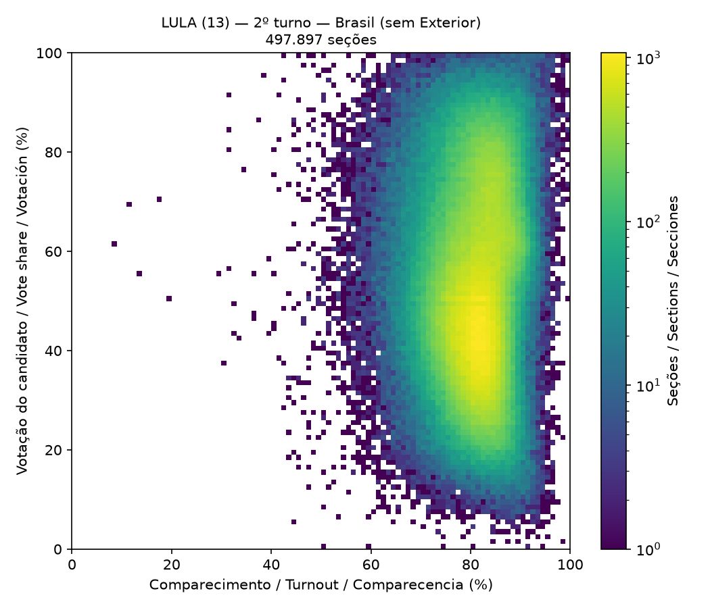
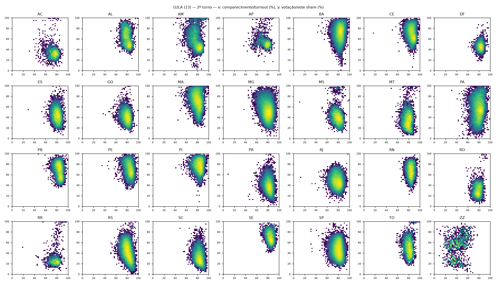
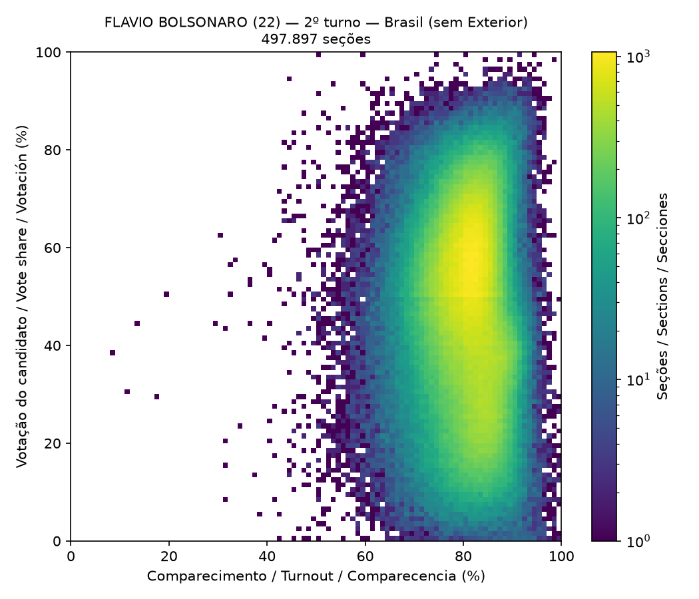
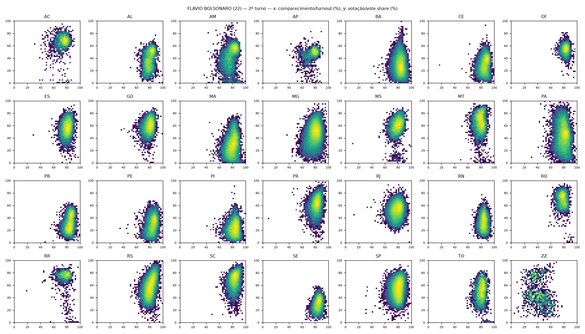

# Informe Técnico de Auditoría Estadística de los Boletines de Urna

**Elecciones Generales de Brasil 2026 — 2.ª vuelta**

|  |  |
|---|---|
| Identificador del documento | `bf5af31e2e6215912049d5f893f6da48` |
| Fecha de emisión | 28/10/2026 |
| Versión del motor de análisis | 2.1.0 |
| SHA-256 del núcleo analítico | `e352358885fbee03f553d831dc82c0499dc5b2f5cc94048dd2ddc0468afa8581` |

> 🧾 **Estado de Integridad (Determinismo Técnico):** Primera ejecución con estos archivos de entrada. El núcleo analítico (15 metodologías, sin fecha, hora ni duración) se registró como **informe de homologación**, con SHA-256 `e352358885fbee03f553d831dc82c0499dc5b2f5cc94048dd2ddc0468afa8581`. Toda nueva ejecución con los mismos archivos se comparará con este registro.

**Leyenda de colores:** 🔴 Anomalía estadística (urna listada para verificación) · 🟡 Evento informativo (registrado para verificación, sin alcanzar el criterio de anomalía) · 🟢 Ninguna ocurrencia · ⚠️ Fallo en la ejecución de la prueba

## 1. Naturaleza del documento y salvedades

Este documento es un informe técnico de análisis estadístico exploratorio (*election forensics*) aplicado a los datos públicos oficiales de Boletines de Urna (BU) divulgados por el Tribunal Superior Electoral de Brasil (TSE) en su Portal de Datos Abiertos.

El informe **no constituye un dictamen pericial oficial** (arts. 159 y siguientes del Código de Proceso Penal brasileño) y **no atribuye conducta alguna a ninguna persona o institución**.

Una señalización estadística identifica una observación improbable bajo el modelo de referencia explicitado en este documento. **Una anomalía estadística no es prueba de fraude, error o irregularidad.** Toda señalización debe someterse a verificación documental y técnica: BU impreso, archivos digitales firmados de la urna (.bu, .imgbu, .rdv, .logjez), acta de la mesa receptora y registros de incidencias.

En análisis de cientos de miles de unidades se espera, incluso en un proceso electoral íntegro, un número no nulo de señalizaciones, derivado de la variabilidad natural, de particularidades locales y de supuestos simplificadores de los modelos. La tasa de falsos descubrimientos se controla en 0,01 (Sección 8.4) para las pruebas inferenciales.

## 2. Autoría y responsabilidad técnica

|  |  |
|---|---|
| Autor | Eduardo Santana dos Santos Beira de Lima |
| Especialidad | Especialista en Ingeniería de Prompts y Arquitectura Analítica con Inteligencia Artificial |
| Lugar de ejecución | Centro de Curitiba, Paraná, Brasil |
| Instagram | @edu.limaoficial |

## 3. Resumen ejecutivo

Se procesaron 2.088.107 registros de 28 archivos oficiales (28 unidades federativas), correspondientes a 499.207 boletines de sección (499.207 secciones electorales distintas; 2.ª vuelta) y 538.946 boletines sección–cargo. Se aplicaron 15 pruebas estadísticas y de consistencia.

Integridad de los archivos: 28 de 56 archivos con hash SHA-512 coincidente con el hash oficial publicado por el TSE; 0 divergente(s); 28 sin verificación oficial posible.

Secciones con al menos una señalización de anomalía: 625 (0,13% de las secciones analizadas). Secciones con señalizaciones convergentes (dos o más pruebas distintas): 0.

**Resultados consolidados**

| Prueba | Unidades analizadas | Señalizaciones (anomalía) | Eventos informativos | Ocurrencias brutas | Tasa |
|---|---:|---:|---:|---:|---:|
| 🟢 1. Cierre Aritmético del Boletín de Urna | 538.946 | 0 | 0 | — | 0,000% |
| 🟢 2. Inconsistencia de Totales | 538.946 | 0 | 0 | — | 0,000% |
| 🔴 3. Unanimidad en la Sección | 538.940 | 28 | 114 | 142 | 0,005% |
| 🔴 4. Abstención Cero | 499.207 | 1 | 0 | 12 | 0,000% |
| 🔴 5. Exceso de Votos en Blanco y Nulos | 538.771 | 20 | 0 | — | 0,004% |
| 🟢 6. Voto Cruzado Extremo | 0 | 0 | 0 | 0 | — |
| 🟢 7. Paradoja del Voto de Lista | 0 | 0 | 0 | — | — |
| 🔴 8. Contraste de Vecindad | 488.530 | 17 | 0 | — | 0,003% |
| 🔴 9. Secciones con Resultados Idénticos | 534.392 | 2 | 0 | 117.328 | 0,000% |
| 🔴 10. Baja Validación Biométrica | 499.042 | 161 | 0 | — | 0,032% |
| 🟡 11. Horarios Atípicos | 499.178 | 0 | 86 | — | 0,000% |
| 🔴 12. Sustitución de Urna y Votación con Papeleta | 499.207 | 399 | 2.670 | — | 0,080% |
| 🟢 13. Prueba del 2.º Dígito (Mebane) | 70 | 0 | 0 | — | 0,000% |
| 🟢 14. Prueba del Último Dígito (Beber-Scacco) | 70 | 0 | 0 | — | 0,000% |
| 🟡 15. Huella Digital Electoral (Klimek) | 58 | 0 | 9 | — | 0,000% |

### 🔎 Cómo verificar su urna

Cada prueba de la Sección 9 incluye la **lista completa** de las urnas señaladas, con UF, municipio (nombre y código del TSE), zona, sección, secciones agregadas, local de votación, número de la urna y código de carga.

1. Localice la UF, la zona y la sección en el título de elector o en la aplicación e-Título.

2. Busque la zona y la sección en este informe (Ctrl+F) o en los archivos `dados/busca_urnas.json` (una entrada por sección, con todas las pruebas en que aparece) y `dados/secoes_sinalizadas.csv`.

3. Si su sección fue **agregada** a otra, sus votos aparecen bajo el número de la sección principal: busque el número de su sección en la columna *Secciones agregadas*.

4. El número de la urna y el código de carga permiten la comparación con el boletín impreso fijado en la sección y con los archivos oficiales de correspondencia del TSE.

## 4. Alcance, fuentes de datos y cobertura

Fuente primaria: Portal de Datos Abiertos del TSE, conjunto "Resultados – 2026 – Boletim de Urna" (archivos bweb). Fuente complementaria: "Correspondências esperadas e efetivadas" (archivos CESP), utilizada en la prueba 12. Los datos son públicos y se procesaron sin alteración de contenido.

**Cobertura por UF**

| UF | Vuelta | Archivo | Registros | Secciones |
|---|---|---|---:|---:|
| AC | 2 | bweb_2t_AC_261020260742.csv | 17.622 | 2.270 |
| AL | 2 | bweb_2t_AL_261020260742.csv | 27.419 | 7.101 |
| AM | 2 | bweb_2t_AM_261020260742.csv | 62.590 | 8.157 |
| AP | 2 | bweb_2t_AP_261020260742.csv | 6.973 | 1.914 |
| BA | 2 | bweb_2t_BA_261020260742.csv | 137.040 | 35.476 |
| CE | 2 | bweb_2t_CE_261020260742.csv | 91.087 | 23.765 |
| DF | 2 | bweb_2t_DF_261020260742.csv | 55.307 | 6.969 |
| ES | 2 | bweb_2t_ES_261020260742.csv | 78.082 | 9.844 |
| GO | 2 | bweb_2t_GO_261020260742.csv | 61.031 | 15.686 |
| MA | 2 | bweb_2t_MA_261020260742.csv | 66.190 | 18.093 |
| MG | 2 | bweb_2t_MG_261020260742.csv | 203.235 | 52.062 |
| MS | 2 | bweb_2t_MS_261020260742.csv | 26.734 | 7.106 |
| MT | 2 | bweb_2t_MT_261020260742.csv | 30.873 | 8.287 |
| PA | 2 | bweb_2t_PA_261020260742.csv | 76.003 | 20.827 |
| PB | 2 | bweb_2t_PB_261020260742.csv | 41.416 | 10.712 |
| PE | 2 | bweb_2t_PE_261020260742.csv | 83.243 | 21.418 |
| PI | 2 | bweb_2t_PI_261020260742.csv | 37.819 | 10.225 |
| PR | 2 | bweb_2t_PR_261020260742.csv | 105.761 | 27.142 |
| RJ | 2 | bweb_2t_RJ_261020260742.csv | 147.600 | 37.675 |
| RN | 2 | bweb_2t_RN_261020260742.csv | 63.676 | 8.115 |
| RO | 2 | bweb_2t_RO_261020260742.csv | 17.265 | 4.698 |
| RR | 2 | bweb_2t_RR_261020260742.csv | 5.332 | 1.519 |
| RS | 2 | bweb_2t_RS_261020260742.csv | 106.789 | 27.547 |
| SC | 2 | bweb_2t_SC_261020260742.csv | 67.266 | 17.326 |
| SE | 2 | bweb_2t_SE_261020260742.csv | 22.732 | 5.923 |
| SP | 2 | bweb_2t_SP_261020260742.csv | 410.145 | 103.656 |
| TO | 2 | bweb_2t_TO_261020260742.csv | 33.900 | 4.384 |
| ZZ | 2 | bweb_2t_ZZ_261020260742.csv | 4.977 | 1.310 |

Las 27 UF y el Exterior (ZZ) están presentes en el conjunto analizado.

## 5. Integridad de los datos y cadena de custodia digital

Para cada archivo de entrada se calculó el resumen criptográfico SHA-512 (FIPS 180-4), el mismo algoritmo utilizado por el TSE en la publicación de los archivos. Siempre que estuvo disponible, el resumen calculado se comparó con el resumen oficial (archivo .sha512 publicado por el TSE junto a cada archivo .zip).

El hash oficial del TSE se refiere al archivo comprimido (.zip). Los archivos entregados ya descomprimidos (.csv) tienen su resumen registrado, pero no pueden contrastarse con el hash oficial.

El **hash del manifiesto** es el SHA-512 de la lista ordenada "nombre;tamaño;sha512" de todos los archivos de entrada e identifica unívocamente el conjunto de datos analizado.

| Archivo | Tamaño (bytes) | SHA-512 (calculado) | Verificación oficial |
|---|---:|---|---|
| bweb_2t_AC_261020260742.csv | 7.787.974 | `84d6e0b34503097fc92b0311790d4cb1668027b6ccf3fcb7613afbe6fdf99d70f71d1cc9bbdab29fa47a334b8bf138a971daa6bf486b3e34878fa89227bff071` | no verificable (.csv) |
| bweb_2t_AL_261020260742.csv | 12.121.461 | `a46bff5a160809785d4ca3fb78f8b211bf638b34ff93e3ea601ca7562922bd3f4585c21f8f9501decf8184bfb24fc3b17b1b6de7c5339dbcf65b07fe53b2f0a7` | no verificable (.csv) |
| bweb_2t_AM_261020260742.csv | 27.702.556 | `8549ef9040f62c87c4799bdd55ee83cc04ad1146151505f82041b720766057154b8126461b045f7dd564e822df132a689fda1ce78eb86e477609cc7be7df4447` | no verificable (.csv) |
| bweb_2t_AP_261020260742.csv | 3.056.017 | `4122664b97338a699b98a94884e5f54ebfb0ae41a7c8f30150b0cd1e30f424e93670bc7bb8cf37421bb3a01ff2ac58459f5311fb25b9b7ec2189d62748ca0869` | no verificable (.csv) |
| bweb_2t_BA_261020260742.csv | 60.634.146 | `7ef54cebf56a6d44a5eb6b6f241942a57c197ddf44dd1695f2ea2a10ddb59e6433d20b74f5d0ddf90da5589685b41beec517f7d095419b723f20be7be07aad59` | no verificable (.csv) |
| bweb_2t_CE_261020260742.csv | 40.143.027 | `f936a48868b8ef23cd232a823a27872e7d94043d8ea06ffd4ac5ffbfb82f8cda2b5c558842ac1caf16b2b0c49872f146ffd1de41fd0814887c5da2a4e2b5ebe0` | no verificable (.csv) |
| bweb_2t_DF_261020260742.csv | 24.424.285 | `7df57e1a13effeb9460516e129e6fa014ac07ce79b33be2c11e47f88ff68e720bb2494827814aa4cfe58ecab9a2f52266153d50b9d74310b80b794f64f982310` | no verificable (.csv) |
| bweb_2t_ES_261020260742.csv | 34.889.872 | `c6cc89095ba9de649a72283f22753d4fc6efcfdf8b93155b96138a4f01eafd740b1284936b6f8ae36f78012082c80ae60c88a12598bd276f8b21f2e3fdaeacd6` | no verificable (.csv) |
| bweb_2t_GO_261020260742.csv | 26.992.772 | `d87fa457de8b648a23049091653d13d0e57cb2159b1ef8b1eea4b637d54092629e9ce17bd1cca1f9aa80e8750e2fdb14914e3e331cb2c5f447c1aaffa4bc4f86` | no verificable (.csv) |
| bweb_2t_MA_261020260742.csv | 29.265.535 | `f071a916ff06e502669785a94165de9b3de1eb44fca89c637c1d06d8148a6428dde1a35982fe5db8c0127d5075febb1d9925aff858b12a3076ba25e55e3b5204` | no verificable (.csv) |
| bweb_2t_MG_261020260742.csv | 90.084.704 | `3612cc0ad5a10507516d8c643453a693fa7864fc3247e878af51da26afc58f21119dc6f61f1a3d8b55b68d5895b0625b4c50392d64b3deccbc5f13b3e987ac00` | no verificable (.csv) |
| bweb_2t_MS_261020260742.csv | 11.819.925 | `2171f13cde7637e629cb20df9b4719d5c81eaf57bb851ef4f0a136d7360de84647d34f818084c1058125e51e4d34f3e7ab5f374b25b9e95299957e05cc06ef1c` | no verificable (.csv) |
| bweb_2t_MT_261020260742.csv | 13.675.646 | `a7ae9a155c8d9d170107a3ffc800568b467f96c5ca45f2dd2976bbbb25b1acb9789611d38395bcc8c44718f23ffd9b92c787a72267fa932885205d6935f87e7a` | no verificable (.csv) |
| bweb_2t_PA_261020260742.csv | 33.481.174 | `1b8edd2d572674ba770b2ae937c9cb2c46138f5604c2633efadb341a6e4e9cf9ab215628e50361ed9fa5288a378299b17bdb44c7a2fb35542932dba23e633dad` | no verificable (.csv) |
| bweb_2t_PB_261020260742.csv | 18.289.946 | `db1ccc4419e0f29ab16ed5f581643ff5f358a80a6e0dce5f1ca5a1fdd690779f1625e46b0191abd15d6f074424c83663ba74927fcd663d9eb48c18fe2ad0a5c4` | no verificable (.csv) |
| bweb_2t_PE_261020260742.csv | 36.788.510 | `574fa03de17dceb7ae0faee7415933696c770c8d0ab6c1c353232b6ff8c98683c4f4be1fe121d8ece225614df31a421e710e928311d0326e5629b7bb81607a30` | no verificable (.csv) |
| bweb_2t_PI_261020260742.csv | 16.738.697 | `5558ba5b480eb94a8d5e80f33f00315c6fc4c8a226211751ccb37beb59f50b23bf070aecd892c2603db0ae472ce5f1365380ab808e82e71750b31837abf35031` | no verificable (.csv) |
| bweb_2t_PR_261020260742.csv | 46.790.542 | `47436b944fdf355eb4bf09736d7342cbf056f9b0ca7fabf2fb7a13550e06d83414f072709b4e473fa629a017f67a5a8191378fba9d53584cb7e3268ca5c0a7bc` | no verificable (.csv) |
| bweb_2t_RJ_261020260742.csv | 65.654.095 | `86cdc9312ab494db509d4b7539b59305a3adf7a2058d33858c2dc7efff18d5783d86470bab118e6fc096da7873c470536475148d588a77ba61adbf0a1f702f67` | no verificable (.csv) |
| bweb_2t_RN_261020260742.csv | 28.189.615 | `84460baddbcd8305049124bb30ae5640c09586b46788e8a3f9678f8482c9af23aa89538c20e416c27f632a2c3ad694a9f4b81113230a9202d2d6609ed8d54672` | no verificable (.csv) |
| bweb_2t_RO_261020260742.csv | 7.610.801 | `8c3b4729d3765373213e35f0590cd33f624cebcee5cc1e430c9febbe52a6ee007ab623d6463e1339a9cd07f3d12d6469fe40e82f565c1c1fe3c60badf6884966` | no verificable (.csv) |
| bweb_2t_RR_261020260742.csv | 2.339.778 | `0c03531f4f45618ea94e41e751ed120d3d619272bdbd1d1fc1417bdbf4ac23de87027a1485fd76e4ad9d3a8d20b60ceef83b9471ffc3b24420e840ca46ae900c` | no verificable (.csv) |
| bweb_2t_RS_261020260742.csv | 47.289.327 | `c53f1e722a6435667d31b45177a3529cbe389a596c96c72922d8be5fc37b94445fe18de72da20ce2b563250586d0c5eb4ae1a115b0d7128a1900b792c27e5077` | no verificable (.csv) |
| bweb_2t_SC_261020260742.csv | 29.698.108 | `45147348a4753e83fc6d44b53e3b6420f034ba9872d1195c9272585c53ae3e8f24e231bae042c787b56129a75fd735a7d83c9968fe439fae9664f5f82fa2508b` | no verificable (.csv) |
| bweb_2t_SE_261020260742.csv | 10.064.205 | `3123dd8eec84eb10f24f5a5a0ad444519a8dd1164f16e5a588a21467461382a2082f194fc6712b52e0cb094e9b26c90f90adbe68f20a5b51821f04ed973fda10` | no verificable (.csv) |
| bweb_2t_SP_261020260742.csv | 181.487.605 | `8255d6142fd0f90d62514942eaa4091690a9b07cbd5a237b54a71c38a99d37f25edce42b5ea3ac00a4d381236d16bbe5ff794696c57294145724cedb53f6064e` | no verificable (.csv) |
| bweb_2t_TO_261020260742.csv | 15.196.303 | `2bebe5e49789151f1283ea156ff980c4368b483bfacae443e6e4a3ae30135392e902a9ed4f39f8ccc5aebc5fd75730c9d8214893a8fa06ec5695697e54dfcf71` | no verificable (.csv) |
| bweb_2t_ZZ_261020260742.csv | 2.179.102 | `ee51df30c93d06f71050eb294b1f1bd4cec97ff458afeda104d6af649265f0a76f04506f48d420cc96a2bace2960ecda7c17fbc5b52ffeecb2a9f3b2ec00a6ea` | no verificable (.csv) |
| CESP_2t_AC_241020261231.zip | 440.866 | `24fbb21a9eb75b2336f8509b6a7fda2453ad81657c7135efc5066423d09028071b7689e2a907140608ba6113a4cf2518061913bb160cec404dd24adc42cf6cd0` | COINCIDE |
| CESP_2t_AL_241020261231.zip | 642.420 | `f422b7fda96a6fb4edd76200fd13f5fa66b1eb41fd5c2f9738666fa5a8ce110b72643b7b15fcb6f2935e2f654035ef7b32f70ee5fb9131a4d047fb33aa690a38` | COINCIDE |
| CESP_2t_AM_241020261231.zip | 724.436 | `22ab2c0dc59804821fbd9818d46e0876de061c4c2e8bf10c6277fccf28b535db931277d6393257c7a44180cba0f32d4d21801f723edabcd7deaad924b830b87e` | COINCIDE |
| CESP_2t_AP_241020261231.zip | 419.857 | `6afe6ebe3dd031d71872c26fa9af4a184116161977b997f75e6269445ee6aa6c5b55627f530a64d5f72d2d4c5b6b78f3a5e19ee3207ee3092e3556aeacc777bc` | COINCIDE |
| CESP_2t_BA_241020261231.zip | 2.376.168 | `6980c4beb0b1a1daad6161483b98fd674fcb130c2ff2b672f00ea2a0a9cc61b69cb3cb6fea78906dd13ef00c34d819ca3981e4b578a8a12a4209803ab878518f` | COINCIDE |
| CESP_2t_CE_241020261231.zip | 1.592.883 | `c7aacd88da61e9f03f5c81215a8b36cfc583bc8adf7f820e599989c5f8187361e8dafae6ca5874324d89a3563ac2ce2772acb4d8abf9769b857217cf786656d8` | COINCIDE |
| CESP_2t_DF_241020261231.zip | 614.288 | `216fec055e74489fbf384f9aa81125eccec9d14fbd566ebe76bc3198d208877c0e7c2e3f40ae93eeca7dae0170634fb2b97dcb19cb50f7417d10066d6904be83` | COINCIDE |
| CESP_2t_ES_241020261231.zip | 781.162 | `dd5073053f41415dd4c026981623bc8efdbe5dc85e5480c7189d7571428ce77af4017f28ae9addf008c1287bf19fe217abb80afc88c07215ad07057ccb849c71` | COINCIDE |
| CESP_2t_GO_241020261231.zip | 1.121.842 | `c74c1c8b725f015d6a213000efdc71790864a7fa89d05b2ad1e53a4515333480488b61cbc9f07be20505cdc2554c0a32db33b267d08996accff348b44fa06f53` | COINCIDE |
| CESP_2t_MA_241020261231.zip | 1.289.548 | `6af3d8557b4144dc091d6005445c8b0833cc6256d8d1ca7a3d1fde0e896b35a0928524f218e4b748f4e8478ebd1d2b7bdd41ceb39750395d4c12b45513ddea6a` | COINCIDE |
| CESP_2t_MG_241020261231.zip | 3.350.542 | `16d992d2103df59b8cf906f4913d3bee4cd80adfb370720826d8bf5332a658704e4e6d51b1320277aa86c71bc5bbf248e4901d9d2d693b9146083cf4f3cd5a03` | COINCIDE |
| CESP_2t_MS_241020261231.zip | 695.366 | `14aab5aad528a0ef57f788e6e3febb04d39db05ffded54e4afc7cd347758a987185fdd5b64e52830e0ce01c3ecaa89245dd91165a2e25c3d537f9b2188facb36` | COINCIDE |
| CESP_2t_MT_241020261231.zip | 759.147 | `02de63ec90c1072e08bfab595a135674b66805cbcf1beb749ddf381fa616650088bc3ee6a073fbe48432283d5d74bd70e7dc51e586e72a6ec2564e3f67e1b6c1` | COINCIDE |
| CESP_2t_PA_241020261231.zip | 1.415.097 | `1dfcd21341b893d77b7b9916a8ea8e5f6ecf77661061f8d3225bf599bae6be434f790b69b2005187207dd0a5898009685dd20a25409e358e9c5a8ca52a599580` | COINCIDE |
| CESP_2t_PB_241020261231.zip | 829.951 | `32b07e99ab370e1d028dcbb4ef824930d87f8b85e9b60d5a3f7776828f0f0ec6ca88eb16e443b0335dd5f0e3f2b86c1bedc96cf7f5e75cb7a184c0f91b2fd1b0` | COINCIDE |
| CESP_2t_PE_241020261231.zip | 1.482.252 | `d9ea6c3b121d786fc9088241a6d16de6afe9675c2baac6a10b117da98aba333a3610dd450c773923a1e3986cf24af200ed9b187f2cfc986225543158a6ec975f` | COINCIDE |
| CESP_2t_PI_241020261231.zip | 873.775 | `6e911b5bee58fbe00e74b69e5921a755c3c7088f61a1af9dd4ea7a507da3c17047fe8e7c23a7e107dd976882877291b0e1e7ff557cef1cb91ebe1ecdbb1abefe` | COINCIDE |
| CESP_2t_PR_241020261231.zip | 1.822.757 | `3b1382a3a22b27a082b4390efa8b19b75e143b632da6558bf8097e297f680fdbe51a8a52171f1df4b97dfb68a305e995a271d92649328a799006f53729b19bb3` | COINCIDE |
| CESP_2t_RJ_241020261231.zip | 2.278.462 | `db46adcd8325bc87ff2fd445b92a6a06681c90ff146c628ee0ac1499a83f2431e3098e82dc11e47b367244d0111f5a5a464edebfdd7a1ce0773dc441bbbc42e9` | COINCIDE |
| CESP_2t_RN_241020261231.zip | 714.014 | `c2ae1ef0595e1c88fbe64c59493f17c94d529a54911eb7dd2e8c7a12ea6b3d6b9ec6a22bc34eccd7a1ccbe9bdb685e1fae865d120e3ac3df4757929fd9965140` | COINCIDE |
| CESP_2t_RO_241020261231.zip | 547.384 | `2d07bc37c389198b784a5b039bc646fdd11987edb0f931fb5fe02be229b48450f8cd78d0956e72f07a346062caf93777c0891a7485719557961587068a6a602c` | COINCIDE |
| CESP_2t_RR_241020261231.zip | 402.949 | `bd4f62ae290ad401c416e205e6534045aad2f0dab7537393d72a02e1d0874c9bf3bfdbd6530aed96b2de33b43953b43e51e147f55f340aeca93778282f465508` | COINCIDE |
| CESP_2t_RS_241020261231.zip | 1.947.214 | `5e1f54d95dda1693ceda68f0fd3a8210d59f83cd49b157afd4bab8763bb97f7aef44f70892758f63113ccf07b33f1e3611644988a6a3503b77201f98b7ad9c8c` | COINCIDE |
| CESP_2t_SC_241020261231.zip | 1.273.232 | `d87f01a1d4e0844d7b959d60d2a67e3b501c58346a9d5af412f388fa956b55dd529d658d9ac14a2fb14c61e1d12da9ac833564b1fd82f2529e389f59e56e2fc5` | COINCIDE |
| CESP_2t_SE_241020261231.zip | 596.857 | `17f963a409daf629c77bd7f9f0c06dddd5d0e4555e68d3b5477b5bb9602b8f7843ba3d80a434557fb60205b106a45edb008294639eed4f0cda4ed67196c31a60` | COINCIDE |
| CESP_2t_SP_241020261231.zip | 6.877.003 | `4490c82f2c941060f88bd15c24b1a55b9affac34327fd0f51833e6d23e2362947c874083df47cec803bfeae52d87ae4c3b23e7a4aa8c100c295e1d3469ece518` | COINCIDE |
| CESP_2t_TO_241020261231.zip | 542.112 | `876ade5ad809d00dcde263c173dcb5eda305bd0184c8ce7ff0991829da15fb4234a3c747766876a12a24e5f7e89511f7c42a6c4f9aaeb060d04e42a74eb81246` | COINCIDE |
| CESP_2t_ZZ_241020261231.zip | 396.618 | `664a2ae806670c3cd5afd16f0309596d9db0272d01d86cb58488009889f717faded987bbf8a5e4e3edb2623b8f3fb923cb39c210fc645f8183e8b1678486e7c9` | COINCIDE |

**Hash del manifiesto (SHA-512):** `bf5af31e2e6215912049d5f893f6da4896ddb8deb0cf072028f6f9547eb8cddb03f375a4d7857270ad81b69636a3abb95727e9c416d1ba28ca553120f77234d5`

## 6. Entorno computacional y cronología de la ejecución

|  |  |
|---|---|
| Inicio del procesamiento | 28/10/2026 00:44:01 |
| Conclusión del procesamiento | 28/10/2026 00:47:50 |
| Duración total | 0h 03min 49s |
| Huso horario de referencia | America/Sao_Paulo (UTC−03:00) |
| Sistema operativo | Windows 11 (AMD64) |
| Python | 3.14.7 |
| Bibliotecas | DuckDB 2.0.0; pandas 3.0.6; NumPy 2.5.3; SciPy 1.18.1; Matplotlib 3.11.2 |
| Núcleos de procesamiento | 4 |
| Memoria física | 7,9 GB |
| Límite de memoria de DuckDB | 3,6 GB |
| Volumen comprimido leído | 0,00 GB |
| Volumen descomprimido procesado | 0,86 GB |

## 7. Preprocesamiento y control de calidad

- Lectura íntegra de los archivos CSV (codificación Latin-1, separador ";") mediante un motor analítico columnar (DuckDB), sin muestreo.
- Valores centinela del TSE ("#NULO#", "#NE", −1, −3) convertidos en ausencia de información en los campos numéricos y temporales.
- Códigos de carga de la urna normalizados (eliminación de separadores y ceros a la izquierda) para su comparación con la correspondencia esperada.
- Clave de la sección: vuelta, UF, código del municipio, zona y sección. Clave del boletín: sección y cargo.
- Votos válidos: nominales y de lista (tipos 1 y 4). Inválidos: en blanco (tipo 2, opción 95) y nulos (tipo 3, opción 96). Los votos anulados escrutados por separado (opción 97) integran el total, pero no los válidos.

**Validación empírica de k (votos por elector)**

| Cargo | Boletines | Razón modal Σvotos/comparecencia | k |
|---|---:|---:|---:|
| — | 2 | — | 1 |
| Presidente | 499.205 | 1,000 | 1 |
| Gobernador | 39.739 | 1,000 | 1 |

## 8. Fundamentos metodológicos

### 8.1 Unidad de análisis

La unidad elemental es el boletín sección–cargo. Las pruebas de comparecencia, biometría, horarios y urna utilizan la sección. Las pruebas de dígitos (13 y 14) y la huella digital electoral (15) operan sobre agregados (candidato × UF).

### 8.2 Grupos geográficos de referencia

Cada sección se compara con las secciones de su grupo de referencia, definido jerárquicamente: la zona electoral dentro del municipio (cuando reúne al menos 20 secciones); en caso contrario, el municipio; luego, el conjunto de las secciones restantes de la misma zona electoral; después, de la UF; y, por último, de la vuelta. Esta jerarquía preserva la homogeneidad local, incluso en grandes ciudades divididas en varias zonas, sin sacrificar la estabilidad de las estimaciones.

### 8.3 Modelo beta-binomial y sobredispersión

Los recuentos de votos por sección presentan una variabilidad superior a la prevista por el modelo binomial, debido a la heterogeneidad del electorado entre secciones. Las pruebas de proporción utilizan el modelo beta-binomial (Skellam, 1948), con media m y correlación intraclase ρ estimadas en el grupo de referencia mediante el estimador de momentos ponderado (Ridout, Demétrio y Firth, 1999): m = Σx/Σn; S = Σ nᵢ(yᵢ − m)²/(G − 1); n₀ = (Σn − Σn²/Σn)/(G − 1); ρ = [S/(m(1 − m)) − 1]/(n₀ − 1), restringido a [0,000001; 0,5]. Parámetros: α = m(1/ρ − 1); β = (1 − m)(1/ρ − 1). La propia unidad evaluada se excluye de la estimación de su grupo (leave-one-out), de modo que un valor extremo no se enmascara a sí mismo; los grupos con menos de tres unidades reciben el ρ máximo (conservador).

### 8.4 Comparaciones múltiples

En cada prueba inferencial, los p-valores de todas las unidades elegibles se ajustan mediante el procedimiento de Benjamini y Hochberg (1995), que controla la tasa esperada de falsos descubrimientos (FDR) en 0,01. Las unidades en las que el evento probado no ocurre (por ejemplo, ausencia de unanimidad) o cuya proporción no supera la media del grupo reciben p = 1; como esas unidades no podrían señalarse, esto no altera las señalizaciones y hace conservador el ajuste.

### 8.5 Pruebas determinísticas

Las pruebas 1, 2, 11 y 12 verifican identidades aritméticas, cronológicas o documentales. No hay modelo probabilístico: cualquier violación se señala.

### 8.6 Parámetros utilizados

| Parámetro | Valor |
|---|---|
| `ALFA_FDR` | 0.01 |
| `MIN_SECOES_GRUPO` | 20 |
| `RHO_MIN / RHO_MAX` | 1e-06 / 0.5 |
| `MIN_VOTOS_UNANIMIDADE` | 10 |
| `MIN_APTOS_ABSTENCAO` | 20 |
| `MIN_VOTOS_PROPORCAO` | 30 |
| `LIMIAR_BLOCO` | 0.7 |
| `LIMIAR_Z_ROBUSTO` | 3.5 |
| `MIN_VOTOS_VOTO_CRUZADO` | 50 |
| `MIN_SECOES_LOCAL` | 3 |
| `LIMIAR_DIF_VIZINHANCA_PP` | 25.0 |
| `MIN_VOTOS_IDENTICOS` | 50 |
| `MIN_CATEGORIAS_IDENTICOS` | 3 |
| `LIMIAR_ESPERADO_IDENTICOS` | 0.01 |
| `HORA_INICIO_OFICIAL / HORA_FIM_OFICIAL` | 8 / 17 |
| `TOLERANCIA_MINUTOS` | 2 |
| `ATRASO_ABERTURA_MIN` | 60 |
| `MIN_CONTAGENS_DIGITOS` | 50 |
| `MIN_MEDIANA_DIGITOS` | 30 |
| `REPLICAS_DIGITOS / SEMENTE_SIMULACAO` | 50 / 20261004 |
| `MIN_SECOES_LOCAL_DIGITOS` | 4 |
| `KLIMEK_CANTO` | 0.9 |
| `KLIMEK_MIN_CANTO / KLIMEK_RAZAO` | 10 / 3.0 |
| `VAGAS_POR_CARGO` | Presidente=1, Gobernador=1, Senador=2, Diputado Federal=1, Diputado Estatal=1, Diputado Distrital=1 |

## 9. Resultados por prueba

### 9.1 🟢 Cierre Aritmético del Boletín de Urna

**Objetivo.** Verificar la consistencia aritmética y estructural interna de cada Boletín de Urna (BU).

**Método.** Para cada par sección–cargo se verifican las identidades: (i) habilitados = comparecencia + abstenciones; (ii) comparecencia ≤ habilitados; (iii) constancia de habilitados, comparecencia y abstenciones en todos los registros del mismo boletín; (iv) ausencia de opciones de voto duplicadas; (v) ausencia de cantidades negativas. Para cada sección: (vi) igualdad de la comparecencia entre los cargos de ámbito estatal; (vii) comparecencia presidencial mayor o igual que la estatal (la diferencia positiva se explica por electores en tránsito habilitados solo para Presidente); (viii) presencia de todos los cargos esperados en el boletín; (ix) constancia del número de urna, del código de carga, del horario de apertura y del recuento biométrico en todos los registros de la sección.

**Criterio de señalización.** Prueba determinística. Cualquier violación se señala como anomalía.

**Limitaciones y explicaciones alternativas.** Una violación indica un error de registro, extracción o procesamiento y debe contrastarse con el BU impreso y con los archivos digitales firmados de la urna (.bu, .rdv, .logjez).

> 📊 **Resultado:** 🟢 **0 anomalía(s)** en 538.946 unidades analizadas (0,000%) · 🟡 0 evento(s) informativo(s).
>
> **Qué significa:** ninguna urna alcanzó el criterio de anomalía de esta prueba.

🟢 Ninguna señalización.

### 9.2 🟢 Inconsistencia de Totales

**Objetivo.** Verificar si el total de votos registrados en cada cargo es compatible con el número de electores que comparecieron.

**Método.** Para cada sección–cargo: Σ votos (nominales, de lista, en blanco, nulos y anulados) = k × comparecencia, donde k es el número de votos por elector en el cargo: k = 2 para Senador en 2026 (renovación de dos tercios del Senado Federal) y k = 1 para los demás cargos. La validez empírica de k se confirma mediante la razón modal Σ votos / comparecencia observada en cada cargo.

**Criterio de señalización.** Prueba determinística. Cualquier diferencia (Δ ≠ 0) se señala como anomalía.

**Limitaciones y explicaciones alternativas.** Las diferencias pueden deberse a errores de extracción o de registro; la verificación definitiva exige el BU impreso y el archivo .bu firmado.

> 📊 **Resultado:** 🟢 **0 anomalía(s)** en 538.946 unidades analizadas (0,000%) · 🟡 0 evento(s) informativo(s).
>
> **Qué significa:** ninguna urna alcanzó el criterio de anomalía de esta prueba.

🟢 Ninguna señalización.

### 9.3 🔴 Unanimidad en la Sección

**Objetivo.** Identificar secciones en las que un único candidato recibió la totalidad de los votos válidos y evaluar la rareza estadística del evento.

**Método.** Son elegibles los pares sección–cargo (Presidente, Gobernador y Diputados) con al menos 10 votos válidos. Para cada unanimidad, la probabilidad del evento se calcula bajo un modelo beta-binomial cuyos parámetros (media y correlación intraclase) se estiman, por el método de los momentos, a partir de la votación del mismo candidato en todas las secciones del grupo geográfico de referencia (Sección 8.2). p = P(X = n). Los p-valores se ajustan mediante el procedimiento de Benjamini–Hochberg (Sección 8.4).

**Criterio de señalización.** Anomalía (🔴) cuando q < 0,01. Todas las demás secciones con el 100% de los votos válidos para un único candidato se enumeran como evento informativo (🟡), con el recuento por candidato.

**Limitaciones y explicaciones alternativas.** Comunidades pequeñas y homogéneas (aldeas indígenas, comunidades aisladas, establecimientos específicos) pueden producir unanimidad legítima que el grupo de referencia no captura.

> 📊 **Resultado:** 🔴 **28 anomalía(s)** en 538.940 unidades analizadas (0,005%) · 🟡 114 evento(s) informativo(s).
>
> Ocurrencias brutas (antes del criterio estadístico): 142.
>
> **Qué significa:** cada urna de la lista 🔴 de abajo presentó un resultado que, según el criterio anterior, es aritméticamente imposible (pruebas 1 y 2) o estadísticamente improbable en su contexto. Es una anomalía estadística: indica prioridad de verificación documental (boletín impreso, acta de la mesa, registros de la urna), pero no es, por sí sola, prueba de fraude.
>
> Los eventos 🟡 se registran por transparencia y verificación, pero no alcanzaron el criterio de anomalía.

**Distribución por categoría**

| Categoría | Cantidad |
|---|---:|
| 🟡 100% para un único candidato | 114 |
| 🔴 Unanimidad improbable | 28 |

**Secciones con el 100% de los votos válidos para un único candidato, por candidato**

| UF | Cargo | Candidato | Secciones 100% | 🔴 Improbables |
|---|---|---|---:|---:|
| Todas las UF | Presidente | nº 13 — LULA | 106 | 25 |
| Todas las UF | Presidente | nº 22 — FLAVIO BOLSONARO | 4 | 1 |
| AC | Presidente | nº 13 — LULA | 3 | 1 |
| AM | Presidente | nº 13 — LULA | 30 | 2 |
| BA | Presidente | nº 13 — LULA | 4 | 0 |
| CE | Presidente | nº 13 — LULA | 2 | 0 |
| ES | Presidente | nº 13 — LULA | 1 | 0 |
| MA | Presidente | nº 13 — LULA | 20 | 2 |
| MG | Presidente | nº 13 — LULA | 2 | 0 |
| MS | Presidente | nº 13 — LULA | 1 | 1 |
| MT | Presidente | nº 13 — LULA | 5 | 5 |
| PA | Presidente | nº 13 — LULA | 16 | 8 |
| PA | Presidente | nº 22 — FLAVIO BOLSONARO | 2 | 1 |
| PB | Presidente | nº 13 — LULA | 1 | 0 |
| PE | Presidente | nº 13 — LULA | 1 | 1 |
| PI | Presidente | nº 13 — LULA | 1 | 0 |
| PR | Presidente | nº 13 — LULA | 1 | 1 |
| RO | Presidente | nº 13 — LULA | 1 | 1 |
| RR | Presidente | nº 13 — LULA | 8 | 1 |
| RS | Presidente | nº 13 — LULA | 2 | 2 |
| RS | Presidente | nº 22 — FLAVIO BOLSONARO | 2 | 0 |
| TO | Presidente | nº 13 — LULA | 7 | 0 |
| AC | Gobernador | nº 11 — MAILZA ASSIS | 3 | 0 |
| AM | Gobernador | nº 55 — OMAR AZIZ | 28 | 1 |
| ES | Gobernador | nº 15 — RICARDO FERRAÇO | 1 | 1 |

#### 🔴 Urnas con anomalía — lista completa (28)

| # | UF | Municipio | Zona | Sección | Secciones agregadas | Local | Nº de urna | Cód. carga | Cargo | Observado | Referencia | q (BH) | Detalle |
|---:|---|---|---:|---:|---|---|---|---|---|---|---|---|---|
| 1 | MT | GUARANTÃ DO NORTE (99058) | 44 | 284 | — | 1171 | 2011320 | 566328743756215356321036 | Presidente | 145/145 (100%) | 17,48% | 1,06e-44 | nº 13 — LULA |
| 2 | MT | CONFRESA (90280) | 28 | 200 | — | 1120 | 2456017 | 484950667769399559554249 | Presidente | 309/309 (100%) | 24,59% | 5,50e-31 | nº 13 — LULA |
| 3 | AC | CRUZEIRO DO SUL (1074) | 4 | 457 | — | 2291 | 2264708 | 93153576434520797581571 | Presidente | 137/137 (100%) | 28,68% | 1,77e-20 | nº 13 — LULA |
| 4 | MT | PEIXOTO DE AZEVEDO (98817) | 33 | 255 | — | 1139 | 2006504 | 949548023749521608651328 | Presidente | 179/179 (100%) | 36,96% | 2,24e-16 | nº 13 — LULA |
| 5 | AM | JURUÁ (2470) | 50 | 19 | 26 / 27 / 36 / 40 / 44 | 1180 | 2316234 | 931628998051954512448123 | Presidente | 149/149 (100%) | 58,73% | 5,98e-16 | nº 13 — LULA |
| 6 | PA | SÃO FÉLIX DO XINGU (5452) | 53 | 218 | — | 1350 | 2392159 | 75375200622742085477778 | Presidente | 273/273 (100%) | 27,01% | 2,07e-14 | nº 13 — LULA |
| 7 | PA | PARAUAPEBAS (5835) | 106 | 330 | — | 1210 | 2191815 | 371612858261111991255705 | Presidente | 212/212 (100%) | 40,91% | 5,06e-14 | nº 13 — LULA |
| 8 | PA | PARAUAPEBAS (5835) | 106 | 365 | — | 1210 | 2183419 | 664541902690794112041508 | Presidente | 197/197 (100%) | 40,92% | 1,62e-13 | nº 13 — LULA |
| 9 | PA | SÃO FÉLIX DO XINGU (5452) | 53 | 217 | — | 1341 | 2324287 | 499517511164880586291396 | Presidente | 145/145 (100%) | 27,3% | 1,93e-09 | nº 13 — LULA |
| 10 | RS | VIAMÃO (89630) | 59 | 591 | — | 2208 | 2007723 | 125646319138205055713445 | Presidente | 65/65 (100%) | 52,52% | 4,68e-08 | nº 13 — LULA |
| 11 | MT | PORTO ALEGRE DO NORTE (98850) | 28 | 191 | — | 1090 | 2251676 | 78909907683703746396615 | Presidente | 61/61 (100%) | 33,31% | 4,88e-08 | nº 13 — LULA |
| 12 | RO | PORTO VELHO (35) | 6 | 516 | — | 1767 | 2228253 | 937159111507218321254088 | Presidente | 104/104 (100%) | 34,69% | 7,68e-08 | nº 13 — LULA |
| 13 | MA | MONTES ALTOS (8397) | 103 | 80 | — | 1090 | 2136242 | 288370841622116372636965 | Presidente | 298/298 (100%) | 61,03% | 7,49e-07 | nº 13 — LULA |
| 14 | PR | ORTIGUEIRA (77275) | 167 | 96 | — | 1562 | 2436538 | 795507085296360816835824 | Presidente | 314/314 (100%) | 51,84% | 3,99e-06 | nº 13 — LULA |
| 15 | PA | ALTAMIRA (4111) | 18 | 516 | — | 3018 | 2435673 | 662961843603081870364038 | Presidente | 52/52 (100%) | 36,17% | 7,33e-06 | nº 13 — LULA |
| 16 | AM | JAPURÁ (2453) | 48 | 12 | — | 1074 | 2357890 | 204836493261232786697780 | Presidente | 224/224 (100%) | 47,6% | 9,66e-06 | nº 13 — LULA |
| 17 | MT | BARRA DO GARÇAS (90352) | 9 | 531 | — | 1511 | 2011356 | 746773514274475795822139 | Presidente | 119/119 (100%) | 38,72% | 1,34e-05 | nº 13 — LULA |
| 18 | PE | FLORESTA (24139) | 72 | 119 | — | 1287 | 2320194 | 270698423044291291024537 | Presidente | 227/227 (100%) | 85,57% | 3,35e-05 | nº 13 — LULA |
| 19 | RR | CAROEBE (3000) | 4 | 141 | — | 1163 | 2283087 | 285572762668174112277933 | Presidente | 44/44 (100%) | 20,17% | 4,93e-05 | nº 13 — LULA |
| 20 | RS | VIAMÃO (89630) | 59 | 590 | — | 2194 | 2002935 | 368070441362230911817299 | Presidente | 39/39 (100%) | 52,54% | 0,0002 | nº 13 — LULA |
| 21 | PA | ALTAMIRA (4111) | 18 | 519 | — | 3000 | 2432252 | 188113690255192522644658 | Presidente | 35/35 (100%) | 36,18% | 0,0004 | nº 13 — LULA |
| 22 | PA | PARAGOMINAS (5096) | 42 | 214 | — | 1503 | 1796710 | 969446656700451847515584 | Presidente | 54/54 (100%) | 41,29% | 0,0015 | nº 13 — LULA |
| 23 | PA | ALMEIRIM (4090) | 55 | 128 | — | 1600 | 1782102 | 751065866488733879336592 | Presidente | 156/156 (100%) | 68,7% | 0,0022 | nº 13 — LULA |
| 24 | PA | CHAVES (4499) | 17 | 41 | — | 1252 | 2419940 | 772161162208997063577605 | Presidente | 48/48 (100%) | 29,98% | 0,0027 | nº 22 — FLAVIO BOLSONARO |
| 25 | MA | MARANHÃOZINHO (7927) | 101 | 78 | — | 1104 | 2125278 | 647584011909773495464340 | Presidente | 176/176 (100%) | 75,84% | 0,0032 | nº 13 — LULA |
| 26 | ES | ARACRUZ (56111) | 20 | 232 | — | 1627 | 2216136 | 559169164666977586808161 | Gobernador | 40/40 (100%) | 46,75% | 0,0064 | nº 15 — RICARDO FERRAÇO |
| 27 | AM | NOVA OLINDA DO NORTE (2658) | 35 | 175 | — | 1198 | 2335394 | 210897349496247635077915 | Gobernador | 110/110 (100%) | 82,52% | 0,0072 | nº 55 — OMAR AZIZ |
| 28 | MS | ARAL MOREIRA (91715) | 19 | 313 | — | 1171 | 2151060 | 819487483665562412876018 | Presidente | 56/56 (100%) | 43,27% | 0,0077 | nº 13 — LULA |

<b>🟡 Eventos informativos — lista completa (114)</b>

| # | UF | Municipio | Zona | Sección | Secciones agregadas | Local | Nº de urna | Cód. carga | Cargo | Observado | Referencia | q (BH) | Detalle |
|---:|---|---|---:|---:|---|---|---|---|---|---|---|---|---|
| 1 | ES | ARACRUZ (56111) | 20 | 232 | — | 1627 | 2216136 | 559169164666977586808161 | Presidente | 41/41 (100%) | 44,29% | 0,0109 | nº 13 — LULA |
| 2 | AM | CARAUARI (2216) | 21 | 96 | — | 1414 | 2460256 | 494674788474281224489454 | Presidente | 113/113 (100%) | 74,47% | 0,0140 | nº 13 — LULA |
| 3 | AC | JORDÃO (1104) | 5 | 66 | — | 1074 | 2273044 | 86063162441442089701437 | Gobernador | 139/139 (100%) | 70,53% | 0,0147 | nº 11 — MAILZA ASSIS |
| 4 | TO | TOCANTINÓPOLIS (96210) | 9 | 192 | — | 1252 | 2259977 | 28001967379852561832277 | Presidente | 155/155 (100%) | 66,61% | 0,0235 | nº 13 — LULA |
| 5 | AM | SANTA ISABEL DO RIO NEGRO (2372) | 30 | 22 | — | 1139 | 2359864 | 740895100742981001794645 | Presidente | 236/236 (100%) | 72,73% | 0,0256 | nº 13 — LULA |
| 6 | AM | SANTA ISABEL DO RIO NEGRO (2372) | 30 | 22 | — | 1139 | 2359864 | 740895100742981001794645 | Gobernador | 245/245 (100%) | 79,23% | 0,0256 | nº 55 — OMAR AZIZ |
| 7 | AC | JORDÃO (1104) | 5 | 65 | — | 1074 | 2285723 | 641619612797794095077374 | Gobernador | 127/127 (100%) | 70,63% | 0,0296 | nº 11 — MAILZA ASSIS |
| 8 | AM | SANTA ISABEL DO RIO NEGRO (2372) | 30 | 26 | — | 1139 | 2342321 | 23623825570575109396386 | Presidente | 229/229 (100%) | 72,76% | 0,0299 | nº 13 — LULA |
| 9 | AM | SANTA ISABEL DO RIO NEGRO (2372) | 30 | 26 | — | 1139 | 2342321 | 23623825570575109396386 | Gobernador | 235/235 (100%) | 79,27% | 0,0329 | nº 55 — OMAR AZIZ |
| 10 | AC | JORDÃO (1104) | 5 | 125 | — | 1074 | 2256855 | 409295183773983336884034 | Gobernador | 120/120 (100%) | 70,69% | 0,0440 | nº 11 — MAILZA ASSIS |
| 11 | PA | ORIXIMINÁ (5053) | 38 | 260 | — | 2097 | 2398124 | 123921728706135398328421 | Presidente | 152/152 (100%) | 55,0% | 0,0444 | nº 13 — LULA |
| 12 | AM | URUCURITUBA (2879) | 3 | 252 | — | 1112 | 2345569 | 589091336854801726921755 | Presidente | 101/101 (100%) | 77,4% | 0,0552 | nº 13 — LULA |
| 13 | AC | JORDÃO (1104) | 5 | 65 | — | 1074 | 2285723 | 641619612797794095077374 | Presidente | 126/126 (100%) | 54,61% | 0,0664 | nº 13 — LULA |
| 14 | MA | GRAJAÚ (7935) | 15 | 405 | — | 2100 | 2307579 | 838745747844235797663665 | Presidente | 102/102 (100%) | 60,76% | 0,0664 | nº 13 — LULA |
| 15 | PA | ORIXIMINÁ (5053) | 38 | 259 | — | 2070 | 2282976 | 265335785820670082063548 | Presidente | 133/133 (100%) | 55,02% | 0,0680 | nº 13 — LULA |
| 16 | PA | ALENQUER (4073) | 21 | 234 | — | 2216 | 1805374 | 731398561731226672292811 | Presidente | 60/60 (100%) | 48,78% | 0,0680 | nº 13 — LULA |
| 17 | AC | JORDÃO (1104) | 5 | 125 | — | 1074 | 2256855 | 409295183773983336884034 | Presidente | 123/123 (100%) | 54,65% | 0,0722 | nº 13 — LULA |
| 18 | MG | SALINAS (51390) | 244 | 256 | 54 | 1562 | 2101483 | 392329581680825942195798 | Presidente | 47/47 (100%) | 60,48% | 0,0890 | nº 13 — LULA |
| 19 | RS | ARROIO DO PADRE (89028) | 34 | 433 | — | 1040 | 2159597 | 753840653390192170880271 | Presidente | 116/116 (100%) | 61,16% | 0,1299 | nº 22 — FLAVIO BOLSONARO |
| 20 | MA | ÁGUA DOCE DO MARANHÃO (7005) | 12 | 145 | — | 1210 | 2281216 | 778506698500958740614838 | Presidente | 189/189 (100%) | 82,82% | 0,1789 | nº 13 — LULA |
| 21 | AM | MAUÉS (2615) | 5 | 176 | — | 1406 | 2341225 | 860241105902238895738404 | Presidente | 333/333 (100%) | 83,43% | 0,1837 | nº 13 — LULA |
| 22 | TO | GOIATINS (95338) | 32 | 84 | — | 1180 | 2153221 | 542497540607832869511086 | Presidente | 174/174 (100%) | 67,5% | 0,1837 | nº 13 — LULA |
| 23 | MG | LUISLÂNDIA (41009) | 50 | 224 | — | 1139 | 2030910 | 457980217071642965842121 | Presidente | 69/69 (100%) | 80,06% | 0,2052 | nº 13 — LULA |
| 24 | TO | GOIATINS (95338) | 32 | 61 | — | 1180 | 2151794 | 794922325232548838270411 | Presidente | 162/162 (100%) | 67,56% | 0,2480 | nº 13 — LULA |
| 25 | AM | PARINTINS (2690) | 4 | 130 | 132 | 1600 | 2342318 | 228166522701607183739440 | Presidente | 220/220 (100%) | 82,68% | 0,2588 | nº 13 — LULA |
| 26 | PA | NOVO REPARTIMENTO (4421) | 101 | 152 | — | 1546 | 1808129 | 757095412207256142914206 | Presidente | 18/18 (100%) | 39,84% | 0,3706 | nº 13 — LULA |
| 27 | CE | AQUIRAZ (13196) | 66 | 334 | — | 2151 | 2281772 | 19909937424151744236426 | Presidente | 32/32 (100%) | 64,83% | 0,4506 | nº 13 — LULA |
| 28 | AM | ATALAIA DO NORTE (2054) | 42 | 29 | 32 / 41 | 1112 | 2354152 | 263576393693131068886749 | Presidente | 325/325 (100%) | 76,7% | 0,6209 | nº 13 — LULA |
| 29 | AM | CARAUARI (2216) | 21 | 96 | — | 1414 | 2460256 | 494674788474281224489454 | Gobernador | 113/113 (100%) | 85,72% | 0,7737 | nº 55 — OMAR AZIZ |
| 30 | AM | ATALAIA DO NORTE (2054) | 42 | 26 | 34 | 1120 | 2340939 | 324182129299433029754992 | Presidente | 302/302 (100%) | 76,79% | 0,8204 | nº 13 — LULA |
| 31 | AM | SANTO ANTÔNIO DO IÇÁ (2739) | 47 | 9 | — | 1040 | 2340906 | 523357515265534932881504 | Presidente | 329/329 (100%) | 73,52% | 0,8204 | nº 13 — LULA |
| 32 | AM | SANTO ANTÔNIO DO IÇÁ (2739) | 47 | 87 | — | 1180 | 2356185 | 109115439811593660372388 | Presidente | 315/315 (100%) | 73,54% | 0,9267 | nº 13 — LULA |
| 33 | TO | GOIATINS (95338) | 32 | 60 | — | 1171 | 2459540 | 47447466557445433816028 | Presidente | 108/108 (100%) | 67,81% | 1,0000 | nº 13 — LULA |
| 34 | PA | AVEIRO (4197) | 34 | 660 | — | 1481 | 2301485 | 737838698238961942554015 | Presidente | 106/106 (100%) | 54,38% | 1,0000 | nº 13 — LULA |
| 35 | TO | TOCANTINÓPOLIS (96210) | 9 | 184 | — | 1406 | 2293117 | 785677871755632496185454 | Presidente | 59/59 (100%) | 66,87% | 1,0000 | nº 13 — LULA |
| 36 | MA | VIANA (9490) | 20 | 258 | — | 1945 | 2307063 | 616975025621474245743482 | Presidente | 100/100 (100%) | 71,87% | 1,0000 | nº 13 — LULA |
| 37 | AM | ATALAIA DO NORTE (2054) | 42 | 29 | 32 / 41 | 1112 | 2354152 | 263576393693131068886749 | Gobernador | 323/323 (100%) | 86,14% | 1,0000 | nº 55 — OMAR AZIZ |
| 38 | MA | TURIAÇU (9415) | 39 | 58 | — | 1309 | 2473085 | 198439420232725738885941 | Presidente | 164/164 (100%) | 80,14% | 1,0000 | nº 13 — LULA |
| 39 | BA | IAÇU (35378) | 193 | 116 | — | 1210 | 2228387 | 883693708671192285552054 | Presidente | 40/40 (100%) | 77,71% | 1,0000 | nº 13 — LULA |
| 40 | PA | MOJU (4936) | 37 | 120 | — | 1503 | 2187388 | 695567922691072232084828 | Presidente | 41/41 (100%) | 70,36% | 1,0000 | nº 13 — LULA |
| 41 | MA | TURIAÇU (9415) | 39 | 162 | 193 | 2089 | 2289599 | 77227802320241952214654 | Presidente | 157/157 (100%) | 80,15% | 1,0000 | nº 13 — LULA |
| 42 | AM | ATALAIA DO NORTE (2054) | 42 | 26 | 34 | 1120 | 2340939 | 324182129299433029754992 | Gobernador | 300/300 (100%) | 86,19% | 1,0000 | nº 55 — OMAR AZIZ |
| 43 | AM | BARREIRINHA (2119) | 26 | 62 | — | 1414 | 2356393 | 819861457645286018662935 | Presidente | 261/261 (100%) | 90,77% | 1,0000 | nº 13 — LULA |
| 44 | AM | SANTO ANTÔNIO DO IÇÁ (2739) | 47 | 71 | — | 1180 | 2251565 | 58610654706109684273510 | Gobernador | 283/283 (100%) | 86,43% | 1,0000 | nº 55 — OMAR AZIZ |
| 45 | AM | TABATINGA (98477) | 36 | 61 | — | 1201 | 2332683 | 407927938744383297013109 | Presidente | 354/354 (100%) | 67,52% | 1,0000 | nº 13 — LULA |
| 46 | AM | TABATINGA (98477) | 36 | 61 | — | 1201 | 2332683 | 407927938744383297013109 | Gobernador | 347/347 (100%) | 72,21% | 1,0000 | nº 55 — OMAR AZIZ |
| 47 | BA | SENTO SÉ (39039) | 96 | 119 | — | 1643 | 2251388 | 406869551709189182718667 | Presidente | 62/62 (100%) | 69,56% | 1,0000 | nº 13 — LULA |
| 48 | AM | TABATINGA (98477) | 36 | 96 | — | 1260 | 2352217 | 771664067790413788373042 | Presidente | 338/338 (100%) | 67,54% | 1,0000 | nº 13 — LULA |
| 49 | TO | PARANÃ (95214) | 18 | 87 | — | 1252 | 2029768 | 545949876269528743698983 | Presidente | 33/33 (100%) | 74,07% | 1,0000 | nº 13 — LULA |
| 50 | AM | SANTA ISABEL DO RIO NEGRO (2372) | 30 | 30 | — | 1139 | 2460506 | 700491917138628687621118 | Presidente | 72/72 (100%) | 73,48% | 1,0000 | nº 13 — LULA |
| 51 | PA | ORIXIMINÁ (5053) | 38 | 243 | — | 2046 | 2329438 | 447153231938676011994806 | Presidente | 35/35 (100%) | 55,14% | 1,0000 | nº 13 — LULA |
| 52 | CE | PORANGA (15210) | 40 | 208 | — | 1368 | 1771927 | 836411897567653560622545 | Presidente | 54/54 (100%) | 80,87% | 1,0000 | nº 13 — LULA |
| 53 | AM | MAUÉS (2615) | 5 | 179 | — | 1406 | 2335173 | 506605077866156623284188 | Presidente | 123/123 (100%) | 83,56% | 1,0000 | nº 13 — LULA |
| 54 | MA | SÃO BENTO (9075) | 38 | 167 | — | 1368 | 2287758 | 747783023362528796414014 | Presidente | 96/96 (100%) | 79,82% | 1,0000 | nº 13 — LULA |
| 55 | AM | PARINTINS (2690) | 4 | 280 | — | 2054 | 2339655 | 288772022399821049100294 | Presidente | 88/88 (100%) | 82,73% | 1,0000 | nº 13 — LULA |
| 56 | AM | SANTA ISABEL DO RIO NEGRO (2372) | 30 | 30 | — | 1139 | 2460506 | 700491917138628687621118 | Gobernador | 74/74 (100%) | 79,83% | 1,0000 | nº 55 — OMAR AZIZ |
| 57 | AM | ATALAIA DO NORTE (2054) | 42 | 30 | — | 1155 | 2358043 | 879637082454929129132869 | Presidente | 142/142 (100%) | 77,34% | 1,0000 | nº 13 — LULA |
| 58 | AM | ATALAIA DO NORTE (2054) | 42 | 28 | 33 | 1147 | 2352356 | 435293458510639541054292 | Presidente | 136/136 (100%) | 77,36% | 1,0000 | nº 13 — LULA |
| 59 | AM | BENJAMIN CONSTANT (2135) | 20 | 89 | — | 1244 | 2373862 | 343748891733702512736919 | Presidente | 238/238 (100%) | 81,04% | 1,0000 | nº 13 — LULA |
| 60 | AM | MAUÉS (2615) | 5 | 179 | — | 1406 | 2335173 | 506605077866156623284188 | Gobernador | 121/121 (100%) | 87,31% | 1,0000 | nº 55 — OMAR AZIZ |
| 61 | AM | BENJAMIN CONSTANT (2135) | 20 | 117 | — | 1341 | 2357238 | 30617967957336595313852 | Presidente | 231/231 (100%) | 81,05% | 1,0000 | nº 13 — LULA |
| 62 | RS | CÂNDIDO GODÓI (85839) | 166 | 81 | — | 1228 | 2454088 | 970014649433027243988115 | Presidente | 82/82 (100%) | 75,24% | 1,0000 | nº 22 — FLAVIO BOLSONARO |
| 63 | AM | CANUTAMA (2194) | 13 | 53 | — | 1180 | 2086288 | 763616441044933818619950 | Gobernador | 61/61 (100%) | 73,89% | 1,0000 | nº 55 — OMAR AZIZ |
| 64 | MA | TURIAÇU (9415) | 39 | 206 | — | 2267 | 2272757 | 592479435358126354782249 | Presidente | 91/91 (100%) | 80,22% | 1,0000 | nº 13 — LULA |
| 65 | AM | BARREIRINHA (2119) | 26 | 62 | — | 1414 | 2356393 | 819861457645286018662935 | Gobernador | 261/261 (100%) | 93,64% | 1,0000 | nº 55 — OMAR AZIZ |
| 66 | AM | ATALAIA DO NORTE (2054) | 42 | 37 | — | 1171 | 2351092 | 435293416310783301432831 | Presidente | 122/122 (100%) | 77,41% | 1,0000 | nº 13 — LULA |
| 67 | MA | SANTA HELENA (8958) | 83 | 179 | — | 1562 | 2130536 | 602249174092366034989837 | Presidente | 55/55 (100%) | 75,71% | 1,0000 | nº 13 — LULA |
| 68 | AM | BENJAMIN CONSTANT (2135) | 20 | 89 | — | 1244 | 2373862 | 343748891733702512736919 | Gobernador | 240/240 (100%) | 86,02% | 1,0000 | nº 55 — OMAR AZIZ |
| 69 | MA | SANTA HELENA (8958) | 83 | 170 | — | 1538 | 2097347 | 6289580832099347235639 | Presidente | 54/54 (100%) | 75,71% | 1,0000 | nº 13 — LULA |
| 70 | MA | BARREIRINHAS (7331) | 56 | 254 | — | 2259 | 2285823 | 861287835688602732224643 | Presidente | 95/95 (100%) | 77,77% | 1,0000 | nº 13 — LULA |
| 71 | AM | BENJAMIN CONSTANT (2135) | 20 | 117 | — | 1341 | 2357238 | 30617967957336595313852 | Gobernador | 229/229 (100%) | 86,03% | 1,0000 | nº 55 — OMAR AZIZ |
| 72 | AM | BARREIRINHA (2119) | 26 | 14 | — | 1325 | 2356212 | 234003741496176496446358 | Gobernador | 240/240 (100%) | 93,65% | 1,0000 | nº 55 — OMAR AZIZ |
| 73 | AM | BENJAMIN CONSTANT (2135) | 20 | 96 | — | 1309 | 2351180 | 879001168541029608610473 | Gobernador | 208/208 (100%) | 86,05% | 1,0000 | nº 55 — OMAR AZIZ |
| 74 | PA | VISEU (5657) | 14 | 236 | — | 2151 | 2202784 | 283379335151331332099479 | Presidente | 64/64 (100%) | 79,52% | 1,0000 | nº 13 — LULA |
| 75 | MA | TURIAÇU (9415) | 39 | 195 | — | 2224 | 2256880 | 642984914977260698817671 | Presidente | 73/73 (100%) | 80,23% | 1,0000 | nº 13 — LULA |
| 76 | MA | CURURUPU (7714) | 14 | 195 | — | 1686 | 2356902 | 258476525417575981336596 | Presidente | 54/54 (100%) | 82,13% | 1,0000 | nº 13 — LULA |
| 77 | BA | BARRA DO MENDES (33596) | 176 | 151 | — | 1422 | 2310291 | 944218496692443943586516 | Presidente | 69/69 (100%) | 87,64% | 1,0000 | nº 13 — LULA |
| 78 | AM | ATALAIA DO NORTE (2054) | 42 | 30 | — | 1155 | 2358043 | 879637082454929129132869 | Gobernador | 142/142 (100%) | 86,52% | 1,0000 | nº 55 — OMAR AZIZ |
| 79 | AM | SÃO GABRIEL DA CACHOEIRA (2836) | 19 | 65 | — | 1546 | 2336271 | 430449406971705575652887 | Gobernador | 227/227 (100%) | 79,7% | 1,0000 | nº 55 — OMAR AZIZ |
| 80 | TO | TOCANTÍNIA (96199) | 5 | 55 | — | 1031 | 2029117 | 933348839540883344232841 | Presidente | 196/196 (100%) | 72,78% | 1,0000 | nº 13 — LULA |
| 81 | MA | ALCÂNTARA (7030) | 52 | 85 | — | 1554 | 2252617 | 444001446568757657173688 | Presidente | 79/79 (100%) | 80,82% | 1,0000 | nº 13 — LULA |
| 82 | AM | ATALAIA DO NORTE (2054) | 42 | 28 | 33 | 1147 | 2352356 | 435293458510639541054292 | Gobernador | 133/133 (100%) | 86,53% | 1,0000 | nº 55 — OMAR AZIZ |
| 83 | AM | ATALAIA DO NORTE (2054) | 42 | 37 | — | 1171 | 2351092 | 435293416310783301432831 | Gobernador | 125/125 (100%) | 86,55% | 1,0000 | nº 55 — OMAR AZIZ |
| 84 | AM | BARREIRINHA (2119) | 26 | 68 | — | 1414 | 2340257 | 516831816615126082499945 | Gobernador | 184/184 (100%) | 93,67% | 1,0000 | nº 55 — OMAR AZIZ |
| 85 | AM | SÃO GABRIEL DA CACHOEIRA (2836) | 19 | 65 | — | 1546 | 2336271 | 430449406971705575652887 | Presidente | 224/224 (100%) | 79,8% | 1,0000 | nº 13 — LULA |
| 86 | AM | SÃO GABRIEL DA CACHOEIRA (2836) | 19 | 87 | — | 1600 | 2340183 | 844590178974280706745108 | Presidente | 222/222 (100%) | 79,81% | 1,0000 | nº 13 — LULA |
| 87 | AM | JAPURÁ (2453) | 48 | 12 | — | 1074 | 2357890 | 204836493261232786697780 | Gobernador | 226/226 (100%) | 25,44% | 1,0000 | nº 55 — OMAR AZIZ |
| 88 | AM | AMATURÁ (2917) | 22 | 66 | — | 1074 | 2460847 | 641900723945317777605651 | Gobernador | 175/175 (100%) | 87,59% | 1,0000 | nº 55 — OMAR AZIZ |
| 89 | AM | SÃO GABRIEL DA CACHOEIRA (2836) | 19 | 92 | — | 1546 | 2359680 | 66712911196466104862160 | Presidente | 215/215 (100%) | 79,81% | 1,0000 | nº 13 — LULA |
| 90 | AM | SÃO GABRIEL DA CACHOEIRA (2836) | 19 | 1 | — | 1090 | 2357805 | 794085903796437971826941 | Gobernador | 169/169 (100%) | 79,75% | 1,0000 | nº 55 — OMAR AZIZ |
| 91 | AM | SÃO PAULO DE OLIVENÇA (2755) | 22 | 71 | — | 1171 | 2355352 | 168352764936972305914550 | Presidente | 298/298 (100%) | 83,13% | 1,0000 | nº 13 — LULA |
| 92 | AM | SÃO PAULO DE OLIVENÇA (2755) | 22 | 78 | — | 1198 | 2355852 | 188554558638802035095937 | Gobernador | 283/283 (100%) | 87,4% | 1,0000 | nº 55 — OMAR AZIZ |
| 93 | MA | SERRANO DO MARANHÃO (8524) | 107 | 87 | — | 1120 | 2091229 | 976283304060974917432940 | Presidente | 83/83 (100%) | 89,98% | 1,0000 | nº 13 — LULA |
| 94 | PI | TERESINA (12190) | 97 | 168 | 147 / 148 / 149 / 150 | 1350 | 2397528 | 266166655694805088693729 | Presidente | 16/16 (100%) | 67,87% | 1,0000 | nº 13 — LULA |
| 95 | AM | SÃO PAULO DE OLIVENÇA (2755) | 22 | 114 | 58 / 59 / 94 / 118 | 1228 | 2351934 | 87544684367094465012935 | Presidente | 244/244 (100%) | 83,18% | 1,0000 | nº 13 — LULA |
| 96 | AM | SÃO GABRIEL DA CACHOEIRA (2836) | 19 | 1 | — | 1090 | 2357805 | 794085903796437971826941 | Presidente | 167/167 (100%) | 79,85% | 1,0000 | nº 13 — LULA |
| 97 | AM | SÃO GABRIEL DA CACHOEIRA (2836) | 19 | 120 | — | 1708 | 2470611 | 662772895132021129025440 | Gobernador | 127/127 (100%) | 79,79% | 1,0000 | nº 55 — OMAR AZIZ |
| 98 | MA | SERRANO DO MARANHÃO (8524) | 107 | 89 | — | 1147 | 2129006 | 67192068851058085897920 | Presidente | 74/74 (100%) | 90,0% | 1,0000 | nº 13 — LULA |
| 99 | AM | SÃO PAULO DE OLIVENÇA (2755) | 22 | 119 | — | 1260 | 2359903 | 249160398983903717785717 | Gobernador | 208/208 (100%) | 87,46% | 1,0000 | nº 55 — OMAR AZIZ |
| 100 | BA | ÉRICO CARDOSO (33090) | 111 | 250 | — | 1228 | 2306101 | 490876025819913503369714 | Presidente | 44/44 (100%) | 77,39% | 1,0000 | nº 13 — LULA |
| 101 | AM | SÃO GABRIEL DA CACHOEIRA (2836) | 19 | 120 | — | 1708 | 2470611 | 662772895132021129025440 | Presidente | 126/126 (100%) | 79,89% | 1,0000 | nº 13 — LULA |
| 102 | MA | ALCÂNTARA (7030) | 52 | 86 | — | 1562 | 2292867 | 262283486062277200269199 | Presidente | 44/44 (100%) | 80,87% | 1,0000 | nº 13 — LULA |
| 103 | AM | AMATURÁ (2917) | 22 | 65 | 67 | 1082 | 2358592 | 702506678851635700687181 | Gobernador | 97/97 (100%) | 87,75% | 1,0000 | nº 55 — OMAR AZIZ |
| 104 | MA | PRIMEIRA CRUZ (8850) | 32 | 90 | — | 1384 | 2306595 | 372080000914829055116533 | Presidente | 42/42 (100%) | 85,85% | 1,0000 | nº 13 — LULA |
| 105 | MA | PRIMEIRA CRUZ (8850) | 32 | 193 | — | 1147 | 2252387 | 917434966801139022161578 | Presidente | 42/42 (100%) | 85,85% | 1,0000 | nº 13 — LULA |
| 106 | PA | JACAREACANGA (4200) | 102 | 44 | — | 1244 | 2422991 | 823213543995329732979338 | Presidente | 50/50 (100%) | 49,56% | 1,0000 | nº 22 — FLAVIO BOLSONARO |
| 107 | RR | UIRAMUTÃ (3107) | 7 | 63 | 121 | 1147 | 2285392 | 595636346249250621147532 | Presidente | 256/256 (100%) | 71,92% | 1,0000 | nº 13 — LULA |
| 108 | PB | SAPÉ (22071) | 4 | 290 | — | 1597 | 2455215 | 649008458086565173066680 | Presidente | 10/10 (100%) | 69,72% | 1,0000 | nº 13 — LULA |
| 109 | RR | UIRAMUTÃ (3107) | 7 | 62 | — | 1139 | 2259277 | 878464510977797590291682 | Presidente | 216/216 (100%) | 72,07% | 1,0000 | nº 13 — LULA |
| 110 | RR | UIRAMUTÃ (3107) | 7 | 113 | — | 1244 | 2275361 | 353212848576940751984509 | Presidente | 190/190 (100%) | 72,17% | 1,0000 | nº 13 — LULA |
| 111 | RR | UIRAMUTÃ (3107) | 7 | 61 | — | 1120 | 2254486 | 555232084845268560980417 | Presidente | 189/189 (100%) | 72,17% | 1,0000 | nº 13 — LULA |
| 112 | RR | UIRAMUTÃ (3107) | 7 | 104 | — | 1198 | 2258032 | 70484601748206601899061 | Presidente | 138/138 (100%) | 72,37% | 1,0000 | nº 13 — LULA |
| 113 | RR | UIRAMUTÃ (3107) | 7 | 108 | — | 1139 | 2260678 | 444121413385922658262098 | Presidente | 126/126 (100%) | 72,41% | 1,0000 | nº 13 — LULA |
| 114 | RR | UIRAMUTÃ (3107) | 7 | 124 | — | 1279 | 2276704 | 706747371811879937279798 | Presidente | 48/48 (100%) | 72,69% | 1,0000 | nº 13 — LULA |

### 9.4 🔴 Abstención Cero

**Objetivo.** Identificar secciones con comparecencia del 100% de los electores habilitados y evaluar la rareza estadística del evento.

**Método.** Secciones con al menos 20 electores habilitados. La comparecencia se modela como beta-binomial (x = comparecencia; n = habilitados), con parámetros estimados en el grupo de referencia; p = P(X = n); ajuste de Benjamini–Hochberg.

**Criterio de señalización.** Señalización cuando q < 0,01. También se informa el recuento bruto de secciones con comparecencia total.

**Limitaciones y explicaciones alternativas.** Secciones pequeñas, secciones especiales (establecimientos penitenciarios, unidades de internación) y padrones recientemente revisados pueden presentar comparecencia total legítima. Los electores en tránsito alteran el denominador.

> 📊 **Resultado:** 🔴 **1 anomalía(s)** en 499.207 unidades analizadas (0,000%) · 🟡 0 evento(s) informativo(s).
>
> Ocurrencias brutas (antes del criterio estadístico): 12.
>
> **Qué significa:** cada urna de la lista 🔴 de abajo presentó un resultado que, según el criterio anterior, es aritméticamente imposible (pruebas 1 y 2) o estadísticamente improbable en su contexto. Es una anomalía estadística: indica prioridad de verificación documental (boletín impreso, acta de la mesa, registros de la urna), pero no es, por sí sola, prueba de fraude.

#### 🔴 Urnas con anomalía — lista completa (1)

| # | UF | Municipio | Zona | Sección | Secciones agregadas | Local | Nº de urna | Cód. carga | Cargo | Observado | Referencia | q (BH) | Detalle |
|---:|---|---|---:|---:|---|---|---|---|---|---|---|---|---|
| 1 | RN | CARAÚBAS (16454) | 36 | 69 | — | 1279 | 2359780 | 351922764758630364951921 | — | 163/163 | 84,78% | 0,0098 |  |

### 9.5 🔴 Exceso de Votos en Blanco y Nulos

**Objetivo.** Identificar boletines con proporción de votos en blanco y nulos significativamente superior a la del grupo de referencia.

**Método.** Para cada sección–cargo con al menos 30 votos: x = blancos + nulos; n = total de votos del cargo. p = P(X ≥ x) bajo un modelo beta-binomial ajustado al grupo de referencia; ajuste de Benjamini–Hochberg. También se informa el puntaje z robusto modificado de la proporción (mediana y desviación absoluta mediana del grupo).

**Criterio de señalización.** Señalización cuando q < 0,01.

**Limitaciones y explicaciones alternativas.** Campañas de voto nulo, candidaturas impugnadas y dificultades de uso de la urna en perfiles específicos de electorado elevan legítimamente la proporción de votos inválidos.

> 📊 **Resultado:** 🔴 **20 anomalía(s)** en 538.771 unidades analizadas (0,004%) · 🟡 0 evento(s) informativo(s).
>
> **Qué significa:** cada urna de la lista 🔴 de abajo presentó un resultado que, según el criterio anterior, es aritméticamente imposible (pruebas 1 y 2) o estadísticamente improbable en su contexto. Es una anomalía estadística: indica prioridad de verificación documental (boletín impreso, acta de la mesa, registros de la urna), pero no es, por sí sola, prueba de fraude.

#### 🔴 Urnas con anomalía — lista completa (20)

| # | UF | Municipio | Zona | Sección | Secciones agregadas | Local | Nº de urna | Cód. carga | Cargo | Observado | Referencia | q (BH) | Detalle |
|---:|---|---|---:|---:|---|---|---|---|---|---|---|---|---|
| 1 | MG | PASSA TEMPO (49530) | 208 | 53 | — | 1139 | 1836646 | 665972345855378959211302 | Presidente | 28,23% (35/124) | 5,32% | < 1e-300 | z=21,8 |
| 2 | DF | BRASÍLIA (97012) | 5 | 303 | — | 1694 | 2457106 | 655620259010097096354256 | Gobernador | 21,32% (58/272) | 6,39% | 5,08e-07 | z=9,9 |
| 3 | MG | BRUMADINHO (41793) | 52 | 38 | — | 1430 | 2331105 | 932150022682655733037120 | Presidente | 16,94% (31/183) | 3,44% | 8,33e-06 | z=10,2 |
| 4 | AC | TARAUACÁ (1473) | 5 | 103 | — | 1384 | 2292730 | 569711988798997067058987 | Gobernador | 38,3% (36/94) | 8,85% | 8,33e-06 | z=10,6 |
| 5 | PA | MOJU (4936) | 37 | 283 | — | 1945 | 2183496 | 584456657991674447670711 | Presidente | 11,29% (35/310) | 1,59% | 3,84e-05 | z=9,5 |
| 6 | DF | BRASÍLIA (97012) | 5 | 303 | — | 1694 | 2457106 | 655620259010097096354256 | Presidente | 13,55% (37/273) | 3,28% | 0,0002 | z=8,0 |
| 7 | AM | ITACOATIARA (2410) | 3 | 134 | — | 1759 | 2340724 | 793612536945786721574563 | Presidente | 15,61% (32/205) | 2,91% | 0,0004 | z=9,6 |
| 8 | AM | IPIXUNA (2399) | 45 | 52 | — | 1139 | 2040399 | 648347212761742348705298 | Presidente | 27,04% (53/196) | 4,95% | 0,0014 | z=11,3 |
| 9 | PE | ÁGUAS BELAS (23094) | 64 | 179 | — | 1252 | 1774256 | 725658296617005864191379 | Presidente | 14,04% (25/178) | 2,96% | 0,0014 | z=10,1 |
| 10 | RJ | BOM JARDIM (58092) | 42 | 19 | — | 1171 | 2456741 | 883238944595961016926419 | Presidente | 11,92% (31/260) | 3,8% | 0,0014 | z=9,2 |
| 11 | MG | VAZANTE (54194) | 295 | 39 | 40 / 50 | 1139 | 2334522 | 659801854827361118694651 | Presidente | 10,53% (24/228) | 2,79% | 0,0019 | z=7,5 |
| 12 | MG | BOCAIÚVA (41459) | 44 | 133 | — | 1309 | 2059137 | 547126171100397509670979 | Presidente | 11,61% (26/224) | 3,19% | 0,0032 | z=8,0 |
| 13 | AM | ITACOATIARA (2410) | 3 | 134 | — | 1759 | 2340724 | 793612536945786721574563 | Gobernador | 17,56% (36/205) | 4,16% | 0,0048 | z=7,7 |
| 14 | BA | SANTANA (38652) | 99 | 175 | — | 1317 | 1815431 | 961658098793169392185186 | Presidente | 10,16% (26/256) | 3,08% | 0,0055 | z=5,9 |
| 15 | MG | RIO MANSO (51055) | 47 | 56 | — | 1031 | 2420153 | 865091874335535967907546 | Presidente | 16,98% (18/106) | 3,98% | 0,0073 | z=14,0 |
| 16 | BA | CACHOEIRA (33979) | 118 | 27 | — | 1155 | 2052961 | 684972599771678953312634 | Presidente | 10,1% (29/287) | 2,66% | 0,0073 | z=6,5 |
| 17 | AM | MANACAPURU (2534) | 6 | 84 | — | 1317 | 2335177 | 497115491361366271876205 | Gobernador | 15,03% (29/193) | 4,26% | 0,0090 | z=7,1 |
| 18 | AM | IPIXUNA (2399) | 45 | 52 | — | 1139 | 2040399 | 648347212761742348705298 | Gobernador | 22,96% (45/196) | 3,57% | 0,0090 | z=12,8 |
| 19 | PE | CAETÉS (23639) | 130 | 31 | — | 1040 | 1814972 | 162146488659491653435456 | Presidente | 9,67% (26/269) | 2,8% | 0,0099 | z=6,7 |
| 20 | MG | FERROS (45179) | 113 | 20 | — | 1074 | 1755569 | 783227921855761927349329 | Presidente | 12,15% (22/181) | 3,44% | 0,0099 | z=6,6 |

### 9.6 🟢 Voto Cruzado Extremo

**Objetivo.** Identificar secciones con divergencia ideológica extrema entre el voto para el Ejecutivo y el voto para el Legislativo.

**Método.** Los votos válidos (nominales y de lista) se asignan al espectro del partido (Sección 12): Izquierda (−2), Centroizquierda (−1), Centro (0), Centroderecha (+1) y Derecha (+2); los partidos federados reciben la clasificación del partido que encabeza la federación; los votos de Centro integran el denominador. Se comparan los pares Presidente × Diputado Federal y Gobernador × Diputado Estatal/Distrital, en secciones con al menos 50 votos válidos en ambos cargos. Criterio A (bloques): participación ≥ 70% del bloque Izquierda (Izquierda + Centroizquierda) en un cargo y ≥ 70% del bloque Derecha (Derecha + Centroderecha) en el otro. Criterio B (contexto local): puntaje z robusto modificado (Iglewicz–Hoaglin) de la diferencia entre los puntajes ideológicos medios de los dos cargos, calculado dentro del grupo de referencia, con |z| ≥ 3,5.

**Criterio de señalización.** Señalización cuando los criterios A y B se cumplen simultáneamente. Se informan los recuentos del criterio A aislado.

**Limitaciones y explicaciones alternativas.** El voto dividido es un comportamiento electoral legítimo y frecuente en Brasil. La clasificación ideológica es una premisa analítica del autor y no una categoría oficial.

> 📊 **Resultado:** 🟢 **0 anomalía(s)** en 0 unidades analizadas (—) · 🟡 0 evento(s) informativo(s).
>
> Secciones que cumplen solo el criterio A (bloques): 0. Cumplen A y B: 0.
>
> **Qué significa:** ninguna urna alcanzó el criterio de anomalía de esta prueba.

🟢 Ninguna señalización.

### 9.7 🟢 Paradoja del Voto de Lista

**Objetivo.** Identificar boletines de cargos proporcionales con proporción de votos de lista significativamente superior a la del grupo de referencia.

**Método.** Para Diputado Federal, Estatal y Distrital, con al menos 30 votos válidos: x = votos de lista; n = votos válidos. p = P(X ≥ x) bajo un modelo beta-binomial ajustado al grupo de referencia; ajuste de Benjamini–Hochberg.

**Criterio de señalización.** Señalización cuando q < 0,01.

**Limitaciones y explicaciones alternativas.** Campañas de voto de lista y la fuerza de partidos específicos en determinadas localidades elevan legítimamente la proporción de votos de lista.

> 📊 **Resultado:** 🟢 **0 anomalía(s)** en 0 unidades analizadas (—) · 🟡 0 evento(s) informativo(s).
>
> **Qué significa:** ninguna urna alcanzó el criterio de anomalía de esta prueba.

🟢 Ninguna señalización.

### 9.8 🔴 Contraste de Vecindad

**Objetivo.** Identificar secciones cuya votación diverge drásticamente de las demás secciones del mismo local de votación.

**Método.** Para Presidente (candidato más votado en el conjunto de datos) y Gobernador (candidato más votado en la UF), en locales con al menos 3 secciones y secciones con al menos 30 votos válidos: la proporción del candidato en la sección se compara con la proporción en las demás secciones del mismo local mediante el estadístico z de dos proporciones, corregido por un factor de sobredispersión φ estimado de forma robusta en cada grupo de referencia (φ = mediana(z²)/0,4549, con φ ≥ 1). p bilateral; ajuste de Benjamini–Hochberg.

**Criterio de señalización.** Señalización cuando q < 0,01 y la diferencia absoluta es ≥ 25 puntos porcentuales.

**Limitaciones y explicaciones alternativas.** La distribución de electores en secciones sigue parcialmente el orden de inscripción y el domicilio, lo que puede generar perfiles distintos (edad, barrio de origen) dentro del mismo local.

> 📊 **Resultado:** 🔴 **17 anomalía(s)** en 488.530 unidades analizadas (0,003%) · 🟡 0 evento(s) informativo(s).
>
> **Qué significa:** cada urna de la lista 🔴 de abajo presentó un resultado que, según el criterio anterior, es aritméticamente imposible (pruebas 1 y 2) o estadísticamente improbable en su contexto. Es una anomalía estadística: indica prioridad de verificación documental (boletín impreso, acta de la mesa, registros de la urna), pero no es, por sí sola, prueba de fraude.

#### 🔴 Urnas con anomalía — lista completa (17)

| # | UF | Municipio | Zona | Sección | Secciones agregadas | Local | Nº de urna | Cód. carga | Cargo | Observado | Referencia | q (BH) | Detalle |
|---:|---|---|---:|---:|---|---|---|---|---|---|---|---|---|
| 1 | MG | BELO HORIZONTE (41238) | 32 | 336 | — | 1040 | 2265899 | 684011824715523437063796 | Presidente | 84,5% (nº 13) | 54,4% | 1,13e-18 | Δ=30,2 p.p.; φ=1,19 |
| 2 | MA | AÇAILÂNDIA (9610) | 71 | 468 | 466 / 467 | 1767 | 2210691 | 730733396627472836104233 | Presidente | 36,6% (nº 13) | 79,3% | 4,44e-15 | Δ=-42,7 p.p.; φ=1,5 |
| 3 | SP | BOTUCATU (62499) | 26 | 402 | — | 1236 | 2322564 | 807260389641265150529124 | Presidente | 75,9% (nº 13) | 41,0% | 2,46e-13 | Δ=34,8 p.p.; φ=1,68 |
| 4 | SP | SÃO CARLOS (70793) | 121 | 451 | — | 1988 | 1788042 | 126446949237629744088318 | Presidente | 85,2% (nº 13) | 56,9% | 4,99e-10 | Δ=28,3 p.p.; φ=1,2 |
| 5 | PR | BOM SUCESSO DO SUL (74160) | 73 | 170 | — | 1155 | 2141754 | 776359359575480520114173 | Presidente | 54,2% (nº 13) | 25,2% | 3,06e-09 | Δ=29,0 p.p.; φ=1,09 |
| 6 | RS | NÃO-ME-TOQUE (87556) | 117 | 66 | — | 1260 | 2323960 | 433836516080707147476589 | Presidente | 15,8% (nº 13) | 44,4% | 3,97e-09 | Δ=-28,6 p.p.; φ=1,19 |
| 7 | SP | BAURU (62197) | 23 | 463 | — | 1228 | 2001439 | 581105692753899389435183 | Presidente | 72,4% (nº 13) | 39,6% | 4,29e-07 | Δ=32,8 p.p.; φ=1,94 |
| 8 | RO | ALTA FLORESTA D'OESTE (310) | 17 | 97 | — | 1023 | 2283836 | 760860166616080342408631 | Presidente | 66,3% (nº 13) | 30,4% | 4,02e-06 | Δ=35,9 p.p.; φ=1,0 |
| 9 | RJ | ARARUAMA (58033) | 92 | 102 | 232 | 1678 | 2397024 | 89593396739021635217184 | Presidente | 59,0% (nº 13) | 32,2% | 6,92e-06 | Δ=26,8 p.p.; φ=1,74 |
| 10 | MA | AÇAILÂNDIA (9610) | 71 | 438 | — | 1767 | 2094202 | 488208933302278938472094 | Presidente | 84,1% (nº 13) | 55,8% | 1,63e-05 | Δ=28,4 p.p.; φ=1,5 |
| 11 | PR | CURITIBA (75353) | 177 | 776 | — | 1783 | 2328042 | 659000436056816179432096 | Presidente | 72,2% (nº 13) | 46,2% | 0,0001 | Δ=25,9 p.p.; φ=1,64 |
| 12 | MT | NOVA NAZARÉ (90964) | 30 | 108 | — | 1031 | 2447173 | 137734107703640814841819 | Presidente | 58,5% (nº 13) | 30,4% | 0,0002 | Δ=28,2 p.p.; φ=1,58 |
| 13 | RN | TOUROS (18856) | 14 | 110 | — | 1082 | 2047361 | 378588535824385784708624 | Presidente | 87,8% (nº 13) | 61,6% | 0,0003 | Δ=26,2 p.p.; φ=2,0 |
| 14 | SP | ARAÇATUBA (61557) | 299 | 290 | — | 2160 | 2214161 | 487628290995280119042384 | Presidente | 60,3% (nº 13) | 34,6% | 0,0008 | Δ=25,7 p.p.; φ=1,01 |
| 15 | DF | BRASÍLIA (97012) | 2 | 477 | — | 1449 | 2445415 | 191041813884894672788413 | Presidente | 74,6% (nº 13) | 49,0% | 0,0011 | Δ=25,5 p.p.; φ=2,12 |
| 16 | CE | MORRINHOS (14796) | 44 | 148 | — | 1244 | 1818503 | 964568210657845888180268 | Presidente | 67,3% (nº 13) | 38,1% | 0,0014 | Δ=29,2 p.p.; φ=1,82 |
| 17 | SP | UBATUBA (72095) | 144 | 246 | — | 1066 | 2148315 | 660547788418546081591863 | Presidente | 71,4% (nº 13) | 41,6% | 0,0050 | Δ=29,9 p.p.; φ=1,03 |

### 9.9 🔴 Secciones con Resultados Idénticos

**Objetivo.** Identificar secciones distintas con vectores de resultado exactamente idénticos.

**Método.** Para cada sección–cargo (Presidente, Gobernador y Diputados) se calcula una firma (MD5) del vector completo de resultados (opciones de voto, blancos y nulos). Se consideran boletines con al menos 50 votos y al menos 3 categorías con votos. Las firmas coincidentes en secciones distintas (mismo cargo; misma UF para cargos estatales; todo el conjunto para Presidente) se evalúan mediante la probabilidad aproximada de coincidencia casual de dos vectores multinomiales (aproximación normal: P ≈ (4πn)^−(K−1)/2 · Π pᵢ^−1/2), multiplicada por el número de pares de secciones con el mismo total de votos en el ámbito, lo que resulta en el número esperado de coincidencias casuales E.

**Criterio de señalización.** Señalización cuando E < 0,01.

**Limitaciones y explicaciones alternativas.** La aproximación proporciona un orden de magnitud. Las coincidencias pueden deberse a la duplicación de registros en la extracción de los datos.

> 📊 **Resultado:** 🔴 **2 anomalía(s)** en 534.392 unidades analizadas (0,000%) · 🟡 0 evento(s) informativo(s).
>
> Ocurrencias brutas (antes del criterio estadístico): 117.328.
>
> **Qué significa:** cada urna de la lista 🔴 de abajo presentó un resultado que, según el criterio anterior, es aritméticamente imposible (pruebas 1 y 2) o estadísticamente improbable en su contexto. Es una anomalía estadística: indica prioridad de verificación documental (boletín impreso, acta de la mesa, registros de la urna), pero no es, por sí sola, prueba de fraude.

#### 🔴 Urnas con anomalía — lista completa (2)

| # | UF | Municipio | Zona | Sección | Secciones agregadas | Local | Nº de urna | Cód. carga | Cargo | Observado | Referencia | Detalle |
|---:|---|---|---:|---:|---|---|---|---|---|---|---|---|
| 1 | AM | MANAUS (2550) | 32 | 676 | — | 2127 | 2017555 | 313974005844518732687428 | Gobernador | n=349; K=4 | E=7,03e-03 | = AM/2550/63/485 |
| 2 | AM | MANAUS (2550) | 63 | 485 | — | 1791 | 2346405 | 798754268978360981485730 | Gobernador | n=349; K=4 | E=7,03e-03 | = AM/2550/32/676 |

### 9.10 🔴 Baja Validación Biométrica

**Objetivo.** Identificar secciones con proporción atípica de electores con biometría registrada habilitados sin identificación biométrica.

**Método.** x = QT_ELEI_BIOM_SEM_HABILITACAO (electores con biometría registrada habilitados por otro medio); n = comparecencia. Secciones con al menos 30 comparecientes. p = P(X ≥ x) bajo un modelo beta-binomial ajustado al grupo de referencia; ajuste de Benjamini–Hochberg.

**Criterio de señalización.** Señalización cuando q < 0,01.

**Limitaciones y explicaciones alternativas.** Fallas de lectura de huellas (adultos mayores, trabajadores manuales), defectos del lector biométrico y diferencias regionales en la calidad del registro explican aumentos legítimos. El BU no informa cuántos electores de la sección tienen biometría registrada; el denominador utilizado es la comparecencia total.

> 📊 **Resultado:** 🔴 **161 anomalía(s)** en 499.042 unidades analizadas (0,032%) · 🟡 0 evento(s) informativo(s).
>
> **Qué significa:** cada urna de la lista 🔴 de abajo presentó un resultado que, según el criterio anterior, es aritméticamente imposible (pruebas 1 y 2) o estadísticamente improbable en su contexto. Es una anomalía estadística: indica prioridad de verificación documental (boletín impreso, acta de la mesa, registros de la urna), pero no es, por sí sola, prueba de fraude.

#### 🔴 Urnas con anomalía — lista completa (161)

| # | UF | Municipio | Zona | Sección | Secciones agregadas | Local | Nº de urna | Cód. carga | Cargo | Observado | Referencia | q (BH) | Detalle |
|---:|---|---|---:|---:|---|---|---|---|---|---|---|---|---|
| 1 | AL | OLHO D'ÁGUA DAS FLORES (28134) | 11 | 119 | — | 1058 | 1675105 | 431361586879789458766861 | — | 95,3% (223/234) | 13,71% | < 1e-300 |  |
| 2 | CE | CAMOCIM (13510) | 32 | 175 | — | 2208 | 1657058 | 644807776028746678764179 | — | 91,76% (167/182) | 11,55% | < 1e-300 |  |
| 3 | CE | CHAVAL (13773) | 108 | 1 | — | 1023 | 1657035 | 49501155152692513271788 | — | 93,62% (176/188) | 10,64% | < 1e-300 |  |
| 4 | CE | MORADA NOVA (14753) | 47 | 36 | — | 1104 | 1659484 | 270532146687994098427761 | — | 79,37% (177/223) | 12,07% | < 1e-300 |  |
| 5 | GO | TRINDADE (96253) | 49 | 216 | — | 1465 | 1665155 | 45331957391682949025766 | — | 90,0% (198/220) | 12,44% | < 1e-300 |  |
| 6 | GO | NOVA CRIXÁS (96539) | 110 | 116 | — | 1040 | 1651674 | 858701675536539964156945 | — | 88,2% (157/178) | 14,84% | < 1e-300 |  |
| 7 | MA | PAÇO DO LUMIAR (8494) | 93 | 328 | — | 1481 | 1654402 | 54001349361790135390974 | — | 96,41% (188/195) | 10,58% | < 1e-300 |  |
| 8 | MA | SÃO LUÍS (9210) | 10 | 887 | — | 2356 | 1674613 | 707677751412244832730309 | — | 90,32% (28/31) | 8,02% | < 1e-300 |  |
| 9 | PA | PARAGOMINAS (5096) | 42 | 321 | — | 1104 | 1809696 | 222072746303673996699702 | — | 49,23% (128/260) | 6,45% | < 1e-300 |  |
| 10 | PE | BARREIROS (23272) | 42 | 46 | — | 1201 | 1660999 | 712921653176854216532339 | — | 92,55% (174/188) | 9,41% | < 1e-300 |  |
| 11 | PE | CARUARU (23817) | 105 | 324 | — | 1520 | 1676468 | 58469055324277595191648 | — | 91,54% (303/331) | 9,02% | < 1e-300 |  |
| 12 | PI | MIGUEL ALVES (11231) | 17 | 158 | — | 1600 | 1652668 | 553139875969629747943243 | — | 94,51% (86/91) | 9,66% | < 1e-300 |  |
| 13 | PR | FLORESTÓPOLIS (75574) | 65 | 6 | — | 1015 | 1658531 | 188815847366718509212236 | — | 63,79% (155/243) | 10,01% | < 1e-300 |  |
| 14 | PR | IBIPORÃ (75914) | 80 | 83 | — | 1058 | 1699508 | 296185186719781498375848 | — | 42,96% (125/291) | 9,17% | < 1e-300 |  |
| 15 | PR | MANDAGUAÇU (76759) | 102 | 8 | — | 1023 | 1661280 | 991530992709242439425954 | — | 46,84% (111/237) | 8,37% | < 1e-300 |  |
| 16 | PR | SANTA MARIANA (78530) | 109 | 2 | — | 1015 | 1674359 | 153223373623610428102248 | — | 81,07% (197/243) | 11,83% | < 1e-300 |  |
| 17 | PR | TAPEJARA (79111) | 86 | 218 | — | 1015 | 1680927 | 614683744846594572515578 | — | 87,43% (153/175) | 10,99% | < 1e-300 |  |
| 18 | RJ | NILÓPOLIS (58637) | 221 | 178 | — | 1333 | 1671464 | 400583400768739457571917 | — | 87,04% (188/216) | 10,37% | < 1e-300 |  |
| 19 | RJ | RIO DE JANEIRO (60011) | 8 | 74 | — | 1104 | 1671293 | 291517290675765283493058 | — | 89,67% (269/300) | 10,21% | < 1e-300 |  |
| 20 | RJ | RIO DE JANEIRO (60011) | 214 | 325 | — | 1457 | 1760689 | 847053841987732914564491 | — | 68,63% (210/306) | 10,84% | < 1e-300 |  |
| 21 | RS | BAGÉ (85316) | 7 | 50 | — | 2054 | 1653322 | 214098561570780721035439 | — | 68,33% (151/221) | 12,71% | < 1e-300 |  |
| 22 | SC | ITAPEMA (81639) | 91 | 5 | — | 1015 | 1677192 | 156889703033391380477525 | — | 83,95% (204/243) | 10,64% | < 1e-300 |  |
| 23 | SE | ARACAJU (31054) | 1 | 265 | — | 1406 | 1674148 | 195241190688554391835791 | — | 62,41% (181/290) | 8,51% | < 1e-300 |  |
| 24 | SP | INDAIATUBA (65110) | 211 | 302 | — | 2127 | 1676683 | 992835483836689042531543 | — | 51,17% (131/256) | 5,04% | < 1e-300 |  |
| 25 | SP | PEDREGULHO (68411) | 155 | 67 | — | 1970 | 1677143 | 180417378722799279849605 | — | 79,15% (205/259) | 7,37% | < 1e-300 |  |
| 26 | SP | SÃO PAULO (71072) | 6 | 427 | — | 2097 | 1668135 | 816247815503125228072052 | — | 64,26% (205/319) | 7,19% | < 1e-300 |  |
| 27 | SP | SÃO PAULO (71072) | 325 | 642 | — | 1872 | 1680392 | 765772805375976335197171 | — | 91,85% (169/184) | 6,39% | < 1e-300 |  |
| 28 | SP | SÃO PAULO (71072) | 347 | 171 | — | 1643 | 1848187 | 291061296850294216373477 | — | 38,3% (90/235) | 5,58% | < 1e-300 |  |
| 29 | SP | SÃO PAULO (71072) | 404 | 269 | — | 1309 | 1652165 | 341514937627655248143635 | — | 49,39% (122/247) | 5,3% | < 1e-300 |  |
| 30 | SP | SÃO VICENTE (71218) | 340 | 114 | — | 1228 | 1673887 | 89163687059790468040029 | — | 72,65% (170/234) | 5,81% | < 1e-300 |  |
| 31 | RJ | RIO DE JANEIRO (60011) | 9 | 262 | — | 1244 | 1658641 | 564255562924869079316949 | — | 59,0% (200/339) | 9,66% | 2,31e-10 |  |
| 32 | PE | SIRINHAÉM (25836) | 26 | 153 | — | 1120 | 1674577 | 910171683053047735329899 | — | 91,98% (149/162) | 10,63% | 2,74e-10 |  |
| 33 | MA | ANAJATUBA (7137) | 109 | 67 | 93 | 1260 | 1750560 | 592567787391139595157377 | — | 82,17% (106/129) | 12,72% | 3,34e-10 |  |
| 34 | RJ | RIO DE JANEIRO (60011) | 180 | 113 | — | 1260 | 1650469 | 392504392037801207392875 | — | 61,19% (164/268) | 9,54% | 3,63e-10 |  |
| 35 | PE | JATAÚBA (24597) | 54 | 185 | — | 1023 | 1659332 | 803559803976776620923207 | — | 82,11% (257/313) | 10,41% | 4,19e-10 |  |
| 36 | PR | UBIRATÃ (79332) | 98 | 100 | — | 1074 | 1660787 | 760627859386212765777765 | — | 97,1% (201/207) | 11,81% | 4,19e-10 |  |
| 37 | SP | SÃO BERNARDO DO CAMPO (70750) | 174 | 447 | — | 1074 | 1664476 | 917293320391981870559551 | — | 94,04% (205/218) | 5,38% | 5,16e-10 |  |
| 38 | PE | CARUARU (23817) | 105 | 390 | — | 1414 | 1673562 | 785742685282572216511937 | — | 97,12% (135/139) | 9,16% | 5,16e-10 |  |
| 39 | RS | SANTA MARIA DO HERVAL (86207) | 153 | 13 | — | 1260 | 1677821 | 607937003890017070277396 | — | 85,2% (190/223) | 12,37% | 5,16e-10 |  |
| 40 | SP | SÃO PAULO (71072) | 392 | 34 | — | 1058 | 1666870 | 523364175662507511355925 | — | 82,91% (165/199) | 6,03% | 5,35e-10 |  |
| 41 | BA | SÃO GONÇALO DOS CAMPOS (38857) | 108 | 148 | — | 1244 | 1681571 | 341331590384650140144950 | — | 88,89% (64/72) | 13,52% | 7,43e-10 |  |
| 42 | MA | SÃO LUÍS (9210) | 2 | 97 | — | 1228 | 1655151 | 475369876939932010608378 | — | 92,41% (146/158) | 8,58% | 7,43e-10 |  |
| 43 | PA | DOM ELISEU (5975) | 84 | 35 | — | 1040 | 1805362 | 972797731285225343711544 | — | 81,98% (141/172) | 8,18% | 9,66e-10 |  |
| 44 | PR | CENTENÁRIO DO SUL (74993) | 159 | 9 | — | 1015 | 1661675 | 141657130477555702996447 | — | 93,78% (196/209) | 10,43% | 1,01e-09 |  |
| 45 | SP | SANTOS (70718) | 118 | 325 | — | 1392 | 1823075 | 879691832384239778859648 | — | 89,47% (187/209) | 5,24% | 1,29e-09 |  |
| 46 | SP | SÃO CARLOS (70793) | 410 | 52 | — | 1066 | 1798120 | 885931884615114041883999 | — | 49,49% (147/297) | 4,95% | 1,47e-09 |  |
| 47 | RJ | RIO DE JANEIRO (60011) | 10 | 302 | — | 1660 | 1671779 | 746081741845007947558413 | — | 77,24% (241/312) | 10,73% | 1,47e-09 |  |
| 48 | SP | GUARUJÁ (64750) | 310 | 15 | — | 1040 | 1679585 | 162250789329250101150514 | — | 63,87% (99/155) | 5,78% | 1,60e-09 |  |
| 49 | MG | PORTO FIRME (50458) | 217 | 46 | — | 1031 | 1672891 | 223024223241609430072922 | — | 83,97% (220/262) | 9,65% | 1,83e-09 |  |
| 50 | BA | GLÓRIA (35270) | 84 | 340 | — | 1430 | 1762842 | 27102576241464620940902 | — | 74,19% (115/155) | 10,73% | 1,83e-09 |  |
| 51 | MS | ANGÉLICA (91693) | 27 | 108 | — | 1015 | 1672948 | 209611174565162877585151 | — | 90,32% (168/186) | 12,41% | 1,97e-09 |  |
| 52 | RS | COTIPORÃ (89770) | 88 | 113 | — | 1040 | 1666063 | 171261178129910286373629 | — | 95,92% (282/294) | 16,54% | 1,97e-09 |  |
| 53 | PA | SANTO ANTÔNIO DO TAUÁ (5398) | 36 | 424 | — | 1228 | 1656490 | 387525322594446169367374 | — | 88,39% (99/112) | 7,97% | 1,97e-09 |  |
| 54 | PR | SANTA ISABEL DO IVAÍ (78492) | 94 | 24 | — | 1031 | 1676127 | 374044371158664173206204 | — | 70,68% (135/191) | 12,38% | 1,97e-09 |  |
| 55 | RJ | RIO DE JANEIRO (60011) | 188 | 82 | — | 1589 | 1667962 | 645017649104615256574512 | — | 84,76% (228/269) | 9,82% | 2,51e-09 |  |
| 56 | BA | SÃO FRANCISCO DO CONDE (38830) | 162 | 14 | — | 1023 | 1669567 | 443817950687844441716652 | — | 94,42% (220/233) | 10,21% | 2,69e-09 |  |
| 57 | BA | MARAÚ (37150) | 78 | 158 | 159 | 1333 | 1657116 | 389675387933024854355792 | — | 61,11% (121/198) | 9,14% | 2,84e-09 |  |
| 58 | BA | TANQUE NOVO (39918) | 168 | 178 | 194 | 1198 | 1675729 | 844423300923011987627865 | — | 92,59% (275/297) | 12,02% | 3,02e-09 |  |
| 59 | RS | OSÓRIO (87734) | 77 | 93 | — | 1082 | 1674984 | 360562328799749841985316 | — | 88,31% (204/231) | 11,87% | 4,15e-09 |  |
| 60 | SP | SÃO PAULO (71072) | 408 | 361 | — | 1287 | 1677676 | 826306624645427697895037 | — | 97,84% (272/278) | 5,04% | 7,11e-09 |  |
| 61 | AM | ATALAIA DO NORTE (2054) | 42 | 37 | — | 1171 | 2351092 | 435293416310783301432831 | — | 22,66% (29/128) | 3,02% | 2,30e-08 |  |
| 62 | RJ | VOLTA REDONDA (59250) | 131 | 321 | — | 1341 | 2402048 | 172258699747183816578439 | — | 40,16% (100/249) | 7,02% | 2,51e-08 |  |
| 63 | CE | SOBRAL (15598) | 24 | 330 | — | 1236 | 1677960 | 6258002028176563402086 | — | 53,97% (163/302) | 9,33% | 5,78e-08 |  |
| 64 | DF | BRASÍLIA (97012) | 10 | 115 | — | 1210 | 1808612 | 696076407743155195092931 | — | 37,06% (116/313) | 6,22% | 6,43e-08 |  |
| 65 | SP | GUARULHOS (64777) | 394 | 417 | — | 1058 | 1665970 | 79841270910979492025200 | — | 27,13% (86/317) | 4,17% | 8,39e-08 |  |
| 66 | BA | DIAS D'ÁVILA (30872) | 186 | 134 | — | 1015 | 1657522 | 483279229274889600977916 | — | 96,89% (218/225) | 10,11% | 1,50e-07 |  |
| 67 | SC | BARRA VELHA (80411) | 68 | 191 | — | 1147 | 1844485 | 104640931684095524085329 | — | 43,12% (116/269) | 11,22% | 3,09e-07 |  |
| 68 | CE | JAGUARIBE (14397) | 10 | 6 | — | 1414 | 1675054 | 356542019972849275931589 | — | 89,3% (167/187) | 14,66% | 4,89e-07 |  |
| 69 | RJ | NOVA IGUAÇU (58696) | 156 | 4 | — | 1015 | 2155796 | 769886200358261183021068 | — | 33,72% (88/261) | 6,34% | 6,55e-07 |  |
| 70 | CE | APUIARÉS (13170) | 50 | 220 | — | 1074 | 1816055 | 103245424084497942443763 | — | 50,75% (135/266) | 10,95% | 7,80e-07 |  |
| 71 | ES | SERRA (56995) | 26 | 467 | — | 1848 | 1672242 | 385418936057226356679063 | — | 46,72% (128/274) | 7,67% | 1,96e-06 |  |
| 72 | SP | SÃO PAULO (71072) | 392 | 40 | — | 1058 | 1669846 | 189930467028322305013284 | — | 59,52% (125/210) | 6,08% | 1,96e-06 |  |
| 73 | SP | SÃO PAULO (71072) | 418 | 95 | — | 1090 | 1822970 | 240555426940063584417792 | — | 30,42% (87/286) | 5,28% | 5,61e-06 |  |
| 74 | SP | SÃO PAULO (71072) | 371 | 57 | — | 1155 | 1818225 | 513238638050358692887780 | — | 31,97% (94/294) | 5,57% | 6,63e-06 |  |
| 75 | PR | GUARACI (75795) | 64 | 4 | — | 1023 | 1669029 | 344920783590738820208600 | — | 44,2% (99/224) | 8,78% | 7,19e-06 |  |
| 76 | BA | SIMÕES FILHO (39136) | 33 | 222 | — | 1155 | 1675915 | 778531316959890096729192 | — | 90,27% (306/339) | 10,64% | 8,38e-06 |  |
| 77 | SP | SÃO PAULO (71072) | 373 | 335 | — | 1023 | 1826239 | 392048420896665070997020 | — | 28,99% (89/307) | 5,28% | 9,63e-06 |  |
| 78 | SP | SÃO PAULO (71072) | 372 | 78 | — | 1236 | 1815575 | 796077165701667913907967 | — | 32,63% (93/285) | 5,48% | 1,11e-05 |  |
| 79 | RS | PAROBÉ (98256) | 55 | 331 | — | 1139 | 1681115 | 129902122315804882652014 | — | 44,68% (105/235) | 9,04% | 1,23e-05 |  |
| 80 | PI | CRISTINO CASTRO (10618) | 59 | 1 | — | 1058 | 2471919 | 367270472301978615606777 | — | 25,37% (52/205) | 6,41% | 1,26e-05 |  |
| 81 | BA | DIAS D'ÁVILA (30872) | 186 | 21 | — | 1163 | 1656846 | 877118120146608880456316 | — | 93,1% (216/232) | 10,11% | 1,78e-05 |  |
| 82 | MG | PEÇANHA (49719) | 212 | 61 | — | 1120 | 2262356 | 774324302398001114271046 | — | 27,8% (67/241) | 6,57% | 2,62e-05 |  |
| 83 | MG | SÃO GONÇALO DO RIO ABAIXO (52370) | 22 | 97 | — | 1031 | 1783431 | 582994980109421780712402 | — | 49,38% (120/243) | 10,14% | 6,28e-05 |  |
| 84 | SC | VITOR MEIRELES (80128) | 14 | 128 | — | 1040 | 1681529 | 585809584492167362771276 | — | 50,43% (116/230) | 10,92% | 6,85e-05 |  |
| 85 | BA | SIMÕES FILHO (39136) | 33 | 241 | — | 1066 | 1669681 | 980652553580684784847865 | — | 88,06% (273/310) | 10,68% | 8,98e-05 |  |
| 86 | CE | GRANJEIRO (13978) | 62 | 162 | — | 1082 | 2242036 | 893953627099196648572142 | — | 26,22% (70/267) | 7,24% | 0,0001 |  |
| 87 | BA | SIMÕES FILHO (39136) | 33 | 139 | — | 1252 | 1657138 | 940248237535708701367828 | — | 88,99% (194/218) | 10,77% | 0,0002 |  |
| 88 | RJ | RIO DE JANEIRO (60011) | 14 | 446 | — | 1775 | 1760806 | 513702818589332480056409 | — | 34,98% (106/303) | 10,79% | 0,0002 |  |
| 89 | RS | FARROUPILHA (86550) | 61 | 94 | — | 1805 | 1676062 | 791132794592775602979786 | — | 40,6% (108/266) | 10,44% | 0,0003 |  |
| 90 | MT | VÁRZEA GRANDE (91677) | 49 | 301 | — | 1635 | 1650752 | 19128392901774213918127 | — | 34,17% (68/199) | 7,96% | 0,0003 |  |
| 91 | RJ | RIO DE JANEIRO (60011) | 167 | 40 | — | 1058 | 1671249 | 675395674369101699529645 | — | 35,22% (106/301) | 9,52% | 0,0003 |  |
| 92 | AL | DELMIRO GOUVEIA (27472) | 40 | 12 | — | 1040 | 1677076 | 970525971910366951670580 | — | 51,39% (74/144) | 11,03% | 0,0003 |  |
| 93 | BA | TANQUINHO (39217) | 160 | 116 | — | 1023 | 1770736 | 959746776621912107165294 | — | 27,02% (67/248) | 10,21% | 0,0004 |  |
| 94 | PR | TIJUCAS DO SUL (79251) | 199 | 117 | — | 1171 | 2063222 | 417712340685038172458029 | — | 22,17% (47/212) | 6,7% | 0,0004 |  |
| 95 | GO | CORUMBAÍBA (93190) | 5 | 65 | — | 1058 | 1666356 | 356790323661825171784334 | — | 41,81% (120/287) | 15,21% | 0,0005 |  |
| 96 | MG | ITUMIRIM (46850) | 343 | 15 | — | 1031 | 1778396 | 627150244308345608514363 | — | 28,28% (56/198) | 10,28% | 0,0005 |  |
| 97 | BA | LAURO DE FREITAS (36854) | 180 | 386 | — | 1660 | 1655626 | 74172567616091508023958 | — | 92,65% (315/340) | 10,86% | 0,0007 |  |
| 98 | RS | IVOTI (87173) | 118 | 143 | — | 1228 | 1680003 | 154619158158672854524232 | — | 42,3% (140/331) | 10,12% | 0,0007 |  |
| 99 | BA | TERRA NOVA (39330) | 128 | 190 | — | 1171 | 1657790 | 229033943929886845995936 | — | 92,81% (297/320) | 12,55% | 0,0007 |  |
| 100 | ES | SERRA (56995) | 53 | 978 | — | 1589 | 1652301 | 809648803438188797759485 | — | 40,78% (104/255) | 7,5% | 0,0007 |  |
| 101 | SP | COTIA (63614) | 227 | 367 | — | 1368 | 1676639 | 614370079986536224677230 | — | 28,46% (72/253) | 5,43% | 0,0007 |  |
| 102 | BA | LAURO DE FREITAS (36854) | 180 | 331 | — | 1597 | 1679832 | 811546409782994999556331 | — | 92,68% (291/314) | 10,88% | 0,0008 |  |
| 103 | CE | JAGUARIBE (14397) | 10 | 7 | 60 | 1040 | 1674619 | 265633032485888345997856 | — | 77,39% (202/261) | 14,57% | 0,0008 |  |
| 104 | BA | SÃO SEBASTIÃO DO PASSÉ (38890) | 128 | 17 | — | 1023 | 1664337 | 773788614765654852869741 | — | 85,48% (206/241) | 10,06% | 0,0008 |  |
| 105 | AM | NHAMUNDÁ (2631) | 43 | 47 | — | 1430 | 2341275 | 171978224528142552892404 | — | 23,36% (64/274) | 4,75% | 0,0008 |  |
| 106 | MG | BELO HORIZONTE (41238) | 36 | 321 | — | 1210 | 2270192 | 785065301194551756954414 | — | 19,03% (71/373) | 5,04% | 0,0009 |  |
| 107 | RN | BARAÚNA (30031) | 58 | 66 | — | 1015 | 2368201 | 674290756707719955081130 | — | 24,42% (84/344) | 7,79% | 0,0010 |  |
| 108 | RS | BARRA DO RIBEIRO (85375) | 151 | 7 | — | 1082 | 2324800 | 17756785496284389654061 | — | 25,47% (41/161) | 8,22% | 0,0010 |  |
| 109 | RS | XANGRI-LÁ (88145) | 150 | 37 | — | 1015 | 1802602 | 591503570261500489561718 | — | 31,95% (100/313) | 10,17% | 0,0010 |  |
| 110 | BA | CANDEIAS (34290) | 127 | 335 | — | 1341 | 1675804 | 513351541692251633101773 | — | 89,49% (281/314) | 10,07% | 0,0011 |  |
| 111 | BA | SÃO SEBASTIÃO DO PASSÉ (38890) | 128 | 59 | — | 1171 | 1654690 | 117122459402703480779636 | — | 84,11% (217/258) | 10,02% | 0,0011 |  |
| 112 | PA | ÓBIDOS (5010) | 22 | 241 | — | 2089 | 1847127 | 530989101769041899616902 | — | 48,1% (38/79) | 6,59% | 0,0011 |  |
| 113 | PR | IGUARAÇU (75957) | 67 | 139 | — | 1023 | 1845541 | 720591721412236379798690 | — | 42,25% (109/258) | 10,96% | 0,0012 |  |
| 114 | PR | CASTRO (74950) | 16 | 83 | — | 1244 | 2016450 | 871860765372106820610287 | — | 25,21% (30/119) | 5,31% | 0,0013 |  |
| 115 | PR | TOMAZINA (79294) | 19 | 55 | — | 1180 | 1660647 | 293635199516134304726454 | — | 99,12% (225/227) | 16,18% | 0,0013 |  |
| 116 | RS | FARROUPILHA (86550) | 61 | 39 | — | 1406 | 1670251 | 568809566269240045978345 | — | 39,34% (96/244) | 10,46% | 0,0013 |  |
| 117 | BA | LAURO DE FREITAS (36854) | 180 | 547 | — | 1155 | 1666658 | 316596317163254380865893 | — | 91,27% (324/355) | 10,86% | 0,0014 |  |
| 118 | BA | CANDEIAS (34290) | 127 | 326 | — | 1040 | 1680929 | 755775828016481019853204 | — | 88,96% (282/317) | 10,07% | 0,0014 |  |
| 119 | CE | URUOCA (15792) | 25 | 80 | — | 1171 | 1773435 | 577926132518803096435389 | — | 39,61% (101/255) | 12,04% | 0,0016 |  |
| 120 | SE | TOBIAS BARRETO (32476) | 23 | 64 | — | 1325 | 2276528 | 930340798542601602288153 | — | 28,57% (74/259) | 7,04% | 0,0017 |  |
| 121 | RJ | RIO DE JANEIRO (60011) | 24 | 700 | — | 2020 | 2008535 | 927850559507440676808092 | — | 21,4% (64/299) | 5,19% | 0,0024 |  |
| 122 | RN | NATAL (17612) | 3 | 473 | — | 2046 | 1784265 | 671200857488202064355067 | — | 32,3% (94/291) | 10,51% | 0,0024 |  |
| 123 | BA | SALVADOR (38490) | 11 | 527 | — | 1899 | 2302752 | 447662802312929460454510 | — | 17,2% (54/314) | 4,45% | 0,0025 |  |
| 124 | BA | SIMÕES FILHO (39136) | 33 | 228 | — | 1368 | 1658327 | 586612784240231924395090 | — | 82,59% (242/293) | 10,72% | 0,0025 |  |
| 125 | AL | LIMOEIRO DE ANADIA (27839) | 47 | 145 | — | 1392 | 2438947 | 86313002994560881735134 | — | 28,19% (84/298) | 7,11% | 0,0025 |  |
| 126 | MA | VIANA (9490) | 20 | 172 | — | 1651 | 2267227 | 667480462637416647905761 | — | 30,23% (39/129) | 6,69% | 0,0025 |  |
| 127 | RN | BREJINHO (16357) | 44 | 11 | — | 1058 | 2236440 | 535725714444721519133887 | — | 22,89% (65/284) | 6,69% | 0,0026 |  |
| 128 | BA | LAURO DE FREITAS (36854) | 180 | 236 | — | 1430 | 1676786 | 841849895781357939244114 | — | 90,51% (286/316) | 10,88% | 0,0026 |  |
| 129 | SC | ITAPEMA (81639) | 91 | 296 | — | 1040 | 1769603 | 490223492371490967246987 | — | 66,02% (171/259) | 10,71% | 0,0026 |  |
| 130 | MG | TAPARUBA (42420) | 129 | 40 | — | 1040 | 2067101 | 647686922799839072288228 | — | 36,47% (62/170) | 10,88% | 0,0027 |  |
| 131 | SP | SANTO ANDRÉ (70572) | 156 | 61 | — | 1074 | 1676014 | 505760507939843904743620 | — | 30,5% (79/259) | 7,33% | 0,0029 |  |
| 132 | RO | ROLIM DE MOURA (299) | 29 | 162 | — | 1163 | 2270522 | 625675354689380648682262 | — | 21,54% (53/246) | 6,46% | 0,0030 |  |
| 133 | MG | SENADOR JOSÉ BENTO (53155) | 227 | 151 | — | 1295 | 2132085 | 79616621605963020559909 | — | 16,4% (41/250) | 6,55% | 0,0030 |  |
| 134 | MS | ANASTÁCIO (90131) | 49 | 110 | — | 1333 | 1844468 | 227049383320650114762058 | — | 46,58% (109/234) | 12,97% | 0,0031 |  |
| 135 | MA | SÃO LUÍS (9210) | 3 | 331 | — | 1490 | 1673474 | 384471383416878247543879 | — | 31,44% (72/229) | 8,25% | 0,0032 |  |
| 136 | PR | UMUARAMA (79359) | 89 | 194 | — | 1350 | 1834911 | 991454151624662783954189 | — | 32,6% (89/273) | 9,03% | 0,0033 |  |
| 137 | MG | SÃO MIGUEL DO ANTA (52752) | 268 | 68 | — | 1023 | 1653283 | 207968208274358916426359 | — | 35,74% (89/249) | 12,54% | 0,0033 |  |
| 138 | BA | DIAS D'ÁVILA (30872) | 186 | 91 | — | 1015 | 1669609 | 917522651220700455084186 | — | 85,71% (192/224) | 10,17% | 0,0034 |  |
| 139 | BA | LAURO DE FREITAS (36854) | 180 | 280 | — | 1554 | 1670777 | 114576852808452416668669 | — | 89,81% (291/324) | 10,88% | 0,0034 |  |
| 140 | AL | MAJOR ISIDORO (27871) | 31 | 56 | — | 1015 | 1753506 | 396671406833581392159546 | — | 32,3% (94/291) | 11,29% | 0,0035 |  |
| 141 | GO | TRINDADE (96253) | 49 | 175 | — | 1325 | 1664632 | 116038115724682896804800 | — | 59,85% (164/274) | 12,49% | 0,0040 |  |
| 142 | PR | SÃO SEBASTIÃO DA AMOREIRA (78956) | 35 | 64 | — | 1031 | 1660858 | 779853637714092901061682 | — | 28,57% (60/210) | 9,71% | 0,0042 |  |
| 143 | SC | VIDEIRA (83798) | 36 | 30 | — | 1023 | 1667046 | 690456694737884969083861 | — | 37,26% (98/263) | 9,97% | 0,0043 |  |
| 144 | SP | SANTANA DE PARNAÍBA (70475) | 428 | 69 | — | 1040 | 1762751 | 123950126789990563346459 | — | 20,13% (60/298) | 4,54% | 0,0043 |  |
| 145 | BA | SENHOR DO BONFIM (39012) | 45 | 288 | — | 1724 | 2343862 | 408323029089909449261018 | — | 24,81% (67/270) | 6,1% | 0,0043 |  |
| 146 | SP | RIBEIRÃO PRETO (69698) | 265 | 51 | — | 1074 | 1806160 | 258540711759461080056434 | — | 25,93% (70/270) | 5,43% | 0,0045 |  |
| 147 | BA | CORIBE (34819) | 61 | 7 | — | 1023 | 1654345 | 203773207262545608552039 | — | 52,11% (111/213) | 16,84% | 0,0047 |  |
| 148 | PA | ALTAMIRA (4111) | 18 | 234 | — | 1325 | 2438242 | 602355438758509482209137 | — | 18,3% (41/224) | 4,24% | 0,0060 |  |
| 149 | MA | AMAPÁ DO MARANHÃO (7080) | 64 | 57 | — | 1015 | 2244875 | 843570967406323601229348 | — | 12,28% (21/171) | 3,44% | 0,0060 |  |
| 150 | RS | NOVA BOA VISTA (87203) | 83 | 77 | — | 1090 | 1801764 | 665855929187486091914578 | — | 50,93% (55/108) | 14,1% | 0,0060 |  |
| 151 | SP | BAURU (62197) | 23 | 129 | — | 1244 | 1812780 | 328579546362877502652723 | — | 35,87% (66/184) | 7,11% | 0,0064 |  |
| 152 | PR | MISSAL (84697) | 114 | 96 | — | 1082 | 2326862 | 719931002620642116105672 | — | 24,27% (58/239) | 9,41% | 0,0064 |  |
| 153 | SP | JACAREÍ (65897) | 62 | 150 | — | 1198 | 1811248 | 730237178899485897030475 | — | 27,35% (61/223) | 6,24% | 0,0070 |  |
| 154 | BA | CANDEIAS (34290) | 127 | 336 | — | 1180 | 1656722 | 311331458072218095506864 | — | 86,48% (243/281) | 10,13% | 0,0073 |  |
| 155 | SP | SERRA AZUL (71293) | 109 | 108 | — | 1015 | 1794360 | 467254432625589475137005 | — | 32,81% (84/256) | 9,72% | 0,0086 |  |
| 156 | CE | MARACANAÚ (15857) | 122 | 35 | — | 1066 | 2297524 | 902035667797682357479504 | — | 16,45% (50/304) | 5,02% | 0,0086 |  |
| 157 | SP | SÃO PAULO (71072) | 248 | 24 | — | 1023 | 1826961 | 553689133429342375181791 | — | 21,74% (60/276) | 5,42% | 0,0087 |  |
| 158 | MG | BOM DESPACHO (41475) | 45 | 67 | — | 1090 | 1783065 | 454828642989153148651569 | — | 38,76% (81/209) | 11,82% | 0,0087 |  |
| 159 | MG | GOVERNADOR VALADARES (45535) | 318 | 1 | — | 1015 | 2448826 | 485070594292881756243570 | — | 26,34% (69/262) | 6,43% | 0,0087 |  |
| 160 | BA | SOUTO SOARES (39152) | 174 | 35 | — | 1163 | 2312944 | 918593670224931342274486 | — | 31,25% (75/240) | 9,78% | 0,0091 |  |
| 161 | MG | GUANHÃES (45594) | 121 | 88 | — | 1473 | 1775906 | 329166762947157384495287 | — | 28,31% (47/166) | 8,07% | 0,0091 |  |

### 9.11 🟡 Horarios Atípicos

**Objetivo.** Verificar la conformidad cronológica de los eventos registrados en el BU.

**Método.** Para urnas electrónicas escrutadas, el huso horario local de cada municipio se infiere, entre los husos posibles de la UF, por el percentil 10 de los horarios de apertura (una apertura regular nunca precede el horario oficial y los retrasos no desplazan la referencia) (apertura, cierre y emisión del BU se registran en hora local; la recepción, en hora de Brasilia). Horario oficial: 8h–17h (hora de Brasilia), convertido a la hora local; en el Exterior, 8h–17h en hora local. Tolerancia: 2 min. Verificaciones: apertura anterior al horario oficial; cierre anterior al horario oficial; cierre anterior a la apertura; emisión del BU anterior al cierre; recepción del BU anterior a la emisión (excepto Exterior); fecha de apertura o cierre distinta del día de la elección; ausencia de horarios en urna electrónica escrutada. Los retrasos de apertura ≥ 60 min se informan como eventos informativos.

**Criterio de señalización.** Prueba determinística. Cualquier violación se señala como anomalía; los retrasos son informativos.

**Limitaciones y explicaciones alternativas.** Desvíos del reloj de la urna, sustitución de la urna durante la votación y municipios con huso horario distinto de la mayoría pueden generar señalizaciones explicables.

> 📊 **Resultado:** 🟡 **0 anomalía(s)** en 499.178 unidades analizadas (0,000%) · 🟡 86 evento(s) informativo(s).
>
> **Qué significa:** ninguna urna alcanzó el criterio de anomalía de esta prueba.
>
> Los eventos 🟡 se registran por transparencia y verificación, pero no alcanzaron el criterio de anomalía.

**Distribución por categoría**

| Categoría | Cantidad |
|---|---:|
| 🟡 Apertura con retraso (informativo) | 86 |

<b>🟡 Eventos informativos — lista completa (86)</b>

| # | UF | Municipio | Zona | Sección | Secciones agregadas | Local | Nº de urna | Cód. carga | Cargo | Observado | Referencia | Detalle |
|---:|---|---|---:|---:|---|---|---|---|---|---|---|---|
| 1 | AM | SÃO GABRIEL DA CACHOEIRA (2836) | 19 | 120 | — | 1708 | 2470611 | 662772895132021129025440 | — | 08:02:04 | 07:00 | UTC-4 |
| 2 | AP | MAZAGÃO (6076) | 5 | 75 | — | 1309 | 2241451 | 422797461955976115906174 | — | 09:19:36 | 08:00 | UTC-3 |
| 3 | BA | ABARÉ (33030) | 158 | 122 | — | 1058 | 1671509 | 322564328575452954085239 | — | 09:23:47 | 08:00 | UTC-3 |
| 4 | BA | ÁGUA FRIA (33073) | 74 | 241 | 244 | 1465 | 1673837 | 43797041155713401610700 | — | 10:14:40 | 08:00 | UTC-3 |
| 5 | BA | ARACI (33413) | 123 | 93 | — | 1104 | 1675462 | 853041857001661815912979 | — | 09:31:21 | 08:00 | UTC-3 |
| 6 | BA | CAMAÇARI (34134) | 170 | 105 | — | 1104 | 1674939 | 580316589950869261196421 | — | 10:03:45 | 08:00 | UTC-3 |
| 7 | BA | CANDEIAS (34290) | 127 | 96 | — | 1457 | 1656561 | 836583835351457168870244 | — | 09:28:46 | 08:00 | UTC-3 |
| 8 | BA | CANDEIAS (34290) | 127 | 97 | — | 1457 | 1655958 | 836583832446258885206880 | — | 09:34:34 | 08:00 | UTC-3 |
| 9 | BA | CANDEIAS (34290) | 127 | 300 | — | 1490 | 1650854 | 392139669259864457180643 | — | 09:31:56 | 08:00 | UTC-3 |
| 10 | BA | PRESIDENTE TANCREDO NEVES (38164) | 197 | 169 | — | 1163 | 1778476 | 152964158190860906073821 | — | 09:01:31 | 08:00 | UTC-3 |
| 11 | BA | SANTO AMARO (38717) | 178 | 118 | — | 1279 | 1674211 | 942240949246806309310629 | — | 10:23:25 | 08:00 | UTC-3 |
| 12 | BA | SAUBARA (38946) | 178 | 126 | — | 1058 | 1671214 | 649210646277682356173968 | — | 09:19:50 | 08:00 | UTC-3 |
| 13 | BA | SIMÕES FILHO (39136) | 33 | 37 | — | 1058 | 1675024 | 404894407132598305950605 | — | 09:35:58 | 08:00 | UTC-3 |
| 14 | BA | SIMÕES FILHO (39136) | 33 | 76 | — | 1104 | 1655543 | 21056025912326591492664 | — | 09:06:28 | 08:00 | UTC-3 |
| 15 | BA | SIMÕES FILHO (39136) | 33 | 108 | — | 1163 | 1650747 | 21056026469833136837677 | — | 09:58:20 | 08:00 | UTC-3 |
| 16 | BA | SIMÕES FILHO (39136) | 33 | 109 | — | 1163 | 1657606 | 566410562166947410124368 | — | 09:34:00 | 08:00 | UTC-3 |
| 17 | BA | TABOCAS DO BREJO VELHO (39179) | 190 | 146 | — | 1155 | 1655868 | 121484125745347501876489 | — | 09:48:31 | 08:00 | UTC-3 |
| 18 | BA | VERA CRUZ (39632) | 141 | 32 | — | 1066 | 1796088 | 929940926362737201396972 | — | 09:40:28 | 08:00 | UTC-3 |
| 19 | CE | ARACOIABA (13234) | 67 | 125 | — | 1643 | 2242626 | 153634152794554640536437 | — | 09:01:36 | 08:00 | UTC-3 |
| 20 | CE | CANINDÉ (13552) | 33 | 379 | 462 | 2860 | 2041392 | 550109306491737338823124 | — | 10:22:40 | 08:00 | UTC-3 |
| 21 | CE | CANINDÉ (13552) | 33 | 414 | — | 2925 | 2209948 | 529806394440902162163540 | — | 09:41:12 | 08:00 | UTC-3 |
| 22 | ES | ECOPORANGA (56413) | 33 | 49 | — | 1228 | 2358355 | 472201743454930988498056 | — | 11:00:53 | 08:00 | UTC-3 |
| 23 | ES | ECOPORANGA (56413) | 33 | 83 | — | 1473 | 2366497 | 47958935319194337191516 | — | 10:28:40 | 08:00 | UTC-3 |
| 24 | ES | SANTA MARIA DE JETIBÁ (57932) | 9 | 27 | — | 1082 | 1840580 | 760875670898762366111489 | — | 09:24:11 | 08:00 | UTC-3 |
| 25 | MA | ANAJATUBA (7137) | 109 | 39 | — | 1082 | 1664080 | 855193852631870635042769 | — | 09:08:21 | 08:00 | UTC-3 |
| 26 | MA | ITAPECURU MIRIM (8079) | 16 | 241 | — | 1490 | 1681844 | 821255826609703970279257 | — | 09:46:14 | 08:00 | UTC-3 |
| 27 | MA | SANTA LUZIA (8974) | 70 | 165 | — | 1600 | 2074942 | 570506571351055115943655 | — | 10:07:57 | 08:00 | UTC-3 |
| 28 | MA | SÃO BENTO (9075) | 38 | 161 | — | 1350 | 2269906 | 464955084234502613785085 | — | 09:35:32 | 08:00 | UTC-3 |
| 29 | MA | VIANA (9490) | 20 | 89 | — | 1449 | 2254987 | 374551377442707735902207 | — | 09:13:45 | 08:00 | UTC-3 |
| 30 | MG | CONSELHEIRO PENA (43672) | 89 | 101 | — | 1325 | 2125206 | 288783288874708563337929 | — | 09:39:22 | 08:00 | UTC-3 |
| 31 | MG | GUARDA-MOR (45713) | 295 | 9 | — | 1058 | 2325822 | 835919828502440676084865 | — | 09:02:31 | 08:00 | UTC-3 |
| 32 | MG | ITAJUBÁ (46477) | 134 | 295 | — | 1457 | 2076047 | 824856183827134972290763 | — | 13:08:44 | 08:00 | UTC-3 |
| 33 | MG | MURIAÉ (48771) | 187 | 176 | 268 | 1562 | 2300758 | 914233150626743120512618 | — | 09:01:01 | 08:00 | UTC-3 |
| 34 | MG | MURIAÉ (48771) | 187 | 234 | — | 1597 | 2332594 | 146556977449329307227938 | — | 09:00:16 | 08:00 | UTC-3 |
| 35 | MG | TIMÓTEO (53732) | 98 | 20 | — | 1015 | 1782002 | 937544077572970225337904 | — | 09:02:32 | 08:00 | UTC-3 |
| 36 | MG | UNAÍ (54070) | 280 | 217 | — | 1392 | 2321975 | 643238661979645562912393 | — | 09:01:36 | 08:00 | UTC-3 |
| 37 | MG | VARZELÂNDIA (54178) | 255 | 118 | — | 1074 | 2080467 | 135421137691296286062418 | — | 09:12:49 | 08:00 | UTC-3 |
| 38 | MS | TRÊS LAGOAS (91650) | 51 | 44 | — | 1066 | 2001864 | 333879051899478914901870 | — | 08:13:13 | 07:00 | UTC-4 |
| 39 | PA | ACARÁ (4030) | 94 | 185 | — | 1767 | 2194075 | 501957503256124279422627 | — | 09:19:45 | 08:00 | UTC-3 |
| 40 | PA | AVEIRO (4197) | 34 | 504 | 654 | 1228 | 2402584 | 485313377181658460423499 | — | 09:15:33 | 08:00 | UTC-3 |
| 41 | PA | GURUPÁ (4618) | 26 | 41 | 112 | 1198 | 2422429 | 390019785665667642922324 | — | 09:21:43 | 08:00 | UTC-3 |
| 42 | PA | ÓBIDOS (5010) | 22 | 259 | — | 2143 | 1845460 | 924828924070845018294695 | — | 11:00:22 | 08:00 | UTC-3 |
| 43 | PA | ÓBIDOS (5010) | 22 | 275 | — | 2194 | 1805818 | 581494580774151369926201 | — | 09:08:54 | 08:00 | UTC-3 |
| 44 | PB | JOÃO PESSOA (20516) | 70 | 666 | — | 2119 | 1658320 | 476996476816877816055891 | — | 09:30:46 | 08:00 | UTC-3 |
| 45 | PB | LUCENA (20737) | 2 | 15 | — | 1031 | 1799458 | 431065053629138180702762 | — | 09:17:29 | 08:00 | UTC-3 |
| 46 | PB | LUCENA (20737) | 2 | 319 | — | 1074 | 1799773 | 670289675841016039588486 | — | 09:36:55 | 08:00 | UTC-3 |
| 47 | PB | SANTA RITA (21750) | 2 | 342 | — | 1767 | 1658534 | 3522008220599981441469 | — | 09:01:22 | 08:00 | UTC-3 |
| 48 | PE | CARUARU (23817) | 41 | 98 | — | 1392 | 1774429 | 614000126337793745685693 | — | 09:32:33 | 08:00 | UTC-3 |
| 49 | PE | ESCADA (24031) | 19 | 39 | 40 | 1155 | 2042917 | 535359537002772632652968 | — | 09:02:59 | 08:00 | UTC-3 |
| 50 | PE | SÃO CAITANO (25615) | 44 | 125 | — | 1422 | 1661185 | 612633612780138664121492 | — | 09:14:12 | 08:00 | UTC-3 |
| 51 | PI | AROAZES (10170) | 89 | 126 | — | 1112 | 2194444 | 29757917079201043596087 | — | 09:21:07 | 08:00 | UTC-3 |
| 52 | PR | CARLÓPOLIS (74918) | 56 | 37 | — | 1015 | 1797363 | 662567640021510456417105 | — | 10:02:54 | 08:00 | UTC-3 |
| 53 | PR | GUARAPUAVA (75833) | 43 | 397 | — | 1775 | 2462584 | 619922285065644557347040 | — | 10:51:03 | 08:00 | UTC-3 |
| 54 | PR | INÁCIO MARTINS (75990) | 34 | 14 | — | 1066 | 2063033 | 806445315161378667525760 | — | 10:41:51 | 08:00 | UTC-3 |
| 55 | PR | INÁCIO MARTINS (75990) | 34 | 117 | — | 1082 | 2092245 | 220687156003810148099895 | — | 10:49:09 | 08:00 | UTC-3 |
| 56 | PR | INÁCIO MARTINS (75990) | 34 | 133 | — | 1295 | 2060731 | 220687859799900016787257 | — | 10:05:01 | 08:00 | UTC-3 |
| 57 | PR | INÁCIO MARTINS (75990) | 34 | 182 | — | 1260 | 2245856 | 58970929182732717908273 | — | 10:58:53 | 08:00 | UTC-3 |
| 58 | PR | INÁCIO MARTINS (75990) | 34 | 189 | — | 1295 | 2060381 | 947859589671296112811846 | — | 10:02:45 | 08:00 | UTC-3 |
| 59 | PR | PRUDENTÓPOLIS (77917) | 30 | 101 | — | 1490 | 2394422 | 310852517355145056530105 | — | 09:26:41 | 08:00 | UTC-3 |
| 60 | RJ | ANGRA DOS REIS (58017) | 147 | 248 | — | 1465 | 2436295 | 252639591695127969827093 | — | 09:23:45 | 08:00 | UTC-3 |
| 61 | RJ | RIO DAS OSTRAS (58203) | 184 | 261 | — | 1406 | 2473285 | 562465565328408673837353 | — | 09:09:27 | 08:00 | UTC-3 |
| 62 | RJ | MACAÉ (58475) | 109 | 178 | — | 1520 | 2397217 | 724980186113488570382472 | — | 09:02:16 | 08:00 | UTC-3 |
| 63 | RJ | MACAÉ (58475) | 254 | 49 | — | 1074 | 2349793 | 139010135222083334476149 | — | 09:00:13 | 08:00 | UTC-3 |
| 64 | RJ | NILÓPOLIS (58637) | 201 | 39 | — | 1120 | 1824338 | 966125164549681841822531 | — | 09:07:49 | 08:00 | UTC-3 |
| 65 | RJ | RIO DE JANEIRO (60011) | 14 | 165 | — | 1341 | 1750885 | 998550050106641325791341 | — | 09:00:02 | 08:00 | UTC-3 |
| 66 | RJ | RIO DE JANEIRO (60011) | 162 | 258 | — | 1449 | 1666391 | 463219464673091566753162 | — | 09:06:25 | 08:00 | UTC-3 |
| 67 | RJ | RIO DE JANEIRO (60011) | 169 | 105 | — | 1210 | 1764534 | 665216663061938384041775 | — | 09:31:05 | 08:00 | UTC-3 |
| 68 | RJ | RIO DE JANEIRO (60011) | 169 | 208 | — | 1333 | 1821691 | 119761115761187388778707 | — | 09:10:55 | 08:00 | UTC-3 |
| 69 | RJ | RIO DE JANEIRO (60011) | 176 | 229 | — | 1309 | 1670074 | 342058347555549190752411 | — | 09:14:35 | 08:00 | UTC-3 |
| 70 | RJ | RIO DE JANEIRO (60011) | 185 | 255 | — | 1414 | 1664469 | 877311871597365718247167 | — | 09:12:09 | 08:00 | UTC-3 |
| 71 | RJ | RIO DE JANEIRO (60011) | 188 | 99 | — | 1120 | 1671736 | 291582290209337223352670 | — | 09:36:05 | 08:00 | UTC-3 |
| 72 | RJ | RIO DE JANEIRO (60011) | 188 | 208 | — | 1414 | 1669779 | 806633808598542301934287 | — | 09:35:04 | 08:00 | UTC-3 |
| 73 | RJ | RIO DE JANEIRO (60011) | 188 | 270 | — | 1490 | 1844023 | 826835497622017504410544 | — | 09:13:44 | 08:00 | UTC-3 |
| 74 | RN | NATAL (17612) | 69 | 352 | — | 1260 | 1786846 | 701511702439251671102025 | — | 09:31:19 | 08:00 | UTC-3 |
| 75 | RO | PORTO VELHO (35) | 6 | 576 | — | 1147 | 2252082 | 250391253679687544723878 | — | 08:04:46 | 07:00 | UTC-4 |
| 76 | RO | SÃO MIGUEL DO GUAPORÉ (418) | 35 | 96 | — | 1082 | 2292701 | 748550038185869735951945 | — | 08:12:00 | 07:00 | UTC-4 |
| 77 | RS | SÃO SEPÉ (88951) | 82 | 25 | — | 1236 | 2433700 | 847162533923041713427417 | — | 09:02:07 | 08:00 | UTC-3 |
| 78 | SC | APIÚNA (80063) | 15 | 77 | — | 1066 | 1828020 | 612623614275142550218243 | — | 09:34:52 | 08:00 | UTC-3 |
| 79 | SP | ARARAS (61654) | 14 | 228 | — | 1155 | 1796162 | 273578272915253637988697 | — | 09:05:54 | 08:00 | UTC-3 |
| 80 | SP | BAURU (62197) | 300 | 80 | — | 1104 | 2138415 | 773004779121715361561152 | — | 09:12:53 | 08:00 | UTC-3 |
| 81 | SP | GUARULHOS (64777) | 279 | 462 | — | 1295 | 2123266 | 49570041294603230343990 | — | 09:03:20 | 08:00 | UTC-3 |
| 82 | SP | IBIÚNA (64955) | 191 | 86 | — | 1945 | 1653948 | 875270879999664449580811 | — | 09:00:43 | 08:00 | UTC-3 |
| 83 | SP | JUNDIAÍ (66192) | 65 | 658 | — | 1066 | 1832271 | 418538415714353699932622 | — | 09:11:14 | 08:00 | UTC-3 |
| 84 | SP | SÃO PAULO (71072) | 408 | 407 | — | 1295 | 1823749 | 977821978579502478808068 | — | 09:23:42 | 08:00 | UTC-3 |
| 85 | ZZ | BARCELONA (29351) | 1 | 1562 | 3511 | 1015 | 1756134 | 665477860962010152436726 | — | 09:03:34 | 08:00 | hora local |
| 86 | ZZ | LISBOA (29955) | 1 | 3705 | 3038 | 1080 | 1664222 | 521863035969124013410217 | — | 09:00:08 | 08:00 | hora local |

### 9.12 🔴 Sustitución de Urna y Votación con Papeleta

**Objetivo.** Verificar la correspondencia entre la urna efectivamente utilizada en cada sección y la urna prevista en la correspondencia oficial, e identificar secciones escrutadas por junta o con urna no escrutada, anulada o no instalada.

**Método.** Cuando están disponibles los archivos oficiales de correspondencia esperada (CESP/TSE), la urna efectiva (número y código de carga) se compara con la urna esperada de la sección y con la relación oficial de urnas de contingencia de la UF. Categorías: urna original (regular); sustitución por urna de contingencia oficial con carga coincidente (informativo); carga distinta de la prevista; código de carga ausente; urna de contingencia con carga divergente; urna prevista para otra sección; urna no prevista; sección sin correspondencia publicada. Independientemente del CESP: tipo de urna distinto de "Escrutada" y boletines provenientes de junta escrutadora (votación con papeleta o recuperación de datos, informativo).

**Criterio de señalización.** Las categorías no regulares y no informativas se señalan como anomalía.

**Limitaciones y explicaciones alternativas.** La sustitución por urna de contingencia es un procedimiento operacional previsto. Las votaciones con papeleta tienen causas operacionales registradas en el acta de la mesa receptora.

> 📊 **Resultado:** 🔴 **399 anomalía(s)** en 499.207 unidades analizadas (0,080%) · 🟡 2.670 evento(s) informativo(s).
>
> Correspondencia urna esperada × efectiva verificada en 499.207 secciones (496.138 con urna y carga regulares). Pares vuelta/UF sin archivo CESP (no verificados): ninguno.
>
> **Qué significa:** cada urna de la lista 🔴 de abajo presentó un resultado que, según el criterio anterior, es aritméticamente imposible (pruebas 1 y 2) o estadísticamente improbable en su contexto. Es una anomalía estadística: indica prioridad de verificación documental (boletín impreso, acta de la mesa, registros de la urna), pero no es, por sí sola, prueba de fraude.
>
> Los eventos 🟡 se registran por transparencia y verificación, pero no alcanzaron el criterio de anomalía.

**Distribución por categoría**

| Categoría | Cantidad |
|---|---:|
| 🟡 Urna de contingencia oficial (informativo) | 2.641 |
| 🔴 Contingencia con carga divergente | 258 |
| 🔴 Urna no prevista en las correspondencias | 117 |
| 🟡 Escrutinio por junta (papeleta/recuperación) (informativo) | 29 |
| 🔴 Sección sin correspondencia publicada | 12 |
| 🔴 Carga distinta de la prevista | 9 |
| 🔴 Urna prevista para otra sección | 3 |

#### 🔴 Urnas con anomalía — lista completa (399)

| # | UF | Municipio | Zona | Sección | Secciones agregadas | Local | Nº de urna | Cód. carga | Cargo | Ocurrencia | Observado | Referencia | Detalle |
|---:|---|---|---:|---:|---|---|---|---|---|---|---|---|---|
| 1 | AC | CAPIXABA (1015) | 2 | 93 | — | 1120 | 2293878 | 905512905389895793085189 | — | Sección sin correspondencia publicada | 2293878 |  |  |
| 2 | AC | ACRELÂNDIA (1120) | 8 | 72 | — | 1023 | 2045984 | 852373567949012969551427 | — | Contingencia con carga divergente | urna 2045984; carga 852373567949012969551427 | urna 2046562; carga 640252359928579850718848 |  |
| 3 | AC | RIO BRANCO (1392) | 1 | 97 | — | 2569 | 2047971 | 237034639788453464116821 | — | Contingencia con carga divergente | urna 2047971; carga 237034639788453464116821 | urna 2046072; carga 136024532478517427106314 |  |
| 4 | AC | RIO BRANCO (1392) | 1 | 685 | — | 3425 | 2044917 | 216832865658106493408492 | — | Contingencia con carga divergente | urna 2044917; carga 216832865658106493408492 | urna 2046249; carga 802791453517575952723723 |  |
| 5 | AC | RIO BRANCO (1392) | 1 | 770 | — | 3700 | 2276503 | 984509102337945098562387 | — | Contingencia con carga divergente | urna 2276503; carga 984509102337945098562387 | urna 2043646; carga 610872739000575798330152 |  |
| 6 | AC | RIO BRANCO (1392) | 9 | 308 | — | 1899 | 2267969 | 469345611789841441988056 | — | Contingencia con carga divergente | urna 2267969; carga 469345611789841441988056 | urna 2256811; carga 812880969824231694518361 |  |
| 7 | AC | RIO BRANCO (1392) | 9 | 403 | — | 1899 | 2048119 | 620961319529460157215614 | — | Contingencia con carga divergente | urna 2048119; carga 620961319529460157215614 | urna 2285598; carga 85507777975385321026030 |  |
| 8 | AC | SENA MADUREIRA (1457) | 3 | 8 | — | 1040 | 2044863 | 702503581774791457469317 | — | Contingencia con carga divergente | urna 2044863; carga 702503581774791457469317 | urna 2045000; carga 732806618077365824085722 |  |
| 9 | AC | TARAUACÁ (1473) | 5 | 10 | — | 1171 | 2279736 | 367791436220391638161009 | — | Contingencia con carga divergente | urna 2279736; carga 367791436220391638161009 | urna 2278738; carga 792034861463943232869801 |  |
| 10 | AC | TARAUACÁ (1473) | 5 | 15 | — | 1082 | 2283919 | 711226337355164511390287 | — | Contingencia con carga divergente | urna 2283919; carga 711226337355164511390287 | urna 2262995; carga 610216238445757360493387 |  |
| 11 | AC | MANOEL URBANO (1554) | 3 | 126 | — | 1309 | 2046493 | 730806624325504474087278 | — | Contingencia con carga divergente | urna 2046493; carga 730806624325504474087278 | urna 2044764; carga 791412682831524649142925 |  |
| 12 | AL | BRANQUINHA (27219) | 9 | 12 | — | 1180 | 2472023 | 281927571886725634404288 | — | Contingencia con carga divergente | urna 2472023; carga 281927571886725634404288 | urna 2446211; carga 69705358464078227848039 |  |
| 13 | AL | FEIRA GRANDE (27510) | 49 | 80 | — | 1112 | 2072405 | 104137669618926848890031 | — | Contingencia con carga divergente | urna 2072405; carga 104137669618926848890031 | urna 2071772; carga 184945746626218550133560 |  |
| 14 | AL | IGREJA NOVA (27634) | 37 | 187 | — | 1350 | 2072891 | 666264084309396295051202 | — | Contingencia con carga divergente | urna 2072891; carga 666264084309396295051202 | urna 2072071; carga 716769137014886898610033 |  |
| 15 | AL | JOAQUIM GOMES (27758) | 53 | 5 | — | 1139 | 2435074 | 86976634595085456847235 | — | Contingencia con carga divergente | urna 2435074; carga 86976634595085456847235 | urna 2457092; carga 501118053137339449416816 |  |
| 16 | AL | MACEIÓ (27855) | 2 | 355 | — | 1821 | 2036514 | 781900956589927268523619 | — | Contingencia con carga divergente | urna 2036514; carga 781900956589927268523619 | urna 2030860; carga 610283783472316099360442 |  |
| 17 | AL | MACEIÓ (27855) | 2 | 365 | — | 1821 | 2036027 | 691091935920642600041607 | — | Contingencia con carga divergente | urna 2036027; carga 691091935920642600041607 | urna 2014749; carga 963718203547126398364236 |  |
| 18 | AL | MONTEIRÓPOLIS (28070) | 29 | 76 | — | 1015 | 2435862 | 401153550463252195903722 | — | Contingencia con carga divergente | urna 2435862; carga 401153550463252195903722 | urna 2036781; carga 815294963204413562280181 |  |
| 19 | AL | PÃO DE AÇÚCAR (28274) | 11 | 15 | — | 1368 | 1670592 | 456663072518796334200364 | — | Contingencia con carga divergente | urna 1670592; carga 456663072518796334200364 | urna 1772288; carga 800198420753347874507956 |  |
| 20 | AL | POÇO DAS TRINCHEIRAS (28436) | 50 | 37 | — | 1163 | 1674280 | 344369320057851079958451 | — | Contingencia con carga divergente | urna 1674280; carga 344369320057851079958451 | urna 1807867; carga 404975385363204781002999 |  |
| 21 | AL | SANTANA DO IPANEMA (28592) | 19 | 234 | — | 1279 | 1672429 | 24808857966672195377846 | — | Contingencia con carga divergente | urna 1672429; carga 24808857966672195377846 | urna 1769015; carga 156121987679957948839076 |  |
| 22 | AM | NOVO AIRÃO (2011) | 34 | 12 | — | 1112 | 2456949 | 377502668017908387028568 | — | Urna no prevista en las correspondencias | 2456949 | 2460665 |  |
| 23 | AM | CAREIRO (2232) | 23 | 80 | — | 1031 | 2340769 | 361983921561654542760482 | — | Urna no prevista en las correspondencias | 2340769 | 2345158 |  |
| 24 | AM | ITACOATIARA (2410) | 3 | 162 | — | 1082 | 2342812 | 318864041715974481165467 | — | Urna no prevista en las correspondencias | 2342812 | 2350260 |  |
| 25 | AM | ITAPIRANGA (2437) | 24 | 3 | — | 1015 | 2040426 | 287086289466211948135894 | — | Urna no prevista en las correspondencias | 2040426 | 2350798 |  |
| 26 | AM | ITAPIRANGA (2437) | 24 | 30 | — | 1139 | 2355841 | 377995588575037063844323 | — | Urna no prevista en las correspondencias | 2355841 | 2338973 |  |
| 27 | AM | MANACAPURU (2534) | 6 | 54 | — | 1244 | 2330486 | 759741541710136179919188 | — | Urna no prevista en las correspondencias | 2330486 | 2460788 |  |
| 28 | AM | MANAUS (2550) | 1 | 778 | — | 2216 | 1828410 | 111922110904579342293034 | — | Urna no prevista en las correspondencias | 1828410 | 1789291 |  |
| 29 | AM | MANAUS (2550) | 2 | 755 | — | 2020 | 1831445 | 71529603117137013121083 | — | Urna no prevista en las correspondencias | 1831445 | 1789537 |  |
| 30 | AM | MANAUS (2550) | 31 | 577 | — | 2135 | 1760106 | 111943829656716148191149 | — | Urna no prevista en las correspondencias | 1760106 | 1789757 |  |
| 31 | AM | MANAUS (2550) | 37 | 606 | — | 1961 | 1773434 | 414939610047476044106045 | — | Urna no prevista en las correspondencias | 1773434 | 1789731 |  |
| 32 | AM | MANAUS (2550) | 40 | 626 | — | 1805 | 2125171 | 818909156674783340041603 | — | Urna no prevista en las correspondencias | 2125171 | 2084595 |  |
| 33 | AM | MANAUS (2550) | 58 | 876 | — | 1937 | 1761229 | 566479430667814276301327 | — | Urna no prevista en las correspondencias | 1761229 | 1786997 |  |
| 34 | AM | MANAUS (2550) | 59 | 792 | — | 2186 | 1842731 | 122046603064584300758341 | — | Urna no prevista en las correspondencias | 1842731 | 1787400 |  |
| 35 | AM | MANAUS (2550) | 62 | 605 | — | 1970 | 2018306 | 81672178477596113277074 | — | Urna no prevista en las correspondencias | 2018306 | 2088081 |  |
| 36 | AM | MANAUS (2550) | 63 | 688 | — | 2038 | 2018190 | 51380031236306816067630 | — | Urna no prevista en las correspondencias | 2018190 | 2086473 |  |
| 37 | AM | MANAUS (2550) | 65 | 383 | — | 1678 | 2086225 | 162413325706675388310086 | — | Urna no prevista en las correspondencias | 2086225 | 2040420 |  |
| 38 | AM | MANAUS (2550) | 68 | 520 | — | 1724 | 2088328 | 485678074155459003507571 | — | Urna no prevista en las correspondencias | 2088328 | 2040310 |  |
| 39 | AM | MANAUS (2550) | 70 | 784 | — | 1953 | 1839558 | 677516300813856358804055 | — | Urna no prevista en las correspondencias | 1839558 | 1789086 |  |
| 40 | AM | IRANDUBA (98353) | 56 | 34 | 35 | 1120 | 2039387 | 795380448380097897278899 | — | Urna no prevista en las correspondencias | 2039387 | 2040639 |  |
| 41 | AM | PRESIDENTE FIGUEIREDO (98418) | 51 | 78 | — | 1139 | 2357659 | 159761525023799185461858 | — | Urna no prevista en las correspondencias | 2357659 | 2350654 |  |
| 42 | AP | AMAPÁ (6017) | 1 | 18 | — | 1104 | 2016368 | 608871550298996378741044 | — | Contingencia con carga divergente | urna 2016368; carga 608871550298996378741044 | urna 2016181; carga 972508928435583611202510 |  |
| 43 | AP | PORTO GRANDE (6025) | 12 | 31 | — | 1058 | 2341853 | 870816191719017286050058 | — | Contingencia con carga divergente | urna 2341853; carga 870816191719017286050058 | urna 2469754; carga 82937404140480734281924 |  |
| 44 | AP | CALÇOENE (6033) | 1 | 59 | — | 1023 | 2016483 | 950906292167487750580786 | — | Contingencia con carga divergente | urna 2016483; carga 950906292167487750580786 | urna 2019743; carga 890300231961367951082012 |  |
| 45 | AP | MACAPÁ (6050) | 2 | 900 | — | 1090 | 2358708 | 990821808683500167008388 | — | Contingencia con carga divergente | urna 2358708; carga 990821808683500167008388 | urna 2357822; carga 344356158718025263738026 |  |
| 46 | AP | MACAPÁ (6050) | 2 | 904 | — | 1090 | 2341274 | 899811140873423905321626 | — | Contingencia con carga divergente | urna 2341274; carga 899811140873423905321626 | urna 2342744; carga 51427303589140148651555 |  |
| 47 | AP | MACAPÁ (6050) | 10 | 151 | — | 1422 | 2341072 | 940301498140929937988741 | — | Contingencia con carga divergente | urna 2341072; carga 940301498140929937988741 | urna 2358606; carga 71614626953578749329659 |  |
| 48 | AP | MACAPÁ (6050) | 14 | 371 | — | 1546 | 2342888 | 283779154550427011166117 | — | Contingencia con carga divergente | urna 2342888; carga 283779154550427011166117 | urna 2342667; carga 869537735808379062703305 |  |
| 49 | AP | MACAPÁ (6050) | 14 | 379 | — | 1546 | 2341268 | 536204289775558003830235 | — | Contingencia con carga divergente | urna 2341268; carga 536204289775558003830235 | urna 2443652; carga 31254783525077116436875 |  |
| 50 | AP | CUTIAS (6068) | 10 | 416 | — | 1058 | 2358613 | 888095973433076410090115 | — | Contingencia con carga divergente | urna 2358613; carga 888095973433076410090115 | urna 2358864; carga 170924264162304979372240 |  |
| 51 | AP | MAZAGÃO (6076) | 5 | 27 | — | 1228 | 2031338 | 362191272270939146016611 | — | Contingencia con carga divergente | urna 2031338; carga 362191272270939146016611 | urna 2242362; carga 301585212964900775727105 |  |
| 52 | AP | MAZAGÃO (6076) | 5 | 64 | 126 | 1236 | 2240534 | 190474059953933470001398 | — | Contingencia con carga divergente | urna 2240534; carga 190474059953933470001398 | urna 2241170; carga 493404351883570094772591 |  |
| 53 | AP | PEDRA BRANCA DO AMAPARI (6084) | 11 | 37 | — | 1015 | 2242659 | 947212926628288967427813 | — | Contingencia con carga divergente | urna 2242659; carga 947212926628288967427813 | urna 2032264; carga 805898786514354516437739 |  |
| 54 | AP | OIAPOQUE (6092) | 4 | 24 | — | 1015 | 2019093 | 855629432128025207987875 | — | Urna no prevista en las correspondencias | 2019093 | 2015963 |  |
| 55 | AP | OIAPOQUE (6092) | 4 | 86 | — | 1040 | 2017582 | 754619970838929206328096 | — | Urna no prevista en las correspondencias | 2017582 | 2014545 |  |
| 56 | AP | FERREIRA GOMES (6114) | 12 | 51 | — | 1031 | 2353998 | 869415324159070014376835 | — | Contingencia con carga divergente | urna 2353998; carga 869415324159070014376835 | urna 2355396; carga 182647643191494341115987 |  |
| 57 | AP | VITÓRIA DO JARI (6122) | 7 | 164 | — | 1082 | 2019470 | 990076941401657016234530 | — | Contingencia con carga divergente | urna 2019470; carga 990076941401657016234530 | urna 2019795; carga 676844627056166277941144 |  |
| 58 | AP | LARANJAL DO JARI (6130) | 7 | 19 | — | 1120 | 2019172 | 373114434983038692379051 | — | Contingencia con carga divergente | urna 2019172; carga 373114434983038692379051 | urna 2019951; carga 696346750659550219295104 |  |
| 59 | AP | SANTANA (6157) | 6 | 23 | — | 1066 | 2019027 | 805946277560246824842352 | — | Contingencia con carga divergente | urna 2019027; carga 805946277560246824842352 | urna 2019427; carga 664532138946146309733436 |  |
| 60 | AP | SANTANA (6157) | 6 | 218 | — | 1341 | 2020093 | 533219661983977428774640 | — | Contingencia con carga divergente | urna 2020093; carga 533219661983977428774640 | urna 2016185; carga 18067142431842808980642 |  |
| 61 | BA | ARACATU (33391) | 90 | 208 | — | 1244 | 2308311 | 69569125879586255118048 | — | Urna no prevista en las correspondencias | 2308311 | 2309813 |  |
| 62 | BA | BOM JESUS DA LAPA (33774) | 71 | 150 | — | 1589 | 1843885 | 416301856667254842604729 | — | Urna no prevista en las correspondencias | 1843885 | 1780000 |  |
| 63 | BA | CANAVIEIRAS (34258) | 116 | 202 | — | 1325 | 2170397 | 253507651084992678189336 | — | Contingencia con carga divergente | urna 2170397; carga 253507651084992678189336 | urna 2169397; carga 607042001519901825873607 |  |
| 64 | BA | CANDEIAS (34290) | 127 | 83 | — | 1341 | 1656010 | 169816058778916115393082 | — | Contingencia con carga divergente | urna 1656010; carga 169816058778916115393082 | urna 1675512; carga 159715045277498879544390 |  |
| 65 | BA | FEIRA DE SANTANA (35157) | 155 | 11 | — | 1023 | 1752805 | 828581001487662725147866 | — | Contingencia con carga divergente | urna 1752805; carga 828581001487662725147866 | urna 1755622; carga 273026456799272979029702 |  |
| 66 | BA | FEIRA DE SANTANA (35157) | 155 | 186 | — | 1104 | 1767327 | 505349814371276368883535 | — | Contingencia con carga divergente | urna 1767327; carga 505349814371276368883535 | urna 1766992; carga 81107396601672241286650 |  |
| 67 | BA | FEIRA DE SANTANA (35157) | 157 | 379 | — | 1279 | 1815408 | 182139933992660637517989 | — | Contingencia con carga divergente | urna 1815408; carga 182139933992660637517989 | urna 1800383; carga 697290447080317344313797 |  |
| 68 | BA | IBITITÁ (35637) | 104 | 268 | — | 1430 | 2339304 | 203673683073482129807309 | — | Contingencia con carga divergente | urna 2339304; carga 203673683073482129807309 | urna 2309263; carga 213774694874250339698369 |  |
| 69 | BA | ILHÉUS (35734) | 26 | 390 | — | 1635 | 2177302 | 343014243833363887446530 | — | Contingencia con carga divergente | urna 2177302; carga 343014243833363887446530 | urna 2175776; carga 949074842193898187125826 |  |
| 70 | BA | PAULO AFONSO (37818) | 84 | 382 | — | 1228 | 1753327 | 316631367724918391845567 | — | Urna no prevista en las correspondencias | 1753327 | 1767664 |  |
| 71 | BA | PIATÃ (37877) | 105 | 145 | — | 1619 | 2303690 | 675931597401535432114545 | — | Urna no prevista en las correspondencias | 2303690 | 2306347 |  |
| 72 | BA | POJUCA (38059) | 200 | 75 | — | 1198 | 2155195 | 691087734544082937207547 | — | Contingencia con carga divergente | urna 2155195; carga 691087734544082937207547 | urna 2208913; carga 24320060777270753951993 |  |
| 73 | BA | PORTO SEGURO (38075) | 121 | 260 | — | 1147 | 2051124 | 982532584516735644951398 | — | Contingencia con carga divergente | urna 2051124; carga 982532584516735644951398 | urna 2219455; carga 416875019359673470549165 |  |
| 74 | BA | SALVADOR (38490) | 1 | 283 | — | 1201 | 2424963 | 649675712435225677013658 | — | Contingencia con carga divergente | urna 2424963; carga 649675712435225677013658 | urna 2343827; carga 629473691333168931936831 |  |
| 75 | BA | SALVADOR (38490) | 6 | 524 | — | 1341 | 2424675 | 174983208550190775677714 | — | Contingencia con carga divergente | urna 2424675; carga 174983208550190775677714 | urna 2414030; carga 730539769906092123112438 |  |
| 76 | BA | SALVADOR (38490) | 8 | 432 | — | 1317 | 2208418 | 154703943008024666611140 | — | Contingencia con carga divergente | urna 2208418; carga 154703943008024666611140 | urna 2414120; carga 437531226536578180771270 |  |
| 77 | BA | SALVADOR (38490) | 8 | 606 | — | 2283 | 2424785 | 528440723841434386684761 | — | Contingencia con carga divergente | urna 2424785; carga 528440723841434386684761 | urna 2391278; carga 255713453514592682137449 |  |
| 78 | BA | SALVADOR (38490) | 13 | 72 | — | 1090 | 2380185 | 53745767209671411421812 | — | Contingencia con carga divergente | urna 2380185; carga 53745767209671411421812 | urna 2392961; carga 306270012434901362424312 |  |
| 79 | BA | SALVADOR (38490) | 19 | 832 | — | 1619 | 2339468 | 892195040804110980732243 | — | Contingencia con carga divergente | urna 2339468; carga 892195040804110980732243 | urna 2425228; carga 417347566256638824249469 |  |
| 80 | BA | SANTA BÁRBARA (38512) | 160 | 20 | — | 1082 | 1667854 | 491800637697934188231937 | — | Contingencia con carga divergente | urna 1667854; carga 491800637697934188231937 | urna 1658231; carga 509801508446739407632323 |  |
| 81 | BA | SANTA BÁRBARA (38512) | 160 | 72 | — | 1112 | 1650912 | 148365851262258353396637 | — | Contingencia con carga divergente | urna 1650912; carga 148365851262258353396637 | urna 1825184; carga 542305251702129143586209 |  |
| 82 | BA | SÃO FELIPE (38814) | 184 | 89 | — | 1015 | 2048397 | 162425713318474828649695 | — | Contingencia con carga divergente | urna 2048397; carga 162425713318474828649695 | urna 2000525; carga 152324703517761873651421 |  |
| 83 | BA | SÍTIO DO MATO (39144) | 71 | 170 | — | 1066 | 1844077 | 565716144157294550666711 | — | Urna no prevista en las correspondencias | 1844077 | 1771106 |  |
| 84 | BA | TEIXEIRA DE FREITAS (39934) | 183 | 320 | — | 1058 | 2386005 | 974395382314547505335695 | — | Urna prevista para otra sección | 2386005 | 2251166 |  |
| 85 | CE | AIUABA (13072) | 101 | 23 | 22 | 1236 | 2243741 | 700390177594018738564811 | — | Contingencia con carga divergente | urna 2243741; carga 700390177594018738564811 | urna 2243658; carga 922512396416820648374931 |  |
| 86 | CE | ARACOIABA (13234) | 67 | 34 | — | 1228 | 2322962 | 385957036499782272251709 | — | Urna no prevista en las correspondencias | 2322962 | 2227027 |  |
| 87 | CE | CHAVAL (13773) | 108 | 89 | — | 1180 | 1652500 | 635460182286742545092888 | — | Contingencia con carga divergente | urna 1652500; carga 635460182286742545092888 | urna 1771729; carga 110208660734048957918603 |  |
| 88 | CE | CRATO (13854) | 27 | 1 | — | 1333 | 2247291 | 685359792931047284534704 | — | Contingencia con carga divergente | urna 2247291; carga 685359792931047284534704 | urna 2243060; carga 422733531105340265941016 |  |
| 89 | CE | FORTALEZA (13897) | 1 | 792 | — | 2615 | 2314214 | 5611484762132547646558 | — | Contingencia con carga divergente | urna 2314214; carga 5611484762132547646558 | urna 2308858; carga 874398358149702842406324 |  |
| 90 | CE | FORTALEZA (13897) | 2 | 736 | — | 1155 | 2318030 | 268248768182618365163977 | — | Contingencia con carga divergente | urna 2318030; carga 268248768182618365163977 | urna 2446385; carga 530975035109038019352634 |  |
| 91 | CE | FORTALEZA (13897) | 83 | 784 | — | 2470 | 2282732 | 753164381329798159636670 | — | Contingencia con carga divergente | urna 2282732; carga 753164381329798159636670 | urna 2394966; carga 429831059996266576679868 |  |
| 92 | CE | FORTALEZA (13897) | 93 | 306 | — | 1368 | 2333181 | 96505021202663917464652 | — | Contingencia con carga divergente | urna 2333181; carga 96505021202663917464652 | urna 2311237; carga 248020179317671573234679 |  |
| 93 | CE | FORTALEZA (13897) | 112 | 428 | — | 1635 | 2323097 | 722810102274231520770390 | — | Contingencia con carga divergente | urna 2323097; carga 722810102274231520770390 | urna 2412404; carga 308668686932773521838241 |  |
| 94 | CE | FORTALEZA (13897) | 112 | 441 | — | 1635 | 2455265 | 985436736900164963691717 | — | Contingencia con carga divergente | urna 2455265; carga 985436736900164963691717 | urna 2452676; carga 803618557282294901857263 |  |
| 95 | CE | FORTALEZA (13897) | 115 | 337 | — | 1457 | 2336825 | 621833871130406647728802 | — | Contingencia con carga divergente | urna 2336825; carga 621833871130406647728802 | urna 2282453; carga 308601557898831617317712 |  |
| 96 | CE | FORTALEZA (13897) | 117 | 294 | — | 1341 | 2457846 | 349027595283947381527300 | — | Contingencia con carga divergente | urna 2457846; carga 349027595283947381527300 | urna 2402628; carga 864279118635567989269866 |  |
| 97 | CE | FORTALEZA (13897) | 118 | 328 | — | 1384 | 2409916 | 258129548011273152976138 | — | Contingencia con carga divergente | urna 2409916; carga 258129548011273152976138 | urna 2452006; carga 167220458902456962238460 |  |
| 98 | CE | HIDROLÂNDIA (14052) | 54 | 131 | — | 1228 | 2210043 | 103089512483962482234744 | — | Contingencia con carga divergente | urna 2210043; carga 103089512483962482234744 | urna 2240948; carga 42483455977141067004977 |  |
| 99 | CE | JAGUARETAMA (14354) | 72 | 41 | — | 1350 | 1655747 | 228193612910595039587366 | — | Contingencia con carga divergente | urna 1655747; carga 228193612910595039587366 | urna 1772742; carga 137284527701922026421422 |  |
| 100 | CE | JAGUARIBARA (14370) | 72 | 77 | — | 1015 | 1659606 | 812652076468439725298902 | — | Contingencia con carga divergente | urna 1659606; carga 812652076468439725298902 | urna 1773214; carga 741945009761777345151224 |  |
| 101 | CE | JAGUARIBARA (14370) | 72 | 78 | — | 1368 | 1659671 | 226793223709798177723650 | — | Contingencia con carga divergente | urna 1659671; carga 226793223709798177723650 | urna 1817183; carga 832854204437617743797818 |  |
| 102 | CE | JAGUARIBARA (14370) | 72 | 101 | — | 1031 | 1758281 | 853056058172292507553049 | — | Contingencia con carga divergente | urna 1758281; carga 853056058172292507553049 | urna 1757484; carga 964167162483643051377442 |  |
| 103 | CE | MUCAMBO (14818) | 79 | 214 | — | 1023 | 1671949 | 801228800588273607911691 | — | Urna no prevista en las correspondencias | 1671949 | 1794159 |  |
| 104 | CE | MUCAMBO (14818) | 79 | 241 | — | 1090 | 1819939 | 680016680276125215375933 | — | Urna no prevista en las correspondencias | 1819939 | 1766001 |  |
| 105 | CE | QUIXERÉ (15318) | 29 | 240 | — | 1139 | 1767281 | 56518510308239639278724 | — | Urna no prevista en las correspondencias | 1767281 | 1750675 |  |
| 106 | CE | SOBRAL (15598) | 121 | 308 | — | 1414 | 1667998 | 46638191845135506209874 | — | Contingencia con carga divergente | urna 1667998; carga 46638191845135506209874 | urna 1665575; carga 874921020628152324239069 |  |
| 107 | CE | TIANGUÁ (15695) | 81 | 224 | — | 1210 | 2241884 | 468813221122485513312421 | — | Contingencia con carga divergente | urna 2241884; carga 468813221122485513312421 | urna 2243446; carga 367803126512160944886653 |  |
| 108 | CE | TRAIRI (15717) | 97 | 61 | — | 1660 | 2237338 | 836223363797035854260692 | — | Contingencia con carga divergente | urna 2237338; carga 836223363797035854260692 | urna 2187657; carga 311071846745605510819249 |  |
| 109 | CE | CROATÁ (15881) | 74 | 102 | — | 1031 | 2240896 | 344327651921752784902245 | — | Contingencia con carga divergente | urna 2240896; carga 344327651921752784902245 | urna 2186309; carga 899882205876675978930861 |  |
| 110 | CE | ICAPUÍ (15938) | 8 | 137 | — | 1066 | 2266728 | 83296150391330657015559 | — | Contingencia con carga divergente | urna 2266728; carga 83296150391330657015559 | urna 2292976; carga 73195145090249210575312 |  |
| 111 | DF | BRASÍLIA (97012) | 1 | 9 | — | 1422 | 2026554 | 59616042596360750328469 | — | Urna no prevista en las correspondencias | 2026554 | 2013159 |  |
| 112 | DF | BRASÍLIA (97012) | 2 | 270 | — | 1465 | 2102557 | 59627720105191968225666 | — | Urna no prevista en las correspondencias | 2102557 | 2465687 |  |
| 113 | DF | BRASÍLIA (97012) | 3 | 418 | — | 1457 | 2103108 | 160749474753530764938723 | — | Urna no prevista en las correspondencias | 2103108 | 2014078 |  |
| 114 | DF | BRASÍLIA (97012) | 5 | 36 | — | 1066 | 2026141 | 918246784554121858497109 | — | Urna no prevista en las correspondencias | 2026141 | 2454210 |  |
| 115 | DF | BRASÍLIA (97012) | 6 | 200 | — | 1570 | 2011531 | 988964161398425898942651 | — | Urna no prevista en las correspondencias | 2011531 | 2456865 |  |
| 116 | DF | BRASÍLIA (97012) | 8 | 626 | — | 1465 | 2013313 | 120300462791403320303460 | — | Urna no prevista en las correspondencias | 2013313 | 2226731 |  |
| 117 | DF | BRASÍLIA (97012) | 9 | 360 | — | 1317 | 2229518 | 564755250970615601721334 | — | Urna no prevista en las correspondencias | 2229518 | 2012410 |  |
| 118 | DF | BRASÍLIA (97012) | 11 | 229 | — | 1180 | 2010261 | 342552655200378522152496 | — | Urna no prevista en las correspondencias | 2010261 | 2026114 |  |
| 119 | DF | BRASÍLIA (97012) | 15 | 318 | — | 1317 | 2233101 | 968758180432616350538027 | — | Urna no prevista en las correspondencias | 2233101 | 2230344 |  |
| 120 | DF | BRASÍLIA (97012) | 16 | 480 | — | 1570 | 2026817 | 746547669873047825318318 | — | Urna no prevista en las correspondencias | 2026817 | 2028374 |  |
| 121 | ES | ARACRUZ (56111) | 20 | 184 | — | 1287 | 2039862 | 33917127594172693487358 | — | Contingencia con carga divergente | urna 2039862; carga 33917127594172693487358 | urna 2035302; carga 165230255107496624574001 |  |
| 122 | ES | LARANJA DA TERRA (57916) | 7 | 146 | — | 1066 | 2353106 | 65283098849445163136452 | — | Urna no prevista en las correspondencias | 2353106 | 2361908 |  |
| 123 | GO | ANÁPOLIS (92215) | 3 | 397 | — | 1953 | 2357272 | 261359939239751607580388 | — | Contingencia con carga divergente | urna 2357272; carga 261359939239751607580388 | urna 2337941; carga 271460947840614468490205 |  |
| 124 | GO | BURITI ALEGRE (92770) | 5 | 24 | — | 1090 | 1757511 | 691224270058510345117532 | — | Contingencia con carga divergente | urna 1757511; carga 691224270058510345117532 | urna 1759965; carga 761931344465187688001398 |  |
| 125 | GO | TURVELÂNDIA (92800) | 128 | 94 | — | 1031 | 2159628 | 441755514109515009745999 | — | Contingencia con carga divergente | urna 2159628; carga 441755514109515009745999 | urna 2196775; carga 108321175975181719140834 |  |
| 126 | GO | NOVO GAMA (93327) | 4 | 88 | — | 1163 | 2188186 | 902234342442195267247636 | — | Contingencia con carga divergente | urna 2188186; carga 902234342442195267247636 | urna 2158305; carga 831527270135832893029552 |  |
| 127 | GO | DAMOLÂNDIA (93378) | 13 | 76 | — | 1023 | 2201324 | 959135101511414413581099 | — | Contingencia con carga divergente | urna 2201324; carga 959135101511414413581099 | urna 2200658; carga 171357321833813060233712 |  |
| 128 | GO | FIRMINÓPOLIS (93572) | 63 | 22 | — | 1066 | 2035086 | 399514757776661697450093 | — | Contingencia con carga divergente | urna 2035086; carga 399514757776661697450093 | urna 2200899; carga 258100619362564879969239 |  |
| 129 | GO | HIDROLÂNDIA (93890) | 132 | 599 | 670 | 1082 | 2286508 | 998051068006171727772840 | — | Contingencia con carga divergente | urna 2286508; carga 998051068006171727772840 | urna 2335242; carga 381990453145187968607787 |  |
| 130 | GO | LEOPOLDO DE BULHÕES (94439) | 141 | 301 | — | 1015 | 2307587 | 432091813126658570212868 | — | Contingencia con carga divergente | urna 2307587; carga 432091813126658570212868 | urna 2338691; carga 977445359180608762959273 |  |
| 131 | GO | MOIPORÁ (94650) | 80 | 126 | — | 1031 | 2184471 | 447600330797624907058780 | — | Contingencia con carga divergente | urna 2184471; carga 447600330797624907058780 | urna 2177670; carga 649620534817552351234824 |  |
| 132 | GO | PIRACANJUBA (95397) | 25 | 63 | — | 1139 | 2184744 | 295698040773812975467279 | — | Contingencia con carga divergente | urna 2184744; carga 295698040773812975467279 | urna 2031954; carga 972466721141033032621065 |  |
| 133 | GO | SANTA HELENA DE GOIÁS (95818) | 66 | 107 | — | 1120 | 2030569 | 755883750807770069143444 | — | Urna no prevista en las correspondencias | 2030569 | 2202617 |  |
| 134 | MA | AMARANTE DO MARANHÃO (7110) | 99 | 27 | — | 1031 | 2023064 | 876849785613818518296773 | — | Urna no prevista en las correspondencias | 2023064 | 2126133 |  |
| 135 | MA | ANAJATUBA (7137) | 109 | 1 | — | 1015 | 1761446 | 420850530196819514083172 | — | Urna no prevista en las correspondencias | 1761446 | 1766364 |  |
| 136 | MA | CAROLINA (7536) | 26 | 88 | — | 1171 | 2287775 | 129792566684128047003820 | — | Contingencia con carga divergente | urna 2287775; carga 129792566684128047003820 | urna 2309878; carga 281308725300544039467109 |  |
| 137 | MA | NOVA OLINDA DO MARANHÃO (8001) | 80 | 110 | — | 1139 | 2100292 | 220378387838652814690263 | — | Contingencia con carga divergente | urna 2100292; carga 220378387838652814690263 | urna 2026585; carga 796035954195451993337531 |  |
| 138 | MA | PINDARÉ-MIRIM (8672) | 43 | 17 | — | 1023 | 2416149 | 869547702960306934937928 | — | Contingencia con carga divergente | urna 2416149; carga 869547702960306934937928 | urna 2357070; carga 566517409030813261134460 |  |
| 139 | MA | SÃO LUÍS (9210) | 1 | 124 | — | 1821 | 1813889 | 778388440553633326167944 | — | Urna no prevista en las correspondencias | 1813889 | 1656375 |  |
| 140 | MA | SÃO LUÍS (9210) | 1 | 125 | — | 1821 | 1813386 | 434954210919380372716104 | — | Urna no prevista en las correspondencias | 1813386 | 1651908 |  |
| 141 | MA | SÃO LUÍS (9210) | 1 | 139 | — | 1821 | 1656613 | 727883011248791385606674 | — | Contingencia con carga divergente | urna 1656613; carga 727883011248791385606674 | urna 1814514; carga 818792107557390084565232 |  |
| 142 | MA | SÃO LUÍS (9210) | 1 | 211 | — | 1821 | 1674136 | 768287123452278950934791 | — | Contingencia con carga divergente | urna 1674136; carga 768287123452278950934791 | urna 1790861; carga 677378035543198958721569 |  |
| 143 | MA | AÇAILÂNDIA (9610) | 71 | 505 | 519 | 1945 | 2093519 | 104470108199879173776062 | — | Contingencia con carga divergente | urna 2093519; carga 104470108199879173776062 | urna 2092892; carga 326692324021067202430170 |  |
| 144 | MG | IPABA (40266) | 348 | 69 | — | 1058 | 2255603 | 523095935363736788718030 | — | Contingencia con carga divergente | urna 2255603; carga 523095935363736788718030 | urna 2329571; carga 624005032573327493498531 |  |
| 145 | MG | ALFENAS (40312) | 8 | 104 | — | 1040 | 2408768 | 888276419359909700439710 | — | Contingencia con carga divergente | urna 2408768; carga 888276419359909700439710 | urna 2448957; carga 403428938311758323656125 |  |
| 146 | MG | ARAGUARI (40690) | 16 | 263 | — | 1414 | 2091501 | 261199199603586414415633 | — | Urna no prevista en las correspondencias | 2091501 | 2061473 |  |
| 147 | MG | ATALÉIA (40932) | 270 | 175 | — | 1031 | 2080741 | 662433797456352675894018 | — | Sección sin correspondencia publicada | 2080741 |  |  |
| 148 | MG | BELO HORIZONTE (41238) | 33 | 276 | — | 1619 | 2420777 | 502204830755494950985751 | — | Contingencia con carga divergente | urna 2420777; carga 502204830755494950985751 | urna 2298912; carga 997153329486214197645367 |  |
| 149 | MG | BELO HORIZONTE (41238) | 33 | 278 | — | 1619 | 2449784 | 279981827132301513882903 | — | Contingencia con carga divergente | urna 2449784; carga 279981827132301513882903 | urna 2269483; carga 17355562388082630045875 |  |
| 150 | MG | BELO HORIZONTE (41238) | 33 | 283 | — | 1619 | 2255518 | 684022751873209273208097 | — | Contingencia con carga divergente | urna 2255518; carga 684022751873209273208097 | urna 2322803; carga 360890439823051364017884 |  |
| 151 | MG | BELO HORIZONTE (41238) | 34 | 202 | — | 1120 | 2269520 | 57770454191282008944068 | — | Contingencia con carga divergente | urna 2269520; carga 57770454191282008944068 | urna 2258132; carga 7265401786404774457511 |  |
| 152 | MG | BELO HORIZONTE (41238) | 331 | 1 | — | 1015 | 2441970 | 67865174524047500097990 | — | Urna no prevista en las correspondencias | 2441970 | 2465586 |  |
| 153 | MG | BELO HORIZONTE (41238) | 331 | 197 | — | 1074 | 2474562 | 987057987642440679116026 | — | Urna no prevista en las correspondencias | 2474562 | 2282675 |  |
| 154 | MG | GUAXUPÉ (45730) | 125 | 119 | — | 1074 | 2065232 | 593037745304120971453020 | — | Urna no prevista en las correspondencias | 2065232 | 2089070 |  |
| 155 | MG | ITANHOMI (46639) | 138 | 10 | — | 1031 | 2415197 | 5418077160098724312050 | — | Contingencia con carga divergente | urna 2415197; carga 5418077160098724312050 | urna 2401018; carga 571175649517772020192307 |  |
| 156 | MG | JUIZ DE FORA (47333) | 153 | 300 | — | 1554 | 2300443 | 170594445554754937722925 | — | Contingencia con carga divergente | urna 2300443; carga 170594445554754937722925 | urna 2414203; carga 827059091619994419122165 |  |
| 157 | MG | LAGOA SANTA (47511) | 157 | 26 | — | 1198 | 2262880 | 46625846474312501680119 | — | Contingencia con carga divergente | urna 2262880; carga 46625846474312501680119 | urna 2253172; carga 905211700660074694867577 |  |
| 158 | MG | LAMBARI (47554) | 159 | 71 | — | 1023 | 2007867 | 700313703666629721398761 | — | Urna no prevista en las correspondencias | 2007867 | 2090990 |  |
| 159 | MG | LAMBARI (47554) | 159 | 111 | — | 1031 | 2084950 | 498292760945554578914749 | — | Contingencia con carga divergente | urna 2084950; carga 498292760945554578914749 | urna 2135035; carga 225565490318261335241169 |  |
| 160 | MG | MONTES CLAROS (48658) | 184 | 163 | — | 1350 | 2011733 | 644973641158926624164742 | — | Urna no prevista en las correspondencias | 2011733 | 2089910 |  |
| 161 | MG | MONTES CLAROS (48658) | 317 | 243 | 244 / 245 | 1422 | 2068075 | 422753212020701305769504 | — | Contingencia con carga divergente | urna 2068075; carga 422753212020701305769504 | urna 2134304; carga 119622906289969037981537 |  |
| 162 | MG | RIO NOVO (51071) | 235 | 9 | — | 1040 | 2324635 | 823276819947751654096943 | — | Contingencia con carga divergente | urna 2324635; carga 823276819947751654096943 | urna 2276118; carga 368630358901986808893066 |  |
| 163 | MG | SERRO (53414) | 262 | 55 | — | 1040 | 1776113 | 834065731786747316964239 | — | Contingencia con carga divergente | urna 1776113; carga 834065731786747316964239 | urna 1750935; carga 763358663079585566184521 |  |
| 164 | MS | ÁGUA CLARA (90034) | 23 | 55 | — | 1058 | 2023738 | 511998417269767000749737 | — | Contingencia con carga divergente | urna 2023738; carga 511998417269767000749737 | urna 2002705; carga 350382256553467447902020 |  |
| 165 | MS | CAMPO GRANDE (90514) | 8 | 486 | — | 1384 | 2338906 | 816269394297951012598506 | — | Contingencia con carga divergente | urna 2338906; carga 816269394297951012598506 | urna 2452434; carga 68794642222780475264354 |  |
| 166 | MS | CAMPO GRANDE (90514) | 35 | 155 | — | 1325 | 2448814 | 957671946073110313674901 | — | Contingencia con carga divergente | urna 2448814; carga 957671946073110313674901 | urna 2451528; carga 816257802059914530258131 |  |
| 167 | MS | CAMPO GRANDE (90514) | 44 | 85 | — | 1198 | 2450226 | 836455947480579720017128 | — | Contingencia con carga divergente | urna 2450226; carga 836455947480579720017128 | urna 2338580; carga 230495349020186327828185 |  |
| 168 | MS | CAMPO GRANDE (90514) | 54 | 156 | — | 1252 | 2338835 | 351614451365608056635959 | — | Contingencia con carga divergente | urna 2338835; carga 351614451365608056635959 | urna 2334117; carga 341513442364451011747989 |  |
| 169 | MS | DOURADOS (90735) | 18 | 449 | — | 1902 | 2152054 | 750170386478622067312469 | — | Contingencia con carga divergente | urna 2152054; carga 750170386478622067312469 | urna 2001811; carga 305625933333824071415043 |  |
| 170 | MS | MARACAJU (91073) | 16 | 58 | — | 1112 | 1674894 | 859758084000266471758985 | — | Contingencia con carga divergente | urna 1674894; carga 859758084000266471758985 | urna 1843102; carga 728445953387449741284251 |  |
| 171 | MS | NIOAQUE (91154) | 45 | 21 | 22 | 1171 | 2008050 | 303613557544398229085843 | — | Contingencia con carga divergente | urna 2008050; carga 303613557544398229085843 | urna 2009118; carga 697552945883106229533542 |  |
| 172 | MS | RIBAS DO RIO PARDO (91413) | 32 | 76 | — | 1201 | 2023497 | 916534064843442910467792 | — | Contingencia con carga divergente | urna 2023497; carga 916534064843442910467792 | urna 2021580; carga 593302743111378403203168 |  |
| 173 | MS | RIO BRILHANTE (91430) | 11 | 11 | — | 1015 | 2334060 | 330251510759082154242342 | — | Contingencia con carga divergente | urna 2334060; carga 330251510759082154242342 | urna 2339002; carga 370655550863449599266769 |  |
| 174 | MS | TRÊS LAGOAS (91650) | 51 | 44 | — | 1066 | 2001864 | 333879051899478914901870 | — | Contingencia con carga divergente | urna 2001864; carga 333879051899478914901870 | urna 2024419; carga 51051770171945844111810 |  |
| 175 | MS | SÃO GABRIEL DO OESTE (98094) | 40 | 15 | — | 1120 | 1665177 | 303658923925383423047949 | — | Contingencia con carga divergente | urna 1665177; carga 303658923925383423047949 | urna 1844678; carga 525880148847042369530664 |  |
| 176 | MT | ALTO GARÇAS (90077) | 45 | 171 | — | 1015 | 2009343 | 690852386076086848886032 | — | Contingencia con carga divergente | urna 2009343; carga 690852386076086848886032 | urna 2134521; carga 266509958633231882113958 |  |
| 177 | MT | NOVA MARINGÁ (90123) | 29 | 50 | — | 1040 | 2024154 | 500563852496705558957314 | — | Carga distinta de la prevista | urna 2024154; carga 500563852496705558957314 | urna 2024154; carga 561169913002727709976872 |  |
| 178 | MT | BARRA DO BUGRES (90336) | 13 | 7 | — | 1562 | 2454964 | 334073103537176695722666 | — | Contingencia con carga divergente | urna 2454964; carga 334073103537176695722666 | urna 2266864; carga 717811488175724208792547 |  |
| 179 | MT | CÁCERES (90476) | 6 | 70 | — | 2178 | 2271573 | 723038212934337872689418 | — | Contingencia con carga divergente | urna 2271573; carga 723038212934337872689418 | urna 2135260; carga 773543266039004228780571 |  |
| 180 | MT | CHAPADA DOS GUIMARÃES (90590) | 34 | 120 | — | 1180 | 2457738 | 265991494402862719834758 | — | Contingencia con carga divergente | urna 2457738; carga 265991494402862719834758 | urna 2274526; carga 195284427595049701883472 |  |
| 181 | MT | CUIABÁ (90670) | 39 | 376 | 375 | 2305 | 2473230 | 668486086372322703727572 | — | Urna no prevista en las correspondencias | 2473230 | 2447087 |  |
| 182 | MT | CUIABÁ (90670) | 51 | 270 | — | 1236 | 1666122 | 143260143280610033330774 | — | Sección sin correspondencia publicada | 1666122 |  |  |
| 183 | MT | CUIABÁ (90670) | 55 | 192 | — | 1341 | 1839518 | 52395990229923996505356 | — | Urna prevista para otra sección | 1839518 | 1762405 |  |
| 184 | MT | JACIARA (90956) | 14 | 73 | — | 1040 | 2270471 | 896040711227757676605315 | — | Contingencia con carga divergente | urna 2270471; carga 896040711227757676605315 | urna 2468159; carga 784929600516824581365750 |  |
| 185 | MT | POCONÉ (91294) | 4 | 44 | — | 1309 | 2468615 | 712815435309233911223283 | — | Urna no prevista en las correspondencias | 2468615 | 2448226 |  |
| 186 | MT | SANTO ANTÔNIO DO LEVERGER (91553) | 38 | 113 | — | 1031 | 2256442 | 588367078998484011962161 | — | Contingencia con carga divergente | urna 2256442; carga 588367078998484011962161 | urna 2023944; carga 820791319222797630941685 |  |
| 187 | MT | TANGARÁ DA SERRA (91855) | 19 | 39 | — | 1139 | 2445672 | 784284985087093216810639 | — | Urna no prevista en las correspondencias | 2445672 | 2011066 |  |
| 188 | PA | ABAETETUBA (4014) | 7 | 343 | — | 1767 | 2025057 | 462923344909811762415682 | — | Contingencia con carga divergente | urna 2025057; carga 462923344909811762415682 | urna 2026875; carga 422519301405539553865619 |  |
| 189 | PA | ANANINDEUA (4154) | 107 | 161 | — | 1201 | 2165420 | 629648244818345373000751 | — | Carga distinta de la prevista | urna 2165420; carga 629648244818345373000751 | urna 2165420; carga 397325012554588871211386 |  |
| 190 | PA | ANANINDEUA (4154) | 107 | 278 | — | 1317 | 2182404 | 124698670724209585813505 | — | Carga distinta de la prevista | urna 2182404; carga 124698670724209585813505 | urna 2182404; carga 377123923255299162430590 |  |
| 191 | PA | ANANINDEUA (4154) | 107 | 296 | — | 1368 | 2148988 | 629648092627945822597863 | — | Carga distinta de la prevista | urna 2148988; carga 629648092627945822597863 | urna 2148988; carga 952981425953877466373187 |  |
| 192 | PA | ANANINDEUA (4154) | 107 | 341 | — | 1295 | 2156728 | 882274546553255027727912 | — | Carga distinta de la prevista | urna 2156728; carga 882274546553255027727912 | urna 2156728; carga 589244243591334535201448 |  |
| 193 | PA | BELÉM (4278) | 29 | 112 | — | 1210 | 2187378 | 363549748274942255737505 | — | Contingencia con carga divergente | urna 2187378; carga 363549748274942255737505 | urna 2199142; carga 979610357135819511259386 |  |
| 194 | PA | BELÉM (4278) | 30 | 295 | — | 2879 | 2148509 | 373658739474600799986943 | — | Urna no prevista en las correspondencias | 2148509 | 2155867 |  |
| 195 | PA | BELÉM (4278) | 73 | 802 | — | 3506 | 2200024 | 818063757177110349317959 | — | Urna no prevista en las correspondencias | 2200024 | 2187333 |  |
| 196 | PA | BELÉM (4278) | 73 | 807 | — | 3506 | 2178916 | 100992591206592365221038 | — | Urna no prevista en las correspondencias | 2178916 | 2185033 |  |
| 197 | PA | BELÉM (4278) | 76 | 475 | — | 1635 | 2026654 | 717086119889539554678439 | — | Contingencia con carga divergente | urna 2026654; carga 717086119889539554678439 | urna 2148669; carga 717086110189675756667816 |  |
| 198 | PA | BELÉM (4278) | 95 | 37 | — | 1031 | 2177115 | 636281619108600230777057 | — | Contingencia con carga divergente | urna 2177115; carga 636281619108600230777057 | urna 2199463; carga 262544245216839529961051 |  |
| 199 | PA | BELÉM (4278) | 96 | 95 | — | 1147 | 2192419 | 50434236772546191779500 | — | Contingencia con carga divergente | urna 2192419; carga 50434236772546191779500 | urna 2183394; carga 504979684617058153480835 |  |
| 200 | PA | BELÉM (4278) | 98 | 273 | — | 1465 | 2157972 | 383789383912542125459628 | — | Contingencia con carga divergente | urna 2157972; carga 383789383912542125459628 | urna 2169930; carga 807931804854290774896962 |  |
| 201 | PA | BRAGANÇA (4332) | 13 | 428 | — | 2399 | 2384148 | 919931297758867982280902 | — | Carga distinta de la prevista | urna 2384148; carga 919931297758867982280902 | urna 2384148; carga 425082802809445811625286 |  |
| 202 | PA | CASTANHAL (4472) | 50 | 324 | — | 1252 | 1658122 | 702905559557669843875358 | — | Contingencia con carga divergente | urna 1658122; carga 702905559557669843875358 | urna 1806730; carga 248359092511202133705032 |  |
| 203 | PA | IGARAPÉ-MIRI (4650) | 6 | 31 | — | 1031 | 2181989 | 619427931554979027752162 | — | Contingencia con carga divergente | urna 2181989; carga 619427931554979027752162 | urna 2169847; carga 599225919452445777675438 |  |
| 204 | PA | MONTE ALEGRE (4952) | 19 | 58 | — | 1015 | 1804671 | 815387041014494651819529 | — | Urna no prevista en las correspondencias | 1804671 | 1794410 |  |
| 205 | PA | NOVA TIMBOTEUA (4995) | 33 | 12 | — | 1031 | 2329864 | 580112875884159786313856 | — | Urna no prevista en las correspondencias | 2329864 | 2432058 |  |
| 206 | PA | SANTARÉM (5355) | 104 | 93 | — | 1066 | 2324636 | 905643901622045787955622 | — | Urna no prevista en las correspondencias | 2324636 | 2403815 |  |
| 207 | PA | SANTARÉM (5355) | 104 | 279 | — | 1228 | 2423409 | 834936498746580419155069 | — | Contingencia con carga divergente | urna 2423409; carga 834936498746580419155069 | urna 2410645; carga 127865780075070061108356 |  |
| 208 | PA | VIGIA (5630) | 8 | 325 | — | 1627 | 1656304 | 315119274867299089363633 | — | Contingencia con carga divergente | urna 1656304; carga 315119274867299089363633 | urna 1824691; carga 729260684508334584907219 |  |
| 209 | PB | RIACHÃO (19208) | 20 | 283 | — | 1082 | 2203723 | 613975681864180938511594 | — | Contingencia con carga divergente | urna 2203723; carga 613975681864180938511594 | urna 2241305; carga 674581741870872970979823 |  |
| 210 | PB | CAMALAÚ (19798) | 29 | 2 | — | 1139 | 2382503 | 71920291430548258826794 | — | Urna no prevista en las correspondencias | 2382503 | 2451140 |  |
| 211 | PB | MULUNGU (20974) | 75 | 76 | — | 1040 | 2242188 | 232127388485777194599966 | — | Urna no prevista en las correspondencias | 2242188 | 2077320 |  |
| 212 | PB | PILÕEZINHOS (21350) | 47 | 101 | — | 1031 | 2337177 | 705208294735743716472 | — | Urna no prevista en las correspondencias | 2337177 | 2450901 |  |
| 213 | PB | TAVARES (22330) | 34 | 209 | — | 1040 | 2463474 | 595324763910145456306286 | — | Urna no prevista en las correspondencias | 2463474 | 2372437 |  |
| 214 | PB | UMBUZEIRO (22411) | 18 | 110 | — | 1244 | 2169702 | 827077982194285280924021 | — | Urna no prevista en las correspondencias | 2169702 | 2205726 |  |
| 215 | PE | ÁGUAS BELAS (23094) | 64 | 184 | — | 1201 | 1774396 | 735759821856501971897946 | — | Urna no prevista en las correspondencias | 1774396 | 1819158 |  |
| 216 | PE | ARAÇOIABA (23205) | 85 | 102 | — | 1031 | 2160473 | 697780009262150100441476 | — | Contingencia con carga divergente | urna 2160473; carga 697780009262150100441476 | urna 2172928; carga 142225459107143288345949 |  |
| 217 | PE | JATOBÁ (23264) | 89 | 71 | — | 1120 | 2321401 | 885343489525619594900084 | — | Urna no prevista en las correspondencias | 2321401 | 2349385 |  |
| 218 | PE | BARREIROS (23272) | 42 | 90 | — | 1082 | 1769537 | 995749623556402472306729 | — | Urna no prevista en las correspondencias | 1769537 | 1774508 |  |
| 219 | PE | BONITO (23450) | 39 | 51 | — | 1287 | 1821759 | 962816427737551310177112 | — | Urna no prevista en las correspondencias | 1821759 | 1814993 |  |
| 220 | PE | GOIANA (24236) | 25 | 18 | — | 1058 | 2173687 | 844353790653171180495606 | — | Urna no prevista en las correspondencias | 2173687 | 2161251 |  |
| 221 | PE | LIMOEIRO (24775) | 24 | 94 | — | 1260 | 2041752 | 639221705618906878562811 | — | Urna no prevista en las correspondencias | 2041752 | 2195341 |  |
| 222 | PE | PAULISTA (25135) | 114 | 230 | — | 1228 | 2173609 | 288088678071122878366357 | — | Urna no prevista en las correspondencias | 2173609 | 2218332 |  |
| 223 | PE | RECIFE (25313) | 8 | 244 | — | 1473 | 2337587 | 164204063726987143188950 | — | Urna no prevista en las correspondencias | 2337587 | 2370523 |  |
| 224 | PE | RECIFE (25313) | 8 | 246 | — | 1473 | 2374681 | 396527513049954895206037 | — | Urna no prevista en las correspondencias | 2374681 | 2313795 |  |
| 225 | PE | RECIFE (25313) | 149 | 63 | — | 1058 | 2348464 | 275363021207368032421051 | — | Urna no prevista en las correspondencias | 2348464 | 2389731 |  |
| 226 | PE | SANTA MARIA DA BOA VISTA (25518) | 81 | 164 | — | 1376 | 2339247 | 331800280729978637811673 | — | Urna no prevista en las correspondencias | 2339247 | 2339852 |  |
| 227 | PE | SIRINHAÉM (25836) | 26 | 127 | — | 1058 | 1767268 | 738353731213602387129368 | — | Urna no prevista en las correspondencias | 1767268 | 1775106 |  |
| 228 | PE | MOREILÂNDIA (25852) | 79 | 158 | — | 1147 | 2312082 | 40052367860109017474481 | — | Urna no prevista en las correspondencias | 2312082 | 2320627 |  |
| 229 | PE | CAMARAGIBE (26298) | 138 | 81 | — | 1074 | 2378984 | 379855041209994103353085 | — | Urna no prevista en las correspondencias | 2378984 | 2360779 |  |
| 230 | PI | BATALHA (10294) | 45 | 24 | 38 | 1090 | 1799613 | 723255309022142744333316 | — | Contingencia con carga divergente | urna 1799613; carga 723255309022142744333316 | urna 1842376; carga 743457325324830767935058 |  |
| 231 | PI | BOM JESUS (10375) | 15 | 5 | — | 1031 | 2203180 | 631725181713604369640364 | — | Contingencia con carga divergente | urna 2203180; carga 631725181713604369640364 | urna 2138776; carga 126674672262293761140793 |  |
| 232 | PI | CAMPO MAIOR (10430) | 7 | 240 | 262 | 1686 | 1847816 | 370914833090898691070193 | — | Urna no prevista en las correspondencias | 1847816 | 1801290 |  |
| 233 | PI | CAMPO MAIOR (10430) | 96 | 100 | — | 1325 | 1801102 | 704299796949236279379092 | — | Contingencia con carga divergente | urna 1801102; carga 704299796949236279379092 | urna 1801318; carga 643693734243206728949212 |  |
| 234 | PI | ESPERANTINA (10731) | 41 | 10 | — | 1023 | 1677367 | 424481498308288444411486 | — | Contingencia con carga divergente | urna 1677367; carga 424481498308288444411486 | urna 1801205; carga 293168366295946038043836 |  |
| 235 | PI | ILHA GRANDE (10820) | 4 | 49 | — | 1023 | 2030997 | 625106893881110164107299 | — | Contingencia con carga divergente | urna 2030997; carga 625106893881110164107299 | urna 2196123; carga 867530132005695910616119 |  |
| 236 | PI | GUADALUPE (10898) | 46 | 37 | — | 1074 | 2196650 | 367430341115103985130291 | — | Contingencia con carga divergente | urna 2196650; carga 367430341115103985130291 | urna 2035238; carga 347228324978180399810532 |  |
| 237 | PI | LUIS CORREIA (11134) | 91 | 40 | 39 | 1120 | 2362234 | 201694482683737010742961 | — | Contingencia con carga divergente | urna 2362234; carga 201694482683737010742961 | urna 2351512; carga 474321751488458903418024 |  |
| 238 | PI | LUZILÂNDIA (11150) | 27 | 106 | — | 1023 | 2194736 | 200211951632037685253480 | — | Contingencia con carga divergente | urna 2194736; carga 200211951632037685253480 | urna 2344553; carga 947685693006617109088182 |  |
| 239 | PI | OEIRAS (11398) | 5 | 331 | — | 1449 | 2196269 | 950750543403421348080476 | — | Urna no prevista en las correspondencias | 2196269 | 2219050 |  |
| 240 | PI | PEDRO II (11576) | 12 | 167 | — | 1589 | 2359462 | 937922218016850160849417 | — | Contingencia con carga divergente | urna 2359462; carga 937922218016850160849417 | urna 2399967; carga 321861604355037243081103 |  |
| 241 | PI | SÃO JOÃO DO PIAUÍ (11991) | 20 | 12 | — | 1023 | 2206133 | 776891063041301130990484 | — | Contingencia con carga divergente | urna 2206133; carga 776891063041301130990484 | urna 2031480; carga 928306216856943754167651 |  |
| 242 | PI | BETÂNIA DO PIAUÍ (12122) | 38 | 32 | — | 1040 | 2206159 | 199528624889772911006229 | — | Contingencia con carga divergente | urna 2206159; carga 199528624889772911006229 | urna 2032987; carga 27811458572208686348924 |  |
| 243 | PI | SIMPLÍCIO MENDES (12157) | 37 | 172 | — | 1058 | 2030712 | 631761439285233485869715 | — | Contingencia con carga divergente | urna 2030712; carga 631761439285233485869715 | urna 2033577; carga 449842249766242182027996 |  |
| 244 | PI | TERESINA (12190) | 98 | 211 | — | 1708 | 2400323 | 458096816116696810626539 | — | Contingencia con carga divergente | urna 2400323; carga 458096816116696810626539 | urna 2384262; carga 195470558055995721875003 |  |
| 245 | PI | TERESINA (12190) | 98 | 373 | — | 1708 | 2399324 | 286379372665593842567108 | — | Contingencia con carga divergente | urna 2399324; carga 286379372665593842567108 | urna 2410387; carga 3551092936663936301617 |  |
| 246 | PI | UNIÃO (12211) | 16 | 35 | — | 1104 | 1662314 | 228595982554570310758937 | — | Contingencia con carga divergente | urna 1662314; carga 228595982554570310758937 | urna 1800761; carga 753848516407468679696930 |  |
| 247 | PR | ALTO PARANÁ (74098) | 87 | 52 | — | 1023 | 1660474 | 8433575852399905909474 | — | Contingencia con carga divergente | urna 1660474; carga 8433575852399905909474 | urna 1777955; carga 89241656960589005462604 |  |
| 248 | PR | APUCARANA (74250) | 28 | 281 | — | 1317 | 2384119 | 179919027966952378736908 | — | Contingencia con carga divergente | urna 2384119; carga 179919027966952378736908 | urna 2425887; carga 270929124718996360709132 |  |
| 249 | PR | ARAPOTI (74292) | 164 | 39 | — | 1040 | 2393020 | 933788138007427001609511 | — | Contingencia con carga divergente | urna 2393020; carga 933788138007427001609511 | urna 2383076; carga 388233582352075861753304 |  |
| 250 | PR | FAZENDA RIO GRANDE (74322) | 144 | 130 | — | 1066 | 2021153 | 805461101865951612346184 | — | Carga distinta de la prevista | urna 2021153; carga 805461101865951612346184 | urna 2021153; carga 835764132168421618689869 |  |
| 251 | PR | FAZENDA RIO GRANDE (74322) | 144 | 387 | — | 1309 | 2022305 | 886269481203850513285288 | — | Carga distinta de la prevista | urna 2022305; carga 886269481203850513285288 | urna 2022305; carga 37784632718401597631033 |  |
| 252 | PR | ATALAIA (74411) | 71 | 9 | — | 1023 | 1826142 | 662726657604748786696689 | — | Contingencia con carga divergente | urna 1826142; carga 662726657604748786696689 | urna 1780963; carga 834443828521256165444674 |  |
| 253 | PR | CARLÓPOLIS (74918) | 56 | 37 | — | 1015 | 1797363 | 662567640021510456417105 | — | Contingencia con carga divergente | urna 1797363; carga 662567640021510456417105 | urna 1803403; carga 268527247381425112297639 |  |
| 254 | PR | CASCAVEL (74934) | 143 | 418 | — | 1830 | 2422034 | 317601628697047798471998 | — | Contingencia con carga divergente | urna 2422034; carga 317601628697047798471998 | urna 2400882; carga 327702634098426727583465 |  |
| 255 | PR | CORNÉLIO PROCÓPIO (75256) | 26 | 151 | — | 1171 | 1652369 | 519631064312152425056965 | — | Contingencia con carga divergente | urna 1652369; carga 519631064312152425056965 | urna 1663359; carga 721752277333951564940030 |  |
| 256 | PR | CURITIBA (75353) | 2 | 525 | — | 1155 | 2317676 | 830805976910045802383207 | — | Contingencia con carga divergente | urna 2317676; carga 830805976910045802383207 | urna 2326780; carga 255047397752262504609617 |  |
| 257 | PR | CURITIBA (75353) | 177 | 470 | — | 2046 | 2349031 | 830818688919779847049553 | — | Contingencia con carga divergente | urna 2349031; carga 830818688919779847049553 | urna 2327154; carga 982333832034143154519796 |  |
| 258 | PR | CURITIBA (75353) | 177 | 712 | — | 2046 | 2260976 | 386373303029184463586952 | — | Contingencia con carga divergente | urna 2260976; carga 386373303029184463586952 | urna 2259811; carga 356070277926336966075371 |  |
| 259 | PR | FOZ DO IGUAÇU (75639) | 46 | 161 | — | 1155 | 2008772 | 957389572910827498403356 | — | Contingencia con carga divergente | urna 2008772; carga 957389572910827498403356 | urna 2005249; carga 896783519104932269840599 |  |
| 260 | PR | GUARAPUAVA (75833) | 43 | 397 | — | 1775 | 2462584 | 619922285065644557347040 | — | Contingencia con carga divergente | urna 2462584; carga 619922285065644557347040 | urna 2436579; carga 731134409977712625280606 |  |
| 261 | PR | GUARATUBA (75876) | 161 | 10 | — | 1031 | 2141017 | 263588267861442372526909 | — | Contingencia con carga divergente | urna 2141017; carga 263588267861442372526909 | urna 2090888; carga 112073184491718679214519 |  |
| 262 | PR | GUARATUBA (75876) | 161 | 69 | — | 1163 | 2081223 | 576619983592692832774447 | — | Contingencia con carga divergente | urna 2081223; carga 576619983592692832774447 | urna 2081179; carga 930255347328052639914181 |  |
| 263 | PR | IRATI (76074) | 34 | 40 | — | 1120 | 2141635 | 671132956544973632923102 | — | Contingencia con carga divergente | urna 2141635; carga 671132956544973632923102 | urna 2089573; carga 458910737122655503252146 |  |
| 264 | PR | LONDRINA (76678) | 41 | 247 | — | 1341 | 2472350 | 274966504452184639167907 | — | Contingencia con carga divergente | urna 2472350; carga 274966504452184639167907 | urna 2426151; carga 658704885890836250281616 |  |
| 265 | PR | MANDAGUAÇU (76759) | 102 | 30 | — | 1066 | 1652626 | 688499891044238229677368 | — | Contingencia con carga divergente | urna 1652626; carga 688499891044238229677368 | urna 1823480; carga 506681718026147868527899 |  |
| 266 | PR | MARIALVA (76872) | 81 | 53 | — | 1104 | 2438887 | 715338392939659687030445 | — | Contingencia con carga divergente | urna 2438887; carga 715338392939659687030445 | urna 2436068; carga 78974757875143695842553 |  |
| 267 | PR | MARINGÁ (76910) | 137 | 332 | — | 1066 | 2139108 | 374244075530833557017709 | — | Contingencia con carga divergente | urna 2139108; carga 374244075530833557017709 | urna 2082309; carga 212628914714240017197912 |  |
| 268 | PR | PALOTINA (77399) | 124 | 85 | — | 1082 | 1661979 | 701137811706675921930010 | — | Contingencia con carga divergente | urna 1661979; carga 701137811706675921930010 | urna 1780809; carga 44571158740267929126999 |  |
| 269 | PR | PEABIRU (77577) | 74 | 89 | — | 1040 | 1803995 | 395432943861697194889788 | — | Contingencia con carga divergente | urna 1803995; carga 395432943861697194889788 | urna 1785155; carga 314624862953091137128939 |  |
| 270 | PR | PORECATU (77798) | 65 | 88 | — | 1090 | 1658933 | 672764116862293122168429 | — | Contingencia con carga divergente | urna 1658933; carga 672764116862293122168429 | urna 1841053; carga 602057046055781087784255 |  |
| 271 | PR | SALTO DO LONTRA (78379) | 162 | 18 | — | 1430 | 2313919 | 184691135066852262262220 | — | Contingencia con carga divergente | urna 2313919; carga 184691135066852262262220 | urna 2281855; carga 83681039356952250350453 |  |
| 272 | PR | TIBAGI (79235) | 17 | 29 | — | 1147 | 2068066 | 974781107375301612072224 | — | Contingencia con carga divergente | urna 2068066; carga 974781107375301612072224 | urna 2077107; carga 429226557020007402251416 |  |
| 273 | PR | UNIÃO DA VITÓRIA (79375) | 33 | 51 | — | 1139 | 2064385 | 363790821097111621132574 | — | Contingencia con carga divergente | urna 2064385; carga 363790821097111621132574 | urna 2092067; carga 525306981613666057850275 |  |
| 274 | PR | GRANDES RIOS (79596) | 136 | 4 | — | 1023 | 2068448 | 923888369233965361616136 | — | Contingencia con carga divergente | urna 2068448; carga 923888369233965361616136 | urna 2089388; carga 570353012598686402794706 |  |
| 275 | PR | NOVA AURORA (79650) | 120 | 60 | — | 1015 | 1673531 | 702593120271479520548161 | — | Contingencia con carga divergente | urna 1673531; carga 702593120271479520548161 | urna 1834615; carga 702593120271321604990696 |  |
| 276 | PR | SANTA HELENA (79715) | 129 | 19 | — | 1040 | 1809708 | 309352369757066955021622 | — | Contingencia con carga divergente | urna 1809708; carga 309352369757066955021622 | urna 1774744; carga 16423070172351413740124 |  |
| 277 | PR | SÃO JORGE DO PATROCÍNIO (79995) | 123 | 100 | — | 1023 | 1837578 | 986354074373742200587553 | — | Contingencia con carga divergente | urna 1837578; carga 986354074373742200587553 | urna 1770076; carga 350091440110318422468943 |  |
| 278 | RJ | BELFORD ROXO (58041) | 154 | 22 | — | 1040 | 2238012 | 341422700045499002829045 | — | Contingencia con carga divergente | urna 2238012; carga 341422700045499002829045 | urna 2218061; carga 674755035727018846726718 |  |
| 279 | RJ | BARRA DO PIRAÍ (58050) | 93 | 80 | — | 1902 | 2415599 | 988094541568161346524096 | — | Contingencia con carga divergente | urna 2415599; carga 988094541568161346524096 | urna 2397899; carga 947690503161811435193534 |  |
| 280 | RJ | JAPERI (58149) | 139 | 175 | — | 1171 | 2434141 | 86737218313063306459776 | — | Contingencia con carga divergente | urna 2434141; carga 86737218313063306459776 | urna 2468205; carga 702999831375793870604209 |  |
| 281 | RJ | IGUABA GRANDE (58262) | 181 | 2 | — | 1015 | 2377641 | 952071176927974844933807 | — | Contingencia con carga divergente | urna 2377641; carga 952071176927974844933807 | urna 2397590; carga 568132789108688868469655 |  |
| 282 | RJ | CONCEIÇÃO DE MACABU (58270) | 51 | 60 | — | 1171 | 2337672 | 951341376732527905681618 | — | Contingencia con carga divergente | urna 2337672; carga 951341376732527905681618 | urna 2351845; carga 557301970392963865181728 |  |
| 283 | RJ | ITAOCARA (58416) | 106 | 8 | — | 1244 | 2405422 | 335308219299979446133324 | — | Contingencia con carga divergente | urna 2405422; carga 335308219299979446133324 | urna 2429034; carga 698944578782713570610900 |  |
| 284 | RJ | MACAÉ (58475) | 109 | 277 | 39 | 1279 | 2463239 | 300738749727394978202043 | — | Contingencia con carga divergente | urna 2463239; carga 300738749727394978202043 | urna 2437321; carga 391647833336799450698444 |  |
| 285 | RJ | NOVA IGUAÇU (58696) | 27 | 308 | — | 1791 | 2217709 | 497140648530606182605560 | — | Contingencia con carga divergente | urna 2217709; carga 497140648530606182605560 | urna 2194142; carga 184009334787479528388582 |  |
| 286 | RJ | PARAÍBA DO SUL (58734) | 28 | 78 | — | 1082 | 2432223 | 651067022503951994142018 | — | Contingencia con carga divergente | urna 2432223; carga 651067022503951994142018 | urna 2467529; carga 267128633921080655901397 |  |
| 287 | RJ | SÃO JOÃO DE MERITI (59013) | 88 | 310 | — | 1570 | 2223409 | 805424147048314041904802 | — | Contingencia con carga divergente | urna 2223409; carga 805424147048314041904802 | urna 2028429; carga 835727172650094727557880 |  |
| 288 | RJ | TERESÓPOLIS (59153) | 195 | 303 | — | 1570 | 2434147 | 324845326142609129692191 | — | Sección sin correspondencia publicada | 2434147 |  |  |
| 289 | RJ | VOLTA REDONDA (59250) | 131 | 60 | — | 1082 | 2421964 | 616602030317569370695869 | — | Contingencia con carga divergente | urna 2421964; carga 616602030317569370695869 | urna 2417952; carga 51046476187259606527422 |  |
| 290 | RJ | PATY DO ALFERES (59315) | 48 | 155 | — | 1252 | 2467193 | 708386697839971262870083 | — | Contingencia con carga divergente | urna 2467193; carga 708386697839971262870083 | urna 2461382; carga 263942257444226768592143 |  |
| 291 | RJ | RIO DE JANEIRO (60011) | 185 | 50 | — | 1082 | 1672065 | 695589692674492719131142 | — | Sección sin correspondencia publicada | 1672065 |  |  |
| 292 | RJ | RIO DE JANEIRO (60011) | 185 | 158 | — | 1325 | 1793722 | 584478903180151029074327 | — | Urna prevista para otra sección | 1793722 | 1793140 |  |
| 293 | RN | AFONSO BEZERRA (16055) | 18 | 46 | — | 1023 | 2031546 | 430838433633465214251348 | — | Sección sin correspondencia publicada | 2031546 |  |  |
| 294 | RN | APODI (16195) | 35 | 165 | — | 1333 | 2351360 | 476323533706162721423606 | — | Contingencia con carga divergente | urna 2351360; carga 476323533706162721423606 | urna 2345701; carga 688444745427803575876492 |  |
| 295 | RN | AREIA BRANCA (16217) | 32 | 79 | — | 1171 | 2103133 | 490292976805620919811806 | — | Urna no prevista en las correspondencias | 2103133 | 2360738 |  |
| 296 | RN | CAICÓ (16390) | 25 | 67 | — | 1155 | 2385427 | 59074249076604175257200 | — | Urna no prevista en las correspondencias | 2385427 | 2385116 |  |
| 297 | RN | CEARÁ-MIRIM (16519) | 6 | 57 | — | 1163 | 2049069 | 9266129070405240129721 | — | Urna no prevista en las correspondencias | 2049069 | 2058738 |  |
| 298 | RN | JAÇANÃ (16977) | 68 | 30 | — | 1015 | 2048996 | 148244356440806802456690 | — | Urna no prevista en las correspondencias | 2048996 | 2059397 |  |
| 299 | RN | NATAL (17612) | 2 | 326 | — | 1384 | 1787619 | 24724094518184839928384 | — | Urna no prevista en las correspondencias | 1787619 | 1762667 |  |
| 300 | RN | NATAL (17612) | 2 | 366 | — | 2330 | 1793619 | 156037503380393783526765 | — | Urna no prevista en las correspondencias | 1793619 | 1784469 |  |
| 301 | RN | PARAÚ (17736) | 54 | 135 | — | 1031 | 2344809 | 778756623321633703819710 | — | Urna no prevista en las correspondencias | 2344809 | 2365646 |  |
| 302 | RN | SÃO MIGUEL (18473) | 43 | 47 | — | 1066 | 2062688 | 940955999888562411914820 | — | Urna no prevista en las correspondencias | 2062688 | 2339209 |  |
| 303 | RN | SÃO RAFAEL (18538) | 27 | 71 | — | 1031 | 2063812 | 503941504682312051379850 | — | Sección sin correspondencia publicada | 2063812 |  |  |
| 304 | RN | VÁRZEA (18910) | 13 | 98 | — | 1066 | 2236419 | 490689008881902840539354 | — | Urna no prevista en las correspondencias | 2236419 | 2236939 |  |
| 305 | RO | GUAJARÁ-MIRIM (19) | 1 | 26 | — | 1104 | 2275190 | 817392614156534023178158 | — | Contingencia con carga divergente | urna 2275190; carga 817392614156534023178158 | urna 2258127; carga 201231007195213833300311 |  |
| 306 | RO | JI-PARANÁ (51) | 30 | 123 | — | 1120 | 2273941 | 339754898593083775755550 | — | Contingencia con carga divergente | urna 2273941; carga 339754898593083775755550 | urna 2293033; carga 663087228426956238661531 |  |
| 307 | RO | ARIQUEMES (78) | 7 | 39 | — | 1058 | 2291187 | 742351947225697123193409 | — | Contingencia con carga divergente | urna 2291187; carga 742351947225697123193409 | urna 2294190; carga 914068116442145250178141 |  |
| 308 | RO | CACOAL (94) | 11 | 332 | — | 1554 | 2018314 | 488366181702842996296369 | — | Contingencia con carga divergente | urna 2018314; carga 488366181702842996296369 | urna 2018059; carga 761194461330898228338220 |  |
| 309 | RO | PIMENTA BUENO (116) | 9 | 29 | — | 1040 | 2016735 | 320431454274600128396189 | — | Contingencia con carga divergente | urna 2016735; carga 320431454274600128396189 | urna 2018348; carga 138512265155165906266479 |  |
| 310 | RS | PORTO ALEGRE (88013) | 159 | 150 | — | 2178 | 2408580 | 575500019864594268039505 | — | Urna no prevista en las correspondencias | 2408580 | 2412839 |  |
| 311 | RS | PORTO ALEGRE (88013) | 159 | 166 | — | 2178 | 2409009 | 312974483938521905660912 | — | Urna no prevista en las correspondencias | 2409009 | 2472482 |  |
| 312 | RS | PORTO ALEGRE (88013) | 159 | 170 | — | 2178 | 2428555 | 615904193632727674850134 | — | Urna no prevista en las correspondencias | 2428555 | 2427392 |  |
| 313 | RS | PORTO ALEGRE (88013) | 161 | 23 | — | 1821 | 2242560 | 535115004870460936089134 | — | Contingencia con carga divergente | urna 2242560; carga 535115004870460936089134 | urna 2463359; carga 525014994869205689800113 |  |
| 314 | RS | BOA VISTA DO SUL (88161) | 98 | 100 | — | 1082 | 1650716 | 145665233469646163407166 | — | Contingencia con carga divergente | urna 1650716; carga 145665233469646163407166 | urna 1827974; carga 418392506796870866309897 |  |
| 315 | RS | SAPUCAIA DO SUL (89010) | 108 | 163 | — | 1376 | 2210659 | 745471589584020316451489 | — | Contingencia con carga divergente | urna 2210659; carga 745471589584020316451489 | urna 2198917; carga 997996833209226239413781 |  |
| 316 | SC | ANTÔNIO CARLOS (80233) | 2 | 91 | — | 1031 | 2017310 | 435065436769503920584718 | — | Contingencia con carga divergente | urna 2017310; carga 435065436769503920584718 | urna 2047263; carga 36525773583426295662381 |  |
| 317 | SC | BIGUAÇU (80454) | 2 | 192 | — | 1201 | 2122428 | 758297756201760220043649 | — | Urna no prevista en las correspondencias | 2122428 | 2190373 |  |
| 318 | SC | FLORIANÓPOLIS (81051) | 12 | 218 | — | 1716 | 2398880 | 854614983916107590330519 | — | Contingencia con carga divergente | urna 2398880; carga 854614983916107590330519 | urna 2376001; carga 198048329850867148809244 |  |
| 319 | SC | FLORIANÓPOLIS (81051) | 12 | 290 | — | 1716 | 2393848 | 602189419756993806556414 | — | Contingencia con carga divergente | urna 2393848; carga 602189419756993806556414 | urna 2396323; carga 288957099024716150956409 |  |
| 320 | SC | FLORIANÓPOLIS (81051) | 13 | 433 | — | 1570 | 2398523 | 945534848814998491277519 | — | Contingencia con carga divergente | urna 2398523; carga 945534848814998491277519 | urna 2461862; carga 56645956625631548418936 |  |
| 321 | SC | NAVEGANTES (82210) | 106 | 19 | — | 1015 | 1681441 | 892064891835643244251930 | — | Urna no prevista en las correspondencias | 1681441 | 1678471 |  |
| 322 | SC | NAVEGANTES (82210) | 106 | 92 | — | 1201 | 1677014 | 356610357381144564915695 | — | Urna no prevista en las correspondencias | 1677014 | 1777510 |  |
| 323 | SC | NAVEGANTES (82210) | 106 | 131 | — | 1260 | 1680595 | 366711775482429580305600 | — | Contingencia con carga divergente | urna 1680595; carga 366711775482429580305600 | urna 1774881; carga 780953190224217332287557 |  |
| 324 | SC | SÃO BENTO DO SUL (83119) | 30 | 203 | — | 1422 | 1846295 | 82229592942164322276626 | — | Contingencia con carga divergente | urna 1846295; carga 82229592942164322276626 | urna 1843534; carga 698390200903992700282914 |  |
| 325 | SC | SÃO JOSÉ (83275) | 29 | 63 | — | 1570 | 2394101 | 5113759041652402539346 | — | Contingencia con carga divergente | urna 2394101; carga 5113759041652402539346 | urna 2441629; carga 106123855451139393659008 |  |
| 326 | SC | SÃO JOSÉ (83275) | 84 | 99 | — | 1155 | 2472827 | 368736981825320032571913 | — | Urna no prevista en las correspondencias | 2472827 | 2454868 |  |
| 327 | SE | ARACAJU (31054) | 2 | 60 | — | 1112 | 1766766 | 215443216860320833587690 | — | Urna no prevista en las correspondencias | 1766766 | 1785934 |  |
| 328 | SE | ARACAJU (31054) | 2 | 87 | — | 1791 | 1767744 | 831605839983271918600067 | — | Urna no prevista en las correspondencias | 1767744 | 1790675 |  |
| 329 | SE | ARACAJU (31054) | 2 | 345 | — | 2348 | 1791305 | 538675538585783007361706 | — | Urna no prevista en las correspondencias | 1791305 | 1771913 |  |
| 330 | SE | ARACAJU (31054) | 2 | 524 | — | 2720 | 1791181 | 43726047447068964669609 | — | Urna no prevista en las correspondencias | 1791181 | 1676696 |  |
| 331 | SE | ARACAJU (31054) | 2 | 535 | — | 2500 | 1789920 | 861908869829268370782903 | — | Urna no prevista en las correspondencias | 1789920 | 1784380 |  |
| 332 | SE | ARACAJU (31054) | 2 | 551 | — | 2526 | 1796060 | 579079573457166118219091 | — | Urna no prevista en las correspondencias | 1796060 | 1768680 |  |
| 333 | SE | ARACAJU (31054) | 2 | 592 | — | 2577 | 1774945 | 680190689137796133207995 | — | Sección sin correspondencia publicada | 1774945 |  |  |
| 334 | SE | LAGARTO (31690) | 12 | 87 | — | 1210 | 2351482 | 786107111571195221231973 | — | Urna no prevista en las correspondencias | 2351482 | 2302312 |  |
| 335 | SE | LARANJEIRAS (31712) | 13 | 82 | — | 1171 | 2048848 | 890929679527223587882049 | — | Urna no prevista en las correspondencias | 2048848 | 2175982 |  |
| 336 | SE | MALHADA DOS BOIS (31755) | 5 | 143 | — | 1082 | 2283497 | 140569845194866449329504 | — | Urna no prevista en las correspondencias | 2283497 | 2294017 |  |
| 337 | SE | SALGADO (32239) | 31 | 42 | — | 1031 | 2045938 | 447735441970843410897084 | — | Sección sin correspondencia publicada | 2045938 |  |  |
| 338 | SE | SÃO CRISTÓVÃO (32336) | 21 | 264 | — | 1619 | 2309435 | 235614234982381037569046 | — | Sección sin correspondencia publicada | 2309435 |  |  |
| 339 | SE | SIMÃO DIAS (32417) | 22 | 39 | — | 1031 | 2274550 | 853821852055148003495689 | — | Sección sin correspondencia publicada | 2274550 |  |  |
| 340 | SE | SIMÃO DIAS (32417) | 22 | 133 | — | 1201 | 2401645 | 74098079333942518889203 | — | Sección sin correspondencia publicada | 2401645 |  |  |
| 341 | SE | TOBIAS BARRETO (32476) | 23 | 118 | — | 1074 | 2286014 | 708017749170825335204425 | — | Urna no prevista en las correspondencias | 2286014 | 2354969 |  |
| 342 | SE | UMBAÚBA (32514) | 35 | 57 | — | 1023 | 2312114 | 185194304055360384628895 | — | Urna no prevista en las correspondencias | 2312114 | 2174458 |  |
| 343 | SP | ANDRADINA (61417) | 9 | 22 | — | 1090 | 2260797 | 219820573005333620360165 | — | Contingencia con carga divergente | urna 2260797; carga 219820573005333620360165 | urna 2314346; carga 896688259473584331123974 |  |
| 344 | SP | ARAÇOIABA DA SERRA (61573) | 294 | 156 | — | 1112 | 1803073 | 819506917727017221362719 | — | Contingencia con carga divergente | urna 1803073; carga 819506917727017221362719 | urna 1812728; carga 769001861322675415218686 |  |
| 345 | SP | ATIBAIA (61816) | 16 | 436 | — | 1589 | 2295578 | 999572225944452511798007 | — | Contingencia con carga divergente | urna 2295578; carga 999572225944452511798007 | urna 2068831; carga 332906568778306210259390 |  |
| 346 | SP | BARRETOS (62090) | 21 | 234 | — | 1112 | 2296365 | 473072306497435825790214 | — | Contingencia con carga divergente | urna 2296365; carga 473072306497435825790214 | urna 2293058; carga 412466242691186828189141 |  |
| 347 | SP | GUARULHOS (64777) | 393 | 168 | — | 1180 | 1804088 | 443567830509503693142934 | — | Contingencia con carga divergente | urna 1804088; carga 443567830509503693142934 | urna 1804569; carga 524375913517367266598250 |  |
| 348 | SP | IBATÉ (64874) | 410 | 19 | — | 1023 | 2145226 | 956638019984624586153856 | — | Contingencia con carga divergente | urna 2145226; carga 956638019984624586153856 | urna 2291707; carga 714214772360232631228411 |  |
| 349 | SP | ITANHAÉM (65439) | 189 | 131 | — | 1023 | 2143336 | 530617945703775347611578 | — | Contingencia con carga divergente | urna 2143336; carga 530617945703775347611578 | urna 2013679; carga 904354314640222470203227 |  |
| 350 | SP | ITAPETININGA (65471) | 52 | 36 | — | 1040 | 2066099 | 22759892012613608523051 | — | Contingencia con carga divergente | urna 2066099; carga 22759892012613608523051 | urna 1840289; carga 709527576298156358504185 |  |
| 351 | SP | ITAPETININGA (65471) | 52 | 125 | — | 1082 | 2273287 | 477204254857781259270692 | — | Contingencia con carga divergente | urna 2273287; carga 477204254857781259270692 | urna 1798796; carga 871244871873963467404788 |  |
| 352 | SP | JANDIRA (66010) | 304 | 139 | — | 1104 | 1843800 | 821353117494779231524135 | — | Contingencia con carga divergente | urna 1843800; carga 821353117494779231524135 | urna 1845174; carga 922363216604850530578995 |  |
| 353 | SP | JUNDIAÍ (66192) | 281 | 254 | — | 1236 | 2161815 | 277112243957050149902916 | — | Contingencia con carga divergente | urna 2161815; carga 277112243957050149902916 | urna 2168249; carga 630748606593924925245629 |  |
| 354 | SP | MARÍLIA (66818) | 400 | 107 | — | 1228 | 1678047 | 702906567702417686571772 | — | Contingencia con carga divergente | urna 1678047; carga 702906567702417686571772 | urna 1805534; carga 258461113957262739686994 |  |
| 355 | SP | OSASCO (67890) | 277 | 5 | — | 1015 | 1830779 | 28646570747881798893944 | — | Contingencia con carga divergente | urna 1830779; carga 28646570747881798893944 | urna 1832027; carga 745818297519932382470357 |  |
| 356 | SP | PAULÍNIA (68314) | 323 | 75 | — | 1082 | 1842471 | 313705357202431627532566 | — | Urna no prevista en las correspondencias | 1842471 | 1830007 |  |
| 357 | SP | POÁ (68977) | 219 | 304 | — | 1058 | 1779362 | 691093409019569405197978 | — | Contingencia con carga divergente | urna 1779362; carga 691093409019569405197978 | urna 1784844; carga 519275226901235021649394 |  |
| 358 | SP | PONTAL (69051) | 135 | 332 | — | 1015 | 2181097 | 960781668095258744814421 | — | Urna no prevista en las correspondencias | 2181097 | 2394607 |  |
| 359 | SP | PRAIA GRANDE (69213) | 317 | 270 | — | 1325 | 2144351 | 818092817199460725696531 | — | Urna no prevista en las correspondencias | 2144351 | 2307183 |  |
| 360 | SP | PRAIA GRANDE (69213) | 317 | 294 | — | 1570 | 2376839 | 50416054523827934639591 | — | Urna no prevista en las correspondencias | 2376839 | 2144530 |  |
| 361 | SP | RIO DAS PEDRAS (69817) | 244 | 112 | — | 1988 | 2214340 | 472437859152954937248392 | — | Contingencia con carga divergente | urna 2214340; carga 472437859152954937248392 | urna 2214401; carga 825972209887088849360797 |  |
| 362 | SP | SANTA FÉ DO SUL (70335) | 187 | 123 | — | 1082 | 1820267 | 239965795342721805907304 | — | Contingencia con carga divergente | urna 1820267; carga 239965795342721805907304 | urna 1794247; carga 957137510914581322305236 |  |
| 363 | SP | SANTA ISABEL (70378) | 115 | 155 | — | 1961 | 2288835 | 55276043108722529722799 | — | Contingencia con carga divergente | urna 2288835; carga 55276043108722529722799 | urna 2256625; carga 115882106114586141217925 |  |
| 364 | SP | SANTOS (70718) | 273 | 270 | — | 1171 | 1679332 | 364536031704045944225326 | — | Contingencia con carga divergente | urna 1679332; carga 364536031704045944225326 | urna 1823747; carga 415041081109131534706744 |  |
| 365 | SP | SÃO CARLOS (70793) | 410 | 226 | — | 1066 | 1836387 | 247667224824031602046415 | — | Contingencia con carga divergente | urna 1836387; carga 247667224824031602046415 | urna 1820761; carga 732516718473155110659028 |  |
| 366 | SP | SÃO JOSÉ DOS CAMPOS (70998) | 412 | 225 | — | 1279 | 1824662 | 930458804236262983963500 | — | Contingencia con carga divergente | urna 1824662; carga 930458804236262983963500 | urna 1834073; carga 233488106166055965245658 |  |
| 367 | SP | SÃO PAULO (71072) | 4 | 114 | — | 1112 | 1847509 | 695013295771975142323297 | — | Contingencia con carga divergente | urna 1847509; carga 695013295771975142323297 | urna 1807314; carga 503194104652855152252609 |  |
| 368 | SP | SÃO PAULO (71072) | 5 | 36 | — | 1040 | 2255250 | 543509415557110965635243 | — | Contingencia con carga divergente | urna 2255250; carga 543509415557110965635243 | urna 2050346; carga 371892242940819173586552 |  |
| 369 | SP | SÃO PAULO (71072) | 247 | 68 | — | 1090 | 2050833 | 644587945347971988757258 | — | Contingencia con carga divergente | urna 2050833; carga 644587945347971988757258 | urna 2046600; carga 250648558308530568638569 |  |
| 370 | SP | SÃO PAULO (71072) | 248 | 13 | — | 1015 | 2349170 | 503184909897070385538178 | — | Contingencia con carga divergente | urna 2349170; carga 503184909897070385538178 | urna 2051267; carga 452679857092306150745658 |  |
| 371 | SP | SÃO PAULO (71072) | 253 | 302 | — | 1139 | 1815997 | 765762252295207069903158 | — | Contingencia con carga divergente | urna 1815997; carga 765762252295207069903158 | urna 1816338; carga 866772354205926268497660 |  |
| 372 | SP | SÃO PAULO (71072) | 255 | 72 | — | 1074 | 2258864 | 351643065218709765204021 | — | Contingencia con carga divergente | urna 2258864; carga 351643065218709765204021 | urna 2358515; carga 785986493561029494628551 |  |
| 373 | SP | SÃO PAULO (71072) | 256 | 171 | — | 1147 | 2277528 | 48523730506146600021521 | — | Contingencia con carga divergente | urna 2277528; carga 48523730506146600021521 | urna 2364465; carga 755694445577656136886787 |  |
| 374 | SP | SÃO PAULO (71072) | 257 | 32 | — | 1031 | 2362612 | 18231449513218630968308 | — | Contingencia con carga divergente | urna 2362612; carga 18231449513218630968308 | urna 2364091; carga 311261748043587916479950 |  |
| 375 | SP | SÃO PAULO (71072) | 320 | 521 | — | 1554 | 1819373 | 99050799115597775017904 | — | Contingencia con carga divergente | urna 1819373; carga 99050799115597775017904 | urna 1823117; carga 210262911627568706250166 |  |
| 376 | SP | SÃO PAULO (71072) | 327 | 256 | — | 1210 | 2146928 | 462764652659503330241598 | — | Contingencia con carga divergente | urna 2146928; carga 462764652659503330241598 | urna 2146734; carga 260744456739407557561579 |  |
| 377 | SP | SÃO PAULO (71072) | 371 | 501 | — | 1066 | 1822842 | 58692612823607354823676 | — | Contingencia con carga divergente | urna 1822842; carga 58692612823607354823676 | urna 1823336; carga 907177461208330479835178 |  |
| 378 | SP | SÃO PAULO (71072) | 372 | 69 | — | 1236 | 1807445 | 392037808407722072784380 | — | Contingencia con carga divergente | urna 1807445; carga 392037808407722072784380 | urna 1809820; carga 301128715452354727048112 |  |
| 379 | SP | SÃO PAULO (71072) | 372 | 460 | — | 1775 | 1813300 | 442542226826457209406333 | — | Contingencia con carga divergente | urna 1813300; carga 442542226826457209406333 | urna 1807482; carga 482946261030051442713335 |  |
| 380 | SP | SÃO PAULO (71072) | 389 | 219 | — | 1252 | 2079146 | 594041834022249980714940 | — | Contingencia con carga divergente | urna 2079146; carga 594041834022249980714940 | urna 2079941; carga 301112542293373896582540 |  |
| 381 | SP | SÃO PAULO (71072) | 392 | 67 | — | 1082 | 2013612 | 775889960476600376881661 | — | Contingencia con carga divergente | urna 2013612; carga 775889960476600376881661 | urna 2010096; carga 634475824562395358367771 |  |
| 382 | SP | SÃO PAULO (71072) | 392 | 244 | — | 1260 | 2269313 | 432455338133942644910854 | — | Contingencia con carga divergente | urna 2269313; carga 432455338133942644910854 | urna 2269099; carga 846596744374069432600513 |  |
| 383 | SP | SÃO PAULO (71072) | 397 | 66 | — | 1074 | 1847966 | 250692338056103051862683 | — | Contingencia con carga divergente | urna 1847966; carga 250692338056103051862683 | urna 1825119; carga 957662032626593113481688 |  |
| 384 | SP | SÃO PAULO (71072) | 405 | 256 | — | 1180 | 1665566 | 58696242244473207076355 | — | Contingencia con carga divergente | urna 1665566; carga 58696242244473207076355 | urna 1836882; carga 957686140934410827010216 |  |
| 385 | SP | SÃO PAULO (71072) | 418 | 293 | — | 1260 | 2404301 | 654696797764016079350659 | — | Contingencia con carga divergente | urna 2404301; carga 654696797764016079350659 | urna 2089026; carga 745505883773634023743526 |  |
| 386 | SP | SÃO PAULO (71072) | 422 | 222 | — | 1198 | 1830519 | 210293214692322943010428 | — | Urna no prevista en las correspondencias | 1830519 | 1830833 |  |
| 387 | SP | SÃO VICENTE (71218) | 177 | 70 | — | 1155 | 1817282 | 644799132328483399725683 | — | Contingencia con carga divergente | urna 1817282; carga 644799132328483399725683 | urna 1828659; carga 654800140229101315364519 |  |
| 388 | SP | SOROCABA (71455) | 356 | 57 | — | 1198 | 1670541 | 536781656958912022387895 | — | Contingencia con carga divergente | urna 1670541; carga 536781656958912022387895 | urna 1826050; carga 860014988291535557845785 |  |
| 389 | SP | SOROCABA (71455) | 356 | 59 | — | 1147 | 1657500 | 163044502004613768816506 | — | Contingencia con carga divergente | urna 1657500; carga 163044502004613768816506 | urna 1825894; carga 425670766530063093444766 |  |
| 390 | SP | VINHEDO (72370) | 345 | 16 | — | 1015 | 2326420 | 322542059704648198228440 | — | Contingencia con carga divergente | urna 2326420; carga 322542059704648198228440 | urna 2214549; carga 59815784477645388976382 |  |
| 391 | TO | PALMEIRAS DO TOCANTINS (73040) | 27 | 87 | — | 1015 | 2264997 | 227013558115512995370218 | — | Contingencia con carga divergente | urna 2264997; carga 227013558115512995370218 | urna 2153008; carga 984689317791008616573083 |  |
| 392 | TO | PALMAS (73440) | 29 | 95 | — | 2194 | 2029919 | 906603086645888943051027 | — | Urna no prevista en las correspondencias | 2029919 | 2151792 |  |
| 393 | TO | PALMAS (73440) | 29 | 115 | — | 2194 | 2454581 | 876300585642274028632994 | — | Urna no prevista en las correspondencias | 2454581 | 2151414 |  |
| 394 | TO | BARRA DO OURO (73610) | 32 | 58 | — | 1040 | 2468523 | 500793731809412824848682 | — | Contingencia con carga divergente | urna 2468523; carga 500793731809412824848682 | urna 2467046; carga 621905853521661573688794 |  |
| 395 | TO | PEQUIZEIRO (92487) | 16 | 28 | — | 1066 | 2152674 | 231996257644218878131475 | — | Contingencia con carga divergente | urna 2152674; carga 231996257644218878131475 | urna 2279346; carga 80481101729373950261917 |  |
| 396 | TO | COLINAS DO TOCANTINS (93114) | 4 | 163 | — | 1015 | 2279545 | 472791316166147644236238 | — | Contingencia con carga divergente | urna 2279545; carga 472791316166147644236238 | urna 2259430; carga 361680206555510277268154 |  |
| 397 | TO | PARAÍSO DO TOCANTINS (95192) | 7 | 238 | — | 1350 | 2153125 | 117988389288040054542981 | — | Contingencia con carga divergente | urna 2153125; carga 117988389288040054542981 | urna 2151366; carga 319908586108280537661904 |  |
| 398 | TO | PONTE ALTA DO TOCANTINS (95532) | 26 | 1 | 58 | 1015 | 2257259 | 598939705944689829372729 | — | Carga distinta de la prevista | urna 2257259; carga 598939705944689829372729 | urna 2257259; carga 154595261500230715194280 |  |
| 399 | TO | PORTO NACIONAL (95591) | 3 | 18 | — | 1066 | 2279677 | 382571331096735453944797 | — | Contingencia con carga divergente | urna 2279677; carga 382571331096735453944797 | urna 2293136; carga 412874369399963089281628 |  |

<b>🟡 Eventos informativos — lista completa (2.670)</b>

| # | UF | Municipio | Zona | Sección | Secciones agregadas | Local | Nº de urna | Cód. carga | Cargo | Ocurrencia | Observado | Referencia | Detalle |
|---:|---|---|---:|---:|---|---|---|---|---|---|---|---|---|
| 1 | AC | BUJARI (1007) | 9 | 2 | — | 1104 | 2047711 | 631074635700216869739589 | — | Urna de contingencia oficial (informativo) | 2047711 | 2257895 |  |
| 2 | AC | CRUZEIRO DO SUL (1074) | 4 | 394 | — | 1198 | 2276040 | 86152081507929629803984 | — | Urna de contingencia oficial (informativo) | 2276040 | 2278553 |  |
| 3 | AC | SENA MADUREIRA (1457) | 3 | 84 | — | 1503 | 2046522 | 963129968793131122178576 | — | Urna de contingencia oficial (informativo) | 2046522 | 2046886 |  |
| 4 | AC | SENADOR GUIOMARD (1538) | 8 | 82 | — | 1155 | 2044974 | 954483956990674188162214 | — | Urna de contingencia oficial (informativo) | 2044974 | 2045245 |  |
| 5 | AL | ANADIA (27030) | 48 | 200 | — | 1023 | 2433479 | 900806908296996021624562 | — | Urna de contingencia oficial (informativo) | 2433479 | 2382020 |  |
| 6 | AL | ARAPIRACA (27057) | 55 | 114 | — | 1074 | 2073563 | 586148580837308355224721 | — | Urna de contingencia oficial (informativo) | 2073563 | 2071468 |  |
| 7 | AL | ARAPIRACA (27057) | 55 | 143 | — | 1112 | 2038540 | 616451616340450802402946 | — | Urna de contingencia oficial (informativo) | 2038540 | 2037642 |  |
| 8 | AL | ATALAIA (27073) | 6 | 49 | — | 1279 | 2069914 | 241390249911845778169786 | — | Urna de contingencia oficial (informativo) | 2069914 | 2071417 |  |
| 9 | AL | CANAPI (27316) | 27 | 17 | — | 1015 | 1820031 | 812260811019726494429966 | — | Urna de contingencia oficial (informativo) | 1820031 | 1672851 |  |
| 10 | AL | CANAPI (27316) | 27 | 154 | — | 1015 | 1667652 | 976888979271164720536150 | — | Urna de contingencia oficial (informativo) | 1667652 | 1774525 |  |
| 11 | AL | DELMIRO GOUVEIA (27472) | 40 | 45 | — | 1333 | 1658840 | 526080523017865750111808 | — | Urna de contingencia oficial (informativo) | 1658840 | 1821506 |  |
| 12 | AL | DELMIRO GOUVEIA (27472) | 40 | 74 | — | 1082 | 1670405 | 940222949548589095727964 | — | Urna de contingencia oficial (informativo) | 1670405 | 1654643 |  |
| 13 | AL | DELMIRO GOUVEIA (27472) | 40 | 100 | — | 1180 | 1675435 | 657393654478145156827143 | — | Urna de contingencia oficial (informativo) | 1675435 | 1673513 |  |
| 14 | AL | DOIS RIACHOS (27499) | 46 | 142 | — | 1015 | 1672644 | 383132380653661382727625 | — | Urna de contingencia oficial (informativo) | 1672644 | 1670703 |  |
| 15 | AL | IGACI (27618) | 45 | 14 | — | 1104 | 1671097 | 667649666531525731750206 | — | Urna de contingencia oficial (informativo) | 1671097 | 1667745 |  |
| 16 | AL | IGACI (27618) | 45 | 17 | — | 1090 | 1675036 | 701253703037839089644396 | — | Urna de contingencia oficial (informativo) | 1675036 | 1673678 |  |
| 17 | AL | IGREJA NOVA (27634) | 37 | 143 | — | 1201 | 2442921 | 198517192180619662643563 | — | Urna de contingencia oficial (informativo) | 2442921 | 2471048 |  |
| 18 | AL | MACEIÓ (27855) | 1 | 382 | — | 1716 | 2036798 | 802191800574597593460731 | — | Urna de contingencia oficial (informativo) | 2036798 | 2037221 |  |
| 19 | AL | MACEIÓ (27855) | 1 | 395 | — | 1805 | 2036654 | 630474630150668510679872 | — | Urna de contingencia oficial (informativo) | 2036654 | 2036662 |  |
| 20 | AL | MACEIÓ (27855) | 1 | 473 | — | 2046 | 2069773 | 953606951389625482060737 | — | Urna de contingencia oficial (informativo) | 2069773 | 2074179 |  |
| 21 | AL | MACEIÓ (27855) | 2 | 206 | — | 1538 | 2036466 | 4122005387758327698659 | — | Urna de contingencia oficial (informativo) | 2036466 | 2449022 |  |
| 22 | AL | MACEIÓ (27855) | 3 | 60 | — | 1880 | 2013542 | 276860278045991617804357 | — | Urna de contingencia oficial (informativo) | 2013542 | 2473656 |  |
| 23 | AL | MACEIÓ (27855) | 3 | 78 | — | 1163 | 2205894 | 771856774571236040799178 | — | Urna de contingencia oficial (informativo) | 2205894 | 2072290 |  |
| 24 | AL | MACEIÓ (27855) | 3 | 79 | — | 1171 | 2037189 | 135446130331643360106405 | — | Urna de contingencia oficial (informativo) | 2037189 | 2070234 |  |
| 25 | AL | MACEIÓ (27855) | 3 | 139 | — | 1317 | 2052744 | 468779466664727035704821 | — | Urna de contingencia oficial (informativo) | 2052744 | 2443720 |  |
| 26 | AL | MACEIÓ (27855) | 3 | 373 | — | 1902 | 2038487 | 135446131520462566494928 | — | Urna de contingencia oficial (informativo) | 2038487 | 2068871 |  |
| 27 | AL | MACEIÓ (27855) | 3 | 399 | — | 1902 | 2038220 | 196052197826312380883256 | — | Urna de contingencia oficial (informativo) | 2038220 | 2070711 |  |
| 28 | AL | MACEIÓ (27855) | 3 | 429 | — | 1333 | 2038503 | 327311321773743712544393 | — | Urna de contingencia oficial (informativo) | 2038503 | 2473741 |  |
| 29 | AL | MACEIÓ (27855) | 3 | 438 | — | 1902 | 2038250 | 226355221496998192691772 | — | Urna de contingencia oficial (informativo) | 2038250 | 2074324 |  |
| 30 | AL | MACEIÓ (27855) | 33 | 114 | — | 1082 | 2447077 | 95063090248287419123310 | — | Urna de contingencia oficial (informativo) | 2447077 | 2472167 |  |
| 31 | AL | MACEIÓ (27855) | 33 | 232 | — | 1236 | 2439306 | 761730761174324909086137 | — | Urna de contingencia oficial (informativo) | 2439306 | 2034949 |  |
| 32 | AL | MACEIÓ (27855) | 33 | 305 | — | 1350 | 2433472 | 84962083747116804013823 | — | Urna de contingencia oficial (informativo) | 2433472 | 2053009 |  |
| 33 | AL | MACEIÓ (27855) | 54 | 476 | — | 1481 | 2134629 | 236402236217973886772359 | — | Urna de contingencia oficial (informativo) | 2134629 | 2132260 |  |
| 34 | AL | MACEIÓ (27855) | 54 | 561 | — | 1180 | 2442452 | 620341627156138114836349 | — | Urna de contingencia oficial (informativo) | 2442452 | 2072293 |  |
| 35 | AL | MACEIÓ (27855) | 54 | 576 | — | 1686 | 2437270 | 741553740763974918488284 | — | Urna de contingencia oficial (informativo) | 2437270 | 2033457 |  |
| 36 | AL | MAJOR ISIDORO (27871) | 31 | 82 | — | 1015 | 1675952 | 134045132228719347451003 | — | Urna de contingencia oficial (informativo) | 1675952 | 1672915 |  |
| 37 | AL | MAJOR ISIDORO (27871) | 31 | 163 | — | 1171 | 1671227 | 598691599574666545587561 | — | Urna de contingencia oficial (informativo) | 1671227 | 1768178 |  |
| 38 | AL | MARECHAL DEODORO (27936) | 26 | 50 | — | 1201 | 2071023 | 508530500371040184978964 | — | Urna de contingencia oficial (informativo) | 2071023 | 2031498 |  |
| 39 | AL | MATA GRANDE (27995) | 27 | 61 | — | 1015 | 1668382 | 524443526835906628384675 | — | Urna de contingencia oficial (informativo) | 1668382 | 1664683 |  |
| 40 | AL | MATA GRANDE (27995) | 27 | 71 | — | 1031 | 1671608 | 776968772816404444642036 | — | Urna de contingencia oficial (informativo) | 1671608 | 1807343 |  |
| 41 | AL | MINADOR DO NEGRÃO (28053) | 46 | 23 | — | 1031 | 1677015 | 755169752255154161371643 | — | Urna de contingencia oficial (informativo) | 1677015 | 1763673 |  |
| 42 | AL | OLHO D'ÁGUA DAS FLORES (28134) | 11 | 97 | — | 1104 | 1682556 | 732391737460108740980435 | — | Urna de contingencia oficial (informativo) | 1682556 | 1671233 |  |
| 43 | AL | OURO BRANCO (28215) | 50 | 79 | — | 1082 | 1667961 | 693304698763103805930016 | — | Urna de contingencia oficial (informativo) | 1667961 | 1816310 |  |
| 44 | AL | PALMEIRA DOS ÍNDIOS (28258) | 10 | 85 | — | 1058 | 1769245 | 670846677569022542968235 | — | Urna de contingencia oficial (informativo) | 1769245 | 1764215 |  |
| 45 | AL | PALMEIRA DOS ÍNDIOS (28258) | 10 | 97 | — | 1074 | 1773089 | 852664851687783986634132 | — | Urna de contingencia oficial (informativo) | 1773089 | 1670614 |  |
| 46 | AL | PALMEIRA DOS ÍNDIOS (28258) | 10 | 116 | — | 1090 | 1675369 | 821789822378592890692821 | — | Urna de contingencia oficial (informativo) | 1675369 | 1676260 |  |
| 47 | AL | PALMEIRA DOS ÍNDIOS (28258) | 10 | 160 | — | 1201 | 1773566 | 872866870489276433795429 | — | Urna de contingencia oficial (informativo) | 1773566 | 1673456 |  |
| 48 | AL | PÃO DE AÇÚCAR (28274) | 11 | 8 | — | 1201 | 1672225 | 850603851258334116423373 | — | Urna de contingencia oficial (informativo) | 1672225 | 1768287 |  |
| 49 | AL | PIAÇABUÇU (28355) | 13 | 171 | — | 1066 | 2454349 | 679607675010556892594483 | — | Urna de contingencia oficial (informativo) | 2454349 | 2069721 |  |
| 50 | AL | PILAR (28371) | 8 | 67 | — | 1139 | 2442978 | 535441537388417095758194 | — | Urna de contingencia oficial (informativo) | 2442978 | 2036956 |  |
| 51 | AL | PIRANHAS (28410) | 40 | 246 | — | 1155 | 1658739 | 265954266767933344995923 | — | Urna de contingencia oficial (informativo) | 1658739 | 1669699 |  |
| 52 | AL | RIO LARGO (28533) | 15 | 24 | — | 1619 | 2069957 | 130275135995376097689755 | — | Urna de contingencia oficial (informativo) | 2069957 | 2072380 |  |
| 53 | AL | RIO LARGO (28533) | 15 | 110 | — | 1511 | 2038263 | 160578164651550607341788 | — | Urna de contingencia oficial (informativo) | 2038263 | 2074259 |  |
| 54 | AL | RIO LARGO (28533) | 15 | 188 | — | 1384 | 2038251 | 423104424350432692808876 | — | Urna de contingencia oficial (informativo) | 2038251 | 2072129 |  |
| 55 | AL | RIO LARGO (28533) | 15 | 226 | — | 1414 | 2074075 | 59467055817733563229030 | — | Urna de contingencia oficial (informativo) | 2074075 | 2071973 |  |
| 56 | AL | RIO LARGO (28533) | 15 | 263 | — | 1546 | 2135175 | 236402235564387337057940 | — | Urna de contingencia oficial (informativo) | 2135175 | 2072026 |  |
| 57 | AL | SANTANA DO IPANEMA (28592) | 19 | 101 | — | 1260 | 1675290 | 519757513715701636357269 | — | Urna de contingencia oficial (informativo) | 1675290 | 1816375 |  |
| 58 | AL | SANTANA DO IPANEMA (28592) | 19 | 295 | — | 1244 | 1674005 | 802686808916842954646422 | — | Urna de contingencia oficial (informativo) | 1674005 | 1812809 |  |
| 59 | AL | SÃO BRÁS (28630) | 37 | 172 | — | 1040 | 2442139 | 744072740335741273990783 | — | Urna de contingencia oficial (informativo) | 2442139 | 2035940 |  |
| 60 | AL | SÃO MIGUEL DOS CAMPOS (28711) | 18 | 177 | — | 1287 | 2445827 | 534948532907363103915056 | — | Urna de contingencia oficial (informativo) | 2445827 | 2035820 |  |
| 61 | AL | SÃO MIGUEL DOS MILAGRES (28738) | 12 | 168 | — | 1015 | 2442518 | 418970416718436323687020 | — | Urna de contingencia oficial (informativo) | 2442518 | 2454522 |  |
| 62 | AL | TANQUE D'ARCA (28797) | 48 | 81 | — | 1058 | 2442712 | 737889735992473271242572 | — | Urna de contingencia oficial (informativo) | 2442712 | 2073353 |  |
| 63 | AL | TAQUARANA (28819) | 45 | 174 | 172 | 1066 | 1669231 | 981281985221759819004728 | — | Urna de contingencia oficial (informativo) | 1669231 | 1675293 |  |
| 64 | AL | CRAÍBAS (28894) | 31 | 139 | — | 1074 | 1667618 | 766108768191946085749108 | — | Urna de contingencia oficial (informativo) | 1667618 | 1667527 |  |
| 65 | AL | CRAÍBAS (28894) | 31 | 147 | — | 1074 | 1673263 | 513683511324715452260410 | — | Urna de contingencia oficial (informativo) | 1673263 | 1772972 |  |
| 66 | AM | AUTAZES (2070) | 35 | 51 | — | 1252 | 2358205 | 39879032866935136264331 | — | Urna de contingencia oficial (informativo) | 2358205 | 2355908 |  |
| 67 | AM | BARREIRINHA (2119) | 26 | 44 | — | 1350 | 2341113 | 436023438014743445635618 | — | Urna de contingencia oficial (informativo) | 2341113 | 2341300 |  |
| 68 | AM | BARREIRINHA (2119) | 26 | 45 | — | 1384 | 2356628 | 597639594330115423551978 | — | Urna de contingencia oficial (informativo) | 2356628 | 2357104 |  |
| 69 | AM | COARI (2259) | 8 | 53 | — | 1163 | 2086279 | 218909215313693187656746 | — | Urna de contingencia oficial (informativo) | 2086279 | 2084510 |  |
| 70 | AM | HUMAITÁ (2356) | 17 | 102 | — | 1147 | 2337970 | 418925411679983368859500 | — | Urna de contingencia oficial (informativo) | 2337970 | 2339429 |  |
| 71 | AM | ITACOATIARA (2410) | 3 | 132 | — | 1260 | 2346823 | 520985529490402411454613 | — | Urna de contingencia oficial (informativo) | 2346823 | 2350676 |  |
| 72 | AM | LÁBREA (2518) | 12 | 110 | — | 1325 | 2040797 | 932922936696500314300910 | — | Urna de contingencia oficial (informativo) | 2040797 | 2016600 |  |
| 73 | AM | MANACAPURU (2534) | 6 | 142 | — | 1511 | 2345144 | 345600344975961917665015 | — | Urna de contingencia oficial (informativo) | 2345144 | 2350335 |  |
| 74 | AM | MANAUS (2550) | 1 | 666 | — | 2488 | 1786695 | 384649382471919970977938 | — | Urna de contingencia oficial (informativo) | 1786695 | 1786044 |  |
| 75 | AM | MANAUS (2550) | 1 | 924 | — | 2216 | 1789420 | 404851401748935197307228 | — | Urna de contingencia oficial (informativo) | 1789420 | 1808022 |  |
| 76 | AM | MANAUS (2550) | 2 | 578 | — | 1996 | 2081356 | 556377550014914433904666 | — | Urna de contingencia oficial (informativo) | 2081356 | 2017389 |  |
| 77 | AM | MANAUS (2550) | 2 | 595 | — | 1899 | 1837521 | 374559376462026991926347 | — | Urna de contingencia oficial (informativo) | 1837521 | 1789215 |  |
| 78 | AM | MANAUS (2550) | 2 | 599 | — | 1880 | 1843233 | 717993718186366756427028 | — | Urna de contingencia oficial (informativo) | 1843233 | 1838758 |  |
| 79 | AM | MANAUS (2550) | 2 | 799 | — | 1910 | 2085623 | 536175539591892085576268 | — | Urna de contingencia oficial (informativo) | 2085623 | 2038447 |  |
| 80 | AM | MANAUS (2550) | 31 | 507 | — | 2062 | 2040468 | 627073629052194748910169 | — | Urna de contingencia oficial (informativo) | 2040468 | 2017142 |  |
| 81 | AM | MANAUS (2550) | 31 | 737 | — | 2127 | 1811685 | 919923915111710116575268 | — | Urna de contingencia oficial (informativo) | 1811685 | 1847266 |  |
| 82 | AM | MANAUS (2550) | 32 | 714 | — | 1899 | 1787490 | 748217741033907302536111 | — | Urna de contingencia oficial (informativo) | 1787490 | 1750932 |  |
| 83 | AM | MANAUS (2550) | 32 | 848 | — | 1899 | 1760776 | 394750394360993065228658 | — | Urna de contingencia oficial (informativo) | 1760776 | 1807528 |  |
| 84 | AM | MANAUS (2550) | 32 | 861 | — | 2216 | 2016638 | 465457467679106644816949 | — | Urna de contingencia oficial (informativo) | 2016638 | 2015832 |  |
| 85 | AM | MANAUS (2550) | 40 | 434 | — | 1732 | 1787872 | 435171430330003762056642 | — | Urna de contingencia oficial (informativo) | 1787872 | 1788680 |  |
| 86 | AM | MANAUS (2550) | 40 | 502 | — | 1457 | 1789803 | 667494667664372947106388 | — | Urna de contingencia oficial (informativo) | 1789803 | 1839288 |  |
| 87 | AM | MANAUS (2550) | 40 | 504 | — | 1686 | 1798556 | 192730199252693651802489 | — | Urna de contingencia oficial (informativo) | 1798556 | 1802660 |  |
| 88 | AM | MANAUS (2550) | 58 | 779 | — | 1988 | 1786047 | 728083727925484448150220 | — | Urna de contingencia oficial (informativo) | 1786047 | 1786766 |  |
| 89 | AM | MANAUS (2550) | 58 | 849 | — | 2054 | 2340968 | 445267442810426439532318 | — | Urna de contingencia oficial (informativo) | 2340968 | 2355512 |  |
| 90 | AM | MANAUS (2550) | 58 | 988 | — | 1902 | 1788865 | 687691685304202236297381 | — | Urna de contingencia oficial (informativo) | 1788865 | 1787389 |  |
| 91 | AM | MANAUS (2550) | 58 | 1055 | — | 1945 | 2086936 | 475558475745214465723261 | — | Urna de contingencia oficial (informativo) | 2086936 | 2346238 |  |
| 92 | AM | MANAUS (2550) | 59 | 563 | — | 2305 | 1788969 | 839194831113685707625184 | — | Urna de contingencia oficial (informativo) | 1788969 | 1842935 |  |
| 93 | AM | MANAUS (2550) | 59 | 617 | — | 2100 | 1805109 | 526063525073355550416596 | — | Urna de contingencia oficial (informativo) | 1805109 | 1787685 |  |
| 94 | AM | MANAUS (2550) | 59 | 618 | — | 2305 | 1759334 | 919925917565287693504635 | — | Urna de contingencia oficial (informativo) | 1759334 | 1787597 |  |
| 95 | AM | MANAUS (2550) | 59 | 663 | — | 2283 | 1798845 | 667477664037281941997029 | — | Urna de contingencia oficial (informativo) | 1798845 | 1789058 |  |
| 96 | AM | MANAUS (2550) | 63 | 511 | — | 1996 | 1786801 | 202831208524032200743082 | — | Urna de contingencia oficial (informativo) | 1786801 | 1781006 |  |
| 97 | AM | MANAUS (2550) | 63 | 560 | — | 1945 | 1787800 | 192730198472970145351609 | — | Urna de contingencia oficial (informativo) | 1787800 | 1843963 |  |
| 98 | AM | MANAUS (2550) | 63 | 615 | — | 2038 | 2082919 | 818956816014478677718349 | — | Urna de contingencia oficial (informativo) | 2082919 | 2358025 |  |
| 99 | AM | MANAUS (2550) | 63 | 644 | — | 1821 | 1780367 | 384613383462673600992479 | — | Urna de contingencia oficial (informativo) | 1780367 | 1763007 |  |
| 100 | AM | MANAUS (2550) | 63 | 664 | — | 1813 | 2086720 | 425017427375229778311752 | — | Urna de contingencia oficial (informativo) | 2086720 | 2034918 |  |
| 101 | AM | MANAUS (2550) | 63 | 755 | — | 1996 | 1786759 | 475558473200146045635624 | — | Urna de contingencia oficial (informativo) | 1786759 | 1789027 |  |
| 102 | AM | MANAUS (2550) | 65 | 250 | — | 1589 | 1845085 | 950392958281681686839117 | — | Urna de contingencia oficial (informativo) | 1845085 | 1795853 |  |
| 103 | AM | MANAUS (2550) | 65 | 433 | — | 1589 | 1788950 | 889699882438737650122727 | — | Urna de contingencia oficial (informativo) | 1788950 | 1786926 |  |
| 104 | AM | MANAUS (2550) | 65 | 522 | — | 1759 | 2086874 | 627073629171171157261527 | — | Urna de contingencia oficial (informativo) | 2086874 | 2016567 |  |
| 105 | AM | MANAUS (2550) | 65 | 608 | — | 1783 | 1780640 | 303827306236177645767311 | — | Urna de contingencia oficial (informativo) | 1780640 | 1798059 |  |
| 106 | AM | MANAUS (2550) | 65 | 675 | — | 1732 | 1788580 | 930104933499715093240666 | — | Urna de contingencia oficial (informativo) | 1788580 | 1780405 |  |
| 107 | AM | MANAUS (2550) | 68 | 631 | — | 1732 | 1787614 | 465476464487614773929705 | — | Urna de contingencia oficial (informativo) | 1787614 | 1779135 |  |
| 108 | AM | MANAUS (2550) | 70 | 662 | — | 1937 | 1787805 | 273576273705301241560198 | — | Urna de contingencia oficial (informativo) | 1787805 | 1796876 |  |
| 109 | AM | MANICORÉ (2577) | 16 | 74 | — | 1406 | 2083016 | 686141686672542609088071 | — | Urna de contingencia oficial (informativo) | 2083016 | 2040719 |  |
| 110 | AM | SÃO GABRIEL DA CACHOEIRA (2836) | 19 | 72 | — | 1716 | 2340850 | 693075696335549014373686 | — | Urna de contingencia oficial (informativo) | 2340850 | 2337744 |  |
| 111 | AM | PRESIDENTE FIGUEIREDO (98418) | 51 | 32 | 44 | 1155 | 2357813 | 887034883950661368654566 | — | Urna de contingencia oficial (informativo) | 2357813 | 2338275 |  |
| 112 | AM | TABATINGA (98477) | 36 | 52 | — | 1120 | 2350784 | 236210239027277345667093 | — | Urna de contingencia oficial (informativo) | 2350784 | 2356244 |  |
| 113 | AP | ITAUBAL (6041) | 10 | 461 | — | 1104 | 2343260 | 940101948406515745546602 | — | Urna de contingencia oficial (informativo) | 2343260 | 2358719 |  |
| 114 | AP | MACAPÁ (6050) | 2 | 525 | — | 1147 | 2357365 | 526174524103007406913514 | — | Urna de contingencia oficial (informativo) | 2357365 | 2349432 |  |
| 115 | AP | MACAPÁ (6050) | 2 | 632 | — | 2070 | 2341279 | 526174521664867177365956 | — | Urna de contingencia oficial (informativo) | 2341279 | 2339467 |  |
| 116 | AP | MACAPÁ (6050) | 10 | 173 | — | 1414 | 2358877 | 951006225564720360684 | — | Urna de contingencia oficial (informativo) | 2358877 | 2358590 |  |
| 117 | AP | MAZAGÃO (6076) | 5 | 10 | 107 | 1066 | 2001411 | 18656017635852769694021 | — | Urna de contingencia oficial (informativo) | 2001411 | 2241361 |  |
| 118 | AP | LARANJAL DO JARI (6130) | 7 | 27 | — | 1104 | 2020044 | 565033567610221316017614 | — | Urna de contingencia oficial (informativo) | 2020044 | 2016902 |  |
| 119 | AP | SANTANA (6157) | 6 | 236 | — | 1392 | 2016371 | 886754887879438271509468 | — | Urna de contingencia oficial (informativo) | 2016371 | 2016072 |  |
| 120 | BA | EUNÁPOLIS (30058) | 188 | 341 | — | 1767 | 2233079 | 733326732365812274902145 | — | Urna de contingencia oficial (informativo) | 2233079 | 2154692 |  |
| 121 | BA | EUNÁPOLIS (30058) | 203 | 279 | 280 | 1422 | 2238504 | 501001505822311790134233 | — | Urna de contingencia oficial (informativo) | 2238504 | 2174892 |  |
| 122 | BA | CANUDOS (30856) | 83 | 77 | — | 1015 | 2261524 | 882277888844332689518691 | — | Urna de contingencia oficial (informativo) | 2261524 | 2252457 |  |
| 123 | BA | DIAS D'ÁVILA (30872) | 186 | 60 | — | 1104 | 1657789 | 210552210856764642590180 | — | Urna de contingencia oficial (informativo) | 1657789 | 1656176 |  |
| 124 | BA | DIAS D'ÁVILA (30872) | 186 | 102 | — | 1198 | 1654852 | 129643128347720003930726 | — | Urna de contingencia oficial (informativo) | 1654852 | 1656971 |  |
| 125 | BA | DIAS D'ÁVILA (30872) | 186 | 116 | — | 1198 | 1675073 | 220653229982137852186478 | — | Urna de contingencia oficial (informativo) | 1675073 | 1657553 |  |
| 126 | BA | DIAS D'ÁVILA (30872) | 186 | 141 | — | 1236 | 1672999 | 533784534213429625092245 | — | Urna de contingencia oficial (informativo) | 1672999 | 1657840 |  |
| 127 | BA | DIAS D'ÁVILA (30872) | 186 | 154 | — | 1236 | 1680602 | 644895646324072263050026 | — | Urna de contingencia oficial (informativo) | 1680602 | 1650154 |  |
| 128 | BA | GAVIÃO (30937) | 191 | 108 | — | 1023 | 2198254 | 406223404107851301236829 | — | Urna de contingencia oficial (informativo) | 2198254 | 2232297 |  |
| 129 | BA | GAVIÃO (30937) | 191 | 109 | — | 1023 | 2151715 | 406223403407345076841521 | — | Urna de contingencia oficial (informativo) | 2151715 | 2245664 |  |
| 130 | BA | ABARÉ (33030) | 158 | 122 | — | 1058 | 1671509 | 322564328575452954085239 | — | Urna de contingencia oficial (informativo) | 1671509 | 1774021 |  |
| 131 | BA | ACAJUTIBA (33057) | 21 | 120 | — | 1104 | 2022156 | 498174492399906423700146 | — | Urna de contingencia oficial (informativo) | 2022156 | 2247765 |  |
| 132 | BA | ÁGUA FRIA (33073) | 74 | 241 | 244 | 1465 | 1673837 | 43797041155713401610700 | — | Urna de contingencia oficial (informativo) | 1673837 | 1803313 |  |
| 133 | BA | ALAGOINHAS (33138) | 163 | 108 | — | 1163 | 2225399 | 653749656547681304236467 | — | Urna de contingencia oficial (informativo) | 2225399 | 2244830 |  |
| 134 | BA | ALAGOINHAS (33138) | 163 | 111 | — | 1163 | 2234794 | 744658745910206692957372 | — | Urna de contingencia oficial (informativo) | 2234794 | 2215470 |  |
| 135 | BA | ALAGOINHAS (33138) | 163 | 228 | — | 2003 | 2245153 | 875971879723130973423328 | — | Urna de contingencia oficial (informativo) | 2245153 | 2246155 |  |
| 136 | BA | ALAGOINHAS (33138) | 163 | 286 | — | 1627 | 2234964 | 381022380474418785980238 | — | Urna de contingencia oficial (informativo) | 2234964 | 2177690 |  |
| 137 | BA | ALAGOINHAS (33138) | 163 | 417 | — | 1791 | 2247296 | 926476929874745485303971 | — | Urna de contingencia oficial (informativo) | 2247296 | 2233694 |  |
| 138 | BA | ALCOBAÇA (33154) | 112 | 239 | — | 1023 | 2353096 | 894727896379681631496303 | — | Urna de contingencia oficial (informativo) | 2353096 | 2427532 |  |
| 139 | BA | AMARGOSA (33197) | 36 | 208 | — | 1015 | 2151983 | 218608218814146523213763 | — | Urna de contingencia oficial (informativo) | 2151983 | 2152863 |  |
| 140 | BA | ANGICAL (33278) | 126 | 55 | 16 | 1155 | 2238621 | 982187980807782336344098 | — | Urna de contingencia oficial (informativo) | 2238621 | 2216253 |  |
| 141 | BA | ARACI (33413) | 123 | 58 | — | 1015 | 1675623 | 721728723678537430835397 | — | Urna de contingencia oficial (informativo) | 1675623 | 1847854 |  |
| 142 | BA | ARACI (33413) | 123 | 93 | — | 1104 | 1675462 | 853041857001661815912979 | — | Urna de contingencia oficial (informativo) | 1675462 | 1790024 |  |
| 143 | BA | BAIXA GRANDE (33510) | 86 | 147 | — | 1120 | 2221043 | 889410882208868067995647 | — | Urna de contingencia oficial (informativo) | 2221043 | 2198208 |  |
| 144 | BA | BARRA (33537) | 77 | 242 | — | 1210 | 2306223 | 221348227879874414111440 | — | Urna de contingencia oficial (informativo) | 2306223 | 2309762 |  |
| 145 | BA | BARREIRAS (33634) | 70 | 61 | — | 1120 | 2234784 | 855634855917718488573398 | — | Urna de contingencia oficial (informativo) | 2234784 | 2245097 |  |
| 146 | BA | BARREIRAS (33634) | 70 | 99 | — | 1287 | 2226154 | 593008596591314392121364 | — | Urna de contingencia oficial (informativo) | 2226154 | 2233796 |  |
| 147 | BA | BARREIRAS (33634) | 75 | 137 | — | 1074 | 2240143 | 330437338780332186662358 | — | Urna de contingencia oficial (informativo) | 2240143 | 2222131 |  |
| 148 | BA | BOA NOVA (33731) | 59 | 341 | 299 | 1074 | 2039808 | 490583490911142455941901 | — | Urna de contingencia oficial (informativo) | 2039808 | 2051218 |  |
| 149 | BA | BONITO (33804) | 69 | 110 | — | 1040 | 2232398 | 378978371246626253055922 | — | Urna de contingencia oficial (informativo) | 2232398 | 2195984 |  |
| 150 | BA | BREJÕES (33855) | 36 | 183 | — | 1040 | 2163282 | 743961741267755751580943 | — | Urna de contingencia oficial (informativo) | 2163282 | 2039562 |  |
| 151 | BA | CAATIBA (33952) | 201 | 101 | — | 1120 | 2414617 | 757104758436677875135983 | — | Urna de contingencia oficial (informativo) | 2414617 | 2222858 |  |
| 152 | BA | CABACEIRAS DO PARAGUAÇU (33960) | 131 | 197 | — | 1015 | 2198271 | 360977363227435332549231 | — | Urna de contingencia oficial (informativo) | 2198271 | 2195811 |  |
| 153 | BA | CACHOEIRA (33979) | 118 | 25 | — | 1023 | 2049114 | 391043393698278561390093 | — | Urna de contingencia oficial (informativo) | 2049114 | 2212963 |  |
| 154 | BA | CAEM (34010) | 167 | 20 | — | 1120 | 2425407 | 684896687232212588614516 | — | Urna de contingencia oficial (informativo) | 2425407 | 2351390 |  |
| 155 | BA | CAIRU (34070) | 31 | 276 | — | 1015 | 1767559 | 620894622073201625777230 | — | Urna de contingencia oficial (informativo) | 1767559 | 1750908 |  |
| 156 | BA | CAMACAN (34118) | 133 | 25 | — | 1058 | 2171706 | 490812496336604525521038 | — | Urna de contingencia oficial (informativo) | 2171706 | 2179138 |  |
| 157 | BA | CAMAÇARI (34134) | 170 | 44 | — | 1074 | 1656939 | 873245872477331311897786 | — | Urna de contingencia oficial (informativo) | 1656939 | 1789953 |  |
| 158 | BA | CAMAÇARI (34134) | 170 | 93 | — | 1104 | 1674110 | 75265078967003673386658 | — | Urna de contingencia oficial (informativo) | 1674110 | 1756391 |  |
| 159 | BA | CAMAÇARI (34134) | 170 | 105 | — | 1104 | 1674939 | 580316589950869261196421 | — | Urna de contingencia oficial (informativo) | 1674939 | 1765718 |  |
| 160 | BA | CAMAÇARI (34134) | 171 | 166 | — | 1449 | 1658717 | 549923545520215758976697 | — | Urna de contingencia oficial (informativo) | 1658717 | 1757577 |  |
| 161 | BA | CAMAÇARI (34134) | 171 | 203 | — | 1384 | 1681945 | 65175060692086137446675 | — | Urna de contingencia oficial (informativo) | 1681945 | 1765954 |  |
| 162 | BA | CAMAÇARI (34134) | 171 | 335 | — | 1490 | 1656832 | 822751824968841551112064 | — | Urna de contingencia oficial (informativo) | 1656832 | 1763924 |  |
| 163 | BA | CAMPO FORMOSO (34193) | 53 | 220 | 221 / 297 | 1589 | 2393632 | 769344763478457257284167 | — | Urna de contingencia oficial (informativo) | 2393632 | 2424958 |  |
| 164 | BA | CAMPO FORMOSO (34193) | 53 | 274 | — | 1910 | 2415284 | 828450822280225233295783 | — | Urna de contingencia oficial (informativo) | 2415284 | 2396010 |  |
| 165 | BA | CANÁPOLIS (34215) | 99 | 27 | — | 1023 | 1657771 | 981860980281266809720734 | — | Urna de contingencia oficial (informativo) | 1657771 | 1759856 |  |
| 166 | BA | CANÁPOLIS (34215) | 99 | 198 | — | 1040 | 1666169 | 123274123795423447232725 | — | Urna de contingencia oficial (informativo) | 1666169 | 1766862 |  |
| 167 | BA | CANDEIAS (34290) | 127 | 53 | — | 1201 | 1656536 | 614361614329361242367405 | — | Urna de contingencia oficial (informativo) | 1656536 | 1657842 |  |
| 168 | BA | CANDEIAS (34290) | 127 | 93 | 359 | 1422 | 1669017 | 977997976938155604784293 | — | Urna de contingencia oficial (informativo) | 1669017 | 1668773 |  |
| 169 | BA | CANDEIAS (34290) | 127 | 96 | — | 1457 | 1656561 | 836583835351457168870244 | — | Urna de contingencia oficial (informativo) | 1656561 | 1657592 |  |
| 170 | BA | CANDEIAS (34290) | 127 | 97 | — | 1457 | 1655958 | 836583832446258885206880 | — | Urna de contingencia oficial (informativo) | 1655958 | 1670296 |  |
| 171 | BA | CANDEIAS (34290) | 127 | 203 | — | 1040 | 1655224 | 876987871055658088223391 | — | Urna de contingencia oficial (informativo) | 1655224 | 1655549 |  |
| 172 | BA | CANDEIAS (34290) | 127 | 210 | — | 1198 | 1655966 | 483048488211878560209085 | — | Urna de contingencia oficial (informativo) | 1655966 | 1656363 |  |
| 173 | BA | CANDEIAS (34290) | 127 | 216 | — | 1295 | 1654890 | 392139393601947296777790 | — | Urna de contingencia oficial (informativo) | 1654890 | 1667178 |  |
| 174 | BA | CANDEIAS (34290) | 127 | 221 | — | 1449 | 1676694 | 412341410082363101015795 | — | Urna de contingencia oficial (informativo) | 1676694 | 1676224 |  |
| 175 | BA | CANDEIAS (34290) | 127 | 312 | — | 1392 | 1654567 | 190119192587620021051333 | — | Urna de contingencia oficial (informativo) | 1654567 | 1658845 |  |
| 176 | BA | CANDEIAS (34290) | 127 | 344 | — | 1481 | 1664400 | 765876765739079132895050 | — | Urna de contingencia oficial (informativo) | 1664400 | 1673916 |  |
| 177 | BA | CANDEIAS (34290) | 127 | 365 | — | 1490 | 1650233 | 169816169657595007779549 | — | Urna de contingencia oficial (informativo) | 1650233 | 1654578 |  |
| 178 | BA | CATU (34495) | 129 | 218 | — | 1503 | 2244076 | 317253317404076774946313 | — | Urna de contingencia oficial (informativo) | 2244076 | 2247287 |  |
| 179 | BA | CATURAMA (34509) | 111 | 43 | — | 1023 | 2302453 | 378964370443714411718906 | — | Urna de contingencia oficial (informativo) | 2302453 | 2323132 |  |
| 180 | BA | CONCEIÇÃO DA FEIRA (34630) | 108 | 119 | — | 1171 | 1655621 | 357932355977362423926364 | — | Urna de contingencia oficial (informativo) | 1655621 | 1814076 |  |
| 181 | BA | CONCEIÇÃO DO COITÉ (34673) | 132 | 39 | — | 1139 | 2238881 | 464398463618612115241669 | — | Urna de contingencia oficial (informativo) | 2238881 | 2091157 |  |
| 182 | BA | CONCEIÇÃO DO JACUÍPE (34690) | 192 | 45 | — | 1139 | 1672428 | 673361673525685976030927 | — | Urna de contingencia oficial (informativo) | 1672428 | 1764237 |  |
| 183 | BA | CONDE (34711) | 21 | 200 | — | 1082 | 2145249 | 275952278066197613579091 | — | Urna de contingencia oficial (informativo) | 2145249 | 2233931 |  |
| 184 | BA | CORIBE (34819) | 61 | 7 | — | 1023 | 1654345 | 203773207262545608552039 | — | Urna de contingencia oficial (informativo) | 1654345 | 1768795 |  |
| 185 | BA | CRUZ DAS ALMAS (34959) | 142 | 263 | — | 1490 | 2154777 | 279586273246450381803049 | — | Urna de contingencia oficial (informativo) | 2154777 | 2052822 |  |
| 186 | BA | ENTRE RIOS (35092) | 144 | 47 | — | 1376 | 2240153 | 959076956018241488781289 | — | Urna de contingencia oficial (informativo) | 2240153 | 2233731 |  |
| 187 | BA | FEIRA DE SANTANA (35157) | 154 | 137 | — | 1112 | 1762508 | 464934469581579331328529 | — | Urna de contingencia oficial (informativo) | 1762508 | 1751433 |  |
| 188 | BA | FEIRA DE SANTANA (35157) | 154 | 256 | — | 1252 | 1675409 | 303318301298528714705684 | — | Urna de contingencia oficial (informativo) | 1675409 | 1848327 |  |
| 189 | BA | FEIRA DE SANTANA (35157) | 154 | 346 | — | 1449 | 1765577 | 464934469082824406328450 | — | Urna de contingencia oficial (informativo) | 1765577 | 1769193 |  |
| 190 | BA | FEIRA DE SANTANA (35157) | 154 | 349 | — | 1392 | 1825926 | 838671835424896297723071 | — | Urna de contingencia oficial (informativo) | 1825926 | 1765242 |  |
| 191 | BA | FEIRA DE SANTANA (35157) | 155 | 89 | — | 1112 | 1766403 | 808379801361148986428161 | — | Urna de contingencia oficial (informativo) | 1766403 | 1765385 |  |
| 192 | BA | FEIRA DE SANTANA (35157) | 155 | 210 | — | 1171 | 1794397 | 697257694591983885400692 | — | Urna de contingencia oficial (informativo) | 1794397 | 1656389 |  |
| 193 | BA | FEIRA DE SANTANA (35157) | 155 | 271 | — | 1341 | 1764427 | 969995966919915716561016 | — | Urna de contingencia oficial (informativo) | 1764427 | 1769615 |  |
| 194 | BA | FEIRA DE SANTANA (35157) | 156 | 257 | — | 1465 | 1679156 | 666976669126131239694088 | — | Urna de contingencia oficial (informativo) | 1679156 | 1775454 |  |
| 195 | BA | FEIRA DE SANTANA (35157) | 156 | 361 | — | 1961 | 1650744 | 636673639823559020490162 | — | Urna de contingencia oficial (informativo) | 1650744 | 1769392 |  |
| 196 | BA | FEIRA DE SANTANA (35157) | 157 | 68 | — | 1066 | 1672724 | 384159389157185269242083 | — | Urna de contingencia oficial (informativo) | 1672724 | 1766240 |  |
| 197 | BA | FEIRA DE SANTANA (35157) | 157 | 220 | — | 1120 | 1656327 | 505371501662651834645188 | — | Urna de contingencia oficial (informativo) | 1656327 | 1760327 |  |
| 198 | BA | FEIRA DE SANTANA (35157) | 157 | 292 | — | 1350 | 1676704 | 747795744193246811586169 | — | Urna de contingencia oficial (informativo) | 1676704 | 1768167 |  |
| 199 | BA | FEIRA DE SANTANA (35157) | 157 | 399 | — | 1457 | 1676614 | 717492714283267662918840 | — | Urna de contingencia oficial (informativo) | 1676614 | 1767457 |  |
| 200 | BA | GANDU (35238) | 151 | 19 | — | 1058 | 1656336 | 759930754361058638119109 | — | Urna de contingencia oficial (informativo) | 1656336 | 1793537 |  |
| 201 | BA | GANDU (35238) | 151 | 20 | — | 1015 | 1656113 | 535008535864766549879923 | — | Urna de contingencia oficial (informativo) | 1656113 | 1752804 |  |
| 202 | BA | GLÓRIA (35270) | 84 | 16 | — | 1082 | 1656197 | 37203033253856135448002 | — | Urna de contingencia oficial (informativo) | 1656197 | 1808895 |  |
| 203 | BA | IBIRATAIA (35599) | 24 | 195 | — | 1090 | 2239569 | 460604467423793325433309 | — | Urna de contingencia oficial (informativo) | 2239569 | 2043461 |  |
| 204 | BA | IBOTIRAMA (35653) | 173 | 235 | — | 1325 | 1656557 | 588049587188858411884990 | — | Urna de contingencia oficial (informativo) | 1656557 | 1833178 |  |
| 205 | BA | ILHÉUS (35734) | 25 | 206 | — | 1716 | 2175774 | 393508394899960187309455 | — | Urna de contingencia oficial (informativo) | 2175774 | 2168475 |  |
| 206 | BA | ILHÉUS (35734) | 25 | 246 | — | 1457 | 2176577 | 171386174805841202441741 | — | Urna de contingencia oficial (informativo) | 2176577 | 2177587 |  |
| 207 | BA | ITABELA (35947) | 189 | 88 | — | 1031 | 2227723 | 915455910634490793845721 | — | Urna de contingencia oficial (informativo) | 2227723 | 2067510 |  |
| 208 | BA | ITABUNA (35971) | 27 | 109 | — | 1295 | 2170494 | 861377865147015742008972 | — | Urna de contingencia oficial (informativo) | 2170494 | 2172862 |  |
| 209 | BA | ITABUNA (35971) | 27 | 131 | — | 1260 | 2168270 | 265317268087714367646911 | — | Urna de contingencia oficial (informativo) | 2168270 | 2169450 |  |
| 210 | BA | ITABUNA (35971) | 27 | 270 | — | 1481 | 2178585 | 659256650742667511509294 | — | Urna de contingencia oficial (informativo) | 2178585 | 2176195 |  |
| 211 | BA | ITABUNA (35971) | 27 | 280 | — | 1120 | 2174973 | 406731404501841260189769 | — | Urna de contingencia oficial (informativo) | 2174973 | 2173865 |  |
| 212 | BA | ITABUNA (35971) | 28 | 18 | — | 1732 | 2170221 | 93611095696366327217124 | — | Urna de contingencia oficial (informativo) | 2170221 | 2170241 |  |
| 213 | BA | ITABUNA (35971) | 28 | 123 | — | 1872 | 2165230 | 689570685155394548890047 | — | Urna de contingencia oficial (informativo) | 2165230 | 2177306 |  |
| 214 | BA | ITAETÉ (36013) | 119 | 127 | — | 1163 | 2308818 | 63121065606742473964491 | — | Urna de contingencia oficial (informativo) | 2308818 | 2310298 |  |
| 215 | BA | ITAPETINGA (36293) | 140 | 158 | — | 1414 | 2230519 | 921929928409115197188057 | — | Urna de contingencia oficial (informativo) | 2230519 | 2220711 |  |
| 216 | BA | ITAPETINGA (36293) | 140 | 204 | — | 1481 | 2233784 | 659202653054518021809290 | — | Urna de contingencia oficial (informativo) | 2233784 | 2172251 |  |
| 217 | BA | ITATIM (36382) | 107 | 103 | — | 1120 | 2156021 | 718557713698600296471049 | — | Urna de contingencia oficial (informativo) | 2156021 | 2165457 |  |
| 218 | BA | ITIÚBA (36412) | 149 | 1 | — | 1015 | 2413691 | 610597619522169569808118 | — | Urna de contingencia oficial (informativo) | 2413691 | 2424372 |  |
| 219 | BA | ITIÚBA (36412) | 149 | 49 | — | 1350 | 2401680 | 873123877248706905593159 | — | Urna de contingencia oficial (informativo) | 2401680 | 2414200 |  |
| 220 | BA | ITORORÓ (36439) | 137 | 37 | — | 1201 | 2246026 | 346341344034926478962429 | — | Urna de contingencia oficial (informativo) | 2246026 | 2415280 |  |
| 221 | BA | ITORORÓ (36439) | 137 | 49 | — | 1074 | 2231941 | 376644372737606459565529 | — | Urna de contingencia oficial (informativo) | 2231941 | 2233433 |  |
| 222 | BA | JACOBINA (36510) | 46 | 262 | — | 1490 | 2414453 | 892283899259910082558416 | — | Urna de contingencia oficial (informativo) | 2414453 | 2413486 |  |
| 223 | BA | JAGUARIPE (36579) | 30 | 228 | — | 1198 | 1657450 | 747095742605583833688693 | — | Urna de contingencia oficial (informativo) | 1657450 | 1782065 |  |
| 224 | BA | JANDAÍRA (36595) | 49 | 10 | — | 1180 | 2177673 | 198546193046930871776949 | — | Urna de contingencia oficial (informativo) | 2177673 | 2244490 |  |
| 225 | BA | JEREMOABO (36633) | 51 | 52 | — | 1244 | 1767383 | 645310648787439636260449 | — | Urna de contingencia oficial (informativo) | 1767383 | 1753967 |  |
| 226 | BA | JEREMOABO (36633) | 51 | 160 | — | 1031 | 1655882 | 665512667989937059041111 | — | Urna de contingencia oficial (informativo) | 1655882 | 1835556 |  |
| 227 | BA | JEREMOABO (36633) | 51 | 225 | — | 1775 | 1655829 | 887734889811716555924338 | — | Urna de contingencia oficial (informativo) | 1655829 | 1767556 |  |
| 228 | BA | LAJE (36773) | 109 | 55 | — | 1040 | 2056337 | 731381731752569050340736 | — | Urna de contingencia oficial (informativo) | 2056337 | 2154227 |  |
| 229 | BA | LAURO DE FREITAS (36854) | 180 | 19 | — | 1422 | 1668737 | 215586215505147892609318 | — | Urna de contingencia oficial (informativo) | 1668737 | 1672480 |  |
| 230 | BA | LAURO DE FREITAS (36854) | 180 | 149 | — | 1422 | 1666960 | 104475101042438726675875 | — | Urna de contingencia oficial (informativo) | 1666960 | 1657143 |  |
| 231 | BA | LAURO DE FREITAS (36854) | 180 | 159 | — | 1147 | 1657880 | 558920556864385484585590 | — | Urna de contingencia oficial (informativo) | 1657880 | 1657861 |  |
| 232 | BA | LAURO DE FREITAS (36854) | 180 | 288 | — | 1520 | 1668918 | 437708437875729997321457 | — | Urna de contingencia oficial (informativo) | 1668918 | 1667370 |  |
| 233 | BA | LAURO DE FREITAS (36854) | 180 | 332 | — | 1597 | 1653191 | 407405408841646855555723 | — | Urna de contingencia oficial (informativo) | 1653191 | 1650894 |  |
| 234 | BA | LAURO DE FREITAS (36854) | 180 | 406 | — | 1678 | 1655806 | 165081167700727008562063 | — | Urna de contingencia oficial (informativo) | 1655806 | 1650322 |  |
| 235 | BA | LAURO DE FREITAS (36854) | 180 | 449 | — | 1716 | 1680409 | 478112479548944109903295 | — | Urna de contingencia oficial (informativo) | 1680409 | 1674395 |  |
| 236 | BA | LAURO DE FREITAS (36854) | 180 | 486 | — | 1724 | 1650334 | 680233686400884989450694 | — | Urna de contingencia oficial (informativo) | 1650334 | 1656526 |  |
| 237 | BA | LAURO DE FREITAS (36854) | 180 | 547 | — | 1155 | 1666658 | 316596317163254380865893 | — | Urna de contingencia oficial (informativo) | 1666658 | 1655960 |  |
| 238 | BA | LAURO DE FREITAS (36854) | 180 | 561 | — | 1287 | 1676612 | 872152874071563559101345 | — | Urna de contingencia oficial (informativo) | 1676612 | 1657849 |  |
| 239 | BA | MARAGOGIPE (37133) | 118 | 233 | — | 1490 | 2155320 | 400344400833253512043804 | — | Urna de contingencia oficial (informativo) | 2155320 | 2023153 |  |
| 240 | BA | MARAÚ (37150) | 78 | 158 | 159 | 1333 | 1657116 | 389675387933024854355792 | — | Urna de contingencia oficial (informativo) | 1657116 | 1766785 |  |
| 241 | BA | MATA DE SÃO JOÃO (37214) | 185 | 15 | — | 1015 | 2216402 | 500770509317613052556869 | — | Urna de contingencia oficial (informativo) | 2216402 | 2234587 |  |
| 242 | BA | MATA DE SÃO JOÃO (37214) | 185 | 88 | — | 1155 | 2233927 | 541174549421492469963498 | — | Urna de contingencia oficial (informativo) | 2233927 | 2209287 |  |
| 243 | BA | MEDEIROS NETO (37230) | 153 | 68 | 69 | 1210 | 2427055 | 14478013228734226025398 | — | Urna de contingencia oficial (informativo) | 2427055 | 2267166 |  |
| 244 | BA | MEDEIROS NETO (37230) | 153 | 167 | 168 | 1384 | 2429057 | 772054774404126964562059 | — | Urna de contingencia oficial (informativo) | 2429057 | 2380370 |  |
| 245 | BA | MORRO DO CHAPÉU (37354) | 55 | 141 | — | 1821 | 2293578 | 606850600259225995291862 | — | Urna de contingencia oficial (informativo) | 2293578 | 2314121 |  |
| 246 | BA | MORTUGABA (37370) | 92 | 40 | — | 1074 | 2052696 | 473975473357362237858025 | — | Urna de contingencia oficial (informativo) | 2052696 | 2153728 |  |
| 247 | BA | MUCURI (37419) | 35 | 338 | — | 1210 | 2289965 | 809656805545122414959085 | — | Urna de contingencia oficial (informativo) | 2289965 | 2428972 |  |
| 248 | BA | MUNIZ FERREIRA (37451) | 202 | 69 | — | 1120 | 2017684 | 375177379564536395873195 | — | Urna de contingencia oficial (informativo) | 2017684 | 2208646 |  |
| 249 | BA | NILO PEÇANHA (37532) | 32 | 102 | — | 1112 | 1656665 | 2743001396468384087516 | — | Urna de contingencia oficial (informativo) | 1656665 | 1780033 |  |
| 250 | BA | PAULO AFONSO (37818) | 84 | 291 | — | 1406 | 1699720 | 441344444694310040178717 | — | Urna de contingencia oficial (informativo) | 1699720 | 1662804 |  |
| 251 | BA | PAULO AFONSO (37818) | 84 | 306 | — | 1457 | 1658361 | 259425259964771386101500 | — | Urna de contingencia oficial (informativo) | 1658361 | 1795690 |  |
| 252 | BA | PAULO AFONSO (37818) | 84 | 395 | — | 1171 | 1652891 | 542354544293452039274586 | — | Urna de contingencia oficial (informativo) | 1652891 | 1767057 |  |
| 253 | BA | PAULO AFONSO (37818) | 181 | 220 | — | 1198 | 1655222 | 761152768102602982264749 | — | Urna de contingencia oficial (informativo) | 1655222 | 1805670 |  |
| 254 | BA | PEDRO ALEXANDRE (37850) | 51 | 146 | — | 1260 | 1676700 | 768322760752094135061576 | — | Urna de contingencia oficial (informativo) | 1676700 | 1681984 |  |
| 255 | BA | POÇÕES (38032) | 59 | 226 | 360 | 1708 | 2013261 | 389472388300726535802438 | — | Urna de contingencia oficial (informativo) | 2013261 | 2011303 |  |
| 256 | BA | POJUCA (38059) | 200 | 6 | — | 1023 | 2241723 | 165734169955968775134564 | — | Urna de contingencia oficial (informativo) | 2241723 | 2232463 |  |
| 257 | BA | POJUCA (38059) | 200 | 119 | — | 1236 | 2242976 | 408158402879187576368245 | — | Urna de contingencia oficial (informativo) | 2242976 | 2230731 |  |
| 258 | BA | PORTO SEGURO (38075) | 122 | 586 | — | 1520 | 2038208 | 366381364588682508627408 | — | Urna de contingencia oficial (informativo) | 2038208 | 2212254 |  |
| 259 | BA | PORTO SEGURO (38075) | 122 | 587 | — | 1473 | 2244794 | 780523787430953308384674 | — | Urna de contingencia oficial (informativo) | 2244794 | 2197383 |  |
| 260 | BA | PRESIDENTE JÂNIO QUADROS (38156) | 60 | 169 | — | 1090 | 2049308 | 416283417779837173894577 | — | Urna de contingencia oficial (informativo) | 2049308 | 2051154 |  |
| 261 | BA | PRESIDENTE TANCREDO NEVES (38164) | 197 | 169 | — | 1163 | 1778476 | 152964158190860906073821 | — | Urna de contingencia oficial (informativo) | 1778476 | 1793686 |  |
| 262 | BA | RIACHÃO DO JACUÍPE (38270) | 114 | 265 | — | 1449 | 2223884 | 291089299036082241672212 | — | Urna de contingencia oficial (informativo) | 2223884 | 2247470 |  |
| 263 | BA | RUY BARBOSA (38458) | 87 | 117 | — | 1066 | 2195347 | 218154211826385912809470 | — | Urna de contingencia oficial (informativo) | 2195347 | 2198012 |  |
| 264 | BA | RUY BARBOSA (38458) | 87 | 193 | — | 1058 | 2195558 | 117144114216315469313777 | — | Urna de contingencia oficial (informativo) | 2195558 | 2129342 |  |
| 265 | BA | SALVADOR (38490) | 1 | 1 | — | 1988 | 2380929 | 568867564950377413222074 | — | Urna de contingencia oficial (informativo) | 2380929 | 2428153 |  |
| 266 | BA | SALVADOR (38490) | 1 | 343 | — | 1767 | 2391890 | 851796858720221084765863 | — | Urna de contingencia oficial (informativo) | 2391890 | 2428948 |  |
| 267 | BA | SALVADOR (38490) | 2 | 533 | — | 1830 | 2353735 | 962818964455185637925236 | — | Urna de contingencia oficial (informativo) | 2353735 | 2424330 |  |
| 268 | BA | SALVADOR (38490) | 3 | 591 | — | 1520 | 2424359 | 821415824322163615607935 | — | Urna de contingencia oficial (informativo) | 2424359 | 2414767 |  |
| 269 | BA | SALVADOR (38490) | 4 | 181 | — | 1368 | 2408446 | 508294509455928203929698 | — | Urna de contingencia oficial (informativo) | 2408446 | 2426848 |  |
| 270 | BA | SALVADOR (38490) | 4 | 314 | — | 1333 | 2424946 | 387082380306673921231075 | — | Urna de contingencia oficial (informativo) | 2424946 | 2423833 |  |
| 271 | BA | SALVADOR (38490) | 4 | 495 | — | 2011 | 2414029 | 265870262245608781095398 | — | Urna de contingencia oficial (informativo) | 2414029 | 2423925 |  |
| 272 | BA | SALVADOR (38490) | 5 | 422 | — | 1708 | 2354112 | 912346915796460479083201 | — | Urna de contingencia oficial (informativo) | 2354112 | 2429315 |  |
| 273 | BA | SALVADOR (38490) | 5 | 439 | — | 1732 | 2427439 | 366891360941971652283859 | — | Urna de contingencia oficial (informativo) | 2427439 | 2352608 |  |
| 274 | BA | SALVADOR (38490) | 6 | 367 | — | 1538 | 2429154 | 245690247193100990348989 | — | Urna de contingencia oficial (informativo) | 2429154 | 2250622 |  |
| 275 | BA | SALVADOR (38490) | 6 | 491 | — | 1686 | 2275211 | 174983170556030323630621 | — | Urna de contingencia oficial (informativo) | 2275211 | 2424079 |  |
| 276 | BA | SALVADOR (38490) | 7 | 190 | — | 1376 | 2429657 | 3277000998336120829790 | — | Urna de contingencia oficial (informativo) | 2429657 | 2251321 |  |
| 277 | BA | SALVADOR (38490) | 10 | 508 | — | 2186 | 2428854 | 558762554204603338506636 | — | Urna de contingencia oficial (informativo) | 2428854 | 2391215 |  |
| 278 | BA | SALVADOR (38490) | 11 | 486 | — | 1856 | 2391275 | 599177594227468510637272 | — | Urna de contingencia oficial (informativo) | 2391275 | 2392468 |  |
| 279 | BA | SALVADOR (38490) | 13 | 215 | — | 1120 | 2428965 | 629402627604155029392646 | — | Urna de contingencia oficial (informativo) | 2428965 | 2352481 |  |
| 280 | BA | SALVADOR (38490) | 14 | 354 | — | 1562 | 2428881 | 983049989173909048942510 | — | Urna de contingencia oficial (informativo) | 2428881 | 2354405 |  |
| 281 | BA | SALVADOR (38490) | 16 | 24 | — | 1040 | 2342063 | 376910373103760804597404 | — | Urna de contingencia oficial (informativo) | 2342063 | 2428004 |  |
| 282 | BA | SALVADOR (38490) | 19 | 71 | — | 1082 | 2327816 | 558761550050318096481890 | — | Urna de contingencia oficial (informativo) | 2327816 | 2352441 |  |
| 283 | BA | SALVADOR (38490) | 19 | 450 | — | 1597 | 2387642 | 952701958990263800615284 | — | Urna de contingencia oficial (informativo) | 2387642 | 2429338 |  |
| 284 | BA | SANTA CRUZ CABRÁLIA (38555) | 121 | 245 | — | 1201 | 2155089 | 610195615570593192288193 | — | Urna de contingencia oficial (informativo) | 2155089 | 2051361 |  |
| 285 | BA | SANTA MARIA DA VITÓRIA (38636) | 72 | 106 | — | 1287 | 1668934 | 296300295002146092334828 | — | Urna de contingencia oficial (informativo) | 1668934 | 1791405 |  |
| 286 | BA | SANTO AMARO (38717) | 178 | 118 | — | 1279 | 1674211 | 942240949246806309310629 | — | Urna de contingencia oficial (informativo) | 1674211 | 1656201 |  |
| 287 | BA | SANTO AMARO (38717) | 178 | 172 | — | 1120 | 1650740 | 87454080759772821747038 | — | Urna de contingencia oficial (informativo) | 1650740 | 1699560 |  |
| 288 | BA | SÃO DESIDÉRIO (38776) | 100 | 140 | — | 1589 | 2233528 | 644973648576087610956150 | — | Urna de contingencia oficial (informativo) | 2233528 | 2219991 |  |
| 289 | BA | SÃO FELIPE (38814) | 184 | 108 | — | 1317 | 2210737 | 51314059307456687186873 | — | Urna de contingencia oficial (informativo) | 2210737 | 2154611 |  |
| 290 | BA | SÃO FÉLIX DO CORIBE (38822) | 72 | 230 | — | 1147 | 1843984 | 868757860946561448236208 | — | Urna de contingencia oficial (informativo) | 1843984 | 1829057 |  |
| 291 | BA | SÃO FRANCISCO DO CONDE (38830) | 162 | 33 | — | 1104 | 1674258 | 816054818664440560572461 | — | Urna de contingencia oficial (informativo) | 1674258 | 1656256 |  |
| 292 | BA | SÃO FRANCISCO DO CONDE (38830) | 162 | 59 | — | 1058 | 1650432 | 452418453080010916300444 | — | Urna de contingencia oficial (informativo) | 1650432 | 1675792 |  |
| 293 | BA | SÃO FRANCISCO DO CONDE (38830) | 162 | 113 | — | 1198 | 1654921 | 615534619704459381554998 | — | Urna de contingencia oficial (informativo) | 1654921 | 1656283 |  |
| 294 | BA | SÃO GONÇALO DOS CAMPOS (38857) | 108 | 52 | — | 1309 | 1658225 | 95306096851996678773016 | — | Urna de contingencia oficial (informativo) | 1658225 | 1765558 |  |
| 295 | BA | SÃO GONÇALO DOS CAMPOS (38857) | 108 | 131 | — | 1120 | 1656155 | 105407107737964698647932 | — | Urna de contingencia oficial (informativo) | 1656155 | 1825079 |  |
| 296 | BA | SÃO MIGUEL DAS MATAS (38873) | 36 | 199 | — | 1236 | 2212032 | 471234475940666346381536 | — | Urna de contingencia oficial (informativo) | 2212032 | 2072571 |  |
| 297 | BA | SÃO SEBASTIÃO DO PASSÉ (38890) | 128 | 2 | — | 1015 | 1656763 | 197930192107346307271450 | — | Urna de contingencia oficial (informativo) | 1656763 | 1658069 |  |
| 298 | BA | SÃO SEBASTIÃO DO PASSÉ (38890) | 128 | 54 | — | 1147 | 1658793 | 480859480136013459845392 | — | Urna de contingencia oficial (informativo) | 1658793 | 1651356 |  |
| 299 | BA | SÃO SEBASTIÃO DO PASSÉ (38890) | 128 | 75 | — | 1090 | 1675282 | 46415049792295636408736 | — | Urna de contingencia oficial (informativo) | 1675282 | 1672859 |  |
| 300 | BA | SÃO SEBASTIÃO DO PASSÉ (38890) | 128 | 202 | — | 1295 | 1672283 | 339344330821835098038206 | — | Urna de contingencia oficial (informativo) | 1672283 | 1654895 |  |
| 301 | BA | SAPEAÇU (38911) | 142 | 218 | — | 1074 | 2155896 | 685627680298013279858281 | — | Urna de contingencia oficial (informativo) | 2155896 | 2170476 |  |
| 302 | BA | SAUBARA (38946) | 178 | 126 | — | 1058 | 1671214 | 649210646277682356173968 | — | Urna de contingencia oficial (informativo) | 1671214 | 1656275 |  |
| 303 | BA | SAUBARA (38946) | 178 | 135 | — | 1031 | 1673408 | 538199530886164041497577 | — | Urna de contingencia oficial (informativo) | 1673408 | 1667426 |  |
| 304 | BA | SAUBARA (38946) | 178 | 141 | — | 1139 | 1670591 | 174563178869939744109633 | — | Urna de contingencia oficial (informativo) | 1670591 | 1681967 |  |
| 305 | BA | SAUBARA (38946) | 178 | 179 | — | 1104 | 1658820 | 437189439995636889548654 | — | Urna de contingencia oficial (informativo) | 1658820 | 1656755 |  |
| 306 | BA | SAUBARA (38946) | 178 | 187 | — | 1104 | 1652779 | 588604588910884209827314 | — | Urna de contingencia oficial (informativo) | 1652779 | 1665609 |  |
| 307 | BA | SERRA DO RAMALHO (39047) | 71 | 142 | — | 1104 | 1656071 | 335493337926900952155669 | — | Urna de contingencia oficial (informativo) | 1656071 | 1823683 |  |
| 308 | BA | SERRINHA (39098) | 150 | 38 | — | 1090 | 1657741 | 180362188985133130885199 | — | Urna de contingencia oficial (informativo) | 1657741 | 1674402 |  |
| 309 | BA | SERRINHA (39098) | 150 | 269 | — | 1490 | 1674375 | 978241970419738807426154 | — | Urna de contingencia oficial (informativo) | 1674375 | 1757122 |  |
| 310 | BA | SERRINHA (39098) | 150 | 326 | — | 1988 | 1652059 | 301574309052535908385625 | — | Urna de contingencia oficial (informativo) | 1652059 | 1766279 |  |
| 311 | BA | SERRINHA (39098) | 150 | 336 | — | 1279 | 1656151 | 564100568723059553907829 | — | Urna de contingencia oficial (informativo) | 1656151 | 1761300 |  |
| 312 | BA | SIMÕES FILHO (39136) | 33 | 21 | — | 1040 | 1680499 | 707824701780735736345343 | — | Urna de contingencia oficial (informativo) | 1680499 | 1654342 |  |
| 313 | BA | SIMÕES FILHO (39136) | 33 | 37 | — | 1058 | 1675024 | 404894407132598305950605 | — | Urna de contingencia oficial (informativo) | 1675024 | 1672155 |  |
| 314 | BA | SIMÕES FILHO (39136) | 33 | 68 | — | 1090 | 1669945 | 637117631373356915295206 | — | Urna de contingencia oficial (informativo) | 1669945 | 1673838 |  |
| 315 | BA | SIMÕES FILHO (39136) | 33 | 76 | — | 1104 | 1655543 | 21056025912326591492664 | — | Urna de contingencia oficial (informativo) | 1655543 | 1664289 |  |
| 316 | BA | SIMÕES FILHO (39136) | 33 | 100 | — | 1147 | 1664439 | 384692383348365646324422 | — | Urna de contingencia oficial (informativo) | 1664439 | 1655209 |  |
| 317 | BA | SIMÕES FILHO (39136) | 33 | 108 | — | 1163 | 1650747 | 21056026469833136837677 | — | Urna de contingencia oficial (informativo) | 1650747 | 1654524 |  |
| 318 | BA | SIMÕES FILHO (39136) | 33 | 109 | — | 1163 | 1657606 | 566410562166947410124368 | — | Urna de contingencia oficial (informativo) | 1657606 | 1655619 |  |
| 319 | BA | SIMÕES FILHO (39136) | 33 | 156 | — | 1295 | 1667166 | 940248940104141238575858 | — | Urna de contingencia oficial (informativo) | 1667166 | 1654323 |  |
| 320 | BA | SIMÕES FILHO (39136) | 33 | 197 | — | 1317 | 1676685 | 556309551247929753035074 | — | Urna de contingencia oficial (informativo) | 1676685 | 1657783 |  |
| 321 | BA | SIMÕES FILHO (39136) | 33 | 204 | — | 1368 | 1673499 | 687622683178694496693103 | — | Urna de contingencia oficial (informativo) | 1673499 | 1656135 |  |
| 322 | BA | TABOCAS DO BREJO VELHO (39179) | 190 | 146 | — | 1155 | 1655868 | 121484125745347501876489 | — | Urna de contingencia oficial (informativo) | 1655868 | 1766713 |  |
| 323 | BA | TEOFILÂNDIA (39292) | 123 | 38 | — | 1112 | 1656007 | 519607517467480594762805 | — | Urna de contingencia oficial (informativo) | 1656007 | 1767747 |  |
| 324 | BA | TEOFILÂNDIA (39292) | 123 | 44 | — | 1163 | 1652039 | 527808529098244967528613 | — | Urna de contingencia oficial (informativo) | 1652039 | 1699848 |  |
| 325 | BA | TEOFILÂNDIA (39292) | 123 | 157 | — | 1279 | 1764677 | 760232761820802522967545 | — | Urna de contingencia oficial (informativo) | 1764677 | 1767342 |  |
| 326 | BA | UBATÃ (39454) | 134 | 94 | — | 1279 | 2231601 | 756049750015430962313708 | — | Urna de contingencia oficial (informativo) | 2231601 | 2015517 |  |
| 327 | BA | UNA (39497) | 116 | 53 | — | 1236 | 2178491 | 434725435365255294598272 | — | Urna de contingencia oficial (informativo) | 2178491 | 2168623 |  |
| 328 | BA | UTINGA (39551) | 69 | 106 | — | 1023 | 2014642 | 815922815012896105880965 | — | Urna de contingencia oficial (informativo) | 2014642 | 2197504 |  |
| 329 | BA | VALENÇA (39578) | 31 | 20 | — | 1880 | 1758545 | 716903718048047465805317 | — | Urna de contingencia oficial (informativo) | 1758545 | 1791608 |  |
| 330 | BA | VERA CRUZ (39632) | 141 | 32 | — | 1066 | 1796088 | 929940926362737201396972 | — | Urna de contingencia oficial (informativo) | 1796088 | 1819665 |  |
| 331 | BA | VERA CRUZ (39632) | 141 | 101 | — | 1325 | 1652533 | 717819719041090980515300 | — | Urna de contingencia oficial (informativo) | 1652533 | 1811329 |  |
| 332 | BA | VITÓRIA DA CONQUISTA (39659) | 39 | 207 | — | 1503 | 2153055 | 675987677482740791535941 | — | Urna de contingencia oficial (informativo) | 2153055 | 2051509 |  |
| 333 | BA | VITÓRIA DA CONQUISTA (39659) | 40 | 284 | — | 2151 | 2052687 | 554794553984350316926570 | — | Urna de contingencia oficial (informativo) | 2052687 | 2152952 |  |
| 334 | BA | VITÓRIA DA CONQUISTA (39659) | 40 | 805 | — | 3581 | 2154862 | 69826066297205899032286 | — | Urna de contingencia oficial (informativo) | 2154862 | 2049005 |  |
| 335 | BA | VITÓRIA DA CONQUISTA (39659) | 41 | 116 | — | 1732 | 2155075 | 342654348149787564983087 | — | Urna de contingencia oficial (informativo) | 2155075 | 2051680 |  |
| 336 | BA | MADRE DE DEUS (39748) | 162 | 115 | — | 1066 | 1675564 | 523125526235762081339954 | — | Urna de contingencia oficial (informativo) | 1675564 | 1652308 |  |
| 337 | BA | MADRE DE DEUS (39748) | 162 | 162 | — | 1082 | 1657601 | 211594214164748234850411 | — | Urna de contingencia oficial (informativo) | 1657601 | 1650388 |  |
| 338 | BA | RAFAEL JAMBEIRO (39853) | 43 | 68 | — | 1023 | 2154731 | 532314536033873358111414 | — | Urna de contingencia oficial (informativo) | 2154731 | 2101814 |  |
| 339 | BA | SANTA LUZIA (39870) | 133 | 184 | — | 1023 | 2176991 | 115874113835006304917948 | — | Urna de contingencia oficial (informativo) | 2176991 | 2172386 |  |
| 340 | BA | SÃO GABRIEL (39896) | 95 | 225 | — | 1066 | 2305512 | 527570520006840772086660 | — | Urna de contingencia oficial (informativo) | 2305512 | 2287185 |  |
| 341 | BA | TANQUE NOVO (39918) | 168 | 164 | — | 1058 | 1650627 | 502389508377143701385767 | — | Urna de contingencia oficial (informativo) | 1650627 | 1794457 |  |
| 342 | BA | SÃO JOSÉ DA VITÓRIA (39926) | 166 | 71 | — | 1023 | 2171719 | 884105884000212825227114 | — | Urna de contingencia oficial (informativo) | 2171719 | 2034849 |  |
| 343 | BA | TEIXEIRA DE FREITAS (39934) | 183 | 3 | — | 1015 | 2414446 | 590557597822283381751129 | — | Urna de contingencia oficial (informativo) | 2414446 | 2414822 |  |
| 344 | BA | TEIXEIRA DE FREITAS (39934) | 183 | 44 | 45 | 1104 | 2302121 | 711769716634544552316213 | — | Urna de contingencia oficial (informativo) | 2302121 | 2423935 |  |
| 345 | BA | TEIXEIRA DE FREITAS (39934) | 183 | 153 | — | 1473 | 2424214 | 883486885351595323961210 | — | Urna de contingencia oficial (informativo) | 2424214 | 2427713 |  |
| 346 | BA | TEIXEIRA DE FREITAS (39934) | 183 | 294 | — | 1368 | 2380400 | 731971732836068080223447 | — | Urna de contingencia oficial (informativo) | 2380400 | 2428528 |  |
| 347 | BA | TEIXEIRA DE FREITAS (39934) | 183 | 343 | — | 1520 | 2427163 | 55103053668937562276822 | — | Urna de contingencia oficial (informativo) | 2427163 | 2386005 |  |
| 348 | CE | ALTANEIRA (13110) | 53 | 79 | — | 1139 | 2203522 | 884456882293648813093486 | — | Urna de contingencia oficial (informativo) | 2203522 | 2014624 |  |
| 349 | CE | ALTO SANTO (13137) | 86 | 3 | — | 1376 | 1656647 | 842506849329833700088155 | — | Urna de contingencia oficial (informativo) | 1656647 | 1817859 |  |
| 350 | CE | ACARAPE (13145) | 52 | 109 | — | 1244 | 1655921 | 144871145965648830246036 | — | Urna de contingencia oficial (informativo) | 1655921 | 1757642 |  |
| 351 | CE | AQUIRAZ (13196) | 66 | 220 | — | 1902 | 2314946 | 110919115888366096111653 | — | Urna de contingencia oficial (informativo) | 2314946 | 2282430 |  |
| 352 | CE | ARACOIABA (13234) | 67 | 125 | — | 1643 | 2242626 | 153634152794554640536437 | — | Urna de contingencia oficial (informativo) | 2242626 | 2278147 |  |
| 353 | CE | BELA CRUZ (13455) | 96 | 77 | 183 | 1260 | 2203634 | 148043148488660715679560 | — | Urna de contingencia oficial (informativo) | 2203634 | 2181782 |  |
| 354 | CE | CAMOCIM (13510) | 32 | 28 | 30 | 1198 | 1657724 | 816524815765986065771922 | — | Urna de contingencia oficial (informativo) | 1657724 | 1818830 |  |
| 355 | CE | CAMOCIM (13510) | 32 | 189 | 190 | 1929 | 1657991 | 261069266690367510035034 | — | Urna de contingencia oficial (informativo) | 1657991 | 1757371 |  |
| 356 | CE | CAMOCIM (13510) | 32 | 202 | — | 1082 | 1659424 | 564099562994380695028643 | — | Urna de contingencia oficial (informativo) | 1659424 | 1659433 |  |
| 357 | CE | CAMOCIM (13510) | 32 | 208 | — | 1953 | 1659404 | 654908651603829128891949 | — | Urna de contingencia oficial (informativo) | 1659404 | 1657946 |  |
| 358 | CE | CARIRÉ (13617) | 65 | 25 | — | 1210 | 1767937 | 244321247089238338120725 | — | Urna de contingencia oficial (informativo) | 1767937 | 1657193 |  |
| 359 | CE | CAUCAIA (13730) | 37 | 8 | — | 1058 | 2317775 | 62604069020191936605202 | — | Urna de contingencia oficial (informativo) | 2317775 | 2292953 |  |
| 360 | CE | CHAVAL (13773) | 108 | 16 | — | 1031 | 1667023 | 554652558478738991464394 | — | Urna de contingencia oficial (informativo) | 1667023 | 1656380 |  |
| 361 | CE | COREAÚ (13811) | 64 | 4 | 59 | 1082 | 1784345 | 354921352702061160271926 | — | Urna de contingencia oficial (informativo) | 1784345 | 1659471 |  |
| 362 | CE | COREAÚ (13811) | 64 | 5 | 12 | 1031 | 1657059 | 102496101577216773683084 | — | Urna de contingencia oficial (informativo) | 1657059 | 1656537 |  |
| 363 | CE | COREAÚ (13811) | 64 | 109 | 136 | 1481 | 1660072 | 21688021479762595494288 | — | Urna de contingencia oficial (informativo) | 1660072 | 1659635 |  |
| 364 | CE | FORTALEZA (13897) | 93 | 280 | — | 1180 | 2474416 | 904686904283491836853557 | — | Urna de contingencia oficial (informativo) | 2474416 | 2275366 |  |
| 365 | CE | FORTALEZA (13897) | 114 | 51 | — | 1090 | 2452531 | 985458989489277476287789 | — | Urna de contingencia oficial (informativo) | 2452531 | 2299608 |  |
| 366 | CE | GRANJA (13951) | 25 | 18 | — | 1074 | 1767112 | 938362931665428198732235 | — | Urna de contingencia oficial (informativo) | 1767112 | 1669716 |  |
| 367 | CE | GRANJA (13951) | 25 | 117 | — | 1368 | 1671945 | 214390211082032298878871 | — | Urna de contingencia oficial (informativo) | 1671945 | 1659994 |  |
| 368 | CE | GRANJA (13951) | 25 | 122 | — | 1465 | 1657007 | 695938690141080412349426 | — | Urna de contingencia oficial (informativo) | 1657007 | 1659333 |  |
| 369 | CE | IBIAPINA (14079) | 73 | 199 | — | 1449 | 2207378 | 424724420700528979078915 | — | Urna de contingencia oficial (informativo) | 2207378 | 2041382 |  |
| 370 | CE | ICÓ (14095) | 15 | 52 | 105 | 1171 | 2237005 | 191081199214939473111639 | — | Urna de contingencia oficial (informativo) | 2237005 | 2246817 |  |
| 371 | CE | IGUATU (14117) | 13 | 206 | — | 2267 | 2243015 | 285668288730706755652758 | — | Urna de contingencia oficial (informativo) | 2243015 | 2241954 |  |
| 372 | CE | IPU (14176) | 21 | 51 | — | 1317 | 2043476 | 722697722042443029158574 | — | Urna de contingencia oficial (informativo) | 2043476 | 2186087 |  |
| 373 | CE | IPUEIRAS (14192) | 40 | 5 | — | 2127 | 1818988 | 230451239407836214449216 | — | Urna de contingencia oficial (informativo) | 1818988 | 1769425 |  |
| 374 | CE | IPUEIRAS (14192) | 40 | 25 | — | 1198 | 1656295 | 966724961477752643125900 | — | Urna de contingencia oficial (informativo) | 1656295 | 1667565 |  |
| 375 | CE | ITAPAJÉ (14273) | 41 | 291 | — | 1562 | 2042514 | 865125864834990109890410 | — | Urna de contingencia oficial (informativo) | 2042514 | 2246009 |  |
| 376 | CE | ITAPIPOCA (14290) | 17 | 43 | — | 1147 | 2043371 | 6084009612312383116554 | — | Urna de contingencia oficial (informativo) | 2043371 | 2208335 |  |
| 377 | CE | ITAPIPOCA (14290) | 17 | 242 | — | 1139 | 2042282 | 399923393951752150175266 | — | Urna de contingencia oficial (informativo) | 2042282 | 2237670 |  |
| 378 | CE | ITAPIÚNA (14311) | 105 | 147 | — | 1368 | 2246631 | 311995314555765187748343 | — | Urna de contingencia oficial (informativo) | 2246631 | 2100806 |  |
| 379 | CE | JAGUARETAMA (14354) | 72 | 96 | — | 1392 | 1818768 | 5971003588386474534922 | — | Urna de contingencia oficial (informativo) | 1818768 | 1767162 |  |
| 380 | CE | JUAZEIRO DO NORTE (14478) | 119 | 137 | — | 1295 | 2241719 | 153930154194496976798234 | — | Urna de contingencia oficial (informativo) | 2241719 | 2236991 |  |
| 381 | CE | JUCÁS (14494) | 43 | 134 | — | 1457 | 2226063 | 266187262707478837784762 | — | Urna de contingencia oficial (informativo) | 2226063 | 2207903 |  |
| 382 | CE | LAVRAS DA MANGABEIRA (14516) | 14 | 46 | 92 | 1295 | 2246589 | 721923720624475584246264 | — | Urna de contingencia oficial (informativo) | 2246589 | 2227190 |  |
| 383 | CE | LIMOEIRO DO NORTE (14532) | 29 | 64 | — | 1295 | 1659527 | 13414010867714080530057 | — | Urna de contingencia oficial (informativo) | 1659527 | 1659397 |  |
| 384 | CE | LIMOEIRO DO NORTE (14532) | 29 | 109 | — | 1368 | 1659625 | 154828151101036152539202 | — | Urna de contingencia oficial (informativo) | 1659625 | 1654422 |  |
| 385 | CE | MARANGUAPE (14559) | 4 | 612 | — | 2500 | 2285421 | 951339951902528491739866 | — | Urna de contingencia oficial (informativo) | 2285421 | 2291804 |  |
| 386 | CE | MARANGUAPE (14559) | 4 | 623 | — | 2437 | 2288409 | 840228848583526944342919 | — | Urna de contingencia oficial (informativo) | 2288409 | 2284332 |  |
| 387 | CE | MASSAPÊ (14613) | 45 | 17 | — | 1112 | 1659733 | 982581989434325896320583 | — | Urna de contingencia oficial (informativo) | 1659733 | 1659729 |  |
| 388 | CE | MASSAPÊ (14613) | 45 | 78 | — | 1430 | 1659675 | 861369863722174725022281 | — | Urna de contingencia oficial (informativo) | 1659675 | 1750384 |  |
| 389 | CE | MASSAPÊ (14613) | 45 | 92 | — | 1171 | 1652491 | 507733501086508596512867 | — | Urna de contingencia oficial (informativo) | 1652491 | 1818460 |  |
| 390 | CE | MERUOCA (14656) | 24 | 606 | — | 1244 | 1671966 | 97167092967762621953529 | — | Urna de contingencia oficial (informativo) | 1671966 | 1793765 |  |
| 391 | CE | MUCAMBO (14818) | 79 | 243 | — | 1120 | 1671711 | 942642940034020618705303 | — | Urna de contingencia oficial (informativo) | 1671711 | 1759968 |  |
| 392 | CE | NOVO ORIENTE (14893) | 99 | 4 | — | 1023 | 2248094 | 649326644731424247875038 | — | Urna de contingencia oficial (informativo) | 2248094 | 2237300 |  |
| 393 | CE | PACATUBA (14958) | 57 | 73 | — | 1724 | 2452269 | 165328169602251597235797 | — | Urna de contingencia oficial (informativo) | 2452269 | 2395842 |  |
| 394 | CE | PACATUBA (14958) | 57 | 182 | — | 1201 | 2264825 | 195631197670750599121467 | — | Urna de contingencia oficial (informativo) | 2264825 | 2323974 |  |
| 395 | CE | PARACURU (15059) | 109 | 67 | — | 1309 | 2323557 | 989006983954483656296704 | — | Urna de contingencia oficial (informativo) | 2323557 | 2295200 |  |
| 396 | CE | PENTECOSTE (15156) | 50 | 98 | 91 / 105 | 1228 | 1659985 | 269861260929596406695829 | — | Urna de contingencia oficial (informativo) | 1659985 | 1660053 |  |
| 397 | CE | PENTECOSTE (15156) | 50 | 162 | 231 | 1538 | 1670485 | 331268332215157698614249 | — | Urna de contingencia oficial (informativo) | 1670485 | 1772546 |  |
| 398 | CE | PORANGA (15210) | 40 | 143 | — | 1260 | 1817373 | 643592642837239626182154 | — | Urna de contingencia oficial (informativo) | 1817373 | 1820125 |  |
| 399 | CE | QUIXADÁ (15270) | 6 | 389 | — | 1287 | 2239142 | 530019536849915405665084 | — | Urna de contingencia oficial (informativo) | 2239142 | 2207849 |  |
| 400 | CE | QUIXERAMOBIM (15296) | 11 | 287 | 318 | 2828 | 1659746 | 517469518583443392549318 | — | Urna de contingencia oficial (informativo) | 1659746 | 1657380 |  |
| 401 | CE | REDENÇÃO (15334) | 52 | 50 | — | 1295 | 1819497 | 772334772456688003206800 | — | Urna de contingencia oficial (informativo) | 1819497 | 1659928 |  |
| 402 | CE | RUSSAS (15377) | 9 | 220 | — | 1090 | 1653228 | 860385862716584115779262 | — | Urna de contingencia oficial (informativo) | 1653228 | 1767247 |  |
| 403 | CE | RUSSAS (15377) | 9 | 253 | — | 1147 | 1657263 | 234022239953088330331049 | — | Urna de contingencia oficial (informativo) | 1657263 | 1659443 |  |
| 404 | CE | RUSSAS (15377) | 9 | 319 | — | 1147 | 1656266 | 294628292348892183494533 | — | Urna de contingencia oficial (informativo) | 1656266 | 1659643 |  |
| 405 | CE | SABOEIRO (15393) | 43 | 258 | — | 1112 | 2042289 | 495210491273857218402581 | — | Urna de contingencia oficial (informativo) | 2042289 | 2247111 |  |
| 406 | CE | SANTANA DO ACARAÚ (15415) | 44 | 31 | 107 | 1023 | 1791052 | 165688165530859354702797 | — | Urna de contingencia oficial (informativo) | 1791052 | 1659621 |  |
| 407 | CE | SANTANA DO ACARAÚ (15415) | 44 | 99 | — | 1031 | 1656129 | 802052805087244648083724 | — | Urna de contingencia oficial (informativo) | 1656129 | 1657209 |  |
| 408 | CE | SÃO BENEDITO (15474) | 22 | 123 | — | 1384 | 2043393 | 565392569238479344468485 | — | Urna de contingencia oficial (informativo) | 2043393 | 2186269 |  |
| 409 | CE | SENADOR POMPEU (15555) | 12 | 116 | — | 1597 | 2208293 | 372866378185190425867324 | — | Urna de contingencia oficial (informativo) | 2208293 | 2042458 |  |
| 410 | CE | SOBRAL (15598) | 24 | 81 | — | 1236 | 1680804 | 915349912243001440533690 | — | Urna de contingencia oficial (informativo) | 1680804 | 1680965 |  |
| 411 | CE | SOBRAL (15598) | 24 | 189 | — | 1872 | 1667127 | 339591330589279698257494 | — | Urna de contingencia oficial (informativo) | 1667127 | 1819108 |  |
| 412 | CE | SOBRAL (15598) | 24 | 330 | — | 1236 | 1677960 | 6258002028176563402086 | — | Urna de contingencia oficial (informativo) | 1677960 | 1652409 |  |
| 413 | CE | SOBRAL (15598) | 24 | 336 | — | 2550 | 1666861 | 56763050761472065638126 | — | Urna de contingencia oficial (informativo) | 1666861 | 1757719 |  |
| 414 | CE | SOBRAL (15598) | 24 | 354 | — | 2585 | 1680816 | 521410521208868576204065 | — | Urna de contingencia oficial (informativo) | 1680816 | 1819457 |  |
| 415 | CE | SOBRAL (15598) | 24 | 547 | — | 1384 | 1667582 | 137571133469160051824142 | — | Urna de contingencia oficial (informativo) | 1667582 | 1768598 |  |
| 416 | CE | SOBRAL (15598) | 121 | 128 | 336 | 1740 | 1660817 | 258759257228024489713569 | — | Urna de contingencia oficial (informativo) | 1660817 | 1669755 |  |
| 417 | CE | SOBRAL (15598) | 121 | 171 | — | 1953 | 1650950 | 723406729684558389724290 | — | Urna de contingencia oficial (informativo) | 1650950 | 1769867 |  |
| 418 | CE | SOBRAL (15598) | 121 | 293 | — | 1902 | 1667322 | 662800660769005743948397 | — | Urna de contingencia oficial (informativo) | 1667322 | 1679085 |  |
| 419 | CE | SOLONÓPOLE (15610) | 55 | 3 | — | 1023 | 1815317 | 384728385486405016483472 | — | Urna de contingencia oficial (informativo) | 1815317 | 1659413 |  |
| 420 | CE | SOLONÓPOLE (15610) | 55 | 8 | — | 1627 | 1750692 | 263516269874251718206541 | — | Urna de contingencia oficial (informativo) | 1750692 | 1772805 |  |
| 421 | CE | TIANGUÁ (15695) | 81 | 33 | — | 1031 | 2230999 | 398106394760572415266830 | — | Urna de contingencia oficial (informativo) | 2230999 | 2185874 |  |
| 422 | CE | VIÇOSA DO CEARÁ (15830) | 35 | 133 | — | 1767 | 2238312 | 651041655217901181358881 | — | Urna de contingencia oficial (informativo) | 2238312 | 2246923 |  |
| 423 | CE | MARACANAÚ (15857) | 122 | 233 | — | 1058 | 2285803 | 457590459393038258695995 | — | Urna de contingencia oficial (informativo) | 2285803 | 2275087 |  |
| 424 | CE | CRUZ (15890) | 30 | 76 | — | 1074 | 2234335 | 354656353594042326712866 | — | Urna de contingencia oficial (informativo) | 2234335 | 2240692 |  |
| 425 | CE | CRUZ (15890) | 30 | 99 | — | 1163 | 2243188 | 647585643442870748347252 | — | Urna de contingencia oficial (informativo) | 2243188 | 2240641 |  |
| 426 | CE | CRUZ (15890) | 30 | 208 | — | 1333 | 2207397 | 950616957373230742119272 | — | Urna de contingencia oficial (informativo) | 2207397 | 2239889 |  |
| 427 | CE | DEPUTADO IRAPUAN PINHEIRO (15989) | 55 | 127 | — | 1414 | 1659508 | 574547575185342142787557 | — | Urna de contingencia oficial (informativo) | 1659508 | 1762121 |  |
| 428 | CE | VARJOTA (98574) | 65 | 153 | — | 1040 | 1657912 | 32200036468977801831238 | — | Urna de contingencia oficial (informativo) | 1657912 | 1754756 |  |
| 429 | DF | BRASÍLIA (97012) | 2 | 244 | — | 1350 | 2453349 | 584980583258815583062767 | — | Urna de contingencia oficial (informativo) | 2453349 | 2454155 |  |
| 430 | DF | BRASÍLIA (97012) | 4 | 351 | — | 1180 | 1778076 | 756619751307518419249847 | — | Urna de contingencia oficial (informativo) | 1778076 | 1811390 |  |
| 431 | DF | BRASÍLIA (97012) | 4 | 562 | — | 1457 | 1828215 | 393083396898751195329613 | — | Urna de contingencia oficial (informativo) | 1828215 | 1790353 |  |
| 432 | DF | BRASÍLIA (97012) | 8 | 720 | — | 1830 | 2233284 | 332499336397984513095828 | — | Urna de contingencia oficial (informativo) | 2233284 | 2228877 |  |
| 433 | DF | BRASÍLIA (97012) | 8 | 792 | — | 1880 | 2032279 | 130401135401650287232582 | — | Urna de contingencia oficial (informativo) | 2032279 | 2224209 |  |
| 434 | DF | BRASÍLIA (97012) | 8 | 914 | — | 1996 | 2014076 | 332499332997219267121707 | — | Urna de contingencia oficial (informativo) | 2014076 | 2027255 |  |
| 435 | DF | BRASÍLIA (97012) | 9 | 327 | — | 1309 | 2027619 | 524351528951178417673596 | — | Urna de contingencia oficial (informativo) | 2027619 | 2028466 |  |
| 436 | DF | BRASÍLIA (97012) | 10 | 87 | — | 1171 | 1846629 | 79814071580464503346448 | — | Urna de contingencia oficial (informativo) | 1846629 | 1843040 |  |
| 437 | DF | BRASÍLIA (97012) | 14 | 126 | — | 1040 | 2028557 | 140565147987198314019064 | — | Urna de contingencia oficial (informativo) | 2028557 | 2029337 |  |
| 438 | DF | BRASÍLIA (97012) | 14 | 234 | — | 1384 | 2229743 | 595010591441761113805800 | — | Urna de contingencia oficial (informativo) | 2229743 | 2228926 |  |
| 439 | DF | BRASÍLIA (97012) | 15 | 388 | — | 1457 | 2453704 | 302192304345380710865740 | — | Urna de contingencia oficial (informativo) | 2453704 | 2028801 |  |
| 440 | DF | BRASÍLIA (97012) | 15 | 504 | — | 1384 | 2454888 | 999061995205119331905768 | — | Urna de contingencia oficial (informativo) | 2454888 | 2028864 |  |
| 441 | DF | BRASÍLIA (97012) | 16 | 42 | — | 1058 | 2029026 | 564722565320076715798162 | — | Urna de contingencia oficial (informativo) | 2029026 | 2029362 |  |
| 442 | DF | BRASÍLIA (97012) | 16 | 195 | — | 1155 | 2233046 | 362709362616898020604400 | — | Urna de contingencia oficial (informativo) | 2233046 | 2219622 |  |
| 443 | DF | BRASÍLIA (97012) | 16 | 234 | — | 1260 | 2033222 | 231489235585235164407263 | — | Urna de contingencia oficial (informativo) | 2033222 | 2011656 |  |
| 444 | DF | BRASÍLIA (97012) | 16 | 298 | — | 1295 | 2029384 | 261792269201952600563970 | — | Urna de contingencia oficial (informativo) | 2029384 | 2013938 |  |
| 445 | DF | BRASÍLIA (97012) | 16 | 350 | — | 1368 | 2229458 | 978870978727574727287334 | — | Urna de contingencia oficial (informativo) | 2229458 | 2033022 |  |
| 446 | DF | BRASÍLIA (97012) | 17 | 57 | — | 1040 | 1779757 | 130497139600471745854761 | — | Urna de contingencia oficial (informativo) | 1779757 | 1765710 |  |
| 447 | DF | BRASÍLIA (97012) | 17 | 141 | — | 1090 | 1810177 | 534437537640317277960945 | — | Urna de contingencia oficial (informativo) | 1810177 | 1846850 |  |
| 448 | DF | BRASÍLIA (97012) | 17 | 188 | — | 1104 | 1764859 | 19285015357471336337167 | — | Urna de contingencia oficial (informativo) | 1764859 | 1807658 |  |
| 449 | DF | BRASÍLIA (97012) | 17 | 393 | — | 1180 | 1836401 | 160700160572397589858156 | — | Urna de contingencia oficial (informativo) | 1836401 | 1825965 |  |
| 450 | DF | BRASÍLIA (97012) | 18 | 317 | — | 1120 | 2013922 | 857680854483628494013866 | — | Urna de contingencia oficial (informativo) | 2013922 | 2023430 |  |
| 451 | DF | BRASÍLIA (97012) | 19 | 124 | — | 1120 | 2229082 | 726338721345537244115317 | — | Urna de contingencia oficial (informativo) | 2229082 | 2101412 |  |
| 452 | DF | BRASÍLIA (97012) | 20 | 124 | — | 1120 | 2229861 | 988964986460448678674198 | — | Urna de contingencia oficial (informativo) | 2229861 | 2012168 |  |
| 453 | DF | BRASÍLIA (97012) | 21 | 36 | 37 | 1031 | 1759741 | 978822979373595936377870 | — | Urna de contingencia oficial (informativo) | 1759741 | 1828530 |  |
| 454 | DF | BRASÍLIA (97012) | 21 | 71 | — | 1058 | 1843603 | 302155303537508146738279 | — | Urna de contingencia oficial (informativo) | 1843603 | 1764052 |  |
| 455 | ES | MARATAÍZES (56120) | 43 | 43 | — | 1023 | 2007370 | 895450896830473689128408 | — | Urna de contingencia oficial (informativo) | 2007370 | 2042269 |  |
| 456 | ES | BARRA DE SÃO FRANCISCO (56170) | 23 | 8 | — | 1589 | 2391291 | 787125784766390815061745 | — | Urna de contingencia oficial (informativo) | 2391291 | 2363946 |  |
| 457 | ES | VILA VALÉRIO (56227) | 37 | 116 | — | 1058 | 2348674 | 793877798995242907703672 | — | Urna de contingencia oficial (informativo) | 2348674 | 2392911 |  |
| 458 | ES | CARIACICA (56251) | 34 | 142 | — | 1252 | 1760781 | 685533683877833191542433 | — | Urna de contingencia oficial (informativo) | 1760781 | 1841180 |  |
| 459 | ES | CARIACICA (56251) | 34 | 972 | — | 2151 | 1778215 | 917856916800384151399673 | — | Urna de contingencia oficial (informativo) | 1778215 | 1774359 |  |
| 460 | ES | CARIACICA (56251) | 34 | 976 | — | 2151 | 1758484 | 897654892656328886475273 | — | Urna de contingencia oficial (informativo) | 1758484 | 1844986 |  |
| 461 | ES | CARIACICA (56251) | 34 | 1096 | — | 1228 | 1761125 | 907755909799390506687488 | — | Urna de contingencia oficial (informativo) | 1761125 | 1843832 |  |
| 462 | ES | CARIACICA (56251) | 54 | 81 | — | 1120 | 1842398 | 837062830202997300172492 | — | Urna de contingencia oficial (informativo) | 1842398 | 1846116 |  |
| 463 | ES | CARIACICA (56251) | 54 | 103 | — | 1180 | 1846222 | 958274951242614239329542 | — | Urna de contingencia oficial (informativo) | 1846222 | 1780102 |  |
| 464 | ES | CARIACICA (56251) | 54 | 580 | — | 2070 | 1754770 | 99688098456612776872534 | — | Urna de contingencia oficial (informativo) | 1754770 | 1841884 |  |
| 465 | ES | FUNDÃO (56430) | 14 | 157 | — | 1090 | 2039963 | 966647968407429829518199 | — | Urna de contingencia oficial (informativo) | 2039963 | 2005514 |  |
| 466 | ES | FUNDÃO (56430) | 14 | 160 | — | 1104 | 2007322 | 259576256736479561773382 | — | Urna de contingencia oficial (informativo) | 2007322 | 2205109 |  |
| 467 | ES | GUARAPARI (56472) | 24 | 7 | — | 1546 | 1756575 | 568814568047292219200481 | — | Urna de contingencia oficial (informativo) | 1756575 | 1842560 |  |
| 468 | ES | GUARAPARI (56472) | 24 | 26 | — | 1120 | 1845989 | 558713554181285470982081 | — | Urna de contingencia oficial (informativo) | 1845989 | 1811285 |  |
| 469 | ES | GUARAPARI (56472) | 24 | 104 | — | 1490 | 1751052 | 447602443945324780923253 | — | Urna de contingencia oficial (informativo) | 1751052 | 1755140 |  |
| 470 | ES | GUARAPARI (56472) | 24 | 309 | — | 1503 | 1770757 | 679925676937806829220735 | — | Urna de contingencia oficial (informativo) | 1770757 | 1758233 |  |
| 471 | ES | JOÃO NEIVA (56626) | 14 | 112 | — | 1066 | 2038987 | 527903528992476085947655 | — | Urna de contingencia oficial (informativo) | 2038987 | 2199293 |  |
| 472 | ES | LINHARES (56634) | 25 | 544 | — | 2623 | 2391460 | 486817488908979847484406 | — | Urna de contingencia oficial (informativo) | 2391460 | 2457181 |  |
| 473 | ES | NOVA VENÉCIA (56774) | 30 | 297 | — | 1694 | 2341750 | 505671504681868134753431 | — | Urna de contingencia oficial (informativo) | 2341750 | 2392407 |  |
| 474 | ES | PIÚMA (56839) | 17 | 136 | — | 1112 | 2205466 | 159499154027299152080570 | — | Urna de contingencia oficial (informativo) | 2205466 | 2233871 |  |
| 475 | ES | SÃO MATEUS (56979) | 21 | 1053 | — | 1945 | 2341311 | 83833084178369633880543 | — | Urna de contingencia oficial (informativo) | 2341311 | 2339640 |  |
| 476 | ES | SERRA (56995) | 26 | 8 | — | 1015 | 1839055 | 900670906909166312763131 | — | Urna de contingencia oficial (informativo) | 1839055 | 1672320 |  |
| 477 | ES | SERRA (56995) | 26 | 17 | — | 1031 | 1667085 | 890569890238956373948698 | — | Urna de contingencia oficial (informativo) | 1667085 | 1671052 |  |
| 478 | ES | SERRA (56995) | 26 | 280 | — | 1155 | 1840688 | 284408283977091725471654 | — | Urna de contingencia oficial (informativo) | 1840688 | 1662838 |  |
| 479 | ES | SERRA (56995) | 26 | 290 | — | 1058 | 1759518 | 617741617300370031368801 | — | Urna de contingencia oficial (informativo) | 1759518 | 1681980 |  |
| 480 | ES | SERRA (56995) | 26 | 309 | — | 1120 | 1769985 | 1680000149409355697397 | — | Urna de contingencia oficial (informativo) | 1769985 | 1681767 |  |
| 481 | ES | SERRA (56995) | 26 | 436 | — | 1775 | 1847896 | 334913331482421981864117 | — | Urna de contingencia oficial (informativo) | 1847896 | 1671295 |  |
| 482 | ES | SERRA (56995) | 26 | 462 | — | 1783 | 1834493 | 809660806829944896595198 | — | Urna de contingencia oficial (informativo) | 1834493 | 1679652 |  |
| 483 | ES | SERRA (56995) | 26 | 476 | — | 1031 | 1672926 | 304610301569764150137057 | — | Urna de contingencia oficial (informativo) | 1672926 | 1673423 |  |
| 484 | ES | SERRA (56995) | 26 | 488 | — | 1708 | 1672301 | 961276967291238486511567 | — | Urna de contingencia oficial (informativo) | 1672301 | 1675554 |  |
| 485 | ES | SERRA (56995) | 26 | 527 | — | 1899 | 1755865 | 910771911630038076619880 | — | Urna de contingencia oficial (informativo) | 1755865 | 1651098 |  |
| 486 | ES | SERRA (56995) | 26 | 528 | — | 1090 | 1682188 | 930973931742768485814894 | — | Urna de contingencia oficial (informativo) | 1682188 | 1650908 |  |
| 487 | ES | SERRA (56995) | 26 | 543 | — | 1031 | 1667795 | 193599199299591163872293 | — | Urna de contingencia oficial (informativo) | 1667795 | 1666802 |  |
| 488 | ES | SERRA (56995) | 26 | 595 | — | 1791 | 1762589 | 223802226841474890807571 | — | Urna de contingencia oficial (informativo) | 1762589 | 1666701 |  |
| 489 | ES | SERRA (56995) | 53 | 14 | — | 1023 | 1656698 | 617729613419451746793317 | — | Urna de contingencia oficial (informativo) | 1656698 | 1699863 |  |
| 490 | ES | SERRA (56995) | 53 | 58 | — | 1082 | 1666060 | 52173054233287915230248 | — | Urna de contingencia oficial (informativo) | 1666060 | 1672115 |  |
| 491 | ES | SERRA (56995) | 53 | 93 | — | 1112 | 1674979 | 365204362194113706653515 | — | Urna de contingencia oficial (informativo) | 1674979 | 1670282 |  |
| 492 | ES | SERRA (56995) | 53 | 266 | — | 1325 | 1673183 | 708638704728738379977003 | — | Urna de contingencia oficial (informativo) | 1673183 | 1682192 |  |
| 493 | ES | SERRA (56995) | 53 | 323 | — | 1066 | 1673495 | 345002346192349785485868 | — | Urna de contingencia oficial (informativo) | 1673495 | 1672129 |  |
| 494 | ES | SERRA (56995) | 53 | 978 | — | 1589 | 1652301 | 809648803438188797759485 | — | Urna de contingencia oficial (informativo) | 1652301 | 1667042 |  |
| 495 | ES | SERRA (56995) | 53 | 993 | — | 1597 | 1650604 | 163284160074669256652569 | — | Urna de contingencia oficial (informativo) | 1650604 | 1652310 |  |
| 496 | ES | SERRA (56995) | 59 | 85 | — | 1104 | 1837554 | 11735018804197612015816 | — | Urna de contingencia oficial (informativo) | 1837554 | 1780072 |  |
| 497 | ES | SERRA (56995) | 59 | 232 | — | 1171 | 1755868 | 173351176998937541621729 | — | Urna de contingencia oficial (informativo) | 1755868 | 1769591 |  |
| 498 | ES | SERRA (56995) | 59 | 281 | — | 1090 | 1761743 | 860220863984133910927831 | — | Urna de contingencia oficial (informativo) | 1761743 | 1783167 |  |
| 499 | ES | SERRA (56995) | 59 | 290 | — | 1201 | 1843958 | 850119851130935638251675 | — | Urna de contingencia oficial (informativo) | 1843958 | 1826611 |  |
| 500 | ES | VILA VELHA (57037) | 32 | 586 | — | 1392 | 2204920 | 112554116495741272486255 | — | Urna de contingencia oficial (informativo) | 2204920 | 2001442 |  |
| 501 | ES | VILA VELHA (57037) | 57 | 297 | — | 1341 | 2039957 | 253937253807923175987184 | — | Urna de contingencia oficial (informativo) | 2039957 | 2036305 |  |
| 502 | ES | VITÓRIA (57053) | 1 | 574 | — | 1996 | 2353044 | 353546353629403798510407 | — | Urna de contingencia oficial (informativo) | 2353044 | 2192576 |  |
| 503 | ES | VITÓRIA (57053) | 1 | 922 | — | 2267 | 2004508 | 959506955670946012489942 | — | Urna de contingencia oficial (informativo) | 2004508 | 2004383 |  |
| 504 | ES | PEDRO CANÁRIO (57150) | 27 | 120 | — | 1040 | 2380361 | 432334436618372213539755 | — | Urna de contingencia oficial (informativo) | 2380361 | 2391974 |  |
| 505 | ES | SANTA MARIA DE JETIBÁ (57932) | 9 | 112 | — | 1406 | 1758779 | 397538393122127293033577 | — | Urna de contingencia oficial (informativo) | 1758779 | 1750820 |  |
| 506 | ES | SANTA MARIA DE JETIBÁ (57932) | 9 | 147 | — | 1368 | 1776328 | 397138394381379041424859 | — | Urna de contingencia oficial (informativo) | 1776328 | 1841306 |  |
| 507 | GO | ABADIÂNIA (92010) | 87 | 90 | — | 1074 | 2013102 | 790712796027061035015131 | — | Urna de contingencia oficial (informativo) | 2013102 | 2183749 |  |
| 508 | GO | BONFINÓPOLIS (92029) | 141 | 280 | — | 1015 | 2376361 | 988546986455459866528192 | — | Urna de contingencia oficial (informativo) | 2376361 | 2362520 |  |
| 509 | GO | COLINAS DO SUL (92126) | 143 | 57 | — | 1015 | 1664753 | 546124543883355368420480 | — | Urna de contingencia oficial (informativo) | 1664753 | 1834943 |  |
| 510 | GO | ALVORADA DO NORTE (92150) | 123 | 6 | — | 1023 | 1837428 | 140270149790456648877553 | — | Urna de contingencia oficial (informativo) | 1837428 | 1839963 |  |
| 511 | GO | ANÁPOLIS (92215) | 3 | 494 | — | 2100 | 2306608 | 89589081501461467189463 | — | Urna de contingencia oficial (informativo) | 2306608 | 2338677 |  |
| 512 | GO | ANÁPOLIS (92215) | 3 | 513 | — | 2127 | 2445217 | 493682497206116719038766 | — | Urna de contingencia oficial (informativo) | 2445217 | 2365817 |  |
| 513 | GO | ANÁPOLIS (92215) | 144 | 226 | — | 1341 | 2307066 | 210802214314706661993450 | — | Urna de contingencia oficial (informativo) | 2307066 | 2301456 |  |
| 514 | GO | APARECIDA DE GOIÂNIA (92274) | 132 | 623 | — | 1031 | 2338559 | 85260082376321807969790 | — | Urna de contingencia oficial (informativo) | 2338559 | 2338854 |  |
| 515 | GO | APARECIDA DE GOIÂNIA (92274) | 145 | 130 | — | 1317 | 2373646 | 974189978070243047875389 | — | Urna de contingencia oficial (informativo) | 2373646 | 2335200 |  |
| 516 | GO | APARECIDA DE GOIÂNIA (92274) | 145 | 148 | — | 1333 | 2461099 | 54997050605255198772083 | — | Urna de contingencia oficial (informativo) | 2461099 | 2366644 |  |
| 517 | GO | PALESTINA DE GOIÁS (92460) | 102 | 49 | — | 1015 | 2156997 | 869717864594147116520620 | — | Urna de contingencia oficial (informativo) | 2156997 | 2191433 |  |
| 518 | GO | BARRO ALTO (92630) | 74 | 213 | — | 1023 | 1759068 | 844277841668975438315929 | — | Urna de contingencia oficial (informativo) | 1759068 | 1826958 |  |
| 519 | GO | BOM JARDIM DE GOIÁS (92673) | 35 | 33 | — | 1082 | 2031923 | 6376007249763833052737 | — | Urna de contingencia oficial (informativo) | 2031923 | 2102399 |  |
| 520 | GO | BOM JESUS (92690) | 124 | 26 | — | 1066 | 2202527 | 596826592917988188865077 | — | Urna de contingencia oficial (informativo) | 2202527 | 2032193 |  |
| 521 | GO | TROMBAS (92789) | 125 | 48 | 16 | 1031 | 1761187 | 155093150627089860795875 | — | Urna de contingencia oficial (informativo) | 1761187 | 1812174 |  |
| 522 | GO | CACHOEIRA ALTA (92819) | 97 | 5 | — | 1015 | 2005540 | 743914741670766002574334 | — | Urna de contingencia oficial (informativo) | 2005540 | 2100996 |  |
| 523 | GO | CALDAS NOVAS (92894) | 7 | 127 | — | 1163 | 2005013 | 899766899092514117162815 | — | Urna de contingencia oficial (informativo) | 2005013 | 2202744 |  |
| 524 | GO | CASTELÂNDIA (92967) | 124 | 69 | — | 1040 | 2202436 | 652332653026692792212331 | — | Urna de contingencia oficial (informativo) | 2202436 | 2030643 |  |
| 525 | GO | CAMPOS BELOS (92975) | 105 | 24 | — | 1120 | 1760177 | 747638744522907321034550 | — | Urna de contingencia oficial (informativo) | 1760177 | 1817773 |  |
| 526 | GO | CARMO DO RIO VERDE (92991) | 76 | 95 | — | 1015 | 1760408 | 433358436724708409454769 | — | Urna de contingencia oficial (informativo) | 1760408 | 1761395 |  |
| 527 | GO | CATALÃO (93017) | 8 | 30 | — | 1074 | 2026594 | 220410228633770904278065 | — | Urna de contingencia oficial (informativo) | 2026594 | 2005698 |  |
| 528 | GO | CATALÃO (93017) | 8 | 69 | 150 | 1546 | 2202373 | 921380926772499748386186 | — | Urna de contingencia oficial (informativo) | 2202373 | 2245274 |  |
| 529 | GO | CIDADE OCIDENTAL (93025) | 42 | 58 | — | 1139 | 2184223 | 302380304288735398434667 | — | Urna de contingencia oficial (informativo) | 2184223 | 2001877 |  |
| 530 | GO | CAVALCANTE (93050) | 99 | 8 | — | 1031 | 1761893 | 836445839804873103314135 | — | Urna de contingencia oficial (informativo) | 1761893 | 1792430 |  |
| 531 | GO | CAVALCANTE (93050) | 99 | 30 | — | 1031 | 1785614 | 823244826273495586051025 | — | Urna de contingencia oficial (informativo) | 1785614 | 1798900 |  |
| 532 | GO | CAVALCANTE (93050) | 99 | 55 | — | 1210 | 1761279 | 917253919612513266601277 | — | Urna de contingencia oficial (informativo) | 1761279 | 1791616 |  |
| 533 | GO | GUARAÍTA (93149) | 77 | 68 | — | 1023 | 1661442 | 985624981440554814152186 | — | Urna de contingencia oficial (informativo) | 1661442 | 1650168 |  |
| 534 | GO | CRISTALINA (93254) | 36 | 36 | — | 1074 | 2158229 | 397026390807998354884549 | — | Urna de contingencia oficial (informativo) | 2158229 | 2201973 |  |
| 535 | GO | CRIXÁS (93297) | 85 | 119 | — | 1198 | 1760839 | 131524130757560429812706 | — | Urna de contingencia oficial (informativo) | 1760839 | 1836435 |  |
| 536 | GO | VALPARAÍSO DE GOIÁS (93300) | 33 | 45 | — | 1058 | 2028405 | 570411574261869233085639 | — | Urna de contingencia oficial (informativo) | 2028405 | 2159138 |  |
| 537 | GO | VALPARAÍSO DE GOIÁS (93300) | 33 | 275 | — | 1163 | 2030632 | 519805519529928626544772 | — | Urna de contingencia oficial (informativo) | 2030632 | 2157877 |  |
| 538 | GO | ABADIA DE GOIÁS (93360) | 56 | 141 | — | 1031 | 2188440 | 256326258243618169217476 | — | Urna de contingencia oficial (informativo) | 2188440 | 2013183 |  |
| 539 | GO | PORTEIRÃO (93424) | 124 | 70 | — | 1015 | 2033715 | 995766998260382232938792 | — | Urna de contingencia oficial (informativo) | 2033715 | 2066129 |  |
| 540 | GO | GOIANÉSIA (93718) | 74 | 61 | — | 1139 | 1662656 | 591752594595684722037206 | — | Urna de contingencia oficial (informativo) | 1662656 | 1817683 |  |
| 541 | GO | GOIÂNIA (93734) | 2 | 239 | — | 1465 | 2469484 | 559955550043027623206830 | — | Urna de contingencia oficial (informativo) | 2469484 | 2370604 |  |
| 542 | GO | GOIÂNIA (93734) | 127 | 318 | — | 1414 | 2286797 | 438754432819816287104546 | — | Urna de contingencia oficial (informativo) | 2286797 | 2375796 |  |
| 543 | GO | GOIÂNIA (93734) | 133 | 62 | — | 1120 | 2190237 | 903486902457758900854717 | — | Urna de contingencia oficial (informativo) | 2190237 | 2342302 |  |
| 544 | GO | GOIÂNIA (93734) | 133 | 218 | — | 1309 | 2012075 | 933715936241968635370498 | — | Urna de contingencia oficial (informativo) | 2012075 | 2344675 |  |
| 545 | GO | GOIÂNIA (93734) | 134 | 534 | — | 1864 | 2201698 | 751997752988572122834451 | — | Urna de contingencia oficial (informativo) | 2201698 | 2360877 |  |
| 546 | GO | GOIÂNIA (93734) | 146 | 176 | — | 1201 | 2139574 | 570142574406926806222490 | — | Urna de contingencia oficial (informativo) | 2139574 | 2300953 |  |
| 547 | GO | GOIÂNIA (93734) | 146 | 359 | — | 1457 | 2380075 | 428656429178272117365673 | — | Urna de contingencia oficial (informativo) | 2380075 | 2346599 |  |
| 548 | GO | GUAPÓ (93815) | 56 | 111 | — | 1040 | 2158526 | 609861602378982833204429 | — | Urna de contingencia oficial (informativo) | 2158526 | 2202443 |  |
| 549 | GO | GUAPÓ (93815) | 56 | 164 | — | 1031 | 2202488 | 41705044274862663725873 | — | Urna de contingencia oficial (informativo) | 2202488 | 2188857 |  |
| 550 | GO | IPORÁ (93998) | 53 | 25 | — | 1058 | 2156958 | 299397295391331386944116 | — | Urna de contingencia oficial (informativo) | 2156958 | 2190540 |  |
| 551 | GO | ITAPURANGA (94196) | 77 | 77 | — | 1023 | 1679608 | 938819931659941212180713 | — | Urna de contingencia oficial (informativo) | 1679608 | 1825282 |  |
| 552 | GO | ITUMBIARA (94250) | 16 | 265 | — | 1708 | 2012501 | 384211382969472959496405 | — | Urna de contingencia oficial (informativo) | 2012501 | 2179936 |  |
| 553 | GO | JARAGUÁ (94315) | 17 | 114 | — | 1228 | 1759225 | 849668845928117260932121 | — | Urna de contingencia oficial (informativo) | 1759225 | 1754414 |  |
| 554 | GO | JATAÍ (94331) | 18 | 3 | — | 1023 | 2390267 | 393734392085975489518252 | — | Urna de contingencia oficial (informativo) | 2390267 | 2375443 |  |
| 555 | GO | JATAÍ (94331) | 18 | 234 | — | 1015 | 2285105 | 939188931021583216688455 | — | Urna de contingencia oficial (informativo) | 2285105 | 2378050 |  |
| 556 | GO | JATAÍ (94331) | 18 | 295 | — | 1457 | 2382476 | 666461667097385953562253 | — | Urna de contingencia oficial (informativo) | 2382476 | 2298053 |  |
| 557 | GO | LUZIÂNIA (94455) | 19 | 615 | — | 2380 | 2004761 | 36609038167737060979343 | — | Urna de contingencia oficial (informativo) | 2004761 | 2157281 |  |
| 558 | GO | MINEIROS (94595) | 21 | 137 | — | 1252 | 2013320 | 930718939203046094696981 | — | Urna de contingencia oficial (informativo) | 2013320 | 2189613 |  |
| 559 | GO | MORRINHOS (94730) | 22 | 50 | — | 1023 | 2031610 | 617897617499666530286657 | — | Urna de contingencia oficial (informativo) | 2031610 | 2201087 |  |
| 560 | GO | MOZARLÂNDIA (94773) | 110 | 104 | — | 1120 | 1759360 | 938109937448318701202740 | — | Urna de contingencia oficial (informativo) | 1759360 | 1757908 |  |
| 561 | GO | NIQUELÂNDIA (94897) | 41 | 66 | — | 1252 | 1793641 | 379076371649818816295627 | — | Urna de contingencia oficial (informativo) | 1793641 | 1761680 |  |
| 562 | GO | NOVO BRASIL (95010) | 79 | 23 | — | 1040 | 2004579 | 833831833088159425555159 | — | Urna de contingencia oficial (informativo) | 2004579 | 2026470 |  |
| 563 | GO | PADRE BERNARDO (95095) | 131 | 79 | — | 1376 | 1836768 | 426383428183051643072500 | — | Urna de contingencia oficial (informativo) | 1836768 | 1834363 |  |
| 564 | GO | PALMEIRAS DE GOIÁS (95117) | 20 | 7 | — | 1015 | 2006125 | 426656428839209245519744 | — | Urna de contingencia oficial (informativo) | 2006125 | 2201254 |  |
| 565 | GO | PIRENÓPOLIS (95435) | 26 | 113 | — | 1104 | 2200173 | 759055751894345951009572 | — | Urna de contingencia oficial (informativo) | 2200173 | 2158097 |  |
| 566 | GO | POSSE (95613) | 29 | 124 | — | 1333 | 1825464 | 224635228494238945577497 | — | Urna de contingencia oficial (informativo) | 1825464 | 1825355 |  |
| 567 | GO | POSSE (95613) | 29 | 127 | — | 1210 | 1758950 | 42817040756479065489694 | — | Urna de contingencia oficial (informativo) | 1758950 | 1834703 |  |
| 568 | GO | QUIRINÓPOLIS (95630) | 46 | 52 | — | 1104 | 2184894 | 789772781816749219114924 | — | Urna de contingencia oficial (informativo) | 2184894 | 2102366 |  |
| 569 | GO | RIO VERDE (95710) | 30 | 230 | — | 1465 | 2032620 | 397076397209512875951867 | — | Urna de contingencia oficial (informativo) | 2032620 | 2027302 |  |
| 570 | GO | RIO VERDE (95710) | 140 | 47 | — | 1104 | 2027102 | 374174376555293474902809 | — | Urna de contingencia oficial (informativo) | 2027102 | 2202724 |  |
| 571 | GO | SANTA HELENA DE GOIÁS (95818) | 66 | 24 | — | 1040 | 2005677 | 654873651074392368235485 | — | Urna de contingencia oficial (informativo) | 2005677 | 2202539 |  |
| 572 | GO | SANTA HELENA DE GOIÁS (95818) | 66 | 44 | — | 1112 | 2158857 | 745782740006660972051370 | — | Urna de contingencia oficial (informativo) | 2158857 | 2032038 |  |
| 573 | GO | SÃO LUÍS DE MONTES BELOS (95990) | 80 | 1 | — | 1120 | 2010395 | 566212565071295809582857 | — | Urna de contingencia oficial (informativo) | 2010395 | 2005621 |  |
| 574 | GO | SÃO MIGUEL DO ARAGUAIA (96016) | 94 | 38 | — | 1155 | 1664518 | 52212057613654590081829 | — | Urna de contingencia oficial (informativo) | 1664518 | 1825484 |  |
| 575 | GO | TRINDADE (96253) | 49 | 1 | — | 1015 | 1665095 | 166543162203511005863677 | — | Urna de contingencia oficial (informativo) | 1665095 | 1663644 |  |
| 576 | GO | TRINDADE (96253) | 49 | 6 | — | 1015 | 1664556 | 217048211888759435598862 | — | Urna de contingencia oficial (informativo) | 1664556 | 1652081 |  |
| 577 | GO | TRINDADE (96253) | 49 | 18 | — | 1031 | 1662945 | 782705786586298825833969 | — | Urna de contingencia oficial (informativo) | 1662945 | 1664873 |  |
| 578 | GO | TRINDADE (96253) | 49 | 22 | — | 1066 | 1665385 | 136240132994456672045237 | — | Urna de contingencia oficial (informativo) | 1665385 | 1652439 |  |
| 579 | GO | TRINDADE (96253) | 49 | 36 | — | 1082 | 1654469 | 459472456298993941671466 | — | Urna de contingencia oficial (informativo) | 1654469 | 1661890 |  |
| 580 | GO | TRINDADE (96253) | 49 | 72 | — | 1155 | 1650250 | 217048219629805951689136 | — | Urna de contingencia oficial (informativo) | 1650250 | 1658011 |  |
| 581 | GO | TRINDADE (96253) | 49 | 78 | — | 1171 | 1661691 | 540381543007243675967094 | — | Urna de contingencia oficial (informativo) | 1661691 | 1650543 |  |
| 582 | GO | TRINDADE (96253) | 49 | 79 | — | 1180 | 1663884 | 247351244865819559996407 | — | Urna de contingencia oficial (informativo) | 1663884 | 1651437 |  |
| 583 | GO | TRINDADE (96253) | 49 | 95 | — | 1252 | 1650399 | 691896697650234966945802 | — | Urna de contingencia oficial (informativo) | 1650399 | 1663232 |  |
| 584 | GO | TRINDADE (96253) | 49 | 123 | — | 1317 | 1662747 | 25129029378673414613913 | — | Urna de contingencia oficial (informativo) | 1662747 | 1665386 |  |
| 585 | GO | TRINDADE (96253) | 49 | 132 | — | 1333 | 1665073 | 944321946010733836745086 | — | Urna de contingencia oficial (informativo) | 1665073 | 1664394 |  |
| 586 | GO | TRINDADE (96253) | 49 | 143 | — | 1600 | 1664707 | 661593663153106129285075 | — | Urna de contingencia oficial (informativo) | 1664707 | 1663237 |  |
| 587 | GO | TRINDADE (96253) | 49 | 159 | — | 1341 | 1665159 | 944321949961661665482209 | — | Urna de contingencia oficial (informativo) | 1665159 | 1662182 |  |
| 588 | GO | TRINDADE (96253) | 49 | 171 | — | 1163 | 1662709 | 540381541907132263532162 | — | Urna de contingencia oficial (informativo) | 1662709 | 1664175 |  |
| 589 | GO | TRINDADE (96253) | 49 | 175 | — | 1325 | 1664632 | 116038115724682896804800 | — | Urna de contingencia oficial (informativo) | 1664632 | 1658697 |  |
| 590 | GO | TRINDADE (96253) | 49 | 191 | — | 1023 | 1662106 | 782705787486131402718162 | — | Urna de contingencia oficial (informativo) | 1662106 | 1659104 |  |
| 591 | GO | TRINDADE (96253) | 49 | 328 | — | 1660 | 1663628 | 237250230385582004928285 | — | Urna de contingencia oficial (informativo) | 1663628 | 1661468 |  |
| 592 | GO | CACHOEIRA DOURADA (96733) | 16 | 175 | — | 1066 | 2190269 | 677140675294947225263686 | — | Urna de contingencia oficial (informativo) | 2190269 | 2005825 |  |
| 593 | GO | SANTO ANTÔNIO DO DESCOBERTO (96776) | 24 | 100 | — | 1066 | 2183682 | 841742847240302987946540 | — | Urna de contingencia oficial (informativo) | 2183682 | 2005030 |  |
| 594 | GO | CAMPINAÇU (96873) | 125 | 75 | — | 1031 | 1759202 | 600038608665441076454784 | — | Urna de contingencia oficial (informativo) | 1759202 | 1840546 |  |
| 595 | MA | ALCÂNTARA (7030) | 52 | 32 | — | 1120 | 2295302 | 181475183354327069832475 | — | Urna de contingencia oficial (informativo) | 2295302 | 2307731 |  |
| 596 | MA | ALCÂNTARA (7030) | 52 | 65 | — | 1406 | 2306460 | 605617604796778271476414 | — | Urna de contingencia oficial (informativo) | 2306460 | 2309817 |  |
| 597 | MA | ALCÂNTARA (7030) | 52 | 68 | — | 1228 | 2472930 | 736771731010763046850231 | — | Urna de contingencia oficial (informativo) | 2472930 | 2308289 |  |
| 598 | MA | ALTO ALEGRE DO PINDARÉ (7048) | 70 | 184 | — | 1031 | 2129857 | 997848990170531022580169 | — | Urna de contingencia oficial (informativo) | 2129857 | 2083663 |  |
| 599 | MA | AMARANTE DO MARANHÃO (7110) | 99 | 22 | — | 1031 | 2139594 | 934155930221505314791126 | — | Urna de contingencia oficial (informativo) | 2139594 | 2124517 |  |
| 600 | MA | ANAJATUBA (7137) | 109 | 39 | — | 1082 | 1664080 | 855193852631870635042769 | — | Urna de contingencia oficial (informativo) | 1664080 | 1812436 |  |
| 601 | MA | ANAJATUBA (7137) | 109 | 62 | — | 1228 | 1650727 | 521860529269637411726467 | — | Urna de contingencia oficial (informativo) | 1650727 | 1810906 |  |
| 602 | MA | ARAIOSES (7170) | 12 | 119 | 184 | 1805 | 2286325 | 348163349617830188712659 | — | Urna de contingencia oficial (informativo) | 2286325 | 2279100 |  |
| 603 | MA | ARAIOSES (7170) | 12 | 126 | — | 1643 | 2023376 | 524202527144665000706620 | — | Urna de contingencia oficial (informativo) | 2023376 | 2269372 |  |
| 604 | MA | BACABAL (7234) | 13 | 40 | 69 | 1120 | 2383045 | 176357176061773997256153 | — | Urna de contingencia oficial (informativo) | 2383045 | 2267004 |  |
| 605 | MA | BOM JESUS DAS SELVAS (7269) | 95 | 126 | — | 1023 | 2086876 | 355953358299397819162853 | — | Urna de contingencia oficial (informativo) | 2086876 | 2099394 |  |
| 606 | MA | BALSAS (7277) | 22 | 278 | — | 1899 | 2130785 | 143150145463037121979280 | — | Urna de contingencia oficial (informativo) | 2130785 | 2083741 |  |
| 607 | MA | BOM LUGAR (7285) | 66 | 52 | — | 1139 | 2083698 | 657273651128056844034390 | — | Urna de contingencia oficial (informativo) | 2083698 | 2133527 |  |
| 608 | MA | BOM LUGAR (7285) | 66 | 68 | 95 | 1236 | 2023274 | 758283756938057032241758 | — | Urna de contingencia oficial (informativo) | 2023274 | 2246002 |  |
| 609 | MA | BARRA DO CORDA (7315) | 23 | 410 | — | 2542 | 2272758 | 549401545769493616949829 | — | Urna de contingencia oficial (informativo) | 2272758 | 2310095 |  |
| 610 | MA | BREJO (7390) | 24 | 132 | 174 | 1473 | 2288843 | 601218607906799943514125 | — | Urna de contingencia oficial (informativo) | 2288843 | 2264852 |  |
| 611 | MA | CIDELÂNDIA (7480) | 98 | 188 | — | 1139 | 2126401 | 692120690705700545526112 | — | Urna de contingencia oficial (informativo) | 2126401 | 2128204 |  |
| 612 | MA | CÂNDIDO MENDES (7498) | 64 | 1 | — | 1015 | 2213905 | 403696401815855986802911 | — | Urna de contingencia oficial (informativo) | 2213905 | 2300972 |  |
| 613 | MA | FEIRA NOVA DO MARANHÃO (7528) | 75 | 55 | — | 1104 | 2122504 | 736577730975562095700719 | — | Urna de contingencia oficial (informativo) | 2122504 | 2074648 |  |
| 614 | MA | CAROLINA (7536) | 26 | 73 | — | 1171 | 2307161 | 38883038753309383091028 | — | Urna de contingencia oficial (informativo) | 2307161 | 2288559 |  |
| 615 | MA | CAROLINA (7536) | 26 | 83 | — | 1171 | 2282106 | 644944646336198557806290 | — | Urna de contingencia oficial (informativo) | 2282106 | 2259799 |  |
| 616 | MA | CAXIAS (7579) | 4 | 63 | — | 1210 | 2101549 | 500694504467722204987514 | — | Urna de contingencia oficial (informativo) | 2101549 | 2130106 |  |
| 617 | MA | CAXIAS (7579) | 4 | 337 | — | 2100 | 2026101 | 160782162697321575838637 | — | Urna de contingencia oficial (informativo) | 2026101 | 2137500 |  |
| 618 | MA | CHAPADINHA (7617) | 42 | 46 | — | 1198 | 2130748 | 120262123597162972808467 | — | Urna de contingencia oficial (informativo) | 2130748 | 2026699 |  |
| 619 | MA | CHAPADINHA (7617) | 42 | 71 | 175 | 1902 | 2126540 | 908040907068713931694380 | — | Urna de contingencia oficial (informativo) | 2126540 | 2100604 |  |
| 620 | MA | GOVERNADOR NEWTON BELLO (7641) | 96 | 143 | 144 / 150 | 1090 | 2125200 | 551384556140336730204412 | — | Urna de contingencia oficial (informativo) | 2125200 | 2140246 |  |
| 621 | MA | GOVERNADOR NEWTON BELLO (7641) | 96 | 159 | 218 | 1279 | 2099770 | 834112830768332608229918 | — | Urna de contingencia oficial (informativo) | 2099770 | 2122820 |  |
| 622 | MA | GOVERNADOR NEWTON BELLO (7641) | 96 | 232 | — | 1260 | 2082843 | 521081520337002787010306 | — | Urna de contingencia oficial (informativo) | 2082843 | 2131008 |  |
| 623 | MA | COLINAS (7676) | 29 | 73 | — | 1090 | 2103913 | 589471581113138414653619 | — | Urna de contingencia oficial (informativo) | 2103913 | 2311917 |  |
| 624 | MA | COLINAS (7676) | 29 | 89 | — | 1333 | 2098633 | 629975625304797970035815 | — | Urna de contingencia oficial (informativo) | 2098633 | 2252834 |  |
| 625 | MA | CURURUPU (7714) | 14 | 7 | — | 1023 | 2028208 | 541305545276028505638677 | — | Urna de contingencia oficial (informativo) | 2028208 | 2062594 |  |
| 626 | MA | CURURUPU (7714) | 14 | 88 | — | 1023 | 2473578 | 995850993348338073454021 | — | Urna de contingencia oficial (informativo) | 2473578 | 2312586 |  |
| 627 | MA | CURURUPU (7714) | 14 | 137 | — | 1465 | 2124975 | 171115178597650047547358 | — | Urna de contingencia oficial (informativo) | 2124975 | 2266788 |  |
| 628 | MA | ITINGA DO MARANHÃO (7722) | 98 | 7 | — | 1023 | 2099456 | 887139882377840881833961 | — | Urna de contingencia oficial (informativo) | 2099456 | 2045111 |  |
| 629 | MA | JATOBÁ (7749) | 29 | 75 | — | 1066 | 2402753 | 84521080350589044714964 | — | Urna de contingencia oficial (informativo) | 2402753 | 2129839 |  |
| 630 | MA | ESPERANTINÓPOLIS (7773) | 61 | 53 | — | 1120 | 2130094 | 82461080178117093895502 | — | Urna de contingencia oficial (informativo) | 2130094 | 2099499 |  |
| 631 | MA | HUMBERTO DE CAMPOS (7978) | 32 | 135 | 214 | 1023 | 2311568 | 593402599158080154241862 | — | Urna de contingencia oficial (informativo) | 2311568 | 2251561 |  |
| 632 | MA | IMPERATRIZ (8036) | 33 | 684 | — | 2402 | 2075015 | 581712585476598855016055 | — | Urna de contingencia oficial (informativo) | 2075015 | 2081449 |  |
| 633 | MA | IMPERATRIZ (8036) | 65 | 565 | — | 1619 | 2093655 | 379634372325897592515122 | — | Urna de contingencia oficial (informativo) | 2093655 | 2130252 |  |
| 634 | MA | ITAPECURU MIRIM (8079) | 16 | 14 | — | 1031 | 1813420 | 124285126513430813030813 | — | Urna de contingencia oficial (informativo) | 1813420 | 1765447 |  |
| 635 | MA | ITAPECURU MIRIM (8079) | 16 | 18 | — | 1341 | 1650108 | 437316432844595167676747 | — | Urna de contingencia oficial (informativo) | 1650108 | 1809120 |  |
| 636 | MA | ITAPECURU MIRIM (8079) | 16 | 108 | — | 1236 | 1656383 | 669639666241564307621237 | — | Urna de contingencia oficial (informativo) | 1656383 | 1809316 |  |
| 637 | MA | ITAPECURU MIRIM (8079) | 16 | 241 | — | 1490 | 1681844 | 821255826609703970279257 | — | Urna de contingencia oficial (informativo) | 1681844 | 1757089 |  |
| 638 | MA | ITAPECURU MIRIM (8079) | 16 | 309 | — | 1643 | 1751022 | 487821481049709023074945 | — | Urna de contingencia oficial (informativo) | 1751022 | 1790880 |  |
| 639 | MA | JOÃO LISBOA (8095) | 58 | 159 | — | 1040 | 2264864 | 880411888032235988031377 | — | Urna de contingencia oficial (informativo) | 2264864 | 2303005 |  |
| 640 | MA | LAGO DA PEDRA (8133) | 74 | 85 | — | 1236 | 2092721 | 286221284306156648368894 | — | Urna de contingencia oficial (informativo) | 2092721 | 2096719 |  |
| 641 | MA | PRESIDENTE SARNEY (8141) | 106 | 74 | — | 1210 | 2126181 | 33578030822362769376056 | — | Urna de contingencia oficial (informativo) | 2126181 | 2092971 |  |
| 642 | MA | RAPOSA (8168) | 93 | 158 | — | 1015 | 1657005 | 335029334740428944436365 | — | Urna de contingencia oficial (informativo) | 1657005 | 1813944 |  |
| 643 | MA | RAPOSA (8168) | 93 | 162 | — | 1023 | 1655557 | 215617212521487155122000 | — | Urna de contingencia oficial (informativo) | 1655557 | 1790784 |  |
| 644 | MA | RAPOSA (8168) | 93 | 188 | — | 1090 | 1662769 | 407536407108720401095633 | — | Urna de contingencia oficial (informativo) | 1662769 | 1814743 |  |
| 645 | MA | MONÇÃO (8370) | 43 | 175 | — | 1295 | 2308847 | 431304431731636753971765 | — | Urna de contingencia oficial (informativo) | 2308847 | 2287552 |  |
| 646 | MA | SENADOR ALEXANDRE COSTA (8486) | 6 | 171 | — | 1023 | 2258302 | 9166009881725780681769 | — | Urna de contingencia oficial (informativo) | 2258302 | 2263151 |  |
| 647 | MA | PAÇO DO LUMIAR (8494) | 93 | 73 | — | 1147 | 1675940 | 670263674723014070060221 | — | Urna de contingencia oficial (informativo) | 1675940 | 1662231 |  |
| 648 | MA | PAÇO DO LUMIAR (8494) | 93 | 94 | — | 1171 | 1659050 | 730869731522339691999674 | — | Urna de contingencia oficial (informativo) | 1659050 | 1659024 |  |
| 649 | MA | PAÇO DO LUMIAR (8494) | 93 | 106 | — | 1120 | 1652131 | 912687916470519938612781 | — | Urna de contingencia oficial (informativo) | 1652131 | 1659136 |  |
| 650 | MA | PAÇO DO LUMIAR (8494) | 93 | 138 | — | 1384 | 1654311 | 609556604339376391638971 | — | Urna de contingencia oficial (informativo) | 1654311 | 1810475 |  |
| 651 | MA | PAÇO DO LUMIAR (8494) | 93 | 248 | — | 1163 | 1662296 | 213817212363235409321817 | — | Urna de contingencia oficial (informativo) | 1662296 | 1656715 |  |
| 652 | MA | PAÇO DO LUMIAR (8494) | 93 | 260 | — | 1279 | 1681671 | 506746502608028967038250 | — | Urna de contingencia oficial (informativo) | 1681671 | 1674641 |  |
| 653 | MA | PAÇO DO LUMIAR (8494) | 93 | 315 | — | 1384 | 1657430 | 577453578715606515379104 | — | Urna de contingencia oficial (informativo) | 1657430 | 1811622 |  |
| 654 | MA | PAÇO DO LUMIAR (8494) | 93 | 318 | — | 1147 | 1670665 | 639859634463103492358521 | — | Urna de contingencia oficial (informativo) | 1670665 | 1663097 |  |
| 655 | MA | PAÇO DO LUMIAR (8494) | 93 | 323 | — | 1511 | 1664079 | 589354586937084407645448 | — | Urna de contingencia oficial (informativo) | 1664079 | 1660582 |  |
| 656 | MA | PAÇO DO LUMIAR (8494) | 93 | 326 | — | 1481 | 1674993 | 700566702349616332095115 | — | Urna de contingencia oficial (informativo) | 1674993 | 1674116 |  |
| 657 | MA | PAÇO DO LUMIAR (8494) | 93 | 370 | — | 1147 | 1656374 | 508546504418261311169990 | — | Urna de contingencia oficial (informativo) | 1656374 | 1659693 |  |
| 658 | MA | PAÇO DO LUMIAR (8494) | 93 | 377 | — | 1279 | 1681741 | 385534388888812468123573 | — | Urna de contingencia oficial (informativo) | 1681741 | 1662285 |  |
| 659 | MA | PAÇO DO LUMIAR (8494) | 93 | 399 | — | 1503 | 1657136 | 215617218428702735745028 | — | Urna de contingencia oficial (informativo) | 1657136 | 1811363 |  |
| 660 | MA | SERRANO DO MARANHÃO (8524) | 107 | 89 | — | 1147 | 2129006 | 67192068851058085897920 | — | Urna de contingencia oficial (informativo) | 2129006 | 2136092 |  |
| 661 | MA | PARNARAMA (8559) | 36 | 44 | — | 1155 | 2420946 | 367923366559917799315500 | — | Urna de contingencia oficial (informativo) | 2420946 | 2265991 |  |
| 662 | MA | PENALVA (8630) | 45 | 109 | — | 1503 | 2311624 | 166399167563258791103078 | — | Urna de contingencia oficial (informativo) | 2311624 | 2318843 |  |
| 663 | MA | PINHEIRO (8699) | 37 | 326 | — | 1252 | 2093777 | 706468700317335140321796 | — | Urna de contingencia oficial (informativo) | 2093777 | 2129489 |  |
| 664 | MA | PRESIDENTE DUTRA (8796) | 54 | 79 | — | 1252 | 2287776 | 765355763982954782335917 | — | Urna de contingencia oficial (informativo) | 2287776 | 2300298 |  |
| 665 | MA | PRIMEIRA CRUZ (8850) | 32 | 89 | — | 1341 | 2287399 | 674210675166684718324552 | — | Urna de contingencia oficial (informativo) | 2287399 | 2298768 |  |
| 666 | MA | RIACHÃO (8877) | 75 | 1 | — | 1015 | 2080860 | 908294901892087374907055 | — | Urna de contingencia oficial (informativo) | 2080860 | 2095675 |  |
| 667 | MA | RIACHÃO (8877) | 75 | 21 | — | 1295 | 2303758 | 234059236572709933457323 | — | Urna de contingencia oficial (informativo) | 2303758 | 2128501 |  |
| 668 | MA | RIACHÃO (8877) | 75 | 34 | — | 1031 | 2127621 | 340238341723873775007436 | — | Urna de contingencia oficial (informativo) | 2127621 | 2094716 |  |
| 669 | MA | RIACHÃO (8877) | 75 | 77 | — | 1104 | 2130241 | 514355517653603890612000 | — | Urna de contingencia oficial (informativo) | 2130241 | 2093456 |  |
| 670 | MA | SÃO JOSÉ DE RIBAMAR (8893) | 47 | 15 | — | 1074 | 1680539 | 106415109845322465796705 | — | Urna de contingencia oficial (informativo) | 1680539 | 1790898 |  |
| 671 | MA | SÃO JOSÉ DE RIBAMAR (8893) | 47 | 91 | — | 2496 | 1656093 | 480253483413770265031586 | — | Urna de contingencia oficial (informativo) | 1656093 | 1792781 |  |
| 672 | MA | SÃO JOSÉ DE RIBAMAR (8893) | 47 | 166 | — | 1740 | 1672687 | 237728236210917823539355 | — | Urna de contingencia oficial (informativo) | 1672687 | 1663611 |  |
| 673 | MA | SÃO JOSÉ DE RIBAMAR (8893) | 47 | 167 | — | 1732 | 1663676 | 76112072494433550152889 | — | Urna de contingencia oficial (informativo) | 1663676 | 1775072 |  |
| 674 | MA | SÃO JOSÉ DE RIBAMAR (8893) | 47 | 368 | — | 2232 | 1653638 | 550960553539599705404173 | — | Urna de contingencia oficial (informativo) | 1653638 | 1675654 |  |
| 675 | MA | SÃO JOSÉ DE RIBAMAR (8893) | 47 | 374 | — | 1384 | 1659610 | 217526216150817496722556 | — | Urna de contingencia oficial (informativo) | 1659610 | 1790818 |  |
| 676 | MA | SÃO JOSÉ DE RIBAMAR (8893) | 47 | 415 | — | 1929 | 1662817 | 308435309517031907239965 | — | Urna de contingencia oficial (informativo) | 1662817 | 1651351 |  |
| 677 | MA | SÃO JOSÉ DE RIBAMAR (8893) | 47 | 445 | — | 1945 | 1654381 | 146819147479154472154634 | — | Urna de contingencia oficial (informativo) | 1654381 | 1813459 |  |
| 678 | MA | SÃO JOSÉ DE RIBAMAR (8893) | 47 | 454 | — | 1856 | 1814541 | 591364595994996989118258 | — | Urna de contingencia oficial (informativo) | 1814541 | 1815193 |  |
| 679 | MA | SÃO JOSÉ DE RIBAMAR (8893) | 47 | 470 | 416 | 2038 | 1658459 | 601465600218897735462999 | — | Urna de contingencia oficial (informativo) | 1658459 | 1660176 |  |
| 680 | MA | SÃO JOSÉ DE RIBAMAR (8893) | 47 | 533 | — | 2232 | 1674217 | 954900954760400838037957 | — | Urna de contingencia oficial (informativo) | 1674217 | 1657241 |  |
| 681 | MA | SÃO JOSÉ DE RIBAMAR (8893) | 47 | 540 | — | 1236 | 1658912 | 722677724254760363283700 | — | Urna de contingencia oficial (informativo) | 1658912 | 1792304 |  |
| 682 | MA | SÃO JOSÉ DE RIBAMAR (8893) | 47 | 580 | — | 2410 | 1658174 | 323839323074974245782243 | — | Urna de contingencia oficial (informativo) | 1658174 | 1650860 |  |
| 683 | MA | SÃO JOSÉ DE RIBAMAR (8893) | 47 | 600 | — | 1082 | 1661952 | 823687824466972414682325 | — | Urna de contingencia oficial (informativo) | 1661952 | 1663090 |  |
| 684 | MA | SÃO JOSÉ DE RIBAMAR (8893) | 47 | 609 | — | 2100 | 1664037 | 459950459427252714058826 | — | Urna de contingencia oficial (informativo) | 1664037 | 1663580 |  |
| 685 | MA | ROSÁRIO (8915) | 18 | 6 | — | 1015 | 1658976 | 807175805210649256452363 | — | Urna de contingencia oficial (informativo) | 1658976 | 1807923 |  |
| 686 | MA | ROSÁRIO (8915) | 18 | 101 | — | 1040 | 1658920 | 887983885176935721880699 | — | Urna de contingencia oficial (informativo) | 1658920 | 1663504 |  |
| 687 | MA | SANTA LUZIA (8974) | 70 | 165 | — | 1600 | 2074942 | 570506571351055115943655 | — | Urna de contingencia oficial (informativo) | 2074942 | 2083766 |  |
| 688 | MA | SANTA RITA (9016) | 18 | 180 | — | 1228 | 1809496 | 494044497667093801252175 | — | Urna de contingencia oficial (informativo) | 1809496 | 1792822 |  |
| 689 | MA | SANTA RITA (9016) | 18 | 239 | — | 1015 | 1671637 | 706165704500231940279735 | — | Urna de contingencia oficial (informativo) | 1671637 | 1792726 |  |
| 690 | MA | SANTO ANTÔNIO DOS LOPES (9032) | 69 | 256 | — | 1090 | 2093563 | 942635946660165332683792 | — | Urna de contingencia oficial (informativo) | 2093563 | 2125957 |  |
| 691 | MA | SÃO BENEDITO DO RIO PRETO (9059) | 73 | 122 | — | 1309 | 2407475 | 597641591830343393658798 | — | Urna de contingencia oficial (informativo) | 2407475 | 2311423 |  |
| 692 | MA | SÃO DOMINGOS DO MARANHÃO (9113) | 60 | 196 | — | 1201 | 2075042 | 477389474951739657339050 | — | Urna de contingencia oficial (informativo) | 2075042 | 2092673 |  |
| 693 | MA | SÃO FRANCISCO DO MARANHÃO (9156) | 21 | 99 | 100 | 1120 | 2288482 | 535078537947237693812214 | — | Urna de contingencia oficial (informativo) | 2288482 | 2298716 |  |
| 694 | MA | SÃO LUÍS (9210) | 1 | 87 | — | 1147 | 1655863 | 838994838364296147173776 | — | Urna de contingencia oficial (informativo) | 1655863 | 1662455 |  |
| 695 | MA | SÃO LUÍS (9210) | 1 | 94 | — | 1147 | 1677687 | 687479685270633580882735 | — | Urna de contingencia oficial (informativo) | 1677687 | 1663857 |  |
| 696 | MA | SÃO LUÍS (9210) | 1 | 103 | — | 2119 | 1663133 | 626873627338154325082992 | — | Urna de contingencia oficial (informativo) | 1663133 | 1663767 |  |
| 697 | MA | SÃO LUÍS (9210) | 1 | 299 | — | 2100 | 1660661 | 697580690384436663888174 | — | Urna de contingencia oficial (informativo) | 1660661 | 1811739 |  |
| 698 | MA | SÃO LUÍS (9210) | 2 | 146 | — | 1279 | 1664195 | 172339172197830948997498 | — | Urna de contingencia oficial (informativo) | 1664195 | 1790590 |  |
| 699 | MA | SÃO LUÍS (9210) | 2 | 169 | — | 1260 | 1674838 | 919713911676778166749662 | — | Urna de contingencia oficial (informativo) | 1674838 | 1663382 |  |
| 700 | MA | SÃO LUÍS (9210) | 2 | 174 | — | 1228 | 1670305 | 859107857921028983222541 | — | Urna de contingencia oficial (informativo) | 1670305 | 1654900 |  |
| 701 | MA | SÃO LUÍS (9210) | 2 | 219 | — | 1392 | 1657623 | 657187652531570581207172 | — | Urna de contingencia oficial (informativo) | 1657623 | 1813036 |  |
| 702 | MA | SÃO LUÍS (9210) | 2 | 236 | — | 1619 | 1663817 | 758197754911530045811932 | — | Urna de contingencia oficial (informativo) | 1663817 | 1661401 |  |
| 703 | MA | SÃO LUÍS (9210) | 2 | 293 | — | 1660 | 1663702 | 818703819247680778329320 | — | Urna de contingencia oficial (informativo) | 1663702 | 1814862 |  |
| 704 | MA | SÃO LUÍS (9210) | 2 | 384 | — | 1821 | 1654743 | 838905834563891482644228 | — | Urna de contingencia oficial (informativo) | 1654743 | 1753833 |  |
| 705 | MA | SÃO LUÍS (9210) | 2 | 387 | — | 1830 | 1657295 | 697591699654836891458758 | — | Urna de contingencia oficial (informativo) | 1657295 | 1658276 |  |
| 706 | MA | SÃO LUÍS (9210) | 2 | 423 | — | 1880 | 1656484 | 566278566841430028367595 | — | Urna de contingencia oficial (informativo) | 1656484 | 1662488 |  |
| 707 | MA | SÃO LUÍS (9210) | 2 | 470 | — | 1945 | 1675659 | 859107853621954029243071 | — | Urna de contingencia oficial (informativo) | 1675659 | 1655589 |  |
| 708 | MA | SÃO LUÍS (9210) | 2 | 502 | — | 1961 | 1663175 | 707692704395699943292796 | — | Urna de contingencia oficial (informativo) | 1663175 | 1670411 |  |
| 709 | MA | SÃO LUÍS (9210) | 3 | 295 | — | 1457 | 1664159 | 869219868216098051292071 | — | Urna de contingencia oficial (informativo) | 1664159 | 1813496 |  |
| 710 | MA | SÃO LUÍS (9210) | 3 | 331 | — | 1490 | 1673474 | 384471383416878247543879 | — | Urna de contingencia oficial (informativo) | 1673474 | 1652459 |  |
| 711 | MA | SÃO LUÍS (9210) | 3 | 397 | — | 1619 | 1676730 | 283461289282328734368348 | — | Urna de contingencia oficial (informativo) | 1676730 | 1808970 |  |
| 712 | MA | SÃO LUÍS (9210) | 3 | 406 | — | 1619 | 1662929 | 869219868740129565896993 | — | Urna de contingencia oficial (informativo) | 1662929 | 1813140 |  |
| 713 | MA | SÃO LUÍS (9210) | 3 | 494 | — | 1775 | 1660277 | 404673401133744354109648 | — | Urna de contingencia oficial (informativo) | 1660277 | 1657474 |  |
| 714 | MA | SÃO LUÍS (9210) | 10 | 543 | — | 1805 | 1659335 | 243031241074404732352394 | — | Urna de contingencia oficial (informativo) | 1659335 | 1656473 |  |
| 715 | MA | SÃO LUÍS (9210) | 10 | 550 | — | 1805 | 1676808 | 667273667679404327178173 | — | Urna de contingencia oficial (informativo) | 1676808 | 1657860 |  |
| 716 | MA | SÃO LUÍS (9210) | 10 | 802 | — | 2224 | 1655787 | 495556490025071295532022 | — | Urna de contingencia oficial (informativo) | 1655787 | 1792527 |  |
| 717 | MA | SÃO LUÍS (9210) | 10 | 821 | — | 2267 | 1664152 | 758182750894514584786587 | — | Urna de contingencia oficial (informativo) | 1664152 | 1812559 |  |
| 718 | MA | SÃO LUÍS (9210) | 10 | 878 | — | 2267 | 1653600 | 960203967181751872241475 | — | Urna de contingencia oficial (informativo) | 1653600 | 1814538 |  |
| 719 | MA | SÃO LUÍS (9210) | 76 | 47 | — | 1082 | 1764265 | 172332170279002390396071 | — | Urna de contingencia oficial (informativo) | 1764265 | 1813996 |  |
| 720 | MA | SÃO LUÍS (9210) | 76 | 211 | — | 1198 | 1815021 | 374392378983580364371140 | — | Urna de contingencia oficial (informativo) | 1815021 | 1813077 |  |
| 721 | MA | SÃO LUÍS (9210) | 76 | 379 | — | 1490 | 1813224 | 535968532861559897170738 | — | Urna de contingencia oficial (informativo) | 1813224 | 1759933 |  |
| 722 | MA | SÃO LUÍS (9210) | 76 | 387 | — | 1490 | 1699839 | 667281666727930527295573 | — | Urna de contingencia oficial (informativo) | 1699839 | 1812151 |  |
| 723 | MA | SÃO LUÍS (9210) | 76 | 463 | — | 1554 | 1785552 | 323839323112532999776658 | — | Urna de contingencia oficial (informativo) | 1785552 | 1814912 |  |
| 724 | MA | SÃO LUÍS (9210) | 76 | 464 | — | 1554 | 1845089 | 495564497274814679989275 | — | Urna de contingencia oficial (informativo) | 1845089 | 1791593 |  |
| 725 | MA | SÃO LUÍS (9210) | 76 | 472 | — | 1554 | 1810952 | 657180657773723230186354 | — | Urna de contingencia oficial (informativo) | 1810952 | 1813834 |  |
| 726 | MA | SÃO LUÍS (9210) | 76 | 643 | — | 1821 | 1844177 | 101617100236705948064192 | — | Urna de contingencia oficial (informativo) | 1844177 | 1813770 |  |
| 727 | MA | SÃO LUÍS (9210) | 89 | 144 | — | 1708 | 1675698 | 10756018723296161446415 | — | Urna de contingencia oficial (informativo) | 1675698 | 1760619 |  |
| 728 | MA | SÃO LUÍS (9210) | 89 | 462 | — | 1660 | 1658978 | 121867120285899629380706 | — | Urna de contingencia oficial (informativo) | 1658978 | 1674285 |  |
| 729 | MA | SÃO LUÍS (9210) | 89 | 498 | — | 1597 | 1660081 | 606615607452535295443191 | — | Urna de contingencia oficial (informativo) | 1660081 | 1807076 |  |
| 730 | MA | TIMON (9377) | 19 | 199 | — | 1252 | 2280572 | 549660540467678503316913 | — | Urna de contingencia oficial (informativo) | 2280572 | 2282819 |  |
| 731 | MA | TIMON (9377) | 19 | 340 | — | 1368 | 2418023 | 347640341270473977746144 | — | Urna de contingencia oficial (informativo) | 2418023 | 2285912 |  |
| 732 | MA | TIMON (9377) | 19 | 432 | — | 1678 | 2287309 | 34509038896113026377146 | — | Urna de contingencia oficial (informativo) | 2287309 | 2252848 |  |
| 733 | MA | TIMON (9377) | 19 | 545 | — | 1880 | 2305703 | 408246400053255744310117 | — | Urna de contingencia oficial (informativo) | 2305703 | 2310430 |  |
| 734 | MA | TUTÓIA (9431) | 40 | 53 | — | 1520 | 2311980 | 894017899949102614738394 | — | Urna de contingencia oficial (informativo) | 2311980 | 2309023 |  |
| 735 | MA | VIANA (9490) | 20 | 89 | — | 1449 | 2254987 | 374551377442707735902207 | — | Urna de contingencia oficial (informativo) | 2254987 | 2301594 |  |
| 736 | MA | SANTA INÊS (9571) | 57 | 60 | — | 1384 | 2125577 | 575969572482144897036023 | — | Urna de contingencia oficial (informativo) | 2125577 | 2131069 |  |
| 737 | MA | AÇAILÂNDIA (9610) | 71 | 473 | — | 1856 | 2213175 | 700430706938561619146668 | — | Urna de contingencia oficial (informativo) | 2213175 | 2026703 |  |
| 738 | MA | ZÉ DOCA (9717) | 96 | 54 | 53 | 1112 | 2129434 | 596388598470951372328879 | — | Urna de contingencia oficial (informativo) | 2129434 | 2093101 |  |
| 739 | MG | BRASILÂNDIA DE MINAS (40045) | 151 | 203 | — | 1023 | 2061206 | 225577228315660400758841 | — | Urna de contingencia oficial (informativo) | 2061206 | 2066331 |  |
| 740 | MG | AÇUCENA (40096) | 3 | 100 | — | 1155 | 2274636 | 272460270110055080372205 | — | Urna de contingencia oficial (informativo) | 2274636 | 2275937 |  |
| 741 | MG | AGUANIL (40150) | 64 | 6 | — | 1031 | 1776495 | 762162763778532755889284 | — | Urna de contingencia oficial (informativo) | 1776495 | 1834384 |  |
| 742 | MG | JAÍBA (40282) | 63 | 81 | — | 1015 | 2091118 | 349809345009096551197044 | — | Urna de contingencia oficial (informativo) | 2091118 | 2079076 |  |
| 743 | MG | JAÍBA (40282) | 63 | 140 | — | 1139 | 2136884 | 410516413316519349098984 | — | Urna de contingencia oficial (informativo) | 2136884 | 2096376 |  |
| 744 | MG | MATIAS CARDOSO (40444) | 63 | 181 | — | 1058 | 2092013 | 349809340709929643294924 | — | Urna de contingencia oficial (informativo) | 2092013 | 2080079 |  |
| 745 | MG | ANDRELÂNDIA (40550) | 14 | 114 | 10 | 1058 | 2065131 | 872138876505411393267955 | — | Urna de contingencia oficial (informativo) | 2065131 | 2069986 |  |
| 746 | MG | ARAGUARI (40690) | 16 | 128 | 112 | 1155 | 2070596 | 745947745707211872955070 | — | Urna de contingencia oficial (informativo) | 2070596 | 2091271 |  |
| 747 | MG | ARAGUARI (40690) | 16 | 257 | — | 1643 | 2054238 | 503523507883813627496851 | — | Urna de contingencia oficial (informativo) | 2054238 | 2086579 |  |
| 748 | MG | ARAGUARI (40690) | 16 | 264 | — | 1651 | 2092884 | 170290173259837375874151 | — | Urna de contingencia oficial (informativo) | 2092884 | 2129190 |  |
| 749 | MG | ARAGUARI (40690) | 16 | 267 | — | 1635 | 2097337 | 493422494664695452803664 | — | Urna de contingencia oficial (informativo) | 2097337 | 2085674 |  |
| 750 | MG | ARAXÁ (40797) | 17 | 10 | — | 1040 | 2053435 | 96493091583543533818688 | — | Urna de contingencia oficial (informativo) | 2053435 | 2245186 |  |
| 751 | MG | SEM PEIXE (40827) | 12 | 72 | — | 1040 | 1838803 | 584387581108490537748405 | — | Urna de contingencia oficial (informativo) | 1838803 | 1651432 |  |
| 752 | MG | BELO HORIZONTE (41238) | 28 | 300 | — | 1023 | 2404922 | 896191897460041018388779 | — | Urna de contingencia oficial (informativo) | 2404922 | 2449110 |  |
| 753 | MG | BELO HORIZONTE (41238) | 28 | 315 | — | 1023 | 2426086 | 471949471160629795148066 | — | Urna de contingencia oficial (informativo) | 2426086 | 2332437 |  |
| 754 | MG | BELO HORIZONTE (41238) | 30 | 263 | — | 1031 | 2413581 | 360857365229529905977571 | — | Urna de contingencia oficial (informativo) | 2413581 | 2324086 |  |
| 755 | MG | BELO HORIZONTE (41238) | 30 | 267 | — | 1406 | 2262011 | 997120993592818142577298 | — | Urna de contingencia oficial (informativo) | 2262011 | 2331573 |  |
| 756 | MG | BELO HORIZONTE (41238) | 35 | 96 | — | 1236 | 2422612 | 148690147160871393960433 | — | Urna de contingencia oficial (informativo) | 2422612 | 2415189 |  |
| 757 | MG | BELO HORIZONTE (41238) | 38 | 148 | — | 1210 | 2258505 | 724481721186631652265050 | — | Urna de contingencia oficial (informativo) | 2258505 | 2417093 |  |
| 758 | MG | BELO HORIZONTE (41238) | 38 | 468 | — | 1104 | 2413426 | 583067584672252541955297 | — | Urna de contingencia oficial (informativo) | 2413426 | 2413983 |  |
| 759 | MG | BELO HORIZONTE (41238) | 331 | 11 | — | 1015 | 2325087 | 401299409790983722130467 | — | Urna de contingencia oficial (informativo) | 2325087 | 2290961 |  |
| 760 | MG | BELO HORIZONTE (41238) | 333 | 77 | — | 1074 | 2415638 | 633544631282651895004205 | — | Urna de contingencia oficial (informativo) | 2415638 | 2292619 |  |
| 761 | MG | BELO HORIZONTE (41238) | 334 | 103 | — | 1090 | 2468775 | 694161692492696316704666 | — | Urna de contingencia oficial (informativo) | 2468775 | 2415905 |  |
| 762 | MG | BELO HORIZONTE (41238) | 334 | 253 | — | 1244 | 2267852 | 320424322255048501496964 | — | Urna de contingencia oficial (informativo) | 2267852 | 2401507 |  |
| 763 | MG | BETIM (41335) | 319 | 24 | — | 1040 | 2416621 | 985031988220069550363696 | — | Urna de contingencia oficial (informativo) | 2416621 | 2035321 |  |
| 764 | MG | BETIM (41335) | 319 | 384 | — | 1473 | 2452595 | 823415828001088871936573 | — | Urna de contingencia oficial (informativo) | 2452595 | 2282982 |  |
| 765 | MG | BOM JESUS DO AMPARO (41530) | 22 | 40 | — | 1171 | 1653941 | 705406701923971227268930 | — | Urna de contingencia oficial (informativo) | 1653941 | 1653284 |  |
| 766 | MG | BRÁS PIRES (41734) | 261 | 4 | — | 1023 | 1652218 | 694040699004099174850612 | — | Urna de contingencia oficial (informativo) | 1652218 | 1770933 |  |
| 767 | MG | BONITO DE MINAS (41742) | 148 | 378 | — | 1376 | 2129350 | 55430050959293434127452 | — | Urna de contingencia oficial (informativo) | 2129350 | 2066590 |  |
| 768 | MG | BRAÚNAS (41750) | 176 | 144 | — | 1074 | 1652452 | 207844204573145772279185 | — | Urna de contingencia oficial (informativo) | 1652452 | 1841552 |  |
| 769 | MG | CATAS ALTAS (41840) | 245 | 92 | — | 1040 | 1653514 | 181519183371175476965312 | — | Urna de contingencia oficial (informativo) | 1653514 | 1838040 |  |
| 770 | MG | CHAPADA GAÚCHA (41882) | 320 | 185 | — | 1074 | 2066579 | 660107669781933549361902 | — | Urna de contingencia oficial (informativo) | 2066579 | 2079428 |  |
| 771 | MG | CACHOEIRA DE MINAS (41939) | 300 | 5 | — | 1040 | 2134037 | 196146190983122746422620 | — | Urna de contingencia oficial (informativo) | 2134037 | 2075471 |  |
| 772 | MG | CÓRREGO FUNDO (41947) | 114 | 208 | — | 1040 | 1654559 | 492609496225806785943271 | — | Urna de contingencia oficial (informativo) | 1654559 | 1756936 |  |
| 773 | MG | CAETANÓPOLIS (41971) | 206 | 66 | — | 1015 | 1675584 | 698853690198033717772342 | — | Urna de contingencia oficial (informativo) | 1675584 | 1783073 |  |
| 774 | MG | DELTA (42021) | 276 | 189 | — | 1015 | 2085772 | 110444110611951648742693 | — | Urna de contingencia oficial (informativo) | 2085772 | 2100125 |  |
| 775 | MG | DELTA (42021) | 276 | 191 | — | 1015 | 2092467 | 49737049604913059614224 | — | Urna de contingencia oficial (informativo) | 2092467 | 2079191 |  |
| 776 | MG | CAMPO BELO (42234) | 64 | 193 | — | 1210 | 1834680 | 923778925654461309101056 | — | Urna de contingencia oficial (informativo) | 1834680 | 1842641 |  |
| 777 | MG | CAPELINHA (42455) | 67 | 145 | — | 1384 | 2134946 | 817100813655296178058244 | — | Urna de contingencia oficial (informativo) | 2134946 | 2134392 |  |
| 778 | MG | CAPELINHA (42455) | 67 | 169 | — | 1023 | 2064196 | 453564452519047088897778 | — | Urna de contingencia oficial (informativo) | 2064196 | 2092098 |  |
| 779 | MG | CARANDAÍ (42633) | 68 | 88 | — | 1023 | 2055230 | 339763339821000552634776 | — | Urna de contingencia oficial (informativo) | 2055230 | 2416457 |  |
| 780 | MG | CARATINGA (42676) | 71 | 393 | — | 1368 | 2419722 | 912651911875656158053218 | — | Urna de contingencia oficial (informativo) | 2419722 | 2446815 |  |
| 781 | MG | CARATINGA (42676) | 72 | 135 | — | 1198 | 2415054 | 599930595224589755150702 | — | Urna de contingencia oficial (informativo) | 2415054 | 2266672 |  |
| 782 | MG | CARMO DO CAJURU (42838) | 287 | 14 | — | 1058 | 1652938 | 593510595130224812053247 | — | Urna de contingencia oficial (informativo) | 1652938 | 1782100 |  |
| 783 | MG | CARMO DO CAJURU (42838) | 287 | 45 | — | 1058 | 1654259 | 421893423413962824115789 | — | Urna de contingencia oficial (informativo) | 1654259 | 1752392 |  |
| 784 | MG | CONCEIÇÃO DO RIO VERDE (43532) | 80 | 145 | — | 1074 | 2135461 | 601716606669548783622133 | — | Urna de contingencia oficial (informativo) | 2135461 | 2067202 |  |
| 785 | MG | CONGONHAL (43575) | 227 | 3 | — | 1368 | 2011666 | 432552434317103168326444 | — | Urna de contingencia oficial (informativo) | 2011666 | 2065897 |  |
| 786 | MG | CONSELHEIRO LAFAIETE (43656) | 87 | 99 | — | 1406 | 2056669 | 628495627888459446704795 | — | Urna de contingencia oficial (informativo) | 2056669 | 2454731 |  |
| 787 | MG | CONSELHEIRO PENA (43672) | 89 | 101 | — | 1325 | 2125206 | 288783288874708563337929 | — | Urna de contingencia oficial (informativo) | 2125206 | 2054941 |  |
| 788 | MG | CONTAGEM (43710) | 90 | 20 | — | 1040 | 2407351 | 457608453904044450032562 | — | Urna de contingencia oficial (informativo) | 2407351 | 2407742 |  |
| 789 | MG | CONTAGEM (43710) | 313 | 255 | — | 1201 | 2472225 | 467713466803935882303297 | — | Urna de contingencia oficial (informativo) | 2472225 | 2418616 |  |
| 790 | MG | CORINTO (43818) | 95 | 121 | — | 1155 | 1786673 | 546472540009726252595426 | — | Urna de contingencia oficial (informativo) | 1786673 | 1653193 |  |
| 791 | MG | CORONEL FABRICIANO (43877) | 97 | 143 | — | 1325 | 1754328 | 747014743848228832884491 | — | Urna de contingencia oficial (informativo) | 1754328 | 1783604 |  |
| 792 | MG | CORONEL FABRICIANO (43877) | 97 | 261 | — | 1546 | 1651562 | 966336963084128216037788 | — | Urna de contingencia oficial (informativo) | 1651562 | 1755062 |  |
| 793 | MG | CURVELO (44172) | 100 | 17 | — | 1040 | 1833710 | 655974655021460302977101 | — | Urna de contingencia oficial (informativo) | 1833710 | 1791423 |  |
| 794 | MG | CURVELO (44172) | 100 | 18 | — | 1040 | 1841051 | 621271624493473241027902 | — | Urna de contingencia oficial (informativo) | 1841051 | 1650803 |  |
| 795 | MG | CURVELO (44172) | 100 | 243 | — | 1074 | 1791398 | 762685763407601137739635 | — | Urna de contingencia oficial (informativo) | 1791398 | 1758390 |  |
| 796 | MG | ESMERALDAS (44814) | 108 | 100 | — | 1228 | 1675255 | 634660635076740951115183 | — | Urna de contingencia oficial (informativo) | 1675255 | 1653000 |  |
| 797 | MG | ESMERALDAS (44814) | 108 | 107 | — | 1295 | 1754985 | 281125287349344568116309 | — | Urna de contingencia oficial (informativo) | 1754985 | 1653925 |  |
| 798 | MG | ESPERA FELIZ (44830) | 303 | 111 | — | 1015 | 2077443 | 512011510833623047332417 | — | Urna de contingencia oficial (informativo) | 2077443 | 2056946 |  |
| 799 | MG | ESPINOSA (44857) | 109 | 64 | — | 1554 | 2135307 | 801888806750547246066388 | — | Urna de contingencia oficial (informativo) | 2135307 | 2058505 |  |
| 800 | MG | FELIXLÂNDIA (45136) | 100 | 118 | — | 1031 | 1837592 | 887097880132576299877154 | — | Urna de contingencia oficial (informativo) | 1837592 | 1794816 |  |
| 801 | MG | FELIXLÂNDIA (45136) | 100 | 119 | — | 1040 | 1758263 | 149623140609824417938265 | — | Urna de contingencia oficial (informativo) | 1758263 | 1842616 |  |
| 802 | MG | GOVERNADOR VALADARES (45535) | 118 | 254 | — | 1350 | 2265159 | 131517139960604325390388 | — | Urna de contingencia oficial (informativo) | 2265159 | 2401574 |  |
| 803 | MG | GOVERNADOR VALADARES (45535) | 318 | 90 | — | 1139 | 2458460 | 555777552299778348637193 | — | Urna de contingencia oficial (informativo) | 2458460 | 2262717 |  |
| 804 | MG | GRÃO MOGOL (45551) | 120 | 37 | — | 1147 | 2063796 | 580681587193871890093115 | — | Urna de contingencia oficial (informativo) | 2063796 | 2124375 |  |
| 805 | MG | GUAXUPÉ (45730) | 125 | 11 | — | 1155 | 2054136 | 705048707374819985687487 | — | Urna de contingencia oficial (informativo) | 2054136 | 2086045 |  |
| 806 | MG | GURINHATÃ (45810) | 141 | 275 | — | 1090 | 2075679 | 728620721236891348122548 | — | Urna de contingencia oficial (informativo) | 2075679 | 2122550 |  |
| 807 | MG | IBITURUNA (45993) | 46 | 32 | — | 1015 | 1652806 | 230117235724148710006490 | — | Urna de contingencia oficial (informativo) | 1652806 | 1777753 |  |
| 808 | MG | IGARAPÉ (46019) | 41 | 205 | — | 1139 | 2421700 | 403879406626479524392797 | — | Urna de contingencia oficial (informativo) | 2421700 | 2297649 |  |
| 809 | MG | IPIAÇU (46272) | 141 | 395 | — | 1040 | 2134760 | 82256081772302586551884 | — | Urna de contingencia oficial (informativo) | 2134760 | 2122252 |  |
| 810 | MG | ITABIRA (46337) | 132 | 25 | — | 1090 | 1840360 | 435895433992924460754813 | — | Urna de contingencia oficial (informativo) | 1840360 | 1652094 |  |
| 811 | MG | ITABIRA (46337) | 132 | 26 | — | 1090 | 1754281 | 41956046491108936698419 | — | Urna de contingencia oficial (informativo) | 1754281 | 1673903 |  |
| 812 | MG | ITABIRA (46337) | 132 | 65 | — | 1201 | 1653361 | 456097457438611433263161 | — | Urna de contingencia oficial (informativo) | 1653361 | 1752183 |  |
| 813 | MG | ITABIRITO (46370) | 133 | 14 | — | 1589 | 1755625 | 433906431002654822441119 | — | Urna de contingencia oficial (informativo) | 1755625 | 1763149 |  |
| 814 | MG | ITAJUBÁ (46477) | 134 | 226 | — | 1210 | 2090082 | 178791174044480920710515 | — | Urna de contingencia oficial (informativo) | 2090082 | 2075960 |  |
| 815 | MG | ITAMBACURI (46531) | 136 | 53 | — | 1252 | 2064544 | 300526306574777594990438 | — | Urna de contingencia oficial (informativo) | 2064544 | 2152062 |  |
| 816 | MG | ITAMONTE (46590) | 306 | 20 | — | 1031 | 2020155 | 33596035019695722069596 | — | Urna de contingencia oficial (informativo) | 2020155 | 2055316 |  |
| 817 | MG | ITAÚNA (46752) | 140 | 36 | — | 1090 | 1653479 | 133350133286983661122886 | — | Urna de contingencia oficial (informativo) | 1653479 | 1834547 |  |
| 818 | MG | ITAÚNA (46752) | 140 | 54 | — | 1210 | 1842644 | 123249126185739758088385 | — | Urna de contingencia oficial (informativo) | 1842644 | 1655150 |  |
| 819 | MG | ITAÚNA (46752) | 140 | 152 | — | 1279 | 1655487 | 385875386811246205785213 | — | Urna de contingencia oficial (informativo) | 1655487 | 1836499 |  |
| 820 | MG | ITAÚNA (46752) | 140 | 249 | — | 1317 | 1653392 | 52542057678751475239117 | — | Urna de contingencia oficial (informativo) | 1653392 | 1654035 |  |
| 821 | MG | ITINGA (46795) | 15 | 165 | — | 1031 | 2055356 | 352697358304670136292408 | — | Urna de contingencia oficial (informativo) | 2055356 | 2031074 |  |
| 822 | MG | JACUÍ (46957) | 260 | 231 | — | 1015 | 2034700 | 836243831953976619599421 | — | Urna de contingencia oficial (informativo) | 2034700 | 2060329 |  |
| 823 | MG | JACUÍ (46957) | 260 | 236 | — | 1015 | 2090752 | 146074145324567139989196 | — | Urna de contingencia oficial (informativo) | 2090752 | 2069335 |  |
| 824 | MG | JACUÍ (46957) | 260 | 244 | — | 1031 | 2076360 | 327092326856605987040891 | — | Urna de contingencia oficial (informativo) | 2076360 | 2134797 |  |
| 825 | MG | JANUÁRIA (47031) | 148 | 42 | 44 | 1120 | 2131115 | 45329043431147748095130 | — | Urna de contingencia oficial (informativo) | 2131115 | 2131794 |  |
| 826 | MG | JOÃO MONLEVADE (47236) | 150 | 259 | — | 1155 | 1654818 | 586602583952381188866864 | — | Urna de contingencia oficial (informativo) | 1654818 | 1755683 |  |
| 827 | MG | JOÃO PINHEIRO (47252) | 151 | 114 | — | 1325 | 2132362 | 201475200123469184797940 | — | Urna de contingencia oficial (informativo) | 2132362 | 2076304 |  |
| 828 | MG | JUIZ DE FORA (47333) | 152 | 7 | — | 1414 | 2326867 | 847250848497979483948099 | — | Urna de contingencia oficial (informativo) | 2326867 | 2445547 |  |
| 829 | MG | JUIZ DE FORA (47333) | 315 | 237 | — | 1457 | 2297391 | 241213244786641956431701 | — | Urna de contingencia oficial (informativo) | 2297391 | 2446560 |  |
| 830 | MG | LAGOA DA PRATA (47430) | 156 | 51 | — | 1155 | 1653597 | 532163538343282556632915 | — | Urna de contingencia oficial (informativo) | 1653597 | 1842249 |  |
| 831 | MG | LAMIM (47570) | 87 | 343 | — | 1023 | 2055560 | 971930971623158234634018 | — | Urna de contingencia oficial (informativo) | 2055560 | 2472058 |  |
| 832 | MG | MALACACHETA (47830) | 165 | 31 | — | 1090 | 2079513 | 464252469563084822455623 | — | Urna de contingencia oficial (informativo) | 2079513 | 2130889 |  |
| 833 | MG | MANGA (47856) | 166 | 57 | — | 1317 | 2125123 | 37520035121978592189871 | — | Urna de contingencia oficial (informativo) | 2125123 | 2095811 |  |
| 834 | MG | MANHUMIRIM (47899) | 168 | 29 | — | 1139 | 2419341 | 176056172903004339982273 | — | Urna de contingencia oficial (informativo) | 2419341 | 2270065 |  |
| 835 | MG | MARIANA (47996) | 171 | 35 | — | 1074 | 1675161 | 749743742999983752024705 | — | Urna de contingencia oficial (informativo) | 1675161 | 1751674 |  |
| 836 | MG | MARIANA (47996) | 171 | 90 | — | 1384 | 1674424 | 578026570782420017557952 | — | Urna de contingencia oficial (informativo) | 1674424 | 1835427 |  |
| 837 | MG | MARIANA (47996) | 171 | 116 | — | 1155 | 1653366 | 719440714596439984319171 | — | Urna de contingencia oficial (informativo) | 1653366 | 1753010 |  |
| 838 | MG | MARIANA (47996) | 171 | 128 | — | 1147 | 1654745 | 254894250550557614540713 | — | Urna de contingencia oficial (informativo) | 1654745 | 1654095 |  |
| 839 | MG | MARIANA (47996) | 171 | 145 | — | 1490 | 1655277 | 275096273252454493226250 | — | Urna de contingencia oficial (informativo) | 1655277 | 1755365 |  |
| 840 | MG | MARTINHO CAMPOS (48097) | 45 | 176 | — | 1058 | 1754826 | 699052695013380205534822 | — | Urna de contingencia oficial (informativo) | 1754826 | 1832828 |  |
| 841 | MG | MEDEIROS (48259) | 21 | 111 | — | 1040 | 1654712 | 952220951509269470184933 | — | Urna de contingencia oficial (informativo) | 1654712 | 1755207 |  |
| 842 | MG | MOEMA (48470) | 45 | 78 | — | 1058 | 1779172 | 899272890760020185566952 | — | Urna de contingencia oficial (informativo) | 1779172 | 1653577 |  |
| 843 | MG | MONTE CARMELO (48615) | 181 | 107 | — | 1058 | 2078327 | 425618421544722015334530 | — | Urna de contingencia oficial (informativo) | 2078327 | 2134430 |  |
| 844 | MG | MONTES CLAROS (48658) | 185 | 84 | — | 1104 | 2083003 | 634883632314665889763411 | — | Urna de contingencia oficial (informativo) | 2083003 | 2063422 |  |
| 845 | MG | MONTES CLAROS (48658) | 185 | 280 | — | 1155 | 2029770 | 665186661317287322550248 | — | Urna de contingencia oficial (informativo) | 2029770 | 2131228 |  |
| 846 | MG | MONTES CLAROS (48658) | 317 | 419 | — | 1325 | 2061321 | 48915044985520532220739 | — | Urna de contingencia oficial (informativo) | 2061321 | 2120749 |  |
| 847 | MG | MUZAMBINHO (48810) | 189 | 34 | — | 1015 | 2070500 | 685132689899738999222380 | — | Urna de contingencia oficial (informativo) | 2070500 | 2092334 |  |
| 848 | MG | NANUQUE (48852) | 190 | 151 | — | 1090 | 2121048 | 115683118325521311730452 | — | Urna de contingencia oficial (informativo) | 2121048 | 2091308 |  |
| 849 | MG | NEPOMUCENO (48917) | 192 | 3 | — | 1015 | 1834051 | 318425312981023447602294 | — | Urna de contingencia oficial (informativo) | 1834051 | 1653483 |  |
| 850 | MG | NEPOMUCENO (48917) | 192 | 7 | — | 1023 | 1652879 | 870381872510817693480625 | — | Urna de contingencia oficial (informativo) | 1652879 | 1776423 |  |
| 851 | MG | NEPOMUCENO (48917) | 192 | 16 | — | 1023 | 1653548 | 62200069029882305781802 | — | Urna de contingencia oficial (informativo) | 1653548 | 1847340 |  |
| 852 | MG | NOVA SERRANA (49034) | 298 | 75 | — | 1147 | 1676647 | 547523548510482336893420 | — | Urna de contingencia oficial (informativo) | 1676647 | 1758155 |  |
| 853 | MG | NOVA SERRANA (49034) | 298 | 197 | — | 1198 | 1655013 | 214290211077610904125203 | — | Urna de contingencia oficial (informativo) | 1655013 | 1758227 |  |
| 854 | MG | NOVO CRUZEIRO (49050) | 196 | 167 | — | 1120 | 2090952 | 997937995293017637023961 | — | Urna de contingencia oficial (informativo) | 2090952 | 2062966 |  |
| 855 | MG | OLIVEIRA (49115) | 197 | 153 | — | 1511 | 1753569 | 657514658726514182537744 | — | Urna de contingencia oficial (informativo) | 1753569 | 1842691 |  |
| 856 | MG | OURO PRETO (49212) | 200 | 102 | — | 1414 | 1673266 | 501868503912013841580769 | — | Urna de contingencia oficial (informativo) | 1673266 | 1757152 |  |
| 857 | MG | PARAOPEBA (49476) | 206 | 60 | — | 1210 | 1834110 | 961580964825213590559372 | — | Urna de contingencia oficial (informativo) | 1834110 | 1848001 |  |
| 858 | MG | PASSOS (49573) | 209 | 149 | — | 1562 | 2076794 | 915508912495872514411782 | — | Urna de contingencia oficial (informativo) | 2076794 | 2012228 |  |
| 859 | MG | PASSOS (49573) | 209 | 212 | — | 1570 | 2071227 | 562073565958898329143172 | — | Urna de contingencia oficial (informativo) | 2071227 | 2061864 |  |
| 860 | MG | PASSOS (49573) | 209 | 255 | — | 1902 | 2060197 | 420659429544181043298587 | — | Urna de contingencia oficial (informativo) | 2060197 | 2054822 |  |
| 861 | MG | PATOS DE MINAS (49590) | 210 | 402 | — | 1856 | 2010053 | 410066415287050930372323 | — | Urna de contingencia oficial (informativo) | 2010053 | 2097472 |  |
| 862 | MG | PITANGUI (50270) | 219 | 201 | — | 1139 | 1651804 | 307654303773968472382977 | — | Urna de contingencia oficial (informativo) | 1651804 | 1830985 |  |
| 863 | MG | PIUMHI (50296) | 220 | 49 | — | 1066 | 1653526 | 957527953986434708539891 | — | Urna de contingencia oficial (informativo) | 1653526 | 1776492 |  |
| 864 | MG | PIUMHI (50296) | 220 | 88 | — | 1082 | 1836642 | 775709773368781291917940 | — | Urna de contingencia oficial (informativo) | 1836642 | 1774052 |  |
| 865 | MG | PONTE NOVA (50415) | 224 | 6 | — | 1040 | 2292316 | 847360841925872897973563 | — | Urna de contingencia oficial (informativo) | 2292316 | 2423126 |  |
| 866 | MG | POUSO ALEGRE (50490) | 227 | 39 | — | 1023 | 2037329 | 291138296703756523494883 | — | Urna de contingencia oficial (informativo) | 2037329 | 2052230 |  |
| 867 | MG | POUSO ALEGRE (50490) | 227 | 77 | — | 1074 | 2132691 | 108719103622009462320715 | — | Urna de contingencia oficial (informativo) | 2132691 | 2089716 |  |
| 868 | MG | POUSO ALEGRE (50490) | 227 | 236 | — | 1058 | 2096172 | 624471623536386916737299 | — | Urna de contingencia oficial (informativo) | 2096172 | 2092296 |  |
| 869 | MG | POUSO ALEGRE (50490) | 227 | 462 | — | 1287 | 2123893 | 796188793553621794927798 | — | Urna de contingencia oficial (informativo) | 2123893 | 2042573 |  |
| 870 | MG | PRATA (50555) | 229 | 64 | — | 1180 | 2063485 | 86739088053615765761727 | — | Urna de contingencia oficial (informativo) | 2063485 | 2089040 |  |
| 871 | MG | RESENDE COSTA (50830) | 232 | 40 | 38 | 1147 | 1783286 | 236784235221242175066555 | — | Urna de contingencia oficial (informativo) | 1783286 | 1775919 |  |
| 872 | MG | RIBEIRÃO DAS NEVES (50911) | 321 | 2 | — | 1015 | 2260910 | 256377259795111034887154 | — | Urna de contingencia oficial (informativo) | 2260910 | 2258194 |  |
| 873 | MG | RIO PARDO DE MINAS (51110) | 237 | 56 | — | 1406 | 2056541 | 866802860183677650509374 | — | Urna de contingencia oficial (informativo) | 2056541 | 2133999 |  |
| 874 | MG | RIO PIRACICABA (51136) | 150 | 243 | — | 1058 | 1654101 | 268470268412648714156867 | — | Urna de contingencia oficial (informativo) | 1654101 | 1751655 |  |
| 875 | MG | SANTA MARGARIDA (51578) | 2 | 73 | — | 1023 | 2098259 | 22824024143292983445740 | — | Urna de contingencia oficial (informativo) | 2098259 | 2032489 |  |
| 876 | MG | SANTA RITA DO SAPUCAÍ (51918) | 248 | 32 | — | 1082 | 2103134 | 374771376549452089609012 | — | Urna de contingencia oficial (informativo) | 2103134 | 2078626 |  |
| 877 | MG | SÃO FRANCISCO (52213) | 252 | 27 | — | 1066 | 2062772 | 757750752165139380306007 | — | Urna de contingencia oficial (informativo) | 2062772 | 2080199 |  |
| 878 | MG | SÃO FRANCISCO DE SALES (52256) | 297 | 10 | — | 1058 | 2097611 | 911749913379037433059394 | — | Urna de contingencia oficial (informativo) | 2097611 | 2134202 |  |
| 879 | MG | SÃO GONÇALO DO RIO ABAIXO (52370) | 22 | 93 | — | 1015 | 1834726 | 956631955446571291418615 | — | Urna de contingencia oficial (informativo) | 1834726 | 1682246 |  |
| 880 | MG | SÃO GOTARDO (52418) | 254 | 89 | — | 1155 | 2291938 | 155012152332822883197380 | — | Urna de contingencia oficial (informativo) | 2291938 | 2265989 |  |
| 881 | MG | SÃO JOÃO DEL REI (52493) | 328 | 145 | — | 1325 | 1652696 | 571586577631883738450291 | — | Urna de contingencia oficial (informativo) | 1652696 | 1783963 |  |
| 882 | MG | SÃO JOÃO DEL REI (52493) | 328 | 307 | — | 1813 | 1652681 | 547083541717393257328355 | — | Urna de contingencia oficial (informativo) | 1652681 | 1755816 |  |
| 883 | MG | SÃO JOÃO DEL REI (52493) | 328 | 325 | — | 1864 | 1652945 | 15930017775210380920965 | — | Urna de contingencia oficial (informativo) | 1652945 | 1837245 |  |
| 884 | MG | SÃO JOÃO DEL REI (52493) | 328 | 327 | 328 | 1872 | 1654562 | 763405763750840352206593 | — | Urna de contingencia oficial (informativo) | 1654562 | 1751002 |  |
| 885 | MG | SÃO JOÃO DEL REI (52493) | 328 | 339 | — | 1767 | 1751593 | 561485563930209322269891 | — | Urna de contingencia oficial (informativo) | 1751593 | 1756530 |  |
| 886 | MG | SÃO MIGUEL DO ANTA (52752) | 268 | 68 | — | 1023 | 1653283 | 207968208274358916426359 | — | Urna de contingencia oficial (informativo) | 1653283 | 1751846 |  |
| 887 | MG | SÃO SEBASTIÃO DO PARAÍSO (52930) | 260 | 84 | — | 1090 | 2129744 | 367496369360774013076143 | — | Urna de contingencia oficial (informativo) | 2129744 | 2049361 |  |
| 888 | MG | SÃO SEBASTIÃO DO PARAÍSO (52930) | 260 | 142 | — | 1171 | 2097572 | 432203435313823466232760 | — | Urna de contingencia oficial (informativo) | 2097572 | 2080047 |  |
| 889 | MG | SAPUCAÍ-MIRIM (53074) | 205 | 58 | — | 1252 | 2132641 | 50078057696736573329804 | — | Urna de contingencia oficial (informativo) | 2132641 | 2099063 |  |
| 890 | MG | SERRO (53414) | 262 | 42 | — | 1015 | 1652988 | 359217358238637913373043 | — | Urna de contingencia oficial (informativo) | 1652988 | 1752071 |  |
| 891 | MG | TEÓFILO OTONI (53716) | 269 | 8 | — | 1120 | 2092328 | 884847883838648696437382 | — | Urna de contingencia oficial (informativo) | 2092328 | 2130058 |  |
| 892 | MG | UBÁ (53970) | 275 | 59 | — | 1511 | 1654813 | 166338165217415888205194 | — | Urna de contingencia oficial (informativo) | 1654813 | 1755129 |  |
| 893 | MG | UBERLÂNDIA (54038) | 278 | 675 | — | 1732 | 2080605 | 494504494230377462476877 | — | Urna de contingencia oficial (informativo) | 2080605 | 2120966 |  |
| 894 | MG | UBERLÂNDIA (54038) | 299 | 339 | — | 1333 | 2408347 | 555135550161040437479143 | — | Urna de contingencia oficial (informativo) | 2408347 | 2037239 |  |
| 895 | MG | UBERLÂNDIA (54038) | 299 | 344 | — | 1350 | 2030896 | 555135551561536021047526 | — | Urna de contingencia oficial (informativo) | 2030896 | 2071686 |  |
| 896 | MG | UBERLÂNDIA (54038) | 314 | 332 | — | 1384 | 2131647 | 151193153169988706791613 | — | Urna de contingencia oficial (informativo) | 2131647 | 2129050 |  |
| 897 | MG | UNAÍ (54070) | 280 | 298 | — | 1457 | 2473653 | 592733593328770159100857 | — | Urna de contingencia oficial (informativo) | 2473653 | 2273658 |  |
| 898 | MG | UNAÍ (54070) | 280 | 334 | — | 1295 | 2323580 | 835157839452706394131061 | — | Urna de contingencia oficial (informativo) | 2323580 | 2446806 |  |
| 899 | MG | VARZELÂNDIA (54178) | 255 | 118 | — | 1074 | 2080467 | 135421137691296286062418 | — | Urna de contingencia oficial (informativo) | 2080467 | 2101470 |  |
| 900 | MG | VISCONDE DO RIO BRANCO (54410) | 284 | 100 | — | 1201 | 1682242 | 477765478064045232391975 | — | Urna de contingencia oficial (informativo) | 1682242 | 1751800 |  |
| 901 | MG | VISCONDE DO RIO BRANCO (54410) | 284 | 120 | 124 | 1171 | 1699554 | 360354369303297441264555 | — | Urna de contingencia oficial (informativo) | 1699554 | 1836328 |  |
| 902 | MG | VISCONDE DO RIO BRANCO (54410) | 284 | 149 | — | 1180 | 1665268 | 228940223689784469835257 | — | Urna de contingencia oficial (informativo) | 1665268 | 1756302 |  |
| 903 | MG | ITAÚ DE MINAS (54453) | 293 | 33 | — | 1031 | 2077951 | 959609958014301689282810 | — | Urna de contingencia oficial (informativo) | 2077951 | 2000669 |  |
| 904 | MS | ANASTÁCIO (90131) | 49 | 90 | — | 1198 | 1651395 | 186645189856954282939727 | — | Urna de contingencia oficial (informativo) | 1651395 | 1845037 |  |
| 905 | MS | AQUIDAUANA (90212) | 10 | 70 | — | 1031 | 1653141 | 155722150813158078480756 | — | Urna de contingencia oficial (informativo) | 1653141 | 1760207 |  |
| 906 | MS | CAMPO GRANDE (90514) | 8 | 79 | — | 1236 | 2358349 | 361708364817104588022273 | — | Urna de contingencia oficial (informativo) | 2358349 | 2347968 |  |
| 907 | MS | CAMPO GRANDE (90514) | 8 | 460 | — | 1376 | 2363460 | 614249618730831616950014 | — | Urna de contingencia oficial (informativo) | 2363460 | 2351171 |  |
| 908 | MS | CAMPO GRANDE (90514) | 35 | 688 | — | 1856 | 2363004 | 897065895767036245931941 | — | Urna de contingencia oficial (informativo) | 2363004 | 2439209 |  |
| 909 | MS | CAMPO GRANDE (90514) | 36 | 87 | — | 1546 | 2346846 | 927379928385499841265274 | — | Urna de contingencia oficial (informativo) | 2346846 | 2360852 |  |
| 910 | MS | CAMPO GRANDE (90514) | 36 | 173 | — | 1775 | 2350597 | 856672857605619482743331 | — | Urna de contingencia oficial (informativo) | 2350597 | 2338511 |  |
| 911 | MS | CAMPO GRANDE (90514) | 44 | 65 | — | 1155 | 2338710 | 331405333764119099932338 | — | Urna de contingencia oficial (informativo) | 2338710 | 2337924 |  |
| 912 | MS | CAMPO GRANDE (90514) | 53 | 21 | 22 | 1066 | 2447732 | 785950783134176787349358 | — | Urna de contingencia oficial (informativo) | 2447732 | 2338080 |  |
| 913 | MS | CAMPO GRANDE (90514) | 53 | 238 | — | 1449 | 2359378 | 866754863140869727598981 | — | Urna de contingencia oficial (informativo) | 2359378 | 2350491 |  |
| 914 | MS | COXIM (90654) | 12 | 17 | — | 1023 | 1665660 | 730502734308474911883362 | — | Urna de contingencia oficial (informativo) | 1665660 | 1665948 |  |
| 915 | MS | COXIM (90654) | 12 | 28 | — | 1031 | 1673124 | 73936072700345879940961 | — | Urna de contingencia oficial (informativo) | 1673124 | 1666502 |  |
| 916 | MS | COXIM (90654) | 12 | 70 | — | 1066 | 1674802 | 437572438136367071350157 | — | Urna de contingencia oficial (informativo) | 1674802 | 1664861 |  |
| 917 | MS | COXIM (90654) | 12 | 116 | — | 1341 | 1679718 | 13330014206756739107539 | — | Urna de contingencia oficial (informativo) | 1679718 | 1665781 |  |
| 918 | MS | DOURADOS (90735) | 18 | 403 | — | 1856 | 2001592 | 43099048397549400265602 | — | Urna de contingencia oficial (informativo) | 2001592 | 2000201 |  |
| 919 | MS | DOURADOS (90735) | 43 | 75 | — | 1171 | 2362039 | 329593326966581878115326 | — | Urna de contingencia oficial (informativo) | 2362039 | 2337757 |  |
| 920 | MS | FÁTIMA DO SUL (90751) | 4 | 3 | — | 1015 | 1822935 | 253769257146223883196836 | — | Urna de contingencia oficial (informativo) | 1822935 | 1673915 |  |
| 921 | MS | FÁTIMA DO SUL (90751) | 4 | 33 | — | 1040 | 1678830 | 900234907974110544083731 | — | Urna de contingencia oficial (informativo) | 1678830 | 1651931 |  |
| 922 | MS | IVINHEMA (90930) | 27 | 130 | — | 1163 | 1847021 | 29793020525434613481618 | — | Urna de contingencia oficial (informativo) | 1847021 | 1762323 |  |
| 923 | MS | NOVA ANDRADINA (91235) | 5 | 125 | — | 1120 | 2149762 | 313186311464263623361694 | — | Urna de contingencia oficial (informativo) | 2149762 | 2024000 |  |
| 924 | MS | DEODÁPOLIS (91758) | 39 | 73 | — | 1023 | 1681196 | 574177576547871795029512 | — | Urna de contingencia oficial (informativo) | 1681196 | 1762796 |  |
| 925 | MS | CHAPADÃO DO SUL (91782) | 48 | 25 | — | 1015 | 2009384 | 56821054901194863026319 | — | Urna de contingencia oficial (informativo) | 2009384 | 2001034 |  |
| 926 | MS | COSTA RICA (98035) | 38 | 72 | — | 1023 | 2002768 | 873696871000494012159456 | — | Urna de contingencia oficial (informativo) | 2002768 | 2152990 |  |
| 927 | MS | CORONEL SAPUCAIA (98590) | 19 | 305 | — | 1104 | 2148508 | 141920146224598864360493 | — | Urna de contingencia oficial (informativo) | 2148508 | 2005350 |  |
| 928 | MT | COLÍDER (89796) | 23 | 10 | — | 1023 | 2000723 | 805127809667980781882840 | — | Urna de contingencia oficial (informativo) | 2000723 | 2026336 |  |
| 929 | MT | COLÍDER (89796) | 23 | 330 | — | 1538 | 2006866 | 613208610948351940541435 | — | Urna de contingencia oficial (informativo) | 2006866 | 2007003 |  |
| 930 | MT | PARANATINGA (89834) | 57 | 9 | — | 1023 | 2137695 | 332745334025476959962851 | — | Urna de contingencia oficial (informativo) | 2137695 | 2008760 |  |
| 931 | MT | SINOP (89850) | 22 | 266 | — | 1236 | 2023737 | 149450142627483964153144 | — | Urna de contingencia oficial (informativo) | 2023737 | 2024390 |  |
| 932 | MT | SINOP (89850) | 22 | 463 | — | 1538 | 2136855 | 583894582671429582947428 | — | Urna de contingencia oficial (informativo) | 2136855 | 2001245 |  |
| 933 | MT | SINOP (89850) | 22 | 564 | — | 1759 | 2024294 | 179753174230068698053083 | — | Urna de contingencia oficial (informativo) | 2024294 | 2243570 |  |
| 934 | MT | SINOP (89850) | 22 | 570 | — | 1538 | 2131026 | 896925893202832012335890 | — | Urna de contingencia oficial (informativo) | 2131026 | 2136640 |  |
| 935 | MT | RONDOLÂNDIA (89960) | 61 | 83 | — | 1015 | 2134579 | 640017645105828014895894 | — | Urna de contingencia oficial (informativo) | 2134579 | 2003291 |  |
| 936 | MT | QUERÊNCIA (90069) | 53 | 165 | — | 1120 | 2268233 | 742042741838737037738300 | — | Urna de contingencia oficial (informativo) | 2268233 | 2271731 |  |
| 937 | MT | SÃO JOSÉ DO XINGU (90247) | 28 | 174 | — | 1015 | 2271031 | 941496945478703744688881 | — | Urna de contingencia oficial (informativo) | 2271031 | 2283976 |  |
| 938 | MT | COTRIGUAÇU (90425) | 48 | 101 | — | 1252 | 2276722 | 29618025408401177097111 | — | Urna de contingencia oficial (informativo) | 2276722 | 2474511 |  |
| 939 | MT | CÁCERES (90476) | 6 | 218 | — | 1627 | 2004945 | 339199333995482304969209 | — | Urna de contingencia oficial (informativo) | 2004945 | 2006260 |  |
| 940 | MT | CÁCERES (90476) | 6 | 253 | — | 1660 | 2134619 | 76573073569537276786770 | — | Urna de contingencia oficial (informativo) | 2134619 | 2134958 |  |
| 941 | MT | CAMPO VERDE (90506) | 12 | 27 | — | 1023 | 2445389 | 8829002546756675347994 | — | Urna de contingencia oficial (informativo) | 2445389 | 2266914 |  |
| 942 | MT | LUCAS DO RIO VERDE (90603) | 21 | 173 | — | 1139 | 2004507 | 875512873913273059905731 | — | Urna de contingencia oficial (informativo) | 2004507 | 2134261 |  |
| 943 | MT | LUCAS DO RIO VERDE (90603) | 21 | 198 | — | 1139 | 2006688 | 16926017513580461668044 | — | Urna de contingencia oficial (informativo) | 2006688 | 2009935 |  |
| 944 | MT | CUIABÁ (90670) | 1 | 873 | — | 2488 | 1665927 | 496760495986994801847500 | — | Urna de contingencia oficial (informativo) | 1665927 | 1662467 |  |
| 945 | MT | CUIABÁ (90670) | 1 | 879 | — | 2488 | 1660543 | 820002820568966168737956 | — | Urna de contingencia oficial (informativo) | 1660543 | 1651808 |  |
| 946 | MT | CUIABÁ (90670) | 39 | 565 | — | 1970 | 2445498 | 112922114503120090962674 | — | Urna de contingencia oficial (informativo) | 2445498 | 2462302 |  |
| 947 | MT | CUIABÁ (90670) | 51 | 1 | — | 1015 | 2444114 | 244270240437255390419987 | — | Urna de contingencia oficial (informativo) | 2444114 | 2447253 |  |
| 948 | MT | CUIABÁ (90670) | 51 | 105 | — | 1546 | 1847467 | 234169235250003971575849 | — | Urna de contingencia oficial (informativo) | 1847467 | 1763350 |  |
| 949 | MT | CUIABÁ (90670) | 55 | 58 | — | 1503 | 1665985 | 213911217919606628623751 | — | Urna de contingencia oficial (informativo) | 1665985 | 1838329 |  |
| 950 | MT | CUIABÁ (90670) | 55 | 71 | — | 1503 | 1665321 | 42294041887234148071633 | — | Urna de contingencia oficial (informativo) | 1665321 | 1809872 |  |
| 951 | MT | CUIABÁ (90670) | 55 | 79 | — | 1058 | 1663627 | 628052623362349418237116 | — | Urna de contingencia oficial (informativo) | 1663627 | 1761960 |  |
| 952 | MT | CUIABÁ (90670) | 55 | 118 | — | 1503 | 1663891 | 991789990707187965288647 | — | Urna de contingencia oficial (informativo) | 1663891 | 1759839 |  |
| 953 | MT | CUIABÁ (90670) | 55 | 130 | — | 1260 | 1761757 | 92799090918879712959679 | — | Urna de contingencia oficial (informativo) | 1761757 | 1763427 |  |
| 954 | MT | CUIABÁ (90670) | 55 | 187 | — | 1333 | 1758157 | 820072829289609249721428 | — | Urna de contingencia oficial (informativo) | 1758157 | 1760970 |  |
| 955 | MT | CUIABÁ (90670) | 55 | 217 | — | 1414 | 1662861 | 456335451142553798669677 | — | Urna de contingencia oficial (informativo) | 1662861 | 1653268 |  |
| 956 | MT | CARLINDA (90760) | 24 | 203 | — | 1066 | 2007038 | 602518604657345251041931 | — | Urna de contingencia oficial (informativo) | 2007038 | 2026153 |  |
| 957 | MT | NOVA NAZARÉ (90964) | 30 | 63 | — | 1015 | 2447964 | 157936153305301999753134 | — | Urna de contingencia oficial (informativo) | 2447964 | 2447182 |  |
| 958 | MT | POCONÉ (91294) | 4 | 22 | — | 1155 | 2447074 | 520996521890850507835643 | — | Urna de contingencia oficial (informativo) | 2447074 | 2447135 |  |
| 959 | MT | POCONÉ (91294) | 4 | 31 | — | 1155 | 2446632 | 288572286515551784813069 | — | Urna de contingencia oficial (informativo) | 2446632 | 2447278 |  |
| 960 | MT | POCONÉ (91294) | 4 | 82 | — | 1554 | 2270540 | 15845018988008668218953 | — | Urna de contingencia oficial (informativo) | 2270540 | 2462945 |  |
| 961 | MT | POXORÉU (91391) | 47 | 245 | — | 1317 | 2131797 | 215826219998792155527443 | — | Urna de contingencia oficial (informativo) | 2131797 | 2001606 |  |
| 962 | MT | RONDONÓPOLIS (91510) | 10 | 467 | — | 2020 | 2007975 | 818188814788377030278884 | — | Urna de contingencia oficial (informativo) | 2007975 | 2136573 |  |
| 963 | MT | RONDONÓPOLIS (91510) | 46 | 102 | — | 1228 | 2447200 | 702464703717880562534161 | — | Urna de contingencia oficial (informativo) | 2447200 | 2446880 |  |
| 964 | MT | VÁRZEA GRANDE (91677) | 20 | 347 | 348 | 1554 | 2288965 | 130327137928483173225932 | — | Urna de contingencia oficial (informativo) | 2288965 | 2455009 |  |
| 965 | MT | VÁRZEA GRANDE (91677) | 20 | 419 | — | 1716 | 1833261 | 547244546822004587671205 | — | Urna de contingencia oficial (informativo) | 1833261 | 1759448 |  |
| 966 | MT | VÁRZEA GRANDE (91677) | 20 | 441 | — | 1775 | 1661974 | 655579656777912089677590 | — | Urna de contingencia oficial (informativo) | 1661974 | 1667079 |  |
| 967 | MT | VÁRZEA GRANDE (91677) | 20 | 584 | — | 2097 | 1664631 | 29229023948652809778948 | — | Urna de contingencia oficial (informativo) | 1664631 | 1763590 |  |
| 968 | MT | VÁRZEA GRANDE (91677) | 20 | 669 | — | 1937 | 1663797 | 213911217689091347787647 | — | Urna de contingencia oficial (informativo) | 1663797 | 1761162 |  |
| 969 | MT | VÁRZEA GRANDE (91677) | 20 | 694 | — | 1546 | 1663179 | 251539253437551963741081 | — | Urna de contingencia oficial (informativo) | 1663179 | 1751320 |  |
| 970 | MT | VÁRZEA GRANDE (91677) | 49 | 11 | — | 1015 | 1663907 | 352562350538933116443124 | — | Urna de contingencia oficial (informativo) | 1663907 | 1839518 |  |
| 971 | MT | VÁRZEA GRANDE (91677) | 49 | 310 | — | 1635 | 1664935 | 493976494335459218292317 | — | Urna de contingencia oficial (informativo) | 1664935 | 1664019 |  |
| 972 | MT | PEDRA PRETA (91812) | 45 | 224 | — | 1104 | 2024389 | 90292097552019874612351 | — | Urna de contingencia oficial (informativo) | 2024389 | 2137190 |  |
| 973 | MT | TANGARÁ DA SERRA (91855) | 19 | 105 | — | 1155 | 2124789 | 152221151660136364122743 | — | Urna de contingencia oficial (informativo) | 2124789 | 2135513 |  |
| 974 | MT | NOVA XAVANTINA (91952) | 26 | 35 | — | 1236 | 2136623 | 509430505337050846148520 | — | Urna de contingencia oficial (informativo) | 2136623 | 2009345 |  |
| 975 | MT | JUARA (98191) | 27 | 11 | — | 1023 | 2006200 | 357026352120074889838385 | — | Urna de contingencia oficial (informativo) | 2006200 | 2455151 |  |
| 976 | MT | COCALINHO (98671) | 30 | 40 | — | 1040 | 2448027 | 897110893668945431814418 | — | Urna de contingencia oficial (informativo) | 2448027 | 2271551 |  |
| 977 | MT | PEIXOTO DE AZEVEDO (98817) | 33 | 34 | 38 | 1201 | 2005529 | 192073192074418204719007 | — | Urna de contingencia oficial (informativo) | 2005529 | 2001076 |  |
| 978 | MT | PORTO ALEGRE DO NORTE (98850) | 28 | 216 | — | 1031 | 2445624 | 907292902566321952375688 | — | Urna de contingencia oficial (informativo) | 2445624 | 2472815 |  |
| 979 | MT | PORTO ESPERIDIÃO (98876) | 18 | 171 | — | 1074 | 2448543 | 47499047268794741576751 | — | Urna de contingencia oficial (informativo) | 2448543 | 2289265 |  |
| 980 | MT | TERRA NOVA DO NORTE (98957) | 33 | 269 | 79 / 97 / 145 | 1040 | 2135352 | 500204504739321799910795 | — | Urna de contingencia oficial (informativo) | 2135352 | 2135563 |  |
| 981 | MT | VERA (98973) | 36 | 71 | — | 1015 | 2005945 | 842271849919192620957589 | — | Urna de contingencia oficial (informativo) | 2005945 | 2009440 |  |
| 982 | MT | COMODORO (99015) | 61 | 18 | — | 1040 | 2003007 | 215774212949439554207675 | — | Urna de contingencia oficial (informativo) | 2003007 | 2023167 |  |
| 983 | PA | GOIANÉSIA DO PARÁ (4006) | 103 | 108 | 100 | 1015 | 2193478 | 402082406806767923697323 | — | Urna de contingencia oficial (informativo) | 2193478 | 2187410 |  |
| 984 | PA | ABAETETUBA (4014) | 7 | 203 | — | 2011 | 2184063 | 382115388080945704300077 | — | Urna de contingencia oficial (informativo) | 2184063 | 2169906 |  |
| 985 | PA | ABAETETUBA (4014) | 7 | 351 | — | 1937 | 2168492 | 372014374500151611018529 | — | Urna de contingencia oficial (informativo) | 2168492 | 2190027 |  |
| 986 | PA | ACARÁ (4030) | 94 | 185 | — | 1767 | 2194075 | 501957503256124279422627 | — | Urna de contingencia oficial (informativo) | 2194075 | 2200672 |  |
| 987 | PA | ALENQUER (4073) | 21 | 40 | — | 1228 | 1847163 | 952420956722389023335242 | — | Urna de contingencia oficial (informativo) | 1847163 | 1836200 |  |
| 988 | PA | ALENQUER (4073) | 21 | 120 | 300 | 1074 | 1780535 | 13026016028134072874870 | — | Urna de contingencia oficial (informativo) | 1780535 | 1792622 |  |
| 989 | PA | ANAJÁS (4138) | 90 | 61 | — | 1031 | 2285329 | 429005423121995487764361 | — | Urna de contingencia oficial (informativo) | 2285329 | 2432265 |  |
| 990 | PA | ANANINDEUA (4154) | 72 | 120 | — | 1414 | 2169914 | 720643725487913052379856 | — | Urna de contingencia oficial (informativo) | 2169914 | 2148456 |  |
| 991 | PA | ANANINDEUA (4154) | 72 | 256 | — | 2020 | 2149983 | 660037669471448023846189 | — | Urna de contingencia oficial (informativo) | 2149983 | 2154102 |  |
| 992 | PA | ANANINDEUA (4154) | 72 | 398 | — | 2143 | 2193259 | 609431606193451131896855 | — | Urna de contingencia oficial (informativo) | 2193259 | 2149508 |  |
| 993 | PA | ANANINDEUA (4154) | 107 | 62 | — | 1074 | 2156313 | 144800140779857767200148 | — | Urna de contingencia oficial (informativo) | 2156313 | 2156685 |  |
| 994 | PA | ANANINDEUA (4154) | 107 | 310 | — | 1376 | 2188768 | 266012269810418260705264 | — | Urna de contingencia oficial (informativo) | 2188768 | 2184719 |  |
| 995 | PA | JACAREACANGA (4200) | 102 | 7 | — | 1040 | 2432368 | 176748177385867991623734 | — | Urna de contingencia oficial (informativo) | 2432368 | 2409506 |  |
| 996 | PA | BAIÃO (4235) | 35 | 25 | — | 1198 | 2199106 | 608836602673028819866866 | — | Urna de contingencia oficial (informativo) | 2199106 | 2168987 |  |
| 997 | PA | SANTA BÁRBARA DO PARÁ (4243) | 36 | 191 | — | 1023 | 1805574 | 288615288618587248999280 | — | Urna de contingencia oficial (informativo) | 1805574 | 1830059 |  |
| 998 | PA | BARCARENA (4251) | 65 | 244 | — | 1554 | 2273497 | 930790931952475000833772 | — | Urna de contingencia oficial (informativo) | 2273497 | 2399772 |  |
| 999 | PA | BARCARENA (4251) | 65 | 247 | — | 1627 | 2412816 | 647861646023415390735552 | — | Urna de contingencia oficial (informativo) | 2412816 | 2332189 |  |
| 1000 | PA | BELÉM (4278) | 28 | 100 | — | 1198 | 2196385 | 30205033546705211668885 | — | Urna de contingencia oficial (informativo) | 2196385 | 2248116 |  |
| 1001 | PA | BELÉM (4278) | 28 | 643 | — | 1929 | 2188361 | 494851493087900905712875 | — | Urna de contingencia oficial (informativo) | 2188361 | 2188074 |  |
| 1002 | PA | BELÉM (4278) | 28 | 668 | — | 1937 | 2182916 | 252427258468899409452753 | — | Urna de contingencia oficial (informativo) | 2182916 | 2183656 |  |
| 1003 | PA | BELÉM (4278) | 29 | 675 | — | 2089 | 2142682 | 616074619683128588362838 | — | Urna de contingencia oficial (informativo) | 2142682 | 2180924 |  |
| 1004 | PA | BELÉM (4278) | 30 | 493 | — | 1066 | 2147598 | 111032114931330942038458 | — | Urna de contingencia oficial (informativo) | 2147598 | 2188149 |  |
| 1005 | PA | BELÉM (4278) | 30 | 638 | — | 2623 | 2192332 | 807901809467017805620593 | — | Urna de contingencia oficial (informativo) | 2192332 | 2146677 |  |
| 1006 | PA | BELÉM (4278) | 73 | 447 | — | 3344 | 2157340 | 727154728001667666575737 | — | Urna de contingencia oficial (informativo) | 2157340 | 2168909 |  |
| 1007 | PA | BELÉM (4278) | 73 | 535 | — | 3395 | 2149102 | 20184027798244385379509 | — | Urna de contingencia oficial (informativo) | 2149102 | 2169851 |  |
| 1008 | PA | BELÉM (4278) | 73 | 607 | — | 3131 | 2187787 | 555437553151265643194360 | — | Urna de contingencia oficial (informativo) | 2187787 | 2186329 |  |
| 1009 | PA | BELÉM (4278) | 73 | 690 | — | 3247 | 2183809 | 858467856214079518104835 | — | Urna de contingencia oficial (informativo) | 2183809 | 2183638 |  |
| 1010 | PA | BELÉM (4278) | 73 | 707 | — | 3247 | 2181757 | 100992109906207758156147 | — | Urna de contingencia oficial (informativo) | 2181757 | 2148026 |  |
| 1011 | PA | BELÉM (4278) | 95 | 90 | — | 1066 | 2186135 | 494867490122619453406158 | — | Urna de contingencia oficial (informativo) | 2186135 | 2180470 |  |
| 1012 | PA | BELÉM (4278) | 96 | 219 | — | 1350 | 2200677 | 838212839708132220201849 | — | Urna de contingencia oficial (informativo) | 2200677 | 2170000 |  |
| 1013 | PA | BELÉM (4278) | 96 | 280 | — | 1414 | 2147947 | 262555262851674446537949 | — | Urna de contingencia oficial (informativo) | 2147947 | 2146708 |  |
| 1014 | PA | BELÉM (4278) | 96 | 292 | — | 1422 | 2183449 | 353464352816787352976461 | — | Urna de contingencia oficial (informativo) | 2183449 | 2204273 |  |
| 1015 | PA | BELÉM (4278) | 96 | 304 | — | 1430 | 2182511 | 666595665291115941632577 | — | Urna de contingencia oficial (informativo) | 2182511 | 2170660 |  |
| 1016 | PA | BELÉM (4278) | 97 | 454 | — | 1694 | 2168576 | 504990507904717674932934 | — | Urna de contingencia oficial (informativo) | 2168576 | 2157375 |  |
| 1017 | PA | BELÉM (4278) | 97 | 514 | — | 1040 | 2169118 | 80748087062203091097614 | — | Urna de contingencia oficial (informativo) | 2169118 | 2186246 |  |
| 1018 | PA | BELÉM (4278) | 98 | 294 | — | 1465 | 2192172 | 494800499373534022104116 | — | Urna de contingencia oficial (informativo) | 2192172 | 2156713 |  |
| 1019 | PA | BELÉM (4278) | 98 | 307 | — | 1368 | 2186691 | 858436850209957293135107 | — | Urna de contingencia oficial (informativo) | 2186691 | 2150472 |  |
| 1020 | PA | BRAGANÇA (4332) | 13 | 447 | — | 1961 | 2393527 | 425082422787638092288014 | — | Urna de contingencia oficial (informativo) | 2393527 | 2397044 |  |
| 1021 | PA | BREVES (4359) | 15 | 25 | — | 1040 | 2384553 | 408202402098712011290784 | — | Urna de contingencia oficial (informativo) | 2384553 | 2265499 |  |
| 1022 | PA | BREVES (4359) | 15 | 72 | — | 1287 | 2387729 | 782040782036807612099083 | — | Urna de contingencia oficial (informativo) | 2387729 | 2422906 |  |
| 1023 | PA | BREVES (4359) | 15 | 193 | — | 1457 | 2329310 | 948756946800946030562754 | — | Urna de contingencia oficial (informativo) | 2329310 | 2380531 |  |
| 1024 | PA | BUJARU (4375) | 87 | 276 | — | 1058 | 1656269 | 957428951655308998482614 | — | Urna de contingencia oficial (informativo) | 1656269 | 1753970 |  |
| 1025 | PA | CAMETÁ (4413) | 12 | 280 | — | 1716 | 2026992 | 232552239756921015937459 | — | Urna de contingencia oficial (informativo) | 2026992 | 2026157 |  |
| 1026 | PA | CAMETÁ (4413) | 12 | 321 | — | 2070 | 2191208 | 535582537245195338919630 | — | Urna de contingencia oficial (informativo) | 2191208 | 2183018 |  |
| 1027 | PA | CAMETÁ (4413) | 12 | 432 | — | 2437 | 2026908 | 747603740305085857605794 | — | Urna de contingencia oficial (informativo) | 2026908 | 2157625 |  |
| 1028 | PA | NOVO REPARTIMENTO (4421) | 101 | 157 | 117 | 1058 | 1796747 | 757095754243208238705061 | — | Urna de contingencia oficial (informativo) | 1796747 | 1805389 |  |
| 1029 | PA | CASTANHAL (4472) | 4 | 217 | — | 1244 | 1655821 | 430287438174905208869361 | — | Urna de contingencia oficial (informativo) | 1655821 | 1807541 |  |
| 1030 | PA | CASTANHAL (4472) | 4 | 277 | — | 2089 | 1651015 | 496793492030681384288077 | — | Urna de contingencia oficial (informativo) | 1651015 | 1787623 |  |
| 1031 | PA | CASTANHAL (4472) | 4 | 297 | — | 1252 | 1657760 | 460590463080795425825507 | — | Urna de contingencia oficial (informativo) | 1657760 | 1808580 |  |
| 1032 | PA | CASTANHAL (4472) | 4 | 349 | — | 2020 | 1657990 | 106954104126432443976924 | — | Urna de contingencia oficial (informativo) | 1657990 | 1805708 |  |
| 1033 | PA | CASTANHAL (4472) | 50 | 429 | — | 1295 | 1656297 | 46439044079835686927584 | — | Urna de contingencia oficial (informativo) | 1656297 | 1752902 |  |
| 1034 | PA | COLARES (4510) | 8 | 320 | — | 1295 | 1664420 | 664854666902530690984629 | — | Urna de contingencia oficial (informativo) | 1664420 | 1847641 |  |
| 1035 | PA | COLARES (4510) | 8 | 350 | — | 1287 | 1656805 | 382026389954437165310879 | — | Urna de contingencia oficial (informativo) | 1656805 | 1657373 |  |
| 1036 | PA | MARITUBA (4642) | 78 | 257 | — | 1082 | 2199298 | 781815786817494952887744 | — | Urna de contingencia oficial (informativo) | 2199298 | 2193583 |  |
| 1037 | PA | MARITUBA (4642) | 78 | 281 | — | 1112 | 2192585 | 927729920227981977653518 | — | Urna de contingencia oficial (informativo) | 2192585 | 2199988 |  |
| 1038 | PA | MARITUBA (4642) | 78 | 476 | — | 1430 | 2144111 | 711108710332257708100312 | — | Urna de contingencia oficial (informativo) | 2144111 | 2157917 |  |
| 1039 | PA | IGARAPÉ-MIRI (4650) | 6 | 36 | — | 1155 | 2025230 | 43770043643425681629617 | — | Urna de contingencia oficial (informativo) | 2025230 | 2025623 |  |
| 1040 | PA | QUATIPURU (4685) | 33 | 175 | — | 1040 | 2318447 | 485902480520247845763467 | — | Urna de contingencia oficial (informativo) | 2318447 | 2331485 |  |
| 1041 | PA | CANAÃ DOS CARAJÁS (4707) | 75 | 643 | — | 1090 | 2193589 | 247228247905814674648704 | — | Urna de contingencia oficial (informativo) | 2193589 | 2157933 |  |
| 1042 | PA | CANAÃ DOS CARAJÁS (4707) | 75 | 674 | — | 1180 | 2187576 | 126016125493595211313607 | — | Urna de contingencia oficial (informativo) | 2187576 | 2200009 |  |
| 1043 | PA | JURUTI (4774) | 105 | 15 | — | 1058 | 1798282 | 454309459488267307138241 | — | Urna de contingencia oficial (informativo) | 1798282 | 1797448 |  |
| 1044 | PA | JURUTI (4774) | 105 | 92 | — | 1481 | 1795920 | 918955917861341199912490 | — | Urna de contingencia oficial (informativo) | 1795920 | 1797147 |  |
| 1045 | PA | MARABÁ (4839) | 100 | 251 | — | 1147 | 2148976 | 394548397485263466011157 | — | Urna de contingencia oficial (informativo) | 2148976 | 2190083 |  |
| 1046 | PA | MARABÁ (4839) | 100 | 293 | — | 1538 | 2025196 | 61215065152487165660301 | — | Urna de contingencia oficial (informativo) | 2025196 | 2181177 |  |
| 1047 | PA | MARACANÃ (4855) | 31 | 13 | — | 1104 | 1753109 | 150747154339909002746987 | — | Urna de contingencia oficial (informativo) | 1753109 | 1796663 |  |
| 1048 | PA | MARACANÃ (4855) | 31 | 128 | — | 1716 | 1655547 | 564888564995430568124026 | — | Urna de contingencia oficial (informativo) | 1655547 | 1753851 |  |
| 1049 | PA | MARACANÃ (4855) | 31 | 143 | — | 1791 | 1655717 | 29434027626168508649001 | — | Urna de contingencia oficial (informativo) | 1655717 | 1781569 |  |
| 1050 | PA | MOJUÍ DOS CAMPOS (4863) | 20 | 849 | — | 1252 | 2276230 | 491563495951167536304363 | — | Urna de contingencia oficial (informativo) | 2276230 | 2410051 |  |
| 1051 | PA | MARAPANIM (4871) | 32 | 95 | — | 1449 | 1652876 | 824225829338923682827605 | — | Urna de contingencia oficial (informativo) | 1652876 | 1806757 |  |
| 1052 | PA | MELGAÇO (4898) | 99 | 5 | 7 | 1040 | 2398114 | 561918562019439412379692 | — | Urna de contingencia oficial (informativo) | 2398114 | 2265631 |  |
| 1053 | PA | MELGAÇO (4898) | 99 | 62 | — | 1210 | 2415360 | 875049877675021447687337 | — | Urna de contingencia oficial (informativo) | 2415360 | 2396886 |  |
| 1054 | PA | MOCAJUBA (4910) | 35 | 230 | — | 1112 | 2026975 | 677743674674366948619991 | — | Urna de contingencia oficial (informativo) | 2026975 | 2185049 |  |
| 1055 | PA | MONTE ALEGRE (4952) | 19 | 312 | — | 1910 | 1798143 | 98115091675209844892106 | — | Urna de contingencia oficial (informativo) | 1798143 | 1809216 |  |
| 1056 | PA | NOVA TIMBOTEUA (4995) | 33 | 74 | — | 1090 | 2282555 | 813335815439765100161340 | — | Urna de contingencia oficial (informativo) | 2282555 | 2329989 |  |
| 1057 | PA | ÓBIDOS (5010) | 22 | 106 | — | 1597 | 1845176 | 854121857736384379284334 | — | Urna de contingencia oficial (informativo) | 1845176 | 1807568 |  |
| 1058 | PA | ÓBIDOS (5010) | 22 | 136 | — | 1678 | 1808442 | 429878426958958658286143 | — | Urna de contingencia oficial (informativo) | 1808442 | 1797488 |  |
| 1059 | PA | ÓBIDOS (5010) | 22 | 275 | — | 2194 | 1805818 | 581494580774151369926201 | — | Urna de contingencia oficial (informativo) | 1805818 | 1787840 |  |
| 1060 | PA | PARAGOMINAS (5096) | 42 | 168 | — | 1422 | 1804388 | 605810604241612355751773 | — | Urna de contingencia oficial (informativo) | 1804388 | 1809060 |  |
| 1061 | PA | PORTO DE MOZ (5177) | 82 | 25 | — | 1031 | 1802424 | 170995178694448140414763 | — | Urna de contingencia oficial (informativo) | 1802424 | 1794371 |  |
| 1062 | PA | PORTO DE MOZ (5177) | 82 | 65 | — | 1376 | 1809042 | 160894162447516259325937 | — | Urna de contingencia oficial (informativo) | 1809042 | 1807755 |  |
| 1063 | PA | SANTA IZABEL DO PARÁ (5290) | 36 | 61 | — | 1058 | 1792442 | 803867804521927615478024 | — | Urna de contingencia oficial (informativo) | 1792442 | 1806586 |  |
| 1064 | PA | SANTA IZABEL DO PARÁ (5290) | 36 | 67 | — | 1120 | 1805416 | 187605182112205211707561 | — | Urna de contingencia oficial (informativo) | 1805416 | 1807987 |  |
| 1065 | PA | SANTA IZABEL DO PARÁ (5290) | 36 | 298 | — | 1058 | 1759123 | 177504176798305158363049 | — | Urna de contingencia oficial (informativo) | 1759123 | 1808125 |  |
| 1066 | PA | SANTA IZABEL DO PARÁ (5290) | 36 | 441 | — | 1023 | 1808117 | 288615284609450330607078 | — | Urna de contingencia oficial (informativo) | 1808117 | 1790728 |  |
| 1067 | PA | SANTANA DO ARAGUAIA (5339) | 46 | 6 | — | 1201 | 2435159 | 543448542137055991907824 | — | Urna de contingencia oficial (informativo) | 2435159 | 2437418 |  |
| 1068 | PA | SANTARÉM (5355) | 20 | 57 | — | 1236 | 2329126 | 663280669108424640345136 | — | Urna de contingencia oficial (informativo) | 2329126 | 2384489 |  |
| 1069 | PA | SANTARÉM (5355) | 83 | 108 | — | 1287 | 2417321 | 511740512342998705355884 | — | Urna de contingencia oficial (informativo) | 2417321 | 2258283 |  |
| 1070 | PA | SANTARÉM NOVO (5371) | 33 | 127 | — | 1082 | 2329465 | 348688341577409969395625 | — | Urna de contingencia oficial (informativo) | 2329465 | 2469559 |  |
| 1071 | PA | SANTO ANTÔNIO DO TAUÁ (5398) | 36 | 369 | — | 1104 | 1804273 | 207807203910139729764668 | — | Urna de contingencia oficial (informativo) | 1804273 | 1816350 |  |
| 1072 | PA | SÃO CAETANO DE ODIVELAS (5410) | 8 | 207 | — | 1295 | 1656499 | 503438501893720632835766 | — | Urna de contingencia oficial (informativo) | 1656499 | 1787560 |  |
| 1073 | PA | SÃO DOMINGOS DO CAPIM (5436) | 50 | 155 | — | 2070 | 1655092 | 349469340209743551423307 | — | Urna de contingencia oficial (informativo) | 1655092 | 1796960 |  |
| 1074 | PA | SÃO DOMINGOS DO CAPIM (5436) | 50 | 162 | — | 1988 | 1658074 | 521287524355063739185118 | — | Urna de contingencia oficial (informativo) | 1658074 | 1807378 |  |
| 1075 | PA | SÃO MIGUEL DO GUAMÁ (5517) | 11 | 165 | — | 1082 | 1655883 | 843802840640956937827370 | — | Urna de contingencia oficial (informativo) | 1655883 | 1790490 |  |
| 1076 | PA | TOMÉ-AÇU (5592) | 39 | 84 | — | 1309 | 2188812 | 898609895958163902287937 | — | Urna de contingencia oficial (informativo) | 2188812 | 2186761 |  |
| 1077 | PA | TUCURUÍ (5614) | 40 | 304 | — | 1309 | 2387577 | 882216885364101169719172 | — | Urna de contingencia oficial (informativo) | 2387577 | 2307564 |  |
| 1078 | PA | URUARÁ (5754) | 79 | 26 | — | 1120 | 1798338 | 200568207522312732387222 | — | Urna de contingencia oficial (informativo) | 1798338 | 1798191 |  |
| 1079 | PA | URUARÁ (5754) | 79 | 117 | — | 1325 | 1806866 | 574205575259848239522427 | — | Urna de contingencia oficial (informativo) | 1806866 | 1809266 |  |
| 1080 | PA | CONCÓRDIA DO PARÁ (5819) | 87 | 205 | — | 1341 | 1651724 | 391872396199809941074309 | — | Urna de contingencia oficial (informativo) | 1651724 | 1796430 |  |
| 1081 | PA | CONCÓRDIA DO PARÁ (5819) | 87 | 215 | 198 | 1333 | 1764423 | 997832993685437319008583 | — | Urna de contingencia oficial (informativo) | 1764423 | 1797184 |  |
| 1082 | PA | PARAUAPEBAS (5835) | 75 | 50 | — | 1066 | 2187659 | 300934308416474248401761 | — | Urna de contingencia oficial (informativo) | 2187659 | 2025327 |  |
| 1083 | PA | PARAUAPEBAS (5835) | 106 | 17 | — | 1023 | 2168900 | 947369942037590310966457 | — | Urna de contingencia oficial (informativo) | 2168900 | 2183237 |  |
| 1084 | PA | PARAUAPEBAS (5835) | 106 | 35 | — | 1031 | 2149196 | 755450758599142577878543 | — | Urna de contingencia oficial (informativo) | 2149196 | 2183427 |  |
| 1085 | PA | PARAUAPEBAS (5835) | 106 | 230 | — | 1198 | 2148675 | 240399242967609246654557 | — | Urna de contingencia oficial (informativo) | 2148675 | 2148983 |  |
| 1086 | PA | PARAUAPEBAS (5835) | 106 | 236 | — | 1201 | 2023534 | 755450754665153233978511 | — | Urna de contingencia oficial (informativo) | 2023534 | 2199047 |  |
| 1087 | PA | PACAJÁ (5916) | 80 | 132 | — | 1023 | 1797467 | 23658027926101735420934 | — | Urna de contingencia oficial (informativo) | 1797467 | 1797013 |  |
| 1088 | PA | BREJO GRANDE DO ARAGUAIA (5932) | 57 | 51 | — | 1058 | 1796543 | 632275638091027586754727 | — | Urna de contingencia oficial (informativo) | 1796543 | 1791649 |  |
| 1089 | PA | DOM ELISEU (5975) | 84 | 169 | — | 1066 | 1807250 | 82308080576626858361271 | — | Urna de contingencia oficial (informativo) | 1807250 | 1803618 |  |
| 1090 | PB | ALHANDRA (19119) | 73 | 219 | — | 1228 | 1674330 | 827364820039451787389836 | — | Urna de contingencia oficial (informativo) | 1674330 | 1799720 |  |
| 1091 | PB | ARARA (19178) | 48 | 118 | — | 1066 | 2203721 | 548270549388932825724715 | — | Urna de contingencia oficial (informativo) | 2203721 | 2227192 |  |
| 1092 | PB | AROEIRAS (19259) | 49 | 1 | — | 1023 | 2027818 | 245351246679574729046685 | — | Urna de contingencia oficial (informativo) | 2027818 | 2209369 |  |
| 1093 | PB | BAYEUX (19372) | 61 | 219 | — | 1392 | 2330859 | 455398450991792445928031 | — | Urna de contingencia oficial (informativo) | 2330859 | 2458726 |  |
| 1094 | PB | MARIZÓPOLIS (19461) | 35 | 107 | — | 1023 | 2450604 | 778653775696488062143344 | — | Urna de contingencia oficial (informativo) | 2450604 | 2337294 |  |
| 1095 | PB | BOQUEIRÃO (19518) | 62 | 100 | — | 1066 | 2217215 | 209684209633852179441535 | — | Urna de contingencia oficial (informativo) | 2217215 | 2230830 |  |
| 1096 | PB | CABEDELO (19658) | 57 | 66 | — | 1031 | 1659462 | 248536242387784347997308 | — | Urna de contingencia oficial (informativo) | 1659462 | 1799729 |  |
| 1097 | PB | CAMPINA GRANDE (19810) | 16 | 284 | — | 1660 | 2217462 | 882161880601933717047679 | — | Urna de contingencia oficial (informativo) | 2217462 | 2168141 |  |
| 1098 | PB | CAMPINA GRANDE (19810) | 17 | 136 | — | 1384 | 2204008 | 288712286862611499030757 | — | Urna de contingencia oficial (informativo) | 2204008 | 2085750 |  |
| 1099 | PB | CAMPINA GRANDE (19810) | 17 | 210 | — | 1546 | 2168922 | 733257733952961855870813 | — | Urna de contingencia oficial (informativo) | 2168922 | 2217560 |  |
| 1100 | PB | CAMPINA GRANDE (19810) | 17 | 224 | — | 1791 | 2034371 | 995883999367759614143215 | — | Urna de contingencia oficial (informativo) | 2034371 | 2209686 |  |
| 1101 | PB | CAMPINA GRANDE (19810) | 17 | 353 | — | 1775 | 2034276 | 955479952758114142767680 | — | Urna de contingencia oficial (informativo) | 2034276 | 2166891 |  |
| 1102 | PB | CAMPINA GRANDE (19810) | 72 | 95 | — | 1228 | 2230803 | 632234631150409592520634 | — | Urna de contingencia oficial (informativo) | 2230803 | 2032150 |  |
| 1103 | PB | CONDE (19933) | 3 | 259 | — | 1082 | 1667313 | 518684519095783228339166 | — | Urna de contingencia oficial (informativo) | 1667313 | 1799274 |  |
| 1104 | PB | DONA INÊS (20150) | 14 | 95 | — | 1171 | 2032227 | 55656057395323214305873 | — | Urna de contingencia oficial (informativo) | 2032227 | 2166850 |  |
| 1105 | PB | GUARABIRA (20273) | 10 | 44 | — | 1074 | 2167732 | 690976692356035210345816 | — | Urna de contingencia oficial (informativo) | 2167732 | 2015567 |  |
| 1106 | PB | GUARABIRA (20273) | 10 | 188 | — | 1325 | 2169433 | 913198915126836380597432 | — | Urna de contingencia oficial (informativo) | 2169433 | 2230775 |  |
| 1107 | PB | GUARABIRA (20273) | 10 | 224 | — | 1473 | 2231008 | 64613065245005540403109 | — | Urna de contingencia oficial (informativo) | 2231008 | 2169532 |  |
| 1108 | PB | INGÁ (20370) | 8 | 21 | — | 1040 | 2034832 | 28690029626442729987397 | — | Urna de contingencia oficial (informativo) | 2034832 | 2031255 |  |
| 1109 | PB | JOÃO PESSOA (20516) | 1 | 17 | — | 1082 | 1672975 | 881099881940210816727656 | — | Urna de contingencia oficial (informativo) | 1672975 | 1682287 |  |
| 1110 | PB | JOÃO PESSOA (20516) | 1 | 297 | — | 1694 | 1659991 | 52716056378948701928269 | — | Urna de contingencia oficial (informativo) | 1659991 | 1797582 |  |
| 1111 | PB | JOÃO PESSOA (20516) | 1 | 309 | — | 1716 | 1674302 | 628473626544127460760933 | — | Urna de contingencia oficial (informativo) | 1674302 | 1659179 |  |
| 1112 | PB | JOÃO PESSOA (20516) | 1 | 320 | — | 1732 | 1655828 | 2211000197135058270345 | — | Urna de contingencia oficial (informativo) | 1655828 | 1654833 |  |
| 1113 | PB | JOÃO PESSOA (20516) | 64 | 9 | — | 1759 | 1659109 | 184004189365464723304835 | — | Urna de contingencia oficial (informativo) | 1659109 | 1673648 |  |
| 1114 | PB | JOÃO PESSOA (20516) | 64 | 67 | — | 1872 | 1667415 | 547640541802150477688570 | — | Urna de contingencia oficial (informativo) | 1667415 | 1658181 |  |
| 1115 | PB | JOÃO PESSOA (20516) | 64 | 84 | — | 1244 | 1680690 | 668852664613097066974011 | — | Urna de contingencia oficial (informativo) | 1680690 | 1679478 |  |
| 1116 | PB | JOÃO PESSOA (20516) | 64 | 312 | — | 1244 | 1699559 | 638549636510651357811961 | — | Urna de contingencia oficial (informativo) | 1699559 | 1659302 |  |
| 1117 | PB | JOÃO PESSOA (20516) | 64 | 404 | — | 1929 | 1663749 | 396125395787466982824735 | — | Urna de contingencia oficial (informativo) | 1663749 | 1668943 |  |
| 1118 | PB | JOÃO PESSOA (20516) | 64 | 467 | — | 1996 | 1699761 | 426428429790205652097404 | — | Urna de contingencia oficial (informativo) | 1699761 | 1674790 |  |
| 1119 | PB | JOÃO PESSOA (20516) | 70 | 210 | — | 1511 | 1675476 | 678916679953127612455904 | — | Urna de contingencia oficial (informativo) | 1675476 | 1798891 |  |
| 1120 | PB | JOÃO PESSOA (20516) | 70 | 218 | — | 1538 | 1680580 | 456794450731393042705159 | — | Urna de contingencia oficial (informativo) | 1680580 | 1798769 |  |
| 1121 | PB | JOÃO PESSOA (20516) | 70 | 385 | — | 1902 | 1659633 | 961845968593184974824332 | — | Urna de contingencia oficial (informativo) | 1659633 | 1799070 |  |
| 1122 | PB | JOÃO PESSOA (20516) | 70 | 460 | — | 1953 | 1658374 | 830532839500883882356197 | — | Urna de contingencia oficial (informativo) | 1658374 | 1658560 |  |
| 1123 | PB | JOÃO PESSOA (20516) | 70 | 468 | — | 1821 | 1682119 | 881037884458682664562694 | — | Urna de contingencia oficial (informativo) | 1682119 | 1799990 |  |
| 1124 | PB | JOÃO PESSOA (20516) | 70 | 540 | — | 1856 | 1664992 | 992148993246654709417541 | — | Urna de contingencia oficial (informativo) | 1664992 | 1763162 |  |
| 1125 | PB | JOÃO PESSOA (20516) | 70 | 666 | — | 2119 | 1658320 | 476996476816877816055891 | — | Urna de contingencia oficial (informativo) | 1658320 | 1798299 |  |
| 1126 | PB | JOÃO PESSOA (20516) | 76 | 20 | — | 1066 | 1672709 | 103225108609082142619361 | — | Urna de contingencia oficial (informativo) | 1672709 | 1794521 |  |
| 1127 | PB | JOÃO PESSOA (20516) | 76 | 55 | — | 1139 | 1653213 | 618376614688348303045130 | — | Urna de contingencia oficial (informativo) | 1653213 | 1799022 |  |
| 1128 | PB | JOÃO PESSOA (20516) | 76 | 183 | — | 1341 | 1666922 | 951710956974355996142456 | — | Urna de contingencia oficial (informativo) | 1666922 | 1673004 |  |
| 1129 | PB | JOÃO PESSOA (20516) | 76 | 256 | — | 1449 | 1654241 | 113326112027517577262900 | — | Urna de contingencia oficial (informativo) | 1654241 | 1800339 |  |
| 1130 | PB | JOÃO PESSOA (20516) | 76 | 270 | — | 1562 | 1652814 | 325447325959091751113703 | — | Urna de contingencia oficial (informativo) | 1652814 | 1671248 |  |
| 1131 | PB | JOÃO PESSOA (20516) | 76 | 305 | — | 1961 | 1681234 | 133528134430670752166371 | — | Urna de contingencia oficial (informativo) | 1681234 | 1800499 |  |
| 1132 | PB | JOÃO PESSOA (20516) | 77 | 51 | — | 1104 | 1652449 | 638589634084506350390505 | — | Urna de contingencia oficial (informativo) | 1652449 | 1663059 |  |
| 1133 | PB | JOÃO PESSOA (20516) | 77 | 262 | — | 1376 | 1668990 | 214347217234948939363973 | — | Urna de contingencia oficial (informativo) | 1668990 | 1660734 |  |
| 1134 | PB | JOÃO PESSOA (20516) | 77 | 358 | — | 1600 | 1674070 | 658791650615172431342757 | — | Urna de contingencia oficial (informativo) | 1674070 | 1650226 |  |
| 1135 | PB | LUCENA (20737) | 2 | 319 | — | 1074 | 1799773 | 670289675841016039588486 | — | Urna de contingencia oficial (informativo) | 1799773 | 1798962 |  |
| 1136 | PB | MATARACA (20877) | 7 | 122 | — | 1082 | 2330895 | 780255785039650070901148 | — | Urna de contingencia oficial (informativo) | 2330895 | 2451704 |  |
| 1137 | PB | PILAR (21318) | 44 | 109 | — | 1066 | 2218045 | 93681091373193072153881 | — | Urna de contingencia oficial (informativo) | 2218045 | 2169503 |  |
| 1138 | PB | PRATA (21458) | 43 | 107 | — | 1023 | 2167961 | 230884231500568778283040 | — | Urna de contingencia oficial (informativo) | 2167961 | 2210345 |  |
| 1139 | PB | PUXINANÃ (21490) | 50 | 46 | — | 1040 | 2167283 | 233858230611322443321512 | — | Urna de contingencia oficial (informativo) | 2167283 | 2169086 |  |
| 1140 | PB | PUXINANÃ (21490) | 50 | 53 | — | 1163 | 2034719 | 516686517939514379274874 | — | Urna de contingencia oficial (informativo) | 2034719 | 2033231 |  |
| 1141 | PB | SALGADINHO (21610) | 65 | 152 | — | 1066 | 2371033 | 821879826772617754256152 | — | Urna de contingencia oficial (informativo) | 2371033 | 2365647 |  |
| 1142 | PB | SANTA RITA (21750) | 2 | 299 | — | 1686 | 1794944 | 306552306633101597118977 | — | Urna de contingencia oficial (informativo) | 1794944 | 1798953 |  |
| 1143 | PB | SANTA RITA (21750) | 2 | 342 | — | 1767 | 1658534 | 3522008220599981441469 | — | Urna de contingencia oficial (informativo) | 1658534 | 1799739 |  |
| 1144 | PB | SANTA RITA (21750) | 2 | 405 | — | 1899 | 1680543 | 377259378230736868974921 | — | Urna de contingencia oficial (informativo) | 1680543 | 1797616 |  |
| 1145 | PB | SANTA RITA (21750) | 3 | 163 | — | 1155 | 1651057 | 892422892294747637441475 | — | Urna de contingencia oficial (informativo) | 1651057 | 1799093 |  |
| 1146 | PB | SÃO BENTO (21792) | 69 | 7 | — | 1031 | 2211243 | 890730892690386108818520 | — | Urna de contingencia oficial (informativo) | 2211243 | 2203714 |  |
| 1147 | PB | SÃO JOÃO DO CARIRI (21814) | 22 | 37 | — | 1015 | 2169122 | 762612769570529227488918 | — | Urna de contingencia oficial (informativo) | 2169122 | 2217004 |  |
| 1148 | PB | SÃO MIGUEL DE TAIPU (22012) | 44 | 166 | — | 1023 | 2231142 | 740946741744649858522499 | — | Urna de contingencia oficial (informativo) | 2231142 | 2169427 |  |
| 1149 | PB | SÃO SEBASTIÃO DE LAGOA DE ROÇA (22039) | 19 | 133 | — | 1066 | 2227115 | 200326200086126001428768 | — | Urna de contingencia oficial (informativo) | 2227115 | 2210085 |  |
| 1150 | PB | SERRA REDONDA (22179) | 72 | 345 | — | 1023 | 2230887 | 106981108299138873385135 | — | Urna de contingencia oficial (informativo) | 2230887 | 2026891 |  |
| 1151 | PB | SOLEDADE (22233) | 23 | 82 | — | 1147 | 2225925 | 13448013017740909882456 | — | Urna de contingencia oficial (informativo) | 2225925 | 2015214 |  |
| 1152 | PB | TAPEROÁ (22314) | 27 | 17 | — | 1023 | 2451127 | 371928373996649976106271 | — | Urna de contingencia oficial (informativo) | 2451127 | 2451493 |  |
| 1153 | PE | AGRESTINA (23051) | 86 | 15 | — | 1287 | 1651126 | 748596747205157048355442 | — | Urna de contingencia oficial (informativo) | 1651126 | 1672509 |  |
| 1154 | PE | ÁGUAS BELAS (23094) | 64 | 8 | 9 | 1481 | 1680372 | 18587015677830719931781 | — | Urna de contingencia oficial (informativo) | 1680372 | 1765629 |  |
| 1155 | PE | JUCATI (23124) | 92 | 448 | — | 1066 | 1673601 | 253910253191522560452124 | — | Urna de contingencia oficial (informativo) | 1673601 | 1674655 |  |
| 1156 | PE | CARNAUBEIRA DA PENHA (23167) | 69 | 90 | 92 | 1082 | 2357874 | 32644032917146921686347 | — | Urna de contingencia oficial (informativo) | 2357874 | 2335582 |  |
| 1157 | PE | ANGELIM (23191) | 116 | 61 | — | 1023 | 1671757 | 360018364000249070799095 | — | Urna de contingencia oficial (informativo) | 1671757 | 1673466 |  |
| 1158 | PE | TAMANDARÉ (23280) | 26 | 87 | — | 1155 | 1774797 | 132393139574935425904885 | — | Urna de contingencia oficial (informativo) | 1774797 | 1770244 |  |
| 1159 | PE | TAMANDARÉ (23280) | 26 | 99 | — | 1120 | 1673016 | 520332527242739449625277 | — | Urna de contingencia oficial (informativo) | 1673016 | 1821641 |  |
| 1160 | PE | BELO JARDIM (23337) | 45 | 34 | — | 1090 | 1669220 | 693552690331374607597107 | — | Urna de contingencia oficial (informativo) | 1669220 | 1772686 |  |
| 1161 | PE | BELO JARDIM (23337) | 45 | 86 | — | 1236 | 1672292 | 572340573419267993679587 | — | Urna de contingencia oficial (informativo) | 1672292 | 1806915 |  |
| 1162 | PE | BELO JARDIM (23337) | 45 | 130 | — | 1090 | 1670963 | 168299160078219913050613 | — | Urna de contingencia oficial (informativo) | 1670963 | 1671264 |  |
| 1163 | PE | BELO JARDIM (23337) | 45 | 145 | — | 1074 | 1669378 | 340017340244392373107691 | — | Urna de contingencia oficial (informativo) | 1669378 | 1810847 |  |
| 1164 | PE | BEZERROS (23370) | 35 | 21 | — | 1252 | 1658800 | 752251750944994937419686 | — | Urna de contingencia oficial (informativo) | 1658800 | 1774023 |  |
| 1165 | PE | BOM CONSELHO (23418) | 61 | 39 | 40 / 41 | 1090 | 1658533 | 743427744727596259319963 | — | Urna de contingencia oficial (informativo) | 1658533 | 1762406 |  |
| 1166 | PE | BOM JARDIM (23434) | 33 | 146 | — | 1287 | 2165239 | 641018642856523425800603 | — | Urna de contingencia oficial (informativo) | 2165239 | 2184145 |  |
| 1167 | PE | BREJO DA MADRE DE DEUS (23515) | 54 | 35 | — | 1147 | 1658513 | 872766873826166372952478 | — | Urna de contingencia oficial (informativo) | 1658513 | 1822233 |  |
| 1168 | PE | BREJO DA MADRE DE DEUS (23515) | 54 | 84 | — | 1350 | 1672408 | 509029509693951016344274 | — | Urna de contingencia oficial (informativo) | 1672408 | 1660923 |  |
| 1169 | PE | BUENOS AIRES (23531) | 23 | 99 | — | 1058 | 2039265 | 161063167335329768202736 | — | Urna de contingencia oficial (informativo) | 2039265 | 2162331 |  |
| 1170 | PE | CABO DE SANTO AGOSTINHO (23574) | 15 | 30 | — | 1465 | 2218292 | 292691297522790521787702 | — | Urna de contingencia oficial (informativo) | 2218292 | 2193866 |  |
| 1171 | PE | CABO DE SANTO AGOSTINHO (23574) | 15 | 64 | — | 1295 | 2179448 | 908752901777852325432839 | — | Urna de contingencia oficial (informativo) | 2179448 | 2185491 |  |
| 1172 | PE | CABO DE SANTO AGOSTINHO (23574) | 121 | 209 | — | 1023 | 2171243 | 605794605633106046004081 | — | Urna de contingencia oficial (informativo) | 2171243 | 2044043 |  |
| 1173 | PE | CABO DE SANTO AGOSTINHO (23574) | 121 | 217 | — | 1392 | 2173817 | 272461278600864184728942 | — | Urna de contingencia oficial (informativo) | 2173817 | 2171960 |  |
| 1174 | PE | CAETÉS (23639) | 130 | 82 | — | 1279 | 1673428 | 788308785579171399919749 | — | Urna de contingencia oficial (informativo) | 1673428 | 1772261 |  |
| 1175 | PE | CARPINA (23795) | 20 | 180 | — | 1317 | 2170161 | 841898846837706507655510 | — | Urna de contingencia oficial (informativo) | 2170161 | 2186392 |  |
| 1176 | PE | CARPINA (23795) | 20 | 229 | 227 | 1627 | 2193744 | 367850361638315300806116 | — | Urna de contingencia oficial (informativo) | 2193744 | 2173547 |  |
| 1177 | PE | CARUARU (23817) | 41 | 42 | — | 1252 | 1660349 | 230262238641207570575678 | — | Urna de contingencia oficial (informativo) | 1660349 | 1775094 |  |
| 1178 | PE | CARUARU (23817) | 105 | 196 | — | 1384 | 1666216 | 967560964610213705872935 | — | Urna de contingencia oficial (informativo) | 1666216 | 1815705 |  |
| 1179 | PE | CARUARU (23817) | 105 | 331 | — | 1538 | 1660587 | 78671071088437905542493 | — | Urna de contingencia oficial (informativo) | 1660587 | 1660000 |  |
| 1180 | PE | CARUARU (23817) | 105 | 344 | — | 1503 | 1660445 | 755439750989310996017903 | — | Urna de contingencia oficial (informativo) | 1660445 | 1816449 |  |
| 1181 | PE | CARUARU (23817) | 105 | 376 | — | 1546 | 1676850 | 78671070021425150949005 | — | Urna de contingencia oficial (informativo) | 1676850 | 1821887 |  |
| 1182 | PE | CARUARU (23817) | 106 | 2 | — | 1562 | 1673085 | 745349746269307620101102 | — | Urna de contingencia oficial (informativo) | 1673085 | 1773321 |  |
| 1183 | PE | CARUARU (23817) | 106 | 126 | — | 1082 | 1662876 | 987773982012504299665129 | — | Urna de contingencia oficial (informativo) | 1662876 | 1768796 |  |
| 1184 | PE | CARUARU (23817) | 106 | 141 | — | 1287 | 1682277 | 270602273847548036286772 | — | Urna de contingencia oficial (informativo) | 1682277 | 1813114 |  |
| 1185 | PE | CARUARU (23817) | 106 | 234 | — | 1660 | 1679282 | 412016417093309435848062 | — | Urna de contingencia oficial (informativo) | 1679282 | 1814685 |  |
| 1186 | PE | CARUARU (23817) | 106 | 262 | — | 1457 | 1673793 | 725147720292559243158352 | — | Urna de contingencia oficial (informativo) | 1673793 | 1664202 |  |
| 1187 | PE | CUPIRA (23990) | 86 | 123 | — | 1066 | 1666921 | 748596743959807353644378 | — | Urna de contingencia oficial (informativo) | 1666921 | 1814893 |  |
| 1188 | PE | ESCADA (24031) | 19 | 39 | 40 | 1155 | 2042917 | 535359537002772632652968 | — | Urna de contingencia oficial (informativo) | 2042917 | 2192258 |  |
| 1189 | PE | GAMELEIRA (24171) | 28 | 146 | — | 1015 | 1672792 | 706772708225677896552394 | — | Urna de contingencia oficial (informativo) | 1672792 | 1827740 |  |
| 1190 | PE | GARANHUNS (24198) | 56 | 91 | — | 1325 | 1672326 | 690570691206079006303159 | — | Urna de contingencia oficial (informativo) | 1672326 | 1809648 |  |
| 1191 | PE | GARANHUNS (24198) | 56 | 102 | — | 1481 | 1661055 | 357136356197762505271052 | — | Urna de contingencia oficial (informativo) | 1661055 | 1848058 |  |
| 1192 | PE | GARANHUNS (24198) | 56 | 427 | — | 1775 | 1673454 | 276328270113949432094064 | — | Urna de contingencia oficial (informativo) | 1673454 | 1774552 |  |
| 1193 | PE | GOIANA (24236) | 25 | 123 | — | 1236 | 2179500 | 117080112959826807979273 | — | Urna de contingencia oficial (informativo) | 2179500 | 2185748 |  |
| 1194 | PE | IATI (24295) | 136 | 62 | — | 1031 | 1675862 | 229918223570714531139808 | — | Urna de contingencia oficial (informativo) | 1675862 | 1661080 |  |
| 1195 | PE | IBIMIRIM (24317) | 128 | 30 | 31 / 32 | 1201 | 2320218 | 540765541262777762009162 | — | Urna de contingencia oficial (informativo) | 2320218 | 2316031 |  |
| 1196 | PE | IBIRAJUBA (24333) | 48 | 98 | 102 | 1120 | 1672084 | 781794784842371864562005 | — | Urna de contingencia oficial (informativo) | 1672084 | 1822289 |  |
| 1197 | PE | IGARASSU (24350) | 85 | 184 | — | 1694 | 2194841 | 932704936280564083635976 | — | Urna de contingencia oficial (informativo) | 2194841 | 2162775 |  |
| 1198 | PE | ITAQUITINGA (24554) | 125 | 43 | — | 1090 | 2026190 | 970475979710115739275142 | — | Urna de contingencia oficial (informativo) | 2026190 | 2169904 |  |
| 1199 | PE | JABOATÃO DOS GUARARAPES (24570) | 101 | 539 | — | 1244 | 2222392 | 360656364656719295167548 | — | Urna de contingencia oficial (informativo) | 2222392 | 2185220 |  |
| 1200 | PE | JABOATÃO DOS GUARARAPES (24570) | 101 | 554 | — | 1503 | 2171135 | 986818989479312439258817 | — | Urna de contingencia oficial (informativo) | 2171135 | 2101699 |  |
| 1201 | PE | JABOATÃO DOS GUARARAPES (24570) | 101 | 657 | — | 1694 | 2158667 | 542474547774563232685924 | — | Urna de contingencia oficial (informativo) | 2158667 | 2172011 |  |
| 1202 | PE | JABOATÃO DOS GUARARAPES (24570) | 101 | 750 | — | 1503 | 2193692 | 461666465678110242145820 | — | Urna de contingencia oficial (informativo) | 2193692 | 2172317 |  |
| 1203 | PE | JABOATÃO DOS GUARARAPES (24570) | 118 | 179 | — | 1481 | 2043017 | 663670662942496433222089 | — | Urna de contingencia oficial (informativo) | 2043017 | 2223833 |  |
| 1204 | PE | JABOATÃO DOS GUARARAPES (24570) | 147 | 338 | — | 1457 | 2193683 | 986812980666437868517392 | — | Urna de contingencia oficial (informativo) | 2193683 | 2237642 |  |
| 1205 | PE | JATAÚBA (24597) | 54 | 166 | — | 1228 | 1814816 | 864165861913133354458914 | — | Urna de contingencia oficial (informativo) | 1814816 | 1822258 |  |
| 1206 | PE | JOÃO ALFREDO (24619) | 88 | 12 | — | 1040 | 2187014 | 908234901340693568112999 | — | Urna de contingencia oficial (informativo) | 2187014 | 2193928 |  |
| 1207 | PE | JOAQUIM NABUCO (24635) | 38 | 115 | — | 1074 | 1659361 | 838192836626575732962729 | — | Urna de contingencia oficial (informativo) | 1659361 | 1666178 |  |
| 1208 | PE | JUPI (24651) | 92 | 436 | — | 1210 | 1660616 | 77192073185415628815355 | — | Urna de contingencia oficial (informativo) | 1660616 | 1673041 |  |
| 1209 | PE | JUREMA (24678) | 94 | 146 | — | 1112 | 1672407 | 887995882513462483188915 | — | Urna de contingencia oficial (informativo) | 1672407 | 1815439 |  |
| 1210 | PE | LAJEDO (24759) | 94 | 89 | — | 1112 | 1652064 | 231430234979447269543903 | — | Urna de contingencia oficial (informativo) | 1652064 | 1816408 |  |
| 1211 | PE | MACAPARANA (24791) | 90 | 24 | — | 1031 | 2045402 | 385301389106791608733627 | — | Urna de contingencia oficial (informativo) | 2045402 | 2184400 |  |
| 1212 | PE | MORENO (24872) | 14 | 57 | — | 1139 | 2041243 | 495800490573647076129059 | — | Urna de contingencia oficial (informativo) | 2041243 | 2171261 |  |
| 1213 | PE | MORENO (24872) | 14 | 96 | — | 1058 | 2222108 | 697820692031835509472701 | — | Urna de contingencia oficial (informativo) | 2222108 | 2195309 |  |
| 1214 | PE | OLINDA (24910) | 10 | 19 | — | 1074 | 2044068 | 447651448002054032480183 | — | Urna de contingencia oficial (informativo) | 2044068 | 2160596 |  |
| 1215 | PE | OLINDA (24910) | 10 | 256 | — | 1414 | 2041173 | 710378715328841585844269 | — | Urna de contingencia oficial (informativo) | 2041173 | 2040186 |  |
| 1216 | PE | OLINDA (24910) | 10 | 288 | — | 1350 | 2182975 | 528459526810043710003110 | — | Urna de contingencia oficial (informativo) | 2182975 | 2191340 |  |
| 1217 | PE | PALMARES (24996) | 37 | 39 | — | 1074 | 1767758 | 946892945791736068166290 | — | Urna de contingencia oficial (informativo) | 1767758 | 1774246 |  |
| 1218 | PE | PAUDALHO (25119) | 17 | 78 | — | 1198 | 2045563 | 521836528725125947986593 | — | Urna de contingencia oficial (informativo) | 2045563 | 2170070 |  |
| 1219 | PE | PESQUEIRA (25178) | 55 | 250 | 254 | 1597 | 2353682 | 275917279674197868210960 | — | Urna de contingencia oficial (informativo) | 2353682 | 2333553 |  |
| 1220 | PE | RECIFE (25313) | 1 | 448 | — | 1023 | 2370703 | 396550393167229423594764 | — | Urna de contingencia oficial (informativo) | 2370703 | 2361020 |  |
| 1221 | PE | RECIFE (25313) | 3 | 806 | — | 2097 | 2369852 | 265259264121233082375739 | — | Urna de contingencia oficial (informativo) | 2369852 | 2378998 |  |
| 1222 | PE | RECIFE (25313) | 4 | 245 | — | 1562 | 2388504 | 719715714153934782422862 | — | Urna de contingencia oficial (informativo) | 2388504 | 2369891 |  |
| 1223 | PE | RECIFE (25313) | 6 | 210 | — | 1341 | 2376861 | 346000343528206889541432 | — | Urna de contingencia oficial (informativo) | 2376861 | 2365415 |  |
| 1224 | PE | RECIFE (25313) | 6 | 446 | — | 1643 | 2378686 | 406606401234881639918817 | — | Urna de contingencia oficial (informativo) | 2378686 | 2346207 |  |
| 1225 | PE | RECIFE (25313) | 6 | 480 | — | 1767 | 2336971 | 366202361186572947699771 | — | Urna de contingencia oficial (informativo) | 2336971 | 2355179 |  |
| 1226 | PE | RECIFE (25313) | 7 | 182 | — | 1490 | 2335969 | 234900235097592825357872 | — | Urna de contingencia oficial (informativo) | 2335969 | 2370780 |  |
| 1227 | PE | RECIFE (25313) | 8 | 194 | — | 1376 | 2350935 | 598547599435843339737204 | — | Urna de contingencia oficial (informativo) | 2350935 | 2341220 |  |
| 1228 | PE | RECIFE (25313) | 149 | 386 | — | 1457 | 2365562 | 22838027110459901885047 | — | Urna de contingencia oficial (informativo) | 2365562 | 2333969 |  |
| 1229 | PE | RIACHO DAS ALMAS (25330) | 41 | 173 | — | 1031 | 1682785 | 133452135290383806230673 | — | Urna de contingencia oficial (informativo) | 1682785 | 1807488 |  |
| 1230 | PE | RIBEIRÃO (25356) | 28 | 99 | — | 1090 | 1661028 | 221924224272896692693271 | — | Urna de contingencia oficial (informativo) | 1661028 | 1767557 |  |
| 1231 | PE | RIO FORMOSO (25372) | 26 | 15 | — | 1015 | 1661213 | 637343634124940248350272 | — | Urna de contingencia oficial (informativo) | 1661213 | 1774131 |  |
| 1232 | PE | SALOÁ (25453) | 136 | 8 | — | 1015 | 1669621 | 341130340504621138746331 | — | Urna de contingencia oficial (informativo) | 1669621 | 1759494 |  |
| 1233 | PE | SALOÁ (25453) | 136 | 25 | — | 1066 | 1659441 | 937089936141241561999322 | — | Urna de contingencia oficial (informativo) | 1659441 | 1678095 |  |
| 1234 | PE | SANHARÓ (25470) | 45 | 211 | — | 1031 | 1660524 | 815364819164863318430361 | — | Urna de contingencia oficial (informativo) | 1660524 | 1847885 |  |
| 1235 | PE | SANHARÓ (25470) | 45 | 215 | — | 1031 | 1669874 | 511734511813349609916509 | — | Urna de contingencia oficial (informativo) | 1669874 | 1814679 |  |
| 1236 | PE | SANHARÓ (25470) | 45 | 230 | — | 1015 | 1679152 | 764259766538756599697942 | — | Urna de contingencia oficial (informativo) | 1679152 | 1816436 |  |
| 1237 | PE | SANTA MARIA DA BOA VISTA (25518) | 81 | 85 | — | 1074 | 2371277 | 554022553422697055765888 | — | Urna de contingencia oficial (informativo) | 2371277 | 2374742 |  |
| 1238 | PE | SÃO BENEDITO DO SUL (25577) | 47 | 45 | — | 1082 | 1673026 | 966801962762743253628035 | — | Urna de contingencia oficial (informativo) | 1673026 | 1815754 |  |
| 1239 | PE | SÃO BENTO DO UNA (25593) | 52 | 38 | — | 1023 | 1652401 | 709827703131712049871659 | — | Urna de contingencia oficial (informativo) | 1652401 | 1768329 |  |
| 1240 | PE | SÃO BENTO DO UNA (25593) | 52 | 69 | — | 1058 | 1660475 | 780635784598070083132148 | — | Urna de contingencia oficial (informativo) | 1660475 | 1814999 |  |
| 1241 | PE | SÃO BENTO DO UNA (25593) | 52 | 132 | — | 1201 | 1673391 | 649221644826315708659717 | — | Urna de contingencia oficial (informativo) | 1673391 | 1774913 |  |
| 1242 | PE | SÃO CAITANO (25615) | 44 | 28 | — | 1139 | 1659205 | 956067954114027834851095 | — | Urna de contingencia oficial (informativo) | 1659205 | 1773019 |  |
| 1243 | PE | SÃO CAITANO (25615) | 44 | 125 | — | 1422 | 1661185 | 612633612780138664121492 | — | Urna de contingencia oficial (informativo) | 1661185 | 1815782 |  |
| 1244 | PE | SÃO JOSÉ DA COROA GRANDE (25674) | 42 | 132 | — | 1058 | 1664427 | 426492420846548851007529 | — | Urna de contingencia oficial (informativo) | 1664427 | 1773475 |  |
| 1245 | PE | TACAIMBÓ (25933) | 44 | 197 | — | 1287 | 1805106 | 612633613234353795901343 | — | Urna de contingencia oficial (informativo) | 1805106 | 1767991 |  |
| 1246 | PE | TACARATU (25950) | 89 | 36 | — | 1074 | 2319143 | 875242879671985300167724 | — | Urna de contingencia oficial (informativo) | 2319143 | 2339713 |  |
| 1247 | PE | TEREZINHA (26018) | 61 | 91 | — | 1031 | 1653041 | 107063109640170037620997 | — | Urna de contingencia oficial (informativo) | 1653041 | 1661167 |  |
| 1248 | PE | TORITAMA (26077) | 112 | 71 | — | 1198 | 2221751 | 870325876335051595319556 | — | Urna de contingencia oficial (informativo) | 2221751 | 2172379 |  |
| 1249 | PE | TORITAMA (26077) | 112 | 98 | — | 1325 | 2192960 | 405678401171719719014038 | — | Urna de contingencia oficial (informativo) | 2192960 | 2161664 |  |
| 1250 | PE | VITÓRIA DE SANTO ANTÃO (26271) | 18 | 218 | — | 1341 | 2042618 | 442039444985929091809844 | — | Urna de contingencia oficial (informativo) | 2042618 | 2172717 |  |
| 1251 | PE | CAMARAGIBE (26298) | 127 | 28 | — | 1058 | 2357242 | 905190902397401003297912 | — | Urna de contingencia oficial (informativo) | 2357242 | 2337446 |  |
| 1252 | PI | CABECEIRAS DO PIAUÍ (10120) | 6 | 61 | — | 1023 | 1787301 | 509016508907241442839617 | — | Urna de contingencia oficial (informativo) | 1787301 | 1656069 |  |
| 1253 | PI | BARRAS (10235) | 6 | 107 | — | 1252 | 1761234 | 868952860227489502379501 | — | Urna de contingencia oficial (informativo) | 1761234 | 1661809 |  |
| 1254 | PI | BARRO DURO (10278) | 74 | 36 | 124 | 1031 | 1651002 | 731966730627893074377574 | — | Urna de contingencia oficial (informativo) | 1651002 | 1663119 |  |
| 1255 | PI | BATALHA (10294) | 45 | 10 | — | 1058 | 1800534 | 278710279677883722583613 | — | Urna de contingencia oficial (informativo) | 1800534 | 1663537 |  |
| 1256 | PI | BATALHA (10294) | 45 | 32 | 33 | 1147 | 1662258 | 723255724822523625550404 | — | Urna de contingencia oficial (informativo) | 1662258 | 1659268 |  |
| 1257 | PI | BENEDITINOS (10316) | 47 | 55 | 206 | 1503 | 1657907 | 604365605559436620438906 | — | Urna de contingencia oficial (informativo) | 1657907 | 1801557 |  |
| 1258 | PI | PASSAGEM FRANCA DO PIAUÍ (10405) | 74 | 104 | 103 | 1023 | 1663317 | 389331387793996439065780 | — | Urna de contingencia oficial (informativo) | 1663317 | 1800552 |  |
| 1259 | PI | CAMPO MAIOR (10430) | 7 | 192 | — | 1554 | 1675443 | 88085088071795217844012 | — | Urna de contingencia oficial (informativo) | 1675443 | 1788817 |  |
| 1260 | PI | CAMPO MAIOR (10430) | 96 | 16 | 23 | 1058 | 1662240 | 875916878066562983626612 | — | Urna de contingencia oficial (informativo) | 1662240 | 1800795 |  |
| 1261 | PI | CAMPO MAIOR (10430) | 96 | 41 | — | 1155 | 1650450 | 461875463525684381799384 | — | Urna de contingencia oficial (informativo) | 1650450 | 1800682 |  |
| 1262 | PI | CAMPO MAIOR (10430) | 96 | 52 | — | 1376 | 1800546 | 239552232102960702969953 | — | Urna de contingencia oficial (informativo) | 1800546 | 1802132 |  |
| 1263 | PI | CASTELO DO PIAUÍ (10510) | 34 | 131 | 188 | 1473 | 2202997 | 955260957027704104306760 | — | Urna de contingencia oficial (informativo) | 2202997 | 2194968 |  |
| 1264 | PI | CORRENTE (10570) | 22 | 1 | — | 1104 | 2194752 | 921528927485851949637032 | — | Urna de contingencia oficial (informativo) | 2194752 | 2033585 |  |
| 1265 | PI | CORRENTE (10570) | 22 | 49 | — | 1287 | 2218980 | 325568329825023502463033 | — | Urna de contingencia oficial (informativo) | 2218980 | 2196222 |  |
| 1266 | PI | BELA VISTA DO PIAUÍ (10626) | 37 | 115 | — | 1015 | 2124025 | 417039419194275147405904 | — | Urna de contingencia oficial (informativo) | 2124025 | 2034209 |  |
| 1267 | PI | BOA HORA (10669) | 6 | 56 | — | 1023 | 1675678 | 878753875142872632162925 | — | Urna de contingencia oficial (informativo) | 1675678 | 1803488 |  |
| 1268 | PI | ESPERANTINA (10731) | 41 | 1 | — | 1155 | 1675321 | 212360214608207809159130 | — | Urna de contingencia oficial (informativo) | 1675321 | 1654820 |  |
| 1269 | PI | ESPERANTINA (10731) | 41 | 5 | — | 1317 | 1662899 | 303269300117950292901055 | — | Urna de contingencia oficial (informativo) | 1662899 | 1755268 |  |
| 1270 | PI | FLORIANO (10774) | 9 | 350 | — | 2054 | 2412013 | 724571728579133409849768 | — | Urna de contingencia oficial (informativo) | 2412013 | 2343203 |  |
| 1271 | PI | GUARIBAS (10804) | 79 | 19 | — | 1023 | 2412194 | 628110627927598578666131 | — | Urna de contingencia oficial (informativo) | 2412194 | 2336426 |  |
| 1272 | PI | MORRO CABEÇA NO TEMPO (10880) | 88 | 39 | — | 1040 | 2194406 | 480392489085292083372236 | — | Urna de contingencia oficial (informativo) | 2194406 | 2196490 |  |
| 1273 | PI | INHUMA (10936) | 64 | 21 | — | 1058 | 2034458 | 907976903250709461145688 | — | Urna de contingencia oficial (informativo) | 2034458 | 2217051 |  |
| 1274 | PI | JOAQUIM PIRES (11070) | 41 | 192 | — | 1031 | 1660493 | 959234956634024673019109 | — | Urna de contingencia oficial (informativo) | 1660493 | 1658711 |  |
| 1275 | PI | JOAQUIM PIRES (11070) | 41 | 199 | — | 1040 | 1674941 | 423981422281446253399582 | — | Urna de contingencia oficial (informativo) | 1674941 | 1782935 |  |
| 1276 | PI | JOSÉ DE FREITAS (11096) | 24 | 14 | — | 1066 | 1801441 | 17459015600309735917752 | — | Urna de contingencia oficial (informativo) | 1801441 | 1800245 |  |
| 1277 | PI | MIGUEL ALVES (11231) | 17 | 91 | — | 1368 | 1658985 | 128896128626219085669852 | — | Urna de contingencia oficial (informativo) | 1658985 | 1801068 |  |
| 1278 | PI | MIGUEL ALVES (11231) | 17 | 124 | — | 1325 | 1799142 | 724856727986972637895591 | — | Urna de contingencia oficial (informativo) | 1799142 | 1800143 |  |
| 1279 | PI | MONSENHOR GIL (11274) | 58 | 11 | — | 1082 | 1801264 | 248547241499325519395546 | — | Urna de contingencia oficial (informativo) | 1801264 | 1800999 |  |
| 1280 | PI | PEDRO II (11576) | 12 | 103 | 201 | 1457 | 2357580 | 291558290989089302473098 | — | Urna de contingencia oficial (informativo) | 2357580 | 2340852 |  |
| 1281 | PI | PEDRO II (11576) | 12 | 109 | — | 1449 | 2337929 | 836912838406273284214095 | — | Urna de contingencia oficial (informativo) | 2337929 | 2359137 |  |
| 1282 | PI | PIRIPIRI (11673) | 11 | 107 | — | 1210 | 2471695 | 279345274502717349525641 | — | Urna de contingencia oficial (informativo) | 2471695 | 2356113 |  |
| 1283 | PI | PORTO (11690) | 49 | 21 | — | 1031 | 1662897 | 268753267952614252115405 | — | Urna de contingencia oficial (informativo) | 1662897 | 1802221 |  |
| 1284 | PI | REDENÇÃO DO GURGUÉIA (11738) | 15 | 33 | — | 1147 | 2205054 | 129274128034676465274932 | — | Urna de contingencia oficial (informativo) | 2205054 | 2033491 |  |
| 1285 | PI | SANTA CRUZ DO PIAUÍ (11819) | 62 | 274 | — | 1074 | 2464034 | 697133698655218588844335 | — | Urna de contingencia oficial (informativo) | 2464034 | 2357867 |  |
| 1286 | PI | SANTO ANTÔNIO DE LISBOA (11878) | 28 | 95 | — | 1040 | 2343140 | 199321198029818095948113 | — | Urna de contingencia oficial (informativo) | 2343140 | 2357680 |  |
| 1287 | PI | SÃO FRANCISCO DO PIAUÍ (11932) | 94 | 117 | 142 | 1104 | 2126309 | 354542353816555134410097 | — | Urna de contingencia oficial (informativo) | 2126309 | 2194541 |  |
| 1288 | PI | SÃO JOÃO DA SERRA (11975) | 47 | 136 | 207 | 1244 | 1659773 | 402345408039486560930476 | — | Urna de contingencia oficial (informativo) | 1659773 | 1797894 |  |
| 1289 | PI | SÃO RAIMUNDO NONATO (12114) | 13 | 56 | — | 1082 | 2156178 | 351875352528756353708122 | — | Urna de contingencia oficial (informativo) | 2156178 | 2206071 |  |
| 1290 | PI | TERESINA (12190) | 2 | 74 | — | 1503 | 2357081 | 963118965053673358342402 | — | Urna de contingencia oficial (informativo) | 2357081 | 2473927 |  |
| 1291 | PI | TERESINA (12190) | 2 | 387 | — | 2445 | 2405773 | 650087650967419703133015 | — | Urna de contingencia oficial (informativo) | 2405773 | 2309686 |  |
| 1292 | PI | TERESINA (12190) | 97 | 27 | — | 1090 | 2400545 | 237763239328968329685134 | — | Urna de contingencia oficial (informativo) | 2400545 | 2409065 |  |
| 1293 | PI | TERESINA (12190) | 97 | 95 | — | 1287 | 2387496 | 235863239477801214649359 | — | Urna de contingencia oficial (informativo) | 2387496 | 2394092 |  |
| 1294 | PI | TERESINA (12190) | 97 | 478 | — | 2143 | 2403302 | 23742021485249936619637 | — | Urna de contingencia oficial (informativo) | 2403302 | 2357004 |  |
| 1295 | PI | TERESINA (12190) | 98 | 21 | — | 1040 | 2400324 | 791430790418455368191730 | — | Urna de contingencia oficial (informativo) | 2400324 | 2346507 |  |
| 1296 | PI | UNIÃO (12211) | 16 | 43 | 46 | 1112 | 1658546 | 551828556601223928274046 | — | Urna de contingencia oficial (informativo) | 1658546 | 1799903 |  |
| 1297 | PI | UNIÃO (12211) | 16 | 122 | — | 1554 | 1663136 | 312104316988863679889361 | — | Urna de contingencia oficial (informativo) | 1663136 | 1801423 |  |
| 1298 | PI | UNIÃO (12211) | 16 | 144 | — | 1520 | 1662078 | 359808351967373117993220 | — | Urna de contingencia oficial (informativo) | 1662078 | 1800811 |  |
| 1299 | PI | MASSAPÊ DO PIAUÍ (12467) | 19 | 128 | — | 1066 | 2218024 | 978303977016243823161381 | — | Urna de contingencia oficial (informativo) | 2218024 | 2034327 |  |
| 1300 | PI | OLHO D'ÁGUA DO PIAUÍ (12483) | 52 | 109 | — | 1066 | 1802507 | 633520634463916601608390 | — | Urna de contingencia oficial (informativo) | 1802507 | 1663390 |  |
| 1301 | PI | FLORESTA DO PIAUÍ (12637) | 90 | 125 | — | 1040 | 2030922 | 673430672129817299362780 | — | Urna de contingencia oficial (informativo) | 2030922 | 2196550 |  |
| 1302 | PI | CAXINGÓ (12688) | 33 | 98 | — | 1023 | 2194399 | 327286329350553265020711 | — | Urna de contingencia oficial (informativo) | 2194399 | 2124549 |  |
| 1303 | PR | ADRIANÓPOLIS (74039) | 48 | 6 | 85 | 1023 | 2068650 | 760392762924133343938184 | — | Urna de contingencia oficial (informativo) | 2068650 | 2091707 |  |
| 1304 | PR | ADRIANÓPOLIS (74039) | 48 | 18 | — | 1015 | 2102864 | 194635192067680647964835 | — | Urna de contingencia oficial (informativo) | 2102864 | 2090480 |  |
| 1305 | PR | ALMIRANTE TAMANDARÉ (74071) | 171 | 118 | — | 1155 | 2065542 | 838252830905913580150766 | — | Urna de contingencia oficial (informativo) | 2065542 | 2094855 |  |
| 1306 | PR | ALMIRANTE TAMANDARÉ (74071) | 171 | 194 | — | 1040 | 2081212 | 717040712993755478628560 | — | Urna de contingencia oficial (informativo) | 2081212 | 2128650 |  |
| 1307 | PR | ALTO PARANÁ (74098) | 87 | 53 | — | 1058 | 1660108 | 957128959182150823576118 | — | Urna de contingencia oficial (informativo) | 1660108 | 1840708 |  |
| 1308 | PR | ALTO PIQUIRI (74110) | 128 | 54 | — | 1058 | 1658156 | 659676655997357509144704 | — | Urna de contingencia oficial (informativo) | 1658156 | 1661926 |  |
| 1309 | PR | ÂNGULO (74128) | 150 | 144 | — | 1015 | 1681993 | 144658145195980607185097 | — | Urna de contingencia oficial (informativo) | 1681993 | 1661479 |  |
| 1310 | PR | APUCARANA (74250) | 28 | 180 | — | 1180 | 2399022 | 816383814094834295577136 | — | Urna de contingencia oficial (informativo) | 2399022 | 2387911 |  |
| 1311 | PR | APUCARANA (74250) | 28 | 242 | — | 1279 | 2405757 | 674969672580469684159454 | — | Urna de contingencia oficial (informativo) | 2405757 | 2401811 |  |
| 1312 | PR | ARAPONGAS (74276) | 61 | 162 | — | 1210 | 2382923 | 551308551222855890609771 | — | Urna de contingencia oficial (informativo) | 2382923 | 2394427 |  |
| 1313 | PR | ARAPONGAS (74276) | 61 | 317 | — | 1449 | 2403241 | 298782296996605919840563 | — | Urna de contingencia oficial (informativo) | 2403241 | 2409175 |  |
| 1314 | PR | ARARUNA (74314) | 74 | 26 | — | 1082 | 1841065 | 466139467568178584771393 | — | Urna de contingencia oficial (informativo) | 1841065 | 1660531 |  |
| 1315 | PR | MARILÂNDIA DO SUL (74330) | 76 | 121 | — | 1350 | 2461812 | 754290758105919930399470 | — | Urna de contingencia oficial (informativo) | 2461812 | 2268962 |  |
| 1316 | PR | ARAUCÁRIA (74357) | 50 | 78 | — | 1228 | 2127421 | 906425905982178217725628 | — | Urna de contingencia oficial (informativo) | 2127421 | 2089981 |  |
| 1317 | PR | ARAUCÁRIA (74357) | 50 | 87 | — | 1287 | 2090219 | 863821860927711738546449 | — | Urna de contingencia oficial (informativo) | 2090219 | 2091034 |  |
| 1318 | PR | ARAUCÁRIA (74357) | 50 | 134 | — | 1031 | 2178096 | 480083487544056497092874 | — | Urna de contingencia oficial (informativo) | 2178096 | 2081458 |  |
| 1319 | PR | ARAUCÁRIA (74357) | 50 | 140 | — | 1562 | 2125252 | 247659240320209408210377 | — | Urna de contingencia oficial (informativo) | 2125252 | 2088829 |  |
| 1320 | PR | ARAUCÁRIA (74357) | 50 | 180 | — | 1570 | 2125110 | 621497627258302336733946 | — | Urna de contingencia oficial (informativo) | 2125110 | 2089780 |  |
| 1321 | PR | ARAUCÁRIA (74357) | 50 | 185 | — | 1090 | 2140702 | 227457225877583211615149 | — | Urna de contingencia oficial (informativo) | 2140702 | 2051747 |  |
| 1322 | PR | ARAUCÁRIA (74357) | 50 | 208 | — | 1597 | 2125115 | 651700652015150413097078 | — | Urna de contingencia oficial (informativo) | 2125115 | 2089230 |  |
| 1323 | PR | ARAUCÁRIA (74357) | 50 | 267 | — | 1481 | 2080937 | 732508733814191040422351 | — | Urna de contingencia oficial (informativo) | 2080937 | 2125410 |  |
| 1324 | PR | ARAUCÁRIA (74357) | 50 | 390 | — | 1686 | 2142598 | 530588534610323961245478 | — | Urna de contingencia oficial (informativo) | 2142598 | 2092201 |  |
| 1325 | PR | ARAUCÁRIA (74357) | 50 | 429 | — | 1600 | 2141089 | 914326913848432797897601 | — | Urna de contingencia oficial (informativo) | 2141089 | 2081050 |  |
| 1326 | PR | ASTORGA (74390) | 67 | 33 | — | 1104 | 1661590 | 351954359590684047130087 | — | Urna de contingencia oficial (informativo) | 1661590 | 1846758 |  |
| 1327 | PR | BALSA NOVA (74438) | 182 | 21 | — | 1090 | 2076422 | 482935486507150020421548 | — | Urna de contingencia oficial (informativo) | 2076422 | 2076468 |  |
| 1328 | PR | BALSA NOVA (74438) | 182 | 146 | — | 1082 | 2124030 | 624349627821047595142700 | — | Urna de contingencia oficial (informativo) | 2124030 | 2124270 |  |
| 1329 | PR | BALSA NOVA (74438) | 182 | 219 | — | 1104 | 2075532 | 38490032962291652967901 | — | Urna de contingencia oficial (informativo) | 2075532 | 2097892 |  |
| 1330 | PR | IVATÉ (74462) | 172 | 46 | — | 1015 | 1781045 | 285308287213675136463530 | — | Urna de contingencia oficial (informativo) | 1781045 | 1656625 |  |
| 1331 | PR | BARRA DO JACARÉ (74519) | 57 | 60 | — | 1015 | 1661639 | 408052402278915067835204 | — | Urna de contingencia oficial (informativo) | 1661639 | 1668438 |  |
| 1332 | PR | MERCEDES (74560) | 121 | 264 | — | 1104 | 1841326 | 446478445981840738445255 | — | Urna de contingencia oficial (informativo) | 1841326 | 1654059 |  |
| 1333 | PR | CAMBARÁ (74691) | 25 | 26 | — | 1031 | 1673224 | 258894255294448988013193 | — | Urna de contingencia oficial (informativo) | 1673224 | 1778812 |  |
| 1334 | PR | CAMBÉ (74713) | 78 | 200 | — | 1430 | 1660252 | 656502656935529043232154 | — | Urna de contingencia oficial (informativo) | 1660252 | 1661716 |  |
| 1335 | PR | CAMBÉ (74713) | 78 | 201 | — | 1449 | 1671469 | 949431940604932620885037 | — | Urna de contingencia oficial (informativo) | 1671469 | 1651519 |  |
| 1336 | PR | CAMBÉ (74713) | 78 | 253 | — | 1481 | 1658857 | 626299621430037394588353 | — | Urna de contingencia oficial (informativo) | 1658857 | 1650761 |  |
| 1337 | PR | CAMPINA GRANDE DO SUL (74772) | 195 | 100 | — | 1147 | 2143186 | 490776499496910016281743 | — | Urna de contingencia oficial (informativo) | 2143186 | 2079532 |  |
| 1338 | PR | CAMPINA GRANDE DO SUL (74772) | 195 | 135 | — | 1120 | 2092211 | 753302754441172609758028 | — | Urna de contingencia oficial (informativo) | 2092211 | 2141855 |  |
| 1339 | PR | CAMPINA GRANDE DO SUL (74772) | 195 | 151 | — | 1112 | 2140879 | 662493664913295146780651 | — | Urna de contingencia oficial (informativo) | 2140879 | 2091526 |  |
| 1340 | PR | CAMPO DO TENENTE (74799) | 11 | 8 | — | 1031 | 2140629 | 482566486243671657096060 | — | Urna de contingencia oficial (informativo) | 2140629 | 2075909 |  |
| 1341 | PR | CAMPO LARGO (74810) | 9 | 93 | — | 1155 | 2092750 | 361635367575325117396226 | — | Urna de contingencia oficial (informativo) | 2092750 | 2124046 |  |
| 1342 | PR | CAMPO LARGO (74810) | 9 | 278 | — | 1260 | 2072086 | 624261621701475854230693 | — | Urna de contingencia oficial (informativo) | 2072086 | 2091982 |  |
| 1343 | PR | SÃO PEDRO DO IGUAÇU (74861) | 148 | 44 | — | 1066 | 1663488 | 663191669881330358552027 | — | Urna de contingencia oficial (informativo) | 1663488 | 1662012 |  |
| 1344 | PR | VENTANIA (74900) | 17 | 66 | — | 1015 | 2076964 | 893973890367553785518066 | — | Urna de contingencia oficial (informativo) | 2076964 | 2124169 |  |
| 1345 | PR | CASCAVEL (74934) | 68 | 476 | — | 1716 | 2436586 | 95439091916203232397337 | — | Urna de contingencia oficial (informativo) | 2436586 | 2402126 |  |
| 1346 | PR | CASCAVEL (74934) | 143 | 459 | — | 1872 | 2408802 | 335303332572344472876924 | — | Urna de contingencia oficial (informativo) | 2408802 | 2407315 |  |
| 1347 | PR | CENTENÁRIO DO SUL (74993) | 159 | 10 | — | 1015 | 1661072 | 212964214252178466200457 | — | Urna de contingencia oficial (informativo) | 1661072 | 1660294 |  |
| 1348 | PR | ITAIPULÂNDIA (75000) | 122 | 85 | — | 1015 | 2282134 | 406285405418624179971752 | — | Urna de contingencia oficial (informativo) | 2282134 | 2319505 |  |
| 1349 | PR | PINHAIS (75043) | 188 | 164 | — | 1058 | 2090386 | 958848957538134383549093 | — | Urna de contingencia oficial (informativo) | 2090386 | 2090715 |  |
| 1350 | PR | PINHAIS (75043) | 188 | 273 | — | 1317 | 2076951 | 302383300673206122166936 | — | Urna de contingencia oficial (informativo) | 2076951 | 2076717 |  |
| 1351 | PR | PINHAIS (75043) | 188 | 358 | — | 1554 | 2089670 | 292282293536533420892657 | — | Urna de contingencia oficial (informativo) | 2089670 | 2089329 |  |
| 1352 | PR | CIANORTE (75051) | 88 | 99 | — | 1023 | 1663420 | 321876322642982322768605 | — | Urna de contingencia oficial (informativo) | 1663420 | 1769237 |  |
| 1353 | PR | CIANORTE (75051) | 88 | 128 | — | 1023 | 1778890 | 786422784088336699160504 | — | Urna de contingencia oficial (informativo) | 1778890 | 1775457 |  |
| 1354 | PR | CIANORTE (75051) | 88 | 167 | — | 1058 | 1778959 | 38947030914258130314011 | — | Urna de contingencia oficial (informativo) | 1778959 | 1661668 |  |
| 1355 | PR | CIDADE GAÚCHA (75078) | 127 | 14 | — | 1066 | 1661522 | 356435353642260279856664 | — | Urna de contingencia oficial (informativo) | 1661522 | 1841272 |  |
| 1356 | PR | COLOMBO (75132) | 49 | 57 | — | 1139 | 2387024 | 846411843246392509200001 | — | Urna de contingencia oficial (informativo) | 2387024 | 2435714 |  |
| 1357 | PR | COLORADO (75159) | 95 | 128 | — | 1082 | 1660466 | 592477592409350008824328 | — | Urna de contingencia oficial (informativo) | 1660466 | 1776178 |  |
| 1358 | PR | CORNÉLIO PROCÓPIO (75256) | 26 | 35 | — | 1082 | 1660168 | 681348683029109177305517 | — | Urna de contingencia oficial (informativo) | 1660168 | 1659255 |  |
| 1359 | PR | CORNÉLIO PROCÓPIO (75256) | 26 | 121 | — | 1155 | 1771639 | 408520404001801487048997 | — | Urna de contingencia oficial (informativo) | 1771639 | 1677577 |  |
| 1360 | PR | CORUMBATAÍ DO SUL (75280) | 133 | 58 | — | 1040 | 2075828 | 699332695902391801975394 | — | Urna de contingencia oficial (informativo) | 2075828 | 2069776 |  |
| 1361 | PR | CRUZEIRO DO OESTE (75299) | 86 | 12 | — | 1163 | 1659041 | 819703812184162362160694 | — | Urna de contingencia oficial (informativo) | 1659041 | 1681175 |  |
| 1362 | PR | CURITIBA (75353) | 1 | 357 | — | 1740 | 2039318 | 760187761225944991684962 | — | Urna de contingencia oficial (informativo) | 2039318 | 2139237 |  |
| 1363 | PR | CURITIBA (75353) | 1 | 429 | — | 1872 | 2075675 | 537864535702033201335911 | — | Urna de contingencia oficial (informativo) | 2075675 | 2075736 |  |
| 1364 | PR | CURITIBA (75353) | 1 | 730 | — | 2399 | 2094647 | 527763525401710166805591 | — | Urna de contingencia oficial (informativo) | 2094647 | 2140354 |  |
| 1365 | PR | CURITIBA (75353) | 2 | 205 | — | 1805 | 2327125 | 426764424096692050009821 | — | Urna de contingencia oficial (informativo) | 2327125 | 2318325 |  |
| 1366 | PR | CURITIBA (75353) | 3 | 599 | — | 1201 | 2317932 | 962129962351277580178194 | — | Urna de contingencia oficial (informativo) | 2317932 | 2328403 |  |
| 1367 | PR | CURITIBA (75353) | 3 | 600 | — | 1082 | 2326810 | 285361281083921158450026 | — | Urna de contingencia oficial (informativo) | 2326810 | 2323180 |  |
| 1368 | PR | CURITIBA (75353) | 4 | 599 | — | 1694 | 2267381 | 123756129172704045067531 | — | Urna de contingencia oficial (informativo) | 2267381 | 2327020 |  |
| 1369 | PR | CURITIBA (75353) | 145 | 300 | — | 1538 | 2327460 | 325724325015510309500612 | — | Urna de contingencia oficial (informativo) | 2327460 | 2471064 |  |
| 1370 | PR | CURITIBA (75353) | 174 | 146 | — | 1210 | 2288119 | 194421191047191020227470 | — | Urna de contingencia oficial (informativo) | 2288119 | 2336828 |  |
| 1371 | PR | CURITIBA (75353) | 174 | 343 | — | 1732 | 2296071 | 982300986946121736398527 | — | Urna de contingencia oficial (informativo) | 2296071 | 2326402 |  |
| 1372 | PR | CURITIBA (75353) | 175 | 369 | — | 1449 | 2471261 | 103523103163274668637970 | — | Urna de contingencia oficial (informativo) | 2471261 | 2265299 |  |
| 1373 | PR | CURITIBA (75353) | 176 | 99 | — | 1147 | 2139744 | 366160360455062398949889 | — | Urna de contingencia oficial (informativo) | 2139744 | 2021411 |  |
| 1374 | PR | CURITIBA (75353) | 176 | 380 | — | 1538 | 2063863 | 32827036322404916932297 | — | Urna de contingencia oficial (informativo) | 2063863 | 2140782 |  |
| 1375 | PR | CURITIBA (75353) | 176 | 517 | — | 1678 | 2141645 | 285352283747861280079922 | — | Urna de contingencia oficial (informativo) | 2141645 | 2142031 |  |
| 1376 | PR | CURITIBA (75353) | 176 | 556 | — | 1465 | 2062001 | 255049253644508672976950 | — | Urna de contingencia oficial (informativo) | 2062001 | 2064048 |  |
| 1377 | PR | CURITIBA (75353) | 177 | 799 | — | 1961 | 2268791 | 507585507741189312018847 | — | Urna de contingencia oficial (informativo) | 2268791 | 2278728 |  |
| 1378 | PR | CURITIBA (75353) | 178 | 324 | — | 1643 | 2262131 | 214667218656517949264229 | — | Urna de contingencia oficial (informativo) | 2262131 | 2266845 |  |
| 1379 | PR | DOIS VIZINHOS (75418) | 115 | 25 | — | 1058 | 2387586 | 508321501780171517412509 | — | Urna de contingencia oficial (informativo) | 2387586 | 2392609 |  |
| 1380 | PR | PEROBAL (75507) | 142 | 109 | — | 1023 | 1654255 | 928851924863126935241777 | — | Urna de contingencia oficial (informativo) | 1654255 | 1660306 |  |
| 1381 | PR | PEROBAL (75507) | 142 | 136 | — | 1031 | 1660545 | 625821620333638454594013 | — | Urna de contingencia oficial (informativo) | 1660545 | 1825741 |  |
| 1382 | PR | PONTAL DO PARANÁ (75523) | 194 | 219 | — | 1147 | 2082378 | 566272565020050340808322 | — | Urna de contingencia oficial (informativo) | 2082378 | 2141489 |  |
| 1383 | PR | FLORESTÓPOLIS (75574) | 65 | 5 | — | 1015 | 1676334 | 599056593138919879380435 | — | Urna de contingencia oficial (informativo) | 1676334 | 1662526 |  |
| 1384 | PR | FLORESTÓPOLIS (75574) | 65 | 75 | — | 1066 | 1673865 | 430340436538250795405458 | — | Urna de contingencia oficial (informativo) | 1673865 | 1824600 |  |
| 1385 | PR | FOZ DO IGUAÇU (75639) | 46 | 234 | — | 1341 | 2007263 | 543248544269491030064409 | — | Urna de contingencia oficial (informativo) | 2007263 | 2062333 |  |
| 1386 | PR | FOZ DO IGUAÇU (75639) | 46 | 239 | — | 1015 | 2004570 | 785672784442813688485002 | — | Urna de contingencia oficial (informativo) | 2004570 | 2003086 |  |
| 1387 | PR | FOZ DO IGUAÇU (75639) | 104 | 39 | — | 1023 | 2019223 | 856338855816854619158071 | — | Urna de contingencia oficial (informativo) | 2019223 | 2065432 |  |
| 1388 | PR | FOZ DO IGUAÇU (75639) | 104 | 156 | — | 1104 | 2008503 | 98762096191248171274324 | — | Urna de contingencia oficial (informativo) | 2008503 | 2008408 |  |
| 1389 | PR | SERRANÓPOLIS DO IGUAÇU (75647) | 114 | 66 | — | 1023 | 2271732 | 692929698779975373752470 | — | Urna de contingencia oficial (informativo) | 2271732 | 2274763 |  |
| 1390 | PR | GOIOERÊ (75698) | 92 | 31 | — | 1040 | 1678357 | 882373882715088506222053 | — | Urna de contingencia oficial (informativo) | 1678357 | 1770138 |  |
| 1391 | PR | GUARATUBA (75876) | 161 | 5 | — | 1023 | 2088050 | 283790286163404373689538 | — | Urna de contingencia oficial (informativo) | 2088050 | 2077432 |  |
| 1392 | PR | GUARATUBA (75876) | 161 | 92 | — | 1031 | 2081370 | 112073112446716985883487 | — | Urna de contingencia oficial (informativo) | 2081370 | 2090829 |  |
| 1393 | PR | IBIPORÃ (75914) | 80 | 185 | — | 1163 | 1660835 | 366892368713764038874209 | — | Urna de contingencia oficial (informativo) | 1660835 | 1670301 |  |
| 1394 | PR | IBIPORÃ (75914) | 80 | 188 | — | 1090 | 1677394 | 3256004777707815521783 | — | Urna de contingencia oficial (informativo) | 1677394 | 1652408 |  |
| 1395 | PR | ICARAÍMA (75930) | 172 | 68 | — | 1031 | 1804171 | 739153736761578413343876 | — | Urna de contingencia oficial (informativo) | 1804171 | 1658997 |  |
| 1396 | PR | IGUARAÇU (75957) | 67 | 139 | — | 1023 | 1845541 | 720591721412236379798690 | — | Urna de contingencia oficial (informativo) | 1845541 | 1662736 |  |
| 1397 | PR | IPORÃ (76058) | 97 | 102 | — | 1201 | 1660315 | 254565251960079224553987 | — | Urna de contingencia oficial (informativo) | 1660315 | 1660467 |  |
| 1398 | PR | JABOTI (76279) | 19 | 7 | — | 1074 | 1664475 | 151821151896600447680444 | — | Urna de contingencia oficial (informativo) | 1664475 | 1840378 |  |
| 1399 | PR | JABOTI (76279) | 19 | 75 | — | 1015 | 1662091 | 50811054886418065360165 | — | Urna de contingencia oficial (informativo) | 1662091 | 1671069 |  |
| 1400 | PR | JACAREZINHO (76295) | 24 | 104 | — | 1384 | 1771942 | 89766087779740849267800 | — | Urna de contingencia oficial (informativo) | 1771942 | 1777976 |  |
| 1401 | PR | JACAREZINHO (76295) | 24 | 111 | — | 1422 | 1662087 | 322190321803697007012076 | — | Urna de contingencia oficial (informativo) | 1662087 | 1659852 |  |
| 1402 | PR | JAPIRA (76392) | 79 | 64 | — | 1066 | 1838078 | 534801537223534711400484 | — | Urna de contingencia oficial (informativo) | 1838078 | 1654124 |  |
| 1403 | PR | LARANJEIRAS DO SUL (76597) | 45 | 156 | — | 1058 | 2396702 | 719954713013278815199466 | — | Urna de contingencia oficial (informativo) | 2396702 | 2411834 |  |
| 1404 | PR | LOANDA (76635) | 85 | 150 | — | 1104 | 1680883 | 469757465603348388420980 | — | Urna de contingencia oficial (informativo) | 1680883 | 1838491 |  |
| 1405 | PR | LONDRINA (76678) | 42 | 284 | — | 1414 | 2078086 | 487098485753356674521180 | — | Urna de contingencia oficial (informativo) | 2078086 | 2141018 |  |
| 1406 | PR | LONDRINA (76678) | 42 | 286 | — | 1414 | 2082642 | 254775255330635239566819 | — | Urna de contingencia oficial (informativo) | 2082642 | 2127277 |  |
| 1407 | PR | MANDAGUAÇU (76759) | 102 | 8 | — | 1023 | 1661280 | 991530992709242439425954 | — | Urna de contingencia oficial (informativo) | 1661280 | 1653086 |  |
| 1408 | PR | MARIA HELENA (76856) | 142 | 39 | 134 | 1031 | 1661059 | 315190319353846507318874 | — | Urna de contingencia oficial (informativo) | 1661059 | 1758202 |  |
| 1409 | PR | MARINGÁ (76910) | 66 | 379 | — | 1600 | 2282157 | 414649410486808118166228 | — | Urna de contingencia oficial (informativo) | 2282157 | 2314401 |  |
| 1410 | PR | MARINGÁ (76910) | 137 | 305 | — | 1260 | 2030444 | 141921147366556306612193 | — | Urna de contingencia oficial (informativo) | 2030444 | 2124200 |  |
| 1411 | PR | MARINGÁ (76910) | 137 | 316 | — | 1236 | 2000881 | 737880734497494523877235 | — | Urna de contingencia oficial (informativo) | 2000881 | 2083882 |  |
| 1412 | PR | MARINGÁ (76910) | 137 | 434 | — | 1228 | 2074781 | 828789825934351812637209 | — | Urna de contingencia oficial (informativo) | 2074781 | 2055790 |  |
| 1413 | PR | MARINGÁ (76910) | 192 | 211 | — | 1171 | 2268649 | 152009155253646903890009 | — | Urna de contingencia oficial (informativo) | 2268649 | 2316514 |  |
| 1414 | PR | MOREIRA SALES (77070) | 92 | 116 | — | 1031 | 1661591 | 900775905996072275725865 | — | Urna de contingencia oficial (informativo) | 1661591 | 1661959 |  |
| 1415 | PR | NOVA ALIANÇA DO IVAÍ (77151) | 72 | 205 | — | 1015 | 1760374 | 935064935181044779509577 | — | Urna de contingencia oficial (informativo) | 1760374 | 1780608 |  |
| 1416 | PR | NOVA ESPERANÇA (77216) | 71 | 52 | — | 1104 | 1771766 | 703130708308164691544909 | — | Urna de contingencia oficial (informativo) | 1771766 | 1824872 |  |
| 1417 | PR | NOVA LONDRINA (77259) | 96 | 39 | — | 1023 | 1780714 | 675796670919551540518411 | — | Urna de contingencia oficial (informativo) | 1780714 | 1663375 |  |
| 1418 | PR | NOVA LONDRINA (77259) | 96 | 41 | — | 1023 | 1844096 | 948423949271651690689434 | — | Urna de contingencia oficial (informativo) | 1844096 | 1662721 |  |
| 1419 | PR | NOVA LONDRINA (77259) | 96 | 86 | — | 1040 | 1761531 | 49433041456220706323588 | — | Urna de contingencia oficial (informativo) | 1761531 | 1661566 |  |
| 1420 | PR | ORTIGUEIRA (77275) | 167 | 10 | — | 1031 | 2438929 | 704698708787750252040274 | — | Urna de contingencia oficial (informativo) | 2438929 | 2439168 |  |
| 1421 | PR | PALMEIRA (77356) | 13 | 11 | — | 1031 | 2001926 | 158555158181060126249909 | — | Urna de contingencia oficial (informativo) | 2001926 | 2002372 |  |
| 1422 | PR | PALMEIRA (77356) | 13 | 86 | — | 1058 | 2022236 | 350575359401424847264688 | — | Urna de contingencia oficial (informativo) | 2022236 | 2008680 |  |
| 1423 | PR | PALOTINA (77399) | 124 | 80 | — | 1465 | 1651521 | 994066998011046356504110 | — | Urna de contingencia oficial (informativo) | 1651521 | 1658906 |  |
| 1424 | PR | PARAÍSO DO NORTE (77410) | 100 | 80 | — | 1040 | 1652050 | 690378694870120059376830 | — | Urna de contingencia oficial (informativo) | 1652050 | 1661276 |  |
| 1425 | PR | PARANACITY (77437) | 91 | 22 | — | 1040 | 1669419 | 450919456316455961585843 | — | Urna de contingencia oficial (informativo) | 1669419 | 1771749 |  |
| 1426 | PR | PARANACITY (77437) | 91 | 32 | — | 1015 | 1778782 | 369010369815428424822248 | — | Urna de contingencia oficial (informativo) | 1778782 | 1778401 |  |
| 1427 | PR | PARANAVAÍ (77496) | 72 | 66 | — | 1082 | 1752284 | 517222512090412125234628 | — | Urna de contingencia oficial (informativo) | 1752284 | 1788608 |  |
| 1428 | PR | PARANAVAÍ (77496) | 72 | 70 | — | 1090 | 1679471 | 699040699208038940645892 | — | Urna de contingencia oficial (informativo) | 1679471 | 1792173 |  |
| 1429 | PR | PARANAVAÍ (77496) | 72 | 88 | — | 1074 | 1660174 | 547525549193119813480164 | — | Urna de contingencia oficial (informativo) | 1660174 | 1651133 |  |
| 1430 | PR | PARANAVAÍ (77496) | 72 | 92 | — | 1082 | 1661570 | 103181104879174898174327 | — | Urna de contingencia oficial (informativo) | 1661570 | 1653754 |  |
| 1431 | PR | PARANAVAÍ (77496) | 72 | 93 | — | 1074 | 1770006 | 667737665583495985815474 | — | Urna de contingencia oficial (informativo) | 1770006 | 1660624 |  |
| 1432 | PR | PARANAVAÍ (77496) | 72 | 97 | — | 1015 | 1660205 | 375808371306735500468453 | — | Urna de contingencia oficial (informativo) | 1660205 | 1824244 |  |
| 1433 | PR | PARANAVAÍ (77496) | 72 | 184 | — | 1228 | 1660485 | 133484139149708767542335 | — | Urna de contingencia oficial (informativo) | 1660485 | 1837276 |  |
| 1434 | PR | PARANAVAÍ (77496) | 72 | 238 | — | 1295 | 1661412 | 405111402357398149333052 | — | Urna de contingencia oficial (informativo) | 1661412 | 1661482 |  |
| 1435 | PR | PIRAQUARA (77690) | 155 | 338 | — | 1279 | 2061945 | 58604055067627879195900 | — | Urna de contingencia oficial (informativo) | 2061945 | 2090636 |  |
| 1436 | PR | PONTA GROSSA (77771) | 14 | 11 | — | 1333 | 2081696 | 492400495905260856790423 | — | Urna de contingencia oficial (informativo) | 2081696 | 2062048 |  |
| 1437 | PR | PONTA GROSSA (77771) | 14 | 51 | — | 1236 | 2066392 | 462197462202284293708143 | — | Urna de contingencia oficial (informativo) | 2066392 | 2096608 |  |
| 1438 | PR | PONTA GROSSA (77771) | 14 | 122 | — | 1341 | 2095126 | 179268176274912812543912 | — | Urna de contingencia oficial (informativo) | 2095126 | 2080549 |  |
| 1439 | PR | PONTA GROSSA (77771) | 15 | 354 | — | 1848 | 2081109 | 88370081157826259898270 | — | Urna de contingencia oficial (informativo) | 2081109 | 2082167 |  |
| 1440 | PR | PRIMEIRO DE MAIO (77895) | 40 | 48 | — | 1015 | 1824124 | 270355271536802024847714 | — | Urna de contingencia oficial (informativo) | 1824124 | 1652016 |  |
| 1441 | PR | PRIMEIRO DE MAIO (77895) | 40 | 50 | — | 1015 | 1839795 | 690997694125220480018643 | — | Urna de contingencia oficial (informativo) | 1839795 | 1667089 |  |
| 1442 | PR | PRIMEIRO DE MAIO (77895) | 40 | 53 | — | 1023 | 1829352 | 462274460886268458533849 | — | Urna de contingencia oficial (informativo) | 1829352 | 1678623 |  |
| 1443 | PR | PRUDENTÓPOLIS (77917) | 30 | 10 | — | 1015 | 2391196 | 492670495651114908807563 | — | Urna de contingencia oficial (informativo) | 2391196 | 2384120 |  |
| 1444 | PR | QUITANDINHA (78018) | 11 | 163 | — | 1228 | 2075956 | 125430122458000422718641 | — | Urna de contingencia oficial (informativo) | 2075956 | 2075642 |  |
| 1445 | PR | REALEZA (78050) | 130 | 174 | — | 1040 | 2142069 | 697399690329268073067559 | — | Urna de contingencia oficial (informativo) | 2142069 | 2142099 |  |
| 1446 | PR | REBOUÇAS (78077) | 62 | 75 | — | 1023 | 2141323 | 441308449235180252238065 | — | Urna de contingencia oficial (informativo) | 2141323 | 2008795 |  |
| 1447 | PR | RESERVA (78115) | 39 | 9 | — | 1031 | 2067861 | 445664442216505740559787 | — | Urna de contingencia oficial (informativo) | 2067861 | 2090270 |  |
| 1448 | PR | RIBEIRÃO CLARO (78131) | 23 | 2 | — | 1015 | 1668900 | 989645985008217741656447 | — | Urna de contingencia oficial (informativo) | 1668900 | 1773137 |  |
| 1449 | PR | RIBEIRÃO DO PINHAL (78158) | 82 | 36 | — | 1023 | 1657289 | 715449712316695695523514 | — | Urna de contingencia oficial (informativo) | 1657289 | 1679075 |  |
| 1450 | PR | RIO BRANCO DO SUL (78212) | 156 | 154 | — | 1341 | 2127168 | 989008985351322502500441 | — | Urna de contingencia oficial (informativo) | 2127168 | 2127259 |  |
| 1451 | PR | RIO NEGRO (78239) | 11 | 202 | — | 1155 | 2385837 | 225440224645898763558049 | — | Urna de contingencia oficial (informativo) | 2385837 | 2080558 |  |
| 1452 | PR | ROLÂNDIA (78255) | 59 | 7 | — | 1015 | 1663547 | 652899655171191825623779 | — | Urna de contingencia oficial (informativo) | 1663547 | 1661517 |  |
| 1453 | PR | ROLÂNDIA (78255) | 59 | 147 | — | 1201 | 1661122 | 703304704327998125051177 | — | Urna de contingencia oficial (informativo) | 1661122 | 1827476 |  |
| 1454 | PR | RONCADOR (78271) | 141 | 129 | — | 1023 | 2315845 | 619109610124909421653818 | — | Urna de contingencia oficial (informativo) | 2315845 | 2435745 |  |
| 1455 | PR | SANTA CRUZ DE MONTE CASTELO (78433) | 94 | 69 | — | 1031 | 1673113 | 640171646492452460343372 | — | Urna de contingencia oficial (informativo) | 1673113 | 1659586 |  |
| 1456 | PR | SANTA INÊS (78476) | 95 | 65 | — | 1023 | 1681326 | 855003853035129137741721 | — | Urna de contingencia oficial (informativo) | 1681326 | 1839810 |  |
| 1457 | PR | SANTA ISABEL DO IVAÍ (78492) | 94 | 24 | — | 1031 | 1676127 | 374044371158664173206204 | — | Urna de contingencia oficial (informativo) | 1676127 | 1663472 |  |
| 1458 | PR | SANTO ANTÔNIO DA PLATINA (78590) | 22 | 88 | — | 1066 | 1658465 | 170053173425672257810824 | — | Urna de contingencia oficial (informativo) | 1658465 | 1780601 |  |
| 1459 | PR | SÃO JOSÉ DOS PINHAIS (78859) | 8 | 145 | — | 1481 | 2192545 | 95097097561194201101111 | — | Urna de contingencia oficial (informativo) | 2192545 | 2124300 |  |
| 1460 | PR | SÃO JOSÉ DOS PINHAIS (78859) | 8 | 243 | — | 1198 | 2214597 | 276815270351403049987252 | — | Urna de contingencia oficial (informativo) | 2214597 | 2069012 |  |
| 1461 | PR | SÃO JOSÉ DOS PINHAIS (78859) | 8 | 255 | — | 1449 | 2124328 | 529340525076820670088766 | — | Urna de contingencia oficial (informativo) | 2124328 | 2069579 |  |
| 1462 | PR | SÃO JOSÉ DOS PINHAIS (78859) | 8 | 443 | — | 1961 | 2002005 | 286916280980689044030409 | — | Urna de contingencia oficial (informativo) | 2002005 | 2094595 |  |
| 1463 | PR | SÃO JOSÉ DOS PINHAIS (78859) | 8 | 465 | — | 1392 | 2124116 | 206108207572025151305049 | — | Urna de contingencia oficial (informativo) | 2124116 | 2097884 |  |
| 1464 | PR | SÃO JOSÉ DOS PINHAIS (78859) | 199 | 138 | — | 1023 | 2063114 | 235994238867386735918063 | — | Urna de contingencia oficial (informativo) | 2063114 | 2124020 |  |
| 1465 | PR | SÃO MATEUS DO SUL (78875) | 12 | 65 | — | 1465 | 2008798 | 503779506079901060566156 | — | Urna de contingencia oficial (informativo) | 2008798 | 2022164 |  |
| 1466 | PR | SAPOPEMA (78999) | 119 | 23 | — | 1015 | 2127594 | 652880654584141492081532 | — | Urna de contingencia oficial (informativo) | 2127594 | 2064956 |  |
| 1467 | PR | SIQUEIRA CAMPOS (79073) | 21 | 20 | — | 1015 | 1777191 | 784003789138994277288888 | — | Urna de contingencia oficial (informativo) | 1777191 | 1661563 |  |
| 1468 | PR | TEIXEIRA SOARES (79138) | 53 | 34 | — | 1180 | 2020866 | 825250829863993416224447 | — | Urna de contingencia oficial (informativo) | 2020866 | 2018826 |  |
| 1469 | PR | TERRA RICA (79197) | 105 | 13 | — | 1023 | 1653463 | 803844803481942476773352 | — | Urna de contingencia oficial (informativo) | 1653463 | 1661711 |  |
| 1470 | PR | TOLEDO (79278) | 75 | 20 | — | 1040 | 1660762 | 648568641448599213606563 | — | Urna de contingencia oficial (informativo) | 1660762 | 1825608 |  |
| 1471 | PR | TOLEDO (79278) | 75 | 151 | — | 1031 | 1659088 | 183922186506954309162634 | — | Urna de contingencia oficial (informativo) | 1659088 | 1661091 |  |
| 1472 | PR | TOLEDO (79278) | 75 | 301 | — | 1627 | 1661761 | 587962580844563568966616 | — | Urna de contingencia oficial (informativo) | 1661761 | 1811582 |  |
| 1473 | PR | TOLEDO (79278) | 75 | 362 | — | 1759 | 1678199 | 82912089588046375904825 | — | Urna de contingencia oficial (informativo) | 1678199 | 1778322 |  |
| 1474 | PR | UMUARAMA (79359) | 89 | 243 | — | 1120 | 1661606 | 961151961812863559606441 | — | Urna de contingencia oficial (informativo) | 1661606 | 1764064 |  |
| 1475 | PR | UNIÃO DA VITÓRIA (79375) | 33 | 71 | — | 1163 | 2089842 | 141568141905168067418372 | — | Urna de contingencia oficial (informativo) | 2089842 | 2059763 |  |
| 1476 | PR | WENCESLAU BRAZ (79430) | 20 | 53 | — | 1023 | 1670748 | 405954403352413336988620 | — | Urna de contingencia oficial (informativo) | 1670748 | 1829871 |  |
| 1477 | PR | ALTÔNIA (79510) | 123 | 16 | — | 1031 | 1769082 | 808436809105695880495416 | — | Urna de contingencia oficial (informativo) | 1769082 | 1847605 |  |
| 1478 | PR | ALTÔNIA (79510) | 123 | 54 | — | 1023 | 1775798 | 848840848409827826021972 | — | Urna de contingencia oficial (informativo) | 1775798 | 1663526 |  |
| 1479 | PR | ASSIS CHATEAUBRIAND (79537) | 113 | 78 | — | 1210 | 1650630 | 564505563731238871589404 | — | Urna de contingencia oficial (informativo) | 1650630 | 1843802 |  |
| 1480 | PR | ASSIS CHATEAUBRIAND (79537) | 113 | 122 | — | 1023 | 1661898 | 948343944768687831286548 | — | Urna de contingencia oficial (informativo) | 1661898 | 1661260 |  |
| 1481 | PR | GRANDES RIOS (79596) | 136 | 2 | — | 1023 | 2065286 | 210717210649194616625301 | — | Urna de contingencia oficial (informativo) | 2065286 | 2008992 |  |
| 1482 | PR | NOVA AURORA (79650) | 120 | 134 | — | 1015 | 1667548 | 433666437466628857573151 | — | Urna de contingencia oficial (informativo) | 1667548 | 1775631 |  |
| 1483 | PR | NOVA OLÍMPIA (79677) | 127 | 53 | — | 1023 | 1680909 | 148514149754416266665450 | — | Urna de contingencia oficial (informativo) | 1680909 | 1778957 |  |
| 1484 | PR | TUPÃSSI (79936) | 148 | 172 | — | 1023 | 1676313 | 673292670882968125952095 | — | Urna de contingencia oficial (informativo) | 1676313 | 1775852 |  |
| 1485 | PR | SARANDI (84611) | 206 | 82 | — | 1171 | 2076978 | 665250662702726948936896 | — | Urna de contingencia oficial (informativo) | 2076978 | 2081337 |  |
| 1486 | PR | SARANDI (84611) | 206 | 131 | — | 1180 | 2003103 | 281412280764533007710337 | — | Urna de contingencia oficial (informativo) | 2003103 | 2141236 |  |
| 1487 | PR | SARANDI (84611) | 206 | 166 | — | 1074 | 2059455 | 109694109285604626980928 | — | Urna de contingencia oficial (informativo) | 2059455 | 2057596 |  |
| 1488 | PR | SANTA TEREZINHA DE ITAIPU (84670) | 147 | 420 | — | 1236 | 2061444 | 28016020313510822889278 | — | Urna de contingencia oficial (informativo) | 2061444 | 2021117 |  |
| 1489 | RJ | BELFORD ROXO (58041) | 152 | 34 | — | 1040 | 2231722 | 927258925538173379410325 | — | Urna de contingencia oficial (informativo) | 2231722 | 2070939 |  |
| 1490 | RJ | BOM JARDIM (58092) | 42 | 15 | — | 1082 | 2461621 | 85258080215045518865998 | — | Urna de contingencia oficial (informativo) | 2461621 | 2462494 |  |
| 1491 | RJ | QUEIMADOS (58122) | 138 | 170 | — | 1384 | 2395194 | 866004861190209198303278 | — | Urna de contingencia oficial (informativo) | 2395194 | 2468944 |  |
| 1492 | RJ | CABO FRIO (58130) | 96 | 361 | — | 1996 | 2177649 | 340163346670585724456877 | — | Urna de contingencia oficial (informativo) | 2177649 | 2179882 |  |
| 1493 | RJ | CABO FRIO (58130) | 96 | 508 | — | 2194 | 2187785 | 87537086644644734143533 | — | Urna de contingencia oficial (informativo) | 2187785 | 2217233 |  |
| 1494 | RJ | CABO FRIO (58130) | 96 | 519 | — | 2100 | 2175926 | 330062331969618434990008 | — | Urna de contingencia oficial (informativo) | 2175926 | 2236238 |  |
| 1495 | RJ | CABO FRIO (58130) | 256 | 191 | — | 1279 | 2189661 | 673486677804340716800521 | — | Urna de contingencia oficial (informativo) | 2189661 | 2049506 |  |
| 1496 | RJ | JAPERI (58149) | 139 | 124 | — | 1112 | 2440936 | 117040115156529709838362 | — | Urna de contingencia oficial (informativo) | 2440936 | 2461901 |  |
| 1497 | RJ | CAMPOS DOS GOYTACAZES (58190) | 75 | 150 | — | 1015 | 2468484 | 942798943072992061617295 | — | Urna de contingencia oficial (informativo) | 2468484 | 2430768 |  |
| 1498 | RJ | CAMPOS DOS GOYTACAZES (58190) | 98 | 135 | — | 1201 | 2438489 | 639614631113000751128411 | — | Urna de contingencia oficial (informativo) | 2438489 | 2431818 |  |
| 1499 | RJ | CAMPOS DOS GOYTACAZES (58190) | 98 | 190 | — | 1368 | 2430390 | 811432818031389099484738 | — | Urna de contingencia oficial (informativo) | 2430390 | 2465067 |  |
| 1500 | RJ | CAMPOS DOS GOYTACAZES (58190) | 129 | 183 | — | 1376 | 2465558 | 659887658411481707332999 | — | Urna de contingencia oficial (informativo) | 2465558 | 2457570 |  |
| 1501 | RJ | RIO DAS OSTRAS (58203) | 184 | 12 | — | 1058 | 2432128 | 461455464488684279447922 | — | Urna de contingencia oficial (informativo) | 2432128 | 2395452 |  |
| 1502 | RJ | RIO DAS OSTRAS (58203) | 184 | 261 | — | 1406 | 2473285 | 562465565328408673837353 | — | Urna de contingencia oficial (informativo) | 2473285 | 2436299 |  |
| 1503 | RJ | RIO DAS OSTRAS (58203) | 184 | 282 | — | 1139 | 2340122 | 663475669608412605160737 | — | Urna de contingencia oficial (informativo) | 2340122 | 2340501 |  |
| 1504 | RJ | CASIMIRO DE ABREU (58254) | 50 | 15 | — | 1082 | 2346021 | 538588532142476841026660 | — | Urna de contingencia oficial (informativo) | 2346021 | 2346195 |  |
| 1505 | RJ | PORTO REAL (58327) | 183 | 122 | — | 1040 | 2385553 | 983196988758313429850100 | — | Urna de contingencia oficial (informativo) | 2385553 | 2384860 |  |
| 1506 | RJ | PORTO REAL (58327) | 183 | 144 | — | 1040 | 2384831 | 868084864772867504174202 | — | Urna de contingencia oficial (informativo) | 2384831 | 2371443 |  |
| 1507 | RJ | DUQUE DE CAXIAS (58335) | 78 | 85 | — | 1228 | 2219906 | 113748115215199985800334 | — | Urna de contingencia oficial (informativo) | 2219906 | 2155988 |  |
| 1508 | RJ | DUQUE DE CAXIAS (58335) | 78 | 104 | — | 1031 | 2236447 | 992536995308284073056809 | — | Urna de contingencia oficial (informativo) | 2236447 | 2221834 |  |
| 1509 | RJ | DUQUE DE CAXIAS (58335) | 78 | 121 | — | 1198 | 2248326 | 113729115621792775364945 | — | Urna de contingencia oficial (informativo) | 2248326 | 2229640 |  |
| 1510 | RJ | DUQUE DE CAXIAS (58335) | 78 | 192 | — | 1295 | 2217476 | 871324875203864467853333 | — | Urna de contingencia oficial (informativo) | 2217476 | 2231938 |  |
| 1511 | RJ | DUQUE DE CAXIAS (58335) | 79 | 550 | — | 1694 | 2221694 | 53153054570468456749396 | — | Urna de contingencia oficial (informativo) | 2221694 | 2057480 |  |
| 1512 | RJ | DUQUE DE CAXIAS (58335) | 79 | 635 | — | 2208 | 2223162 | 457193451710293202138601 | — | Urna de contingencia oficial (informativo) | 2223162 | 2241441 |  |
| 1513 | RJ | DUQUE DE CAXIAS (58335) | 127 | 179 | — | 1376 | 2223580 | 830983838761963067623973 | — | Urna de contingencia oficial (informativo) | 2223580 | 2008450 |  |
| 1514 | RJ | DUQUE DE CAXIAS (58335) | 128 | 100 | — | 1015 | 2221675 | 851196851286724489382508 | — | Urna de contingencia oficial (informativo) | 2221675 | 2232474 |  |
| 1515 | RJ | DUQUE DE CAXIAS (58335) | 200 | 16 | — | 1023 | 2244156 | 204638204830068075516689 | — | Urna de contingencia oficial (informativo) | 2244156 | 2231882 |  |
| 1516 | RJ | DUQUE DE CAXIAS (58335) | 200 | 122 | — | 1031 | 2045725 | 133931133680445298375177 | — | Urna de contingencia oficial (informativo) | 2045725 | 2007366 |  |
| 1517 | RJ | DUQUE DE CAXIAS (58335) | 200 | 141 | — | 1457 | 2005176 | 426860424363641889785973 | — | Urna de contingencia oficial (informativo) | 2005176 | 2225053 |  |
| 1518 | RJ | DUQUE DE CAXIAS (58335) | 200 | 182 | — | 1554 | 2214370 | 992517997633760999650276 | — | Urna de contingencia oficial (informativo) | 2214370 | 2247502 |  |
| 1519 | RJ | ITABORAÍ (58378) | 104 | 209 | — | 1619 | 2440934 | 868339860872830880469908 | — | Urna de contingencia oficial (informativo) | 2440934 | 2469657 |  |
| 1520 | RJ | ITABORAÍ (58378) | 104 | 268 | — | 1481 | 2448548 | 555208556807776234450893 | — | Urna de contingencia oficial (informativo) | 2448548 | 2459653 |  |
| 1521 | RJ | ITABORAÍ (58378) | 151 | 261 | — | 1376 | 2448058 | 423997423110556968765767 | — | Urna de contingencia oficial (informativo) | 2448058 | 2470195 |  |
| 1522 | RJ | ITAGUAÍ (58394) | 105 | 5 | — | 1694 | 2433008 | 574021573566504248960087 | — | Urna de contingencia oficial (informativo) | 2433008 | 2350418 |  |
| 1523 | RJ | ITAGUAÍ (58394) | 105 | 318 | — | 1872 | 2440158 | 119475113528177756901462 | — | Urna de contingencia oficial (informativo) | 2440158 | 2441475 |  |
| 1524 | RJ | ITAOCARA (58416) | 106 | 89 | — | 1775 | 2433881 | 789853783746106351495471 | — | Urna de contingencia oficial (informativo) | 2433881 | 2425505 |  |
| 1525 | RJ | MESQUITA (58467) | 83 | 12 | — | 1341 | 1665875 | 725661721232265550619722 | — | Urna de contingencia oficial (informativo) | 1665875 | 1835342 |  |
| 1526 | RJ | MESQUITA (58467) | 83 | 109 | — | 1090 | 1671793 | 432732435578918206488740 | — | Urna de contingencia oficial (informativo) | 1671793 | 1811351 |  |
| 1527 | RJ | MESQUITA (58467) | 150 | 12 | — | 1210 | 1676095 | 341878346027831042327345 | — | Urna de contingencia oficial (informativo) | 1676095 | 1840410 |  |
| 1528 | RJ | MESQUITA (58467) | 150 | 72 | — | 1279 | 1680561 | 968040964553643275097585 | — | Urna de contingencia oficial (informativo) | 1680561 | 1824925 |  |
| 1529 | RJ | MESQUITA (58467) | 150 | 76 | — | 1147 | 1670066 | 220666227022735661999692 | — | Urna de contingencia oficial (informativo) | 1670066 | 1836608 |  |
| 1530 | RJ | MESQUITA (58467) | 150 | 112 | — | 1155 | 1671505 | 301474304722708410151158 | — | Urna de contingencia oficial (informativo) | 1671505 | 1762746 |  |
| 1531 | RJ | MACAÉ (58475) | 254 | 49 | — | 1074 | 2349793 | 139010135222083334476149 | — | Urna de contingencia oficial (informativo) | 2349793 | 2439408 |  |
| 1532 | RJ | MACAÉ (58475) | 254 | 257 | — | 1333 | 2460651 | 997696991708422700183958 | — | Urna de contingencia oficial (informativo) | 2460651 | 2432099 |  |
| 1533 | RJ | MAGÉ (58491) | 110 | 237 | — | 1503 | 2446323 | 925508920664803878618588 | — | Urna de contingencia oficial (informativo) | 2446323 | 2460548 |  |
| 1534 | RJ | MAGÉ (58491) | 110 | 407 | — | 1562 | 2448201 | 208336200543282037400446 | — | Urna de contingencia oficial (informativo) | 2448201 | 2446330 |  |
| 1535 | RJ | MAGÉ (58491) | 110 | 496 | — | 2917 | 2447980 | 693285697386295556003894 | — | Urna de contingencia oficial (informativo) | 2447980 | 2446285 |  |
| 1536 | RJ | MAGÉ (58491) | 110 | 497 | — | 2917 | 2460342 | 561972565173097439871747 | — | Urna de contingencia oficial (informativo) | 2460342 | 2441386 |  |
| 1537 | RJ | MARICÁ (58530) | 55 | 378 | — | 1260 | 2216128 | 908580908846219970607971 | — | Urna de contingencia oficial (informativo) | 2216128 | 2042287 |  |
| 1538 | RJ | MARICÁ (58530) | 55 | 413 | — | 1236 | 2164139 | 686358681688999101855561 | — | Urna de contingencia oficial (informativo) | 2164139 | 2155611 |  |
| 1539 | RJ | MARICÁ (58530) | 55 | 417 | — | 1422 | 2240999 | 898479890811135175852484 | — | Urna de contingencia oficial (informativo) | 2240999 | 2230123 |  |
| 1540 | RJ | MARICÁ (58530) | 55 | 577 | — | 1635 | 2206616 | 60196069977670643784883 | — | Urna de contingencia oficial (informativo) | 2206616 | 2229909 |  |
| 1541 | RJ | MARICÁ (58530) | 55 | 671 | — | 1422 | 2192938 | 514641516139899792471599 | — | Urna de contingencia oficial (informativo) | 2192938 | 2178565 |  |
| 1542 | RJ | MARICÁ (58530) | 55 | 725 | — | 1066 | 2045908 | 847974842673291119756570 | — | Urna de contingencia oficial (informativo) | 2045908 | 2243373 |  |
| 1543 | RJ | NILÓPOLIS (58637) | 201 | 25 | — | 1384 | 1669599 | 218650213436056827228804 | — | Urna de contingencia oficial (informativo) | 1669599 | 1826068 |  |
| 1544 | RJ | NILÓPOLIS (58637) | 201 | 94 | — | 1244 | 1669420 | 764105762491500601928884 | — | Urna de contingencia oficial (informativo) | 1669420 | 1759828 |  |
| 1545 | RJ | NILÓPOLIS (58637) | 201 | 126 | — | 1260 | 1650954 | 774206773733630506515526 | — | Urna de contingencia oficial (informativo) | 1650954 | 1775071 |  |
| 1546 | RJ | NILÓPOLIS (58637) | 201 | 146 | — | 1287 | 1680150 | 531882535471227335379754 | — | Urna de contingencia oficial (informativo) | 1680150 | 1761856 |  |
| 1547 | RJ | NILÓPOLIS (58637) | 201 | 157 | — | 1309 | 1676008 | 703599702416106596800175 | — | Urna de contingencia oficial (informativo) | 1676008 | 1672062 |  |
| 1548 | RJ | NILÓPOLIS (58637) | 221 | 32 | — | 1074 | 1671527 | 592402591670255977513776 | — | Urna de contingencia oficial (informativo) | 1671527 | 1782057 |  |
| 1549 | RJ | NILÓPOLIS (58637) | 221 | 50 | — | 1074 | 1671157 | 26745026448854483177754 | — | Urna de contingencia oficial (informativo) | 1671157 | 1770304 |  |
| 1550 | RJ | NILÓPOLIS (58637) | 221 | 140 | — | 1295 | 1671268 | 430886433271395152424043 | — | Urna de contingencia oficial (informativo) | 1671268 | 1809327 |  |
| 1551 | RJ | NILÓPOLIS (58637) | 221 | 154 | — | 1317 | 1670706 | 531896538421235555107729 | — | Urna de contingencia oficial (informativo) | 1670706 | 1771836 |  |
| 1552 | RJ | NILÓPOLIS (58637) | 221 | 178 | — | 1333 | 1671464 | 400583400768739457571917 | — | Urna de contingencia oficial (informativo) | 1671464 | 1765904 |  |
| 1553 | RJ | NITERÓI (58653) | 71 | 133 | — | 1392 | 2229958 | 419201416695316819036688 | — | Urna de contingencia oficial (informativo) | 2229958 | 2102860 |  |
| 1554 | RJ | NITERÓI (58653) | 71 | 284 | — | 1546 | 2239767 | 954655951909679927157677 | — | Urna de contingencia oficial (informativo) | 2239767 | 2177926 |  |
| 1555 | RJ | NITERÓI (58653) | 72 | 139 | — | 1171 | 2179871 | 974868972201611879902705 | — | Urna de contingencia oficial (informativo) | 2179871 | 2179278 |  |
| 1556 | RJ | NITERÓI (58653) | 72 | 210 | — | 1074 | 2156283 | 489919481152086874614776 | — | Urna de contingencia oficial (informativo) | 2156283 | 2040016 |  |
| 1557 | RJ | NITERÓI (58653) | 72 | 274 | — | 1597 | 2224828 | 186989185822769748045431 | — | Urna de contingencia oficial (informativo) | 2224828 | 2244160 |  |
| 1558 | RJ | NITERÓI (58653) | 144 | 3 | — | 1090 | 2190742 | 217202215677050933700125 | — | Urna de contingencia oficial (informativo) | 2190742 | 2045947 |  |
| 1559 | RJ | NITERÓI (58653) | 144 | 20 | — | 1090 | 2235275 | 914272913721475267676972 | — | Urna de contingencia oficial (informativo) | 2235275 | 2231704 |  |
| 1560 | RJ | NITERÓI (58653) | 144 | 39 | — | 1090 | 2238825 | 146595147465659352410913 | — | Urna de contingencia oficial (informativo) | 2238825 | 2028108 |  |
| 1561 | RJ | NITERÓI (58653) | 144 | 101 | — | 1031 | 2015151 | 752656752031612247030945 | — | Urna de contingencia oficial (informativo) | 2015151 | 2179297 |  |
| 1562 | RJ | NITERÓI (58653) | 144 | 247 | — | 1570 | 2226853 | 166797166276820339108197 | — | Urna de contingencia oficial (informativo) | 2226853 | 2219678 |  |
| 1563 | RJ | NITERÓI (58653) | 199 | 144 | — | 1139 | 2044008 | 914262916193603008013971 | — | Urna de contingencia oficial (informativo) | 2044008 | 2101793 |  |
| 1564 | RJ | NITERÓI (58653) | 199 | 234 | — | 1325 | 2226737 | 813252813483018506174555 | — | Urna de contingencia oficial (informativo) | 2226737 | 2228725 |  |
| 1565 | RJ | NITERÓI (58653) | 199 | 246 | — | 1104 | 2231568 | 560727560358279227381605 | — | Urna de contingencia oficial (informativo) | 2231568 | 2236193 |  |
| 1566 | RJ | NOVA FRIBURGO (58670) | 222 | 20 | — | 1074 | 2466222 | 984452981872591776824812 | — | Urna de contingencia oficial (informativo) | 2466222 | 2457021 |  |
| 1567 | RJ | NOVA IGUAÇU (58696) | 27 | 201 | — | 1627 | 2155557 | 992190997748077604172152 | — | Urna de contingencia oficial (informativo) | 2155557 | 2043681 |  |
| 1568 | RJ | NOVA IGUAÇU (58696) | 84 | 331 | — | 1147 | 2189272 | 749665747734430035472744 | — | Urna de contingencia oficial (informativo) | 2189272 | 2041441 |  |
| 1569 | RJ | NOVA IGUAÇU (58696) | 84 | 486 | — | 2003 | 2041670 | 860886867643725955581338 | — | Urna de contingencia oficial (informativo) | 2041670 | 2046785 |  |
| 1570 | RJ | NOVA IGUAÇU (58696) | 157 | 139 | 282 | 1244 | 2155809 | 143635147614467126814216 | — | Urna de contingencia oficial (informativo) | 2155809 | 2155596 |  |
| 1571 | RJ | PIRAÍ (58793) | 30 | 134 | — | 1198 | 2402522 | 272948276687077438193842 | — | Urna de contingencia oficial (informativo) | 2402522 | 2406929 |  |
| 1572 | RJ | RESENDE (58831) | 31 | 67 | — | 1813 | 2371302 | 931825935798163331635451 | — | Urna de contingencia oficial (informativo) | 2371302 | 2375011 |  |
| 1573 | RJ | RESENDE (58831) | 198 | 50 | — | 1031 | 2462031 | 356095350748493019498100 | — | Urna de contingencia oficial (informativo) | 2462031 | 2410546 |  |
| 1574 | RJ | RESENDE (58831) | 198 | 84 | — | 1112 | 2429467 | 133873131926417219287614 | — | Urna de contingencia oficial (informativo) | 2429467 | 2372871 |  |
| 1575 | RJ | RESENDE (58831) | 198 | 137 | — | 1279 | 2457017 | 750035751388334568013110 | — | Urna de contingencia oficial (informativo) | 2457017 | 2388731 |  |
| 1576 | RJ | SÃO GONÇALO (58971) | 68 | 154 | — | 1180 | 2164896 | 108640104641710327986655 | — | Urna de contingencia oficial (informativo) | 2164896 | 2226870 |  |
| 1577 | RJ | SÃO GONÇALO (58971) | 69 | 519 | — | 1155 | 2026184 | 138954133820507077103628 | — | Urna de contingencia oficial (informativo) | 2026184 | 2228583 |  |
| 1578 | RJ | SÃO GONÇALO (58971) | 87 | 184 | — | 1120 | 2238698 | 502683500066581807734354 | — | Urna de contingencia oficial (informativo) | 2238698 | 2172702 |  |
| 1579 | RJ | SÃO GONÇALO (58971) | 87 | 229 | — | 1295 | 2173934 | 209653208136971881366894 | — | Urna de contingencia oficial (informativo) | 2173934 | 2205598 |  |
| 1580 | RJ | SÃO GONÇALO (58971) | 132 | 45 | — | 1082 | 2038700 | 482400482049301354162170 | — | Urna de contingencia oficial (informativo) | 2038700 | 2219702 |  |
| 1581 | RJ | SÃO GONÇALO (58971) | 132 | 165 | — | 1015 | 2219048 | 805632802081463348862626 | — | Urna de contingencia oficial (informativo) | 2219048 | 2223871 |  |
| 1582 | RJ | SÃO GONÇALO (58971) | 133 | 155 | — | 1040 | 2223502 | 330996336756253122730450 | — | Urna de contingencia oficial (informativo) | 2223502 | 2229397 |  |
| 1583 | RJ | SÃO GONÇALO (58971) | 135 | 19 | — | 1023 | 2224092 | 462231465306261841797871 | — | Urna de contingencia oficial (informativo) | 2224092 | 2220325 |  |
| 1584 | RJ | SÃO GONÇALO (58971) | 135 | 93 | — | 1090 | 2220313 | 704655708330531283016818 | — | Urna de contingencia oficial (informativo) | 2220313 | 2219029 |  |
| 1585 | RJ | SÃO GONÇALO (58971) | 135 | 159 | — | 1082 | 2219972 | 633948634523593870899631 | — | Urna de contingencia oficial (informativo) | 2219972 | 2235910 |  |
| 1586 | RJ | SÃO GONÇALO (58971) | 135 | 318 | — | 1287 | 2163673 | 734958733750897786829790 | — | Urna de contingencia oficial (informativo) | 2163673 | 2042684 |  |
| 1587 | RJ | SÃO GONÇALO (58971) | 135 | 322 | — | 1287 | 2178658 | 48089044751406986455946 | — | Urna de contingencia oficial (informativo) | 2178658 | 2223558 |  |
| 1588 | RJ | SÃO JOÃO DE MERITI (59013) | 89 | 101 | — | 1864 | 2231771 | 148856142321261816170003 | — | Urna de contingencia oficial (informativo) | 2231771 | 2164432 |  |
| 1589 | RJ | SÃO JOÃO DE MERITI (59013) | 186 | 5 | — | 1260 | 2164539 | 633707633997772215805314 | — | Urna de contingencia oficial (informativo) | 2164539 | 2213268 |  |
| 1590 | RJ | SÃO JOÃO DE MERITI (59013) | 186 | 98 | — | 1180 | 2243926 | 492393499183988125486217 | — | Urna de contingencia oficial (informativo) | 2243926 | 2050587 |  |
| 1591 | RJ | SÃO JOÃO DE MERITI (59013) | 186 | 217 | — | 1511 | 2042404 | 684212681202441399223679 | — | Urna de contingencia oficial (informativo) | 2042404 | 2241273 |  |
| 1592 | RJ | SÃO JOÃO DE MERITI (59013) | 187 | 57 | — | 1120 | 2006205 | 563011568750930346262254 | — | Urna de contingencia oficial (informativo) | 2006205 | 2037950 |  |
| 1593 | RJ | SÃO JOÃO DE MERITI (59013) | 187 | 91 | — | 1376 | 2165200 | 674122671792705286712557 | — | Urna de contingencia oficial (informativo) | 2165200 | 2226471 |  |
| 1594 | RJ | SÃO JOÃO DE MERITI (59013) | 187 | 122 | — | 1210 | 2231714 | 967040966652490992562870 | — | Urna de contingencia oficial (informativo) | 2231714 | 2100860 |  |
| 1595 | RJ | SÃO PEDRO DA ALDEIA (59030) | 59 | 185 | — | 1384 | 2378136 | 249358240661818596582238 | — | Urna de contingencia oficial (informativo) | 2378136 | 2376615 |  |
| 1596 | RJ | SAQUAREMA (59099) | 62 | 163 | — | 1260 | 2383856 | 738937739212311858363188 | — | Urna de contingencia oficial (informativo) | 2383856 | 2374752 |  |
| 1597 | RJ | VASSOURAS (59234) | 41 | 104 | — | 1686 | 2415509 | 315070314957840380047413 | — | Urna de contingencia oficial (informativo) | 2415509 | 2426823 |  |
| 1598 | RJ | VOLTA REDONDA (59250) | 131 | 216 | — | 1252 | 2418028 | 687309689140262000675916 | — | Urna de contingencia oficial (informativo) | 2418028 | 2399635 |  |
| 1599 | RJ | ARRAIAL DO CABO (59277) | 146 | 74 | — | 1031 | 2200486 | 504053505240217966973037 | — | Urna de contingencia oficial (informativo) | 2200486 | 2163458 |  |
| 1600 | RJ | ARRAIAL DO CABO (59277) | 146 | 171 | — | 1120 | 2155059 | 706073703160087390891433 | — | Urna de contingencia oficial (informativo) | 2155059 | 2179872 |  |
| 1601 | RJ | ARRAIAL DO CABO (59277) | 146 | 178 | — | 1155 | 2237991 | 675770676659590904188656 | — | Urna de contingencia oficial (informativo) | 2237991 | 2041825 |  |
| 1602 | RJ | PATY DO ALFERES (59315) | 48 | 79 | — | 1040 | 2463167 | 890205896416617339983927 | — | Urna de contingencia oficial (informativo) | 2463167 | 2455860 |  |
| 1603 | RJ | RIO DE JANEIRO (60011) | 4 | 113 | — | 1279 | 2206485 | 826826822944466957271508 | — | Urna de contingencia oficial (informativo) | 2206485 | 2207513 |  |
| 1604 | RJ | RIO DE JANEIRO (60011) | 4 | 123 | — | 1279 | 2204202 | 655109656550547596520340 | — | Urna de contingencia oficial (informativo) | 2204202 | 2009078 |  |
| 1605 | RJ | RIO DE JANEIRO (60011) | 4 | 243 | — | 1481 | 2009037 | 554199555056413237712868 | — | Urna de contingencia oficial (informativo) | 2009037 | 2148550 |  |
| 1606 | RJ | RIO DE JANEIRO (60011) | 4 | 281 | — | 1546 | 2208444 | 988442981008941704455605 | — | Urna de contingencia oficial (informativo) | 2208444 | 2226470 |  |
| 1607 | RJ | RIO DE JANEIRO (60011) | 4 | 366 | — | 1740 | 2194909 | 372381374147237761360630 | — | Urna de contingencia oficial (informativo) | 2194909 | 2205431 |  |
| 1608 | RJ | RIO DE JANEIRO (60011) | 5 | 424 | — | 2372 | 2208485 | 867241865162090237096328 | — | Urna de contingencia oficial (informativo) | 2208485 | 2187444 |  |
| 1609 | RJ | RIO DE JANEIRO (60011) | 5 | 512 | — | 2526 | 2206707 | 887443888653133300874096 | — | Urna de contingencia oficial (informativo) | 2206707 | 2203174 |  |
| 1610 | RJ | RIO DE JANEIRO (60011) | 7 | 44 | — | 2038 | 1668324 | 362213360447295821266178 | — | Urna de contingencia oficial (informativo) | 1668324 | 1791338 |  |
| 1611 | RJ | RIO DE JANEIRO (60011) | 7 | 162 | — | 1635 | 1666494 | 988475983208786297179694 | — | Urna de contingencia oficial (informativo) | 1666494 | 1775957 |  |
| 1612 | RJ | RIO DE JANEIRO (60011) | 7 | 192 | — | 1937 | 1823745 | 453195459720440556271038 | — | Urna de contingencia oficial (informativo) | 1823745 | 1789927 |  |
| 1613 | RJ | RIO DE JANEIRO (60011) | 7 | 486 | — | 2143 | 1670232 | 584435585168311873771716 | — | Urna de contingencia oficial (informativo) | 1670232 | 1789433 |  |
| 1614 | RJ | RIO DE JANEIRO (60011) | 8 | 90 | — | 1112 | 1671259 | 735961736006145317419187 | — | Urna de contingencia oficial (informativo) | 1671259 | 1794900 |  |
| 1615 | RJ | RIO DE JANEIRO (60011) | 8 | 402 | — | 1368 | 1652514 | 937981939917034161160406 | — | Urna de contingencia oficial (informativo) | 1652514 | 1792212 |  |
| 1616 | RJ | RIO DE JANEIRO (60011) | 9 | 236 | — | 1155 | 1666896 | 897588896998548938706643 | — | Urna de contingencia oficial (informativo) | 1666896 | 1671776 |  |
| 1617 | RJ | RIO DE JANEIRO (60011) | 9 | 262 | — | 1244 | 1658641 | 564255562924869079316949 | — | Urna de contingencia oficial (informativo) | 1658641 | 1812905 |  |
| 1618 | RJ | RIO DE JANEIRO (60011) | 9 | 273 | — | 1201 | 1677975 | 210720219758799709513634 | — | Urna de contingencia oficial (informativo) | 1677975 | 1781276 |  |
| 1619 | RJ | RIO DE JANEIRO (60011) | 9 | 360 | — | 1317 | 1650927 | 907689904448020453298690 | — | Urna de contingencia oficial (informativo) | 1650927 | 1762620 |  |
| 1620 | RJ | RIO DE JANEIRO (60011) | 9 | 449 | — | 1201 | 1667314 | 695568691706585370166873 | — | Urna de contingencia oficial (informativo) | 1667314 | 1824767 |  |
| 1621 | RJ | RIO DE JANEIRO (60011) | 9 | 464 | — | 1406 | 1667924 | 503649505108460543545951 | — | Urna de contingencia oficial (informativo) | 1667924 | 1758499 |  |
| 1622 | RJ | RIO DE JANEIRO (60011) | 10 | 307 | — | 1686 | 1669935 | 422849428178962742695897 | — | Urna de contingencia oficial (informativo) | 1669935 | 1841121 |  |
| 1623 | RJ | RIO DE JANEIRO (60011) | 14 | 444 | — | 1775 | 1658846 | 796530791124505137100599 | — | Urna de contingencia oficial (informativo) | 1658846 | 1789830 |  |
| 1624 | RJ | RIO DE JANEIRO (60011) | 14 | 487 | — | 1864 | 1671432 | 604611607602977229979963 | — | Urna de contingencia oficial (informativo) | 1671432 | 1752453 |  |
| 1625 | RJ | RIO DE JANEIRO (60011) | 16 | 207 | — | 1449 | 2174519 | 988471986348454219318598 | — | Urna de contingencia oficial (informativo) | 2174519 | 2205723 |  |
| 1626 | RJ | RIO DE JANEIRO (60011) | 17 | 132 | — | 1600 | 2208240 | 533937531551303911967039 | — | Urna de contingencia oficial (informativo) | 2208240 | 2208057 |  |
| 1627 | RJ | RIO DE JANEIRO (60011) | 21 | 301 | — | 1775 | 1658723 | 806605805666361420536560 | — | Urna de contingencia oficial (informativo) | 1658723 | 1786428 |  |
| 1628 | RJ | RIO DE JANEIRO (60011) | 21 | 309 | — | 2097 | 1654098 | 251150253866290646486785 | — | Urna de contingencia oficial (informativo) | 1654098 | 1781752 |  |
| 1629 | RJ | RIO DE JANEIRO (60011) | 21 | 333 | — | 1856 | 1671648 | 917716918633434859752038 | — | Urna de contingencia oficial (informativo) | 1671648 | 1763224 |  |
| 1630 | RJ | RIO DE JANEIRO (60011) | 21 | 339 | — | 1856 | 1671683 | 453170453986635627748530 | — | Urna de contingencia oficial (informativo) | 1671683 | 1795164 |  |
| 1631 | RJ | RIO DE JANEIRO (60011) | 21 | 476 | — | 2089 | 1669692 | 523877520993056716573967 | — | Urna de contingencia oficial (informativo) | 1669692 | 1765479 |  |
| 1632 | RJ | RIO DE JANEIRO (60011) | 21 | 486 | — | 2100 | 1668082 | 958120959062299322622413 | — | Urna de contingencia oficial (informativo) | 1668082 | 1667927 |  |
| 1633 | RJ | RIO DE JANEIRO (60011) | 21 | 539 | — | 2208 | 1668907 | 776302779236514742844379 | — | Urna de contingencia oficial (informativo) | 1668907 | 1758952 |  |
| 1634 | RJ | RIO DE JANEIRO (60011) | 21 | 544 | — | 2232 | 1652268 | 604685603645259212228578 | — | Urna de contingencia oficial (informativo) | 1652268 | 1758671 |  |
| 1635 | RJ | RIO DE JANEIRO (60011) | 21 | 583 | — | 2291 | 1674878 | 776302774666518183383633 | — | Urna de contingencia oficial (informativo) | 1674878 | 1818896 |  |
| 1636 | RJ | RIO DE JANEIRO (60011) | 22 | 109 | — | 1171 | 1650673 | 513787510379026270651201 | — | Urna de contingencia oficial (informativo) | 1650673 | 1764628 |  |
| 1637 | RJ | RIO DE JANEIRO (60011) | 22 | 202 | — | 1309 | 1670412 | 69242069173728940529163 | — | Urna de contingencia oficial (informativo) | 1670412 | 1793722 |  |
| 1638 | RJ | RIO DE JANEIRO (60011) | 24 | 788 | — | 2143 | 2213948 | 897547893804385771202451 | — | Urna de contingencia oficial (informativo) | 2213948 | 2213631 |  |
| 1639 | RJ | RIO DE JANEIRO (60011) | 25 | 827 | — | 1694 | 2164510 | 554124552896230119739433 | — | Urna de contingencia oficial (informativo) | 2164510 | 2155982 |  |
| 1640 | RJ | RIO DE JANEIRO (60011) | 25 | 884 | — | 2488 | 2165668 | 584427587491429139613405 | — | Urna de contingencia oficial (informativo) | 2165668 | 2164579 |  |
| 1641 | RJ | RIO DE JANEIRO (60011) | 25 | 1040 | — | 2631 | 2200514 | 907659900431415387402692 | — | Urna de contingencia oficial (informativo) | 2200514 | 2164731 |  |
| 1642 | RJ | RIO DE JANEIRO (60011) | 118 | 113 | — | 1198 | 1670399 | 604664608937275117061524 | — | Urna de contingencia oficial (informativo) | 1670399 | 1823714 |  |
| 1643 | RJ | RIO DE JANEIRO (60011) | 119 | 228 | — | 1473 | 1652224 | 170332171312037580509928 | — | Urna de contingencia oficial (informativo) | 1652224 | 1781007 |  |
| 1644 | RJ | RIO DE JANEIRO (60011) | 119 | 342 | — | 1589 | 1670739 | 776392776872219542287221 | — | Urna de contingencia oficial (informativo) | 1670739 | 1780164 |  |
| 1645 | RJ | RIO DE JANEIRO (60011) | 119 | 368 | — | 1600 | 1670273 | 28817024809715995334088 | — | Urna de contingencia oficial (informativo) | 1670273 | 1764810 |  |
| 1646 | RJ | RIO DE JANEIRO (60011) | 161 | 15 | — | 1023 | 1667411 | 513713517981905647467643 | — | Urna de contingencia oficial (informativo) | 1667411 | 1777941 |  |
| 1647 | RJ | RIO DE JANEIRO (60011) | 161 | 25 | — | 1023 | 1673313 | 8662001405719087207549 | — | Urna de contingencia oficial (informativo) | 1673313 | 1825270 |  |
| 1648 | RJ | RIO DE JANEIRO (60011) | 161 | 67 | — | 1074 | 1672932 | 119773117116204482363160 | — | Urna de contingencia oficial (informativo) | 1672932 | 1825758 |  |
| 1649 | RJ | RIO DE JANEIRO (60011) | 161 | 98 | — | 1139 | 1677403 | 564218560231292704132635 | — | Urna de contingencia oficial (informativo) | 1677403 | 1795341 |  |
| 1650 | RJ | RIO DE JANEIRO (60011) | 161 | 126 | — | 1023 | 1669403 | 140076146704836592439359 | — | Urna de contingencia oficial (informativo) | 1669403 | 1824396 |  |
| 1651 | RJ | RIO DE JANEIRO (60011) | 162 | 68 | — | 1201 | 1759775 | 847057844911045094701330 | — | Urna de contingencia oficial (informativo) | 1759775 | 1811372 |  |
| 1652 | RJ | RIO DE JANEIRO (60011) | 162 | 81 | — | 1139 | 1671724 | 38976034730232428326402 | — | Urna de contingencia oficial (informativo) | 1671724 | 1825191 |  |
| 1653 | RJ | RIO DE JANEIRO (60011) | 162 | 89 | — | 1155 | 1764142 | 715744710067909902362461 | — | Urna de contingencia oficial (informativo) | 1764142 | 1826045 |  |
| 1654 | RJ | RIO DE JANEIRO (60011) | 162 | 111 | — | 1155 | 1651614 | 917764919518444822637561 | — | Urna de contingencia oficial (informativo) | 1651614 | 1781159 |  |
| 1655 | RJ | RIO DE JANEIRO (60011) | 162 | 132 | — | 1260 | 1669385 | 69279065835030364423680 | — | Urna de contingencia oficial (informativo) | 1669385 | 1758605 |  |
| 1656 | RJ | RIO DE JANEIRO (60011) | 162 | 203 | — | 1350 | 1653930 | 412714417025881243567567 | — | Urna de contingencia oficial (informativo) | 1653930 | 1825774 |  |
| 1657 | RJ | RIO DE JANEIRO (60011) | 162 | 248 | — | 1430 | 1672048 | 261299268811867692048579 | — | Urna de contingencia oficial (informativo) | 1672048 | 1774419 |  |
| 1658 | RJ | RIO DE JANEIRO (60011) | 162 | 254 | — | 1430 | 1653701 | 28875029386930357427400 | — | Urna de contingencia oficial (informativo) | 1653701 | 1809880 |  |
| 1659 | RJ | RIO DE JANEIRO (60011) | 162 | 258 | — | 1449 | 1666391 | 463219464673091566753162 | — | Urna de contingencia oficial (informativo) | 1666391 | 1765857 |  |
| 1660 | RJ | RIO DE JANEIRO (60011) | 162 | 263 | — | 1449 | 1668469 | 321805329617978093829098 | — | Urna de contingencia oficial (informativo) | 1668469 | 1671000 |  |
| 1661 | RJ | RIO DE JANEIRO (60011) | 162 | 272 | — | 1465 | 1672330 | 69279060635397977320904 | — | Urna de contingencia oficial (informativo) | 1672330 | 1793134 |  |
| 1662 | RJ | RIO DE JANEIRO (60011) | 162 | 334 | — | 1538 | 1669859 | 28875029208401304493918 | — | Urna de contingencia oficial (informativo) | 1669859 | 1822956 |  |
| 1663 | RJ | RIO DE JANEIRO (60011) | 167 | 40 | — | 1058 | 1671249 | 675395674369101699529645 | — | Urna de contingencia oficial (informativo) | 1671249 | 1795399 |  |
| 1664 | RJ | RIO DE JANEIRO (60011) | 167 | 41 | — | 1058 | 1668087 | 746002741456028940994653 | — | Urna de contingencia oficial (informativo) | 1668087 | 1788502 |  |
| 1665 | RJ | RIO DE JANEIRO (60011) | 167 | 142 | — | 1104 | 1671969 | 614789610820944509588731 | — | Urna de contingencia oficial (informativo) | 1671969 | 1759536 |  |
| 1666 | RJ | RIO DE JANEIRO (60011) | 169 | 74 | — | 1180 | 1826154 | 533903539291229660849524 | — | Urna de contingencia oficial (informativo) | 1826154 | 1839462 |  |
| 1667 | RJ | RIO DE JANEIRO (60011) | 169 | 105 | — | 1210 | 1764534 | 665216663061938384041775 | — | Urna de contingencia oficial (informativo) | 1764534 | 1824736 |  |
| 1668 | RJ | RIO DE JANEIRO (60011) | 169 | 111 | — | 1252 | 1809192 | 99559097947718113947820 | — | Urna de contingencia oficial (informativo) | 1809192 | 1807825 |  |
| 1669 | RJ | RIO DE JANEIRO (60011) | 169 | 208 | — | 1333 | 1821691 | 119761115761187388778707 | — | Urna de contingencia oficial (informativo) | 1821691 | 1825819 |  |
| 1670 | RJ | RIO DE JANEIRO (60011) | 170 | 160 | — | 1120 | 1670729 | 725830725211369668475072 | — | Urna de contingencia oficial (informativo) | 1670729 | 1788632 |  |
| 1671 | RJ | RIO DE JANEIRO (60011) | 170 | 333 | — | 1465 | 1664660 | 877345874808511378831590 | — | Urna de contingencia oficial (informativo) | 1664660 | 1795200 |  |
| 1672 | RJ | RIO DE JANEIRO (60011) | 176 | 96 | — | 1082 | 1671302 | 210745219733282022912253 | — | Urna de contingencia oficial (informativo) | 1671302 | 1759979 |  |
| 1673 | RJ | RIO DE JANEIRO (60011) | 176 | 98 | — | 1082 | 1670985 | 49028042828993821528302 | — | Urna de contingencia oficial (informativo) | 1670985 | 1824529 |  |
| 1674 | RJ | RIO DE JANEIRO (60011) | 176 | 204 | — | 1279 | 1678323 | 836907835351453779011032 | — | Urna de contingencia oficial (informativo) | 1678323 | 1808679 |  |
| 1675 | RJ | RIO DE JANEIRO (60011) | 176 | 229 | — | 1309 | 1670074 | 342058347555549190752411 | — | Urna de contingencia oficial (informativo) | 1670074 | 1788266 |  |
| 1676 | RJ | RIO DE JANEIRO (60011) | 179 | 24 | — | 1058 | 1670557 | 746031745533146959207752 | — | Urna de contingencia oficial (informativo) | 1670557 | 1776211 |  |
| 1677 | RJ | RIO DE JANEIRO (60011) | 179 | 331 | — | 1520 | 1665849 | 584415580117615417206495 | — | Urna de contingencia oficial (informativo) | 1665849 | 1776138 |  |
| 1678 | RJ | RIO DE JANEIRO (60011) | 180 | 6 | — | 1309 | 1680657 | 59170050492567645267604 | — | Urna de contingencia oficial (informativo) | 1680657 | 1772306 |  |
| 1679 | RJ | RIO DE JANEIRO (60011) | 180 | 14 | — | 1058 | 1674875 | 735938731558669206050343 | — | Urna de contingencia oficial (informativo) | 1674875 | 1781009 |  |
| 1680 | RJ | RIO DE JANEIRO (60011) | 180 | 85 | — | 1198 | 1665650 | 513716511045829174862863 | — | Urna de contingencia oficial (informativo) | 1665650 | 1807874 |  |
| 1681 | RJ | RIO DE JANEIRO (60011) | 180 | 105 | — | 1015 | 1667352 | 978362977121345443773846 | — | Urna de contingencia oficial (informativo) | 1667352 | 1780130 |  |
| 1682 | RJ | RIO DE JANEIRO (60011) | 180 | 113 | — | 1260 | 1650469 | 392504392037801207392875 | — | Urna de contingencia oficial (informativo) | 1650469 | 1825567 |  |
| 1683 | RJ | RIO DE JANEIRO (60011) | 180 | 156 | — | 1287 | 1666322 | 210786215315207183840244 | — | Urna de contingencia oficial (informativo) | 1666322 | 1791483 |  |
| 1684 | RJ | RIO DE JANEIRO (60011) | 180 | 166 | — | 1295 | 1668840 | 554120554453276327950346 | — | Urna de contingencia oficial (informativo) | 1668840 | 1766332 |  |
| 1685 | RJ | RIO DE JANEIRO (60011) | 180 | 261 | — | 1260 | 1667534 | 988463988292994820604717 | — | Urna de contingencia oficial (informativo) | 1667534 | 1752536 |  |
| 1686 | RJ | RIO DE JANEIRO (60011) | 182 | 24 | — | 1031 | 1681950 | 109697107664542429469358 | — | Urna de contingencia oficial (informativo) | 1681950 | 1775157 |  |
| 1687 | RJ | RIO DE JANEIRO (60011) | 182 | 47 | — | 1066 | 1668964 | 665253662040672706356565 | — | Urna de contingencia oficial (informativo) | 1668964 | 1807203 |  |
| 1688 | RJ | RIO DE JANEIRO (60011) | 182 | 114 | — | 1210 | 1671614 | 816768810760551649418170 | — | Urna de contingencia oficial (informativo) | 1671614 | 1825141 |  |
| 1689 | RJ | RIO DE JANEIRO (60011) | 182 | 122 | — | 1040 | 1665026 | 877374872561787344128846 | — | Urna de contingencia oficial (informativo) | 1665026 | 1822387 |  |
| 1690 | RJ | RIO DE JANEIRO (60011) | 182 | 148 | — | 1198 | 1674975 | 806667802904149618784361 | — | Urna de contingencia oficial (informativo) | 1674975 | 1824216 |  |
| 1691 | RJ | RIO DE JANEIRO (60011) | 182 | 158 | — | 1350 | 1664068 | 907677908145110792555011 | — | Urna de contingencia oficial (informativo) | 1664068 | 1758991 |  |
| 1692 | RJ | RIO DE JANEIRO (60011) | 182 | 226 | — | 1430 | 1670979 | 564243560535980426936196 | — | Urna de contingencia oficial (informativo) | 1670979 | 1763263 |  |
| 1693 | RJ | RIO DE JANEIRO (60011) | 182 | 231 | — | 1449 | 1668272 | 685455686676123879982080 | — | Urna de contingencia oficial (informativo) | 1668272 | 1778720 |  |
| 1694 | RJ | RIO DE JANEIRO (60011) | 185 | 43 | — | 1074 | 1680978 | 402660409189277639546424 | — | Urna de contingencia oficial (informativo) | 1680978 | 1791712 |  |
| 1695 | RJ | RIO DE JANEIRO (60011) | 185 | 62 | — | 1236 | 1668090 | 735997736181555064745820 | — | Urna de contingencia oficial (informativo) | 1668090 | 1795100 |  |
| 1696 | RJ | RIO DE JANEIRO (60011) | 185 | 116 | — | 1180 | 1679791 | 119731117785716130146774 | — | Urna de contingencia oficial (informativo) | 1679791 | 1761142 |  |
| 1697 | RJ | RIO DE JANEIRO (60011) | 185 | 147 | — | 1309 | 1667672 | 847004840139348047683337 | — | Urna de contingencia oficial (informativo) | 1667672 | 1764843 |  |
| 1698 | RJ | RIO DE JANEIRO (60011) | 185 | 238 | — | 1236 | 1651776 | 725892726721626446105775 | — | Urna de contingencia oficial (informativo) | 1651776 | 1820212 |  |
| 1699 | RJ | RIO DE JANEIRO (60011) | 185 | 255 | — | 1414 | 1664469 | 877311871597365718247167 | — | Urna de contingencia oficial (informativo) | 1664469 | 1750990 |  |
| 1700 | RJ | RIO DE JANEIRO (60011) | 188 | 82 | — | 1589 | 1667962 | 645017649104615256574512 | — | Urna de contingencia oficial (informativo) | 1667962 | 1774197 |  |
| 1701 | RJ | RIO DE JANEIRO (60011) | 188 | 99 | — | 1120 | 1671736 | 291582290209337223352670 | — | Urna de contingencia oficial (informativo) | 1671736 | 1824624 |  |
| 1702 | RJ | RIO DE JANEIRO (60011) | 188 | 131 | — | 1309 | 1674063 | 796532793646635880250411 | — | Urna de contingencia oficial (informativo) | 1674063 | 1763965 |  |
| 1703 | RJ | RIO DE JANEIRO (60011) | 188 | 196 | — | 1392 | 1651468 | 655118654663448802124113 | — | Urna de contingencia oficial (informativo) | 1651468 | 1824273 |  |
| 1704 | RJ | RIO DE JANEIRO (60011) | 188 | 208 | — | 1414 | 1669779 | 806633808598542301934287 | — | Urna de contingencia oficial (informativo) | 1669779 | 1837847 |  |
| 1705 | RJ | RIO DE JANEIRO (60011) | 191 | 27 | — | 1040 | 1671665 | 483431483853050673322078 | — | Urna de contingencia oficial (informativo) | 1671665 | 1779516 |  |
| 1706 | RJ | RIO DE JANEIRO (60011) | 191 | 28 | — | 1040 | 1665872 | 857168859867473047717002 | — | Urna de contingencia oficial (informativo) | 1665872 | 1785817 |  |
| 1707 | RJ | RIO DE JANEIRO (60011) | 191 | 78 | — | 1104 | 1651094 | 513734510165349035933324 | — | Urna de contingencia oficial (informativo) | 1651094 | 1795355 |  |
| 1708 | RJ | RIO DE JANEIRO (60011) | 191 | 93 | — | 1023 | 1670767 | 786461788440499489385425 | — | Urna de contingencia oficial (informativo) | 1670767 | 1793333 |  |
| 1709 | RJ | RIO DE JANEIRO (60011) | 191 | 203 | — | 1260 | 1667602 | 28885024255652158138130 | — | Urna de contingencia oficial (informativo) | 1667602 | 1835221 |  |
| 1710 | RJ | RIO DE JANEIRO (60011) | 191 | 204 | — | 1260 | 1652315 | 988481989941379994176569 | — | Urna de contingencia oficial (informativo) | 1652315 | 1757220 |  |
| 1711 | RJ | RIO DE JANEIRO (60011) | 191 | 245 | — | 1317 | 1669915 | 230906234015963773455783 | — | Urna de contingencia oficial (informativo) | 1669915 | 1755424 |  |
| 1712 | RJ | RIO DE JANEIRO (60011) | 191 | 248 | — | 1325 | 1671396 | 756158758645024666440763 | — | Urna de contingencia oficial (informativo) | 1671396 | 1790147 |  |
| 1713 | RJ | RIO DE JANEIRO (60011) | 191 | 261 | — | 1333 | 1663585 | 49087041650010525816503 | — | Urna de contingencia oficial (informativo) | 1663585 | 1806917 |  |
| 1714 | RJ | RIO DE JANEIRO (60011) | 192 | 82 | — | 1104 | 1664073 | 533947531002638998298448 | — | Urna de contingencia oficial (informativo) | 1664073 | 1809783 |  |
| 1715 | RJ | RIO DE JANEIRO (60011) | 192 | 98 | — | 1120 | 1669405 | 382432380951671772021620 | — | Urna de contingencia oficial (informativo) | 1669405 | 1760455 |  |
| 1716 | RJ | RIO DE JANEIRO (60011) | 192 | 114 | — | 1139 | 1671362 | 513745519365987934899571 | — | Urna de contingencia oficial (informativo) | 1671362 | 1791971 |  |
| 1717 | RJ | RIO DE JANEIRO (60011) | 192 | 119 | — | 1031 | 1671127 | 766270760590120851765752 | — | Urna de contingencia oficial (informativo) | 1671127 | 1809720 |  |
| 1718 | RJ | RIO DE JANEIRO (60011) | 192 | 136 | — | 1147 | 1668923 | 473341474846619753026144 | — | Urna de contingencia oficial (informativo) | 1668923 | 1760984 |  |
| 1719 | RJ | RIO DE JANEIRO (60011) | 192 | 148 | — | 1147 | 1664944 | 695563696574994748388635 | — | Urna de contingencia oficial (informativo) | 1664944 | 1773148 |  |
| 1720 | RJ | RIO DE JANEIRO (60011) | 204 | 312 | 319 / 320 | 1619 | 1788520 | 756137755058227457165159 | — | Urna de contingencia oficial (informativo) | 1788520 | 1797148 |  |
| 1721 | RJ | RIO DE JANEIRO (60011) | 204 | 313 | 317 / 318 | 1619 | 1668731 | 867248866665582105894872 | — | Urna de contingencia oficial (informativo) | 1668731 | 1809723 |  |
| 1722 | RJ | RIO DE JANEIRO (60011) | 204 | 346 | — | 1643 | 1670632 | 311793315289968811067310 | — | Urna de contingencia oficial (informativo) | 1670632 | 1825971 |  |
| 1723 | RJ | RIO DE JANEIRO (60011) | 211 | 243 | — | 1724 | 2207514 | 59141058276578819960958 | — | Urna de contingencia oficial (informativo) | 2207514 | 2242138 |  |
| 1724 | RJ | RIO DE JANEIRO (60011) | 214 | 1 | — | 1155 | 1672098 | 887457880597240348554034 | — | Urna de contingencia oficial (informativo) | 1672098 | 1795369 |  |
| 1725 | RJ | RIO DE JANEIRO (60011) | 214 | 32 | — | 1074 | 1675328 | 402609402851874011454092 | — | Urna de contingencia oficial (informativo) | 1675328 | 1775074 |  |
| 1726 | RJ | RIO DE JANEIRO (60011) | 214 | 87 | — | 1171 | 1671524 | 69275063664264099137836 | — | Urna de contingencia oficial (informativo) | 1671524 | 1837033 |  |
| 1727 | RJ | RIO DE JANEIRO (60011) | 214 | 100 | — | 1201 | 1819594 | 857154851205778926944380 | — | Urna de contingencia oficial (informativo) | 1819594 | 1794549 |  |
| 1728 | RJ | RIO DE JANEIRO (60011) | 214 | 200 | — | 1309 | 1668676 | 604629602223826240716773 | — | Urna de contingencia oficial (informativo) | 1668676 | 1754897 |  |
| 1729 | RJ | RIO DE JANEIRO (60011) | 214 | 205 | — | 1317 | 1670013 | 190588198582351436384174 | — | Urna de contingencia oficial (informativo) | 1670013 | 1785504 |  |
| 1730 | RJ | RIO DE JANEIRO (60011) | 214 | 226 | — | 1350 | 1670472 | 69275065709704471885386 | — | Urna de contingencia oficial (informativo) | 1670472 | 1760964 |  |
| 1731 | RJ | RIO DE JANEIRO (60011) | 214 | 306 | — | 1430 | 1750318 | 38972032023004594937041 | — | Urna de contingencia oficial (informativo) | 1750318 | 1760720 |  |
| 1732 | RJ | RIO DE JANEIRO (60011) | 214 | 325 | — | 1457 | 1760689 | 847053841987732914564491 | — | Urna de contingencia oficial (informativo) | 1760689 | 1664203 |  |
| 1733 | RJ | RIO DE JANEIRO (60011) | 216 | 188 | — | 1309 | 1671179 | 816772818378464264021599 | — | Urna de contingencia oficial (informativo) | 1671179 | 1777277 |  |
| 1734 | RJ | RIO DE JANEIRO (60011) | 218 | 6 | — | 1228 | 1659747 | 735986731672140173049344 | — | Urna de contingencia oficial (informativo) | 1659747 | 1825895 |  |
| 1735 | RJ | RIO DE JANEIRO (60011) | 218 | 69 | — | 1163 | 1668945 | 776390771845114598521272 | — | Urna de contingencia oficial (informativo) | 1668945 | 1808871 |  |
| 1736 | RJ | RIO DE JANEIRO (60011) | 218 | 158 | — | 1244 | 1667950 | 49017040239927654426469 | — | Urna de contingencia oficial (informativo) | 1667950 | 1809683 |  |
| 1737 | RJ | RIO DE JANEIRO (60011) | 218 | 244 | — | 1341 | 1671240 | 28815029742802961928707 | — | Urna de contingencia oficial (informativo) | 1671240 | 1819981 |  |
| 1738 | RJ | RIO DE JANEIRO (60011) | 219 | 18 | — | 1040 | 1791535 | 79331078616565170373477 | — | Urna de contingencia oficial (informativo) | 1791535 | 1810791 |  |
| 1739 | RJ | RIO DE JANEIRO (60011) | 219 | 58 | — | 1082 | 1671399 | 342058347295605487616384 | — | Urna de contingencia oficial (informativo) | 1671399 | 1838375 |  |
| 1740 | RJ | RIO DE JANEIRO (60011) | 219 | 229 | — | 1333 | 1670430 | 533977534262143606921571 | — | Urna de contingencia oficial (informativo) | 1670430 | 1789185 |  |
| 1741 | RJ | RIO DE JANEIRO (60011) | 219 | 267 | — | 1279 | 1667381 | 362260363488523589564199 | — | Urna de contingencia oficial (informativo) | 1667381 | 1760724 |  |
| 1742 | RJ | RIO DE JANEIRO (60011) | 219 | 270 | — | 1368 | 1668002 | 998523990607866766811806 | — | Urna de contingencia oficial (informativo) | 1668002 | 1772930 |  |
| 1743 | RJ | RIO DE JANEIRO (60011) | 229 | 15 | — | 1023 | 1679341 | 786409786101931448848305 | — | Urna de contingencia oficial (informativo) | 1679341 | 1775558 |  |
| 1744 | RJ | RIO DE JANEIRO (60011) | 229 | 22 | — | 1023 | 1676097 | 463277469054330244646599 | — | Urna de contingencia oficial (informativo) | 1676097 | 1781211 |  |
| 1745 | RJ | RIO DE JANEIRO (60011) | 229 | 23 | — | 1023 | 1671337 | 533984530760290827711106 | — | Urna de contingencia oficial (informativo) | 1671337 | 1788320 |  |
| 1746 | RJ | RIO DE JANEIRO (60011) | 229 | 57 | — | 1082 | 1671287 | 786409788086432585769669 | — | Urna de contingencia oficial (informativo) | 1671287 | 1757601 |  |
| 1747 | RJ | RIO DE JANEIRO (60011) | 233 | 33 | — | 1040 | 2212619 | 412713413616372742176642 | — | Urna de contingencia oficial (informativo) | 2212619 | 2213955 |  |
| 1748 | RJ | RIO DE JANEIRO (60011) | 234 | 50 | — | 1082 | 2214425 | 210704219598583736343425 | — | Urna de contingencia oficial (informativo) | 2214425 | 2208851 |  |
| 1749 | RJ | RIO DE JANEIRO (60011) | 238 | 177 | — | 1228 | 2208765 | 675394673179195751326661 | — | Urna de contingencia oficial (informativo) | 2208765 | 2156623 |  |
| 1750 | RJ | RIO DE JANEIRO (60011) | 241 | 10 | — | 1015 | 2164734 | 261283267178365854864353 | — | Urna de contingencia oficial (informativo) | 2164734 | 2165336 |  |
| 1751 | RJ | RIO DE JANEIRO (60011) | 241 | 84 | — | 1163 | 2165099 | 291586294581067332981312 | — | Urna de contingencia oficial (informativo) | 2165099 | 2163463 |  |
| 1752 | RJ | RIO DE JANEIRO (60011) | 241 | 172 | — | 1104 | 2156269 | 8679009506396144621286 | — | Urna de contingencia oficial (informativo) | 2156269 | 2162328 |  |
| 1753 | RJ | RIO DE JANEIRO (60011) | 242 | 118 | — | 1155 | 2180459 | 109678108731306213919493 | — | Urna de contingencia oficial (informativo) | 2180459 | 2216647 |  |
| 1754 | RJ | RIO DE JANEIRO (60011) | 242 | 192 | — | 1325 | 2213545 | 544022544876618899427766 | — | Urna de contingencia oficial (informativo) | 2213545 | 2217120 |  |
| 1755 | RJ | RIO DE JANEIRO (60011) | 245 | 93 | — | 1155 | 2216817 | 927893921971374367566073 | — | Urna de contingencia oficial (informativo) | 2216817 | 2216744 |  |
| 1756 | RJ | RIO DE JANEIRO (60011) | 245 | 211 | — | 1260 | 2217182 | 544055547309067656987592 | — | Urna de contingencia oficial (informativo) | 2217182 | 2217415 |  |
| 1757 | RJ | RIO DE JANEIRO (60011) | 246 | 2 | — | 1120 | 2190512 | 190531190795081475445075 | — | Urna de contingencia oficial (informativo) | 2190512 | 2226589 |  |
| 1758 | RJ | RIO DE JANEIRO (60011) | 246 | 185 | — | 1341 | 2239013 | 170329170196637343124477 | — | Urna de contingencia oficial (informativo) | 2239013 | 2164447 |  |
| 1759 | RN | ASSÚ (16039) | 29 | 252 | — | 1414 | 2372712 | 937206930576026704992608 | — | Urna de contingencia oficial (informativo) | 2372712 | 2381728 |  |
| 1760 | RN | SÃO MIGUEL DO GOSTOSO (16063) | 14 | 26 | — | 1040 | 2050956 | 177568176213786463376751 | — | Urna de contingencia oficial (informativo) | 2050956 | 2051063 |  |
| 1761 | RN | ALTO DO RODRIGUES (16136) | 47 | 8 | — | 1023 | 2373530 | 813686819230960258687253 | — | Urna de contingencia oficial (informativo) | 2373530 | 2360380 |  |
| 1762 | RN | ALTO DO RODRIGUES (16136) | 47 | 66 | — | 1112 | 2370582 | 268131268375673481353920 | — | Urna de contingencia oficial (informativo) | 2370582 | 2372908 |  |
| 1763 | RN | CAICÓ (16390) | 25 | 109 | — | 1058 | 2052676 | 604529602469913338342869 | — | Urna de contingencia oficial (informativo) | 2052676 | 2385602 |  |
| 1764 | RN | CORONEL JOÃO PESSOA (16578) | 43 | 2 | — | 1090 | 2350400 | 355896355752623911637166 | — | Urna de contingencia oficial (informativo) | 2350400 | 2339569 |  |
| 1765 | RN | GOIANINHA (16810) | 9 | 132 | — | 1171 | 2052072 | 245623241094843044966136 | — | Urna de contingencia oficial (informativo) | 2052072 | 2058124 |  |
| 1766 | RN | GUAMARÉ (16870) | 30 | 154 | — | 1147 | 2064110 | 340555347291212636177403 | — | Urna de contingencia oficial (informativo) | 2064110 | 2064140 |  |
| 1767 | RN | IELMO MARINHO (16896) | 46 | 93 | — | 1309 | 2051779 | 219515211020346337521267 | — | Urna de contingencia oficial (informativo) | 2051779 | 2089030 |  |
| 1768 | RN | JUCURUTU (17191) | 27 | 37 | — | 1171 | 2057224 | 423133425074275484456860 | — | Urna de contingencia oficial (informativo) | 2057224 | 2064201 |  |
| 1769 | RN | LUCRÉCIA (17370) | 39 | 85 | — | 1040 | 2356296 | 310351314600008510880703 | — | Urna de contingencia oficial (informativo) | 2356296 | 2359006 |  |
| 1770 | RN | MACAÍBA (17418) | 5 | 84 | — | 1236 | 2051999 | 917646911678928341705781 | — | Urna de contingencia oficial (informativo) | 2051999 | 2054399 |  |
| 1771 | RN | MACAÍBA (17418) | 5 | 225 | — | 1422 | 2052403 | 796434792566784873964026 | — | Urna de contingencia oficial (informativo) | 2052403 | 2052576 |  |
| 1772 | RN | MACAÍBA (17418) | 5 | 227 | 269 | 1783 | 2052429 | 766131769863074647905983 | — | Urna de contingencia oficial (informativo) | 2052429 | 2054261 |  |
| 1773 | RN | MACAU (17434) | 30 | 28 | — | 1210 | 2064106 | 532474533410752379125464 | — | Urna de contingencia oficial (informativo) | 2064106 | 2064300 |  |
| 1774 | RN | MACAU (17434) | 30 | 71 | — | 1180 | 2064304 | 90730098624553552454521 | — | Urna de contingencia oficial (informativo) | 2064304 | 2064113 |  |
| 1775 | RN | MACAU (17434) | 30 | 118 | — | 1147 | 2064302 | 454366450460358359993789 | — | Urna de contingencia oficial (informativo) | 2064302 | 2064256 |  |
| 1776 | RN | MOSSORÓ (17590) | 33 | 1 | — | 1155 | 2053652 | 920046920719642355530561 | — | Urna de contingencia oficial (informativo) | 2053652 | 2049061 |  |
| 1777 | RN | MOSSORÓ (17590) | 33 | 30 | — | 1066 | 2368097 | 798733791806241852618397 | — | Urna de contingencia oficial (informativo) | 2368097 | 2373592 |  |
| 1778 | RN | MOSSORÓ (17590) | 34 | 327 | — | 1287 | 2361159 | 859350854217211355333374 | — | Urna de contingencia oficial (informativo) | 2361159 | 2360194 |  |
| 1779 | RN | NATAL (17612) | 1 | 85 | — | 1279 | 1847398 | 731884733715806675625791 | — | Urna de contingencia oficial (informativo) | 1847398 | 1790727 |  |
| 1780 | RN | NATAL (17612) | 1 | 516 | — | 2356 | 1793627 | 4511001147053628501340 | — | Urna de contingencia oficial (informativo) | 1793627 | 1794574 |  |
| 1781 | RN | NATAL (17612) | 2 | 95 | — | 1252 | 1794117 | 44926047872286625835272 | — | Urna de contingencia oficial (informativo) | 1794117 | 1792246 |  |
| 1782 | RN | NATAL (17612) | 2 | 208 | — | 1716 | 1793283 | 529774526520192239691440 | — | Urna de contingencia oficial (informativo) | 1793283 | 1794953 |  |
| 1783 | RN | NATAL (17612) | 2 | 362 | — | 2330 | 1793206 | 95431096177872502410729 | — | Urna de contingencia oficial (informativo) | 1793206 | 1793925 |  |
| 1784 | RN | NATAL (17612) | 2 | 381 | — | 2070 | 1784570 | 923714928660122786135844 | — | Urna de contingencia oficial (informativo) | 1784570 | 1790188 |  |
| 1785 | RN | NATAL (17612) | 2 | 415 | — | 2127 | 1790018 | 741996741442950469952525 | — | Urna de contingencia oficial (informativo) | 1790018 | 1791040 |  |
| 1786 | RN | NATAL (17612) | 2 | 447 | — | 2160 | 1848249 | 368158365604994988529101 | — | Urna de contingencia oficial (informativo) | 1848249 | 1794199 |  |
| 1787 | RN | NATAL (17612) | 2 | 515 | — | 2259 | 1784622 | 661188663034240673505970 | — | Urna de contingencia oficial (informativo) | 1784622 | 1780659 |  |
| 1788 | RN | NATAL (17612) | 3 | 122 | — | 1309 | 1794136 | 459078453253252334129109 | — | Urna de contingencia oficial (informativo) | 1794136 | 1764406 |  |
| 1789 | RN | NATAL (17612) | 4 | 307 | — | 1856 | 1792130 | 711615718690190144503779 | — | Urna de contingencia oficial (informativo) | 1792130 | 1794940 |  |
| 1790 | RN | NATAL (17612) | 4 | 389 | — | 1937 | 1777817 | 630807639101719773369165 | — | Urna de contingencia oficial (informativo) | 1777817 | 1785000 |  |
| 1791 | RN | NATAL (17612) | 69 | 352 | — | 1260 | 1786846 | 701511702439251671102025 | — | Urna de contingencia oficial (informativo) | 1786846 | 1762832 |  |
| 1792 | RN | NATAL (17612) | 69 | 365 | — | 1660 | 1795058 | 368177366505756807841686 | — | Urna de contingencia oficial (informativo) | 1795058 | 1842905 |  |
| 1793 | RN | NOVA CRUZ (17655) | 12 | 218 | — | 1015 | 2058621 | 944523941206598755180914 | — | Urna de contingencia oficial (informativo) | 2058621 | 2054286 |  |
| 1794 | RN | PARNAMIRIM (17795) | 50 | 60 | — | 1813 | 2050883 | 764311762050516031083658 | — | Urna de contingencia oficial (informativo) | 2050883 | 2053683 |  |
| 1795 | RN | PARNAMIRIM (17795) | 50 | 339 | — | 1813 | 2157709 | 653200653839882066306068 | — | Urna de contingencia oficial (informativo) | 2157709 | 2054729 |  |
| 1796 | RN | PARNAMIRIM (17795) | 50 | 345 | — | 1546 | 2052383 | 643199649138514178422939 | — | Urna de contingencia oficial (informativo) | 2052383 | 2053723 |  |
| 1797 | RN | PARNAMIRIM (17795) | 50 | 390 | — | 2259 | 2015389 | 713806713545862525733203 | — | Urna de contingencia oficial (informativo) | 2015389 | 2053790 |  |
| 1798 | RN | PARNAMIRIM (17795) | 50 | 582 | — | 1970 | 2053594 | 380573380812097518332164 | — | Urna de contingencia oficial (informativo) | 2053594 | 2050405 |  |
| 1799 | RN | SÃO JOSÉ DE MIPIBU (18414) | 7 | 78 | — | 1066 | 2238237 | 154392156212081886850678 | — | Urna de contingencia oficial (informativo) | 2238237 | 2238172 |  |
| 1800 | RN | SÃO JOSÉ DE MIPIBU (18414) | 7 | 108 | — | 1031 | 2238353 | 662443660646897300709001 | — | Urna de contingencia oficial (informativo) | 2238353 | 2238220 |  |
| 1801 | RN | TOUROS (18856) | 14 | 60 | — | 1058 | 2052783 | 995750995495623802334557 | — | Urna de contingencia oficial (informativo) | 2052783 | 2061861 |  |
| 1802 | RO | GUAJARÁ-MIRIM (19) | 1 | 146 | — | 1210 | 2251666 | 181029187632413512868945 | — | Urna de contingencia oficial (informativo) | 2251666 | 2268666 |  |
| 1803 | RO | PORTO VELHO (35) | 6 | 303 | 304 | 1376 | 2451173 | 603826608115384491415599 | — | Urna de contingencia oficial (informativo) | 2451173 | 2018169 |  |
| 1804 | RO | PORTO VELHO (35) | 6 | 393 | — | 1147 | 2472644 | 149280147769958064359812 | — | Urna de contingencia oficial (informativo) | 2472644 | 2239051 |  |
| 1805 | RO | PORTO VELHO (35) | 6 | 549 | — | 1384 | 2453068 | 88674087464535623925938 | — | Urna de contingencia oficial (informativo) | 2453068 | 2215551 |  |
| 1806 | RO | PORTO VELHO (35) | 6 | 556 | — | 1619 | 2471887 | 684634680722986608138064 | — | Urna de contingencia oficial (informativo) | 2471887 | 2248004 |  |
| 1807 | RO | PORTO VELHO (35) | 6 | 576 | — | 1147 | 2252082 | 250391253679687544723878 | — | Urna de contingencia oficial (informativo) | 2252082 | 2054283 |  |
| 1808 | RO | PORTO VELHO (35) | 21 | 46 | — | 1040 | 2240446 | 603885606238655527173469 | — | Urna de contingencia oficial (informativo) | 2240446 | 2239482 |  |
| 1809 | RO | JI-PARANÁ (51) | 30 | 52 | — | 1040 | 2254576 | 551976554458517784246679 | — | Urna de contingencia oficial (informativo) | 2254576 | 2259027 |  |
| 1810 | RO | JI-PARANÁ (51) | 30 | 233 | — | 1244 | 2261812 | 865007867842012611108921 | — | Urna de contingencia oficial (informativo) | 2261812 | 2260977 |  |
| 1811 | RO | ARIQUEMES (78) | 7 | 223 | — | 1376 | 2264263 | 358412357681530450877537 | — | Urna de contingencia oficial (informativo) | 2264263 | 2261801 |  |
| 1812 | RO | CACOAL (94) | 11 | 251 | — | 1481 | 2018721 | 104528109164264755300825 | — | Urna de contingencia oficial (informativo) | 2018721 | 2054110 |  |
| 1813 | RO | CACOAL (94) | 11 | 387 | — | 1597 | 2016976 | 296447290616525282958284 | — | Urna de contingencia oficial (informativo) | 2016976 | 2018361 |  |
| 1814 | RO | CACOAL (94) | 11 | 392 | — | 1597 | 2019322 | 700588704144939344137182 | — | Urna de contingencia oficial (informativo) | 2019322 | 2054553 |  |
| 1815 | RO | CASTANHEIRAS (531) | 15 | 184 | — | 1023 | 2258587 | 533015539891486599331879 | — | Urna de contingencia oficial (informativo) | 2258587 | 2261887 |  |
| 1816 | RO | THEOBROMA (590) | 27 | 67 | — | 1031 | 2260201 | 518542517243969790057861 | — | Urna de contingencia oficial (informativo) | 2260201 | 2251446 |  |
| 1817 | RO | THEOBROMA (590) | 27 | 132 | — | 1082 | 2289428 | 245815244769017553086779 | — | Urna de contingencia oficial (informativo) | 2289428 | 2292739 |  |
| 1818 | RO | SÃO FELIPE D'OESTE (710) | 19 | 50 | — | 1031 | 2261668 | 571763574488758636682662 | — | Urna de contingencia oficial (informativo) | 2261668 | 2269103 |  |
| 1819 | RO | BURITIS (779) | 34 | 17 | — | 1023 | 2289403 | 313896318733194551856126 | — | Urna de contingencia oficial (informativo) | 2289403 | 2264458 |  |
| 1820 | RR | BOA VISTA (3018) | 1 | 710 | — | 3638 | 2021505 | 819136811009856002511134 | — | Urna de contingencia oficial (informativo) | 2021505 | 2228696 |  |
| 1821 | RR | BOA VISTA (3018) | 1 | 844 | — | 3344 | 2232750 | 788833786578555653932726 | — | Urna de contingencia oficial (informativo) | 2232750 | 2233016 |  |
| 1822 | RR | BOA VISTA (3018) | 5 | 279 | — | 1902 | 2227798 | 536308539083889675076299 | — | Urna de contingencia oficial (informativo) | 2227798 | 2020377 |  |
| 1823 | RR | RORAINÓPOLIS (3085) | 8 | 80 | — | 1210 | 2260634 | 824270829154471546483859 | — | Urna de contingencia oficial (informativo) | 2260634 | 2230440 |  |
| 1824 | RR | MUCAJAÍ (3093) | 6 | 78 | — | 1252 | 2258101 | 200397209544251595224715 | — | Urna de contingencia oficial (informativo) | 2258101 | 2261081 |  |
| 1825 | RS | TRÊS ARROIOS (84743) | 20 | 38 | — | 1627 | 1658871 | 782792789884996796570797 | — | Urna de contingencia oficial (informativo) | 1658871 | 1752462 |  |
| 1826 | RS | SÃO DOMINGOS DO SUL (84832) | 138 | 132 | — | 1040 | 2265027 | 436861437160079084326984 | — | Urna de contingencia oficial (informativo) | 2265027 | 2329192 |  |
| 1827 | RS | VANINI (84913) | 138 | 14 | — | 1058 | 2334491 | 612779610504231456059811 | — | Urna de contingencia oficial (informativo) | 2334491 | 2282678 |  |
| 1828 | RS | FAGUNDES VARELA (84930) | 88 | 6 | — | 1163 | 1679492 | 507094500403367746024178 | — | Urna de contingencia oficial (informativo) | 1679492 | 1828341 |  |
| 1829 | RS | BROCHIER (85065) | 31 | 157 | — | 1619 | 2407856 | 725904724630221226419876 | — | Urna de contingencia oficial (informativo) | 2407856 | 2419260 |  |
| 1830 | RS | ALEGRETE (85073) | 5 | 33 | — | 1082 | 2326958 | 135068131821417701872785 | — | Urna de contingencia oficial (informativo) | 2326958 | 2427844 |  |
| 1831 | RS | ALPESTRE (85090) | 144 | 63 | — | 1244 | 1802302 | 871968870954587126167833 | — | Urna de contingencia oficial (informativo) | 1802302 | 1779533 |  |
| 1832 | RS | ALVORADA (85111) | 74 | 337 | — | 1236 | 2230556 | 16194011081301996051319 | — | Urna de contingencia oficial (informativo) | 2230556 | 2220607 |  |
| 1833 | RS | ALVORADA (85111) | 124 | 78 | — | 1074 | 2243931 | 268693263434441585121214 | — | Urna de contingencia oficial (informativo) | 2243931 | 2211320 |  |
| 1834 | RS | TERRA DE AREIA (85162) | 77 | 141 | — | 1546 | 1679104 | 431269439544805182879907 | — | Urna de contingencia oficial (informativo) | 1679104 | 1752881 |  |
| 1835 | RS | IPIRANGA DO SUL (85243) | 70 | 28 | — | 1430 | 2417591 | 42253046714875457990432 | — | Urna de contingencia oficial (informativo) | 2417591 | 2419147 |  |
| 1836 | RS | BAGÉ (85316) | 7 | 45 | — | 1147 | 1681257 | 203997200077883753674942 | — | Urna de contingencia oficial (informativo) | 1681257 | 1657480 |  |
| 1837 | RS | BAGÉ (85316) | 7 | 197 | — | 1171 | 1666878 | 981775987477022949846932 | — | Urna de contingencia oficial (informativo) | 1666878 | 1772917 |  |
| 1838 | RS | BAGÉ (85316) | 7 | 207 | — | 1171 | 1680597 | 113088114788656408702401 | — | Urna de contingencia oficial (informativo) | 1680597 | 1791909 |  |
| 1839 | RS | BAGÉ (85316) | 7 | 325 | — | 1600 | 1670270 | 486725486797065911169999 | — | Urna de contingencia oficial (informativo) | 1670270 | 1651798 |  |
| 1840 | RS | BAGÉ (85316) | 142 | 258 | — | 1058 | 1666196 | 668525669770320143457332 | — | Urna de contingencia oficial (informativo) | 1666196 | 1665564 |  |
| 1841 | RS | BAGÉ (85316) | 142 | 263 | — | 1244 | 1681151 | 52464052437312558354101 | — | Urna de contingencia oficial (informativo) | 1681151 | 1652966 |  |
| 1842 | RS | BAGÉ (85316) | 142 | 347 | — | 1295 | 1678368 | 698828692801297552562903 | — | Urna de contingencia oficial (informativo) | 1678368 | 1652482 |  |
| 1843 | RS | BAGÉ (85316) | 142 | 367 | — | 1260 | 1678427 | 648323647796779330016155 | — | Urna de contingencia oficial (informativo) | 1678427 | 1667065 |  |
| 1844 | RS | BENTO GONÇALVES (85413) | 8 | 85 | — | 1244 | 2174398 | 724760720273026250533609 | — | Urna de contingencia oficial (informativo) | 2174398 | 2175062 |  |
| 1845 | RS | BENTO GONÇALVES (85413) | 8 | 131 | — | 1066 | 2020022 | 479535472723429333351577 | — | Urna de contingencia oficial (informativo) | 2020022 | 2174715 |  |
| 1846 | RS | BENTO GONÇALVES (85413) | 8 | 230 | — | 1724 | 2159328 | 916679916792491582207356 | — | Urna de contingencia oficial (informativo) | 2159328 | 2175142 |  |
| 1847 | RS | ALEGRIA (85545) | 89 | 127 | — | 1546 | 2435574 | 884043886072148531367726 | — | Urna de contingencia oficial (informativo) | 2435574 | 2434605 |  |
| 1848 | RS | CACHOEIRINHA (85618) | 143 | 102 | — | 1066 | 2201440 | 753345758864947605183745 | — | Urna de contingencia oficial (informativo) | 2201440 | 2200190 |  |
| 1849 | RS | CACHOEIRINHA (85618) | 143 | 140 | — | 1171 | 2202002 | 137183138102698118638173 | — | Urna de contingencia oficial (informativo) | 2202002 | 2200366 |  |
| 1850 | RS | CACHOEIRINHA (85618) | 143 | 198 | — | 1171 | 2201214 | 15971010390995224810745 | — | Urna de contingencia oficial (informativo) | 2201214 | 2199566 |  |
| 1851 | RS | CACIQUE DOBLE (85634) | 103 | 37 | — | 1104 | 1680997 | 114753117530097757236607 | — | Urna de contingencia oficial (informativo) | 1680997 | 1674550 |  |
| 1852 | RS | IMBÉ (85685) | 110 | 144 | — | 1023 | 1680268 | 829098827392012880422269 | — | Urna de contingencia oficial (informativo) | 1680268 | 1767432 |  |
| 1853 | RS | IMBÉ (85685) | 110 | 147 | — | 1074 | 1673876 | 446960448620514240309045 | — | Urna de contingencia oficial (informativo) | 1673876 | 1823601 |  |
| 1854 | RS | IMBÉ (85685) | 110 | 157 | — | 1210 | 1651131 | 194435198395240853018730 | — | Urna de contingencia oficial (informativo) | 1651131 | 1841220 |  |
| 1855 | RS | IMBÉ (85685) | 110 | 163 | — | 1074 | 1680637 | 537869533042395118299865 | — | Urna de contingencia oficial (informativo) | 1680637 | 1769882 |  |
| 1856 | RS | IMBÉ (85685) | 110 | 243 | — | 1228 | 1678976 | 31119039713912830817228 | — | Urna de contingencia oficial (informativo) | 1678976 | 1673607 |  |
| 1857 | RS | CAMAQUÃ (85693) | 12 | 12 | — | 1228 | 1679552 | 222351223948762408932512 | — | Urna de contingencia oficial (informativo) | 1679552 | 1664988 |  |
| 1858 | RS | CAMAQUÃ (85693) | 12 | 212 | — | 2437 | 1678672 | 149943145183578798777962 | — | Urna de contingencia oficial (informativo) | 1678672 | 1658955 |  |
| 1859 | RS | CAMPINAS DO SUL (85758) | 148 | 343 | — | 1074 | 1668410 | 495874497783550809330976 | — | Urna de contingencia oficial (informativo) | 1668410 | 1828229 |  |
| 1860 | RS | CANDELÁRIA (85812) | 13 | 24 | 126 | 1210 | 2420059 | 123052121617331482840563 | — | Urna de contingencia oficial (informativo) | 2420059 | 2375902 |  |
| 1861 | RS | VISTA GAÚCHA (85847) | 101 | 71 | — | 1465 | 2329299 | 576777579302148719066488 | — | Urna de contingencia oficial (informativo) | 2329299 | 2332320 |  |
| 1862 | RS | VISTA ALEGRE DO PRATA (85863) | 75 | 55 | — | 1074 | 2452779 | 4604002632725891348081 | — | Urna de contingencia oficial (informativo) | 2452779 | 2467739 |  |
| 1863 | RS | CANGUÇU (85871) | 14 | 105 | — | 1090 | 2250036 | 68157068088481847191897 | — | Urna de contingencia oficial (informativo) | 2250036 | 2465877 |  |
| 1864 | RS | CANGUÇU (85871) | 14 | 161 | — | 1902 | 2427851 | 886339883910042901333832 | — | Urna de contingencia oficial (informativo) | 2427851 | 2443971 |  |
| 1865 | RS | CARLOS BARBOSA (85936) | 152 | 41 | — | 1392 | 1793081 | 825248826313482514750539 | — | Urna de contingencia oficial (informativo) | 1793081 | 1810748 |  |
| 1866 | RS | CARLOS BARBOSA (85936) | 152 | 76 | — | 1465 | 1843421 | 734339736804439320833014 | — | Urna de contingencia oficial (informativo) | 1843421 | 1678645 |  |
| 1867 | RS | CARLOS BARBOSA (85936) | 152 | 180 | — | 1538 | 1771336 | 57571055736431602555383 | — | Urna de contingencia oficial (informativo) | 1771336 | 1666306 |  |
| 1868 | RS | PARAÍSO DO SUL (85987) | 157 | 478 | — | 1139 | 2350225 | 4721007588630645710835 | — | Urna de contingencia oficial (informativo) | 2350225 | 2261127 |  |
| 1869 | RS | CAXIAS DO SUL (85995) | 16 | 57 | — | 1473 | 2152599 | 44477041706595062507092 | — | Urna de contingencia oficial (informativo) | 2152599 | 2150599 |  |
| 1870 | RS | CAXIAS DO SUL (85995) | 16 | 211 | — | 1139 | 2150772 | 165689164031500019162149 | — | Urna de contingencia oficial (informativo) | 2150772 | 2152257 |  |
| 1871 | RS | CAXIAS DO SUL (85995) | 136 | 466 | — | 1899 | 2230505 | 771773772293380042423158 | — | Urna de contingencia oficial (informativo) | 2230505 | 2150483 |  |
| 1872 | RS | CAXIAS DO SUL (85995) | 136 | 471 | — | 1368 | 2224147 | 448440444877051040934523 | — | Urna de contingencia oficial (informativo) | 2224147 | 2150524 |  |
| 1873 | RS | CAXIAS DO SUL (85995) | 169 | 201 | — | 1457 | 2150107 | 630313631371275859661924 | — | Urna de contingencia oficial (informativo) | 2150107 | 2149475 |  |
| 1874 | RS | CAXIAS DO SUL (85995) | 169 | 233 | — | 1333 | 2150105 | 94959094129735763148740 | — | Urna de contingencia oficial (informativo) | 2150105 | 2146622 |  |
| 1875 | RS | CAXIAS DO SUL (85995) | 169 | 282 | — | 1414 | 2150830 | 711121714048135492545276 | — | Urna de contingencia oficial (informativo) | 2150830 | 2149130 |  |
| 1876 | RS | CAXIAS DO SUL (85995) | 169 | 341 | — | 1589 | 2149588 | 488898489373123715257261 | — | Urna de contingencia oficial (informativo) | 2149588 | 2150654 |  |
| 1877 | RS | MORRO REDONDO (86185) | 164 | 976 | — | 1040 | 2160053 | 307325300353439214059888 | — | Urna de contingencia oficial (informativo) | 2160053 | 2160046 |  |
| 1878 | RS | CRUZ ALTA (86193) | 17 | 103 | — | 1171 | 2326922 | 98493092721031885218937 | — | Urna de contingencia oficial (informativo) | 2326922 | 2327284 |  |
| 1879 | RS | CRUZEIRO DO SUL (86215) | 29 | 13 | — | 1198 | 1785202 | 132526133620172645733981 | — | Urna de contingencia oficial (informativo) | 1785202 | 1795547 |  |
| 1880 | RS | CRUZEIRO DO SUL (86215) | 29 | 426 | — | 1210 | 1835236 | 475960479154589940126427 | — | Urna de contingencia oficial (informativo) | 1835236 | 1760209 |  |
| 1881 | RS | ELDORADO DO SUL (86240) | 90 | 203 | — | 1694 | 2201572 | 622425623365923891049084 | — | Urna de contingencia oficial (informativo) | 2201572 | 2201613 |  |
| 1882 | RS | DOIS IRMÃOS (86258) | 153 | 96 | — | 1350 | 1665345 | 210498219369413280137018 | — | Urna de contingencia oficial (informativo) | 1665345 | 1767558 |  |
| 1883 | RS | DOM FELICIANO (86274) | 12 | 252 | — | 1139 | 1665623 | 444573449772478065393403 | — | Urna de contingencia oficial (informativo) | 1665623 | 1798711 |  |
| 1884 | RS | ERECHIM (86371) | 20 | 46 | — | 1341 | 1666767 | 762590762582813531407256 | — | Urna de contingencia oficial (informativo) | 1666767 | 1838162 |  |
| 1885 | RS | ERECHIM (86371) | 20 | 115 | — | 1295 | 1678175 | 348348346340401790437703 | — | Urna de contingencia oficial (informativo) | 1678175 | 1671667 |  |
| 1886 | RS | ERECHIM (86371) | 20 | 247 | — | 1740 | 1653162 | 217035214527672998072667 | — | Urna de contingencia oficial (informativo) | 1653162 | 1824442 |  |
| 1887 | RS | ERECHIM (86371) | 148 | 156 | — | 1325 | 1795800 | 903915904875974751555935 | — | Urna de contingencia oficial (informativo) | 1795800 | 1803693 |  |
| 1888 | RS | ERVAL SECO (86436) | 132 | 10 | — | 1040 | 2453433 | 904742900666283766805520 | — | Urna de contingencia oficial (informativo) | 2453433 | 2445895 |  |
| 1889 | RS | ESTÂNCIA VELHA (86495) | 118 | 95 | — | 1040 | 1666077 | 870191879863603799600638 | — | Urna de contingencia oficial (informativo) | 1666077 | 1801875 |  |
| 1890 | RS | ESTÂNCIA VELHA (86495) | 118 | 157 | — | 1228 | 1665179 | 860090861362242366134342 | — | Urna de contingencia oficial (informativo) | 1665179 | 1802645 |  |
| 1891 | RS | ESTEIO (86517) | 97 | 4 | — | 1023 | 2004741 | 984938985487592936992064 | — | Urna de contingencia oficial (informativo) | 2004741 | 2005048 |  |
| 1892 | RS | ESTEIO (86517) | 97 | 100 | — | 1040 | 2003394 | 793019798068682945527434 | — | Urna de contingencia oficial (informativo) | 2003394 | 2004738 |  |
| 1893 | RS | FARROUPILHA (86550) | 61 | 39 | — | 1406 | 1670251 | 568809566269240045978345 | — | Urna de contingencia oficial (informativo) | 1670251 | 1676512 |  |
| 1894 | RS | FARROUPILHA (86550) | 61 | 64 | — | 1112 | 1678463 | 306283305143291753098149 | — | Urna de contingencia oficial (informativo) | 1678463 | 1661738 |  |
| 1895 | RS | FARROUPILHA (86550) | 61 | 87 | — | 1236 | 1678651 | 760829768224831509117889 | — | Urna de contingencia oficial (informativo) | 1678651 | 1680855 |  |
| 1896 | RS | FARROUPILHA (86550) | 61 | 94 | — | 1805 | 1676062 | 791132794592775602979786 | — | Urna de contingencia oficial (informativo) | 1676062 | 1667266 |  |
| 1897 | RS | FARROUPILHA (86550) | 61 | 111 | — | 1589 | 1828424 | 336586337822902252125178 | — | Urna de contingencia oficial (informativo) | 1828424 | 1803014 |  |
| 1898 | RS | FARROUPILHA (86550) | 61 | 165 | — | 1554 | 1669537 | 781031780726608239235171 | — | Urna de contingencia oficial (informativo) | 1669537 | 1680685 |  |
| 1899 | RS | CHARRUA (86568) | 100 | 1 | — | 1058 | 2325843 | 405549407350859786759523 | — | Urna de contingencia oficial (informativo) | 2325843 | 2324310 |  |
| 1900 | RS | FELIZ (86592) | 165 | 105 | — | 1252 | 1777710 | 622468622074326179689133 | — | Urna de contingencia oficial (informativo) | 1777710 | 1650767 |  |
| 1901 | RS | FLORES DA CUNHA (86614) | 68 | 25 | — | 1201 | 2447673 | 968326969599445877688500 | — | Urna de contingencia oficial (informativo) | 2447673 | 2450141 |  |
| 1902 | RS | FREDERICO WESTPHALEN (86673) | 94 | 118 | — | 1139 | 2398643 | 840691840783863210984502 | — | Urna de contingencia oficial (informativo) | 2398643 | 2326630 |  |
| 1903 | RS | GRAMADO (86819) | 65 | 158 | — | 1422 | 2053324 | 342431341349244961730190 | — | Urna de contingencia oficial (informativo) | 2053324 | 2013236 |  |
| 1904 | RS | GRAMADO (86819) | 65 | 229 | — | 1325 | 2013242 | 766673760891221595081053 | — | Urna de contingencia oficial (informativo) | 2013242 | 2021131 |  |
| 1905 | RS | GRAVATAÍ (86835) | 71 | 59 | — | 1503 | 2009716 | 633923637614534509682412 | — | Urna de contingencia oficial (informativo) | 2009716 | 2245291 |  |
| 1906 | RS | GRAVATAÍ (86835) | 71 | 426 | — | 1805 | 2017328 | 442004445195498046750448 | — | Urna de contingencia oficial (informativo) | 2017328 | 2160004 |  |
| 1907 | RS | GRAVATAÍ (86835) | 173 | 101 | — | 1163 | 2159863 | 452136455557641134983394 | — | Urna de contingencia oficial (informativo) | 2159863 | 2159249 |  |
| 1908 | RS | GRAVATAÍ (86835) | 173 | 164 | — | 1287 | 2159586 | 250116256337373117949745 | — | Urna de contingencia oficial (informativo) | 2159586 | 2149460 |  |
| 1909 | RS | CHARQUEADAS (86932) | 50 | 214 | — | 1430 | 2239706 | 844019843352234548465246 | — | Urna de contingencia oficial (informativo) | 2239706 | 2248228 |  |
| 1910 | RS | MAQUINÉ (86967) | 77 | 67 | — | 1074 | 1803310 | 61432063081111045437461 | — | Urna de contingencia oficial (informativo) | 1803310 | 1829877 |  |
| 1911 | RS | IBIRUBÁ (87017) | 121 | 125 | — | 1384 | 2418060 | 265160262102571069855774 | — | Urna de contingencia oficial (informativo) | 2418060 | 2418432 |  |
| 1912 | RS | IGREJINHA (87033) | 149 | 73 | — | 1139 | 1839841 | 425378423092821526519340 | — | Urna de contingencia oficial (informativo) | 1839841 | 1679874 |  |
| 1913 | RS | IGREJINHA (87033) | 149 | 86 | — | 1139 | 1666969 | 228958220383895007584507 | — | Urna de contingencia oficial (informativo) | 1666969 | 1676637 |  |
| 1914 | RS | IJUÍ (87050) | 23 | 18 | — | 1244 | 2310922 | 525899520578923399346947 | — | Urna de contingencia oficial (informativo) | 2310922 | 2296563 |  |
| 1915 | RS | INDEPENDÊNCIA (87092) | 89 | 25 | — | 1023 | 2435569 | 651720657149705313019988 | — | Urna de contingencia oficial (informativo) | 2435569 | 2472477 |  |
| 1916 | RS | IVOTI (87173) | 118 | 143 | — | 1228 | 1680003 | 154619158158672854524232 | — | Urna de contingencia oficial (informativo) | 1680003 | 1830528 |  |
| 1917 | RS | JAGUARÃO (87211) | 25 | 60 | — | 1171 | 2420236 | 968165966586612295391141 | — | Urna de contingencia oficial (informativo) | 2420236 | 2421725 |  |
| 1918 | RS | NOVO TIRADENTES (87300) | 64 | 68 | — | 1139 | 2385960 | 170603171899658145982466 | — | Urna de contingencia oficial (informativo) | 2385960 | 2422840 |  |
| 1919 | RS | MACHADINHO (87351) | 103 | 74 | — | 1066 | 1681556 | 821824827401285274406860 | — | Urna de contingencia oficial (informativo) | 1681556 | 1653311 |  |
| 1920 | RS | MARAU (87378) | 62 | 156 | — | 1686 | 2260223 | 385902389968652850353020 | — | Urna de contingencia oficial (informativo) | 2260223 | 2333681 |  |
| 1921 | RS | PINHAL GRANDE (87386) | 27 | 13 | — | 1023 | 2391935 | 500641503836074413081709 | — | Urna de contingencia oficial (informativo) | 2391935 | 2384519 |  |
| 1922 | RS | MARIANO MORO (87416) | 20 | 196 | — | 1040 | 1652609 | 55419055234195142194639 | — | Urna de contingencia oficial (informativo) | 1652609 | 1781451 |  |
| 1923 | RS | SAGRADA FAMÍLIA (87564) | 32 | 47 | — | 1031 | 2291735 | 673110673420582524681038 | — | Urna de contingencia oficial (informativo) | 2291735 | 2263367 |  |
| 1924 | RS | NONOAI (87572) | 99 | 35 | — | 1090 | 1763334 | 856647852663503517371403 | — | Urna de contingencia oficial (informativo) | 1763334 | 1678637 |  |
| 1925 | RS | NOVA ARAÇÁ (87599) | 138 | 99 | — | 1066 | 2326985 | 794597799022663208695629 | — | Urna de contingencia oficial (informativo) | 2326985 | 2262660 |  |
| 1926 | RS | NOVA PETRÓPOLIS (87670) | 129 | 12 | — | 1031 | 1794597 | 542476544416205320343719 | — | Urna de contingencia oficial (informativo) | 1794597 | 1790178 |  |
| 1927 | RS | NOVA PETRÓPOLIS (87670) | 129 | 72 | — | 1066 | 1826432 | 299951294991669561518485 | — | Urna de contingencia oficial (informativo) | 1826432 | 1778783 |  |
| 1928 | RS | NOVO HAMBURGO (87718) | 172 | 72 | — | 1082 | 2162689 | 210401214102952029823276 | — | Urna de contingencia oficial (informativo) | 2162689 | 2162388 |  |
| 1929 | RS | NOVO HAMBURGO (87718) | 172 | 185 | — | 1228 | 2162397 | 503330504231753792972692 | — | Urna de contingencia oficial (informativo) | 2162397 | 2162279 |  |
| 1930 | RS | OSÓRIO (87734) | 77 | 131 | — | 1210 | 1845377 | 515977516626083988773339 | — | Urna de contingencia oficial (informativo) | 1845377 | 1666049 |  |
| 1931 | RS | OSÓRIO (87734) | 77 | 154 | — | 1643 | 1679107 | 118037119049039218606812 | — | Urna de contingencia oficial (informativo) | 1679107 | 1651031 |  |
| 1932 | RS | PALMEIRA DAS MISSÕES (87777) | 32 | 163 | — | 1473 | 2332509 | 834726838936724496754227 | — | Urna de contingencia oficial (informativo) | 2332509 | 2334390 |  |
| 1933 | RS | PALMEIRA DAS MISSÕES (87777) | 32 | 204 | — | 1520 | 2325409 | 397982395414240337026312 | — | Urna de contingencia oficial (informativo) | 2325409 | 2325031 |  |
| 1934 | RS | SÃO PEDRO DA SERRA (87807) | 152 | 142 | — | 1031 | 1791870 | 663632666597109249745373 | — | Urna de contingencia oficial (informativo) | 1791870 | 1681029 |  |
| 1935 | RS | PASSO FUNDO (87858) | 33 | 17 | — | 1937 | 2177814 | 869540865427437878769662 | — | Urna de contingencia oficial (informativo) | 2177814 | 2177339 |  |
| 1936 | RS | PASSO FUNDO (87858) | 33 | 34 | — | 1937 | 2177399 | 526106521893464430502739 | — | Urna de contingencia oficial (informativo) | 2177399 | 2176070 |  |
| 1937 | RS | PASSO FUNDO (87858) | 33 | 138 | — | 1350 | 2176652 | 627116623303705044455108 | — | Urna de contingencia oficial (informativo) | 2176652 | 2175868 |  |
| 1938 | RS | PASSO FUNDO (87858) | 33 | 139 | — | 1350 | 2176240 | 647318647805797852459912 | — | Urna de contingencia oficial (informativo) | 2176240 | 2175684 |  |
| 1939 | RS | PASSO FUNDO (87858) | 128 | 52 | — | 1031 | 2173902 | 457956455522011311204304 | — | Urna de contingencia oficial (informativo) | 2173902 | 2176385 |  |
| 1940 | RS | PELOTAS (87912) | 34 | 45 | — | 1449 | 2146816 | 842749842852931224619148 | — | Urna de contingencia oficial (informativo) | 2146816 | 2160086 |  |
| 1941 | RS | PELOTAS (87912) | 34 | 187 | — | 1147 | 2102884 | 105375103323548482400809 | — | Urna de contingencia oficial (informativo) | 2102884 | 2160225 |  |
| 1942 | RS | PELOTAS (87912) | 34 | 424 | — | 1805 | 2159922 | 196284198345637088730866 | — | Urna de contingencia oficial (informativo) | 2159922 | 2158510 |  |
| 1943 | RS | PELOTAS (87912) | 60 | 45 | — | 1775 | 2158773 | 54847051022864034977654 | — | Urna de contingencia oficial (informativo) | 2158773 | 2159349 |  |
| 1944 | RS | PELOTAS (87912) | 60 | 58 | — | 1716 | 2159907 | 711413715888294580799585 | — | Urna de contingencia oficial (informativo) | 2159907 | 2159759 |  |
| 1945 | RS | PELOTAS (87912) | 164 | 137 | — | 1171 | 2159680 | 448739443546990365596245 | — | Urna de contingencia oficial (informativo) | 2159680 | 2158375 |  |
| 1946 | RS | PLANALTO (87971) | 144 | 42 | — | 1180 | 1802765 | 555536559898154559627563 | — | Urna de contingencia oficial (informativo) | 1802765 | 1650669 |  |
| 1947 | RS | PORTO ALEGRE (88013) | 1 | 130 | — | 1651 | 2234382 | 100821103845483679331951 | — | Urna de contingencia oficial (informativo) | 2234382 | 2408915 |  |
| 1948 | RS | PORTO ALEGRE (88013) | 2 | 272 | — | 1732 | 2228163 | 121034123885136652361345 | — | Urna de contingencia oficial (informativo) | 2228163 | 2412624 |  |
| 1949 | RS | PORTO ALEGRE (88013) | 111 | 96 | — | 1341 | 2228359 | 19928018496372579687497 | — | Urna de contingencia oficial (informativo) | 2228359 | 2427260 |  |
| 1950 | RS | PORTO ALEGRE (88013) | 112 | 296 | — | 1171 | 2228119 | 878525871245614171474503 | — | Urna de contingencia oficial (informativo) | 2228119 | 2405143 |  |
| 1951 | RS | PORTO ALEGRE (88013) | 114 | 93 | — | 1260 | 2212199 | 151375156388342274715434 | — | Urna de contingencia oficial (informativo) | 2212199 | 2466638 |  |
| 1952 | RS | PORTO ALEGRE (88013) | 114 | 463 | — | 1643 | 2082483 | 181678188507440270618937 | — | Urna de contingencia oficial (informativo) | 2082483 | 2412114 |  |
| 1953 | RS | PORTO ALEGRE (88013) | 114 | 516 | — | 1619 | 2213066 | 787638786899047843674032 | — | Urna de contingencia oficial (informativo) | 2213066 | 2408989 |  |
| 1954 | RS | PORTO ALEGRE (88013) | 158 | 486 | — | 1112 | 2176674 | 484680485950824276762994 | — | Urna de contingencia oficial (informativo) | 2176674 | 2412162 |  |
| 1955 | RS | PORTO ALEGRE (88013) | 159 | 461 | — | 2151 | 2200187 | 716914716137834993578627 | — | Urna de contingencia oficial (informativo) | 2200187 | 2466891 |  |
| 1956 | RS | PORTO ALEGRE (88013) | 160 | 308 | — | 1600 | 2236131 | 939144936178809198855191 | — | Urna de contingencia oficial (informativo) | 2236131 | 2410070 |  |
| 1957 | RS | PORTO ALEGRE (88013) | 161 | 469 | — | 1902 | 2228645 | 767438763383950778744326 | — | Urna de contingencia oficial (informativo) | 2228645 | 2429493 |  |
| 1958 | RS | PORTO ALEGRE (88013) | 161 | 470 | — | 1392 | 2244953 | 403802409794852071631197 | — | Urna de contingencia oficial (informativo) | 2244953 | 2455996 |  |
| 1959 | RS | TUPANCI DO SUL (88021) | 103 | 28 | — | 1023 | 1674387 | 468288468265292371210779 | — | Urna de contingencia oficial (informativo) | 1674387 | 1761410 |  |
| 1960 | RS | PUTINGA (88072) | 145 | 16 | — | 1040 | 2433561 | 159707153146489273811790 | — | Urna de contingencia oficial (informativo) | 2433561 | 2435340 |  |
| 1961 | RS | XANGRI-LÁ (88145) | 150 | 112 | — | 1023 | 1666333 | 174861176943721314092418 | — | Urna de contingencia oficial (informativo) | 1666333 | 1802039 |  |
| 1962 | RS | RIO GRANDE (88153) | 37 | 274 | — | 1279 | 2229000 | 661564660177084860945998 | — | Urna de contingencia oficial (informativo) | 2229000 | 2248194 |  |
| 1963 | RS | RIO GRANDE (88153) | 37 | 312 | — | 1236 | 2220840 | 368534369085113209942348 | — | Urna de contingencia oficial (informativo) | 2220840 | 2031190 |  |
| 1964 | RS | RIO GRANDE (88153) | 163 | 102 | — | 1066 | 2210793 | 358419355367106554785454 | — | Urna de contingencia oficial (informativo) | 2210793 | 2230575 |  |
| 1965 | RS | RIO GRANDE (88153) | 163 | 307 | — | 1260 | 2224869 | 287712282174263379008227 | — | Urna de contingencia oficial (informativo) | 2224869 | 2245353 |  |
| 1966 | RS | RIO GRANDE (88153) | 163 | 309 | — | 1210 | 2224776 | 25186027286603240789760 | — | Urna de contingencia oficial (informativo) | 2224776 | 2226919 |  |
| 1967 | RS | RIO GRANDE (88153) | 163 | 329 | — | 1309 | 2248007 | 701954708116278432946048 | — | Urna de contingencia oficial (informativo) | 2248007 | 2246404 |  |
| 1968 | RS | RIO GRANDE (88153) | 163 | 408 | — | 1376 | 2242454 | 328116324578727835422897 | — | Urna de contingencia oficial (informativo) | 2242454 | 2101024 |  |
| 1969 | RS | RIO GRANDE (88153) | 163 | 447 | — | 1457 | 2247954 | 25186029534732752950154 | — | Urna de contingencia oficial (informativo) | 2247954 | 2246288 |  |
| 1970 | RS | RIO PARDO (88170) | 38 | 110 | — | 1147 | 2419680 | 361145360455169256017314 | — | Urna de contingencia oficial (informativo) | 2419680 | 2422737 |  |
| 1971 | RS | ROLANTE (88234) | 55 | 109 | — | 1015 | 1679410 | 574447570560052067564476 | — | Urna de contingencia oficial (informativo) | 1679410 | 1804097 |  |
| 1972 | RS | ROLANTE (88234) | 55 | 274 | — | 1201 | 1678668 | 534043533356130954815522 | — | Urna de contingencia oficial (informativo) | 1678668 | 1801726 |  |
| 1973 | RS | ROQUE GONZALES (88293) | 96 | 114 | — | 1031 | 2334254 | 905319900370785154070754 | — | Urna de contingencia oficial (informativo) | 2334254 | 2329686 |  |
| 1974 | RS | ROSÁRIO DO SUL (88315) | 39 | 1 | — | 1228 | 1680771 | 135033138745563995155648 | — | Urna de contingencia oficial (informativo) | 1680771 | 1651391 |  |
| 1975 | RS | FAZENDA VILANOVA (88366) | 21 | 188 | — | 1058 | 1681122 | 781503787379223443794469 | — | Urna de contingencia oficial (informativo) | 1681122 | 1802466 |  |
| 1976 | RS | SANTA CRUZ DO SUL (88390) | 162 | 346 | — | 1171 | 2176091 | 88881087216110612466295 | — | Urna de contingencia oficial (informativo) | 2176091 | 2226942 |  |
| 1977 | RS | SANTA MARIA (88412) | 41 | 89 | — | 1384 | 2163574 | 415880410768131691559969 | — | Urna de contingencia oficial (informativo) | 2163574 | 2163607 |  |
| 1978 | RS | SANTA MARIA (88412) | 41 | 520 | — | 2100 | 2163662 | 809719802407326950184650 | — | Urna de contingencia oficial (informativo) | 2163662 | 2165018 |  |
| 1979 | RS | SANTA MARIA (88412) | 135 | 53 | — | 1201 | 2162594 | 951280957463520680457982 | — | Urna de contingencia oficial (informativo) | 2162594 | 2162660 |  |
| 1980 | RS | SANTA MARIA (88412) | 135 | 184 | — | 1783 | 2162616 | 62391062274849664365417 | — | Urna de contingencia oficial (informativo) | 2162616 | 2165042 |  |
| 1981 | RS | SANT'ANA DO LIVRAMENTO (88455) | 30 | 49 | — | 1627 | 2202566 | 655386657092340521243956 | — | Urna de contingencia oficial (informativo) | 2202566 | 2100974 |  |
| 1982 | RS | SANT'ANA DO LIVRAMENTO (88455) | 30 | 64 | — | 1279 | 2244897 | 928013922221878567205278 | — | Urna de contingencia oficial (informativo) | 2244897 | 2243797 |  |
| 1983 | RS | SANT'ANA DO LIVRAMENTO (88455) | 30 | 136 | — | 1333 | 2216003 | 594780598388070647029564 | — | Urna de contingencia oficial (informativo) | 2216003 | 2228648 |  |
| 1984 | RS | SANTO CRISTO (88617) | 102 | 8 | — | 1031 | 2423585 | 906621905369040226857594 | — | Urna de contingencia oficial (informativo) | 2423585 | 2434613 |  |
| 1985 | RS | BARRA DO QUARAÍ (88625) | 57 | 45 | — | 1023 | 2465868 | 926104924302152128937550 | — | Urna de contingencia oficial (informativo) | 2465868 | 2409717 |  |
| 1986 | RS | SÃO FRANCISCO DE PAULA (88676) | 48 | 29 | — | 1554 | 2441000 | 579073575613872314413294 | — | Urna de contingencia oficial (informativo) | 2441000 | 2446389 |  |
| 1987 | RS | SÃO GABRIEL (88692) | 49 | 190 | — | 1961 | 1677759 | 678694674324621922551334 | — | Urna de contingencia oficial (informativo) | 1677759 | 1846480 |  |
| 1988 | RS | SÃO GABRIEL (88692) | 49 | 199 | — | 1996 | 1801425 | 284755289752135863161441 | — | Urna de contingencia oficial (informativo) | 1801425 | 1680575 |  |
| 1989 | RS | TABAÍ (88722) | 56 | 36 | — | 1015 | 1664246 | 937594935880624646406496 | — | Urna de contingencia oficial (informativo) | 1664246 | 1803510 |  |
| 1990 | RS | SÃO LEOPOLDO (88773) | 51 | 428 | — | 1589 | 2202149 | 768922765805837138150140 | — | Urna de contingencia oficial (informativo) | 2202149 | 2198598 |  |
| 1991 | RS | SÃO LEOPOLDO (88773) | 73 | 93 | — | 1074 | 2140166 | 233605231918780839041483 | — | Urna de contingencia oficial (informativo) | 2140166 | 2196827 |  |
| 1992 | RS | SÃO LEOPOLDO (88773) | 73 | 329 | — | 1201 | 2198629 | 445726448539894309765865 | — | Urna de contingencia oficial (informativo) | 2198629 | 2199762 |  |
| 1993 | RS | SÃO LEOPOLDO (88773) | 73 | 358 | — | 1171 | 2198703 | 61988067801095068669798 | — | Urna de contingencia oficial (informativo) | 2198703 | 2199534 |  |
| 1994 | RS | SÃO LEOPOLDO (88773) | 73 | 426 | — | 1147 | 2093832 | 334615338428876685892507 | — | Urna de contingencia oficial (informativo) | 2093832 | 2200154 |  |
| 1995 | RS | SÃO LOURENÇO DO SUL (88790) | 80 | 35 | — | 1694 | 2332319 | 162472161992203363739750 | — | Urna de contingencia oficial (informativo) | 2332319 | 2330127 |  |
| 1996 | RS | SÃO LUIZ GONZAGA (88811) | 52 | 130 | — | 1244 | 2290127 | 326889325536452238196508 | — | Urna de contingencia oficial (informativo) | 2290127 | 2315804 |  |
| 1997 | RS | MARQUES DE SOUZA (88820) | 29 | 57 | — | 1074 | 1846843 | 913004918188306941660946 | — | Urna de contingencia oficial (informativo) | 1846843 | 1846465 |  |
| 1998 | RS | BALNEÁRIO PINHAL (88927) | 110 | 198 | — | 1279 | 1665119 | 71523076874689819387713 | — | Urna de contingencia oficial (informativo) | 1665119 | 1770277 |  |
| 1999 | RS | SÃO SEBASTIÃO DO CAÍ (88935) | 11 | 31 | — | 1228 | 2237317 | 558673557810957271691803 | — | Urna de contingencia oficial (informativo) | 2237317 | 2228624 |  |
| 2000 | RS | SÃO SEBASTIÃO DO CAÍ (88935) | 11 | 41 | — | 1120 | 2231731 | 548572541909199043229703 | — | Urna de contingencia oficial (informativo) | 2231731 | 2244861 |  |
| 2001 | RS | ACEGUÁ (88986) | 7 | 75 | — | 1040 | 1673132 | 440921445726581928320100 | — | Urna de contingencia oficial (informativo) | 1673132 | 1788043 |  |
| 2002 | RS | SAPIRANGA (88994) | 131 | 7 | — | 1058 | 2224944 | 197760195274823742417254 | — | Urna de contingencia oficial (informativo) | 2224944 | 2247920 |  |
| 2003 | RS | SAPIRANGA (88994) | 131 | 8 | — | 1139 | 2229049 | 228063228210472006933497 | — | Urna de contingencia oficial (informativo) | 2229049 | 2224933 |  |
| 2004 | RS | SAPIRANGA (88994) | 131 | 171 | — | 1260 | 2244384 | 217962217844609881715176 | — | Urna de contingencia oficial (informativo) | 2244384 | 2228738 |  |
| 2005 | RS | SARANDI (89036) | 83 | 57 | — | 1023 | 1679413 | 561245563199992314339109 | — | Urna de contingencia oficial (informativo) | 1679413 | 1801753 |  |
| 2006 | RS | BOA VISTA DO INCRA (89060) | 17 | 191 | — | 1058 | 2317450 | 553039555167002599198538 | — | Urna de contingencia oficial (informativo) | 2317450 | 2320374 |  |
| 2007 | RS | SERTÃO (89117) | 70 | 114 | — | 1058 | 2416701 | 619110613001454646761250 | — | Urna de contingencia oficial (informativo) | 2416701 | 2417678 |  |
| 2008 | RS | CAPÃO DA CANOA (89150) | 150 | 48 | — | 1716 | 1652201 | 902134903706615531939430 | — | Urna de contingencia oficial (informativo) | 1652201 | 1668227 |  |
| 2009 | RS | CAPÃO DA CANOA (89150) | 150 | 113 | — | 1058 | 1680016 | 902134909448908259991928 | — | Urna de contingencia oficial (informativo) | 1680016 | 1803407 |  |
| 2010 | RS | CAPÃO DA CANOA (89150) | 150 | 128 | — | 1066 | 1681304 | 63750061164311856660796 | — | Urna de contingencia oficial (informativo) | 1681304 | 1663869 |  |
| 2011 | RS | CORONEL PILAR (89184) | 98 | 15 | — | 1015 | 1676272 | 321583322391677628709144 | — | Urna de contingencia oficial (informativo) | 1676272 | 1846902 |  |
| 2012 | RS | CRUZALTENSE (89206) | 148 | 25 | — | 1104 | 1678715 | 3725000502110505236921 | — | Urna de contingencia oficial (informativo) | 1678715 | 1788791 |  |
| 2013 | RS | TAPEJARA (89214) | 100 | 57 | — | 1031 | 2325728 | 365145368546122694078112 | — | Urna de contingencia oficial (informativo) | 2325728 | 2329701 |  |
| 2014 | RS | TAQUARA (89273) | 55 | 6 | — | 1082 | 1678490 | 181208184507299565726318 | — | Urna de contingencia oficial (informativo) | 1678490 | 1810247 |  |
| 2015 | RS | TAQUARA (89273) | 55 | 138 | — | 1333 | 1679871 | 948184944517683579901374 | — | Urna de contingencia oficial (informativo) | 1679871 | 1801631 |  |
| 2016 | RS | TAQUARI (89290) | 56 | 69 | — | 1104 | 1678912 | 230524231510062904860357 | — | Urna de contingencia oficial (informativo) | 1678912 | 1790406 |  |
| 2017 | RS | TRAMANDAÍ (89354) | 110 | 3 | — | 1031 | 1674748 | 780394780767762379602764 | — | Urna de contingencia oficial (informativo) | 1674748 | 1847898 |  |
| 2018 | RS | TRAMANDAÍ (89354) | 110 | 84 | — | 1058 | 1677304 | 647280641231817511186835 | — | Urna de contingencia oficial (informativo) | 1677304 | 1679322 |  |
| 2019 | RS | TRAMANDAÍ (89354) | 110 | 123 | — | 1090 | 1679099 | 598475594848990666310703 | — | Urna de contingencia oficial (informativo) | 1679099 | 1665843 |  |
| 2020 | RS | TRAMANDAÍ (89354) | 110 | 155 | — | 1163 | 1674793 | 223038226132063720624842 | — | Urna de contingencia oficial (informativo) | 1674793 | 1828200 |  |
| 2021 | RS | TRAMANDAÍ (89354) | 110 | 240 | — | 1147 | 1650390 | 768492760222866838631419 | — | Urna de contingencia oficial (informativo) | 1650390 | 1770870 |  |
| 2022 | RS | TRAMANDAÍ (89354) | 110 | 241 | — | 1376 | 1667702 | 608576600749812303191929 | — | Urna de contingencia oficial (informativo) | 1667702 | 1845847 |  |
| 2023 | RS | TRAMANDAÍ (89354) | 110 | 257 | — | 1414 | 1650309 | 990715990745030271967036 | — | Urna de contingencia oficial (informativo) | 1650309 | 1829355 |  |
| 2024 | RS | TRÊS COROAS (89370) | 149 | 76 | — | 1147 | 1804643 | 703706708431786542319377 | — | Urna de contingencia oficial (informativo) | 1804643 | 1848064 |  |
| 2025 | RS | TRÊS COROAS (89370) | 149 | 119 | — | 1040 | 1775538 | 960732961646455531524619 | — | Urna de contingencia oficial (informativo) | 1775538 | 1804333 |  |
| 2026 | RS | TRÊS DE MAIO (89397) | 89 | 31 | — | 1163 | 2435580 | 560811560340727982270257 | — | Urna de contingencia oficial (informativo) | 2435580 | 2431661 |  |
| 2027 | RS | TRÊS DE MAIO (89397) | 89 | 125 | — | 1015 | 2433795 | 954750959479600156689371 | — | Urna de contingencia oficial (informativo) | 2433795 | 2430674 |  |
| 2028 | RS | TRÊS PASSOS (89419) | 86 | 19 | — | 1090 | 2433541 | 473669474135192659605045 | — | Urna de contingencia oficial (informativo) | 2433541 | 2434711 |  |
| 2029 | RS | TUCUNDUVA (89451) | 120 | 100 | — | 1023 | 2423699 | 865609860382066774941159 | — | Urna de contingencia oficial (informativo) | 2423699 | 2422870 |  |
| 2030 | RS | VERA CRUZ (89575) | 162 | 10 | — | 1040 | 2176328 | 907063906198633280303966 | — | Urna de contingencia oficial (informativo) | 2176328 | 2175956 |  |
| 2031 | RS | VIAMÃO (89630) | 59 | 105 | — | 2186 | 2007172 | 822616826508109592777440 | — | Urna de contingencia oficial (informativo) | 2007172 | 2003839 |  |
| 2032 | RS | VIAMÃO (89630) | 59 | 331 | — | 1023 | 2000190 | 640898648873970190141993 | — | Urna de contingencia oficial (informativo) | 2000190 | 2000466 |  |
| 2033 | RS | VIAMÃO (89630) | 59 | 508 | — | 2011 | 2004180 | 368070368536520022154776 | — | Urna de contingencia oficial (informativo) | 2004180 | 2007351 |  |
| 2034 | RS | VIAMÃO (89630) | 59 | 532 | — | 2100 | 2003572 | 903424906595418830369320 | — | Urna de contingencia oficial (informativo) | 2003572 | 2004014 |  |
| 2035 | RS | COTIPORÃ (89770) | 88 | 113 | — | 1040 | 1666063 | 171261178129910286373629 | — | Urna de contingencia oficial (informativo) | 1666063 | 1765438 |  |
| 2036 | RS | PAROBÉ (98256) | 55 | 226 | — | 1074 | 1674611 | 978487972300604311410189 | — | Urna de contingencia oficial (informativo) | 1674611 | 1673936 |  |
| 2037 | RS | PAROBÉ (98256) | 55 | 262 | — | 1074 | 1666786 | 948184945697594182355246 | — | Urna de contingencia oficial (informativo) | 1666786 | 1665757 |  |
| 2038 | RS | PAROBÉ (98256) | 55 | 308 | — | 1015 | 1679487 | 59995059394015721801813 | — | Urna de contingencia oficial (informativo) | 1679487 | 1651807 |  |
| 2039 | RS | PAROBÉ (98256) | 55 | 331 | — | 1139 | 1681115 | 129902122315804882652014 | — | Urna de contingencia oficial (informativo) | 1681115 | 1681400 |  |
| 2040 | RS | PAROBÉ (98256) | 55 | 341 | — | 1180 | 1680868 | 776467771080471419115253 | — | Urna de contingencia oficial (informativo) | 1680868 | 1674392 |  |
| 2041 | RS | PAROBÉ (98256) | 55 | 344 | — | 1198 | 1666142 | 272117276716250835518231 | — | Urna de contingencia oficial (informativo) | 1666142 | 1652494 |  |
| 2042 | SC | APIÚNA (80063) | 15 | 77 | — | 1066 | 1828020 | 612623614275142550218243 | — | Urna de contingencia oficial (informativo) | 1828020 | 1755623 |  |
| 2043 | SC | APIÚNA (80063) | 15 | 138 | — | 1198 | 1803316 | 147976149238399844005113 | — | Urna de contingencia oficial (informativo) | 1803316 | 1678160 |  |
| 2044 | SC | ÁGUA DOCE (80071) | 85 | 200 | — | 1015 | 2000202 | 548165540427990676964205 | — | Urna de contingencia oficial (informativo) | 2000202 | 2191934 |  |
| 2045 | SC | VITOR MEIRELES (80128) | 14 | 128 | — | 1040 | 1681529 | 585809584492167362771276 | — | Urna de contingencia oficial (informativo) | 1681529 | 1681047 |  |
| 2046 | SC | ALFREDO WAGNER (80136) | 4 | 6 | — | 1015 | 2460834 | 131557135021163825986406 | — | Urna de contingencia oficial (informativo) | 2460834 | 2374897 |  |
| 2047 | SC | TIMBÓ GRANDE (80209) | 51 | 41 | — | 1082 | 1843109 | 91555093344367640946632 | — | Urna de contingencia oficial (informativo) | 1843109 | 1681160 |  |
| 2048 | SC | TIMBÓ GRANDE (80209) | 51 | 42 | 54 | 1082 | 1804076 | 374383376972989542238110 | — | Urna de contingencia oficial (informativo) | 1804076 | 1677965 |  |
| 2049 | SC | TIMBÓ GRANDE (80209) | 51 | 49 | — | 1015 | 1681501 | 121858120495130030781613 | — | Urna de contingencia oficial (informativo) | 1681501 | 1843143 |  |
| 2050 | SC | ABDON BATISTA (80225) | 52 | 102 | — | 1015 | 1784102 | 17058010859813472619589 | — | Urna de contingencia oficial (informativo) | 1784102 | 1846038 |  |
| 2051 | SC | ANTÔNIO CARLOS (80233) | 2 | 216 | — | 1015 | 2195698 | 521474523432088112892367 | — | Urna de contingencia oficial (informativo) | 2195698 | 2132028 |  |
| 2052 | SC | ARARANGUÁ (80276) | 1 | 7 | — | 1023 | 2047437 | 711182712031417120704448 | — | Urna de contingencia oficial (informativo) | 2047437 | 2044310 |  |
| 2053 | SC | ARARANGUÁ (80276) | 1 | 67 | — | 1210 | 2049829 | 659876656772737083698577 | — | Urna de contingencia oficial (informativo) | 2049829 | 2181296 |  |
| 2054 | SC | ARARANGUÁ (80276) | 1 | 180 | — | 1210 | 2044455 | 347445346094879374415699 | — | Urna de contingencia oficial (informativo) | 2044455 | 2190296 |  |
| 2055 | SC | ARARANGUÁ (80276) | 1 | 214 | — | 1120 | 2191157 | 286139288635647754934702 | — | Urna de contingencia oficial (informativo) | 2191157 | 2023587 |  |
| 2056 | SC | COCAL DO SUL (80306) | 34 | 76 | — | 1015 | 1681269 | 331198334225186738014151 | — | Urna de contingencia oficial (informativo) | 1681269 | 1843527 |  |
| 2057 | SC | MIRIM DOCE (80365) | 46 | 80 | — | 1040 | 1844552 | 255819257852544100502762 | — | Urna de contingencia oficial (informativo) | 1844552 | 1839898 |  |
| 2058 | SC | BALNEÁRIO CAMBORIÚ (80390) | 103 | 116 | — | 1031 | 2181300 | 130855135679526356330457 | — | Urna de contingencia oficial (informativo) | 2181300 | 2003782 |  |
| 2059 | SC | BRAÇO DO TROMBUDO (80420) | 57 | 53 | — | 1015 | 1678507 | 988210989621980129264194 | — | Urna de contingencia oficial (informativo) | 1678507 | 1843204 |  |
| 2060 | SC | BENEDITO NOVO (80438) | 32 | 134 | — | 1082 | 2048508 | 736316731455400057839365 | — | Urna de contingencia oficial (informativo) | 2048508 | 2180610 |  |
| 2061 | SC | SUL BRASIL (80446) | 83 | 63 | — | 1023 | 2003517 | 124601126612478093651887 | — | Urna de contingencia oficial (informativo) | 2003517 | 2050240 |  |
| 2062 | SC | BLUMENAU (80470) | 3 | 69 | — | 1180 | 2369032 | 797212791627928285822608 | — | Urna de contingencia oficial (informativo) | 2369032 | 2442562 |  |
| 2063 | SC | BLUMENAU (80470) | 3 | 481 | — | 1066 | 2389389 | 837616838131516687977962 | — | Urna de contingencia oficial (informativo) | 2389389 | 2374369 |  |
| 2064 | SC | BLUMENAU (80470) | 3 | 659 | — | 2208 | 2460332 | 332666331781769869239383 | — | Urna de contingencia oficial (informativo) | 2460332 | 2375885 |  |
| 2065 | SC | BLUMENAU (80470) | 88 | 50 | — | 1104 | 2445034 | 575001576137305057602024 | — | Urna de contingencia oficial (informativo) | 2445034 | 2372278 |  |
| 2066 | SC | BLUMENAU (80470) | 88 | 159 | — | 1325 | 2441904 | 968940969476101759302232 | — | Urna de contingencia oficial (informativo) | 2441904 | 2367485 |  |
| 2067 | SC | BRUSQUE (80551) | 5 | 220 | — | 1597 | 2022292 | 887543887787983561931157 | — | Urna de contingencia oficial (informativo) | 2022292 | 2002003 |  |
| 2068 | SC | CAÇADOR (80578) | 6 | 65 | — | 1015 | 2003388 | 178983174357133035472580 | — | Urna de contingencia oficial (informativo) | 2003388 | 2048492 |  |
| 2069 | SC | CAÇADOR (80578) | 6 | 74 | — | 1422 | 2022953 | 360802363940837948977345 | — | Urna de contingencia oficial (informativo) | 2022953 | 2046284 |  |
| 2070 | SC | CAMBORIÚ (80616) | 103 | 58 | — | 1201 | 2007403 | 514693518717626728403168 | — | Urna de contingencia oficial (informativo) | 2007403 | 2023718 |  |
| 2071 | SC | CAMBORIÚ (80616) | 103 | 167 | — | 1210 | 2020175 | 859327855454913109055600 | — | Urna de contingencia oficial (informativo) | 2020175 | 2020918 |  |
| 2072 | SC | CAMBORIÚ (80616) | 103 | 236 | — | 1287 | 2003207 | 454087456711931474265399 | — | Urna de contingencia oficial (informativo) | 2003207 | 2004241 |  |
| 2073 | SC | BALNEÁRIO BARRA DO SUL (80683) | 27 | 124 | — | 1058 | 1680691 | 975488978694602452517257 | — | Urna de contingencia oficial (informativo) | 1680691 | 1828383 |  |
| 2074 | SC | CATANDUVAS (80772) | 18 | 312 | — | 1295 | 2004828 | 973192970145406569245154 | — | Urna de contingencia oficial (informativo) | 2004828 | 2022904 |  |
| 2075 | SC | CHAPECÓ (80810) | 35 | 486 | — | 1171 | 2369658 | 672243672273045941651489 | — | Urna de contingencia oficial (informativo) | 2369658 | 2364385 |  |
| 2076 | SC | CHAPECÓ (80810) | 94 | 327 | — | 1600 | 2386460 | 8707007501289417104889 | — | Urna de contingencia oficial (informativo) | 2386460 | 2457540 |  |
| 2077 | SC | CRICIÚMA (80896) | 10 | 136 | — | 1252 | 2469849 | 969303967033969217726518 | — | Urna de contingencia oficial (informativo) | 2469849 | 2469688 |  |
| 2078 | SC | CRICIÚMA (80896) | 92 | 166 | — | 1155 | 2438029 | 555240550985519093367868 | — | Urna de contingencia oficial (informativo) | 2438029 | 2469770 |  |
| 2079 | SC | CRICIÚMA (80896) | 92 | 252 | — | 1317 | 2468105 | 979482973376949670669004 | — | Urna de contingencia oficial (informativo) | 2468105 | 2388891 |  |
| 2080 | SC | CRICIÚMA (80896) | 98 | 43 | — | 1015 | 2452370 | 999650991612180478020771 | — | Urna de contingencia oficial (informativo) | 2452370 | 2445350 |  |
| 2081 | SC | CUNHA PORÃ (80918) | 83 | 30 | — | 1031 | 2198509 | 579146576957575365363375 | — | Urna de contingencia oficial (informativo) | 2198509 | 2180525 |  |
| 2082 | SC | DESCANSO (80950) | 45 | 20 | — | 1104 | 2121595 | 880471882336842542032885 | — | Urna de contingencia oficial (informativo) | 2121595 | 2179778 |  |
| 2083 | SC | FLORIANÓPOLIS (81051) | 12 | 463 | — | 2062 | 2383432 | 672896670040172114110366 | — | Urna de contingencia oficial (informativo) | 2383432 | 2437111 |  |
| 2084 | SC | FLORIANÓPOLIS (81051) | 12 | 465 | — | 2062 | 2438041 | 491078495322654208633747 | — | Urna de contingencia oficial (informativo) | 2438041 | 2364586 |  |
| 2085 | SC | FORQUILHINHA (81060) | 98 | 172 | — | 1180 | 2445396 | 211872213014947998837061 | — | Urna de contingencia oficial (informativo) | 2445396 | 2474670 |  |
| 2086 | SC | GASPAR (81175) | 64 | 61 | — | 1341 | 1681533 | 447030448770106188142536 | — | Urna de contingencia oficial (informativo) | 1681533 | 1803790 |  |
| 2087 | SC | GASPAR (81175) | 64 | 135 | — | 1430 | 1677986 | 7186009695383884827227 | — | Urna de contingencia oficial (informativo) | 1677986 | 1681064 |  |
| 2088 | SC | GASPAR (81175) | 64 | 154 | — | 1112 | 1681504 | 734459739268745085044894 | — | Urna de contingencia oficial (informativo) | 1681504 | 1830444 |  |
| 2089 | SC | GASPAR (81175) | 64 | 214 | — | 1090 | 1681379 | 992585992625249070809554 | — | Urna de contingencia oficial (informativo) | 1681379 | 1778784 |  |
| 2090 | SC | GUARACIABA (81256) | 82 | 98 | — | 1031 | 2042463 | 200298202131350275771638 | — | Urna de contingencia oficial (informativo) | 2042463 | 2192119 |  |
| 2091 | SC | GUARAMIRIM (81272) | 60 | 102 | — | 1074 | 2181391 | 325174328396224750991891 | — | Urna de contingencia oficial (informativo) | 2181391 | 2192023 |  |
| 2092 | SC | IBIRAMA (81353) | 14 | 19 | — | 1015 | 1650463 | 111162113893481661910765 | — | Urna de contingencia oficial (informativo) | 1650463 | 1670020 |  |
| 2093 | SC | IBIRAMA (81353) | 14 | 21 | — | 1015 | 1679123 | 565607562138964367206641 | — | Urna de contingencia oficial (informativo) | 1679123 | 1667497 |  |
| 2094 | SC | IÇARA (81370) | 79 | 283 | — | 1040 | 1674321 | 454093456178658696177238 | — | Urna de contingencia oficial (informativo) | 1674321 | 1674374 |  |
| 2095 | SC | IÇARA (81370) | 79 | 398 | — | 1384 | 1681299 | 686316681062683829750516 | — | Urna de contingencia oficial (informativo) | 1681299 | 1665104 |  |
| 2096 | SC | IÇARA (81370) | 79 | 418 | — | 1473 | 1676355 | 504598505383573231917937 | — | Urna de contingencia oficial (informativo) | 1676355 | 1777574 |  |
| 2097 | SC | IÇARA (81370) | 79 | 422 | — | 1350 | 1677955 | 484396480281648320143073 | — | Urna de contingencia oficial (informativo) | 1677955 | 1828056 |  |
| 2098 | SC | BOM JESUS (81388) | 43 | 71 | — | 1015 | 2022704 | 217982216491609410763329 | — | Urna de contingencia oficial (informativo) | 2022704 | 2190074 |  |
| 2099 | SC | IMBITUBA (81434) | 73 | 25 | — | 1015 | 1678681 | 706452700913554032183474 | — | Urna de contingencia oficial (informativo) | 1678681 | 1666168 |  |
| 2100 | SC | IMBITUBA (81434) | 73 | 131 | — | 1031 | 1678413 | 282210289499893266182641 | — | Urna de contingencia oficial (informativo) | 1678413 | 1827141 |  |
| 2101 | SC | IMBITUBA (81434) | 73 | 145 | — | 1112 | 1840635 | 262008265517180745445611 | — | Urna de contingencia oficial (informativo) | 1840635 | 1843552 |  |
| 2102 | SC | IMBITUBA (81434) | 73 | 147 | — | 1201 | 1653093 | 868068864557975068687020 | — | Urna de contingencia oficial (informativo) | 1653093 | 1753393 |  |
| 2103 | SC | IMBITUBA (81434) | 73 | 185 | — | 1090 | 1664261 | 29684024445334400490127 | — | Urna de contingencia oficial (informativo) | 1664261 | 1650254 |  |
| 2104 | SC | ITAJAÍ (81612) | 97 | 36 | — | 1104 | 2460453 | 562496567849515721158291 | — | Urna de contingencia oficial (informativo) | 2460453 | 2389309 |  |
| 2105 | SC | ITAJAÍ (81612) | 97 | 272 | — | 1740 | 2372529 | 926032926485785896170464 | — | Urna de contingencia oficial (informativo) | 2372529 | 2460596 |  |
| 2106 | SC | ITAJAÍ (81612) | 97 | 375 | — | 1570 | 2459766 | 107850106103549856774647 | — | Urna de contingencia oficial (informativo) | 2459766 | 2364573 |  |
| 2107 | SC | ITAPEMA (81639) | 91 | 73 | — | 1031 | 1845044 | 985172983216272758864225 | — | Urna de contingencia oficial (informativo) | 1845044 | 1677017 |  |
| 2108 | SC | ITAPEMA (81639) | 91 | 89 | — | 1180 | 1681428 | 985172986816534757133117 | — | Urna de contingencia oficial (informativo) | 1681428 | 1828202 |  |
| 2109 | SC | ITAPEMA (81639) | 91 | 100 | — | 1058 | 1841207 | 581132585391582528981322 | — | Urna de contingencia oficial (informativo) | 1841207 | 1776972 |  |
| 2110 | SC | ITAPEMA (81639) | 91 | 168 | — | 1066 | 1678268 | 86182086026402561805616 | — | Urna de contingencia oficial (informativo) | 1678268 | 1803665 |  |
| 2111 | SC | ITAPEMA (81639) | 91 | 289 | — | 1210 | 1777383 | 813455811599718306307667 | — | Urna de contingencia oficial (informativo) | 1777383 | 1829299 |  |
| 2112 | SC | ITAPEMA (81639) | 91 | 296 | — | 1040 | 1769603 | 490223492371490967246987 | — | Urna de contingencia oficial (informativo) | 1769603 | 1678378 |  |
| 2113 | SC | ITAPEMA (81639) | 91 | 301 | — | 1228 | 1768200 | 964970960614636734891085 | — | Urna de contingencia oficial (informativo) | 1768200 | 1835040 |  |
| 2114 | SC | ITAPIRANGA (81655) | 65 | 37 | — | 1015 | 2184004 | 976094978214616520486026 | — | Urna de contingencia oficial (informativo) | 2184004 | 2197661 |  |
| 2115 | SC | ITUPORANGA (81671) | 39 | 27 | — | 1023 | 2004953 | 886808888768861862065994 | — | Urna de contingencia oficial (informativo) | 2004953 | 2049847 |  |
| 2116 | SC | BALNEÁRIO GAIVOTA (81744) | 54 | 76 | — | 1015 | 1844260 | 174396174269158635523850 | — | Urna de contingencia oficial (informativo) | 1844260 | 1666569 |  |
| 2117 | SC | JOAÇABA (81779) | 18 | 309 | — | 1260 | 2177190 | 316526310279657547549220 | — | Urna de contingencia oficial (informativo) | 2177190 | 2188582 |  |
| 2118 | SC | JOAÇABA (81779) | 18 | 320 | — | 1236 | 2020737 | 346829341982088283697505 | — | Urna de contingencia oficial (informativo) | 2020737 | 2187625 |  |
| 2119 | SC | JOINVILLE (81795) | 19 | 348 | — | 1724 | 2445819 | 776783776012316508490818 | — | Urna de contingencia oficial (informativo) | 2445819 | 2440311 |  |
| 2120 | SC | JOINVILLE (81795) | 76 | 237 | — | 1457 | 2372491 | 867601865660065433420742 | — | Urna de contingencia oficial (informativo) | 2372491 | 2386485 |  |
| 2121 | SC | JOINVILLE (81795) | 76 | 549 | — | 1821 | 2460318 | 251540254199441278973660 | — | Urna de contingencia oficial (informativo) | 2460318 | 2386566 |  |
| 2122 | SC | JOINVILLE (81795) | 95 | 61 | — | 1210 | 2452067 | 807098802823691363732619 | — | Urna de contingencia oficial (informativo) | 2452067 | 2368836 |  |
| 2123 | SC | JOINVILLE (81795) | 95 | 116 | — | 1198 | 2459172 | 968614968039061119627218 | — | Urna de contingencia oficial (informativo) | 2459172 | 2451057 |  |
| 2124 | SC | JOINVILLE (81795) | 95 | 193 | — | 1252 | 2430355 | 251543252568083465423370 | — | Urna de contingencia oficial (informativo) | 2430355 | 2437016 |  |
| 2125 | SC | JOINVILLE (81795) | 96 | 43 | — | 1104 | 2369509 | 908019909288683820042038 | — | Urna de contingencia oficial (informativo) | 2369509 | 2384945 |  |
| 2126 | SC | ZORTÉA (81825) | 37 | 144 | — | 1031 | 2023094 | 30401030581704559650748 | — | Urna de contingencia oficial (informativo) | 2023094 | 2047409 |  |
| 2127 | SC | LAGES (81833) | 104 | 132 | — | 1244 | 2430193 | 849737849657586487288564 | — | Urna de contingencia oficial (informativo) | 2430193 | 2372473 |  |
| 2128 | SC | LONTRAS (81957) | 102 | 67 | — | 1082 | 2022673 | 836014838749556771096182 | — | Urna de contingencia oficial (informativo) | 2022673 | 2191164 |  |
| 2129 | SC | MAFRA (81990) | 22 | 4 | — | 1015 | 1666395 | 975633973320575946320794 | — | Urna de contingencia oficial (informativo) | 1666395 | 1778461 |  |
| 2130 | SC | MAFRA (81990) | 22 | 47 | — | 1082 | 1682297 | 106946104325149492849748 | — | Urna de contingencia oficial (informativo) | 1682297 | 1755101 |  |
| 2131 | SC | MAFRA (81990) | 22 | 69 | — | 1201 | 1652877 | 531289537337977439632125 | — | Urna de contingencia oficial (informativo) | 1652877 | 1772981 |  |
| 2132 | SC | MAFRA (81990) | 22 | 101 | — | 1252 | 1680430 | 278663272742548648772897 | — | Urna de contingencia oficial (informativo) | 1680430 | 1680875 |  |
| 2133 | SC | NAVEGANTES (82210) | 106 | 237 | — | 1104 | 1677236 | 326307322478995184315816 | — | Urna de contingencia oficial (informativo) | 1677236 | 1776070 |  |
| 2134 | SC | ORLEANS (82295) | 23 | 55 | — | 1066 | 1665904 | 461093460783554705312041 | — | Urna de contingencia oficial (informativo) | 1665904 | 1842528 |  |
| 2135 | SC | PALHOÇA (82333) | 24 | 418 | — | 2003 | 2003053 | 130071134011864087016095 | — | Urna de contingencia oficial (informativo) | 2003053 | 2191023 |  |
| 2136 | SC | PAULO LOPES (82414) | 107 | 10 | — | 1058 | 2004213 | 129398121892609434593456 | — | Urna de contingencia oficial (informativo) | 2004213 | 2003494 |  |
| 2137 | SC | PAULO LOPES (82414) | 107 | 25 | — | 1201 | 2181217 | 533439536333736026724829 | — | Urna de contingencia oficial (informativo) | 2181217 | 2015666 |  |
| 2138 | SC | BALNEÁRIO PIÇARRAS (82511) | 68 | 58 | — | 1015 | 1674893 | 5230004611296309705399 | — | Urna de contingencia oficial (informativo) | 1674893 | 1651791 |  |
| 2139 | SC | PIRATUBA (82570) | 37 | 138 | — | 1015 | 2005387 | 80906084386874856090888 | — | Urna de contingencia oficial (informativo) | 2005387 | 2188559 |  |
| 2140 | SC | POMERODE (82597) | 55 | 37 | — | 1082 | 1681422 | 828572829875056979933510 | — | Urna de contingencia oficial (informativo) | 1681422 | 1846220 |  |
| 2141 | SC | PORTO BELO (82651) | 31 | 284 | — | 1090 | 1681341 | 968028961868547965015811 | — | Urna de contingencia oficial (informativo) | 1681341 | 1836299 |  |
| 2142 | SC | PORTO UNIÃO (82678) | 25 | 143 | — | 1481 | 2173510 | 495418492465031933668783 | — | Urna de contingencia oficial (informativo) | 2173510 | 2181433 |  |
| 2143 | SC | PRESIDENTE GETÚLIO (82759) | 14 | 120 | — | 1031 | 1678649 | 313182319865791447714188 | — | Urna de contingencia oficial (informativo) | 1678649 | 1841040 |  |
| 2144 | SC | RIO DAS ANTAS (82830) | 6 | 103 | — | 1031 | 2023013 | 27468020706765257237586 | — | Urna de contingencia oficial (informativo) | 2023013 | 2191371 |  |
| 2145 | SC | RIO DOS CEDROS (82899) | 55 | 70 | — | 1015 | 1681308 | 367826367740713997694875 | — | Urna de contingencia oficial (informativo) | 1681308 | 1751232 |  |
| 2146 | SC | RIO DO SUL (82910) | 26 | 172 | — | 1236 | 2022764 | 270707273633646936828782 | — | Urna de contingencia oficial (informativo) | 2022764 | 2179487 |  |
| 2147 | SC | RIO DO SUL (82910) | 26 | 244 | — | 1023 | 2196120 | 604040606738401867027276 | — | Urna de contingencia oficial (informativo) | 2196120 | 2179758 |  |
| 2148 | SC | RIO FORTUNA (82937) | 44 | 56 | — | 1031 | 2178099 | 360108369083521348205107 | — | Urna de contingencia oficial (informativo) | 2178099 | 2049798 |  |
| 2149 | SC | RIO NEGRINHO (82953) | 74 | 85 | — | 1139 | 1681155 | 873880874273078107543855 | — | Urna de contingencia oficial (informativo) | 1681155 | 1828165 |  |
| 2150 | SC | SANTA CECÍLIA (83054) | 51 | 40 | — | 1260 | 1680017 | 546000546789525151166307 | — | Urna de contingencia oficial (informativo) | 1680017 | 1830406 |  |
| 2151 | SC | SÃO BONIFÁCIO (83135) | 67 | 147 | — | 1058 | 2002799 | 131932137818058245635579 | — | Urna de contingencia oficial (informativo) | 2002799 | 2191534 |  |
| 2152 | SC | SÃO FRANCISCO DO SUL (83194) | 27 | 179 | — | 1104 | 1680842 | 874478874484705365637085 | — | Urna de contingencia oficial (informativo) | 1680842 | 1663284 |  |
| 2153 | SC | SÃO JOAQUIM (83259) | 28 | 93 | — | 1325 | 1678099 | 46506048493354551405462 | — | Urna de contingencia oficial (informativo) | 1678099 | 1776503 |  |
| 2154 | SC | SÃO JOSÉ (83275) | 29 | 201 | — | 1384 | 2460568 | 163529160192392220810389 | — | Urna de contingencia oficial (informativo) | 2460568 | 2364330 |  |
| 2155 | SC | SÃO LOURENÇO DO OESTE (83330) | 49 | 13 | — | 1031 | 2048277 | 77634079544761561133050 | — | Urna de contingencia oficial (informativo) | 2048277 | 2000579 |  |
| 2156 | SC | SÃO MIGUEL DO OESTE (83399) | 45 | 147 | — | 1163 | 2050753 | 547037545802245683624150 | — | Urna de contingencia oficial (informativo) | 2050753 | 2196441 |  |
| 2157 | SC | SÃO MIGUEL DO OESTE (83399) | 45 | 218 | — | 1600 | 2044671 | 971380972345515893708127 | — | Urna de contingencia oficial (informativo) | 2044671 | 2050112 |  |
| 2158 | SC | SÃO MIGUEL DO OESTE (83399) | 45 | 267 | — | 1260 | 2000457 | 829865824630031030727667 | — | Urna de contingencia oficial (informativo) | 2000457 | 2178005 |  |
| 2159 | SC | SOMBRIO (83496) | 54 | 102 | — | 1295 | 1844779 | 365615368870691329702001 | — | Urna de contingencia oficial (informativo) | 1844779 | 1678928 |  |
| 2160 | SC | SOMBRIO (83496) | 54 | 164 | — | 1279 | 1844239 | 18180017451618369397460 | — | Urna de contingencia oficial (informativo) | 1844239 | 1680802 |  |
| 2161 | SC | TIJUCAS (83550) | 31 | 133 | — | 1260 | 1681567 | 644896647636993787977884 | — | Urna de contingencia oficial (informativo) | 1681567 | 1828554 |  |
| 2162 | SC | TIMBÓ (83577) | 32 | 164 | — | 1031 | 2187656 | 746417740135566206843742 | — | Urna de contingencia oficial (informativo) | 2187656 | 2048694 |  |
| 2163 | SC | TUBARÃO (83674) | 33 | 434 | — | 1066 | 2022026 | 77761074106957016983565 | — | Urna de contingencia oficial (informativo) | 2022026 | 2021569 |  |
| 2164 | SC | TUBARÃO (83674) | 99 | 173 | — | 1058 | 2049767 | 209082204189860259818589 | — | Urna de contingencia oficial (informativo) | 2049767 | 2044366 |  |
| 2165 | SC | URUSSANGA (83739) | 34 | 102 | — | 1228 | 1824257 | 856350854077845376641925 | — | Urna de contingencia oficial (informativo) | 1824257 | 1770377 |  |
| 2166 | SC | VIDEIRA (83798) | 36 | 30 | — | 1023 | 1667046 | 690456694737884969083861 | — | Urna de contingencia oficial (informativo) | 1667046 | 1680598 |  |
| 2167 | SC | VIDEIRA (83798) | 36 | 98 | — | 1023 | 1677882 | 538840530685341533104390 | — | Urna de contingencia oficial (informativo) | 1677882 | 1823701 |  |
| 2168 | SC | XANXERÊ (83836) | 43 | 78 | — | 1295 | 2180541 | 5861000170346564318295 | — | Urna de contingencia oficial (informativo) | 2180541 | 2182059 |  |
| 2169 | SE | AQUIDABÃ (31038) | 3 | 123 | — | 1287 | 2046322 | 762309765379889195225705 | — | Urna de contingencia oficial (informativo) | 2046322 | 2174036 |  |
| 2170 | SE | ARACAJU (31054) | 1 | 77 | — | 1120 | 1676451 | 538664532732977057759273 | — | Urna de contingencia oficial (informativo) | 1676451 | 1768560 |  |
| 2171 | SE | ARACAJU (31054) | 1 | 130 | — | 1295 | 1794072 | 983120988678761890849258 | — | Urna de contingencia oficial (informativo) | 1794072 | 1654092 |  |
| 2172 | SE | ARACAJU (31054) | 1 | 134 | — | 1325 | 1791287 | 195241195051993996300072 | — | Urna de contingencia oficial (informativo) | 1791287 | 1676783 |  |
| 2173 | SE | ARACAJU (31054) | 1 | 159 | — | 1368 | 1777220 | 750897750936398419749340 | — | Urna de contingencia oficial (informativo) | 1777220 | 1677590 |  |
| 2174 | SE | ARACAJU (31054) | 1 | 169 | — | 1376 | 1791226 | 750897753144532999069364 | — | Urna de contingencia oficial (informativo) | 1791226 | 1678933 |  |
| 2175 | SE | ARACAJU (31054) | 1 | 170 | — | 1376 | 1675504 | 154837155984771466214746 | — | Urna de contingencia oficial (informativo) | 1675504 | 1784456 |  |
| 2176 | SE | ARACAJU (31054) | 1 | 231 | — | 1112 | 1670953 | 821504825532860078461087 | — | Urna de contingencia oficial (informativo) | 1670953 | 1767299 |  |
| 2177 | SE | ARACAJU (31054) | 1 | 242 | — | 1023 | 1676734 | 306341303050845697564429 | — | Urna de contingencia oficial (informativo) | 1676734 | 1847968 |  |
| 2178 | SE | ARACAJU (31054) | 1 | 253 | — | 1422 | 1681738 | 498260495128963158531016 | — | Urna de contingencia oficial (informativo) | 1681738 | 1793277 |  |
| 2179 | SE | ARACAJU (31054) | 1 | 265 | — | 1406 | 1674148 | 195241190688554391835791 | — | Urna de contingencia oficial (informativo) | 1674148 | 1675631 |  |
| 2180 | SE | ARACAJU (31054) | 1 | 291 | — | 1422 | 1751799 | 417463419241261560827559 | — | Urna de contingencia oficial (informativo) | 1751799 | 1674952 |  |
| 2181 | SE | ARACAJU (31054) | 1 | 315 | — | 1368 | 1795880 | 942716944094885913412254 | — | Urna de contingencia oficial (informativo) | 1795880 | 1675692 |  |
| 2182 | SE | ARACAJU (31054) | 1 | 317 | — | 1570 | 1781961 | 296251292268161805534908 | — | Urna de contingencia oficial (informativo) | 1781961 | 1654679 |  |
| 2183 | SE | ARACAJU (31054) | 1 | 321 | — | 1422 | 1674629 | 568967566576468068633136 | — | Urna de contingencia oficial (informativo) | 1674629 | 1796320 |  |
| 2184 | SE | ARACAJU (31054) | 1 | 330 | — | 1473 | 1794814 | 154837151158006449153105 | — | Urna de contingencia oficial (informativo) | 1794814 | 1670341 |  |
| 2185 | SE | ARACAJU (31054) | 1 | 346 | — | 1325 | 1775296 | 94231095670682845976406 | — | Urna de contingencia oficial (informativo) | 1775296 | 1751434 |  |
| 2186 | SE | ARACAJU (31054) | 1 | 357 | — | 1392 | 1655566 | 993221990560084894644425 | — | Urna de contingencia oficial (informativo) | 1655566 | 1768158 |  |
| 2187 | SE | ARACAJU (31054) | 1 | 379 | — | 1040 | 1654940 | 84130085789754273121139 | — | Urna de contingencia oficial (informativo) | 1654940 | 1768569 |  |
| 2188 | SE | ARACAJU (31054) | 1 | 405 | — | 1848 | 1676611 | 760987762043561087873468 | — | Urna de contingencia oficial (informativo) | 1676611 | 1760630 |  |
| 2189 | SE | ARACAJU (31054) | 1 | 427 | — | 1376 | 1650122 | 579079571026853862818875 | — | Urna de contingencia oficial (informativo) | 1650122 | 1766027 |  |
| 2190 | SE | ARACAJU (31054) | 1 | 519 | — | 1830 | 1764974 | 134635134945911474175263 | — | Urna de contingencia oficial (informativo) | 1764974 | 1676883 |  |
| 2191 | SE | ARACAJU (31054) | 2 | 23 | — | 2232 | 1676485 | 902312903381478876204257 | — | Urna de contingencia oficial (informativo) | 1676485 | 1769084 |  |
| 2192 | SE | ARACAJU (31054) | 2 | 134 | 135 | 1856 | 1676600 | 922514921618210155202259 | — | Urna de contingencia oficial (informativo) | 1676600 | 1759369 |  |
| 2193 | SE | ARACAJU (31054) | 2 | 168 | — | 1899 | 1791133 | 397261397297242873285315 | — | Urna de contingencia oficial (informativo) | 1791133 | 1771941 |  |
| 2194 | SE | ARACAJU (31054) | 2 | 233 | — | 1988 | 1656705 | 326554328636900738463076 | — | Urna de contingencia oficial (informativo) | 1656705 | 1769047 |  |
| 2195 | SE | ARACAJU (31054) | 2 | 323 | — | 2305 | 1676574 | 619483619108107284208269 | — | Urna de contingencia oficial (informativo) | 1676574 | 1795726 |  |
| 2196 | SE | ARACAJU (31054) | 2 | 332 | — | 2313 | 1674943 | 518473514942546407652615 | — | Urna de contingencia oficial (informativo) | 1674943 | 1795723 |  |
| 2197 | SE | ARACAJU (31054) | 2 | 377 | — | 2380 | 1677606 | 680190685559873411433749 | — | Urna de contingencia oficial (informativo) | 1677606 | 1839993 |  |
| 2198 | SE | ARACAJU (31054) | 2 | 528 | — | 2496 | 1788723 | 235645233992102603558249 | — | Urna de contingencia oficial (informativo) | 1788723 | 1763790 |  |
| 2199 | SE | ARACAJU (31054) | 2 | 575 | — | 2550 | 1792187 | 33625033603003265899037 | — | Urna de contingencia oficial (informativo) | 1792187 | 1764789 |  |
| 2200 | SE | ARACAJU (31054) | 2 | 999 | 1027 | 2887 | 1670370 | 801302800627504890771469 | — | Urna de contingencia oficial (informativo) | 1670370 | 1768964 |  |
| 2201 | SE | ARACAJU (31054) | 27 | 58 | — | 1147 | 2070901 | 13492016874832459920864 | — | Urna de contingencia oficial (informativo) | 2070901 | 2172965 |  |
| 2202 | SE | ARACAJU (31054) | 27 | 301 | — | 1015 | 2276539 | 680159688029660154102072 | — | Urna de contingencia oficial (informativo) | 2276539 | 2173982 |  |
| 2203 | SE | ARACAJU (31054) | 27 | 305 | — | 1333 | 2270333 | 356826352596643718515980 | — | Urna de contingencia oficial (informativo) | 2270333 | 2044449 |  |
| 2204 | SE | CANINDÉ DE SÃO FRANCISCO (31232) | 28 | 11 | — | 1015 | 2174456 | 51207058049534729612932 | — | Urna de contingencia oficial (informativo) | 2174456 | 2174287 |  |
| 2205 | SE | CANINDÉ DE SÃO FRANCISCO (31232) | 28 | 79 | — | 1023 | 2047583 | 192621199463210243907644 | — | Urna de contingencia oficial (informativo) | 2047583 | 2341837 |  |
| 2206 | SE | CUMBE (31372) | 16 | 77 | — | 1058 | 2046475 | 805953804669459076218253 | — | Urna de contingencia oficial (informativo) | 2046475 | 2046349 |  |
| 2207 | SE | ESTÂNCIA (31410) | 6 | 170 | — | 1350 | 2174498 | 291095296608193591776497 | — | Urna de contingencia oficial (informativo) | 2174498 | 2047756 |  |
| 2208 | SE | ESTÂNCIA (31410) | 6 | 213 | — | 1473 | 2290671 | 48570046330546340360021 | — | Urna de contingencia oficial (informativo) | 2290671 | 2175757 |  |
| 2209 | SE | ESTÂNCIA (31410) | 6 | 222 | 250 | 1473 | 2274117 | 240590245012094368518385 | — | Urna de contingencia oficial (informativo) | 2274117 | 2293540 |  |
| 2210 | SE | ESTÂNCIA (31410) | 6 | 247 | — | 1090 | 2174082 | 179883176160386238203545 | — | Urna de contingencia oficial (informativo) | 2174082 | 2175206 |  |
| 2211 | SE | GRACCHO CARDOSO (31518) | 3 | 47 | — | 1163 | 2173822 | 125945123715262614998257 | — | Urna de contingencia oficial (informativo) | 2173822 | 2048761 |  |
| 2212 | SE | INDIAROBA (31550) | 35 | 17 | — | 1082 | 2175429 | 134689139130669015596469 | — | Urna de contingencia oficial (informativo) | 2175429 | 2342079 |  |
| 2213 | SE | INDIAROBA (31550) | 35 | 141 | — | 1082 | 2044633 | 861862868631205197568850 | — | Urna de contingencia oficial (informativo) | 2044633 | 2273329 |  |
| 2214 | SE | INDIAROBA (31550) | 35 | 165 | — | 1139 | 2273027 | 104386103127505146933698 | — | Urna de contingencia oficial (informativo) | 2273027 | 2289616 |  |
| 2215 | SE | ITABAIANA (31577) | 9 | 36 | — | 1023 | 2281350 | 375436374272214953368560 | — | Urna de contingencia oficial (informativo) | 2281350 | 2047684 |  |
| 2216 | SE | ITABAIANA (31577) | 9 | 234 | — | 1384 | 2302118 | 557254550279376830971345 | — | Urna de contingencia oficial (informativo) | 2302118 | 2047587 |  |
| 2217 | SE | ITAPORANGA D'AJUDA (31631) | 31 | 89 | — | 1139 | 2341606 | 316422311957786847601123 | — | Urna de contingencia oficial (informativo) | 2341606 | 2049834 |  |
| 2218 | SE | LARANJEIRAS (31712) | 13 | 20 | — | 1015 | 2102061 | 680159688694705435199137 | — | Urna de contingencia oficial (informativo) | 2102061 | 2046221 |  |
| 2219 | SE | NOSSA SENHORA DA GLÓRIA (31895) | 17 | 118 | — | 1112 | 2200711 | 438527434497051279054565 | — | Urna de contingencia oficial (informativo) | 2200711 | 2285932 |  |
| 2220 | SE | NOSSA SENHORA DA GLÓRIA (31895) | 17 | 150 | — | 1066 | 2175118 | 145698145159761101939649 | — | Urna de contingencia oficial (informativo) | 2175118 | 2044472 |  |
| 2221 | SE | NOSSA SENHORA DE LOURDES (31933) | 8 | 50 | — | 1015 | 2171090 | 325520324272743953961958 | — | Urna de contingencia oficial (informativo) | 2171090 | 2290798 |  |
| 2222 | SE | NOSSA SENHORA DO SOCORRO (31950) | 34 | 166 | — | 1341 | 2309418 | 804045801124987900235889 | — | Urna de contingencia oficial (informativo) | 2309418 | 2174836 |  |
| 2223 | SE | PINHÃO (32034) | 29 | 88 | — | 1082 | 2175156 | 179530178010437473843653 | — | Urna de contingencia oficial (informativo) | 2175156 | 2341398 |  |
| 2224 | SE | POÇO REDONDO (32077) | 28 | 29 | — | 1198 | 2045337 | 323934325688895165022891 | — | Urna de contingencia oficial (informativo) | 2045337 | 2044480 |  |
| 2225 | SE | PORTO DA FOLHA (32115) | 18 | 114 | — | 1236 | 2173932 | 498240499222190992488674 | — | Urna de contingencia oficial (informativo) | 2173932 | 2250820 |  |
| 2226 | SE | RIACHÃO DO DANTAS (32158) | 4 | 199 | — | 1368 | 2286259 | 940738941816340203526202 | — | Urna de contingencia oficial (informativo) | 2286259 | 2352771 |  |
| 2227 | SE | RIACHÃO DO DANTAS (32158) | 4 | 201 | — | 1295 | 2311992 | 144858145360647702474122 | — | Urna de contingencia oficial (informativo) | 2311992 | 2305177 |  |
| 2228 | SE | RIBEIRÓPOLIS (32190) | 26 | 156 | — | 1090 | 2046693 | 389518382204429180266338 | — | Urna de contingencia oficial (informativo) | 2046693 | 2277941 |  |
| 2229 | SE | SÃO CRISTÓVÃO (32336) | 21 | 127 | — | 1244 | 2044901 | 612086613129803948680879 | — | Urna de contingencia oficial (informativo) | 2044901 | 2312131 |  |
| 2230 | SE | SIMÃO DIAS (32417) | 22 | 64 | — | 1031 | 2174443 | 712407710876028361675500 | — | Urna de contingencia oficial (informativo) | 2174443 | 2043962 |  |
| 2231 | SE | SIMÃO DIAS (32417) | 22 | 127 | — | 1198 | 2276062 | 146750146160388319833275 | — | Urna de contingencia oficial (informativo) | 2276062 | 2174764 |  |
| 2232 | SE | SIMÃO DIAS (32417) | 22 | 145 | — | 1350 | 2283535 | 823518824274246450301858 | — | Urna de contingencia oficial (informativo) | 2283535 | 2047733 |  |
| 2233 | SE | SIRIRI (32433) | 5 | 120 | — | 1090 | 2351460 | 807235807730734561812148 | — | Urna de contingencia oficial (informativo) | 2351460 | 2305851 |  |
| 2234 | SE | SIRIRI (32433) | 5 | 130 | — | 1023 | 2174855 | 827437827610436234321295 | — | Urna de contingencia oficial (informativo) | 2174855 | 2272988 |  |
| 2235 | SP | TARUMÃ (61042) | 290 | 124 | — | 1058 | 1668546 | 528933527492750189149518 | — | Urna de contingencia oficial (informativo) | 1668546 | 1780852 |  |
| 2236 | SP | ÁGUAS DA PRATA (61077) | 122 | 7 | — | 1031 | 2370742 | 411686416884295505565156 | — | Urna de contingencia oficial (informativo) | 2370742 | 2313380 |  |
| 2237 | SP | AGUDOS (61131) | 7 | 18 | — | 1031 | 2065948 | 992376990761484814893444 | — | Urna de contingencia oficial (informativo) | 2065948 | 2291462 |  |
| 2238 | SP | ALUMÍNIO (61220) | 131 | 31 | — | 1058 | 1667490 | 725413727983916354549885 | — | Urna de contingencia oficial (informativo) | 1667490 | 1679883 |  |
| 2239 | SP | AMERICANA (61310) | 158 | 272 | — | 1384 | 1836252 | 697601690821212830627106 | — | Urna de contingencia oficial (informativo) | 1836252 | 1668536 |  |
| 2240 | SP | AMERICANA (61310) | 384 | 213 | — | 1350 | 2446515 | 162343165131424903558393 | — | Urna de contingencia oficial (informativo) | 2446515 | 2394262 |  |
| 2241 | SP | AMERICANA (61310) | 384 | 230 | — | 1155 | 1805762 | 586585580165172280848280 | — | Urna de contingencia oficial (informativo) | 1805762 | 1665555 |  |
| 2242 | SP | EMILIANÓPOLIS (61387) | 165 | 30 | — | 1031 | 2312267 | 188324182928135179869834 | — | Urna de contingencia oficial (informativo) | 2312267 | 2281769 |  |
| 2243 | SP | ANGATUBA (61433) | 215 | 10 | — | 1023 | 1835228 | 289108287947681691358230 | — | Urna de contingencia oficial (informativo) | 1835228 | 1826602 |  |
| 2244 | SP | ARANDU (61611) | 301 | 4 | — | 1015 | 2159831 | 195657197865249874313919 | — | Urna de contingencia oficial (informativo) | 2159831 | 2183226 |  |
| 2245 | SP | TUIUTI (61620) | 298 | 70 | — | 1058 | 2384770 | 24171029168090202883585 | — | Urna de contingencia oficial (informativo) | 2384770 | 2379543 |  |
| 2246 | SP | ARARAQUARA (61638) | 385 | 223 | — | 1279 | 1832625 | 567894568146703578079832 | — | Urna de contingencia oficial (informativo) | 1832625 | 1806271 |  |
| 2247 | SP | ARARAS (61654) | 14 | 19 | — | 1031 | 2308639 | 182669188536068433697249 | — | Urna de contingencia oficial (informativo) | 2308639 | 2144213 |  |
| 2248 | SP | ARARAS (61654) | 14 | 228 | — | 1155 | 1796162 | 273578272915253637988697 | — | Urna de contingencia oficial (informativo) | 1796162 | 1669174 |  |
| 2249 | SP | ARARAS (61654) | 14 | 250 | — | 1287 | 1794345 | 152366151803290759831020 | — | Urna de contingencia oficial (informativo) | 1794345 | 1786184 |  |
| 2250 | SP | HORTOLÂNDIA (61727) | 361 | 210 | — | 1104 | 2020322 | 172697171863430132291542 | — | Urna de contingencia oficial (informativo) | 2020322 | 2154358 |  |
| 2251 | SP | ARUJÁ (61778) | 335 | 117 | — | 1961 | 1848320 | 502353507499419459665131 | — | Urna de contingencia oficial (informativo) | 1848320 | 1782345 |  |
| 2252 | SP | ASSIS (61794) | 15 | 32 | — | 1031 | 2070021 | 662528669282997525586599 | — | Urna de contingencia oficial (informativo) | 2070021 | 2072911 |  |
| 2253 | SP | ASSIS (61794) | 15 | 191 | — | 2054 | 1805069 | 288790288560064047697475 | — | Urna de contingencia oficial (informativo) | 1805069 | 1803247 |  |
| 2254 | SP | AVARÉ (61891) | 17 | 91 | — | 1015 | 2209148 | 610045619799845382317398 | — | Urna de contingencia oficial (informativo) | 2209148 | 2292217 |  |
| 2255 | SP | AVARÉ (61891) | 17 | 203 | — | 2020 | 1803992 | 630247633519785766059678 | — | Urna de contingencia oficial (informativo) | 1803992 | 1794407 |  |
| 2256 | SP | BARRA DO TURVO (62073) | 228 | 158 | — | 1031 | 1794664 | 140234145176871219522759 | — | Urna de contingencia oficial (informativo) | 1794664 | 1782096 |  |
| 2257 | SP | BARRETOS (62090) | 21 | 20 | — | 1023 | 1833694 | 382163384092507067176203 | — | Urna de contingencia oficial (informativo) | 1833694 | 1833670 |  |
| 2258 | SP | BARRETOS (62090) | 21 | 207 | — | 1147 | 1833730 | 412466414895997930253375 | — | Urna de contingencia oficial (informativo) | 1833730 | 1676938 |  |
| 2259 | SP | BARUERI (62138) | 199 | 71 | — | 1090 | 2148197 | 656136657547528135324852 | — | Urna de contingencia oficial (informativo) | 2148197 | 2277671 |  |
| 2260 | SP | BARUERI (62138) | 199 | 376 | — | 1112 | 2135067 | 817752811359843270203978 | — | Urna de contingencia oficial (informativo) | 2135067 | 2277071 |  |
| 2261 | SP | BARUERI (62138) | 199 | 390 | — | 1244 | 1821554 | 29873022405162734348941 | — | Urna de contingencia oficial (informativo) | 1821554 | 1821529 |  |
| 2262 | SP | BARUERI (62138) | 199 | 492 | — | 1422 | 2146584 | 231994230501052039664321 | — | Urna de contingencia oficial (informativo) | 2146584 | 2148899 |  |
| 2263 | SP | BARUERI (62138) | 386 | 76 | — | 1481 | 2147036 | 151164153462726028610824 | — | Urna de contingencia oficial (informativo) | 2147036 | 2148743 |  |
| 2264 | SP | BAURU (62197) | 300 | 80 | — | 1104 | 2138415 | 773004779121715361561152 | — | Urna de contingencia oficial (informativo) | 2138415 | 2370296 |  |
| 2265 | SP | BIRIGUI (62294) | 25 | 277 | — | 1937 | 2146601 | 639632633709247331944285 | — | Urna de contingencia oficial (informativo) | 2146601 | 2296189 |  |
| 2266 | SP | BOTUCATU (62499) | 26 | 119 | — | 1040 | 2072744 | 827462822432588966251325 | — | Urna de contingencia oficial (informativo) | 2072744 | 2073428 |  |
| 2267 | SP | BOTUCATU (62499) | 26 | 214 | — | 1058 | 2072417 | 332513334823595042032475 | — | Urna de contingencia oficial (informativo) | 2072417 | 2074160 |  |
| 2268 | SP | BOTUCATU (62499) | 26 | 232 | — | 1287 | 2322825 | 271907272977419411903268 | — | Urna de contingencia oficial (informativo) | 2322825 | 2295590 |  |
| 2269 | SP | BOTUCATU (62499) | 26 | 264 | — | 1171 | 2016064 | 383018382388383118535554 | — | Urna de contingencia oficial (informativo) | 2016064 | 2073905 |  |
| 2270 | SP | BOTUCATU (62499) | 26 | 351 | — | 1511 | 1825103 | 728452723817164806855042 | — | Urna de contingencia oficial (informativo) | 1825103 | 1666375 |  |
| 2271 | SP | BOTUCATU (62499) | 26 | 376 | — | 1287 | 2322340 | 595139590309749353696645 | — | Urna de contingencia oficial (informativo) | 2322340 | 2321711 |  |
| 2272 | SP | BRAGANÇA PAULISTA (62510) | 298 | 91 | — | 1023 | 2068018 | 43473044357676683701873 | — | Urna de contingencia oficial (informativo) | 2068018 | 2070782 |  |
| 2273 | SP | BURITAMA (62634) | 214 | 3 | — | 1015 | 1682541 | 544923549965651123077610 | — | Urna de contingencia oficial (informativo) | 1682541 | 1805493 |  |
| 2274 | SP | CAMPINAS (62910) | 33 | 44 | — | 1074 | 2167796 | 753329753146445368640904 | — | Urna de contingencia oficial (informativo) | 2167796 | 2288401 |  |
| 2275 | SP | CAMPINAS (62910) | 274 | 129 | — | 1155 | 1774907 | 591770595644608319549536 | — | Urna de contingencia oficial (informativo) | 1774907 | 1665572 |  |
| 2276 | SP | CAMPINAS (62910) | 275 | 41 | — | 1074 | 1817723 | 460468468382666413056676 | — | Urna de contingencia oficial (informativo) | 1817723 | 1820234 |  |
| 2277 | SP | CAMPINAS (62910) | 378 | 281 | — | 1163 | 2166403 | 925056929201771314634731 | — | Urna de contingencia oficial (informativo) | 2166403 | 2311033 |  |
| 2278 | SP | CAMPINAS (62910) | 379 | 450 | — | 1317 | 2307779 | 217996213076317081522665 | — | Urna de contingencia oficial (informativo) | 2307779 | 2396319 |  |
| 2279 | SP | CAMPINAS (62910) | 380 | 76 | — | 1180 | 1668718 | 864469860740673175466660 | — | Urna de contingencia oficial (informativo) | 1668718 | 1818983 |  |
| 2280 | SP | CAMPINAS (62910) | 380 | 221 | — | 1422 | 2366954 | 339116334678344618759412 | — | Urna de contingencia oficial (informativo) | 2366954 | 2167851 |  |
| 2281 | SP | CAMPINAS (62910) | 380 | 341 | — | 1171 | 2168223 | 369419366281741026990583 | — | Urna de contingencia oficial (informativo) | 2168223 | 2307456 |  |
| 2282 | SP | CAMPINAS (62910) | 423 | 191 | — | 1155 | 1821620 | 450328450588376821365172 | — | Urna de contingencia oficial (informativo) | 1821620 | 1669881 |  |
| 2283 | SP | CAMPO LIMPO PAULISTA (62936) | 344 | 15 | — | 1031 | 2161733 | 558954556409131526227680 | — | Urna de contingencia oficial (informativo) | 2161733 | 2161947 |  |
| 2284 | SP | CAMPO LIMPO PAULISTA (62936) | 344 | 60 | — | 1147 | 2162074 | 457944456799444474435264 | — | Urna de contingencia oficial (informativo) | 2162074 | 2067900 |  |
| 2285 | SP | CAMPO LIMPO PAULISTA (62936) | 344 | 131 | — | 1147 | 2162051 | 670166674021673907560650 | — | Urna de contingencia oficial (informativo) | 2162051 | 2068503 |  |
| 2286 | SP | CAMPO LIMPO PAULISTA (62936) | 344 | 137 | — | 1210 | 2162057 | 912590911845059067514726 | — | Urna de contingencia oficial (informativo) | 2162057 | 2167157 |  |
| 2287 | SP | CARAPICUÍBA (63134) | 303 | 353 | — | 1210 | 2383739 | 724132728949857878166361 | — | Urna de contingencia oficial (informativo) | 2383739 | 2073618 |  |
| 2288 | SP | CARAPICUÍBA (63134) | 388 | 165 | — | 1082 | 2148601 | 835254837598976056718173 | — | Urna de contingencia oficial (informativo) | 2148601 | 2148260 |  |
| 2289 | SP | CASA BRANCA (63177) | 39 | 69 | — | 1970 | 2384891 | 84828083501386211166657 | — | Urna de contingencia oficial (informativo) | 2384891 | 2372118 |  |
| 2290 | SP | CATANDUVA (63231) | 40 | 9 | — | 1015 | 1794658 | 35231036593923359307760 | — | Urna de contingencia oficial (informativo) | 1794658 | 1794780 |  |
| 2291 | SP | CATANDUVA (63231) | 40 | 73 | — | 1120 | 2322307 | 509978501341273663274729 | — | Urna de contingencia oficial (informativo) | 2322307 | 2069770 |  |
| 2292 | SP | CATANDUVA (63231) | 40 | 241 | — | 1236 | 2292515 | 105938105082365706760036 | — | Urna de contingencia oficial (informativo) | 2292515 | 2056258 |  |
| 2293 | SP | CORDEIRÓPOLIS (63495) | 243 | 71 | — | 1090 | 1787049 | 552034558935754080069864 | — | Urna de contingencia oficial (informativo) | 1787049 | 1795803 |  |
| 2294 | SP | CORONEL MACEDO (63533) | 236 | 3 | — | 1015 | 1807656 | 483653482780268960457659 | — | Urna de contingencia oficial (informativo) | 1807656 | 1793240 |  |
| 2295 | SP | CORONEL MACEDO (63533) | 236 | 31 | — | 1015 | 1783132 | 311936316263893989897422 | — | Urna de contingencia oficial (informativo) | 1783132 | 1828817 |  |
| 2296 | SP | COSMÓPOLIS (63576) | 360 | 48 | — | 1040 | 1839297 | 692838692494851661783498 | — | Urna de contingencia oficial (informativo) | 1839297 | 1786728 |  |
| 2297 | SP | COSMÓPOLIS (63576) | 360 | 112 | — | 1120 | 2166149 | 298898290658329073432361 | — | Urna de contingencia oficial (informativo) | 2166149 | 2132137 |  |
| 2298 | SP | COTIA (63614) | 227 | 277 | — | 1163 | 2140745 | 604269606761935814885493 | — | Urna de contingencia oficial (informativo) | 2140745 | 2142434 |  |
| 2299 | SP | COTIA (63614) | 227 | 350 | — | 1457 | 1836583 | 250734252783281331227240 | — | Urna de contingencia oficial (informativo) | 1836583 | 1839285 |  |
| 2300 | SP | COTIA (63614) | 227 | 520 | — | 1252 | 2140850 | 331542331367936800682097 | — | Urna de contingencia oficial (informativo) | 2140850 | 2140748 |  |
| 2301 | SP | CRUZEIRO (63690) | 42 | 31 | — | 1040 | 1668276 | 457995457962301955093276 | — | Urna de contingencia oficial (informativo) | 1668276 | 1835461 |  |
| 2302 | SP | CRUZEIRO (63690) | 42 | 179 | — | 1074 | 1785287 | 710521712788573167020661 | — | Urna de contingencia oficial (informativo) | 1785287 | 1654037 |  |
| 2303 | SP | CUBATÃO (63711) | 119 | 92 | — | 1384 | 2097223 | 551770559897504209205873 | — | Urna de contingencia oficial (informativo) | 2097223 | 2278133 |  |
| 2304 | SP | DIADEMA (63770) | 222 | 81 | — | 1155 | 1665967 | 840338843861385910852777 | — | Urna de contingencia oficial (informativo) | 1665967 | 1831299 |  |
| 2305 | SP | DIADEMA (63770) | 222 | 247 | — | 1120 | 1668911 | 708924704247296747251192 | — | Urna de contingencia oficial (informativo) | 1668911 | 1831521 |  |
| 2306 | SP | DIADEMA (63770) | 329 | 319 | — | 1465 | 2219516 | 719011719546059755963090 | — | Urna de contingencia oficial (informativo) | 2219516 | 2219693 |  |
| 2307 | SP | ELDORADO (63975) | 148 | 47 | — | 1139 | 2273390 | 442269440002760764950818 | — | Urna de contingencia oficial (informativo) | 2273390 | 2334808 |  |
| 2308 | SP | EMBU DAS ARTES (64017) | 341 | 296 | — | 1309 | 1672953 | 704636706125197503683808 | — | Urna de contingencia oficial (informativo) | 1672953 | 1805290 |  |
| 2309 | SP | EMBU DAS ARTES (64017) | 341 | 324 | — | 1970 | 1654446 | 936959936159496714213344 | — | Urna de contingencia oficial (informativo) | 1654446 | 1673895 |  |
| 2310 | SP | EMBU DAS ARTES (64017) | 391 | 6 | — | 1015 | 2394242 | 835984833340680919278321 | — | Urna de contingencia oficial (informativo) | 2394242 | 2138471 |  |
| 2311 | SP | FERRAZ DE VASCONCELOS (64157) | 401 | 21 | — | 1023 | 1668978 | 43151040598709154650044 | — | Urna de contingencia oficial (informativo) | 1668978 | 1843801 |  |
| 2312 | SP | FERRAZ DE VASCONCELOS (64157) | 401 | 121 | — | 1112 | 1650286 | 63353066800916168740688 | — | Urna de contingencia oficial (informativo) | 1650286 | 1843613 |  |
| 2313 | SP | FERRAZ DE VASCONCELOS (64157) | 401 | 422 | — | 1279 | 2392933 | 831030836288901645466747 | — | Urna de contingencia oficial (informativo) | 2392933 | 2381149 |  |
| 2314 | SP | FERRAZ DE VASCONCELOS (64157) | 401 | 426 | — | 1317 | 2393265 | 53252059537510227277518 | — | Urna de contingencia oficial (informativo) | 2393265 | 2367746 |  |
| 2315 | SP | FLÓRIDA PAULISTA (64211) | 157 | 46 | — | 1015 | 1794324 | 640085643619985210226827 | — | Urna de contingencia oficial (informativo) | 1794324 | 1759896 |  |
| 2316 | SP | FRANCA (64254) | 46 | 181 | — | 1201 | 2189286 | 132007136338621029417367 | — | Urna de contingencia oficial (informativo) | 2189286 | 2309785 |  |
| 2317 | SP | FRANCA (64254) | 46 | 313 | — | 1546 | 1671050 | 806374807294815008291505 | — | Urna de contingencia oficial (informativo) | 1671050 | 1802711 |  |
| 2318 | SP | FRANCA (64254) | 291 | 21 | — | 1023 | 2380235 | 778469779647525806102253 | — | Urna de contingencia oficial (informativo) | 2380235 | 2188416 |  |
| 2319 | SP | FRANCISCO MORATO (64270) | 367 | 21 | — | 1031 | 1782183 | 817427816768102144709119 | — | Urna de contingencia oficial (informativo) | 1782183 | 1782690 |  |
| 2320 | SP | FRANCISCO MORATO (64270) | 367 | 217 | — | 1252 | 2387460 | 524598523605615649920870 | — | Urna de contingencia oficial (informativo) | 2387460 | 2391058 |  |
| 2321 | SP | GETULINA (64416) | 297 | 177 | — | 1023 | 2145415 | 252083252356744903729747 | — | Urna de contingencia oficial (informativo) | 2145415 | 2375131 |  |
| 2322 | SP | GUAÍRA (64491) | 169 | 38 | — | 1023 | 1806788 | 357385356386656780379633 | — | Urna de contingencia oficial (informativo) | 1806788 | 1796176 |  |
| 2323 | SP | GUARANI D'OESTE (64610) | 302 | 3 | — | 1015 | 1835500 | 419690411920293299099537 | — | Urna de contingencia oficial (informativo) | 1835500 | 1679511 |  |
| 2324 | SP | GUARAREMA (64670) | 319 | 162 | — | 1082 | 2140171 | 557688551745307380994017 | — | Urna de contingencia oficial (informativo) | 2140171 | 2299782 |  |
| 2325 | SP | GUARIBA (64734) | 197 | 119 | — | 1147 | 1794675 | 597908591650463858520808 | — | Urna de contingencia oficial (informativo) | 1794675 | 1805859 |  |
| 2326 | SP | GUARUJÁ (64750) | 212 | 20 | — | 1031 | 2133105 | 91556094688818094595165 | — | Urna de contingencia oficial (informativo) | 2133105 | 2259597 |  |
| 2327 | SP | GUARUJÁ (64750) | 212 | 239 | — | 1058 | 2276861 | 414788413551649764266278 | — | Urna de contingencia oficial (informativo) | 2276861 | 2131940 |  |
| 2328 | SP | GUARUJÁ (64750) | 310 | 303 | — | 1260 | 2146123 | 566290563515833608745898 | — | Urna de contingencia oficial (informativo) | 2146123 | 2145779 |  |
| 2329 | SP | GUARULHOS (64777) | 176 | 352 | — | 2003 | 2329621 | 362760365131592946426961 | — | Urna de contingencia oficial (informativo) | 2329621 | 2334731 |  |
| 2330 | SP | GUARULHOS (64777) | 185 | 162 | — | 1180 | 2471688 | 352655356947096007450877 | — | Urna de contingencia oficial (informativo) | 2471688 | 2124615 |  |
| 2331 | SP | GUARULHOS (64777) | 185 | 414 | — | 1449 | 1804701 | 999019995895841725844775 | — | Urna de contingencia oficial (informativo) | 1804701 | 1803464 |  |
| 2332 | SP | GUARULHOS (64777) | 278 | 178 | — | 1155 | 1666479 | 130468137082861426342947 | — | Urna de contingencia oficial (informativo) | 1666479 | 1782549 |  |
| 2333 | SP | GUARULHOS (64777) | 393 | 97 | — | 1120 | 1669504 | 100133107946873167542607 | — | Urna de contingencia oficial (informativo) | 1669504 | 1804161 |  |
| 2334 | SP | GUARULHOS (64777) | 393 | 123 | — | 1155 | 2468751 | 615284615860208457205517 | — | Urna de contingencia oficial (informativo) | 2468751 | 2402660 |  |
| 2335 | SP | GUARULHOS (64777) | 394 | 307 | — | 1066 | 1666641 | 554689552116608892506493 | — | Urna de contingencia oficial (informativo) | 1666641 | 1847785 |  |
| 2336 | SP | GUARULHOS (64777) | 394 | 530 | — | 1074 | 1786262 | 211255211982556751876526 | — | Urna de contingencia oficial (informativo) | 1786262 | 1785326 |  |
| 2337 | SP | GUARULHOS (64777) | 395 | 48 | — | 1155 | 1812142 | 413286410471288763852824 | — | Urna de contingencia oficial (informativo) | 1812142 | 1751867 |  |
| 2338 | SP | HERCULÂNDIA (64815) | 184 | 68 | — | 1023 | 2138112 | 31712036930258662114980 | — | Urna de contingencia oficial (informativo) | 2138112 | 2138366 |  |
| 2339 | SP | IBIÚNA (64955) | 191 | 86 | — | 1945 | 1653948 | 875270879999664449580811 | — | Urna de contingencia oficial (informativo) | 1653948 | 1665455 |  |
| 2340 | SP | IBIÚNA (64955) | 191 | 141 | — | 2097 | 1841546 | 400523409152208121930952 | — | Urna de contingencia oficial (informativo) | 1841546 | 1652585 |  |
| 2341 | SP | INDAIATUBA (65110) | 211 | 129 | — | 2038 | 2038553 | 103946105041358233396572 | — | Urna de contingencia oficial (informativo) | 2038553 | 2122078 |  |
| 2342 | SP | IPORANGA (65250) | 148 | 48 | — | 1015 | 2097342 | 593984592274026882018330 | — | Urna de contingencia oficial (informativo) | 2097342 | 2094481 |  |
| 2343 | SP | IRAPUÃ (65315) | 207 | 6 | — | 1023 | 2180954 | 379332370406336505274263 | — | Urna de contingencia oficial (informativo) | 2180954 | 2288906 |  |
| 2344 | SP | ITANHAÉM (65439) | 189 | 23 | — | 1040 | 1823784 | 459809453284717674716475 | — | Urna de contingencia oficial (informativo) | 1823784 | 1838202 |  |
| 2345 | SP | ITANHAÉM (65439) | 189 | 55 | — | 1023 | 2144135 | 439607433393067452714522 | — | Urna de contingencia oficial (informativo) | 2144135 | 2143999 |  |
| 2346 | SP | ITANHAÉM (65439) | 189 | 136 | — | 1147 | 1810547 | 732637739112501133871273 | — | Urna de contingencia oficial (informativo) | 1810547 | 1836064 |  |
| 2347 | SP | ITANHAÉM (65439) | 189 | 180 | — | 1180 | 2143844 | 530617538503288083164906 | — | Urna de contingencia oficial (informativo) | 2143844 | 2144075 |  |
| 2348 | SP | ITAPECERICA DA SERRA (65455) | 201 | 45 | — | 1023 | 1831419 | 54434053252825002816385 | — | Urna de contingencia oficial (informativo) | 1831419 | 1844340 |  |
| 2349 | SP | ITAPECERICA DA SERRA (65455) | 201 | 71 | — | 1961 | 2136791 | 690898693851002124128364 | — | Urna de contingencia oficial (informativo) | 2136791 | 2299803 |  |
| 2350 | SP | ITAPECERICA DA SERRA (65455) | 201 | 102 | — | 1139 | 2277012 | 862515868738962270941724 | — | Urna de contingencia oficial (informativo) | 2277012 | 2349005 |  |
| 2351 | SP | ITAPETININGA (65471) | 52 | 382 | — | 2216 | 1841153 | 22759020924543791442248 | — | Urna de contingencia oficial (informativo) | 1841153 | 1785719 |  |
| 2352 | SP | ITAPEVI (65510) | 359 | 106 | — | 1082 | 2370980 | 328993329950998225460815 | — | Urna de contingencia oficial (informativo) | 2370980 | 2142888 |  |
| 2353 | SP | ITAPEVI (65510) | 359 | 215 | — | 1163 | 2370969 | 743135740092138094098040 | — | Urna de contingencia oficial (informativo) | 2370969 | 2133852 |  |
| 2354 | SP | ITAQUAQUECETUBA (65633) | 377 | 502 | — | 1546 | 2377355 | 738626737360806318770542 | — | Urna de contingencia oficial (informativo) | 2377355 | 2140312 |  |
| 2355 | SP | ITAQUAQUECETUBA (65633) | 419 | 83 | — | 1074 | 2374430 | 304372304339398519449887 | — | Urna de contingencia oficial (informativo) | 2374430 | 2391204 |  |
| 2356 | SP | ITAQUAQUECETUBA (65633) | 419 | 229 | — | 1139 | 2376650 | 132655138022937589015283 | — | Urna de contingencia oficial (informativo) | 2376650 | 2298526 |  |
| 2357 | SP | ITARARÉ (65650) | 57 | 75 | — | 1058 | 2140675 | 960408962941141197562309 | — | Urna de contingencia oficial (informativo) | 2140675 | 2139384 |  |
| 2358 | SP | ITATINGA (65714) | 26 | 95 | — | 1015 | 1839153 | 344614340279422972119502 | — | Urna de contingencia oficial (informativo) | 1839153 | 1785712 |  |
| 2359 | SP | ITUPEVA (65811) | 65 | 176 | — | 1015 | 2264051 | 610558615955114414961661 | — | Urna de contingencia oficial (informativo) | 2264051 | 2214988 |  |
| 2360 | SP | ITUPEVA (65811) | 65 | 650 | — | 1090 | 2212554 | 392636392626257116314938 | — | Urna de contingencia oficial (informativo) | 2212554 | 2213263 |  |
| 2361 | SP | JACAREÍ (65897) | 62 | 160 | — | 1937 | 2322201 | 679631676974802333895285 | — | Urna de contingencia oficial (informativo) | 2322201 | 2317278 |  |
| 2362 | SP | JAÚ (66079) | 63 | 135 | — | 1201 | 2076361 | 422017428756457996992650 | — | Urna de contingencia oficial (informativo) | 2076361 | 2084322 |  |
| 2363 | SP | JUNDIAÍ (66192) | 65 | 60 | — | 1058 | 1834391 | 610558612434150438563669 | — | Urna de contingencia oficial (informativo) | 1834391 | 1762491 |  |
| 2364 | SP | JUNDIAÍ (66192) | 65 | 145 | — | 1066 | 1780481 | 256922259690460519486114 | — | Urna de contingencia oficial (informativo) | 1780481 | 1834433 |  |
| 2365 | SP | JUNDIAÍ (66192) | 65 | 309 | — | 1163 | 2319908 | 145811148011151165978814 | — | Urna de contingencia oficial (informativo) | 2319908 | 2214262 |  |
| 2366 | SP | JUNDIAÍ (66192) | 65 | 426 | — | 1422 | 1780214 | 196316192692770272461323 | — | Urna de contingencia oficial (informativo) | 1780214 | 1669245 |  |
| 2367 | SP | JUNDIAÍ (66192) | 65 | 658 | — | 1066 | 1832271 | 418538415714353699932622 | — | Urna de contingencia oficial (informativo) | 1832271 | 1780528 |  |
| 2368 | SP | JUNDIAÍ (66192) | 281 | 108 | — | 1082 | 1780209 | 428627428377300666922098 | — | Urna de contingencia oficial (informativo) | 1780209 | 1785340 |  |
| 2369 | SP | JUNDIAÍ (66192) | 424 | 51 | — | 1074 | 2149048 | 802474804673066823335484 | — | Urna de contingencia oficial (informativo) | 2149048 | 2154844 |  |
| 2370 | SP | JUNQUEIRÓPOLIS (66214) | 196 | 36 | — | 1023 | 2024248 | 917229919769630858097083 | — | Urna de contingencia oficial (informativo) | 2024248 | 2015899 |  |
| 2371 | SP | JUQUIÁ (66230) | 223 | 46 | — | 1031 | 2369120 | 47169041962557378291455 | — | Urna de contingencia oficial (informativo) | 2369120 | 2373037 |  |
| 2372 | SP | LENÇÓIS PAULISTA (66370) | 161 | 21 | — | 1031 | 1669000 | 62468060497473689325623 | — | Urna de contingencia oficial (informativo) | 1669000 | 1826556 |  |
| 2373 | SP | LENÇÓIS PAULISTA (66370) | 161 | 179 | — | 1961 | 2074713 | 537115537160714647783755 | — | Urna de contingencia oficial (informativo) | 2074713 | 2084130 |  |
| 2374 | SP | LIMEIRA (66397) | 399 | 48 | — | 1040 | 2014724 | 394228391189855722443914 | — | Urna de contingencia oficial (informativo) | 2014724 | 2143603 |  |
| 2375 | SP | LIMEIRA (66397) | 399 | 236 | — | 1287 | 1826264 | 767965763353600639237823 | — | Urna de contingencia oficial (informativo) | 1826264 | 1826579 |  |
| 2376 | SP | LINS (66435) | 67 | 135 | — | 1210 | 2145549 | 982417987214039714792987 | — | Urna de contingencia oficial (informativo) | 2145549 | 2146121 |  |
| 2377 | SP | LOUVEIRA (66478) | 345 | 82 | — | 1031 | 1825914 | 545164549619711603764850 | — | Urna de contingencia oficial (informativo) | 1825914 | 1780379 |  |
| 2378 | SP | LOUVEIRA (66478) | 345 | 245 | — | 1163 | 1826373 | 171427178382976044023228 | — | Urna de contingencia oficial (informativo) | 1826373 | 1656836 |  |
| 2379 | SP | MARABÁ PAULISTA (66753) | 102 | 101 | — | 1023 | 1790237 | 651696653266097802097600 | — | Urna de contingencia oficial (informativo) | 1790237 | 1793567 |  |
| 2380 | SP | MARÍLIA (66818) | 70 | 111 | — | 1139 | 1839135 | 66555067092216824768696 | — | Urna de contingencia oficial (informativo) | 1839135 | 1838042 |  |
| 2381 | SP | MARÍLIA (66818) | 400 | 62 | — | 1104 | 2471679 | 450481457706216567388990 | — | Urna de contingencia oficial (informativo) | 2471679 | 2165603 |  |
| 2382 | SP | MARÍLIA (66818) | 400 | 117 | — | 1180 | 1679399 | 369572364668022935725216 | — | Urna de contingencia oficial (informativo) | 1679399 | 1804158 |  |
| 2383 | SP | MARÍLIA (66818) | 400 | 130 | — | 1228 | 1678347 | 76643073539566807098324 | — | Urna de contingencia oficial (informativo) | 1678347 | 1808741 |  |
| 2384 | SP | MARÍLIA (66818) | 400 | 193 | — | 1252 | 1803654 | 500986507582223495226185 | — | Urna de contingencia oficial (informativo) | 1803654 | 1678758 |  |
| 2385 | SP | MARÍLIA (66818) | 400 | 245 | — | 1309 | 2364430 | 36239030564525944514499 | — | Urna de contingencia oficial (informativo) | 2364430 | 2137804 |  |
| 2386 | SP | MARTINÓPOLIS (66850) | 71 | 26 | — | 1040 | 2332140 | 114271115223276385250608 | — | Urna de contingencia oficial (informativo) | 2332140 | 2027127 |  |
| 2387 | SP | MAUÁ (66893) | 217 | 143 | — | 1074 | 2138454 | 464848469578691191411751 | — | Urna de contingencia oficial (informativo) | 2138454 | 2137492 |  |
| 2388 | SP | MAUÁ (66893) | 217 | 318 | — | 2100 | 2102369 | 545656546535616895538152 | — | Urna de contingencia oficial (informativo) | 2102369 | 2138244 |  |
| 2389 | SP | MAUÁ (66893) | 365 | 14 | — | 1074 | 1803280 | 525476524656620635759219 | — | Urna de contingencia oficial (informativo) | 1803280 | 1803906 |  |
| 2390 | SP | MAUÁ (66893) | 365 | 343 | — | 1325 | 1801953 | 454769456449471051282487 | — | Urna de contingencia oficial (informativo) | 1801953 | 1803095 |  |
| 2391 | SP | MINEIROS DO TIETÊ (66974) | 241 | 67 | — | 1090 | 1663963 | 736930737301759692404345 | — | Urna de contingencia oficial (informativo) | 1663963 | 1808933 |  |
| 2392 | SP | MIRASSOL (67075) | 72 | 192 | — | 1139 | 2265439 | 934464937871748237777848 | — | Urna de contingencia oficial (informativo) | 2265439 | 2182398 |  |
| 2393 | SP | MOCOCA (67113) | 73 | 22 | — | 1023 | 1677629 | 421624427859239251270775 | — | Urna de contingencia oficial (informativo) | 1677629 | 1824619 |  |
| 2394 | SP | MOGI DAS CRUZES (67130) | 74 | 223 | — | 1015 | 2286236 | 370630371246320777876611 | — | Urna de contingencia oficial (informativo) | 2286236 | 2095905 |  |
| 2395 | SP | MOGI DAS CRUZES (67130) | 287 | 17 | — | 1023 | 1842307 | 602911607121778217423560 | — | Urna de contingencia oficial (informativo) | 1842307 | 1783504 |  |
| 2396 | SP | MOGI DAS CRUZES (67130) | 287 | 120 | — | 1090 | 2373771 | 946345947251878030765217 | — | Urna de contingencia oficial (informativo) | 2373771 | 2365746 |  |
| 2397 | SP | MOGI GUAÇU (67156) | 216 | 118 | — | 1040 | 1835546 | 65197068202402018315005 | — | Urna de contingencia oficial (informativo) | 1835546 | 1784873 |  |
| 2398 | SP | MOGI GUAÇU (67156) | 216 | 290 | — | 1155 | 1835756 | 691460697065304898763448 | — | Urna de contingencia oficial (informativo) | 1835756 | 1835808 |  |
| 2399 | SP | MONGAGUÁ (67237) | 189 | 310 | — | 1236 | 2143718 | 530617538103233384497697 | — | Urna de contingencia oficial (informativo) | 2143718 | 2255404 |  |
| 2400 | SP | MONTE AZUL PAULISTA (67318) | 171 | 26 | — | 1031 | 2179429 | 255894253971848696750087 | — | Urna de contingencia oficial (informativo) | 2179429 | 2179460 |  |
| 2401 | SP | MONTE MOR (67377) | 358 | 16 | — | 1023 | 2065709 | 413191410033759714567443 | — | Urna de contingencia oficial (informativo) | 2065709 | 2103436 |  |
| 2402 | SP | MONTE MOR (67377) | 358 | 103 | — | 1112 | 1779406 | 110161110901428482905547 | — | Urna de contingencia oficial (informativo) | 1779406 | 1782355 |  |
| 2403 | SP | NAZARÉ PAULISTA (67490) | 16 | 366 | — | 1112 | 1667589 | 965269968079559285149228 | — | Urna de contingencia oficial (informativo) | 1667589 | 1825152 |  |
| 2404 | SP | ORLÂNDIA (67873) | 81 | 13 | — | 1023 | 1763314 | 746341749313514405280180 | — | Urna de contingencia oficial (informativo) | 1763314 | 1780805 |  |
| 2405 | SP | OSASCO (67890) | 213 | 216 | — | 1309 | 2285460 | 129670127110287794072570 | — | Urna de contingencia oficial (informativo) | 2285460 | 2071117 |  |
| 2406 | SP | OSASCO (67890) | 315 | 172 | — | 1937 | 1827826 | 634752634521957341696147 | — | Urna de contingencia oficial (informativo) | 1827826 | 1651486 |  |
| 2407 | SP | OSASCO (67890) | 331 | 38 | — | 1139 | 2256639 | 877146878403660720635555 | — | Urna de contingencia oficial (informativo) | 2256639 | 2372057 |  |
| 2408 | SP | OSASCO (67890) | 331 | 173 | — | 1074 | 1830640 | 877146877183458548947511 | — | Urna de contingencia oficial (informativo) | 1830640 | 1830267 |  |
| 2409 | SP | OSASCO (67890) | 331 | 193 | — | 1120 | 2380415 | 392398395071228936903363 | — | Urna de contingencia oficial (informativo) | 2380415 | 2101286 |  |
| 2410 | SP | OSASCO (67890) | 331 | 271 | — | 1104 | 2303213 | 432702436175497220458631 | — | Urna de contingencia oficial (informativo) | 2303213 | 2372134 |  |
| 2411 | SP | OSASCO (67890) | 332 | 49 | — | 1058 | 2209305 | 826652826100484887478262 | — | Urna de contingencia oficial (informativo) | 2209305 | 2203902 |  |
| 2412 | SP | OURINHOS (67954) | 82 | 151 | — | 1112 | 2296383 | 240702244581016547533105 | — | Urna de contingencia oficial (informativo) | 2296383 | 2318669 |  |
| 2413 | SP | PAULÍNIA (68314) | 323 | 270 | — | 2020 | 2309994 | 818755819941604127814865 | — | Urna de contingencia oficial (informativo) | 2309994 | 2140010 |  |
| 2414 | SP | PEDERNEIRAS (68357) | 86 | 38 | — | 1023 | 2084165 | 371459379785162577899686 | — | Urna de contingencia oficial (informativo) | 2084165 | 2083214 |  |
| 2415 | SP | PENÁPOLIS (68470) | 87 | 11 | — | 1031 | 2139443 | 388171387610319684722826 | — | Urna de contingencia oficial (informativo) | 2139443 | 2147784 |  |
| 2416 | SP | PIEDADE (68578) | 89 | 199 | — | 1090 | 2142773 | 412396418187981373517488 | — | Urna de contingencia oficial (informativo) | 2142773 | 2140949 |  |
| 2417 | SP | PIRACAIA (68730) | 92 | 53 | — | 1066 | 2069352 | 193904197891906264643311 | — | Urna de contingencia oficial (informativo) | 2069352 | 2069347 |  |
| 2418 | SP | PIRACICABA (68756) | 93 | 424 | — | 1597 | 2265366 | 90505099320588510499450 | — | Urna de contingencia oficial (informativo) | 2265366 | 2276394 |  |
| 2419 | SP | PIRACICABA (68756) | 270 | 46 | — | 1066 | 1786530 | 80475087699713157588182 | — | Urna de contingencia oficial (informativo) | 1786530 | 1786680 |  |
| 2420 | SP | PIRACICABA (68756) | 270 | 267 | — | 2054 | 1699873 | 383405382942150387989062 | — | Urna de contingencia oficial (informativo) | 1699873 | 1780560 |  |
| 2421 | SP | PIRACICABA (68756) | 270 | 331 | — | 1031 | 1786921 | 706637706474250902884927 | — | Urna de contingencia oficial (informativo) | 1786921 | 1821663 |  |
| 2422 | SP | PIRACICABA (68756) | 270 | 504 | — | 2216 | 2215241 | 302697308523532158018295 | — | Urna de contingencia oficial (informativo) | 2215241 | 2214922 |  |
| 2423 | SP | POÁ (68977) | 219 | 173 | — | 1015 | 1782953 | 640588647314401595345559 | — | Urna de contingencia oficial (informativo) | 1782953 | 1677971 |  |
| 2424 | SP | PRAIA GRANDE (69213) | 317 | 215 | — | 1368 | 2380421 | 333244331911647588220897 | — | Urna de contingencia oficial (informativo) | 2380421 | 2144605 |  |
| 2425 | SP | PRAIA GRANDE (69213) | 317 | 263 | — | 1430 | 2056262 | 949305941987187388996401 | — | Urna de contingencia oficial (informativo) | 2056262 | 2145212 |  |
| 2426 | SP | PRAIA GRANDE (69213) | 317 | 364 | — | 1317 | 2375648 | 969507961507204641049227 | — | Urna de contingencia oficial (informativo) | 2375648 | 2307527 |  |
| 2427 | SP | PRAIA GRANDE (69213) | 406 | 74 | — | 1767 | 2145774 | 878689876370649132812057 | — | Urna de contingencia oficial (informativo) | 2145774 | 2144023 |  |
| 2428 | SP | PRESIDENTE PRUDENTE (69299) | 402 | 283 | — | 1171 | 2391186 | 589916585487765645332669 | — | Urna de contingencia oficial (informativo) | 2391186 | 2047957 |  |
| 2429 | SP | RANCHARIA (69450) | 106 | 43 | — | 1066 | 2289013 | 356510357413076999929220 | — | Urna de contingencia oficial (informativo) | 2289013 | 2198830 |  |
| 2430 | SP | RIBEIRÃO PRETO (69698) | 108 | 67 | — | 1937 | 2280908 | 773774773215004554818063 | — | Urna de contingencia oficial (informativo) | 2280908 | 2197895 |  |
| 2431 | SP | RIBEIRÃO PRETO (69698) | 108 | 162 | — | 2011 | 1677150 | 531350530672780392151826 | — | Urna de contingencia oficial (informativo) | 1677150 | 1832501 |  |
| 2432 | SP | RIBEIRÃO PRETO (69698) | 108 | 260 | — | 2062 | 2198164 | 925289929730509311869893 | — | Urna de contingencia oficial (informativo) | 2198164 | 2198775 |  |
| 2433 | SP | RIBEIRÃO PRETO (69698) | 108 | 365 | — | 2143 | 1832392 | 238320237742574157843216 | — | Urna de contingencia oficial (informativo) | 1832392 | 1682100 |  |
| 2434 | SP | RIBEIRÃO PRETO (69698) | 266 | 174 | — | 2011 | 1678344 | 218147212254965855639133 | — | Urna de contingencia oficial (informativo) | 1678344 | 1678742 |  |
| 2435 | SP | RIBEIRÃO PRETO (69698) | 305 | 40 | — | 1058 | 2010778 | 905072901728602956857938 | — | Urna de contingencia oficial (informativo) | 2010778 | 2380067 |  |
| 2436 | SP | RIO CLARO (69795) | 110 | 52 | — | 1112 | 1840419 | 468662467524984303982388 | — | Urna de contingencia oficial (informativo) | 1840419 | 1820925 |  |
| 2437 | SP | RIO CLARO (69795) | 110 | 57 | — | 1112 | 1840400 | 721288720950284468964922 | — | Urna de contingencia oficial (informativo) | 1840400 | 1838101 |  |
| 2438 | SP | RIO CLARO (69795) | 110 | 70 | — | 1147 | 1836560 | 488864480126673095826503 | — | Urna de contingencia oficial (informativo) | 1836560 | 1840391 |  |
| 2439 | SP | RIO CLARO (69795) | 288 | 206 | — | 1279 | 1819724 | 701032703409902428602316 | — | Urna de contingencia oficial (informativo) | 1819724 | 1842016 |  |
| 2440 | SP | RIO DAS PEDRAS (69817) | 244 | 103 | — | 2054 | 2214832 | 371427372342625209135553 | — | Urna de contingencia oficial (informativo) | 2214832 | 2212318 |  |
| 2441 | SP | RIO GRANDE DA SERRA (69833) | 382 | 107 | — | 1082 | 1823528 | 694474691294926632812765 | — | Urna de contingencia oficial (informativo) | 1823528 | 1843248 |  |
| 2442 | SP | RIO GRANDE DA SERRA (69833) | 382 | 216 | — | 1058 | 1841589 | 512656517376316121867265 | — | Urna de contingencia oficial (informativo) | 1841589 | 1841583 |  |
| 2443 | SP | SALTO (70050) | 221 | 127 | — | 1120 | 2374031 | 255768251945977654049917 | — | Urna de contingencia oficial (informativo) | 2374031 | 2287976 |  |
| 2444 | SP | SALTO (70050) | 221 | 212 | — | 1112 | 2122770 | 104253100130479862831454 | — | Urna de contingencia oficial (informativo) | 2122770 | 2122225 |  |
| 2445 | SP | SALTO DE PIRAPORA (70076) | 294 | 27 | — | 1015 | 2102246 | 879512874262603958589426 | — | Urna de contingencia oficial (informativo) | 2102246 | 2143651 |  |
| 2446 | SP | SANTA BÁRBARA D'OESTE (70173) | 186 | 120 | — | 1112 | 1784004 | 665497668422760470589906 | — | Urna de contingencia oficial (informativo) | 1784004 | 1757185 |  |
| 2447 | SP | SANTA BÁRBARA D'OESTE (70173) | 186 | 207 | — | 1180 | 2145169 | 766407764414108517368932 | — | Urna de contingencia oficial (informativo) | 2145169 | 2145949 |  |
| 2448 | SP | SANTA BÁRBARA D'OESTE (70173) | 186 | 374 | — | 1252 | 1760537 | 746205742980322706303707 | — | Urna de contingencia oficial (informativo) | 1760537 | 1679402 |  |
| 2449 | SP | SANTA CRUZ DAS PALMEIRAS (70270) | 39 | 125 | — | 1066 | 2209182 | 804800800690860520477521 | — | Urna de contingencia oficial (informativo) | 2209182 | 2013118 |  |
| 2450 | SP | SANTA CRUZ DO RIO PARDO (70297) | 114 | 142 | — | 1040 | 1677406 | 156875158812973159559261 | — | Urna de contingencia oficial (informativo) | 1677406 | 1841422 |  |
| 2451 | SP | SANTA FÉ DO SUL (70335) | 187 | 109 | — | 1066 | 1820604 | 886430885307357784017446 | — | Urna de contingencia oficial (informativo) | 1820604 | 1820251 |  |
| 2452 | SP | SANTA ISABEL (70378) | 115 | 139 | — | 1945 | 1816767 | 671438677547369867865595 | — | Urna de contingencia oficial (informativo) | 1816767 | 1758493 |  |
| 2453 | SP | SANTANA DE PARNAÍBA (70475) | 428 | 58 | — | 1023 | 1819805 | 93647096762532585090624 | — | Urna de contingencia oficial (informativo) | 1819805 | 1650588 |  |
| 2454 | SP | SANTANA DE PARNAÍBA (70475) | 428 | 69 | — | 1040 | 1762751 | 123950126789990563346459 | — | Urna de contingencia oficial (informativo) | 1762751 | 1762095 |  |
| 2455 | SP | SANTANA DE PARNAÍBA (70475) | 428 | 333 | 353 | 1384 | 2050047 | 184556189844558570985155 | — | Urna de contingencia oficial (informativo) | 2050047 | 2365361 |  |
| 2456 | SP | SANTA RITA DO PASSA QUATRO (70513) | 116 | 37 | — | 1082 | 1771313 | 994981990256411657965998 | — | Urna de contingencia oficial (informativo) | 1771313 | 1788354 |  |
| 2457 | SP | SANTO ANDRÉ (70572) | 263 | 150 | — | 2011 | 1833237 | 808773801542716450148209 | — | Urna de contingencia oficial (informativo) | 1833237 | 1833118 |  |
| 2458 | SP | SANTO ANDRÉ (70572) | 264 | 80 | — | 1090 | 1835578 | 253229255211470101133062 | — | Urna de contingencia oficial (informativo) | 1835578 | 1833932 |  |
| 2459 | SP | SANTO ANDRÉ (70572) | 306 | 125 | — | 2020 | 2050224 | 637056630866995646886536 | — | Urna de contingencia oficial (informativo) | 2050224 | 2154209 |  |
| 2460 | SP | SANTO ANDRÉ (70572) | 307 | 394 | — | 1368 | 1811565 | 202724205132264446362341 | — | Urna de contingencia oficial (informativo) | 1811565 | 1811180 |  |
| 2461 | SP | SANTO ANDRÉ (70572) | 307 | 417 | — | 1147 | 2379397 | 61310068658227929157022 | — | Urna de contingencia oficial (informativo) | 2379397 | 2303131 |  |
| 2462 | SP | SANTO ANTÔNIO DE POSSE (70610) | 333 | 249 | — | 1066 | 2389901 | 623343624270812788152274 | — | Urna de contingencia oficial (informativo) | 2389901 | 2380626 |  |
| 2463 | SP | SANTÓPOLIS DO AGUAPEÍ (70696) | 25 | 156 | — | 1015 | 2145314 | 114480119357818090293248 | — | Urna de contingencia oficial (informativo) | 2145314 | 2262284 |  |
| 2464 | SP | SANTOS (70718) | 118 | 51 | — | 2186 | 2473200 | 101914107448631463718139 | — | Urna de contingencia oficial (informativo) | 2473200 | 2332190 |  |
| 2465 | SP | SANTOS (70718) | 118 | 276 | — | 2151 | 2125927 | 728176721296437332250803 | — | Urna de contingencia oficial (informativo) | 2125927 | 2131344 |  |
| 2466 | SP | SANTOS (70718) | 118 | 402 | — | 1023 | 2281749 | 930297939617398565095508 | — | Urna de contingencia oficial (informativo) | 2281749 | 2131803 |  |
| 2467 | SP | SANTOS (70718) | 273 | 195 | — | 1180 | 1845124 | 738273739241023510061897 | — | Urna de contingencia oficial (informativo) | 1845124 | 1665172 |  |
| 2468 | SP | SANTOS (70718) | 273 | 224 | — | 1180 | 1823664 | 112011116979964351020558 | — | Urna de contingencia oficial (informativo) | 1823664 | 1651932 |  |
| 2469 | SP | SANTOS (70718) | 273 | 286 | — | 1210 | 1823398 | 909990909621885646162865 | — | Urna de contingencia oficial (informativo) | 1823398 | 1666398 |  |
| 2470 | SP | SÃO BERNARDO DO CAMPO (70750) | 174 | 10 | — | 1031 | 2233327 | 109112100800808216087752 | — | Urna de contingencia oficial (informativo) | 2233327 | 2120889 |  |
| 2471 | SP | SÃO BERNARDO DO CAMPO (70750) | 174 | 272 | — | 1066 | 2278122 | 169718164419381343408839 | — | Urna de contingencia oficial (informativo) | 2278122 | 2098877 |  |
| 2472 | SP | SÃO BERNARDO DO CAMPO (70750) | 283 | 512 | — | 1503 | 2323657 | 361743368471829995106700 | — | Urna de contingencia oficial (informativo) | 2323657 | 2138253 |  |
| 2473 | SP | SÃO BERNARDO DO CAMPO (70750) | 284 | 294 | — | 1295 | 2302903 | 987916984594429206464833 | — | Urna de contingencia oficial (informativo) | 2302903 | 2029969 |  |
| 2474 | SP | SÃO BERNARDO DO CAMPO (70750) | 296 | 319 | — | 1317 | 1782717 | 139460130086440406913391 | — | Urna de contingencia oficial (informativo) | 1782717 | 1782805 |  |
| 2475 | SP | SÃO BERNARDO DO CAMPO (70750) | 414 | 335 | — | 1295 | 2217961 | 674854671162624506603212 | — | Urna de contingencia oficial (informativo) | 2217961 | 2311482 |  |
| 2476 | SP | SÃO CARLOS (70793) | 410 | 52 | — | 1066 | 1798120 | 885931884615114041883999 | — | Urna de contingencia oficial (informativo) | 1798120 | 1670363 |  |
| 2477 | SP | SÃO CARLOS (70793) | 410 | 114 | — | 1120 | 2143990 | 603103601853988807553684 | — | Urna de contingencia oficial (informativo) | 2143990 | 2143735 |  |
| 2478 | SP | SÃO CARLOS (70793) | 410 | 227 | — | 1147 | 1804748 | 510394511730207419908707 | — | Urna de contingencia oficial (informativo) | 1804748 | 1801322 |  |
| 2479 | SP | SÃO JOÃO DA BOA VISTA (70831) | 122 | 53 | — | 1058 | 2313180 | 255570259749591613046791 | — | Urna de contingencia oficial (informativo) | 2313180 | 2133121 |  |
| 2480 | SP | SÃO JOSÉ DO RIO PARDO (70955) | 124 | 119 | — | 1066 | 2133354 | 387805383525118713102951 | — | Urna de contingencia oficial (informativo) | 2133354 | 2132510 |  |
| 2481 | SP | SÃO JOSÉ DO RIO PARDO (70955) | 124 | 127 | — | 1120 | 2132548 | 711138719858313201981619 | — | Urna de contingencia oficial (informativo) | 2132548 | 2286110 |  |
| 2482 | SP | SÃO JOSÉ DO RIO PRETO (70971) | 125 | 230 | — | 2194 | 2197956 | 416719410044340490137057 | — | Urna de contingencia oficial (informativo) | 2197956 | 2128503 |  |
| 2483 | SP | SÃO JOSÉ DO RIO PRETO (70971) | 268 | 226 | — | 1350 | 1835278 | 942042940051727361882564 | — | Urna de contingencia oficial (informativo) | 1835278 | 1832503 |  |
| 2484 | SP | SÃO JOSÉ DOS CAMPOS (70998) | 411 | 399 | — | 1449 | 2410556 | 435497434480558796648837 | — | Urna de contingencia oficial (informativo) | 2410556 | 2097292 |  |
| 2485 | SP | SÃO JOSÉ DOS CAMPOS (70998) | 412 | 138 | — | 1635 | 2375463 | 374802371913719864278218 | — | Urna de contingencia oficial (informativo) | 2375463 | 2383079 |  |
| 2486 | SP | SÃO JOSÉ DOS CAMPOS (70998) | 412 | 334 | — | 1503 | 1834570 | 910256913705530867008776 | — | Urna de contingencia oficial (informativo) | 1834570 | 1827741 |  |
| 2487 | SP | SÃO PAULO (71072) | 1 | 72 | — | 1058 | 1840023 | 967707965471545059737246 | — | Urna de contingencia oficial (informativo) | 1840023 | 1843381 |  |
| 2488 | SP | SÃO PAULO (71072) | 2 | 7 | — | 1015 | 1666817 | 371859373829324102652161 | — | Urna de contingencia oficial (informativo) | 1666817 | 1821713 |  |
| 2489 | SP | SÃO PAULO (71072) | 3 | 67 | — | 1104 | 2030497 | 190052196061779665106579 | — | Urna de contingencia oficial (informativo) | 2030497 | 2101573 |  |
| 2490 | SP | SÃO PAULO (71072) | 4 | 116 | — | 1112 | 1670543 | 826326821684094712656743 | — | Urna de contingencia oficial (informativo) | 1670543 | 1810848 |  |
| 2491 | SP | SÃO PAULO (71072) | 5 | 54 | — | 1040 | 2314582 | 341589346129440557585877 | — | Urna de contingencia oficial (informativo) | 2314582 | 2050757 |  |
| 2492 | SP | SÃO PAULO (71072) | 5 | 83 | — | 1074 | 1670010 | 644519640327034805953996 | — | Urna de contingencia oficial (informativo) | 1670010 | 1835838 |  |
| 2493 | SP | SÃO PAULO (71072) | 5 | 327 | — | 1139 | 2315121 | 654620659814002662077499 | — | Urna de contingencia oficial (informativo) | 2315121 | 2047485 |  |
| 2494 | SP | SÃO PAULO (71072) | 6 | 51 | — | 1040 | 2050238 | 493015494150600726059805 | — | Urna de contingencia oficial (informativo) | 2050238 | 2089620 |  |
| 2495 | SP | SÃO PAULO (71072) | 6 | 427 | — | 2097 | 1668135 | 816247815503125228072052 | — | Urna de contingencia oficial (informativo) | 1668135 | 1666590 |  |
| 2496 | SP | SÃO PAULO (71072) | 20 | 6 | — | 1023 | 1816451 | 200134204247692038461004 | — | Urna de contingencia oficial (informativo) | 1816451 | 1820847 |  |
| 2497 | SP | SÃO PAULO (71072) | 20 | 226 | — | 1163 | 2316386 | 48518047191443612797478 | — | Urna de contingencia oficial (informativo) | 2316386 | 2269886 |  |
| 2498 | SP | SÃO PAULO (71072) | 20 | 273 | — | 1198 | 2320963 | 523366526939435006114455 | — | Urna de contingencia oficial (informativo) | 2320963 | 2024259 |  |
| 2499 | SP | SÃO PAULO (71072) | 20 | 399 | — | 1325 | 1820244 | 785992785992925612965351 | — | Urna de contingencia oficial (informativo) | 1820244 | 1821244 |  |
| 2500 | SP | SÃO PAULO (71072) | 247 | 939 | — | 2089 | 2049678 | 351658356939762844542289 | — | Urna de contingencia oficial (informativo) | 2049678 | 2049492 |  |
| 2501 | SP | SÃO PAULO (71072) | 248 | 16 | — | 1015 | 2336321 | 614295613964041456015167 | — | Urna de contingencia oficial (informativo) | 2336321 | 2051512 |  |
| 2502 | SP | SÃO PAULO (71072) | 249 | 62 | — | 1074 | 2251230 | 654610650812990288943616 | — | Urna de contingencia oficial (informativo) | 2251230 | 2252087 |  |
| 2503 | SP | SÃO PAULO (71072) | 249 | 81 | — | 1090 | 2340004 | 927337921139000850121165 | — | Urna de contingencia oficial (informativo) | 2340004 | 2044718 |  |
| 2504 | SP | SÃO PAULO (71072) | 249 | 519 | — | 1031 | 1670712 | 967741960276136117142462 | — | Urna de contingencia oficial (informativo) | 1670712 | 1667699 |  |
| 2505 | SP | SÃO PAULO (71072) | 249 | 605 | — | 1082 | 1669738 | 543599540682353424476376 | — | Urna de contingencia oficial (informativo) | 1669738 | 1818051 |  |
| 2506 | SP | SÃO PAULO (71072) | 250 | 83 | — | 1104 | 1679548 | 987951985892530837875510 | — | Urna de contingencia oficial (informativo) | 1679548 | 1847533 |  |
| 2507 | SP | SÃO PAULO (71072) | 250 | 142 | — | 1180 | 1679210 | 230476235747820013749833 | — | Urna de contingencia oficial (informativo) | 1679210 | 1819008 |  |
| 2508 | SP | SÃO PAULO (71072) | 250 | 321 | — | 1090 | 1680080 | 664719669360057046014157 | — | Urna de contingencia oficial (informativo) | 1680080 | 1820229 |  |
| 2509 | SP | SÃO PAULO (71072) | 252 | 289 | — | 1287 | 1671374 | 897064896069453839706057 | — | Urna de contingencia oficial (informativo) | 1671374 | 1832720 |  |
| 2510 | SP | SÃO PAULO (71072) | 253 | 154 | — | 1198 | 1651279 | 139499130005745278929949 | — | Urna de contingencia oficial (informativo) | 1651279 | 1811348 |  |
| 2511 | SP | SÃO PAULO (71072) | 253 | 306 | — | 1139 | 1817232 | 462732465038157653509675 | — | Urna de contingencia oficial (informativo) | 1817232 | 1807336 |  |
| 2512 | SP | SÃO PAULO (71072) | 255 | 113 | — | 1112 | 2047245 | 442552447271055413082894 | — | Urna de contingencia oficial (informativo) | 2047245 | 2051520 |  |
| 2513 | SP | SÃO PAULO (71072) | 258 | 197 | — | 1147 | 1665686 | 190060196566498791572469 | — | Urna de contingencia oficial (informativo) | 1665686 | 1823411 |  |
| 2514 | SP | SÃO PAULO (71072) | 258 | 279 | — | 1198 | 1650904 | 119252111620414722794754 | — | Urna de contingencia oficial (informativo) | 1650904 | 1820386 |  |
| 2515 | SP | SÃO PAULO (71072) | 260 | 219 | — | 1244 | 2262715 | 482908486963440835712590 | — | Urna de contingencia oficial (informativo) | 2262715 | 2261832 |  |
| 2516 | SP | SÃO PAULO (71072) | 260 | 274 | — | 1287 | 1783685 | 402100408840235936271233 | — | Urna de contingencia oficial (informativo) | 1783685 | 1783691 |  |
| 2517 | SP | SÃO PAULO (71072) | 260 | 329 | — | 2119 | 2058381 | 472807471062591391133801 | — | Urna de contingencia oficial (informativo) | 2058381 | 2269262 |  |
| 2518 | SP | SÃO PAULO (71072) | 260 | 482 | — | 1287 | 1840732 | 927352920132385132947491 | — | Urna de contingencia oficial (informativo) | 1840732 | 1667407 |  |
| 2519 | SP | SÃO PAULO (71072) | 280 | 789 | — | 1988 | 1825372 | 998073994746901452210715 | — | Urna de contingencia oficial (informativo) | 1825372 | 1677472 |  |
| 2520 | SP | SÃO PAULO (71072) | 280 | 815 | — | 1988 | 1826606 | 917265912837034945198128 | — | Urna de contingencia oficial (informativo) | 1826606 | 1677197 |  |
| 2521 | SP | SÃO PAULO (71072) | 320 | 44 | — | 1031 | 2064411 | 917232915969247107572779 | — | Urna de contingencia oficial (informativo) | 2064411 | 2065609 |  |
| 2522 | SP | SÃO PAULO (71072) | 325 | 71 | — | 1066 | 2029874 | 937489938380109478856333 | — | Urna de contingencia oficial (informativo) | 2029874 | 2010931 |  |
| 2523 | SP | SÃO PAULO (71072) | 325 | 121 | — | 1104 | 1808756 | 99005090408307254149496 | — | Urna de contingencia oficial (informativo) | 1808756 | 1829554 |  |
| 2524 | SP | SÃO PAULO (71072) | 325 | 508 | — | 1562 | 2390767 | 967792961283883777076525 | — | Urna de contingencia oficial (informativo) | 2390767 | 2364624 |  |
| 2525 | SP | SÃO PAULO (71072) | 325 | 703 | — | 2216 | 1810972 | 38499033702302941080769 | — | Urna de contingencia oficial (informativo) | 1810972 | 1811932 |  |
| 2526 | SP | SÃO PAULO (71072) | 326 | 618 | — | 1643 | 2078481 | 967703968894007763091015 | — | Urna de contingencia oficial (informativo) | 2078481 | 2078829 |  |
| 2527 | SP | SÃO PAULO (71072) | 326 | 673 | — | 1902 | 2394499 | 998006998160072885798553 | — | Urna de contingencia oficial (informativo) | 2394499 | 2009938 |  |
| 2528 | SP | SÃO PAULO (71072) | 327 | 231 | — | 1180 | 1831464 | 169734165310232517162480 | — | Urna de contingencia oficial (informativo) | 1831464 | 1831392 |  |
| 2529 | SP | SÃO PAULO (71072) | 327 | 378 | — | 1180 | 1831394 | 462764460940368982249609 | — | Urna de contingencia oficial (informativo) | 1831394 | 1651252 |  |
| 2530 | SP | SÃO PAULO (71072) | 327 | 646 | — | 1686 | 2312748 | 674885670059606285862407 | — | Urna de contingencia oficial (informativo) | 2312748 | 2365195 |  |
| 2531 | SP | SÃO PAULO (71072) | 328 | 30 | — | 1031 | 1677088 | 392068399070000776853877 | — | Urna de contingencia oficial (informativo) | 1677088 | 1677603 |  |
| 2532 | SP | SÃO PAULO (71072) | 328 | 947 | — | 1023 | 1825638 | 594088593890574004857562 | — | Urna de contingencia oficial (informativo) | 1825638 | 1820677 |  |
| 2533 | SP | SÃO PAULO (71072) | 346 | 66 | — | 1040 | 2298041 | 210242217741947832669319 | — | Urna de contingencia oficial (informativo) | 2298041 | 2061240 |  |
| 2534 | SP | SÃO PAULO (71072) | 347 | 111 | — | 1112 | 1786594 | 88940087829164317872689 | — | Urna de contingencia oficial (informativo) | 1786594 | 1652572 |  |
| 2535 | SP | SÃO PAULO (71072) | 347 | 171 | — | 1643 | 1848187 | 291061296850294216373477 | — | Urna de contingencia oficial (informativo) | 1848187 | 1669743 |  |
| 2536 | SP | SÃO PAULO (71072) | 348 | 274 | — | 1139 | 2073642 | 139456133901314760614528 | — | Urna de contingencia oficial (informativo) | 2073642 | 2035493 |  |
| 2537 | SP | SÃO PAULO (71072) | 350 | 301 | — | 1228 | 2061957 | 220384229611724173139171 | — | Urna de contingencia oficial (informativo) | 2061957 | 2062144 |  |
| 2538 | SP | SÃO PAULO (71072) | 350 | 593 | — | 2003 | 1830664 | 664728660802237654355231 | — | Urna de contingencia oficial (informativo) | 1830664 | 1816629 |  |
| 2539 | SP | SÃO PAULO (71072) | 350 | 656 | — | 2402 | 1665752 | 816243816517165793373176 | — | Urna de contingencia oficial (informativo) | 1665752 | 1831265 |  |
| 2540 | SP | SÃO PAULO (71072) | 351 | 18 | — | 1023 | 1832645 | 200193206709955910409066 | — | Urna de contingencia oficial (informativo) | 1832645 | 1832982 |  |
| 2541 | SP | SÃO PAULO (71072) | 351 | 353 | — | 1341 | 2062797 | 260799263908761518263642 | — | Urna de contingencia oficial (informativo) | 2062797 | 2062944 |  |
| 2542 | SP | SÃO PAULO (71072) | 352 | 15 | — | 1015 | 1821132 | 836467833713020090785240 | — | Urna de contingencia oficial (informativo) | 1821132 | 1666413 |  |
| 2543 | SP | SÃO PAULO (71072) | 352 | 184 | — | 1139 | 1821112 | 614245619391704645274364 | — | Urna de contingencia oficial (informativo) | 1821112 | 1818195 |  |
| 2544 | SP | SÃO PAULO (71072) | 353 | 684 | — | 1538 | 2061595 | 8195007228537378962860 | — | Urna de contingencia oficial (informativo) | 2061595 | 2059385 |  |
| 2545 | SP | SÃO PAULO (71072) | 371 | 695 | — | 1953 | 2070803 | 68793068432230676416882 | — | Urna de contingencia oficial (informativo) | 2070803 | 2046324 |  |
| 2546 | SP | SÃO PAULO (71072) | 371 | 774 | — | 2259 | 2271074 | 159602154622130563782600 | — | Urna de contingencia oficial (informativo) | 2271074 | 2068172 |  |
| 2547 | SP | SÃO PAULO (71072) | 372 | 58 | — | 1228 | 1815797 | 725370720417240172634543 | — | Urna de contingencia oficial (informativo) | 1815797 | 1807023 |  |
| 2548 | SP | SÃO PAULO (71072) | 372 | 62 | — | 1228 | 1678766 | 785976784723654232372637 | — | Urna de contingencia oficial (informativo) | 1678766 | 1813371 |  |
| 2549 | SP | SÃO PAULO (71072) | 372 | 626 | — | 2224 | 2060605 | 967794966785880057126924 | — | Urna de contingencia oficial (informativo) | 2060605 | 2063157 |  |
| 2550 | SP | SÃO PAULO (71072) | 373 | 392 | — | 2062 | 2064741 | 725381729403466800429472 | — | Urna de contingencia oficial (informativo) | 2064741 | 2051337 |  |
| 2551 | SP | SÃO PAULO (71072) | 373 | 567 | — | 2283 | 1827133 | 876896870444019189381978 | — | Urna de contingencia oficial (informativo) | 1827133 | 1827160 |  |
| 2552 | SP | SÃO PAULO (71072) | 374 | 152 | — | 1520 | 1677758 | 735493734033337165761280 | — | Urna de contingencia oficial (informativo) | 1677758 | 1805167 |  |
| 2553 | SP | SÃO PAULO (71072) | 374 | 339 | — | 1201 | 1677247 | 755695758763137427292625 | — | Urna de contingencia oficial (informativo) | 1677247 | 1803845 |  |
| 2554 | SP | SÃO PAULO (71072) | 374 | 370 | — | 1597 | 1677637 | 280948285788611655991200 | — | Urna de contingencia oficial (informativo) | 1677637 | 1802852 |  |
| 2555 | SP | SÃO PAULO (71072) | 374 | 421 | — | 1953 | 2366956 | 119231114279820571326499 | — | Urna de contingencia oficial (informativo) | 2366956 | 2072659 |  |
| 2556 | SP | SÃO PAULO (71072) | 374 | 549 | — | 1201 | 1677547 | 917211912479638925495492 | — | Urna de contingencia oficial (informativo) | 1677547 | 1803938 |  |
| 2557 | SP | SÃO PAULO (71072) | 374 | 693 | — | 1961 | 2072096 | 432463430944263379235323 | — | Urna de contingencia oficial (informativo) | 2072096 | 2053097 |  |
| 2558 | SP | SÃO PAULO (71072) | 375 | 218 | — | 1457 | 1679865 | 291060290569662805289019 | — | Urna de contingencia oficial (informativo) | 1679865 | 1816598 |  |
| 2559 | SP | SÃO PAULO (71072) | 375 | 263 | — | 1490 | 1653983 | 624393627302119052105067 | — | Urna de contingencia oficial (informativo) | 1653983 | 1816543 |  |
| 2560 | SP | SÃO PAULO (71072) | 375 | 795 | — | 2160 | 2329976 | 674898670316397175764889 | — | Urna de contingencia oficial (informativo) | 2329976 | 2070250 |  |
| 2561 | SP | SÃO PAULO (71072) | 381 | 82 | — | 1074 | 1815864 | 371831371640478437148397 | — | Urna de contingencia oficial (informativo) | 1815864 | 1816499 |  |
| 2562 | SP | SÃO PAULO (71072) | 381 | 300 | — | 1180 | 1847918 | 392033395742700140381591 | — | Urna de contingencia oficial (informativo) | 1847918 | 1678387 |  |
| 2563 | SP | SÃO PAULO (71072) | 381 | 479 | — | 1457 | 2377436 | 806174807431431725127144 | — | Urna de contingencia oficial (informativo) | 2377436 | 2078834 |  |
| 2564 | SP | SÃO PAULO (71072) | 389 | 357 | — | 1058 | 2080701 | 482930481263662134129977 | — | Urna de contingencia oficial (informativo) | 2080701 | 2383383 |  |
| 2565 | SP | SÃO PAULO (71072) | 397 | 73 | — | 1074 | 1813848 | 987965987329424390989885 | — | Urna de contingencia oficial (informativo) | 1813848 | 1791247 |  |
| 2566 | SP | SÃO PAULO (71072) | 403 | 72 | — | 1082 | 2083152 | 361705364907176770170008 | — | Urna de contingencia oficial (informativo) | 2083152 | 2010922 |  |
| 2567 | SP | SÃO PAULO (71072) | 405 | 142 | — | 1112 | 1668864 | 190010196693956560101243 | — | Urna de contingencia oficial (informativo) | 1668864 | 1832095 |  |
| 2568 | SP | SÃO PAULO (71072) | 408 | 301 | — | 1287 | 1663944 | 8124008763529823140508 | — | Urna de contingencia oficial (informativo) | 1663944 | 1677058 |  |
| 2569 | SP | SÃO PAULO (71072) | 408 | 407 | — | 1295 | 1823749 | 977821978579502478808068 | — | Urna de contingencia oficial (informativo) | 1823749 | 1821950 |  |
| 2570 | SP | SÃO PAULO (71072) | 408 | 415 | — | 1392 | 2083977 | 755699751139607155145856 | — | Urna de contingencia oficial (informativo) | 2083977 | 2009513 |  |
| 2571 | SP | SÃO PAULO (71072) | 417 | 16 | — | 1015 | 2086294 | 553675556493144307121543 | — | Urna de contingencia oficial (informativo) | 2086294 | 2253926 |  |
| 2572 | SP | SÃO PAULO (71072) | 417 | 151 | — | 1082 | 1680572 | 179837178655323569614833 | — | Urna de contingencia oficial (informativo) | 1680572 | 1833490 |  |
| 2573 | SP | SÃO PAULO (71072) | 417 | 164 | — | 1104 | 2011483 | 816201816225681060167001 | — | Urna de contingencia oficial (informativo) | 2011483 | 2101189 |  |
| 2574 | SP | SÃO PAULO (71072) | 417 | 217 | — | 1180 | 2010795 | 907110901257494709426620 | — | Urna de contingencia oficial (informativo) | 2010795 | 2087991 |  |
| 2575 | SP | SÃO PAULO (71072) | 418 | 187 | — | 1163 | 2398894 | 866717868752616822908417 | — | Urna de contingencia oficial (informativo) | 2398894 | 2404213 |  |
| 2576 | SP | SÃO PAULO (71072) | 418 | 469 | — | 1317 | 1667700 | 937424932264329478417583 | — | Urna de contingencia oficial (informativo) | 1667700 | 1651984 |  |
| 2577 | SP | SÃO PAULO (71072) | 420 | 92 | — | 1066 | 2404431 | 8150005272614516956087 | — | Urna de contingencia oficial (informativo) | 2404431 | 2403334 |  |
| 2578 | SP | SÃO PAULO (71072) | 420 | 131 | — | 1082 | 2103011 | 967746966868731960851155 | — | Urna de contingencia oficial (informativo) | 2103011 | 2398686 |  |
| 2579 | SP | SÃO PAULO (71072) | 420 | 264 | — | 1180 | 2094259 | 917241919463794335572042 | — | Urna de contingencia oficial (informativo) | 2094259 | 2075100 |  |
| 2580 | SP | SÃO PAULO (71072) | 420 | 287 | — | 1260 | 1832860 | 775827771582901969393877 | — | Urna de contingencia oficial (informativo) | 1832860 | 1834694 |  |
| 2581 | SP | SÃO PAULO (71072) | 420 | 311 | — | 1112 | 1837440 | 38453033608592467077847 | — | Urna de contingencia oficial (informativo) | 1837440 | 1835251 |  |
| 2582 | SP | SÃO PAULO (71072) | 420 | 365 | — | 1244 | 1671081 | 745524740879571452185422 | — | Urna de contingencia oficial (informativo) | 1671081 | 1653119 |  |
| 2583 | SP | SÃO PAULO (71072) | 421 | 53 | — | 1031 | 2092738 | 240585241332178052209351 | — | Urna de contingencia oficial (informativo) | 2092738 | 2087398 |  |
| 2584 | SP | SÃO PAULO (71072) | 421 | 401 | — | 1260 | 2093332 | 775838779389604561773393 | — | Urna de contingencia oficial (informativo) | 2093332 | 2143546 |  |
| 2585 | SP | SÃO PAULO (71072) | 421 | 485 | — | 1384 | 2122154 | 806141804388621820652806 | — | Urna de contingencia oficial (informativo) | 2122154 | 2087144 |  |
| 2586 | SP | SÃO PAULO (71072) | 422 | 373 | — | 1112 | 2389498 | 624334626974267701829791 | — | Urna de contingencia oficial (informativo) | 2389498 | 2368721 |  |
| 2587 | SP | SÃO ROQUE (71137) | 131 | 99 | — | 1082 | 2140733 | 186059189615588317005445 | — | Urna de contingencia oficial (informativo) | 2140733 | 2143580 |  |
| 2588 | SP | SÃO SEBASTIÃO (71153) | 132 | 98 | — | 1090 | 2367852 | 926744928947488484652430 | — | Urna de contingencia oficial (informativo) | 2367852 | 2148382 |  |
| 2589 | SP | SÃO VICENTE (71218) | 177 | 255 | — | 1180 | 2132974 | 957830954710231195478739 | — | Urna de contingencia oficial (informativo) | 2132974 | 2131557 |  |
| 2590 | SP | SERRA AZUL (71293) | 109 | 146 | — | 1147 | 1669296 | 699577693448292998421602 | — | Urna de contingencia oficial (informativo) | 1669296 | 1781755 |  |
| 2591 | SP | SERTÃOZINHO (71358) | 135 | 67 | — | 1040 | 2351244 | 346819343194195911104300 | — | Urna de contingencia oficial (informativo) | 2351244 | 2198609 |  |
| 2592 | SP | SERTÃOZINHO (71358) | 135 | 423 | — | 1058 | 2174237 | 316516317917724474570442 | — | Urna de contingencia oficial (informativo) | 2174237 | 2199730 |  |
| 2593 | SP | SETE BARRAS (71374) | 172 | 98 | — | 1058 | 2325050 | 567636561708995544415829 | — | Urna de contingencia oficial (informativo) | 2325050 | 2078355 |  |
| 2594 | SP | SOROCABA (71455) | 137 | 95 | — | 1112 | 2148353 | 476154479138942207670303 | — | Urna de contingencia oficial (informativo) | 2148353 | 2273936 |  |
| 2595 | SP | SOROCABA (71455) | 342 | 219 | — | 1201 | 2144045 | 11578019543137269907017 | — | Urna de contingencia oficial (informativo) | 2144045 | 2147746 |  |
| 2596 | SP | SOROCABA (71455) | 342 | 323 | — | 2232 | 2146390 | 859962852827071019393504 | — | Urna de contingencia oficial (informativo) | 2146390 | 2302627 |  |
| 2597 | SP | SOROCABA (71455) | 356 | 93 | — | 1163 | 1669909 | 819509812347502402145107 | — | Urna de contingencia oficial (informativo) | 1669909 | 1825323 |  |
| 2598 | SP | SOROCABA (71455) | 356 | 108 | — | 1171 | 2145037 | 142842142492778135463972 | — | Urna de contingencia oficial (informativo) | 2145037 | 2386777 |  |
| 2599 | SP | SOROCABA (71455) | 356 | 398 | — | 1309 | 2074668 | 385266384931156298403310 | — | Urna de contingencia oficial (informativo) | 2074668 | 2144867 |  |
| 2600 | SP | SUMARÉ (71498) | 230 | 232 | — | 1414 | 1814949 | 715610717188363939961674 | — | Urna de contingencia oficial (informativo) | 1814949 | 1838460 |  |
| 2601 | SP | SUZANO (71510) | 181 | 68 | — | 1058 | 1665909 | 144690142013324021430910 | — | Urna de contingencia oficial (informativo) | 1665909 | 1837256 |  |
| 2602 | SP | SUZANO (71510) | 181 | 308 | — | 1449 | 1677800 | 659741651274227285322667 | — | Urna de contingencia oficial (informativo) | 1677800 | 1816429 |  |
| 2603 | SP | TABOÃO DA SERRA (71579) | 324 | 77 | — | 1082 | 2227021 | 18086014947864052240601 | — | Urna de contingencia oficial (informativo) | 2227021 | 2472818 |  |
| 2604 | SP | TABOÃO DA SERRA (71579) | 324 | 91 | — | 1090 | 1833414 | 88793080843720279935470 | — | Urna de contingencia oficial (informativo) | 1833414 | 1665824 |  |
| 2605 | SP | TABOÃO DA SERRA (71579) | 324 | 310 | — | 2003 | 2137203 | 553440551701201037698323 | — | Urna de contingencia oficial (informativo) | 2137203 | 2137721 |  |
| 2606 | SP | TAIAÇU (71633) | 61 | 65 | — | 1015 | 1794532 | 317584311091559799149458 | — | Urna de contingencia oficial (informativo) | 1794532 | 1806712 |  |
| 2607 | SP | TANABI (71692) | 138 | 25 | — | 1023 | 1786904 | 600578605971102235791014 | — | Urna de contingencia oficial (informativo) | 1786904 | 1789414 |  |
| 2608 | SP | TAQUARITINGA (71757) | 139 | 35 | — | 2232 | 1805800 | 672096673329832393280336 | — | Urna de contingencia oficial (informativo) | 1805800 | 1677052 |  |
| 2609 | SP | TATUÍ (71811) | 140 | 53 | — | 1023 | 1840906 | 380075386407486046713631 | — | Urna de contingencia oficial (informativo) | 1840906 | 1808003 |  |
| 2610 | SP | TAUBATÉ (71838) | 141 | 16 | — | 1465 | 1820192 | 964344960784591295548910 | — | Urna de contingencia oficial (informativo) | 1820192 | 1824122 |  |
| 2611 | SP | TAUBATÉ (71838) | 141 | 24 | — | 1465 | 1824210 | 459293459392017239075792 | — | Urna de contingencia oficial (informativo) | 1824210 | 1822738 |  |
| 2612 | SP | TAUBATÉ (71838) | 141 | 269 | — | 1287 | 2087720 | 923940923269380284735053 | — | Urna de contingencia oficial (informativo) | 2087720 | 2285579 |  |
| 2613 | SP | TAUBATÉ (71838) | 141 | 336 | — | 1392 | 1823671 | 439091438590137103726296 | — | Urna de contingencia oficial (informativo) | 1823671 | 1819513 |  |
| 2614 | SP | TAUBATÉ (71838) | 407 | 66 | — | 1074 | 2104059 | 247137242154813966525913 | — | Urna de contingencia oficial (informativo) | 2104059 | 2089104 |  |
| 2615 | SP | TEJUPÁ (71854) | 94 | 66 | — | 1023 | 2139130 | 820989826146730231625943 | — | Urna de contingencia oficial (informativo) | 2139130 | 2139667 |  |
| 2616 | SP | TREMEMBÉ (71978) | 314 | 86 | — | 1090 | 1677545 | 302808304526571036707485 | — | Urna de contingencia oficial (informativo) | 1677545 | 1819006 |  |
| 2617 | SP | TUPÃ (72010) | 143 | 5 | — | 1015 | 1677328 | 879357879374709494494932 | — | Urna de contingencia oficial (informativo) | 1677328 | 1827816 |  |
| 2618 | SP | TUPÃ (72010) | 143 | 123 | — | 1155 | 2125077 | 61276063877013219279387 | — | Urna de contingencia oficial (informativo) | 2125077 | 2328549 |  |
| 2619 | SP | TUPI PAULISTA (72036) | 175 | 93 | — | 1015 | 2330295 | 893502891921389108644274 | — | Urna de contingencia oficial (informativo) | 2330295 | 2137391 |  |
| 2620 | SP | UBATUBA (72095) | 144 | 13 | — | 1023 | 1840488 | 539234535022995849688584 | — | Urna de contingencia oficial (informativo) | 1840488 | 1838887 |  |
| 2621 | SP | VALINHOS (72257) | 34 | 71 | — | 1139 | 1668590 | 497614497243338470215667 | — | Urna de contingencia oficial (informativo) | 1668590 | 1840851 |  |
| 2622 | SP | VÁRZEA PAULISTA (72338) | 242 | 108 | — | 1120 | 2162097 | 123380128304592197608494 | — | Urna de contingencia oficial (informativo) | 2162097 | 2165813 |  |
| 2623 | SP | VÁRZEA PAULISTA (72338) | 242 | 163 | — | 1260 | 1667639 | 385906387409839003234128 | — | Urna de contingencia oficial (informativo) | 1667639 | 1668557 |  |
| 2624 | SP | VOTUPORANGA (72451) | 147 | 143 | — | 1198 | 1806045 | 796693798789003394813004 | — | Urna de contingencia oficial (informativo) | 1806045 | 1805944 |  |
| 2625 | TO | ARAGUAÍNA (92410) | 1 | 351 | — | 1252 | 2255169 | 874398877319969877151894 | — | Urna de contingencia oficial (informativo) | 2255169 | 2255526 |  |
| 2626 | TO | CONCEIÇÃO DO TOCANTINS (93130) | 22 | 62 | — | 1031 | 2029127 | 319767314484988215891693 | — | Urna de contingencia oficial (informativo) | 2029127 | 2250589 |  |
| 2627 | TO | PIUM (95478) | 13 | 28 | — | 1015 | 2025217 | 951635956831156163186026 | — | Urna de contingencia oficial (informativo) | 2025217 | 2271835 |  |
| 2628 | TO | AUGUSTINÓPOLIS (96857) | 21 | 106 | — | 1112 | 2153919 | 93634097189631826380092 | — | Urna de contingencia oficial (informativo) | 2153919 | 2153450 |  |
| 2629 | ZZ | KATMANDU (29173) | 1 | 494 | — | 1015 | 1808076 | 723283724025687430931213 | — | Escrutinio por junta (papeleta/recuperación) (informativo) | 1 |  |  |
| 2630 | ZZ | ABIDJÃ (29254) | 1 | 1 | — | 1015 | 1762246 | 905001904443682739040437 | — | Escrutinio por junta (papeleta/recuperación) (informativo) | 1 |  |  |
| 2631 | ZZ | ACCRA (29270) | 1 | 3 | — | 1015 | 1808076 | 723283724025687430931213 | — | Escrutinio por junta (papeleta/recuperación) (informativo) | 1 |  |  |
| 2632 | ZZ | ANCARA (29297) | 1 | 495 | — | 1015 | 1808076 | 723283724025687430931213 | — | Escrutinio por junta (papeleta/recuperación) (informativo) | 1 |  |  |
| 2633 | ZZ | ARGEL (29300) | 1 | 6 | — | 1015 | 1762246 | 905001904443682739040437 | — | Escrutinio por junta (papeleta/recuperación) (informativo) | 1 |  |  |
| 2634 | ZZ | BARCELONA (29351) | 1 | 956 | 3842 | 1015 | 1672532 | 241235245650768202886938 | — | Urna de contingencia oficial (informativo) | 1672532 | 1666869 |  |
| 2635 | ZZ | BERLIM (29386) | 1 | 1715 | 3135 | 1015 | 1770289 | 935904931156756368963862 | — | Urna de contingencia oficial (informativo) | 1770289 | 1672863 |  |
| 2636 | ZZ | BISSAU (29394) | 1 | 28 | — | 1015 | 1762246 | 905001904443682739040437 | — | Escrutinio por junta (papeleta/recuperación) (informativo) | 1 |  |  |
| 2637 | ZZ | BOSTON (29416) | 1 | 859 | 943 | 1023 | 1679829 | 726883724097369864291969 | — | Urna de contingencia oficial (informativo) | 1679829 | 1662686 |  |
| 2638 | ZZ | BOSTON (29416) | 1 | 1142 | 3375 | 1090 | 1667210 | 969207960121086573655522 | — | Urna de contingencia oficial (informativo) | 1667210 | 1674223 |  |
| 2639 | ZZ | CIUDAD GUAYANA (29564) | 1 | 91 | — | 1015 | 1808076 | 723283724025687430931213 | — | Escrutinio por junta (papeleta/recuperación) (informativo) | 1 |  |  |
| 2640 | ZZ | CONCEPCIÓN (29580) | 1 | 96 | — | 1015 | 1808076 | 723283724025687430931213 | — | Escrutinio por junta (papeleta/recuperación) (informativo) | 1 |  |  |
| 2641 | ZZ | DÍLI (29645) | 1 | 380 | — | 1015 | 1808076 | 723283724025687430931213 | — | Escrutinio por junta (papeleta/recuperación) (informativo) | 1 |  |  |
| 2642 | ZZ | HANÓI (29750) | 1 | 1703 | — | 1015 | 1762246 | 905001904443682739040437 | — | Escrutinio por junta (papeleta/recuperación) (informativo) | 1 |  |  |
| 2643 | ZZ | HAVANA (29777) | 1 | 127 | — | 1015 | 1808076 | 723283724025687430931213 | — | Escrutinio por junta (papeleta/recuperación) (informativo) | 1 |  |  |
| 2644 | ZZ | KIEV (29858) | 1 | 1183 | — | 1015 | 1762246 | 905001904443682739040437 | — | Escrutinio por junta (papeleta/recuperación) (informativo) | 1 |  |  |
| 2645 | ZZ | LAGOS (29912) | 1 | 150 | — | 1015 | 1808076 | 723283724025687430931213 | — | Escrutinio por junta (papeleta/recuperación) (informativo) | 1 |  |  |
| 2646 | ZZ | LISBOA (29955) | 1 | 3674 | 3374 | 1080 | 1652911 | 693580697685165487423351 | — | Urna de contingencia oficial (informativo) | 1652911 | 1670470 |  |
| 2647 | ZZ | LONDRES (29971) | 1 | 1630 | 3294 | 1015 | 1847184 | 25413020587727283891806 | — | Urna de contingencia oficial (informativo) | 1847184 | 1665057 |  |
| 2648 | ZZ | LONDRES (29971) | 1 | 1632 | 3275 | 1015 | 1844209 | 480059488833200358068627 | — | Urna de contingencia oficial (informativo) | 1844209 | 1651040 |  |
| 2649 | ZZ | LOS ANGELES (29980) | 1 | 3651 | 3777 | 1244 | 1670053 | 631774637385830313083859 | — | Urna de contingencia oficial (informativo) | 1670053 | 1651618 |  |
| 2650 | ZZ | MILÃO (30120) | 1 | 422 | 3096 | 1040 | 1779875 | 915302918570456048084108 | — | Urna de contingencia oficial (informativo) | 1779875 | 1664456 |  |
| 2651 | ZZ | MOSCOU (30163) | 1 | 647 | — | 1015 | 1762246 | 905001904443682739040437 | — | Escrutinio por junta (papeleta/recuperación) (informativo) | 1 |  |  |
| 2652 | ZZ | MUMBAI (30171) | 1 | 1340 | — | 1015 | 1762246 | 905001904443682739040437 | — | Escrutinio por junta (papeleta/recuperación) (informativo) | 1 |  |  |
| 2653 | ZZ | NOVA YORK (30228) | 1 | 510 | 3077 | 1082 | 1672596 | 266737266019550254754561 | — | Urna de contingencia oficial (informativo) | 1672596 | 1658776 |  |
| 2654 | ZZ | PARIS (30287) | 1 | 797 | 830 | 1066 | 1673387 | 121023123958213741398496 | — | Urna de contingencia oficial (informativo) | 1673387 | 1680725 |  |
| 2655 | ZZ | PASO LOS LIBRES (30295) | 1 | 348 | — | 1015 | 1808076 | 723283724025687430931213 | — | Escrutinio por junta (papeleta/recuperación) (informativo) | 1 |  |  |
| 2656 | ZZ | PORT OF SPAIN (30325) | 1 | 352 | — | 1015 | 1808076 | 723283724025687430931213 | — | Escrutinio por junta (papeleta/recuperación) (informativo) | 1 |  |  |
| 2657 | ZZ | PORTO PRÍNCIPE (30333) | 1 | 353 | — | 1015 | 1808076 | 723283724025687430931213 | — | Escrutinio por junta (papeleta/recuperación) (informativo) | 1 |  |  |
| 2658 | ZZ | RIO BRANCO (30430) | 1 | 384 | 3468 | 1015 | 1808076 | 723283724025687430931213 | — | Escrutinio por junta (papeleta/recuperación) (informativo) | 1 |  |  |
| 2659 | ZZ | SÓFIA (30546) | 1 | 1764 | — | 1015 | 1808076 | 723283724025687430931213 | — | Escrutinio por junta (papeleta/recuperación) (informativo) | 1 |  |  |
| 2660 | ZZ | SYDNEY (30562) | 1 | 1952 | 3114 | 1015 | 1836310 | 742685745828584375280214 | — | Urna de contingencia oficial (informativo) | 1836310 | 1670754 |  |
| 2661 | ZZ | TEERÃ (30597) | 1 | 1182 | — | 1015 | 1808076 | 723283724025687430931213 | — | Escrutinio por junta (papeleta/recuperación) (informativo) | 1 |  |  |
| 2662 | ZZ | TRÍPOLI (30686) | 1 | 443 | — | 1015 | 1808076 | 723283724025687430931213 | — | Escrutinio por junta (papeleta/recuperación) (informativo) | 1 |  |  |
| 2663 | ZZ | TUNIS (30708) | 1 | 444 | — | 1015 | 1762246 | 905001904443682739040437 | — | Escrutinio por junta (papeleta/recuperación) (informativo) | 1 |  |  |
| 2664 | ZZ | WINDHOEK (30821) | 1 | 1524 | — | 1023 | 1762246 | 905001904443682739040437 | — | Escrutinio por junta (papeleta/recuperación) (informativo) | 1 |  |  |
| 2665 | ZZ | ZURIQUE (30864) | 1 | 329 | 367 | 1082 | 1846731 | 342545348816705183613563 | — | Urna de contingencia oficial (informativo) | 1846731 | 1676768 |  |
| 2666 | ZZ | DAR ES SALAAM (38962) | 1 | 558 | — | 1015 | 1808076 | 723283724025687430931213 | — | Escrutinio por junta (papeleta/recuperación) (informativo) | 1 |  |  |
| 2667 | ZZ | MASCATE (39102) | 1 | 712 | — | 1015 | 1808076 | 723283724025687430931213 | — | Escrutinio por junta (papeleta/recuperación) (informativo) | 1 |  |  |
| 2668 | ZZ | PUERTO IGUAZÚ (99155) | 1 | 1504 | — | 1023 | 1808076 | 723283724025687430931213 | — | Escrutinio por junta (papeleta/recuperación) (informativo) | 1 |  |  |
| 2669 | ZZ | NASSAU (99180) | 1 | 1228 | — | 1015 | 1808076 | 723283724025687430931213 | — | Escrutinio por junta (papeleta/recuperación) (informativo) | 1 |  |  |
| 2670 | ZZ | BAREIN (99473) | 1 | 1327 | — | 1015 | 1808076 | 723283724025687430931213 | — | Escrutinio por junta (papeleta/recuperación) (informativo) | 1 |  |  |

### 9.13 🟢 Prueba del 2.º Dígito (Mebane)

**Objetivo.** Evaluar la distribución del segundo dígito de los recuentos de votos por sección (prueba 2BL de Mebane), con una distribución de referencia condicionada a la forma real de los recuentos.

**Método.** Para cada candidato a Presidente y Gobernador, por UF (y, para Presidente, también en el agregado de todas las UF cargadas), se consideran los recuentos por sección con al menos dos dígitos (≥ 10 votos), exigiéndose al menos 50 recuentos y una mediana de los recuentos de al menos 30 votos (las series de recuentos pequeños y marcadamente asimétricos no admiten una referencia confiable). La distribución esperada del segundo dígito no es la de Benford, inadecuada para recuentos concentrados en un rango estrecho de valores, sino la distribución condicional a la forma real de la votación del candidato, obtenida mediante simulación de Monte Carlo (50 réplicas; semilla fija 20261004) a partir de un modelo beta-binomial ajustado, por el método de los momentos, a la votación del candidato en cada local de votación (o, en locales con menos de 4 secciones, en el grupo de referencia), preservando el número de votos válidos de cada sección. El modelo reproduce la forma de la distribución de los recuentos y no contiene irregularidades en la escala de los dígitos. Se calculan el estadístico χ² de bondad de ajuste (9 grados de libertad, corregido por la incertidumbre de Monte Carlo) y las medias observada y esperada del segundo dígito; la media de Benford para el segundo dígito (4,187; Mebane, 2006) se informa para comparación con la literatura. Ajuste de Benjamini–Hochberg.

**Criterio de señalización.** Señalización cuando q < 0,01.

**Limitaciones y explicaciones alternativas.** Los desvíos indican irregularidad en la distribución fina de los recuentos y pueden deberse, entre otras causas, a comportamiento estratégico o concentración geográfica (Mebane, 2006, 2008). La prueba supone que el modelo de referencia describe adecuadamente la forma de la distribución; los desajustes residuales del modelo también pueden producir desvíos. La prueba del primer dígito (1BL) fue excluida por inadecuación metodológica a recuentos por sección (Deckert, Myagkov y Ordeshook, 2011).

> 📊 **Resultado:** 🟢 **0 anomalía(s)** en 70 unidades analizadas (0,000%) · 🟡 0 evento(s) informativo(s).
>
> Series candidato × UF excluidas por mediana de los recuentos inferior a 30 votos: 0.
>
> **Qué significa:** la unidad de análisis de esta prueba es el candidato en cada UF (no la sección); la tabla de abajo muestra todos los resultados.

**Resultados por candidato y UF (lista completa, ordenada por q)**

| UF | Cargo | Candidato | Recuentos | Media obs. 2.º dígito | Media esperada (modelo) | Media Benford 2BL | χ² | p | q (BH) | Señalado |
|---|---|---|---:|---:|---:|---:|---:|---:|---:|---|
| RJ | Presidente | LULA (13) | 37.674 | 3,322 | 3,369 | 4,187 | 30,1 | 0,0004 | 0,0292 | 🟢 no |
| DF | Gobernador | LEANDRO GRASS (13) | 6.967 | 2,833 | 2,805 | 4,187 | 22,4 | 0,0078 | 0,2727 | 🟢 no |
| AC | Presidente | LULA (13) | 2.268 | 4,338 | 4,336 | 4,187 | 10,9 | 0,2852 | 0,9865 | 🟢 no |
| AC | Presidente | FLAVIO BOLSONARO (22) | 2.248 | 3,769 | 3,735 | 4,187 | 3,8 | 0,9231 | 0,9865 | 🟢 no |
| AC | Gobernador | ALAN RICK (10) | 2.251 | 4,285 | 4,389 | 4,187 | 10,0 | 0,3499 | 0,9865 | 🟢 no |
| AC | Gobernador | MAILZA ASSIS (11) | 2.270 | 3,366 | 3,346 | 4,187 | 10,6 | 0,3062 | 0,9865 | 🟢 no |
| AL | Presidente | LULA (13) | 7.101 | 4,474 | 4,463 | 4,187 | 6,4 | 0,6950 | 0,9865 | 🟢 no |
| AL | Presidente | FLAVIO BOLSONARO (22) | 7.088 | 4,052 | 4,029 | 4,187 | 5,3 | 0,8105 | 0,9865 | 🟢 no |
| AM | Presidente | FLAVIO BOLSONARO (22) | 7.918 | 4,563 | 4,510 | 4,187 | 8,8 | 0,4555 | 0,9865 | 🟢 no |
| AM | Gobernador | PROFESSORA MARIA DO CARMO (22) | 7.838 | 4,083 | 4,080 | 4,187 | 9,6 | 0,3828 | 0,9865 | 🟢 no |
| AP | Presidente | LULA (13) | 1.913 | 3,212 | 3,199 | 4,187 | 7,5 | 0,5826 | 0,9865 | 🟢 no |
| AP | Presidente | FLAVIO BOLSONARO (22) | 1.887 | 3,581 | 3,553 | 4,187 | 5,3 | 0,8099 | 0,9865 | 🟢 no |
| BA | Presidente | LULA (13) | 35.475 | 4,338 | 4,332 | 4,187 | 5,5 | 0,7885 | 0,9865 | 🟢 no |
| BA | Presidente | FLAVIO BOLSONARO (22) | 35.083 | 3,996 | 4,016 | 4,187 | 8,5 | 0,4816 | 0,9865 | 🟢 no |
| Todas las UF | Presidente | LULA (13) | 499.016 | 3,858 | 3,862 | 4,187 | 5,3 | 0,8042 | 0,9865 | 🟢 no |
| Todas las UF | Presidente | FLAVIO BOLSONARO (22) | 496.587 | 3,971 | 3,970 | 4,187 | 8,5 | 0,4879 | 0,9865 | 🟢 no |
| CE | Presidente | LULA (13) | 23.764 | 4,723 | 4,690 | 4,187 | 6,9 | 0,6462 | 0,9865 | 🟢 no |
| CE | Presidente | FLAVIO BOLSONARO (22) | 23.580 | 3,758 | 3,781 | 4,187 | 6,2 | 0,7155 | 0,9865 | 🟢 no |
| DF | Presidente | LULA (13) | 6.968 | 2,737 | 2,762 | 4,187 | 4,8 | 0,8478 | 0,9865 | 🟢 no |
| DF | Presidente | FLAVIO BOLSONARO (22) | 6.965 | 3,981 | 3,992 | 4,187 | 3,9 | 0,9162 | 0,9865 | 🟢 no |
| DF | Gobernador | CELINA LEÃO (11) | 6.966 | 4,066 | 4,067 | 4,187 | 11,0 | 0,2733 | 0,9865 | 🟢 no |
| ES | Presidente | LULA (13) | 9.843 | 3,314 | 3,366 | 4,187 | 6,4 | 0,6957 | 0,9865 | 🟢 no |
| ES | Presidente | FLAVIO BOLSONARO (22) | 9.835 | 3,738 | 3,735 | 4,187 | 9,1 | 0,4307 | 0,9865 | 🟢 no |
| ES | Gobernador | LORENZO PAZOLINI (10) | 9.835 | 3,256 | 3,275 | 4,187 | 3,7 | 0,9287 | 0,9865 | 🟢 no |
| ES | Gobernador | RICARDO FERRAÇO (15) | 9.842 | 2,984 | 3,028 | 4,187 | 8,9 | 0,4480 | 0,9865 | 🟢 no |
| GO | Presidente | LULA (13) | 15.682 | 3,256 | 3,282 | 4,187 | 14,6 | 0,1021 | 0,9865 | 🟢 no |
| GO | Presidente | FLAVIO BOLSONARO (22) | 15.675 | 4,361 | 4,363 | 4,187 | 5,0 | 0,8361 | 0,9865 | 🟢 no |
| MA | Presidente | LULA (13) | 18.093 | 4,285 | 4,264 | 4,187 | 8,5 | 0,4862 | 0,9865 | 🟢 no |
| MA | Presidente | FLAVIO BOLSONARO (22) | 17.401 | 4,044 | 4,034 | 4,187 | 9,1 | 0,4311 | 0,9865 | 🟢 no |
| MG | Presidente | LULA (13) | 52.044 | 3,569 | 3,581 | 4,187 | 7,8 | 0,5594 | 0,9865 | 🟢 no |
| MG | Presidente | FLAVIO BOLSONARO (22) | 51.908 | 3,802 | 3,810 | 4,187 | 11,9 | 0,2195 | 0,9865 | 🟢 no |
| MS | Presidente | LULA (13) | 7.105 | 3,718 | 3,658 | 4,187 | 14,2 | 0,1148 | 0,9865 | 🟢 no |
| MS | Presidente | FLAVIO BOLSONARO (22) | 7.068 | 3,721 | 3,721 | 4,187 | 4,6 | 0,8664 | 0,9865 | 🟢 no |
| MT | Presidente | LULA (13) | 8.277 | 3,814 | 3,819 | 4,187 | 16,8 | 0,0525 | 0,9865 | 🟢 no |
| MT | Presidente | FLAVIO BOLSONARO (22) | 8.239 | 4,345 | 4,348 | 4,187 | 4,0 | 0,9108 | 0,9865 | 🟢 no |
| PA | Presidente | LULA (13) | 20.791 | 4,042 | 4,048 | 4,187 | 5,1 | 0,8223 | 0,9865 | 🟢 no |
| PB | Presidente | LULA (13) | 10.712 | 4,833 | 4,849 | 4,187 | 5,8 | 0,7572 | 0,9865 | 🟢 no |
| PB | Presidente | FLAVIO BOLSONARO (22) | 10.689 | 4,003 | 3,991 | 4,187 | 5,2 | 0,8157 | 0,9865 | 🟢 no |
| PE | Presidente | LULA (13) | 21.418 | 4,442 | 4,431 | 4,187 | 7,0 | 0,6340 | 0,9865 | 🟢 no |
| PE | Presidente | FLAVIO BOLSONARO (22) | 21.344 | 3,594 | 3,615 | 4,187 | 12,3 | 0,1966 | 0,9865 | 🟢 no |
| PI | Presidente | LULA (13) | 10.225 | 4,502 | 4,490 | 4,187 | 4,5 | 0,8729 | 0,9865 | 🟢 no |
| PI | Presidente | FLAVIO BOLSONARO (22) | 9.980 | 4,325 | 4,294 | 4,187 | 11,1 | 0,2707 | 0,9865 | 🟢 no |
| PR | Presidente | LULA (13) | 27.126 | 3,378 | 3,374 | 4,187 | 8,6 | 0,4745 | 0,9865 | 🟢 no |
| PR | Presidente | FLAVIO BOLSONARO (22) | 27.130 | 4,659 | 4,675 | 4,187 | 4,3 | 0,8884 | 0,9865 | 🟢 no |
| RJ | Presidente | FLAVIO BOLSONARO (22) | 37.673 | 3,947 | 3,946 | 4,187 | 6,2 | 0,7226 | 0,9865 | 🟢 no |
| RN | Presidente | LULA (13) | 8.115 | 4,640 | 4,665 | 4,187 | 4,4 | 0,8864 | 0,9865 | 🟢 no |
| RN | Presidente | FLAVIO BOLSONARO (22) | 8.109 | 3,961 | 3,904 | 4,187 | 11,6 | 0,2390 | 0,9865 | 🟢 no |
| RN | Gobernador | CADU DE LULA (13) | 8.115 | 3,740 | 3,743 | 4,187 | 8,6 | 0,4719 | 0,9865 | 🟢 no |
| RN | Gobernador | ALLYSON (44) | 8.114 | 4,049 | 4,024 | 4,187 | 4,3 | 0,8890 | 0,9865 | 🟢 no |
| RO | Presidente | LULA (13) | 4.696 | 4,192 | 4,251 | 4,187 | 12,6 | 0,1815 | 0,9865 | 🟢 no |
| RO | Presidente | FLAVIO BOLSONARO (22) | 4.684 | 4,270 | 4,281 | 4,187 | 4,4 | 0,8827 | 0,9865 | 🟢 no |
| RR | Presidente | LULA (13) | 1.518 | 4,395 | 4,423 | 4,187 | 6,6 | 0,6799 | 0,9865 | 🟢 no |
| RR | Presidente | FLAVIO BOLSONARO (22) | 1.503 | 4,759 | 4,797 | 4,187 | 7,7 | 0,5602 | 0,9865 | 🟢 no |
| RS | Presidente | LULA (13) | 27.488 | 3,697 | 3,703 | 4,187 | 9,1 | 0,4290 | 0,9865 | 🟢 no |
| RS | Presidente | FLAVIO BOLSONARO (22) | 27.525 | 3,898 | 3,897 | 4,187 | 3,7 | 0,9301 | 0,9865 | 🟢 no |
| SC | Presidente | LULA (13) | 17.318 | 3,918 | 3,929 | 4,187 | 6,5 | 0,6910 | 0,9865 | 🟢 no |
| SC | Presidente | FLAVIO BOLSONARO (22) | 17.319 | 4,302 | 4,296 | 4,187 | 7,6 | 0,5718 | 0,9865 | 🟢 no |
| SE | Presidente | LULA (13) | 5.923 | 4,840 | 4,835 | 4,187 | 7,8 | 0,5524 | 0,9865 | 🟢 no |
| SE | Presidente | FLAVIO BOLSONARO (22) | 5.911 | 3,961 | 3,884 | 4,187 | 9,0 | 0,4335 | 0,9865 | 🟢 no |
| SP | Presidente | LULA (13) | 103.649 | 3,692 | 3,691 | 4,187 | 5,8 | 0,7586 | 0,9865 | 🟢 no |
| SP | Presidente | FLAVIO BOLSONARO (22) | 103.612 | 3,827 | 3,823 | 4,187 | 9,8 | 0,3659 | 0,9865 | 🟢 no |
| TO | Presidente | LULA (13) | 4.384 | 3,214 | 3,184 | 4,187 | 5,0 | 0,8340 | 0,9865 | 🟢 no |
| TO | Presidente | FLAVIO BOLSONARO (22) | 4.343 | 3,928 | 3,928 | 4,187 | 11,3 | 0,2581 | 0,9865 | 🟢 no |
| TO | Gobernador | VICENTINHO JÚNIOR (45) | 4.383 | 3,849 | 3,863 | 4,187 | 6,9 | 0,6496 | 0,9865 | 🟢 no |
| ZZ | Presidente | LULA (13) | 1.294 | 4,243 | 4,127 | 4,187 | 12,0 | 0,2133 | 0,9865 | 🟢 no |
| ZZ | Presidente | FLAVIO BOLSONARO (22) | 1.295 | 4,076 | 4,078 | 4,187 | 10,2 | 0,3363 | 0,9865 | 🟢 no |
| TO | Gobernador | PROFESSORA DORINHA (44) | 4.381 | 4,067 | 4,129 | 4,187 | 3,3 | 0,9508 | 0,9934 | 🟢 no |
| AM | Presidente | LULA (13) | 8.152 | 3,600 | 3,601 | 4,187 | 2,7 | 0,9745 | 0,9955 | 🟢 no |
| AM | Gobernador | OMAR AZIZ (55) | 8.152 | 4,180 | 4,192 | 4,187 | 1,7 | 0,9955 | 0,9955 | 🟢 no |
| PA | Presidente | FLAVIO BOLSONARO (22) | 20.575 | 3,847 | 3,846 | 4,187 | 2,0 | 0,9911 | 0,9955 | 🟢 no |

### 9.14 🟢 Prueba del Último Dígito (Beber-Scacco)

**Objetivo.** Evaluar la uniformidad del último dígito de los recuentos de votos por sección.

**Método.** Para cada candidato a Presidente, Gobernador y Senador, por UF (y, para Presidente, también en el agregado de todas las UF cargadas), se consideran recuentos ≥ 10 votos, exigiéndose al menos 50 recuentos y una mediana de los recuentos de al menos 30 votos (las series de recuentos pequeños y marcadamente asimétricos no admiten una referencia confiable). En recuentos concentrados en un rango estrecho (por ejemplo, entre 10 y 20 votos), el último dígito no es uniforme por razones puramente aritméticas; por ello, la distribución esperada se obtiene con el mismo modelo beta-binomial con simulación de Monte Carlo de la prueba 13, que preserva la forma real de la distribución y aísla eventuales irregularidades en la posición de las unidades. Estadístico χ² (9 grados de libertad, corregido por la incertidumbre de Monte Carlo); ajuste de Benjamini–Hochberg.

**Criterio de señalización.** Señalización cuando q < 0,01.

**Limitaciones y explicaciones alternativas.** Los conjuntos pequeños de recuentos tienen baja potencia estadística. La fabricación humana de números tiende a producir preferencias por determinados dígitos finales (Beber y Scacco, 2012); los desvíos también pueden resultar de factores estructurales o de desajuste del modelo.

> 📊 **Resultado:** 🟢 **0 anomalía(s)** en 70 unidades analizadas (0,000%) · 🟡 0 evento(s) informativo(s).
>
> Series candidato × UF excluidas por mediana de los recuentos inferior a 30 votos: 0.
>
> **Qué significa:** la unidad de análisis de esta prueba es el candidato en cada UF (no la sección); la tabla de abajo muestra todos los resultados.

**Resultados por candidato y UF (lista completa, ordenada por q)**

| UF | Cargo | Candidato | Recuentos | χ² | p | q (BH) | Señalado |
|---|---|---|---:|---:|---:|---:|---|
| DF | Presidente | FLAVIO BOLSONARO (22) | 6.965 | 22,9 | 0,0064 | 0,4478 | 🟢 no |
| AC | Gobernador | MAILZA ASSIS (11) | 2.270 | 17,5 | 0,0410 | 0,5598 | 🟢 no |
| MT | Presidente | LULA (13) | 8.277 | 18,2 | 0,0327 | 0,5598 | 🟢 no |
| RN | Gobernador | CADU DE LULA (13) | 8.115 | 17,1 | 0,0475 | 0,5598 | 🟢 no |
| RO | Presidente | LULA (13) | 4.696 | 17,0 | 0,0480 | 0,5598 | 🟢 no |
| TO | Presidente | LULA (13) | 4.384 | 17,2 | 0,0464 | 0,5598 | 🟢 no |
| AC | Presidente | LULA (13) | 2.268 | 9,6 | 0,3878 | 0,9639 | 🟢 no |
| AC | Gobernador | ALAN RICK (10) | 2.251 | 12,1 | 0,2077 | 0,9639 | 🟢 no |
| AL | Presidente | LULA (13) | 7.101 | 11,2 | 0,2639 | 0,9639 | 🟢 no |
| AL | Presidente | FLAVIO BOLSONARO (22) | 7.088 | 5,7 | 0,7705 | 0,9639 | 🟢 no |
| AM | Presidente | LULA (13) | 8.152 | 9,8 | 0,3703 | 0,9639 | 🟢 no |
| AM | Presidente | FLAVIO BOLSONARO (22) | 7.918 | 4,2 | 0,8951 | 0,9639 | 🟢 no |
| AM | Gobernador | PROFESSORA MARIA DO CARMO (22) | 7.838 | 5,3 | 0,8090 | 0,9639 | 🟢 no |
| AP | Presidente | LULA (13) | 1.913 | 12,0 | 0,2157 | 0,9639 | 🟢 no |
| AP | Presidente | FLAVIO BOLSONARO (22) | 1.887 | 5,9 | 0,7500 | 0,9639 | 🟢 no |
| BA | Presidente | LULA (13) | 35.475 | 4,6 | 0,8669 | 0,9639 | 🟢 no |
| BA | Presidente | FLAVIO BOLSONARO (22) | 35.083 | 8,7 | 0,4636 | 0,9639 | 🟢 no |
| Todas las UF | Presidente | LULA (13) | 499.016 | 5,8 | 0,7577 | 0,9639 | 🟢 no |
| Todas las UF | Presidente | FLAVIO BOLSONARO (22) | 496.587 | 8,6 | 0,4794 | 0,9639 | 🟢 no |
| CE | Presidente | LULA (13) | 23.764 | 11,3 | 0,2556 | 0,9639 | 🟢 no |
| DF | Presidente | LULA (13) | 6.968 | 7,8 | 0,5559 | 0,9639 | 🟢 no |
| DF | Gobernador | CELINA LEÃO (11) | 6.966 | 10,5 | 0,3152 | 0,9639 | 🟢 no |
| DF | Gobernador | LEANDRO GRASS (13) | 6.967 | 6,6 | 0,6800 | 0,9639 | 🟢 no |
| ES | Presidente | LULA (13) | 9.843 | 5,0 | 0,8363 | 0,9639 | 🟢 no |
| ES | Presidente | FLAVIO BOLSONARO (22) | 9.835 | 6,8 | 0,6565 | 0,9639 | 🟢 no |
| GO | Presidente | LULA (13) | 15.682 | 9,6 | 0,3868 | 0,9639 | 🟢 no |
| GO | Presidente | FLAVIO BOLSONARO (22) | 15.675 | 7,8 | 0,5508 | 0,9639 | 🟢 no |
| MA | Presidente | LULA (13) | 18.093 | 7,9 | 0,5402 | 0,9639 | 🟢 no |
| MA | Presidente | FLAVIO BOLSONARO (22) | 17.401 | 6,7 | 0,6673 | 0,9639 | 🟢 no |
| MG | Presidente | LULA (13) | 52.044 | 4,6 | 0,8713 | 0,9639 | 🟢 no |
| MG | Presidente | FLAVIO BOLSONARO (22) | 51.908 | 6,9 | 0,6447 | 0,9639 | 🟢 no |
| MS | Presidente | LULA (13) | 7.105 | 7,4 | 0,5947 | 0,9639 | 🟢 no |
| MS | Presidente | FLAVIO BOLSONARO (22) | 7.068 | 5,9 | 0,7545 | 0,9639 | 🟢 no |
| MT | Presidente | FLAVIO BOLSONARO (22) | 8.239 | 7,8 | 0,5494 | 0,9639 | 🟢 no |
| PA | Presidente | LULA (13) | 20.791 | 6,9 | 0,6496 | 0,9639 | 🟢 no |
| PA | Presidente | FLAVIO BOLSONARO (22) | 20.575 | 4,4 | 0,8858 | 0,9639 | 🟢 no |
| PB | Presidente | LULA (13) | 10.712 | 5,7 | 0,7713 | 0,9639 | 🟢 no |
| PB | Presidente | FLAVIO BOLSONARO (22) | 10.689 | 7,7 | 0,5600 | 0,9639 | 🟢 no |
| PE | Presidente | LULA (13) | 21.418 | 11,3 | 0,2581 | 0,9639 | 🟢 no |
| PE | Presidente | FLAVIO BOLSONARO (22) | 21.344 | 7,0 | 0,6403 | 0,9639 | 🟢 no |
| PI | Presidente | LULA (13) | 10.225 | 4,8 | 0,8524 | 0,9639 | 🟢 no |
| PI | Presidente | FLAVIO BOLSONARO (22) | 9.980 | 11,5 | 0,2440 | 0,9639 | 🟢 no |
| PR | Presidente | LULA (13) | 27.126 | 13,6 | 0,1370 | 0,9639 | 🟢 no |
| PR | Presidente | FLAVIO BOLSONARO (22) | 27.130 | 5,6 | 0,7837 | 0,9639 | 🟢 no |
| RJ | Presidente | LULA (13) | 37.674 | 7,6 | 0,5713 | 0,9639 | 🟢 no |
| RJ | Presidente | FLAVIO BOLSONARO (22) | 37.673 | 11,2 | 0,2649 | 0,9639 | 🟢 no |
| RN | Presidente | LULA (13) | 8.115 | 9,8 | 0,3646 | 0,9639 | 🟢 no |
| RN | Presidente | FLAVIO BOLSONARO (22) | 8.109 | 7,2 | 0,6179 | 0,9639 | 🟢 no |
| RN | Gobernador | ALLYSON (44) | 8.114 | 4,8 | 0,8542 | 0,9639 | 🟢 no |
| RO | Presidente | FLAVIO BOLSONARO (22) | 4.684 | 6,6 | 0,6752 | 0,9639 | 🟢 no |
| RR | Presidente | LULA (13) | 1.518 | 9,8 | 0,3691 | 0,9639 | 🟢 no |
| RR | Presidente | FLAVIO BOLSONARO (22) | 1.503 | 7,2 | 0,6142 | 0,9639 | 🟢 no |
| RS | Presidente | LULA (13) | 27.488 | 6,1 | 0,7327 | 0,9639 | 🟢 no |
| RS | Presidente | FLAVIO BOLSONARO (22) | 27.525 | 8,7 | 0,4669 | 0,9639 | 🟢 no |
| SC | Presidente | LULA (13) | 17.318 | 7,6 | 0,5753 | 0,9639 | 🟢 no |
| SC | Presidente | FLAVIO BOLSONARO (22) | 17.319 | 12,7 | 0,1784 | 0,9639 | 🟢 no |
| SE | Presidente | LULA (13) | 5.923 | 4,5 | 0,8760 | 0,9639 | 🟢 no |
| SE | Presidente | FLAVIO BOLSONARO (22) | 5.911 | 7,3 | 0,6104 | 0,9639 | 🟢 no |
| SP | Presidente | LULA (13) | 103.649 | 7,3 | 0,6027 | 0,9639 | 🟢 no |
| SP | Presidente | FLAVIO BOLSONARO (22) | 103.612 | 7,1 | 0,6270 | 0,9639 | 🟢 no |
| TO | Presidente | FLAVIO BOLSONARO (22) | 4.343 | 9,1 | 0,4318 | 0,9639 | 🟢 no |
| TO | Gobernador | PROFESSORA DORINHA (44) | 4.381 | 4,6 | 0,8710 | 0,9639 | 🟢 no |
| TO | Gobernador | VICENTINHO JÚNIOR (45) | 4.383 | 5,5 | 0,7857 | 0,9639 | 🟢 no |
| ZZ | Presidente | LULA (13) | 1.294 | 10,9 | 0,2845 | 0,9639 | 🟢 no |
| ZZ | Presidente | FLAVIO BOLSONARO (22) | 1.295 | 12,0 | 0,2129 | 0,9639 | 🟢 no |
| AC | Presidente | FLAVIO BOLSONARO (22) | 2.248 | 4,0 | 0,9127 | 0,9650 | 🟢 no |
| ES | Gobernador | RICARDO FERRAÇO (15) | 9.842 | 3,8 | 0,9236 | 0,9650 | 🟢 no |
| AM | Gobernador | OMAR AZIZ (55) | 8.152 | 3,1 | 0,9607 | 0,9746 | 🟢 no |
| CE | Presidente | FLAVIO BOLSONARO (22) | 23.580 | 3,3 | 0,9509 | 0,9746 | 🟢 no |
| ES | Gobernador | LORENZO PAZOLINI (10) | 9.835 | 2,6 | 0,9775 | 0,9775 | 🟢 no |

### 9.15 🟡 Huella Digital Electoral (Klimek)

**Objetivo.** Examinar la distribución conjunta de la comparecencia y de la votación de los dos candidatos presidenciales más votados.

**Método.** Para cada sección: comparecencia t = comparecencia / habilitados; votación s = votos del candidato / votos válidos. Se producen histogramas bidimensionales (huella digital electoral; Klimek et al., 2012) por candidato, en el agregado y por UF, y se calculan: correlación de Pearson entre t y s ponderada por el número de habilitados; número de secciones en la esquina superior derecha (t ≥ 90% y s ≥ 90%) y razón entre el número observado y el esperado bajo independencia entre comparecencia y votación dentro de cada grupo de referencia (expectativa estratificada, que neutraliza la mezcla de regiones con perfiles distintos). El agregado nacional excluye el Exterior, cuyo patrón de comparecencia es estructuralmente distinto.

**Criterio de señalización.** Indicador diagnóstico. Las UF con al menos 10 secciones en la esquina y razón observado/esperado ≥ 3,0 se marcan para inspección visual.

**Limitaciones y explicaciones alternativas.** La correlación positiva entre comparecencia y votación ocurre legítimamente en bastiones electorales; la independencia de las marginales es una referencia simplificada.

> 📊 **Resultado:** 🟡 **0 anomalía(s)** en 58 unidades analizadas (0,000%) · 🟡 9 evento(s) informativo(s).
>
> **Qué significa:** la unidad de análisis de esta prueba es el candidato en cada UF (no la sección); la tabla de abajo muestra todos los resultados.

| UF | Candidato | Secciones | Correlación (t, s) | Esquina obs. | Esquina esp. | Obs./esp. | Inspección |
|---|---|---:|---:|---:|---:|---:|---|
| AC | LULA (13) | 2.270 | -0,220 | 0 | 0,00 | — | 🟢 no |
| AL | LULA (13) | 7.101 | -0,376 | 2 | 1,77 | 1,13 | 🟢 no |
| AM | LULA (13) | 8.157 | -0,373 | 59 | 18,22 | 3,24 | 🟡 sí |
| AP | LULA (13) | 1.914 | -0,270 | 0 | 0,00 | — | 🟢 no |
| BA | LULA (13) | 35.476 | 0,063 | 189 | 87,03 | 2,17 | 🟢 no |
| Brasil (sin Exterior) | LULA (13) | 497.897 | 0,048 | 761 | 282,19 | 2,70 | 🟢 no |
| CE | LULA (13) | 23.765 | -0,279 | 148 | 53,31 | 2,78 | 🟢 no |
| DF | LULA (13) | 6.969 | 0,014 | 1 | 0,04 | 27,83 | 🟢 no |
| ES | LULA (13) | 9.844 | -0,180 | 3 | 0,13 | 23,32 | 🟢 no |
| GO | LULA (13) | 15.686 | -0,227 | 0 | 0,00 | — | 🟢 no |
| MA | LULA (13) | 18.093 | -0,280 | 56 | 12,95 | 4,32 | 🟡 sí |
| MG | LULA (13) | 52.062 | -0,220 | 14 | 2,83 | 4,95 | 🟡 sí |
| MS | LULA (13) | 7.106 | -0,258 | 2 | 0,62 | 3,21 | 🟢 no |
| MT | LULA (13) | 8.287 | 0,006 | 12 | 1,35 | 8,88 | 🟡 sí |
| PA | LULA (13) | 20.827 | 0,093 | 65 | 18,96 | 3,43 | 🟡 sí |
| PB | LULA (13) | 10.712 | -0,313 | 14 | 6,68 | 2,10 | 🟢 no |
| PE | LULA (13) | 21.418 | -0,324 | 46 | 20,76 | 2,22 | 🟢 no |
| PI | LULA (13) | 10.225 | -0,091 | 86 | 42,53 | 2,02 | 🟢 no |
| PR | LULA (13) | 27.142 | -0,259 | 1 | 0,12 | 8,33 | 🟢 no |
| RJ | LULA (13) | 37.675 | -0,185 | 1 | 0,02 | 47,80 | 🟢 no |
| RN | LULA (13) | 8.115 | -0,034 | 5 | 1,48 | 3,37 | 🟢 no |
| RO | LULA (13) | 4.698 | 0,107 | 9 | 0,33 | 27,04 | 🟢 no |
| RR | LULA (13) | 1.519 | 0,123 | 6 | 2,61 | 2,30 | 🟢 no |
| RS | LULA (13) | 27.547 | -0,479 | 3 | 1,21 | 2,47 | 🟢 no |
| SC | LULA (13) | 17.326 | -0,258 | 1 | 0,04 | 25,66 | 🟢 no |
| SE | LULA (13) | 5.923 | -0,274 | 12 | 3,83 | 3,13 | 🟡 sí |
| SP | LULA (13) | 103.656 | -0,129 | 3 | 0,10 | 31,13 | 🟢 no |
| TO | LULA (13) | 4.384 | -0,148 | 23 | 5,28 | 4,36 | 🟡 sí |
| ZZ | LULA (13) | 1.308 | 0,236 | 0 | 0,00 | — | 🟢 no |
| AC | FLAVIO BOLSONARO (22) | 2.270 | 0,220 | 0 | 0,02 | 0,00 | 🟢 no |
| AL | FLAVIO BOLSONARO (22) | 7.101 | 0,376 | 0 | 0,00 | — | 🟢 no |
| AM | FLAVIO BOLSONARO (22) | 8.157 | 0,373 | 0 | 0,03 | 0,00 | 🟢 no |
| AP | FLAVIO BOLSONARO (22) | 1.914 | 0,270 | 0 | 0,00 | — | 🟢 no |
| BA | FLAVIO BOLSONARO (22) | 35.476 | -0,063 | 0 | 0,05 | 0,00 | 🟢 no |
| Brasil (sin Exterior) | FLAVIO BOLSONARO (22) | 497.897 | -0,048 | 90 | 29,71 | 3,03 | 🟡 sí |
| CE | FLAVIO BOLSONARO (22) | 23.765 | 0,279 | 0 | 0,15 | 0,00 | 🟢 no |
| DF | FLAVIO BOLSONARO (22) | 6.969 | -0,014 | 0 | 0,00 | — | 🟢 no |
| ES | FLAVIO BOLSONARO (22) | 9.844 | 0,180 | 1 | 0,06 | 17,94 | 🟢 no |
| GO | FLAVIO BOLSONARO (22) | 15.686 | 0,227 | 0 | 0,00 | — | 🟢 no |
| MA | FLAVIO BOLSONARO (22) | 18.093 | 0,280 | 0 | 0,00 | — | 🟢 no |
| MG | FLAVIO BOLSONARO (22) | 52.062 | 0,220 | 2 | 0,04 | 56,41 | 🟢 no |
| MS | FLAVIO BOLSONARO (22) | 7.106 | 0,258 | 0 | 0,00 | — | 🟢 no |
| MT | FLAVIO BOLSONARO (22) | 8.287 | -0,006 | 0 | 0,44 | 0,00 | 🟢 no |
| PA | FLAVIO BOLSONARO (22) | 20.827 | -0,093 | 0 | 0,32 | 0,00 | 🟢 no |
| PB | FLAVIO BOLSONARO (22) | 10.712 | 0,313 | 0 | 0,00 | — | 🟢 no |
| PE | FLAVIO BOLSONARO (22) | 21.418 | 0,324 | 0 | 0,00 | — | 🟢 no |
| PI | FLAVIO BOLSONARO (22) | 10.225 | 0,091 | 0 | 0,01 | 0,00 | 🟢 no |
| PR | FLAVIO BOLSONARO (22) | 27.142 | 0,259 | 11 | 2,68 | 4,10 | 🟡 sí |
| RJ | FLAVIO BOLSONARO (22) | 37.675 | 0,185 | 0 | 0,03 | 0,00 | 🟢 no |
| RN | FLAVIO BOLSONARO (22) | 8.115 | 0,034 | 0 | 0,00 | — | 🟢 no |
| RO | FLAVIO BOLSONARO (22) | 4.698 | -0,107 | 0 | 0,05 | 0,00 | 🟢 no |
| RR | FLAVIO BOLSONARO (22) | 1.519 | -0,123 | 0 | 0,17 | 0,00 | 🟢 no |
| RS | FLAVIO BOLSONARO (22) | 27.547 | 0,479 | 42 | 14,31 | 2,94 | 🟢 no |
| SC | FLAVIO BOLSONARO (22) | 17.326 | 0,258 | 33 | 11,35 | 2,91 | 🟢 no |
| SE | FLAVIO BOLSONARO (22) | 5.923 | 0,274 | 0 | 0,00 | — | 🟢 no |
| SP | FLAVIO BOLSONARO (22) | 103.656 | 0,129 | 1 | 0,00 | 486,00 | 🟢 no |
| TO | FLAVIO BOLSONARO (22) | 4.384 | 0,148 | 0 | 0,00 | — | 🟢 no |
| ZZ | FLAVIO BOLSONARO (22) | 1.308 | -0,236 | 0 | 0,00 | — | 🟢 no |

**Gráficos**

## 10. Secciones con señalizaciones convergentes

Secciones señaladas por dos o más familias de pruebas, excluidos los eventos informativos y las pruebas agregadas. Las pruebas mecánicamente acopladas cuentan como una única evidencia: Cierre Aritmético del Boletín e Inconsistencia de Totales (familia aritmética); Unanimidad en la Sección, Voto Cruzado Extremo y Contraste de Vecindad (familia de concentración de votos). La convergencia de señalizaciones de familias distintas aumenta la prioridad de verificación documental.

Ninguna señalización.

## 11. Distribución de las señalizaciones por UF

| UF | Secciones | Secciones señaladas | % de las secciones |
|---|---:|---:|---:|
| AC | 2.270 | 13 | 0,57% |
| AL | 7.101 | 14 | 0,20% |
| AM | 8.157 | 30 | 0,37% |
| AP | 1.914 | 19 | 0,99% |
| BA | 35.476 | 54 | 0,15% |
| CE | 23.765 | 37 | 0,16% |
| DF | 6.969 | 13 | 0,19% |
| ES | 9.844 | 5 | 0,05% |
| GO | 15.686 | 15 | 0,10% |
| MA | 18.093 | 21 | 0,12% |
| MG | 52.062 | 38 | 0,07% |
| MS | 7.106 | 15 | 0,21% |
| MT | 8.287 | 19 | 0,23% |
| PA | 20.827 | 36 | 0,17% |
| PB | 10.712 | 6 | 0,06% |
| PE | 21.418 | 23 | 0,11% |
| PI | 10.225 | 19 | 0,19% |
| PR | 27.142 | 50 | 0,18% |
| RJ | 37.675 | 29 | 0,08% |
| RN | 8.115 | 17 | 0,21% |
| RO | 4.698 | 8 | 0,17% |
| RR | 1.519 | 1 | 0,07% |
| RS | 27.547 | 20 | 0,07% |
| SC | 17.326 | 16 | 0,09% |
| SE | 5.923 | 18 | 0,30% |
| SP | 103.656 | 80 | 0,08% |
| TO | 4.384 | 9 | 0,21% |
| ZZ | 1.310 | 0 | 0,00% |

## 12. Clasificación partidaria y federaciones

La clasificación ideológica es una premisa analítica del autor, utilizada exclusivamente en la prueba 6. Los partidos integrantes de una federación registrada ante el TSE para 2026 reciben la clasificación del partido que encabeza la federación.

| N.º | Partido | Clasificación original | Federación | Clasificación aplicada |
|---|---|---|---|---|
| 10 | REPUBLICANOS | Derecha | — | Derecha |
| 11 | PP | Derecha | 104 — UNIÃO/PP | Centroderecha |
| 12 | PDT | Centroizquierda | — | Centroizquierda |
| 13 | PT | Izquierda | 101 — PT/PCdoB/PV | Izquierda |
| 14 | MISSÃO | Derecha | — | Derecha |
| 15 | MDB | Centro | — | Centro |
| 16 | PSTU | Izquierda | — | Izquierda |
| 18 | REDE | Centroizquierda | 102 — PSOL/REDE | Izquierda |
| 20 | PODE | Derecha | — | Derecha |
| 21 | PCB | Izquierda | — | Izquierda |
| 22 | PL | Derecha | — | Derecha |
| 23 | CIDADANIA | Centro | 100 — PSDB/CIDADANIA | Centroderecha |
| 25 | PRD | Centroderecha | 103 — PRD/SOLIDARIEDADE | Centroderecha |
| 27 | DC | Derecha | — | Derecha |
| 28 | PRTB | Derecha | — | Derecha |
| 29 | PCO | Izquierda | — | Izquierda |
| 30 | NOVO | Derecha | — | Derecha |
| 33 | MOBILIZA | Centroderecha | — | Centroderecha |
| 35 | DEMOCRATA | Centroderecha | — | Centroderecha |
| 36 | AGIR | Centroderecha | — | Centroderecha |
| 40 | PSB | Centroizquierda | — | Centroizquierda |
| 43 | PV | Centro | 101 — PT/PCdoB/PV | Izquierda |
| 44 | UNIÃO | Centroderecha | 104 — UNIÃO/PP | Centroderecha |
| 45 | PSDB | Centroderecha | 100 — PSDB/CIDADANIA | Centroderecha |
| 50 | PSOL | Izquierda | 102 — PSOL/REDE | Izquierda |
| 55 | PSD | Centroderecha | — | Centroderecha |
| 65 | PCdoB | Izquierda | 101 — PT/PCdoB/PV | Izquierda |
| 70 | AVANTE | Centroderecha | — | Centroderecha |
| 77 | SOLIDARIEDADE | Centro | 103 — PRD/SOLIDARIEDADE | Centroderecha |
| 80 | UP | Izquierda | — | Izquierda |

## 13. Limitaciones generales

- Los datos analizados son los publicados por el TSE; el análisis no examina los archivos firmados individuales de las urnas (.bu, .rdv, .logjez), cuya verificación criptográfica se recomienda como etapa posterior para las secciones señaladas.
- Los modelos estadísticos son aproximaciones de la realidad. La señalización expresa improbabilidad bajo el modelo, no la causa del desvío.
- Las pruebas no son independientes entre sí; las señalizaciones convergentes pueden compartir la misma causa legítima.
- La clasificación ideológica (prueba 6) y los umbrales adoptados son premisas explícitas y pueden modificarse en el código fuente, que acompaña este informe para su reproducción íntegra.
- La prueba del primer dígito de Benford (1BL) y las comparaciones con elecciones anteriores no forman parte del alcance.

## 14. Reproducibilidad y archivos producidos

El análisis es íntegramente reproducible: con los mismos archivos de entrada (hash del manifiesto idéntico) y el mismo código fuente, los resultados son idénticos. Los archivos producidos y sus hashes SHA-512 se enumeran a continuación; el archivo `manifesto_saida.sha512` registra los hashes de todos los archivos, incluido este informe.

**Verificación de determinismo.** El núcleo analítico (resultados de los 15 análisis y de las urnas listadas, sin fecha, hora ni duración) está en `dados/nucleo_analitico.json`; su SHA-256 es `e352358885fbee03f553d831dc82c0499dc5b2f5cc94048dd2ddc0468afa8581`. El registro de homologación (baseline) de estos archivos de entrada se guarda en `.determinismo/cf082b3353565851`. Los números reales se registran con 6 cifras significativas, lo que neutraliza el ruido de redondeo de coma flotante sin afectar ningún resultado.

**Comando de ejecución:** `python auditoria_eleicoes_2026.py --dados <...> --saida <...>`

| Archivo | SHA-512 |
|---|---|
| `dados/classificacao_partidaria.csv` | `3e15cc6f8b0120cce45ce84021684138fb7f47dfbd871e4b0b3ded38dbc4507571a75c12b83120b63f448416ec19f30a430f8fcca51d3791784dd50d7d0c78fc` |
| `dados/digitos_segundo_mebane.csv` | `8e6cff47e8de7b6eb332a3f272b8b98e121a120a45c76b03badbd2ac7a1217567b266dcd9c460da4dbe1b592263001350f0216c15771c1fbfefe6bbb7d756da0` |
| `dados/digitos_ultimo_beber_scacco.csv` | `435ebe4df9fbbab21be9a144af55b9c8e34fe46f73ac9925666981af734db1d1ebc8c0906f124d178119e17481446511bba2d78a86f0e851355d7099a5237b03` |
| `dados/integridade_arquivos.csv` | `47cc7a396866e8b430efb9a267887d57621c8e3d56b4b91269c030d83727c91ce6b0593c17440f68362ea099785780ca0b0fbdca5f5a7872e9d9f6e74e51bf3b` |
| `dados/klimek_indicadores.csv` | `c03b930ff549abae79169038b28ed7afda38a9fe7341a626f0957b6f01e0a5a311a750226a86f0126488525ca3cd9bd56c718d0d7a77c5d6f5e515392ab01a59` |
| `dados/resumo_testes.csv` | `b8e3c2679b9167477154138fd47f6d400b60a375595419869832415695e313abe013ba93f0f69df7a378437f0f22cce325741c325391b070872607c441c37c8d` |
| `dados/secoes_convergentes.csv` | `94dff90e732f8d9883caa1b32ff1b8638d34d6cfa409bd907af442f8e7be4edb042a78506bdafe936545ffc60a346adf37f498dbb605f9d17e44af5115385075` |
| `dados/secoes_sinalizadas.csv` | `21e3bb3a792f81b13e5a1eeb25a3748e30eb2ed9b2dc23854fb116d4d0c9f46d467b271ded71d05e8502d4b88f674facb93ab9319363b32b1efb84222fb502cc` |
| `dados/sinalizacoes_por_uf.csv` | `147705f4b2789f852c093950dc299951d37ca814ce628831f6d16b805b846d445f3b415542f396eb1d865ecc59ca407d253dc85010c7b33e9776e2efcb08ba15` |
| `dados/unanimidade_por_candidato.csv` | `5b271d571b3a2accd30cd433fd69d00ba6f6e14e1e7f2b55e5389d3ea017adca17790769da8cc9b7c111ffd4c80557e1eb19d608ca706e9a4dc150ce2fdc40fe` |
| `dados/busca_urnas.json` | `3f3e3c87207ac745c0ef50154f7da021a0812e89a4bf69dba96cc23a14c9d46d72b62c2715b8faf398ff236fa1f375d72d1ec90994a652d4737d762a265a8305` |
| `dados/nucleo_analitico.json` | `2188844f42a2ff17b3da89d88ac8c7fea588a93ebd9f55335be31b9a437bbccbb5c200dd826dc9a207a1e16e521cdd1381ba39a5d41af59f0d1c3071b32ff864` |
| `graficos/klimek_2t_13_brasil.png` | `aba0f8216c3fa189b0ea344114888183767782f6c74a5ecc5196d7b171edca52e292369b7b6b1fee3123474a0da91abe4363662baa700aed37ae1360982a2dd5` |
| `graficos/klimek_2t_13_por_uf.png` | `6b6a26b93bbe7ad98ba6e523a80bf3023071f81140983462a9aaa917bb8b9f955423a1ed3704e8fd8bfbc9adcc111ec38d0f23331b47ed3660acb66db7852305` |
| `graficos/klimek_2t_22_brasil.png` | `c89cd2cfce4c651b10fc69231af74ab0aeac15d7ec4eb8b7850d9ceb9eedb494f202a0aec3c6a450de1cf148997061e68f9cdf2d1ab8f96f2a3a76d268bbf6a6` |
| `graficos/klimek_2t_22_por_uf.png` | `a567477fa53b2c8954c2621f662d6091164420b4af59a98bb21e4c61f7dbd3cdd5c19387abd649e57852593a3a048a6d715d133007c18ba1eb7ef684b113ca1c` |

## 15. Referencias

- Beber, B.; Scacco, A. (2012). What the numbers say: A digit-based test for election fraud. *Political Analysis*, 20(2), 211–234.
- Benjamini, Y.; Hochberg, Y. (1995). Controlling the false discovery rate: a practical and powerful approach to multiple testing. *Journal of the Royal Statistical Society: Series B*, 57(1), 289–300.
- Deckert, J.; Myagkov, M.; Ordeshook, P. C. (2011). Benford's Law and the detection of election fraud. *Political Analysis*, 19(3), 245–268.
- Iglewicz, B.; Hoaglin, D. C. (1993). *How to Detect and Handle Outliers*. Milwaukee: ASQC Quality Press.
- Klimek, P.; Yegorov, Y.; Hanel, R.; Thurner, S. (2012). Statistical detection of systematic election irregularities. *Proceedings of the National Academy of Sciences*, 109(41), 16469–16473.
- Mebane, W. R., Jr. (2006). Election forensics: Vote counts and Benford's law. Summer Meeting of the Political Methodology Society, University of California, Davis.
- Mebane, W. R., Jr. (2008). Election forensics: The second-digit Benford's law test and recent American presidential elections. In: Alvarez, R. M.; Hall, T. E.; Hyde, S. D. (eds.), *Election Fraud: Detecting and Deterring Electoral Manipulation*. Washington, DC: Brookings Institution Press, 162–181.
- National Institute of Standards and Technology (2015). *FIPS PUB 180-4: Secure Hash Standard (SHS)*.
- Ridout, M. S.; Demétrio, C. G. B.; Firth, D. (1999). Estimating intraclass correlation for binary data. *Biometrics*, 55(1), 137–148.
- Skellam, J. G. (1948). A probability distribution derived from the binomial distribution by regarding the probability of success as variable between the sets of trials. *Journal of the Royal Statistical Society: Series B*, 10(2), 257–261.
- Tribunal Superior Eleitoral. Portal de Dados Abertos — Resultados 2026: Boletim de Urna; Correspondências esperadas e efetivadas. https://dadosabertos.tse.jus.br/

---

*Documento generado automáticamente por el motor de auditoría estadística v2.1.0. Una anomalía estadística no es prueba de fraude.*
